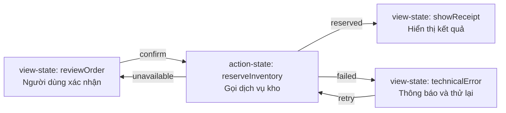

# Vai trò của action-state trong xử lý không cần màn hình

Trong **Spring Web Flow**, một hành trình web thường đi qua nhiều bước: người dùng nhập dữ liệu, xác nhận, hệ thống xử lý nghiệp vụ, rồi hiển thị kết quả. Không phải bước nào cũng cần trang HTML hay biểu mẫu. **`action-state`** biểu diễn một bước mà luồng cần **thực thi logic ở phía máy chủ và chuyển tiếp dựa trên kết quả**, thay vì dừng lại chờ người dùng thao tác trên màn hình.

Đây là một phần quan trọng của cách Spring Web Flow mô hình hóa hành trình nhiều bước bằng **state, event, transition và subflow**: giao diện có trách nhiệm tương tác, còn các bước xử lý tự động được đặt tại những trạng thái riêng, có đường đi rõ ràng và có thể kiểm thử.

## 1. Action-state giải quyết vấn đề gì?

Giả sử luồng đặt hàng gồm các bước:

1. Người dùng kiểm tra giỏ hàng và nhấn **Xác nhận**.
2. Hệ thống kiểm tra và giữ hàng trong kho.
3. Nếu giữ hàng thành công, hệ thống hiển thị thông tin xác nhận; nếu hết hàng, quay lại màn hình giỏ hàng.
4. Nếu dịch vụ kho tạm thời không khả dụng, hiển thị màn hình lỗi để người dùng có thể thử lại.

Bước 2 là một thao tác nghiệp vụ, **không phải một màn hình**. Nếu điều hướng được đặt rải rác trong controller, mỗi nhánh thành công, thất bại, thử lại sẽ phải tự quyết định trang tiếp theo. Trong Spring Web Flow, ta đặt thao tác giữ hàng vào `action-state`; kết quả của thao tác được biểu diễn bằng **event**, còn các hướng đi được mô tả bằng **transition** trong định nghĩa flow.



Điểm cần ghi nhớ: **action-state không sinh màn hình và cũng không tự tạo một tác vụ chạy nền**. Nó được thực thi khi flow đi vào trạng thái đó, thường ngay trong chu kỳ xử lý yêu cầu HTTP đang tiếp diễn. Flow tiếp tục đi qua các transition cho đến khi gặp một trạng thái cần hiển thị/chờ tương tác hoặc kết thúc.

## 2. Phân biệt action-state với các loại state khác

| Thành phần | Công việc chính | Có chờ thao tác trên màn hình? | Ví dụ |
| --- | --- | --- | --- |
| `view-state` | Hiển thị view; tiếp nhận event, binding và validation của tương tác người dùng | Có | Nhập địa chỉ, xác nhận đơn |
| `action-state` | Gọi logic nghiệp vụ rồi phát sinh event cho transition tiếp theo | Không | Giữ hàng, tính phí, ghi nhận đơn |
| `decision-state` | Đánh giá một điều kiện để chọn nhánh | Không | Phân nhánh theo hạn mức hoặc quyền |
| `subflow-state` | Gọi một flow con và nhận outcome khi flow con kết thúc | Tùy các state bên trong flow con | Chạy quy trình xác thực bổ sung |
| `end-state` | Kết thúc flow hoặc trả outcome cho flow cha | Không tiếp tục trong flow hiện tại | Hoàn tất, hủy |

**Khi nào chọn `action-state`?** Khi có một thao tác cần thực thi: gọi service, kiểm tra quy tắc nghiệp vụ phức tạp, lưu dữ liệu, gọi API hoặc ghi nhận kết quả. Nếu chỉ cần kiểm tra một biểu thức điều kiện để chọn nhánh mà không có công việc nghiệp vụ tương ứng, `decision-state` thường diễn đạt ý đồ rõ hơn.

## 3. Vòng đời của một action-state

Một lần đi qua `action-state` thường diễn ra như sau:

1. Transition từ state trước dẫn flow vào `action-state`.
2. Spring Web Flow thực thi action đã khai báo, ví dụ một lời gọi tới Spring bean.
3. Action trả về kết quả được Spring Web Flow diễn giải thành một **event**; với action tự trả `Event`, tên event là `Event.getId()`.
4. Flow tìm `transition` tương ứng với event đó và đi đến state đích.
5. Nếu state đích cũng là trạng thái tự động, quá trình có thể tiếp tục trong cùng lượt xử lý; nếu là `view-state`, flow hiển thị view và chờ tương tác.

Ví dụ khung:

```xml
<action-state id="reserveInventory">
    <evaluate expression="inventoryAction.reserve(flowScope.order)" />
    <transition on="reserved" to="showReceipt" />
    <transition on="unavailable" to="reviewOrder" />
    <transition on="failed" to="technicalError" />
</action-state>
```

Ở đây:

- `id="reserveInventory"` xác định trạng thái xử lý.
- `evaluate` gọi phương thức `reserve(...)` trên Spring bean `inventoryAction`.
- `flowScope.order` cung cấp dữ liệu đơn hàng đang được flow quản lý.
- Các `transition on="..."` mô tả các kết quả nghiệp vụ có thể xảy ra và state đích tương ứng.

**Không nên bỏ ngỏ các kết quả thực tế có thể phát sinh.** Một event không có transition phù hợp có thể khiến flow không chuyển tiếp được; ngoại lệ Java cũng không tự động trở thành event `failed` hay `error`. Phần xử lý ngoại lệ phải được thiết kế rõ ràng.

## 4. Ví dụ hoàn chỉnh: giữ hàng sau bước xác nhận

### 4.1. Định nghĩa flow bằng XML

Giả sử ứng dụng có model `com.example.checkout.Order`, Spring bean `inventoryAction` và các view tương ứng. Đây là một flow rút gọn, tập trung vào nhiệm vụ của `action-state`:

```xml
<?xml version="1.0" encoding="UTF-8"?>
<flow xmlns="http://www.springframework.org/schema/webflow"
      xmlns:xsi="http://www.w3.org/2001/XMLSchema-instance"
      xsi:schemaLocation="
          http://www.springframework.org/schema/webflow
          http://www.springframework.org/schema/webflow/spring-webflow.xsd">

    <!-- Tạo order trong phạm vi flow -->
    <var name="order" class="com.example.checkout.Order" />

    <!-- Trạng thái có giao diện để người dùng xem và xác nhận đơn -->
    <view-state id="reviewOrder" view="checkout/review" model="order">
        <transition on="confirm" to="reserveInventory" />
        <transition on="cancel" to="cancelled" />
    </view-state>

    <!-- Không hiển thị view: gọi nghiệp vụ và chuyển theo event -->
    <action-state id="reserveInventory">
        <evaluate expression="inventoryAction.reserve(flowScope.order)" />
        <transition on="reserved" to="showReceipt" />
        <transition on="unavailable" to="reviewOrder" />
        <transition on="failed" to="technicalError" />
    </action-state>

    <view-state id="showReceipt" view="checkout/receipt">
        <transition on="finish" to="completed" />
    </view-state>

    <view-state id="technicalError" view="checkout/error">
        <transition on="retry" to="reserveInventory" />
        <transition on="cancel" to="cancelled" />
    </view-state>

    <end-state id="completed" />
    <end-state id="cancelled" />
</flow>
```

Trong ví dụ này, `reviewOrder` là nơi người dùng thao tác và nơi hệ thống nhận event `confirm`. Khi event hợp lệ dẫn tới `reserveInventory`, Spring Web Flow tự thực hiện thao tác giữ hàng; không có yêu cầu người dùng gửi thêm một lần nhấp chuột để bắt đầu action.

Lưu ý: `<var>` khởi tạo một biến trong flow; lớp `Order` và các view phải tồn tại trong ứng dụng thật. Việc binding/validation dữ liệu biểu mẫu phải được cấu hình phù hợp với model và yêu cầu nghiệp vụ của ứng dụng trước khi cho phép event `confirm` đi vào bước ghi dữ liệu.

### 4.2. Action trả về event nghiệp vụ

Một cách rõ ràng để điều khiển các nhánh là để phương thức được `evaluate` gọi trả về `org.springframework.webflow.execution.Event`. Ví dụ minh họa:

```java
package com.example.checkout;

import org.springframework.stereotype.Component;
import org.springframework.webflow.execution.Event;

@Component("inventoryAction")
public class InventoryAction {

    private final InventoryService inventoryService;

    public InventoryAction(InventoryService inventoryService) {
        this.inventoryService = inventoryService;
    }

    public Event reserve(Order order) {
        try {
            // requestKey đại diện cho một lần đặt hàng,
            // giúp service nhận ra các lần gửi lại cùng yêu cầu.
            Reservation reservation = inventoryService.reserve(
                order.getItems(), order.getRequestKey());

            order.setReservationCode(reservation.getCode());
            order.setErrorMessage(null);
            return new Event(this, "reserved");

        } catch (OutOfStockException ex) {
            order.setErrorMessage("Một số mặt hàng đã hết hàng.");
            return new Event(this, "unavailable");

        } catch (InventoryTemporarilyUnavailableException ex) {
            return new Event(this, "failed");
        }
    }
}
```

Các kiểu `Order`, `Reservation`, `InventoryService` và các ngoại lệ là thành phần nghiệp vụ minh họa, cần được triển khai theo ứng dụng. Phần quan trọng nằm ở **hợp đồng event** giữa action và flow:

| Kết quả từ service | Event do action trả về | Transition | Hành vi người dùng thấy |
| --- | --- | --- | --- |
| Giữ hàng thành công | `reserved` | `showReceipt` | Trang xác nhận đơn |
| Hết hàng | `unavailable` | `reviewOrder` | Quay lại đơn và hiển thị thông báo |
| Dịch vụ kho tạm lỗi | `failed` | `technicalError` | Trang thông báo lỗi, có thể thử lại |

Như vậy, Java action quyết định **điều gì đã xảy ra**; XML flow quyết định **sau kết quả đó sẽ đi đâu**. Có thể đổi màn hình hoặc bổ sung nhánh xử lý trong flow mà không phải trộn đường dẫn view vào mã service.

### 4.3. Đường đi trong một yêu cầu

Khi người dùng gửi event `confirm` từ màn hình `reviewOrder`, flow tiếp tục như sau:

```text
HTTP request: confirm
  -> view-state reviewOrder tiếp nhận event và xử lý binding/validation
  -> transition: reviewOrder -> reserveInventory
  -> evaluate: inventoryAction.reserve(flowScope.order)
  -> Event("reserved") / Event("unavailable") / Event("failed")
  -> transition khớp event
  -> đi đến view-state tương ứng để render kết quả
```

Do `reserveInventory` không chờ người dùng, nó thường chỉ là một trạng thái trung gian trong lượt xử lý này. Hành trình có thể tiếp tục qua nhiều action-state liên tiếp; thiết kế nên tránh vòng lặp tự động không có điều kiện dừng.

## 5. Action, dữ liệu trả về và event khác nhau thế nào?

Không phải mọi action đều cần tự xây dựng `Event`. Với thao tác tính toán trả về dữ liệu, có thể lưu kết quả vào scope và sử dụng event thành công mặc định của bước đánh giá:

```xml
<action-state id="calculateShipping">
    <evaluate expression="shippingService.quote(flowScope.order)"
              result="flowScope.shippingQuote" />
    <transition on="success" to="reviewShipping" />
</action-state>
```

Trường hợp này có **hai kết quả cần phân biệt**:

- **Dữ liệu nghiệp vụ**: đối tượng báo giá được đặt vào `flowScope.shippingQuote` nhờ thuộc tính `result`.
- **Event điều hướng**: event `success` cho biết bước đánh giá đã thực thi thành công và được transition sử dụng.

Nếu mục tiêu chủ yếu là phân nhánh dựa trên thuộc tính của một đối tượng kết quả, một mẫu dễ đọc là `action-state` thực hiện phép tính, sau đó `decision-state` đánh giá điều kiện:

```xml
<action-state id="checkOrderLimit">
    <evaluate expression="limitService.check(flowScope.order)"
              result="flowScope.limitCheck" />
    <transition on="success" to="routeByLimit" />
</action-state>

<decision-state id="routeByLimit">
    <if test="flowScope.limitCheck.allowed"
        then="nextStep"
        else="limitRejected" />
</decision-state>
```

Trong thực tế, cần quyết định trước phương thức action trả về **`Event` để định tuyến trực tiếp** hay trả về **dữ liệu để lưu vào scope rồi đánh giá tiếp**. Không nên ngầm coi một giá trị `false`, một đối tượng rỗng hoặc một ngoại lệ bất kỳ là event `error`; contract điều hướng phải được xác định và kiểm thử theo kiểu action đang sử dụng.

## 6. Phối hợp với form binding và validation

Trong flow nhiều bước, `view-state` chịu trách nhiệm thu thập thông tin người dùng; `action-state` thường xử lý những dữ liệu đã vượt qua kiểm tra đầu vào. Trình tự khuyến nghị là:

1. Tại `view-state`, bind dữ liệu form vào model và kiểm tra các ràng buộc nhập liệu.
2. Chỉ cho event hợp lệ đi tới `action-state`.
3. Tại `action-state`, kiểm tra tiếp các quy tắc nghiệp vụ phụ thuộc hệ thống bên ngoài (tồn kho, hạn mức, trạng thái thanh toán...).
4. Trả event thành công hoặc sự cố có thể xử lý; với lỗi cần người dùng sửa dữ liệu, chuyển về một `view-state` có thông báo phù hợp.

**Validation form và kiểm tra nghiệp vụ không thay thế nhau.** Ví dụ số lượng đặt mua là số nguyên dương có thể kiểm tra khi bind form; còn lượng hàng thực tế có sẵn phải được dịch vụ kho kiểm tra khi giữ hàng. Khi quay lại `reviewOrder`, form vẫn phải có dữ liệu cần thiết để người dùng điều chỉnh.

Không nên đặt toàn bộ validation hiển thị lỗi vào `action-state` nếu framework đã có cơ chế binding và validation trong `view-state`; điều đó khiến thông báo lỗi, chuyển trạng thái và logic kiểm tra trở nên khó theo dõi.

## 7. Quản lý dữ liệu theo scope

Action-state thường đọc và ghi dữ liệu mà những state tiếp theo sẽ sử dụng. Chọn scope dựa trên thời gian dữ liệu cần tồn tại:

| Scope | Phạm vi sử dụng | Cách dùng trong hành trình |
| --- | --- | --- |
| `requestScope` | Chỉ trong lượt request đang xử lý | Dữ liệu tạm phục vụ một lượt tính toán |
| `flashScope` | Dữ liệu ngắn hạn phục vụ lượt hiển thị kế tiếp của flow | Thông báo thành công hoặc lỗi cần đưa ra view |
| `viewScope` | Dữ liệu gắn với một `view-state` đang hoạt động | Trạng thái riêng của màn hình nhập liệu |
| `flowScope` | Suốt lần thực thi flow hiện tại | Đơn hàng, mã giữ hàng, lựa chọn đã hoàn tất |
| `conversationScope` | Trong conversation, có thể chia sẻ với những subflow liên quan | Dữ liệu xuyên các flow con thuộc cùng hành trình |

Ví dụ `flowScope.order` trong `evaluate` là tham chiếu tới đơn hàng hiện tại. Phương thức Java có thể cập nhật đối tượng đó, giúp state đích đọc được thông tin đã xử lý. Nếu cần lưu một đối tượng mới trả về từ service, có thể dùng `result="flowScope.someValue"` như ví dụ tính phí vận chuyển.

**Chọn scope nhỏ nhất đủ dùng.** Không lưu dữ liệu yêu cầu tồn tại lâu dài chỉ trong request scope; cũng không đưa các đối tượng lớn, thông tin nhạy cảm hoặc tài nguyên không thể tuần tự hóa vào conversation một cách tùy tiện. Cơ chế lưu và khôi phục flow execution phụ thuộc cấu hình repository của Spring Web Flow, nên model giữ trong scope phải phù hợp với chiến lược lưu trữ đó.

## 8. Xử lý lỗi, thử lại và tính nhất quán

Vì `action-state` thường thực hiện thao tác có tác dụng phụ, mọi nhánh lỗi cần được xem xét từ góc độ nghiệp vụ:

**Lỗi dự kiến.** Ví dụ hết hàng, hạn mức không đủ hoặc mã giảm giá hết hạn. Action có thể chuyển chúng thành các event nghiệp vụ như `unavailable`, `rejected`, để flow quay về màn hình tương ứng.

**Lỗi kỹ thuật có khả năng phục hồi.** Ví dụ dịch vụ kho tạm ngắt kết nối. Action có thể trả event `failed` cho một lỗi đã được phân loại, sau đó flow đưa tới màn hình cho phép thử lại hoặc hủy.

**Ngoại lệ chưa xử lý.** Ngoại lệ phát sinh từ action không mặc nhiên biến thành event `error`. Chúng sẽ được cơ chế xử lý ngoại lệ của flow/ứng dụng tiếp nhận hoặc khiến việc thực thi thất bại. Nên có chính sách xử lý rõ ràng thay vì bắt toàn bộ `Exception` rồi luôn trả `success`.

**Thử lại sau lỗi.** Nếu người dùng có thể kích hoạt event `retry`, một thao tác đã thành công một phần có thể được gọi lần nữa. Cần thiết kế **idempotency** ở tầng service, chẳng hạn truyền một `requestKey` ổn định cho mỗi đơn và bảo đảm lần thử lại cùng khóa không tạo hai lần giữ hàng hay thanh toán.

**Transaction.** Một `action-state` không tự tạo transaction nghiệp vụ. Với thao tác cần tính nguyên tử, đặt ranh giới transaction ở service, thường qua cơ chế `@Transactional` của Spring, và xác định rõ ranh giới khi gọi hệ thống bên ngoài. Không giữ transaction cơ sở dữ liệu mở trong lúc chờ người dùng ở `view-state`.

**Tác vụ lâu.** Action-state thường chạy đồng bộ trong xử lý flow. Với công việc mất nhiều thời gian, có thể gửi công việc tới hàng đợi/job riêng, lưu mã theo dõi rồi điều hướng tới màn hình chờ hoặc trạng thái kiểm tra tiến độ. Không nên mặc định action-state tự cung cấp thực thi bất đồng bộ.

## 9. Kết hợp với subflow và Spring MVC

Action-state là một phần của flow, không phải một controller độc lập. Trong ứng dụng tích hợp Spring MVC, các thành phần như `FlowHandlerMapping`, `FlowHandlerAdapter` và `FlowExecutor` giúp đưa request tới flow phù hợp. Khi một event kích hoạt transition vào `action-state`, **Spring Web Flow** thực thi action và tiếp tục điều hướng theo cấu hình flow.

Một quy trình lớn có thể đưa phần phê duyệt hoặc xác thực bổ sung vào `subflow-state`. Flow con vẫn có thể chứa nhiều `view-state` và `action-state` của riêng nó, sau đó trả outcome về flow cha. Quy tắc chung vẫn giữ nguyên: **state mô tả bước của hành trình; event mô tả kết quả; transition mô tả hướng đi**.

Ví dụ phân chia trách nhiệm:

| Lớp/thành phần | Trách nhiệm |
| --- | --- |
| Spring MVC và bộ điều hợp Web Flow | Chuyển HTTP request vào flow executor |
| Flow XML | Định nghĩa state, event, transition, nhánh thất bại và hoàn tất |
| `InventoryAction` | Phối hợp lời gọi nghiệp vụ, chuyển kết quả sang event |
| `InventoryService` | Thực thi quy tắc giữ hàng, giao dịch, idempotency và truy cập hệ thống kho |
| View / form | Nhập dữ liệu, hiển thị trạng thái và nhận tương tác |

Tách trách nhiệm như vậy giúp đơn giản hóa controller và giữ logic điều hướng nhiều bước trong một bản mô tả flow có thể quan sát, thay đổi và kiểm thử.

## 10. Kiểm thử action-state và khả năng phục hồi flow

Nên kiểm thử ở **hai mức**: action riêng lẻ và hành trình chuyển trạng thái.

**Kiểm thử action riêng lẻ** bằng một service giả lập, khẳng định event và dữ liệu model được cập nhật đúng. Ví dụ với trường hợp giữ hàng thành công:

```java
// Minh họa ý tưởng unit test với JUnit và service đã được mock.
Order order = givenValidOrderWithStableRequestKey();
given(inventoryService.reserve(order.getItems(), order.getRequestKey()))
    .willReturn(new Reservation("RES-001"));

Event event = inventoryAction.reserve(order);

assertEquals("reserved", event.getId());
assertEquals("RES-001", order.getReservationCode());
```

Đoạn trên là phác thảo kiểm thử: các helper tạo dữ liệu và mock service cần được cài đặt trong dự án kiểm thử thực tế.

**Kiểm thử flow** phải bắt đầu tại `reviewOrder`, gửi event `confirm`, cho action trả về từng kết quả và xác nhận active state tiếp theo. Có thể sử dụng bộ hỗ trợ kiểm thử flow của Spring Web Flow và các mock external context phù hợp với phiên bản thư viện.

| Tình huống | Kết quả cần xác nhận |
| --- | --- |
| Form không hợp lệ | Tiếp tục ở `reviewOrder`, chưa gọi dịch vụ giữ hàng |
| Action trả `reserved` | Chuyển tới `showReceipt`, mã giữ hàng tồn tại trong flow |
| Action trả `unavailable` | Quay về `reviewOrder`, dữ liệu đơn và thông báo lỗi vẫn dùng được |
| Action trả `failed` | Chuyển tới `technicalError` |
| Người dùng chọn `retry` | Gọi lại action với khóa idempotency phù hợp, không tạo giao dịch trùng |
| Action ném ngoại lệ không dự kiến | Cơ chế xử lý lỗi được kích hoạt đúng, không bị coi là thành công |
| Flow có subflow hoặc resume sau request | Những dữ liệu cần lưu đã được đặt đúng scope và còn hợp lệ |

Ngoài kết quả state, nên kiểm tra **số lần gọi service**, dữ liệu ghi và hành vi khi nhận cùng một event nhiều lần. Đây thường là nơi phát hiện lỗi xử lý lặp trong hành trình giao dịch thực tế.

## 11. Những lỗi thiết kế thường gặp

| Lỗi | Hệ quả | Cách cải thiện |
| --- | --- | --- |
| Thực hiện thao tác ghi dữ liệu ngay trong `view-state` mà không xác định rõ thời điểm | Khó phân biệt xử lý form và xử lý nghiệp vụ; có thể gọi service trước khi dữ liệu hợp lệ | Chuyển bước nghiệp vụ tự động sang `action-state` khi hợp lý |
| Đặt logic điều hướng UI trong service | Service phụ thuộc view và nhiều nhánh khó kiểm soát | Trả event; để XML flow ánh xạ event thành transition |
| Không khai báo đường đi cho event thất bại | Luồng không có transition phù hợp | Liệt kê và kiểm thử các kết quả nghiệp vụ quan trọng |
| Nghĩ ngoại lệ Java tự động tạo event `error` | Nhánh `on="error"` có thể không chạy | Chuyển lỗi dự kiến thành event hoặc cấu hình xử lý ngoại lệ rõ ràng |
| Đặt thông tin cần qua nhiều bước trong `requestScope` | Mất dữ liệu khi sang request khác | Chọn `flowScope` hoặc scope phù hợp với vòng đời dữ liệu |
| Cho action tự gọi lại liên tục sau thất bại | Vòng lặp tự động hoặc gọi API quá nhiều | Chuyển về màn hình quyết định, giới hạn retry và kiểm soát idempotency |
| Tạo side effect không thể thử lại an toàn | Đặt hàng, giữ hàng hoặc thanh toán trùng | Dùng khóa nghiệp vụ, giao dịch và cơ chế chống gửi lặp tại service |
| Chạy tác vụ dài đồng bộ trong action | Request chậm, có thể timeout | Tách job nền và dùng flow để theo dõi trạng thái |

## 12. Nguyên tắc áp dụng

Khi thiết kế một hành trình nhiều bước, hãy đặt câu hỏi: **bước hiện tại cần tương tác người dùng, chỉ chọn nhánh, hay thực hiện nghiệp vụ?** Với bước thực hiện nghiệp vụ không cần màn hình, `action-state` là lựa chọn tự nhiên. Thiết kế tốt thường có một action dễ hiểu, các event mang ý nghĩa nghiệp vụ, transition bao phủ các kết quả quan trọng, scope được chọn theo vòng đời dữ liệu và service bảo đảm an toàn khi thử lại.

Nhờ cách tổ chức này, Spring Web Flow thể hiện rõ cả **đường đi bình thường** lẫn **đường phục hồi sau lỗi**; người phát triển có thể đọc định nghĩa flow để hiểu toàn bộ hành trình mà không phải lần theo nhiều controller và các lệnh điều hướng nằm rải rác trong mã nguồn.
