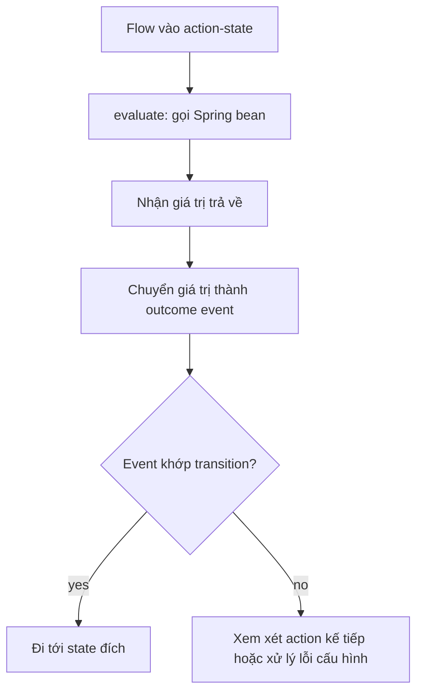
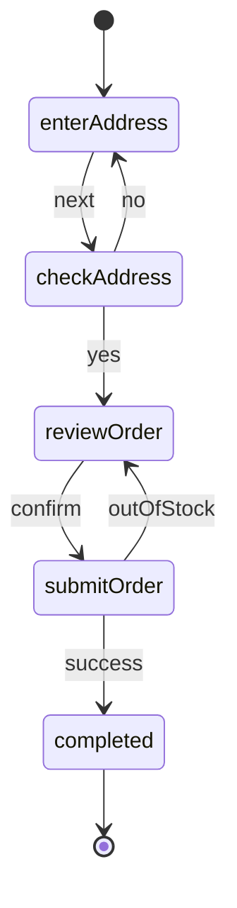
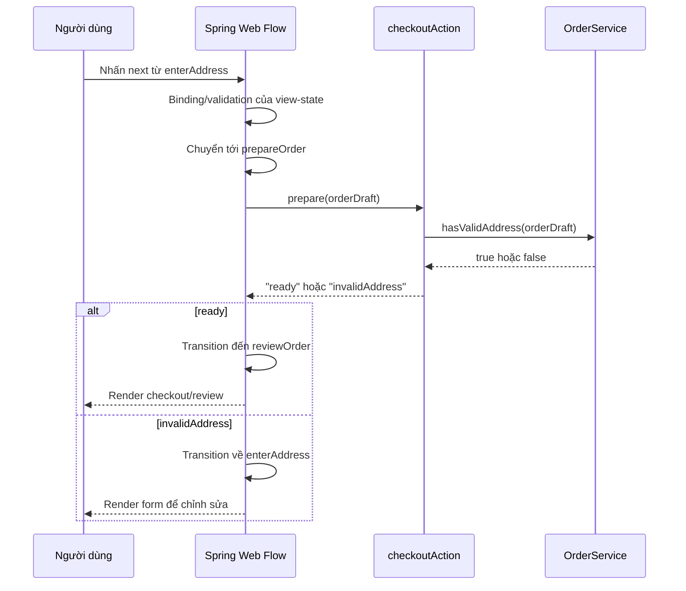

# Gọi Spring bean bằng `<evaluate>` trong `action-state`

## Mục tiêu học tập

Trong **Spring Web Flow**, `view-state` hiển thị giao diện và chờ người dùng tương tác, còn `action-state` thực thi logic tự động rồi quyết định state tiếp theo dựa trên kết quả thực thi. Một cách phổ biến để đưa nghiệp vụ Java vào flow là dùng phần tử **`<evaluate>`** để gọi phương thức trên Spring bean.

Sau bài này, bạn có thể:

- Giải thích mối quan hệ giữa `action-state`, `<evaluate>`, Spring bean và transition.
- Viết biểu thức gọi phương thức Java, truyền tham số từ flow, nhận dữ liệu trả về.
- Phân biệt **`result` lưu dữ liệu** với **outcome event điều hướng**.
- Dự đoán event tương ứng với các kiểu trả về `String`, `boolean`, `enum` và `void`.
- Thiết kế action xử lý lỗi nghiệp vụ rõ ràng, tránh thực thi side effect trùng.
- Kiểm tra một action-state bằng những trường hợp thành công và thất bại.

## 1. Vì sao cần gọi Spring bean trong một flow?

Giả sử ứng dụng có hành trình đặt hàng:

```text
Nhập thông tin giao hàng
       ↓ Người dùng bấm "Tiếp tục"
Kiểm tra khả năng giao hàng
       ├── Hợp lệ → Xem lại đơn
       └── Chưa hợp lệ → Quay lại form
       ↓ Người dùng bấm "Xác nhận"
Tạo đơn hàng
       ├── Thành công → Màn hình hoàn tất
       └── Hết hàng → Màn hình thông báo
```

Các bước **kiểm tra** và **tạo đơn** là logic phía server, thường thuộc service nghiệp vụ có sẵn trong Spring ApplicationContext. Chúng không cần màn hình riêng để chờ người dùng. `action-state` giúp mô tả những bước này ngay trong sơ đồ điều hướng; `<evaluate>` kết nối flow với bean nghiệp vụ.

Ví dụ:

```xml
<action-state id="checkAvailability">
    <evaluate expression="inventoryService.isAvailable(orderDraft)" />
    <transition on="yes" to="reviewOrder" />
    <transition on="no" to="editOrder" />
</action-state>
```

Khi flow **đi vào** `checkAvailability`, framework:

1. Đánh giá biểu thức `inventoryService.isAvailable(orderDraft)`.
2. Gọi phương thức trên bean được quản lý trong Spring context.
3. Chuyển giá trị trả về thành **outcome event**.
4. So khớp event với các transition `on="yes"` và `on="no"`.
5. Chuyển đến state tương ứng.

Nếu method trả `true`, action sinh event `yes`; nếu trả `false`, sinh `no`. Framework không đứng ở `action-state` để chờ thêm một HTTP request như `view-state`.



**Phân biệt:** `evaluate` có thể được đặt ở nhiều điểm trong flow; `action-state` là một nơi sử dụng nó để **tính toán outcome và điều hướng**. Việc có `<evaluate>` không có nghĩa lúc nào cũng phải khai báo `<action-state>`.

## 2. Cú pháp gọi phương thức Spring bean

### 2.1. Ví dụ tối thiểu

```xml
<action-state id="validateBasket">
    <evaluate expression="basketService.validate(basket)" />
    <transition on="success" to="reviewBasket" />
    <transition on="invalid" to="editBasket" />
</action-state>
```

`expression="basketService.validate(basket)"` là một **biểu thức** do cơ chế Expression Language (EL) của Spring Web Flow đánh giá:

| Thành phần | Ý nghĩa |
| --- | --- |
| `basketService` | Tên bean có thể được giải quyết từ Spring ApplicationContext. |
| `validate(...)` | Phương thức được gọi trên bean. |
| `basket` | Biến/đối tượng đã được đưa vào ngữ cảnh flow, chẳng hạn trong `flowScope`. |
| `<evaluate>` | Action đánh giá biểu thức và tạo kết quả. |
| `<transition on="...">` | Quy tắc chọn state tiếp theo từ outcome event. |

**Tên bean khác tên class.** Một class `BasketService` có thể được đăng ký với tên `basketService`, còn tên bean nào dùng được trong biểu thức phụ thuộc cách ứng dụng tạo và đăng ký bean.

Ví dụ trong Java:

```java
import org.springframework.stereotype.Service;

@Service("basketService")
public class BasketService {

    public String validate(Basket basket) {
        if (basket == null || basket.getLines().isEmpty()) {
            return "invalid";
        }

        return "success";
    }
}
```

Trong ví dụ này, `Basket` là model nghiệp vụ do ứng dụng định nghĩa; nó cần các phương thức được gọi trong đoạn mã. Component scanning (hoặc cấu hình bean tương đương) phải thực sự đăng ký `BasketService` trong ApplicationContext có thể truy cập từ Web Flow.

Ở XML, tên `basket` có thể được giải quyết từ một biến flow; nếu chưa có biến này, biểu thức không tự sinh ra object hợp lệ. Chẳng hạn khởi tạo khi bắt đầu flow:

```xml
<on-start>
    <evaluate expression="basketService.newBasket()"
              result="flowScope.basket" />
</on-start>
```

Ví dụ trên chỉ hợp lệ khi bean thực sự có method `newBasket()` trả về `Basket`.

### 2.2. Có thể truyền nhiều tham số

Một bean không bị giới hạn ở method không tham số:

```xml
<evaluate expression="shippingService.quote(
        orderDraft,
        destinationCode,
        currentUser.name)" />
```

Những tên `orderDraft`, `destinationCode` phải có giá trị trong ngữ cảnh flow (ví dụ input/flow scope). `currentUser` là biến ngữ cảnh đặc biệt chỉ dùng được nếu môi trường bảo mật và flow context hỗ trợ nó.

Cách làm thường tốt hơn khi nghiệp vụ bắt đầu phức tạp là gom đầu vào liên quan vào một model rõ ràng, thay vì đưa quá nhiều tham số không đồng nhất vào XML.

### 2.3. Gọi Spring bean hay gọi object trong flow?

`<evaluate>` không chỉ gọi bean:

```xml
<evaluate expression="orderDraft.recalculateTotal()" />
```

`orderDraft` ở đây là object trong flow, có thể được giữ trong `flowScope`. Phân biệt:

- `shippingService` là **Spring bean**: dùng chung theo scope/lifecycle của Spring, có thể chứa service khác được inject.
- `orderDraft` là **flow data**: dữ liệu thuộc một lần thực thi flow cụ thể.

Với Spring bean singleton, không đặt dữ liệu riêng của từng người dùng vào field mutable của singleton:

```java
// Ví dụ thiết kế sai cho một Spring singleton:
@Service("shippingService")
public class ShippingService {
    private OrderDraft currentDraft; // Có nguy cơ dùng chung giữa người dùng
}
```

Hãy truyền `OrderDraft` qua tham số hoặc dùng flow scope phù hợp. Bean thực thi logic; flow giữ dữ liệu của từng cuộc hội thoại.

## 3. `<evaluate>` được gọi khi nào?

Một `action-state` chạy các action ngay khi được kích hoạt. Nếu action trả event khớp transition, framework thực hiện điều hướng tự động; người dùng không phải gửi thêm event để kích hoạt method.



Trong sơ đồ:

- `enterAddress` và `reviewOrder` là các `view-state`, chờ event từ giao diện.
- `checkAddress` và `submitOrder` là các `action-state`, chủ động gọi method trên Spring bean.
- Event `next` hoặc `confirm` từ người dùng **đưa flow đến action-state**.
- Event `yes`, `no`, `success` hoặc `outOfStock` được sinh ra từ **kết quả action**, rồi chọn state kế tiếp.

Điều này giúp giữ logic giao diện ở view, logic nghiệp vụ ở service và logic chuyển state trong flow XML.

## 4. Giá trị trả về được chuyển thành event như thế nào?

Sau khi `<evaluate>` gọi phương thức, `action-state` cần biết phải chọn transition nào. Spring Web Flow chuyển kết quả đánh giá thành `Event` theo quy tắc thông dụng sau:

| Kiểu giá trị Java trả về | Event ID dùng để chọn transition | Ví dụ |
| --- | --- | --- |
| `String` | Chính nội dung chuỗi | `"approved"` → `on="approved"` |
| `Boolean`/`boolean` | `yes` nếu `true`, `no` nếu `false` | `false` → `on="no"` |
| `Enum` | Tên enum | `APPROVED` → `on="APPROVED"` |
| Các kiểu còn lại, gồm kết quả `void` theo cách ánh xạ thông thường | `success` | `void save(...)` → `on="success"` |

Đây là quy ước từ **Action Outcome Event Mappings** trong tài liệu Spring Web Flow. Nó giúp viết các action là POJO thông thường và chọn transition trực tiếp từ giá trị trả về.

### 4.1. `String`: trả outcome có ý nghĩa nghiệp vụ

```java
public String approve(OrderDraft order) {
    if (order.isMissingInformation()) {
        return "incomplete";
    }
    return "approved";
}
```

```xml
<action-state id="approveOrder">
    <evaluate expression="orderService.approve(orderDraft)" />
    <transition on="approved" to="reviewOrder" />
    <transition on="incomplete" to="editOrder" />
</action-state>
```

**Chú ý chính tả và chữ hoa/chữ thường**: `approved`, `approve`, `APPROVED` không phải cùng một event ID.

### 4.2. `boolean`: transition dùng `yes`/`no`

```java
public boolean isAvailable(OrderDraft order) {
    return inventoryGateway.hasSufficientStock(order);
}
```

```xml
<action-state id="checkStock">
    <evaluate expression="inventoryService.isAvailable(orderDraft)" />
    <transition on="yes" to="reviewOrder" />
    <transition on="no" to="stockWarning" />
</action-state>
```

Lỗi phổ biến là viết `on="true"` và `on="false"` trong khi action trả `boolean`. Với quy tắc mặc định, kết quả `boolean` được chuyển thành `yes`/`no`.

### 4.3. `enum`: nhất quán với tên enum

```java
public enum StockStatus {
    AVAILABLE,
    OUT_OF_STOCK
}

public StockStatus check(OrderDraft order) {
    return hasStock(order)
            ? StockStatus.AVAILABLE
            : StockStatus.OUT_OF_STOCK;
}
```

```xml
<action-state id="checkStock">
    <evaluate expression="inventoryService.check(orderDraft)" />
    <transition on="AVAILABLE" to="reviewOrder" />
    <transition on="OUT_OF_STOCK" to="stockWarning" />
</action-state>
```

Trong dự án lớn, enum giúp giảm việc nhập sai kết quả nghiệp vụ ở Java. Tuy vậy, khi đổi tên enum constant phải đồng bộ các `transition on="..."` tương ứng trong XML.

### 4.4. `void`: thường dùng cho action có một đường thành công

```java
public void recordAudit(OrderDraft order) {
    auditRepository.save(AuditRecord.from(order));
}
```

```xml
<action-state id="recordAudit">
    <evaluate expression="auditService.recordAudit(orderDraft)" />
    <transition on="success" to="nextStep" />
</action-state>
```

Lời gọi thực hiện bình thường sẽ được xử lý như kết quả `success`. **Nếu bean ném exception, không mặc nhiên có event `error`**. Việc tạo nhánh `error` cần một action trả kết quả lỗi có chủ đích hoặc cơ chế xử lý exception phù hợp.

## 5. `result` khác với outcome event

Đây là điểm dễ nhầm nhất khi đọc `<evaluate>`.

### 5.1. `result="flowScope..."` để giữ dữ liệu

Ví dụ service trả danh sách phí giao hàng:

```xml
<on-start>
    <evaluate expression="shippingService.listShippingMethods()"
              result="flowScope.shippingMethods" />
</on-start>
```

Giá trị trả về của `listShippingMethods()` được gán vào `flowScope.shippingMethods` để các state sau có thể dùng. `result` là **biểu thức đích nhận dữ liệu**, không phải tên transition.

Tương tự, trong một action-state:

```xml
<action-state id="calculateQuote">
    <evaluate expression="shippingService.quote(orderDraft)"
              result="flowScope.shippingQuote" />
    <transition on="success" to="reviewQuote" />
</action-state>
```

Giả sử `quote(...)` trả một đối tượng `ShippingQuote` thông thường:

1. `ShippingQuote` được ghi vào `flowScope.shippingQuote`.
2. Kiểu trả về không phải `String`, `boolean` hoặc `enum`, nên outcome thông thường là `success`.
3. Framework chọn transition `on="success"` đến `reviewQuote`.

`flowScope.shippingQuote` **không phải tên event**. Nếu phương thức trả về `"approved"` (String) và bạn cũng gán vào `result`, event vẫn dựa trên kết quả đánh giá theo cơ chế mapping của action, chứ không lấy tên trường scope làm event.

### 5.2. Khi nào dùng `result-type`?

Spring Web Flow hỗ trợ `result-type` nếu cần chuyển kiểu dữ liệu trước khi ghi kết quả:

```xml
<on-render>
    <evaluate expression="searchService.findOrders(searchCriteria)"
              result="viewScope.orders"
              result-type="dataModel" />
</on-render>
```

`result-type="dataModel"` là ví dụ trong hệ sinh thái Web Flow/JSF khi có converter phù hợp. Nó phục vụ **chuyển kiểu dữ liệu**; không thay thế quy tắc ánh xạ method return value → event ID. Trong ứng dụng Spring MVC thuần dùng JSP/Thymeleaf, không cần mặc định thêm `result-type="dataModel"` vào mọi action.

### 5.3. `result` không tự động biến dữ liệu thành persistent entity

```xml
<evaluate expression="orderService.createDraft()" result="flowScope.orderDraft" />
```

Đặt object vào `flowScope` giúp tiếp tục qua nhiều state trong một flow execution. Nó **không tự ghi xuống database** và không bảo đảm dữ liệu sẽ tồn tại sau khi flow kết thúc hoặc session hết hạn. Khi muốn lưu đơn hàng chính thức, service phải làm việc đó tại bước phù hợp.

## 6. Ví dụ hoàn chỉnh: gọi bean để kiểm tra rồi lưu đơn

### 6.1. Spring bean giữ nghiệp vụ

Giả sử dự án có `OrderDraft`, `OrderService` và hai loại lỗi nghiệp vụ. Một action bean được đăng ký dưới tên `checkoutAction`:

```java
import org.springframework.stereotype.Component;

@Component("checkoutAction")
public class CheckoutAction {
    private final OrderService orderService;

    public CheckoutAction(OrderService orderService) {
        this.orderService = orderService;
    }

    public String prepare(OrderDraft draft) {
        if (!orderService.hasValidAddress(draft)) {
            return "invalidAddress";
        }
        return "ready";
    }

    public String place(OrderDraft draft) {
        try {
            orderService.place(draft);
            return "success";
        } catch (OutOfStockException ex) {
            return "outOfStock";
        }
    }
}
```

Đây là code minh họa; `OrderService`, `OrderDraft`, `OutOfStockException` là các class do ứng dụng cung cấp. `orderService.place(...)` cần tự bảo vệ transaction, kiểm tra quyền và idempotency theo nghiệp vụ.

### 6.2. XML flow nối các kết quả thành transition

```xml
<?xml version="1.0" encoding="UTF-8"?>
<flow xmlns="http://www.springframework.org/schema/webflow"
      xmlns:xsi="http://www.w3.org/2001/XMLSchema-instance"
      xsi:schemaLocation="http://www.springframework.org/schema/webflow
                          https://www.springframework.org/schema/webflow/spring-webflow.xsd">

    <on-start>
        <evaluate expression="orderService.newDraft()"
                  result="flowScope.orderDraft" />
    </on-start>

    <view-state id="enterAddress"
                view="checkout/address"
                model="orderDraft">
        <transition on="next" to="prepareOrder" />
        <transition on="cancel" to="cancelled" bind="false" />
    </view-state>

    <action-state id="prepareOrder">
        <evaluate expression="checkoutAction.prepare(orderDraft)" />
        <transition on="ready" to="reviewOrder" />
        <transition on="invalidAddress" to="enterAddress" />
    </action-state>

    <view-state id="reviewOrder" view="checkout/review">
        <transition on="edit" to="enterAddress" />
        <transition on="confirm" to="placeOrder" />
    </view-state>

    <action-state id="placeOrder">
        <evaluate expression="checkoutAction.place(orderDraft)" />
        <transition on="success" to="completed" />
        <transition on="outOfStock" to="stockWarning" />
    </action-state>

    <view-state id="stockWarning" view="checkout/stock-warning">
        <transition on="edit" to="enterAddress" />
        <transition on="retry" to="placeOrder" />
    </view-state>

    <end-state id="completed" />
    <end-state id="cancelled" />
</flow>
```

Flow trên giả định:

- `orderService` và `checkoutAction` đã được Spring quản lý và Web Flow có thể truy cập.
- `orderService.newDraft()` trả model `OrderDraft`; cấu hình form binding/validation và MVC view resolver đã phù hợp.
- `checkoutAction.prepare(...)` trả `ready` hoặc `invalidAddress`; `place(...)` trả `success` hoặc `outOfStock`.
- Màn hình `stockWarning` hiển thị lỗi một cách thân thiện và cho người dùng chỉnh sửa hoặc gửi lại, nhưng service vẫn phải chống tạo đơn trùng.

### 6.3. Phân tích khi người dùng nhấn Next



Với hành vi này, form không cần gọi bean trực tiếp trong controller rồi tự quyết định redirect. Flow định nghĩa **thứ tự các bước** và service định nghĩa **quy tắc nghiệp vụ**.

### 6.4. Lỗi nghiệp vụ và lỗi kỹ thuật có đường xử lý khác nhau

`OutOfStockException` trong ví dụ được `checkoutAction.place` **bắt có chủ đích** để biến thành event `outOfStock`. Nếu xảy ra `SQLException` hoặc một exception không được bắt, Web Flow **không tự chuyển exception đó thành String `"error"`**.

Với lỗi kỹ thuật, cần dùng chính sách exception phù hợp (ví dụ handler của flow hoặc tầng ứng dụng) và trả thông báo an toàn. Không nên bắt mọi `Exception` rồi trả `"success"`; như vậy có thể hiển thị thành công dù đơn hàng chưa được lưu.

## 7. Dùng `<evaluate>` tại những vị trí khác

Không phải cứ gọi bean là phải tạo một `action-state`. Spring Web Flow cho phép action ở nhiều điểm của flow:

| Vị trí | Mục đích điển hình | Ví dụ |
| --- | --- | --- |
| `<on-start>` | Chuẩn bị dữ liệu khi bắt đầu flow | Tạo bản nháp |
| `<on-entry>` | Chạy khi vào state | Nạp dữ liệu cần cho bước đó |
| `<on-render>` | Chuẩn bị dữ liệu mỗi lần view được render | Nạp danh sách lựa chọn hiện tại |
| Trong `<transition>` | Chạy khi một event kích hoạt transition | Ghi nhận lựa chọn hoặc kiểm tra thêm |
| `<on-exit>` | Xử lý khi rời state | Dọn một số trạng thái tạm |
| `<on-end>` | Xử lý khi flow kết thúc | Ghi audit/kết thúc tài nguyên |
| Trong `<action-state>` | Gọi logic tự động và chọn nhánh bằng outcome | Kiểm tra tồn kho, xác nhận thanh toán |

Ví dụ nạp danh sách lựa chọn khi render:

```xml
<view-state id="chooseShipping" view="checkout/shipping">
    <on-render>
        <evaluate expression="shippingService.listMethods(orderDraft)"
                  result="viewScope.methods" />
    </on-render>
    <transition on="next" to="reviewOrder" />
</view-state>
```

`on-render` có thể được gọi lại sau khi view render lần tiếp theo. Vì vậy, đặt logic **chỉ đọc / có thể lặp** ở đây; tránh tạo đơn, trừ tiền hoặc gọi API có side effect không thể đảo ngược.

Ví dụ xử lý event:

```xml
<view-state id="chooseShipping" view="checkout/shipping">
    <transition on="select" to="reviewOrder">
        <evaluate expression="shippingService.applySelection(orderDraft)" />
    </transition>
</view-state>
```

Ở đây `select` là event do view gửi lên; action chạy **trong transition**. Trong `action-state`, chính **giá trị trả về của action** quyết định transition. Hai hình thức có mục đích khác nhau.

## 8. Nhiều `<evaluate>` trong cùng `action-state`

Spring Web Flow cho phép nhiều action trong một `action-state`. Theo cơ chế **Chain of Responsibility**, chúng được xét theo thứ tự khai báo: nếu một action trả event khớp transition của state, framework chuyển state và **bỏ qua những action còn lại**.

```xml
<action-state id="checkAndPrepare">
    <evaluate expression="validationService.validate(orderDraft)" />
    <evaluate expression="pricingService.recalculate(orderDraft)" />

    <transition on="invalid" to="enterAddress" />
    <transition on="success" to="reviewOrder" />
</action-state>
```

Đoạn XML trên dễ bị hiểu sai. Nếu `validate(...)` trả `"success"`, transition `on="success"` đã khớp và `recalculate(...)` **không được chạy**. Vì vậy, không nên mặc định hai phương thức sẽ chạy lần lượt như hai câu lệnh Java thông thường.

Có hai cách diễn đạt ý định rõ hơn:

### 8.1. Tách thành nhiều `action-state`

```xml
<action-state id="validateOrder">
    <evaluate expression="validationService.validate(orderDraft)" />
    <transition on="success" to="calculatePrice" />
    <transition on="invalid" to="enterAddress" />
</action-state>

<action-state id="calculatePrice">
    <evaluate expression="pricingService.recalculate(orderDraft)" />
    <transition on="success" to="reviewOrder" />
</action-state>
```

Ở đây `calculatePrice` chỉ chạy sau khi `validateOrder` thành công, có thể đọc luồng xử lý từ XML.

### 8.2. Gom hành động nghiệp vụ vào một bean orchestration

```java
public String prepareCheckout(OrderDraft draft) {
    if (!validationService.isValid(draft)) {
        return "invalid";
    }
    pricingService.recalculate(draft);
    return "ready";
}
```

```xml
<action-state id="prepareCheckout">
    <evaluate expression="checkoutAction.prepareCheckout(orderDraft)" />
    <transition on="ready" to="reviewOrder" />
    <transition on="invalid" to="enterAddress" />
</action-state>
```

Ưu điểm là logic cần chạy nối tiếp được kiểm soát trong Java, còn XML mô tả các outcome có ý nghĩa đối với luồng.

### 8.3. Named action khi cần phân biệt nguồn event

Spring Web Flow cho phép đặt tên action; tên này bổ nghĩa cho kết quả:

```xml
<action-state id="runChecks">
    <evaluate expression="validationService.validate(orderDraft)">
        <attribute name="name" value="validation" />
    </evaluate>
    <evaluate expression="auditService.record(orderDraft)">
        <attribute name="name" value="audit" />
    </evaluate>
    <transition on="validation.invalid" to="enterAddress" />
    <transition on="audit.success" to="reviewOrder" />
</action-state>
```

Ví dụ minh họa cú pháp event được gắn tiền tố action. Nó vẫn tuân theo quy tắc dừng ở action đầu tiên tạo event khớp. Nếu muốn cả hai luôn được thực thi, nên thiết kế luồng và điều kiện khớp transition thật rõ, hoặc dùng phương thức orchestration thay vì dựa vào thứ tự một cách ngầm định.

## 9. Phạm vi dữ liệu và cách truyền context

Spring Web Flow cung cấp các scope phục vụ những mục đích khác nhau:

| Scope | Dùng khi gọi bean | Thời gian sống điển hình |
| --- | --- | --- |
| `requestScope` | Dữ liệu tạm cho một request | Một request |
| `viewScope` | Dữ liệu riêng của một `view-state` | Từ khi vào đến khi rời view-state |
| `flowScope` | Bản nháp dùng qua nhiều bước | Một lần flow execution |
| `conversationScope` | Dữ liệu trao đổi giữa flow cha và subflow | Conversation của flow |
| `flashScope` | Thông điệp/dữ liệu ngắn hạn quanh các lần render/redirect | Phạm vi ngắn hạn |

Khi dùng `<evaluate>`, có thể viết tường minh nguồn/đích:

```xml
<evaluate expression="shippingService.quote(flowScope.orderDraft)"
          result="flowScope.shippingQuote" />
```

Hoặc tham chiếu ngắn tới biến có thể được giải quyết trong flow:

```xml
<evaluate expression="shippingService.quote(orderDraft)"
          result="flowScope.shippingQuote" />
```

Viết tường minh `flowScope.orderDraft` giúp người đọc biết rõ vòng đời của dữ liệu. Không đưa toàn bộ database connection, file stream hoặc service object vào flow scope chỉ để bean có thể truy cập; hãy giữ model gọn và truyền dữ liệu cần thiết.

Trong trường hợp action phải ghi message vào context, có thể truyền `flowRequestContext`:

```xml
<evaluate expression="checkoutAction.place(orderDraft, flowRequestContext)" />
```

Method Java có thể nhận `org.springframework.webflow.execution.RequestContext` rồi thêm message vào `MessageContext` khi lỗi nghiệp vụ. Cách này tạo sự phụ thuộc của action vào API Web Flow; nếu có thể, hãy giữ service nghiệp vụ thuần Java và để một adapter/action bean đảm nhận việc chuyển lỗi thành message/event.

## 10. Những lỗi thường gặp và cách xử lý

### 10.1. Không tìm thấy bean hoặc method

**Triệu chứng:** flow bắt đầu nhưng lỗi khi vào `action-state`, không chạy được expression.

Kiểm tra:

1. Tên bean trong XML có đúng với bean đã đăng ký (`@Service("...")`, `@Component("...")` hoặc khai báo bean) không?
2. Bean có thuộc ApplicationContext mà Web Flow sử dụng không?
3. Tên method, số tham số và kiểu tham số có phù hợp không?
4. Method có thể được truy cập từ cơ chế EL không?
5. Nếu có overload, expression có đủ thông tin để resolve method mong muốn không?

Ví dụ lỗi chính tả:

```xml
<!-- Bean thực tế tên "inventoryService", nhưng XML gọi nhầm -->
<evaluate expression="inventorService.isAvailable(orderDraft)" />
```

Sửa tên bean trong biểu thức; không cần thêm controller mới chỉ để gọi một service đã có.

### 10.2. Transition không khớp kiểu trả về

```java
public boolean canProceed(OrderDraft draft) {
    return true;
}
```

```xml
<!-- Không khớp với boolean theo mặc định -->
<transition on="true" to="reviewOrder" />
```

Đúng theo ánh xạ mặc định:

```xml
<transition on="yes" to="reviewOrder" />
<transition on="no" to="enterAddress" />
```

Tương tự, với `String` phải dùng chính nội dung chuỗi; với `enum` phải dùng chính tên hằng enum.

### 10.3. Dùng `result` làm tên outcome

```xml
<evaluate expression="shippingService.quote(orderDraft)"
          result="flowScope.quote" />
```

Đoạn trên đặt dữ liệu vào `flowScope.quote`. Nó không tạo event tên `quote`. Nếu method trả đối tượng nghiệp vụ thông thường, transition có thể cần `on="success"` theo ánh xạ kết quả.

### 10.4. Giả định mọi exception đều được đổi thành `error`

```xml
<action-state id="placeOrder">
    <evaluate expression="checkoutAction.place(orderDraft)" />
    <transition on="error" to="stockWarning" />
</action-state>
```

`on="error"` chỉ có tác dụng nếu action **thực sự tạo outcome `error`**. Exception không được xử lý không mặc nhiên tạo event này. Hãy bắt exception nghiệp vụ có thể phục hồi và trả String/Enum event phù hợp; với lỗi kỹ thuật, cấu hình xử lý exception và giao dịch riêng.

### 10.5. Để `on-render` gây side effect

```xml
<!-- Không nên: render lại có thể gọi save nhiều lần -->
<on-render>
    <evaluate expression="orderService.place(orderDraft)" />
</on-render>
```

Đặt hành động tạo đơn ở `action-state` sau event xác nhận; service phải có cơ chế chống xử lý trùng trong trường hợp retry.

### 10.6. Dùng singleton bean để giữ dữ liệu từng request

Nếu Spring bean được đăng ký singleton và có field `currentOrder`, hai flow execution có thể cùng sửa một object. Truyền model qua method hoặc đặt dữ liệu trong đúng flow scope, giữ Spring service không chứa trạng thái phiên.

### 10.7. Chọn sai state cho nghiệp vụ

| Yêu cầu | Lựa chọn thường phù hợp |
| --- | --- |
| Cần hỏi người dùng và chờ event | `view-state` |
| Cần gọi service tự động, điều hướng theo kết quả | `action-state` với `<evaluate>` |
| Chỉ cần kiểm tra điều kiện và rẽ nhánh đơn giản | `decision-state` |
| Cần gọi một hành trình tái sử dụng | `subflow-state` |
| Cần khởi tạo dữ liệu trước khi màn hình đầu tiên hiển thị | `<on-start>` hoặc `<on-entry>` |
| Cần nạp dữ liệu hiển thị mỗi lần render | `<on-render>` (ưu tiên thao tác an toàn khi lặp) |

Không có quy tắc rằng mọi lần gọi bean đều phải dùng `action-state`; chọn theo thời điểm cần chạy và ý nghĩa chuyển state.

## 11. Kiểm thử việc gọi bean từ action-state

Với flow checkout ở mục 6, kiểm thử cả việc gọi bean lẫn kết quả điều hướng:

| Tình huống | Stub/đầu vào | Kỳ vọng |
| --- | --- | --- |
| Địa chỉ hợp lệ | `prepare(...)` trả `"ready"` | Vào `reviewOrder` |
| Địa chỉ chưa hợp lệ | `prepare(...)` trả `"invalidAddress"` | Quay về `enterAddress` |
| Đặt hàng thành công | `place(...)` trả `"success"` | Vào `completed` |
| Hết hàng | `place(...)` trả `"outOfStock"` | Vào `stockWarning` |
| Bean ném exception không xử lý | `place(...)` ném lỗi kỹ thuật | Exception được xử lý theo policy, không tự xem là event `"error"` |
| Boolean thành công | `checkStock(...)` trả `true` | Transition `on="yes"` được chọn |
| Boolean thất bại | `checkStock(...)` trả `false` | Transition `on="no"` được chọn |
| Action trả object | `quote(...)` trả `ShippingQuote` | Object vào `flowScope.shippingQuote`, event thường là `success` |
| Hai action trong cùng state | Action đầu tiên đã trả event khớp | Action sau không được gọi |

Khi thực hiện test:

- **Unit test bean:** kiểm tra điều kiện nghiệp vụ và giá trị trả về; không cần khởi chạy Spring Web Flow cho mọi nhánh của Java.
- **Flow test:** dùng flow definition và stub bean để xác nhận event/transition dẫn đến state đúng.
- **Integration test:** xác nhận ApplicationContext giải quyết đúng tên bean, scope, expression và transaction thật.

Nên quan sát tên action-state, expression được chạy, kiểu/giá trị outcome và state đích. Với service có side effect, kiểm tra số lần gọi và bảo đảm nghiệp vụ không bị thực thi trùng.

## 12. Bài tập tự luyện

Giả sử có một bean:

```java
@Service("eligibilityService")
public class EligibilityService {
    public boolean isEligible(ApplicationForm form) {
        return form.getAge() >= 18;
    }
}
```

Flow đã có model `applicationForm` trong `flowScope`. Hãy hoàn thành `action-state` để:

1. Gọi `eligibilityService.isEligible(applicationForm)`.
2. Khi đủ điều kiện, chuyển đến `reviewApplication`.
3. Khi chưa đủ điều kiện, chuyển đến `notEligible`.

Đáp án:

```xml
<action-state id="checkEligibility">
    <evaluate expression="eligibilityService.isEligible(applicationForm)" />
    <transition on="yes" to="reviewApplication" />
    <transition on="no" to="notEligible" />
</action-state>
```

Giờ giả sử `isEligible(...)` đổi sang trả `EligibilityStatus` có các hằng `ELIGIBLE` và `INELIGIBLE`. Khi đó, các transition cần đổi sang `on="ELIGIBLE"` và `on="INELIGIBLE"` cho phù hợp tên enum.

**Câu hỏi mở rộng:** Nếu muốn trả cả danh sách các điều kiện thiếu, nên để phương thức trả `"no"` đơn giản hay trả một object kết quả đầy đủ vào `flowScope`? Hãy cân nhắc nhu cầu hiển thị lỗi, bảo toàn dữ liệu qua các state và lựa chọn outcome event rõ ràng.

## 13. Ghi nhớ

`<evaluate expression="bean.method(...)" />` là cầu nối gọn giữa **state machine** của Spring Web Flow và **Spring bean** chứa logic nghiệp vụ. Trong `action-state`, kết quả thực thi được ánh xạ thành outcome event để chọn transition. `String` dùng giá trị chuỗi, `boolean` dùng `yes`/`no`, enum dùng tên hằng và các kết quả thông thường khác dẫn tới `success`.

Thuộc tính `result` giúp **lưu dữ liệu trả về vào scope**, còn transition dựa trên **event**. Để hành trình nhiều bước dễ bảo trì, hãy để flow XML mô tả thứ tự và nhánh điều hướng, giữ nghiệp vụ trong bean/service, xử lý exception có chủ đích và kiểm thử sự tương ứng giữa **giá trị Java trả về** với **`transition on="..."`**.

### Tài liệu tham khảo

- [Spring Web Flow 3.0.2 Reference Guide — Actions (`evaluate`, `result`, `result-type`)](https://docs.spring.io/spring-webflow/docs/3.0.2/reference/#actions).
- [Spring Web Flow 3.0.2 Reference Guide — Executing Actions (`action-state`, outcome mappings, action exceptions)](https://docs.spring.io/spring-webflow/docs/3.0.2/reference/#executing-actions).
- [Spring Web Flow 3.0.1 API — `EvaluateAction`](https://docs.spring.io/spring-webflow/docs/3.0.1/api/org/springframework/webflow/action/EvaluateAction.html).
