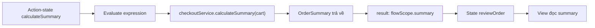
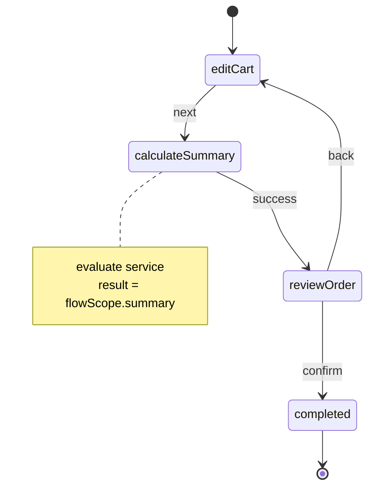

# Gán kết quả evaluate vào một scope

## 1. Bài toán: lưu kết quả xử lý để dùng ở bước tiếp theo

Trong **Spring Web Flow**, một hành trình web nhiều bước được mô tả bằng các trạng thái (`state`), sự kiện (`event`), chuyển trạng thái (`transition`) và luồng con (`subflow`). Một `action-state` thích hợp để gọi service, xử lý dữ liệu hoặc thực hiện một quyết định trước khi chuyển sang state tiếp theo.

Một câu hỏi phổ biến là: **sau khi gọi service bằng `<evaluate>`, làm sao giữ đối tượng mà service trả về để trang tiếp theo sử dụng?**

Giả sử người dùng đang mua hàng. Tại state `calculateSummary`, ứng dụng gọi `checkoutService.calculateSummary(cart)` và nhận `OrderSummary` gồm tổng tiền và phí vận chuyển. State `reviewOrder` cần đọc lại `OrderSummary` để hiển thị. Nếu chỉ gọi service mà không lưu kết quả ở một nơi có vòng đời phù hợp, view không có đối tượng để đọc ở request kế tiếp.

Cú pháp cơ bản:

```xml
<evaluate expression="checkoutService.calculateSummary(cart)"
          result="flowScope.summary" />
```

Ba phần cần hiểu:

- `expression`: biểu thức được đánh giá, ở đây gọi một phương thức trên Spring bean `checkoutService` với dữ liệu `cart`.
- **Giá trị trả về**: đối tượng `OrderSummary` mà phương thức tạo ra.
- `result="flowScope.summary"`: yêu cầu Web Flow lưu giá trị ấy vào biến `summary` trong **flow scope**.

Bài thuộc chương **Action-state** của module `SPRING_WEB_FLOW`, tập trung vào việc gán kết quả của `evaluate` vào scope, lựa chọn vòng đời dữ liệu, mối quan hệ với action-state outcome, form binding, validation, Spring MVC và khôi phục execution.

Sau bài này, bạn có thể viết `evaluate` đúng cú pháp, chọn scope thích hợp, phân biệt dữ liệu kết quả với event điều hướng, kiểm tra dữ liệu đã lưu và tránh những lỗi do scope/serialization.

## 2. evaluate hoạt động như thế nào?

Phần tử `<evaluate>` đánh giá một biểu thức tại thời điểm Web Flow thực hiện action. Biểu thức có thể gọi phương thức của Spring bean hoặc đối tượng có sẵn trong ngữ cảnh flow.



Trong Spring Web Flow, `<evaluate>` được dùng tại nhiều nơi, chẳng hạn:

| Vị trí | Khi nào thực hiện? | Ví dụ sử dụng |
| --- | --- | --- |
| `<on-start>` | Khi bắt đầu flow | Tạo bản nháp, lưu `flowScope.cart` |
| `<on-entry>` | Khi vào một state | Khởi tạo dữ liệu chuẩn bị render |
| `<on-render>` | Khi chuẩn bị hiển thị `view-state` | Nạp danh sách để hiển thị vào `viewScope` |
| `<transition>` | Khi transition được chọn | Cập nhật model, ghi kết quả hoặc đặt thông báo |
| `<action-state>` | Khi engine thực thi action-state | Tính tổng đơn, kiểm tra trạng thái, gọi service |
| `<on-exit>` | Khi rời state | Dọn dữ liệu tạm theo nhu cầu |
| `<on-end>` | Khi flow kết thúc | Ghi thông tin audit hoặc cleanup an toàn |

**Không phải mọi `evaluate` đều cần `result`.** Nếu phương thức chỉ tạo side effect hợp lệ, ví dụ gọi một phương thức cập nhật model đã có, có thể bỏ `result`. Nhưng khi cần dùng **giá trị trả về** ở state sau, nên gán nó tường minh vào biến có scope phù hợp.

```xml
<!-- Chỉ gọi phương thức; không lưu giá trị trả về vào một scope. -->
<evaluate expression="cartService.recalculate(cart)" />

<!-- Lấy giá trị trả về và lưu vào flowScope. -->
<evaluate expression="cartService.recalculate(cart)"
          result="flowScope.cartTotals" />
```

Tuy nhiên, action tạo side effect như thu tiền, ghi đơn hoặc gửi email phải được thiết kế idempotent/transactional ở service; việc gọi `evaluate` không tự bảo đảm “chỉ thực thi đúng một lần”.

## 3. Ba thuộc tính expression, result và result-type

### 3.1. expression: thứ cần đánh giá

`expression` dùng ngôn ngữ biểu thức được cấu hình cho Web Flow (thường theo môi trường Spring EL hiện đại), có thể truy cập bean, flow variable và các biến đặc biệt trong ngữ cảnh.

```xml
<evaluate expression="pricingService.quote(cart)"
          result="flowScope.quote" />
```

`pricingService` là bean Spring. `cart` là dữ liệu có thể đã được khai báo với `<var>` hoặc đưa vào flow scope. Khi expression không tìm được đối tượng, bean hoặc phương thức phù hợp, quá trình đánh giá có thể ném lỗi; nó không tự tạo biến chỉ vì tên xuất hiện trong biểu thức.

### 3.2. result: địa chỉ ghi kết quả

`result` là **biểu thức đích**. Với biến mới trong các scope, hãy chỉ rõ scope:

```xml
<evaluate expression="pricingService.quote(cart)"
          result="flowScope.quote" />

<evaluate expression="catalogService.findProducts(filter)"
          result="viewScope.products" />
```

Ví dụ thứ hai cần chạy trong một `view-state`, thường tại `<on-render>`; `viewScope` **không tồn tại để truy cập tùy ý từ action-state**.

Với một biến **đã tồn tại**, như `cart` được khai báo bằng `<var>`, Web Flow cho phép tham chiếu biến trực tiếp khi cần cập nhật:

```xml
<var name="cart" class="com.example.shop.Cart" />

<on-start>
    <evaluate expression="cartFactory.create()"
              result="cart" />
</on-start>
```

Trong tình huống tạo biến mới, `result="quote"` dễ gây lỗi hoặc đánh nhầm biến do thuật toán tìm biến trong scope. Cú pháp dễ hiểu nhất là `result="flowScope.quote"` hoặc `result="viewScope.quote"` đúng vòng đời cần dùng.

### 3.3. result-type: chuyển kiểu giá trị trả về

Khi cần chuyển giá trị trả về thành kiểu mà view/binding sử dụng, có thể khai báo `result-type`:

```xml
<view-state id="searchProducts">
    <on-render>
        <evaluate expression="catalogService.findProducts(filter)"
                  result="viewScope.products"
                  result-type="dataModel" />
    </on-render>
</view-state>
```

Trong các cấu hình hỗ trợ JSF, alias `dataModel` có thể chuyển một danh sách thành `DataModel` tương thích với UI component. `result-type` không phải tên một scope; nó chỉ dẫn cho conversion service khi **ghi kết quả**. Cần kiểm tra alias/converter được đăng ký trong dự án. Nếu đối tượng trả về đã đúng kiểu, không cần đặt `result-type` chỉ để lặp lại class trả về.

Bảng tổng hợp:

| Thuộc tính | Ý nghĩa | Giá trị minh họa |
| --- | --- | --- |
| `expression` | Phương thức/biểu thức cần thực thi | `checkoutService.calculateSummary(cart)` |
| `result` | Đường dẫn nhận dữ liệu trả về | `flowScope.summary` |
| `result-type` | Kiểu hoặc alias dùng chuyển đổi giá trị trả về | `dataModel`, khi converter có hỗ trợ |

## 4. Lựa chọn scope theo vòng đời dữ liệu

Việc chọn đúng scope quyết định kết quả tồn tại bao lâu, có được truy cập từ state tiếp theo hay không, và có phải tham gia lưu/khôi phục execution hay không.

| Scope | Vòng đời điển hình | Có thể đọc ở bước tiếp theo? | Trường hợp nên dùng |
| --- | --- | --- | --- |
| `requestScope` | Một lần xử lý flow request | Thường không, nếu qua HTTP request mới | Dữ liệu trung gian chỉ cần trong request |
| `flashScope` | Trong flow nhưng được làm rỗng sau mỗi lần render view | Chỉ khi còn trong khoảng flash hợp lệ | Thông báo ngắn hạn sau thao tác |
| `viewScope` | Từ khi vào đến khi rời một `view-state` | Không, nếu đã rời view-state đó | Danh sách phân trang, dữ liệu chỉ của trang |
| `flowScope` | Từ lúc flow bắt đầu đến khi flow kết thúc | Có, trong cùng flow | Bản nháp đơn hàng, kết quả tính toán dùng nhiều bước |
| `conversationScope` | Suốt top-level flow và các subflow trong cùng conversation | Có, cả parent/subflow cùng conversation | Dữ liệu cần chia sẻ giữa các flow liên quan |

**Nguyên tắc chọn nhanh:** Dữ liệu được tính tại `action-state` và cần hiển thị ở `view-state` kế tiếp nên thường đặt trong **`flowScope`**. `viewScope` thích hợp cho dữ liệu nạp ngay tại chính view-state. `flashScope` phù hợp với thông báo ngắn hạn. `conversationScope` chỉ dùng khi thực sự có yêu cầu chia sẻ xuyên qua subflow.

### 4.1. flowScope: kết quả dùng qua nhiều bước

```xml
<action-state id="calculateSummary">
    <evaluate expression="checkoutService.calculateSummary(cart)"
              result="flowScope.summary" />
    <transition on="success" to="reviewOrder" />
</action-state>
```

`summary` có thể được đọc trong `reviewOrder` và cả khi người dùng quay lại một view-state khác **miễn flow execution chưa kết thúc**.

### 4.2. viewScope: dữ liệu chỉ cần trong view-state

```xml
<view-state id="chooseShipping">
    <on-render>
        <evaluate expression="shippingService.listOptions(cart)"
                  result="viewScope.options" />
    </on-render>
    <transition on="selected" to="calculateSummary" />
</view-state>
```

`options` chỉ dùng trong `chooseShipping`. Khi chuyển sang `calculateSummary`, view scope của `chooseShipping` kết thúc. Đừng gán vào `viewScope` ngay trong `action-state` vì action-state không phải view-state.

### 4.3. requestScope: kết quả tồn tại trong một request

```xml
<on-start>
    <evaluate expression="auditService.createRequestMarker()"
              result="requestScope.marker" />
</on-start>
```

`requestScope.marker` thích hợp khi chỉ cần trong request xử lý launch. Nếu trang kế tiếp được render thông qua redirect/HTTP request mới thì marker không còn. Không dùng request scope để lưu đơn hàng đang nhập qua nhiều POST.

### 4.4. flashScope: thông báo ngắn hạn

```xml
<transition on="applyCoupon" to="reviewOrder">
    <evaluate expression="couponService.apply(cart)"
              result="flashScope.couponMessage" />
</transition>
```

`flashScope` được làm rỗng sau mỗi lần render view theo cơ chế Web Flow; biến này không phải nơi lưu `OrderSummary` dài hạn. Cũng cần lưu ý vị trí `<transition>` phải phù hợp với state chứa sự kiện `applyCoupon`.

### 4.5. conversationScope: chia sẻ qua subflow

```xml
<action-state id="createSharedContext">
    <evaluate expression="checkoutService.createContext(cart)"
              result="conversationScope.checkoutContext" />
    <transition on="success" to="chooseAddress" />
</action-state>
```

Trong cùng conversation, parent flow và subflow có thể truy cập dữ liệu này. Đây là lựa chọn hữu ích cho dữ liệu thực sự dùng chung, nhưng cũng làm tăng mức phụ thuộc. Với trao đổi dữ liệu rõ ràng giữa parent/subflow, hợp đồng `<input>` và `<output>` vẫn thường dễ bảo trì hơn.

### 4.6. Cảnh báo về session và serialization

Trong cấu hình Web Flow mặc định, dữ liệu lưu ở flow/view/flash scope thường cần hỗ trợ **serialization** để lưu snapshot hoặc session replication. Conversation scope cũng thường gắn với session. Không đặt trực tiếp vào scope các đối tượng như open JDBC connection, `EntityManager`, `InputStream` hoặc một entity graph khổng lồ chỉ vì muốn “giữ lại để dùng sau”.

Thay vào đó, giữ DTO serializable, ID nghiệp vụ hoặc bản nháp có kích thước hợp lý. Những dữ liệu phải sống lâu hơn flow execution (ví dụ đơn hàng chưa xác nhận trong vài ngày) nên lưu qua service/database và chỉ giữ ID trong scope.

## 5. Ví dụ đầy đủ: tính tổng tiền trong action-state

Giả sử cần hành trình:

1. Người dùng sửa giỏ hàng ở `editCart`.
2. Gửi event `next` đến `calculateSummary`.
3. `checkoutService` tính `OrderSummary`.
4. Kết quả được lưu ở `flowScope.summary`.
5. Engine chuyển đến `reviewOrder`, nơi view đọc được `summary`.
6. Người dùng quay lại sửa giỏ hoặc xác nhận kết thúc.



### 5.1. Flow XML

```xml
<?xml version="1.0" encoding="UTF-8"?>
<flow xmlns="http://www.springframework.org/schema/webflow"
      xmlns:xsi="http://www.w3.org/2001/XMLSchema-instance"
      xsi:schemaLocation="
        http://www.springframework.org/schema/webflow
        https://www.springframework.org/schema/webflow/spring-webflow.xsd">

    <var name="cart" class="com.example.shop.Cart" />

    <view-state id="editCart"
                view="checkout/cart"
                model="cart">
        <transition on="next" to="calculateSummary" />
    </view-state>

    <action-state id="calculateSummary">
        <evaluate expression="checkoutService.calculateSummary(cart)"
                  result="flowScope.summary" />
        <transition on="success" to="reviewOrder" />
    </action-state>

    <view-state id="reviewOrder" view="checkout/review">
        <transition on="back" to="editCart" />
        <transition on="confirm" to="completed" />
    </view-state>

    <end-state id="completed" />
</flow>
```

Flow này tập trung vào phép tính **không có side effect**. Một hệ thống thương mại thật cần kiểm tra tồn kho, khuyến mại, giao dịch tạo đơn, bảo mật và cập nhật giá tại thời điểm xác nhận. Không nên xem `summary` đã tính trước đó là dữ liệu thanh toán bất biến.

### 5.2. Service Java trả về dữ liệu

```java
package com.example.shop;

import java.io.Serializable;
import java.math.BigDecimal;

public class OrderSummary implements Serializable {
    private static final long serialVersionUID = 1L;

    private final BigDecimal subtotal;
    private final BigDecimal shippingFee;
    private final BigDecimal total;

    public OrderSummary(
            BigDecimal subtotal,
            BigDecimal shippingFee) {
        this.subtotal = subtotal;
        this.shippingFee = shippingFee;
        this.total = subtotal.add(shippingFee);
    }

    public BigDecimal getSubtotal() {
        return subtotal;
    }

    public BigDecimal getShippingFee() {
        return shippingFee;
    }

    public BigDecimal getTotal() {
        return total;
    }
}
```

```java
package com.example.shop;

import java.math.BigDecimal;
import org.springframework.stereotype.Service;

@Service
public class CheckoutService {

    public OrderSummary calculateSummary(Cart cart) {
        // Ví dụ đơn giản; Cart là model JavaBean/Serializable của ứng dụng.
        BigDecimal subtotal = cart.subtotal();
        BigDecimal shippingFee = new BigDecimal("30000");
        return new OrderSummary(subtotal, shippingFee);
    }
}
```

Để ví dụ biên dịch trong dự án thật, cần định nghĩa class `Cart` (gồm phương thức `subtotal()` và các thuộc tính bind form), cấu hình view resolver và các bean Spring. Đoạn minh họa tập trung vào **kiểu giá trị trả về**: `calculateSummary` trả một DTO, và `result="flowScope.summary"` lưu DTO ấy để dùng ở view.

### 5.3. Đọc dữ liệu tại view tiếp theo

Trong view template `checkout/review`, EL có thể truy cập biến `summary` thông qua cơ chế scope search của Web Flow. Ví dụ nếu dùng Thymeleaf và có cấu hình view resolver thích hợp:

```html
<div>
    <p>Tạm tính: <span th:text="${summary.subtotal}">0</span></p>
    <p>Phí vận chuyển: <span th:text="${summary.shippingFee}">0</span></p>
    <strong>Tổng: <span th:text="${summary.total}">0</span></strong>
</div>
```

Đây là cú pháp biểu thức Thymeleaf chuẩn cho thuộc tính `th:text`. Một template production còn cần cấu hình view resolver thích hợp, định dạng tiền tệ theo locale và cơ chế escaping; `th:text` mặc định xuất nội dung dạng text đã escape.

**Lưu ý:** Đoạn view trên chỉ là minh họa đường truy cập thuộc tính sau khi `evaluate` đã lưu dữ liệu vào `flowScope`. Việc hiển thị không tự tạo hoặc tính toán lại `OrderSummary`.

### 5.4. Nếu người dùng quay lại sửa giỏ thì sao?

`flowScope.summary` vẫn tồn tại trong flow dù state đã trở về `editCart`. Nhưng sau khi giỏ hàng thay đổi, summary cũ có thể không còn đúng. Luồng thiết kế ở trên chuyển lại qua `calculateSummary` mỗi lần người dùng đi tới `reviewOrder`, nhờ đó kết quả được **tính lại và ghi đè**.

Nếu nhiều đường transition có thể vào `reviewOrder` mà không qua tính lại, cần kiểm soát tính mới của kết quả: đặt timestamp/version hoặc tập trung entry transition để luôn tính lại trước khi hiển thị.

## 6. Phân biệt dữ liệu result và event điều hướng

Đây là điểm quan trọng nhất khi dùng `evaluate` trong `action-state`.

Trong XML:

```xml
<action-state id="calculateSummary">
    <evaluate expression="checkoutService.calculateSummary(cart)"
              result="flowScope.summary" />
    <transition on="success" to="reviewOrder" />
</action-state>
```

Có **hai kênh kết quả**:

1. **Dữ liệu nghiệp vụ:** `OrderSummary` được gán vào `flowScope.summary` bằng thuộc tính `result`.
2. **Event hành động:** `action-state` nhìn vào event kết quả của action để chọn `<transition on="...">`.

Đừng đọc `<transition on="success">` thành “nếu `summary` khác null”. Một service có thể trả đối tượng, event hành động được ánh xạ thành `success` theo cơ chế Web Flow. Nếu service trả `String`, `Boolean` hoặc `Enum` để quyết định điều hướng, quy tắc event mapping sẽ khác.

Bảng event mapping thường dùng cho method trả về POJO trong action-state:

| Giá trị/kiểu trả về khi dùng làm outcome | Event ID thường được ánh xạ | Ví dụ transition |
| --- | --- | --- |
| `String` | Nội dung chuỗi | Trả `"approved"` → `on="approved"` |
| `Boolean` | `yes` nếu `true`, `no` nếu `false` | `on="yes"` hoặc `on="no"` |
| `Enum` | Tên hằng enum | `on="ACCEPTED"` |
| Giá trị kiểu khác / đối tượng dữ liệu | `success` | `on="success"` |

Đây là quy tắc mapping event của Web Flow cho kiểu giá trị thông thường. Khi truyền action object tùy chỉnh hoặc cấu hình action khác, outcome có thể được quyết định theo hợp đồng riêng.

### 6.1. Nếu muốn trả Boolean để rẽ nhánh

```xml
<action-state id="checkAvailability">
    <evaluate expression="inventoryService.isAvailable(cart)" />
    <transition on="yes" to="calculateSummary" />
    <transition on="no" to="outOfStock" />
</action-state>
```

Ở đây không cần gán `result` vì giá trị Boolean được dùng **làm event phân nhánh**. Nếu view cũng cần đọc trạng thái hàng tồn kho, có thể thiết kế một phương thức trả DTO rồi lưu scope và tách quyết định route bằng `decision-state`.

### 6.2. Nếu muốn giữ DTO và rẽ nhánh theo thuộc tính

```xml
<action-state id="loadQuote">
    <evaluate expression="quoteService.createQuote(cart)"
              result="flowScope.quote" />
    <transition on="success" to="routeQuote" />
</action-state>

<decision-state id="routeQuote">
    <if test="quote.accepted"
        then="reviewOrder"
        else="quoteRejected" />
</decision-state>
```

Cách này phân biệt rõ **lưu đối tượng** và **quyết định nhánh**. Một DTO mang ý nghĩa nghiệp vụ thường ổn định hơn việc cố chuyển mọi kết quả thành chuỗi event.

### 6.3. Chuỗi nhiều evaluate trong một action-state

Một `action-state` có thể có nhiều action. Engine kiểm tra outcome của từng action theo thứ tự; nếu outcome khớp một transition đã khai báo, nó có thể chuyển state mà không chạy các action phía sau. Vì vậy, không nên giả định mọi `<evaluate>` đều chạy khi đã có `<transition on="success">` khớp kết quả của action đầu.

Nếu cần một chuỗi bắt buộc, hãy đặt logic bên trong service có transaction rõ ràng, hoặc thiết kế các state/transition tách biệt và kiểm thử thứ tự.

## 7. Ghi biến mới và cập nhật biến đã có

Hai trường hợp này khác nhau.

### 7.1. Ghi một biến mới vào scope

```xml
<evaluate expression="pricingService.quote(cart)"
          result="flowScope.quote" />
```

Web Flow biết chính xác cần lưu kết quả tại `flowScope` với tên `quote`. Các view sau có thể đọc `quote` theo thuật toán scope lookup.

### 7.2. Gán lại một biến được khai báo trước

```xml
<var name="cart" class="com.example.shop.Cart" />

<on-start>
    <evaluate expression="cartFactory.newCart()"
              result="cart" />
</on-start>
```

Khi đã có `cart`, Web Flow có thể xác định biến đích qua scope search. Tuy nhiên, việc dùng `result="flowScope.cart"` có thể làm ý định lưu ở flow scope rõ hơn đối với người đọc. Chọn một quy ước thống nhất và dùng test kiểm tra đối tượng đúng được cập nhật.

### 7.3. Chỉnh thuộc tính của model

Không phải lúc nào cũng cần thay cả object. Có thể cập nhật một thuộc tính bằng `set`:

```xml
<transition on="select" to="reviewOrder">
    <set name="flowScope.cart.shippingMethod"
         value="requestParameters.shippingMethod" />
</transition>
```

Trong production, dữ liệu client như `shippingMethod` phải được chuyển kiểu/validate và đối chiếu với các phương thức hợp lệ trước khi chấp nhận. `set` thích hợp cho phép gán đơn giản, trong khi `evaluate` phù hợp khi cần gọi service hoặc thực hiện tính toán trước khi gán.

## 8. Truy cập dữ liệu sau khi evaluate

Trong Web Flow, các scope được tra cứu theo thuật toán lookup. Thường có thể đọc biến đơn giản như `quote`, `summary` hoặc `cart` mà không thêm tiền tố scope:

```xml
<evaluate expression="emailService.formatSummary(summary)"
          result="flashScope.summaryText" />
```

Tuy nhiên, **ghi biến mới** nên chỉ rõ scope:

```xml
<!-- Khuyến nghị: rõ nơi lưu. -->
<evaluate expression="checkoutService.calculateSummary(cart)"
          result="flowScope.summary" />

<!-- Có nguy cơ sai đích: biến summary chưa tồn tại. -->
<evaluate expression="checkoutService.calculateSummary(cart)"
          result="summary" />
```

Ngữ cảnh tra cứu khác với HTTP session attributes. Nếu view không đọc được `summary`, hãy kiểm tra:

1. `calculateSummary` đã thực sự chạy hay chưa.
2. Service có trả đối tượng dự kiến không.
3. `result` ghi vào đúng scope không.
4. Flow đã rời scope tương ứng hoặc kết thúc chưa.
5. View template có đang truy cập đúng tên biến và thuộc tính bean không.
6. Execution key/HTTP session có còn hợp lệ không.

Một tên biến bị tìm thấy ở nhiều scope có thể che khuất nhau theo thứ tự lookup. Với dự án lớn, nên đặt tên biến nhất quán hoặc dùng scope tường minh khi cần phân biệt.

## 9. Result-type, conversion và dữ liệu hiển thị

`result-type` là một phần của cơ chế conversion dành cho **đối tượng trả về**, không phải converter HTTP request mặc định.

Ví dụ trong một view-state dùng JSF:

```xml
<view-state id="browseProducts">
    <on-render>
        <evaluate expression="catalogService.listProducts(filter)"
                  result="viewScope.products"
                  result-type="dataModel" />
    </on-render>
</view-state>
```

Trường hợp này cần `spring-faces`/conversion service có alias `dataModel`. Từ `List`, converter có thể tạo `DataModel` phục vụ lựa chọn dòng trong JSF DataTable. Nếu ứng dụng chỉ dùng Thymeleaf, không cần tự thêm `dataModel`.

Phân biệt ba lớp conversion:

| Nơi | Ví dụ | Mục đích |
| --- | --- | --- |
| Binding form | Chuỗi `"2"` → `Integer` | Gán request parameter vào model |
| `evaluate result-type` | `List` → `DataModel` | Biến đổi kết quả service khi lưu vào scope |
| View formatting | `BigDecimal` → tiền tệ được định dạng | Hiển thị dữ liệu theo locale |

Kết quả nằm trong scope cần là dữ liệu đã hợp lệ về kiểu, nhưng điều đó không đồng nghĩa service đã kiểm tra nghiệp vụ. Một `OrderSummary` giá trị `total` không âm vẫn cần được đối chiếu với giá thực tế khi xác nhận đơn hàng.

## 10. Lưu kết quả qua subflow

Nếu action-state gọi service tạo dữ liệu mà một subflow sẽ sử dụng, có hai cách:

**Chia sẻ qua conversation scope** khi thực sự cần cùng đối tượng giữa flow cha và subflow:

```xml
<evaluate expression="checkoutService.createDraft(cart)"
          result="conversationScope.draft" />
```

**Truyền input rõ ràng** bằng subflow contract:

```xml
<subflow-state id="collectAddress" subflow="address">
    <input name="draft" value="flowScope.draft" />
    <transition on="addressSaved" to="reviewOrder">
        <evaluate expression="checkoutService.refreshSummary(draft)"
                  result="flowScope.summary" />
    </transition>
</subflow-state>
```

Ví dụ giả định `draft` đã được tạo trong flow cha trước khi vào `collectAddress` và flow con khai báo `<input name="draft" />`. Nếu flow con muốn trả dữ liệu mới, nên khai báo `<output>` trên end-state và dùng `currentEvent.attributes` ở transition của parent.

`flowScope` của parent không phải “global storage” cho mọi subflow. Chia sẻ dữ liệu qua `conversationScope` hoặc input/output tùy mức độ ràng buộc mong muốn.

## 11. Lỗi thường gặp và cách xử lý

| Triệu chứng | Nguyên nhân có thể | Hướng kiểm tra |
| --- | --- | --- |
| `summary` không tồn tại ở `reviewOrder` | Bỏ `result`, ghi sai tên hoặc state tính toán chưa chạy | XML `calculateSummary`, tên biến ở view |
| Ghi vào `viewScope` trong `action-state` bị lỗi | Action-state không có view scope | Dùng `flowScope` hoặc chuyển việc nạp dữ liệu vào `view-state/on-render` |
| Result mất khi chuyển bước | Dùng `requestScope`/`viewScope` ngoài vòng đời | Chọn `flowScope` nếu cần qua state |
| Flash message chỉ hiện một lần | `flashScope` bị làm rỗng sau render | Đây là vòng đời thiết kế; không dùng flash cho dữ liệu dài hạn |
| `result-type` không được nhận | Không có converter alias phù hợp | Cấu hình conversion service/Spring Faces |
| `transition on="success"` không chạy | Event trả về là `yes`, `no`, một `String` hoặc enum khác | Kiểm tra kiểu giá trị và event mapping |
| Cùng một dữ liệu được tính lặp | `evaluate` ở `on-render` bị gọi mỗi lần hiển thị | Dùng tính toán thuần hoặc chuyển action thích hợp |
| Flow resume lỗi sau khi lưu result lớn | Đối tượng không serialize được hoặc snapshot quá lớn | Dùng DTO serializable, ID nghiệp vụ, giới hạn dữ liệu |
| Dữ liệu giỏ hàng thay đổi nhưng summary cũ | Không tính lại trước `reviewOrder` | Điều hướng luôn qua `calculateSummary` |
| Action tạo đơn hai lần | Browser retry/back hoặc người dùng submit lặp | Transaction, idempotency, unique constraint |
| Kết quả bị trộn giữa người dùng | Đặt mutable state trong singleton Spring bean | Giữ service stateless, DTO trong scope execution |

### 11.1. Xử lý ngoại lệ là một việc khác với ghi result

Nếu `checkoutService.calculateSummary(cart)` ném exception, không thể giả định `result="flowScope.summary"` đã được gán và không phải exception nào cũng tự trở thành event `error`.

Với lỗi nghiệp vụ dự kiến, service có thể trả một DTO thể hiện trạng thái rồi đưa qua `decision-state`. Với exception thật sự, nên dùng exception handler phù hợp và hiển thị thông báo an toàn. Không dùng `on="error"` như một catch-all nếu action không có hợp đồng phát event `error`.

### 11.2. Scope không phải kho lưu dữ liệu dài hạn

Khi execution hết hạn, dữ liệu trong flow/view scope có thể không phục hồi được. `FlowExecutionRepository` phục vụ trạng thái của hành trình, không phải database cho đơn hàng thật. Với bản nháp cần sống nhiều ngày, nên ghi ID và trạng thái nghiệp vụ vào database, có kiểm soát truy cập và cơ chế khôi phục.

### 11.3. Thận trọng với dữ liệu nhạy cảm

Không đặt token truy cập, thông tin thanh toán thô hoặc mật khẩu trong `flowScope` chỉ vì muốn dùng ở bước sau. Snapshot, session replication và log/debug có thể khiến thời gian tồn tại của các giá trị này dài hơn dự kiến. Giữ dữ liệu tối thiểu, dùng tokenization và kiểm soát quyền ở service.

## 12. Kiểm thử việc gán kết quả vào scope

### 12.1. Test behavior của flow

Khi dùng Spring Web Flow test support, các bước xác minh nên tập trung vào tác động thật:

1. Bắt đầu flow `checkout` và kiểm tra ở `editCart`.
2. Đặt dữ liệu mẫu trong `cart` và gửi event `next`.
3. Xác minh flow đi qua `calculateSummary` và vào `reviewOrder`.
4. Đọc `flowScope.summary` từ test execution context.
5. Kiểm tra `summary.total` bằng số liệu service đã tính.
6. Gửi event `back`, chỉnh giỏ và đi tiếp để xác nhận `summary` được tính lại.
7. Thử service ném exception hoặc trả kết quả khác và xác minh đường xử lý lỗi.

Ví dụ pseudo-code cho ý tưởng assertion (API lấy scope phụ thuộc test fixture được dùng):

```java
// Sau khi test harness đã khởi chạy checkout và gửi sự kiện "next":
Object result = currentFlowScope.get("summary");

assertNotNull(result);
assertInstanceOf(OrderSummary.class, result);

OrderSummary summary = (OrderSummary) result;
assertEquals(new BigDecimal("130000"), summary.getTotal());
```

`currentFlowScope` là biến giả định mà test fixture cung cấp; đoạn này minh họa mục tiêu assertion, chưa phải một test chạy độc lập. Dùng API `RequestContext`/`FlowExecution` của phiên bản framework để truy cập scope thật trong test.

### 12.2. Test về vòng đời scope

| Bài kiểm thử | Kỳ vọng |
| --- | --- |
| Lưu `flowScope.summary` trong action-state | Có giá trị ở view-state kế tiếp trong cùng flow |
| Lưu `viewScope.products` trong `on-render` | Có giá trị trong view-state hiện tại |
| Rời view-state rồi truy cập biến chỉ thuộc view scope | Biến cũ không còn trong view scope mới |
| Đặt `flashScope.message` và render | Thông báo chỉ tồn tại trong khoảng flash hợp lệ |
| Tiếp tục một flow sau HTTP request mới | Dữ liệu flow scope được khôi phục nếu execution còn hợp lệ |
| Session hết hạn và dùng execution key cũ | Có đường phục hồi phù hợp, không lộ thông tin người dùng |
| Gán DTO không serializable rồi snapshot | Phát hiện lỗi từ repository/test để sửa model |
| Hai người cùng dùng cùng service | Flow scope và dữ liệu form không bị chia sẻ chéo |

### 12.3. Cách quan sát nhanh khi debug

Trong môi trường test, log ID state hiện tại, event nhận được, tên biến được lưu và **kiểu dữ liệu** của kết quả. Tránh log toàn bộ thông tin khách hàng hoặc đối tượng nhạy cảm. Đối chiếu stack trace nếu conversion/EL lỗi và kiểm tra cấu hình repository khi resume thất bại.

Một thứ tự debug hợp lý: **service có trả dữ liệu không → evaluate có chạy không → result ghi vào đâu → state sau có đọc đúng scope không → execution có còn hợp lệ không**. Điều này giúp tách lỗi dữ liệu, điều hướng và lưu execution.

## 13. Checklist thiết kế

Trước khi thêm `result` vào flow XML:

1. Xác định giá trị trả về từ service có cần dùng ở state khác không.
2. Chọn scope theo vòng đời: request, flash, view, flow hay conversation.
3. Ghi rõ scope khi tạo biến mới, ví dụ `result="flowScope.summary"`.
4. Thêm `result-type` **chỉ khi cần chuyển kiểu** và đã có converter.
5. Thiết kế riêng event/outcome cho action-state; không đồng nhất dữ liệu DTO với event điều hướng.
6. Nếu giá trị có thể lỗi, tạo đường lỗi có chủ đích với validation/exception handling.
7. Giữ dữ liệu trong scope nhỏ, an toàn, có thể serialize nếu repository yêu cầu.
8. Viết test xác minh biến tồn tại ở state kế tiếp, mất ở đúng thời điểm và được tính lại khi input thay đổi.

### Câu hỏi tự luyện

1. `result="flowScope.summary"` làm gì sau khi `checkoutService.calculateSummary(cart)` trả về đối tượng?
2. Vì sao `result="viewScope.products"` thích hợp trong `view-state/on-render` nhưng không phù hợp với một `action-state` thuần?
3. Khi tạo **biến mới**, vì sao phải ghi tên scope thay vì chỉ dùng `result="summary"`?
4. `result-type="dataModel"` khác gì `result="viewScope.products"`?
5. Nếu service trả `Boolean false` cho action-state, transition `on="success"` có nhất thiết chạy không?
6. Một DTO trả về và event điều hướng có phải cùng một đối tượng không?
7. Vì sao cần tính lại `flowScope.summary` sau khi giỏ hàng đã chỉnh sửa?
8. Có nên đặt `OrderSummary` trong `flashScope` nếu cần xem lại ở nhiều bước? Vì sao?
9. Dữ liệu nào thích hợp dùng `conversationScope` khi có subflow?
10. Nếu flow đã kết thúc nhưng bản nháp vẫn cần phục hồi sau một tuần, nên lưu ở đâu?
11. Vì sao việc gán `result` không thay thế kiểm thử authorization, transaction và idempotency?
12. Làm sao chứng minh `evaluate` đã lưu đúng giá trị bằng một execution test?

## Tài liệu tham khảo

- [Spring Web Flow 3.0 — Actions: evaluate và gán result](https://docs.spring.io/spring-webflow/docs/3.0.0/reference/#_actions)
- [Spring Web Flow 3.0 — Variable Scopes](https://docs.spring.io/spring-webflow/docs/3.0.0/reference/#_variable_scopes)
- [Spring Web Flow 3.0 — EL Variables và Scope Searching](https://docs.spring.io/spring-webflow/docs/3.0.0/reference/#_using_expression_language_el)
- [Spring Web Flow 3.0 — Action States và Action Outcome](https://docs.spring.io/spring-webflow/docs/3.0.0/reference/#_executing_actions)
- [Spring Web Flow 3.0 Reference Guide](https://docs.spring.io/spring-webflow/docs/3.0.0/reference/)

Các ví dụ tập trung vào cách gán kết quả trong Spring Web Flow; code dự án thật còn cần model, service, view resolver, validation, security và repository phù hợp với phiên bản Spring đang sử dụng.
