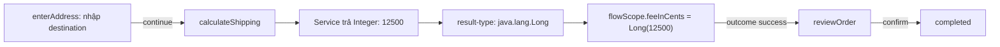

# Chuyển kiểu kết quả bằng result-type trong Action-state

Trong **Spring Web Flow** (`SPRING_WEB_FLOW`), một `action-state` dùng để chạy logic, đánh giá kết quả và điều hướng sang state tiếp theo. Kết quả trả về từ service có thể là một kiểu khác với kiểu mà các bước sau muốn sử dụng. Ví dụ, hệ thống tính phí giao hàng cũ trả số tiền theo đơn vị xu dưới dạng `Integer`, nhưng flow muốn lưu nó thành `Long` để dùng thống nhất với các service phía sau.

Thuộc tính **`result-type`** của phần tử **`<evaluate>`** cho phép khai báo **kiểu mong đợi của kết quả biểu thức khi gán vào một đích**. Tính năng này đặc biệt hữu ích khi kết hợp action-state, biến trong `flowScope` hoặc `viewScope`, bộ chuyển kiểu (conversion service), và luồng kiểm tra nhiều bước.

Bài thuộc chương **Action-state** này sẽ hướng dẫn cú pháp, trình tự xử lý, ví dụ XML/Java, sự khác nhau giữa kết quả gán và event điều hướng, cùng cách nhận diện lỗi chuyển kiểu. Các ví dụ minh họa theo phong cách cấu hình Spring Web Flow 2.x; ứng dụng thực tế cần xác minh cú pháp và converter của phiên bản đang sử dụng.

## 1. Vấn đề: kết quả service và kiểu dữ liệu cần lưu có thể khác nhau

Giả sử người dùng đã nhập địa chỉ giao hàng, sau đó Web Flow chuyển sang state `calculateShipping`. State gọi một service tính phí:

```java
public Integer estimateFeeCents(CheckoutDraft draft) {
    // Ví dụ giản lược; thực tế phải tính giá từ dữ liệu đã kiểm tra.
    return 12500;
}
```

Service trả một đối tượng `Integer` có giá trị `12500`. Trong khi đó, màn hình xác nhận hoặc một service downstream mong chờ `Long`.

Nếu chỉ gán:

```xml
<evaluate expression="shippingPricingService.estimateFeeCents(flowScope.draft)"
          result="flowScope.feeInCents" />
```

thì kiểu dữ liệu của giá trị lưu tại đích có thể đi theo kết quả trả về (`Integer`), tùy biểu thức đích và cơ chế gán. Khi một action khác truy xuất biến như `Long` mà không kiểm tra kiểu, có thể phát sinh lỗi.

Để yêu cầu kết quả được chuyển sang `Long` trước khi gán, khai báo:

```xml
<evaluate expression="shippingPricingService.estimateFeeCents(flowScope.draft)"
          result="flowScope.feeInCents"
          result-type="java.lang.Long" />
```

Ý nghĩa ba thuộc tính:

| Thuộc tính | Trả lời câu hỏi | Trong ví dụ |
| --- | --- | --- |
| `expression` | Tính hoặc lấy giá trị **từ đâu**? | Gọi `shippingPricingService.estimateFeeCents(...)` |
| `result` | Gán kết quả **vào đâu**? | Biến `flowScope.feeInCents` |
| `result-type` | Kết quả cần được xem/chuyển thành **kiểu nào** khi gán? | `java.lang.Long` |

**`result-type` khai báo kiểu Java, không khai báo tên state đích hoặc event.** Giá trị `java.lang.Long` là tên class đầy đủ (fully qualified class name), không phải chuỗi `"12500"` và cũng không phải giá trị điều hướng `"success"`.

## 2. Vị trí đặt result-type trong flow XML

`result-type` là thuộc tính **của `<evaluate>`**, được dùng cùng `result` khi cần lưu kết quả. Nó không phải thuộc tính đặt trên `<action-state>` hay `<transition>`.

```xml
<action-state id="calculateShipping">
    <evaluate
        expression="shippingPricingService.estimateFeeCents(flowScope.draft)"
        result="flowScope.feeInCents"
        result-type="java.lang.Long" />
    <transition on="success" to="reviewOrder" />
</action-state>
```

Có thể đọc từ trên xuống:

1. Khi đi vào `calculateShipping`, Web Flow thực hiện action `<evaluate>`.
2. Biểu thức gọi service đang được đăng ký trong Spring context và lấy kết quả.
3. Với `result-type="java.lang.Long"`, hệ thống thử chuyển kết quả sang kiểu mong đợi bằng cơ chế conversion có sẵn.
4. Giá trị sau khi chuyển được gán vào `flowScope.feeInCents`.
5. `action-state` nhận **outcome event** do action phát ra và chọn `transition` phù hợp.

Bước 5 cần được phân biệt rõ với bước 3. **Kiểu của giá trị lưu vào scope** và **event để chọn transition** là hai khái niệm riêng. `result-type` không tự tạo event `success`, cũng không tự tạo nhánh `error` khi conversion thất bại.

Trong cách dùng thông dụng, một evaluate action trả giá trị số và hoàn tất thành công có thể tạo outcome `success`; cách ánh xạ outcome phụ thuộc loại kết quả và result-event factory mà Web Flow sử dụng. Khi service trả `boolean`, `String` hoặc `Event`, cần kiểm tra quy tắc tạo event của action để xác định chính xác ID chuyển trạng thái. Không giả định mọi giá trị trả về đều tạo `success`.

## 3. Ví dụ hoàn chỉnh: tính phí giao hàng và chuyển Integer thành Long

Giả sử flow thanh toán gồm ba bước: nhập địa chỉ → tính phí → xem lại đơn hàng.

### 3.1. JavaBean nhận dữ liệu form

```java
package com.example.checkout;

public class CheckoutDraft {
    private String destination;

    public CheckoutDraft() {
    }

    public String getDestination() {
        return destination;
    }

    public void setDestination(String destination) {
        this.destination = destination;
    }
}
```

### 3.2. Service tính phí

```java
package com.example.checkout;

import org.springframework.stereotype.Service;

@Service("shippingPricingService")
public class ShippingPricingService {

    public Integer estimateFeeCents(CheckoutDraft draft) {
        if (draft == null || draft.getDestination() == null
                || draft.getDestination().isBlank()) {
            throw new IllegalArgumentException(
                    "Thiếu địa chỉ để tính phí giao hàng");
        }

        // Giá trị minh họa; hệ thống thật tính tại backend.
        return 12500;
    }
}
```

`@Service("shippingPricingService")` đăng ký tên bean trùng với tên trong expression. Ứng dụng phải bật Spring component scanning hoặc khai báo bean theo cách tương đương. Ví dụ dùng `String.isBlank()`, nên cần JDK hỗ trợ API này; với dự án Java cũ có thể dùng kiểm tra `trim().isEmpty()` phù hợp.

### 3.3. Định nghĩa flow XML

```xml
<?xml version="1.0" encoding="UTF-8"?>
<flow xmlns="http://www.springframework.org/schema/webflow"
      xmlns:xsi="http://www.w3.org/2001/XMLSchema-instance"
      xsi:schemaLocation="
          http://www.springframework.org/schema/webflow
          http://www.springframework.org/schema/webflow/spring-webflow-2.0.xsd"
      start-state="enterAddress">

    <var name="draft" class="com.example.checkout.CheckoutDraft" />

    <view-state id="enterAddress"
                view="checkout/address"
                model="draft">
        <binder>
            <binding property="destination" required="true" />
        </binder>
        <transition on="continue" to="calculateShipping" />
    </view-state>

    <action-state id="calculateShipping">
        <evaluate
            expression="shippingPricingService.estimateFeeCents(flowScope.draft)"
            result="flowScope.feeInCents"
            result-type="java.lang.Long" />

        <transition on="success" to="reviewOrder" />
    </action-state>

    <view-state id="reviewOrder" view="checkout/review">
        <transition on="back" to="enterAddress" />
        <transition on="confirm" to="completed" />
    </view-state>

    <end-state id="completed" />
</flow>
```

Đây là ví dụ cấu trúc để hiểu cơ chế binding và chuyển kiểu. Để chạy hoàn chỉnh, ứng dụng còn phải cấu hình `FlowDefinitionRegistry`, `FlowExecutor`, tích hợp Spring MVC và các view tương ứng.

### 3.4. Dòng dữ liệu qua các state



Một phép kiểm tra quan trọng: sau khi chuyển sang `reviewOrder`, code phía server cần đọc được `flowScope.feeInCents` với kiểu `Long` và giá trị `12500L`. Màn hình review chỉ dùng giá trị đã tính ở server; không nên cho phép client gửi một giá trị phí mới rồi ghi đè biến này.

**Lưu ý về conversion:** Việc chuyển `Integer → Long` là ví dụ với hai kiểu số phổ biến. Dự án vẫn phải kiểm tra conversion service thực sự được cấu hình cho Web Flow. Nếu chuyển đổi không được hỗ trợ hoặc bị một cấu hình custom thay thế, action có thể thất bại thay vì tự động lưu `Long`.

## 4. Phân biệt các loại đầu ra của action-state

Trong một action-state, từ “kết quả” có thể đề cập đến nhiều thứ. Cần gọi tên chính xác để tránh thiết kế sai.

| Loại | Ví dụ | Công dụng |
| --- | --- | --- |
| **Giá trị biểu thức** | `Integer(12500)` do service trả về | Dữ liệu để tính toán, gán vào scope hoặc đánh giá |
| **Kiểu kết quả mong đợi** | `java.lang.Long` | `result-type` dùng để chuyển/định kiểu khi gán |
| **Đích lưu kết quả** | `flowScope.feeInCents` | Nơi các state sau đọc dữ liệu |
| **Outcome event** | `success`, `yes`, `no`, hoặc một ID do action tạo | Chọn `transition on="..."` |
| **State đích** | `reviewOrder` | Nơi flow đi đến nếu transition tương ứng được kích hoạt |

Kết quả Java là `Long` không có nghĩa transition phải viết `on="Long"`; cũng không có nghĩa event phải là `12500`. Cơ chế `<transition>` phản ứng với **event ID**, còn `result-type` diễn tả **kiểu giá trị lưu**.

Ví dụ biểu thức trả `boolean` có thể được diễn giải thành outcome `yes` hoặc `no` trong các cấu hình Web Flow thông dụng:

```xml
<action-state id="checkAvailability">
    <evaluate expression="bookingService.hasCapacity(flowScope.request)" />
    <transition on="yes" to="continueBooking" />
    <transition on="no" to="chooseAnotherDate" />
</action-state>
```

Ở đây không có `result`, vì action chỉ kiểm tra điều kiện để điều hướng. Thêm `result-type="java.lang.Boolean"` không thay thế được các transition `yes/no` hoặc công việc bảo đảm service trả kết quả hợp lệ.

Nếu nghiệp vụ cần cả lưu giá trị và điều hướng phức tạp, có thể tách bước tính toán thành action, rồi chuyển sang `decision-state` hoặc action khác để quyết định nhánh. Mỗi bước có một mục đích, giúp log và test rõ hơn.

## 5. Khi nào cần result-type, khi nào không cần?

`result-type` đặc biệt hữu ích trong các trường hợp:

- Service/adapter trả một kiểu số khác với hợp đồng của biến hoặc service downstream, chẳng hạn `Integer` nhưng cần `Long`.
- Giá trị trả về từ một tích hợp bên ngoài là dạng string hoặc kiểu chung, trong khi flow cần kiểu mục tiêu rõ ràng.
- Kết quả biểu thức không có property đích đủ mạnh để suy ra kiểu, ví dụ gán vào một mục `flowScope` có thể chứa nhiều loại đối tượng.
- Các bước sau cần một kiểu cụ thể và bạn muốn nơi chuyển kiểu được thể hiện trực tiếp trong flow XML.

Ngược lại, nếu service đã trả `Long` và hợp đồng đích cũng là `Long` thì `result-type="java.lang.Long"` có thể không cần thiết. Có thể ưu tiên **API service có kiểu trả về phù hợp ngay từ đầu**; dùng `result-type` khi đó là quy tắc chuyển kiểu có chủ đích tại ranh giới flow.

Ví dụ **không cần chuyển kiểu**:

```xml
<evaluate expression="orderService.loadOrder(flowScope.orderId)"
          result="flowScope.order" />
```

Nếu `loadOrder` trả `OrderSummary` đã đúng kiểu, bạn thường chỉ cần lưu kết quả. Đừng dùng `result-type` để che giấu sự mơ hồ của service hoặc để cố sửa những đối tượng hoàn toàn không tương thích.

## 6. Conversion service thực hiện phần chuyển kiểu

`result-type` là **yêu cầu về kiểu**, không phải mã chuyển đổi. Web Flow cần một cơ chế conversion hiểu cách biến giá trị hiện có thành kiểu mục tiêu.

Các trường hợp tiêu biểu:

| Giá trị trả về | Kiểu đích | Cần chú ý |
| --- | --- | --- |
| `Integer(12500)` | `java.lang.Long` | Chuyển kiểu số, giữ đúng giá trị nếu được hỗ trợ |
| `"42"` | `java.lang.Integer` | Chuỗi phải đúng định dạng số; converter cần được cấu hình |
| `"2026-12-01"` | `java.time.LocalDate` | Cần converter/formatter ngày tương thích, đúng định dạng |
| `"EXPRESS"` | `com.example.ShippingMethod` | Enum/converter phải biết giá trị tương ứng |
| `Map` hoặc JSON string | `com.example.OrderSummary` | Không thể mặc định biến Map/JSON thành DTO nếu thiếu mapper/converter |
| `null` | `java.lang.Long` | Kiểu đích không tự tạo giá trị mặc định hoặc thay thế validation |

Trong Spring Web Flow, hệ thống binding/conversion có thể được tùy biến qua các **flow builder services** và conversion service mà phiên bản Web Flow cung cấp. Một converter đăng ký ở Spring MVC không nhất thiết tự động trở thành converter của mọi expression trong Web Flow; cần kiểm tra cách hai tầng được nối với nhau.

Khi thêm kiểu tự định nghĩa, nên thực hiện lần lượt:

1. Xác định kiểu Java thật của object trả về tại runtime.
2. Chọn kiểu đích phù hợp với các state và service sẽ sử dụng.
3. Kiểm tra converter tương ứng có sẵn trong conversion service của flow hay không.
4. Nếu cần custom converter, đăng ký theo API/chế độ cấu hình mà phiên bản Web Flow hiện tại hỗ trợ.
5. Kiểm thử cả giá trị hợp lệ và không hợp lệ, đặc biệt khi convert string, enum, ngày, số hoặc mã định danh.

Không nên kết luận `result-type` tự hỗ trợ mọi phép biến đổi. Nó không phải JSON deserializer đa năng, không tự resolve entity từ database và không thay thế quy tắc phân quyền.

## 7. Ví dụ chuyển String thành kiểu số

Một API cũ có thể trả phí xử lý dưới dạng `String`:

```java
public String feeInCentsText() {
    return "12500";
}
```

Nếu muốn lưu giá trị là số, có thể dùng result-type tại bước đánh giá:

```xml
<on-entry>
    <evaluate expression="legacyFeeService.feeInCentsText()"
              result="flowScope.feeInCents"
              result-type="java.lang.Long" />
</on-entry>
```

Phần tử `<on-entry>` phải được đặt trong một state hợp lệ có hỗ trợ action khi vào state. Ví dụ này chỉ minh họa conversion và lưu giá trị; nó không định nghĩa một flow đầy đủ.

Điểm cần kiểm tra:

- `"12500"` có phải chuỗi số hợp lệ theo converter hiện tại?
- Nếu service trả `"12,500"` hoặc `"12.500"`, parser có hiểu separator theo locale hay không?
- Nếu service trả `null` hoặc chuỗi trắng, yêu cầu nghiệp vụ xử lý thế nào?
- Nếu service trả số vượt phạm vi `Long`, lỗi được trả về đâu và có bị che giấu không?
- Nếu dùng ví dụ `<evaluate>` trong `action-state`, outcome event có được chọn đúng cho **kiểu kết quả gốc** hay không?

Những câu hỏi cuối đặc biệt quan trọng khi service trả `String`: ở một số cơ chế tạo outcome, giá trị trả về dạng chuỗi còn có thể được dùng như một **event ID**. Việc chuyển dữ liệu sang `Long` để lưu không được coi là cam kết chuyển outcome thành `success`. Hãy kiểm tra event thực tế hoặc tách việc chuyển kiểu dữ liệu khỏi action quyết định điều hướng.

## 8. Kết quả trong flowScope, viewScope và object property

`result` là biểu thức chỉ ra vị trí để gán. Chọn scope phụ thuộc vòng đời của giá trị:

| Vị trí | Ví dụ | Phù hợp với |
| --- | --- | --- |
| `flowScope` | `result="flowScope.feeInCents"` | Dữ liệu cần qua nhiều state trong cùng execution |
| `viewScope` | `result="viewScope.previewTotal"` | Dữ liệu dành cho view-state hiện tại |
| Property của object | `result="flowScope.draft.estimatedFee"` | Cập nhật property khi object tồn tại và có setter phù hợp |
| `requestScope` | `result="requestScope.traceValue"` | Giá trị chỉ cần trong request đang xử lý |

Khi thực hiện trong **action-state**, `flowScope` thường thích hợp nếu view-state tiếp theo cần kết quả. `viewScope` thuộc vòng đời view-state; lưu dữ liệu ở viewScope trong một action-state rồi chuyển sang state khác không phải cách đáng tin cậy để duy trì dữ liệu qua các bước.

Với property đích là JavaBean:

```java
package com.example.checkout;

public class CheckoutDraft {
    private Long estimatedFee;

    public Long getEstimatedFee() {
        return estimatedFee;
    }

    public void setEstimatedFee(Long estimatedFee) {
        this.estimatedFee = estimatedFee;
    }
}
```

```xml
<evaluate
    expression="shippingPricingService.estimateFeeCents(flowScope.draft)"
    result="flowScope.draft.estimatedFee"
    result-type="java.lang.Long" />
```

Ở trường hợp này, kiểu `Long` đã được xác định bởi property và setter, nên `result-type` có thể chỉ đóng vai trò ghi rõ ý đồ hoặc hỗ trợ conversion của expression. Nếu object `draft` là `null`, property không writable hoặc thiếu setter, gán có thể thất bại dù `result-type` đúng.

**Không dùng result-type để thay đổi scope.** Nó kiểm soát kiểu của kết quả; vòng đời vẫn do `flowScope`, `viewScope`, `requestScope` hay scope khác quyết định.

## 9. Một số lỗi hay gặp và cách đọc log

| Hiện tượng | Nguyên nhân đáng kiểm tra | Cách xác minh |
| --- | --- | --- |
| Result lưu ra `Integer` thay vì `Long` | Thiếu `result-type` hoặc không dùng converter theo kỳ vọng | Kiểm tra kiểu trả về, expression, conversion service và kiểu thực của biến |
| Không chuyển được `String` sang số | Chuỗi sai định dạng, converter không hỗ trợ | Ghi nhận giá trị test không nhạy cảm, kiểu nguồn/đích và nguyên nhân sâu nhất |
| `ClassNotFoundException` với tên trong `result-type` | Tên class sai, dependency/classloader thiếu | Kiểm tra fully qualified class name và classpath runtime |
| Không gán được `result` | Scope/model/property không tồn tại hoặc không writable | Kiểm tra tên scope, bean/getter/setter, thời điểm chạy action |
| Không có transition phù hợp | Outcome event khác `on` mong đợi | Log event ID thực, xem kiểu object trả về và result-event factory |
| Action-state không chuyển sang nhánh `error` | Conversion ném exception nhưng không có event `error` | Đọc `Caused by` và cấu hình exception handling |
| Phí trong flowScope bị thay đổi khi submit form | Form/model cho phép bind property nghiệp vụ từ client | Tách input DTO, giới hạn binder, tính lại trên server |

Một stack trace có thể bắt đầu bằng lỗi đánh giá expression hoặc lỗi thực thi action rồi mới dẫn xuống nguyên nhân conversion. Hãy tìm chuỗi `Caused by` sâu nhất, lưu flow ID, state ID, tên expression và cặp kiểu nguồn/đích.

Có thể bật log chẩn đoán phù hợp trong ứng dụng Spring Boot:

```properties
logging.level.org.springframework.webflow=DEBUG
logging.level.org.springframework.binding=DEBUG
```

Mức độ chi tiết tùy phiên bản và cấu hình logging. Không ghi các thông tin cá nhân hoặc toàn bộ form/URL nhạy cảm chỉ để debug conversion.

### Exception không phải event error tự động

Nếu converter ném exception trước khi lưu `result`, không có bảo đảm Web Flow sẽ tự chuyển theo `<transition on="error">`. Một nhánh `error` thông thường chỉ được chọn khi **action phát ra event có ID tương ứng**; exception cần được xử lý qua cơ chế riêng hoặc bởi service/action để tạo outcome nghiệp vụ phù hợp.

Đối với lỗi kết nối hệ thống tính phí, nên phân biệt:

- **Không tính phí được vì lỗi hạ tầng:** ghi nhận lỗi an toàn, xử lý/retry theo policy và hiển thị thông báo.
- **Không có phương án giao hàng hợp lệ:** có thể là kết quả nghiệp vụ bình thường và dẫn đến nhánh chọn địa chỉ khác.
- **Không chuyển được kiểu dữ liệu:** cần sửa converter hoặc hợp đồng API; không âm thầm xem chuỗi không hợp lệ là phí `0`.

## 10. Tránh nhầm result-type với data binding và validation

Cùng có khái niệm **chuyển kiểu**, nhưng chúng xảy ra ở những bối cảnh khác nhau:

| Cơ chế | Nguồn và thời điểm | Đích | Ví dụ |
| --- | --- | --- | --- |
| **Form binding** | Tham số HTTP khi người dùng submit view-state | Property của model form | `packageCount=2` → `Integer packageCount` |
| **Flow input** | Input map lúc khởi tạo flow | Biến được khai báo bằng `<input>` | `orderId` → `Long` |
| **`<evaluate result-type>`** | Giá trị Java do expression/service trả về | Biến/property chỉ định bởi `result` | `Integer(12500)` → `Long` trong `flowScope` |
| **Validation** | Kiểm tra dữ liệu đã bind/convert | Kết quả kiểm tra và thông báo lỗi | `packageCount > 0`, `fee >= 0` |

`result-type` không thay đổi tên các input field, không cho phép binding thêm property và không kích hoạt Bean Validation một cách tự động. Mục đích là **kiểu dữ liệu của kết quả biểu thức được gán**.

Ví dụ, nếu service trả `-100` và `result-type="java.lang.Long"` chuyển thành `-100L`, conversion vẫn có thể thành công. Điều kiện “phí không được âm” phải được kiểm tra bằng validation hoặc policy nghiệp vụ riêng.

Với giá tiền, nên thống nhất một cách biểu diễn như **đơn vị nhỏ nhất dưới dạng `Long`** hoặc **`BigDecimal` với quy tắc scale/rounding rõ ràng**. Tránh đổi qua `Double` rồi dùng kết quả trực tiếp cho thanh toán vì có thể xuất hiện sai số biểu diễn số thực.

## 11. Kiểm thử chuyển kiểu và điều hướng theo từng lớp

Một bài kiểm thử đủ tốt cần quan sát cả **dữ liệu đã gán** lẫn **state sau action-state**, bởi transition thành công chưa chứng minh kiểu lưu đúng.

| Kịch bản | Kết quả service | Kiểu đích yêu cầu | Điều cần xác nhận |
| --- | --- | --- | --- |
| Dữ liệu hợp lệ | `Integer(12500)` | `Long` | `flowScope.feeInCents` có kiểu `Long`, giá trị `12500L` |
| Số bằng 0 | `Integer(0)` | `Long` | Chuyển kiểu đúng; chính sách nghiệp vụ quyết định có chấp nhận hay không |
| Số âm | `Integer(-1)` | `Long` | Conversion có thể đúng; validation/policy phát hiện dữ liệu không hợp lệ |
| Chuỗi hợp lệ | `"12500"` | `Long` | Converter được cấu hình và giá trị đúng |
| Chuỗi không hợp lệ | `"unknown"` | `Long` | Có lỗi conversion được xử lý; không tiến đến bước xác nhận đơn hàng |
| Kết quả null | `null` | `Long` | Ứng dụng áp dụng quy tắc null rõ ràng |
| Đích sai | `Integer(12500)` | `flowScope.missingBean.amount` | Có lỗi đích gán; không coi là conversion lỗi |
| Kết quả có event đặc biệt | Boolean/String/Event | Theo cấu hình | Transition đi đúng nhánh với event thực tế |

Với Web Flow, có thể dùng các lớp test hỗ trợ flow execution phù hợp phiên bản (`AbstractXmlFlowExecutionTests` là một ví dụ trong hệ Spring Web Flow 2.x), tạo/mock service cần thiết và gọi sự kiện để xác nhận state. Đối với dữ liệu trong scope, hãy assert **kiểu object** chứ không chỉ kết quả `toString()`.

Ví dụ pseudocode cho yêu cầu kiểm tra:

```java
// Pseudocode: truy cập flowScope tùy API test của phiên bản.
Object fee = flowScope.get("feeInCents");

assert fee instanceof Long;
assert fee.equals(12500L);
assert currentStateId.equals("reviewOrder");
```

Pseudocode trên diễn tả điều kiện cần kiểm tra, không phải một test hoàn chỉnh có thể chạy riêng. Test thực tế phải có flow definition, service stub, event và cơ chế truy cập scope theo API kiểm thử đang dùng.

### Kiểm thử theo hành trình nhiều bước

Sau khi người dùng submit form địa chỉ:

1. Xác nhận binder đưa dữ liệu hợp lệ vào `flowScope.draft`.
2. Xác nhận flow vào `calculateShipping` đúng một lần theo thiết kế.
3. Xác nhận service được gọi với object đã có dữ liệu đúng.
4. Xác nhận `result-type` chuyển thành kiểu mục tiêu và gán vào `flowScope.feeInCents`.
5. Xác nhận transition sang `reviewOrder` và view hiển thị số phí đúng.
6. Thử gửi lại event, quay Back và mở nhiều tab để bảo đảm logic tính phí và dữ liệu không bị trộn giữa các execution.
7. Với thao tác tạo đơn hàng/thanh toán, cần chính sách idempotency ở backend; Web Flow và `result-type` không tự chống xử lý lặp.

## 12. Checklist trước khi đưa result-type vào ứng dụng thật

- [ ] Đã xác định kiểu Java **thực tế** mà expression trả về.
- [ ] Đã chọn kiểu Java đích có ý nghĩa nghiệp vụ và phù hợp API downstream.
- [ ] `result` chỉ đến scope/property đang tồn tại và có thể ghi.
- [ ] `result-type` dùng tên class đúng và có thể load trong runtime.
- [ ] Conversion service của Spring Web Flow hỗ trợ kiểu nguồn → đích.
- [ ] Đã kiểm thử input hợp lệ, không hợp lệ, `null` và các giá trị biên.
- [ ] Đã xác nhận event ID thực tế của evaluate action và các `transition`.
- [ ] Có xử lý exception riêng cho lỗi converter/hạ tầng; không phụ thuộc vào event `error` tự sinh.
- [ ] Không biến conversion thành validation nghiệp vụ hoặc cơ chế phân quyền.
- [ ] Kết quả cần qua nhiều state được đặt trong scope có vòng đời phù hợp.

## 13. Bài thực hành: vì sao kết quả không có kiểu mong đợi?

Giả sử một Web Flow gọi API cũ để lấy số lần thử xác nhận cho phép:

```java
public Integer allowedAttempts() {
    return 3;
}
```

Flow hiện tại:

```xml
<action-state id="loadAttempts">
    <evaluate expression="attemptService.allowedAttempts()"
              result="flowScope.allowedAttempts" />
    <transition on="success" to="confirm" />
</action-state>
```

Service mới phía sau có hợp đồng nhận `Long`. Khi lấy giá trị từ scope và cast sang `Long`, ứng dụng gặp `ClassCastException`.

**Câu hỏi:**

1. Vì sao kết quả đang là `Integer` dù giá trị số `3` hợp lệ?
2. Nên thêm thuộc tính gì vào `<evaluate>`, và kiểu đích nào là phù hợp?
3. Cần kiểm tra gì ở conversion service trước khi tin rằng giá trị được đổi kiểu?
4. Nếu action trả về một chuỗi thay vì số, có thể mặc định transition `success` luôn chạy không?
5. Sau khi sửa, cần assert những gì trong flow test?

**Gợi ý lời giải:**

Thêm kiểu đích rõ ràng:

```xml
<action-state id="loadAttempts">
    <evaluate expression="attemptService.allowedAttempts()"
              result="flowScope.allowedAttempts"
              result-type="java.lang.Long" />
    <transition on="success" to="confirm" />
</action-state>
```

Lý do: khi thiếu `result-type`, giá trị được gán có thể giữ nguyên kiểu mà service trả về (`Integer`). Cần xác nhận converter của Web Flow có thể chuyển `Integer → Long` và cách evaluate action phát outcome với giá trị trả về. Với String/Boolean/Event, không tự suy rằng event luôn là `success`. Test phải kiểm tra **cả kiểu `Long`, giá trị `3L` và state `confirm`**, đồng thời có ca lỗi converter để bảo đảm không phát sinh một bước xác nhận giả.

**Điểm cần nhớ:** Trong `action-state`, `<evaluate result-type="...">` là nơi xác định **kiểu kết quả được gán** vào biến hoặc property, còn `transition` phản ứng với **event outcome** của action. Phân biệt hai cơ chế này giúp giữ dữ liệu chính xác khi một flow nhiều bước thực hiện service/action, chuyển trạng thái, gắn form và tiếp tục qua các request HTTP.
