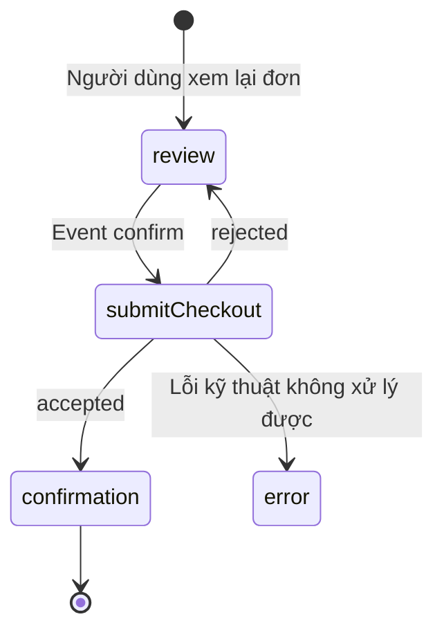

# Tách logic điều hướng khỏi quy tắc nghiệp vụ trong service

Trong một hành trình web nhiều bước, flow cần quyết định người dùng sẽ đi đến màn hình nào sau mỗi event. Đồng thời, ứng dụng phải kiểm tra các quy tắc nghiệp vụ như đơn hàng có hợp lệ không, sản phẩm còn tồn kho không hoặc người dùng có được phép thực hiện thao tác không. Hai loại quyết định này có liên quan nhưng thuộc hai trách nhiệm khác nhau.

Trong Spring Web Flow, `action-state` là nơi điều phối một hành động trong flow và chọn transition tiếp theo dựa trên event trả về. Service của ứng dụng chịu trách nhiệm thực thi quy tắc nghiệp vụ, truy cập dữ liệu và quản lý transaction. Khi tách đúng hai phần, flow mô tả hành trình tương tác; service bảo vệ tính đúng đắn của nghiệp vụ dù thao tác được gọi từ flow, REST API, batch hay một thành phần khác.

## 1. Ranh giới trách nhiệm

Một quy trình đặt hàng có thể được chia thành ba lớp trách nhiệm:

| Thành phần | Trách nhiệm | Ví dụ |
|---|---|---|
| Spring MVC / view | Nhận request, hiển thị form và gửi event của người dùng | Người dùng nhấn nút Xác nhận |
| Flow và `action-state` | Điều phối thứ tự các bước, gọi hành động cần thiết và chọn state tiếp theo | Sau khi gửi đơn, chuyển sang màn hình xác nhận hoặc màn hình sửa thông tin |
| Service nghiệp vụ | Kiểm tra bất biến, quyền, tồn kho, giá, lưu dữ liệu và quản lý transaction | Xác minh đơn còn hợp lệ rồi tạo đơn hàng |

Flow biết hành trình tương tác cần có những bước nào. Service biết điều kiện nào làm cho một thao tác nghiệp vụ hợp lệ. Ví dụ, flow có thể quyết định rằng kết quả `accepted` dẫn đến state `confirmation`, còn kết quả `rejected` đưa người dùng về state `review`. Nhưng quy tắc một mặt hàng có đủ tồn kho hay không phải nằm trong service hoặc domain model, vì đó là quy tắc nghiệp vụ và có thể được nhiều luồng sử dụng.

Không nên đặt toàn bộ logic vào controller hoặc biểu thức điều hướng. Controller và adapter kết nối HTTP với flow; flow điều phối state; service thực hiện nghiệp vụ. Ranh giới này giúp thay đổi giao diện hoặc hành trình mà không phải viết lại quy tắc cốt lõi.

## 2. `action-state` dùng để làm gì?

`action-state` là một state không hiển thị view. Khi flow đi vào state này, Spring Web Flow thực thi một hoặc nhiều action. Kết quả của action được biểu diễn thành event; các transition của state chọn hướng đi dựa trên event đó.

Ví dụ, flow thanh toán có thể đi theo hành trình:



`action-state` phù hợp với các công việc điều phối như gọi service, chuẩn bị dữ liệu cho state tiếp theo, ghi nhận kết quả vào flow scope hoặc chuyển tiếp theo event. Nó không phải nơi để triển khai các quy tắc tính giá, kiểm tra tồn kho, phân quyền hay quyết định trạng thái hợp lệ của đơn hàng.

Một state có thể thực thi nhiều action theo thứ tự. Tuy nhiên, nên giữ mỗi hành động rõ ràng và có mục đích. Nếu một state bắt đầu chứa nhiều điều kiện nghiệp vụ lồng nhau, nhiều truy vấn dữ liệu và các bước cập nhật phức tạp, đó là dấu hiệu cần chuyển phần xử lý vào service.

## 3. Để service quyết định nghiệp vụ, flow quyết định transition

Giả sử người dùng xác nhận đơn hàng. Quy trình hợp lý là:

1. View gửi event `confirm` khi người dùng nhấn nút xác nhận.
2. Flow chuyển từ state `review` sang `submitCheckout`.
3. Action trong state lấy command cần thiết từ flow scope và gọi `CheckoutService`.
4. Service kiểm tra quyền, giá, tồn kho và các bất biến, sau đó thực hiện lưu đơn trong transaction.
5. Service trả về kết quả nghiệp vụ có ý nghĩa, ví dụ được chấp nhận hoặc bị từ chối do dữ liệu không còn hợp lệ.
6. Action chuyển kết quả thành event của flow. Flow dùng event để chọn state tiếp theo.

Như vậy, service không cần biết tên view `confirmation` hay `review`. Service cũng không cần phụ thuộc vào `RequestContext`, `FlowExecution` hoặc API điều hướng của Spring Web Flow. Ngược lại, flow không tự tính toán hoặc tái hiện các quy tắc nghiệp vụ.

## 4. Ví dụ triển khai

### 4.1. Service chứa quy tắc nghiệp vụ

Service nhận một command thể hiện ý định của người dùng. Nó tự tải dữ liệu cần thiết từ nguồn tin cậy và kiểm tra lại điều kiện ngay tại thời điểm thực hiện thao tác.

```java
public interface CheckoutService {
    CheckoutResult submit(CheckoutCommand command);
}
```

Một triển khai service có thể thực hiện các bước nghiệp vụ như sau:

```java
public class DefaultCheckoutService implements CheckoutService {
    private final CartRepository cartRepository;
    private final InventoryService inventoryService;
    private final OrderRepository orderRepository;

    public DefaultCheckoutService(
            CartRepository cartRepository,
            InventoryService inventoryService,
            OrderRepository orderRepository) {
        this.cartRepository = cartRepository;
        this.inventoryService = inventoryService;
        this.orderRepository = orderRepository;
    }

    @Transactional
    @Override
    public CheckoutResult submit(CheckoutCommand command) {
        Cart cart = cartRepository.findById(command.getCartId());
        if (cart == null || cart.isEmpty()) {
            return CheckoutResult.rejected("CART_NOT_AVAILABLE");
        }

        if (!inventoryService.hasStock(cart)) {
            return CheckoutResult.rejected("OUT_OF_STOCK");
        }

        Order order = Order.from(cart, command.getShippingAddressId());
        orderRepository.save(order);
        return CheckoutResult.accepted(order.getOrderNumber());
    }
}
```

Đây là ví dụ rút gọn về cách phân lớp; các repository, kiểu dữ liệu và phương thức cần được định nghĩa theo ứng dụng. Điểm quan trọng là service tự đọc giỏ hàng và tồn kho để xác minh trạng thái hiện hành. Nó không tin rằng dữ liệu trong form hoặc flow scope vẫn còn đúng sau nhiều request.

`@Transactional` đặt ranh giới transaction tại service vì đây là nơi phối hợp các thay đổi dữ liệu nghiệp vụ. Trong ứng dụng thực tế, cần xác định rõ các trường hợp từ chối dự kiến, lỗi cạnh tranh tồn kho, lỗi truy cập dữ liệu và chính sách rollback.

### 4.2. Action chuyển kết quả service thành event

Action đóng vai trò bộ chuyển đổi giữa ngữ cảnh của flow và API nghiệp vụ. Nó lấy command từ flow scope, gọi service, lưu kết quả để view tiếp theo có thể hiển thị và trả về event cho flow.

```java
import org.springframework.webflow.execution.Action;
import org.springframework.webflow.execution.Event;
import org.springframework.webflow.execution.RequestContext;

public class SubmitCheckoutAction implements Action {
    private final CheckoutService checkoutService;

    public SubmitCheckoutAction(CheckoutService checkoutService) {
        this.checkoutService = checkoutService;
    }

    @Override
    public Event execute(RequestContext context) {
        CheckoutCommand command = (CheckoutCommand)
                context.getFlowScope().get("checkoutCommand");

        CheckoutResult result = checkoutService.submit(command);
        context.getFlowScope().put("checkoutResult", result);

        return new Event(this,
                result.isAccepted() ? "accepted" : "rejected");
    }
}
```

Action biết `RequestContext` vì nó là thành phần tích hợp với flow. Service chỉ nhận `CheckoutCommand` và trả về `CheckoutResult`, do đó có thể được kiểm thử hoặc tái sử dụng độc lập với Spring Web Flow. Trong code sản phẩm, cần kiểm tra command tồn tại và có cấu trúc hợp lệ trước khi gọi service; các kiểm tra bảo mật và quy tắc nghiệp vụ vẫn phải được service thực hiện lại.

Kết quả `rejected` trong ví dụ là một kết quả nghiệp vụ dự kiến, chẳng hạn giỏ hàng không còn hợp lệ. Lỗi kỹ thuật như database không truy cập được nên được xử lý theo chính sách lỗi của ứng dụng, thường thông qua exception handling của flow hoặc tầng web. Không nên bắt mọi exception rồi biến thành `rejected`, vì như vậy người dùng và hệ thống vận hành sẽ không phân biệt được dữ liệu không hợp lệ với sự cố hạ tầng.

### 4.3. Khai báo action và transition trong flow

Đăng ký action như một Spring bean và inject service qua constructor:

```xml
<bean id="submitCheckoutAction"
      class="com.example.checkout.SubmitCheckoutAction">
    <constructor-arg ref="checkoutService" />
</bean>
```

Flow gọi action trong `action-state` rồi ánh xạ event thành state tiếp theo:

```xml
<view-state id="review" model="checkoutCommand">
    <transition on="confirm" to="submitCheckout" />
</view-state>

<action-state id="submitCheckout">
    <evaluate expression="submitCheckoutAction.execute(flowRequestContext)" />
    <transition on="accepted" to="confirmation" />
    <transition on="rejected" to="review" />
</action-state>

<view-state id="confirmation">
    <on-entry>
        <evaluate expression="flowScope.checkoutResult.orderNumber"
                  result="viewScope.orderNumber" />
    </on-entry>
</view-state>
```

Đoạn XML minh họa cách nối các thành phần: event `confirm` kích hoạt action-state; action trả về event `accepted` hoặc `rejected`; flow chọn transition tương ứng. Cần điều chỉnh package, bean, model và state đích cho đúng flow của ứng dụng. Nếu cần hiển thị thông báo lỗi nghiệp vụ, có thể lưu mã lỗi hoặc thông tin kết quả phù hợp trong flow scope rồi để view trình bày thông điệp thân thiện.

Trong flow lớn hơn, state `review` có thể có các transition quay lại bước nhập địa chỉ hoặc chỉnh sửa giỏ hàng. Những lựa chọn này là điều hướng. Service vẫn là nơi quyết định một đơn hàng cụ thể có thể được chấp nhận hay không.

## 5. Những việc nên và không nên đặt trong action

Action nên làm các việc gắn với vòng đời flow:

- Đọc dữ liệu đầu vào từ flow scope hoặc request context.
- Gọi một phương thức service có tên thể hiện ý định nghiệp vụ.
- Đặt kết quả cần cho state tiếp theo vào scope phù hợp.
- Chuyển kết quả thành event có ý nghĩa đối với flow.
- Phối hợp các bước tương tác, ví dụ gọi service rồi chuyển sang state hiển thị kết quả.

Các việc sau nên thuộc service hoặc domain model:

- Kiểm tra quyền thực hiện nghiệp vụ và các bất biến của đối tượng.
- Tính giá, phí, thuế, hạn mức hoặc chính sách chiết khấu.
- Kiểm tra tồn kho, trạng thái tài khoản, điều kiện đặt chỗ.
- Lưu dữ liệu và phối hợp transaction.
- Bảo đảm thao tác an toàn khi request được gửi lại hoặc chạy đồng thời.

Tránh viết biểu thức EL dài chứa điều kiện nghiệp vụ, ví dụ tự so sánh tổng tiền, tự kiểm tra vai trò hoặc truy vấn repository ngay trong flow XML. Những biểu thức như vậy khó kiểm thử, dễ lặp lại và làm cho định nghĩa flow phụ thuộc sâu vào cấu trúc dữ liệu nội bộ.

## 6. Chọn event và xử lý các kết quả

Event là giao ước giữa action và flow. Nên đặt tên theo kết quả có ý nghĩa ở cấp điều phối, không để tên event tiết lộ chi tiết triển khai của database hoặc thuật toán nội bộ.

| Kết quả từ action/service | Ý nghĩa | Hướng xử lý trong flow |
|---|---|---|
| `accepted` | Nghiệp vụ được chấp nhận | Chuyển đến state xác nhận |
| `rejected` | Yêu cầu không đáp ứng điều kiện nghiệp vụ dự kiến | Quay lại state review và hiển thị lý do phù hợp |
| `requiresCorrection` | Cần người dùng bổ sung hoặc sửa dữ liệu | Chuyển đến view state nhập thông tin |
| Exception kỹ thuật | Không thể hoàn thành do sự cố ngoài kết quả nghiệp vụ dự kiến | Đưa qua exception handler hoặc trang lỗi phù hợp |

Không cần tạo quá nhiều event cho từng mã lỗi nội bộ. Service có thể trả một result object chứa mã lỗi ổn định, còn action ánh xạ nhóm kết quả sang event mà flow hiểu. View có thể dùng mã lỗi để hiển thị thông báo tương ứng mà không phải biết cấu trúc exception hoặc repository.

Nếu chỉ có một kết quả thành công và không cần phân nhánh, action-state có thể thực hiện action rồi dùng transition mặc định sang state kế tiếp. Khi có nhiều kết quả, hãy khai báo các transition rõ ràng và bảo đảm mọi event dự kiến đều có hướng xử lý. Các trường hợp không mong đợi cần được ghi nhận và xử lý ở tầng exception phù hợp.

## 7. Validation, bảo mật và dữ liệu scope

Validation của form và kiểm tra nghiệp vụ có mục đích khác nhau. Form validation giúp phản hồi sớm cho người dùng về định dạng hoặc trường bắt buộc, chẳng hạn email không đúng định dạng hay địa chỉ bị bỏ trống. Service validation kiểm tra điều kiện nghiệp vụ tại thời điểm thực hiện, chẳng hạn địa chỉ có thuộc người dùng hiện tại hay sản phẩm còn được phép bán hay không.

Một form hợp lệ không đồng nghĩa thao tác nghiệp vụ được phép. Người dùng có thể sửa request, mở nhiều tab hoặc để trang quá lâu khiến dữ liệu trở nên cũ. Vì vậy, service phải xác minh quyền và dữ liệu từ nguồn tin cậy trong mỗi thao tác quan trọng. Không sử dụng execution key, flow scope hoặc giá trị ẩn trong form làm bằng chứng phân quyền.

Flow scope thích hợp để giữ command hoặc dữ liệu cần qua nhiều state. View scope thích hợp với dữ liệu gắn với một view state. Chỉ lưu những dữ liệu cần thiết cho hành trình; ưu tiên ID và bản nháp nhỏ. Không giữ kết nối database, request/response, transaction hoặc tài nguyên có vòng đời ngắn trong scope của flow.

Sau khi action gọi service, chỉ lưu kết quả tối thiểu cần cho view kế tiếp. Nếu dữ liệu nghiệp vụ có thể thay đổi, view nên tải lại dữ liệu hiện hành qua service khi cần. Đừng xem bản sao trong flow scope là nguồn dữ liệu chuẩn cho các quyết định quan trọng.

## 8. Transaction, gửi lại request và lỗi

Một action-state có thể được gọi lại khi người dùng gửi lại request, mở nhiều tab hoặc gặp lỗi mạng. Do đó, thao tác tạo đơn, giữ chỗ hoặc thanh toán cần được thiết kế để xử lý an toàn khi lặp. Service có thể dùng mã yêu cầu duy nhất, ràng buộc duy nhất trong database hoặc cơ chế idempotency phù hợp để tránh tạo side effect trùng lặp.

Transaction nên bao quanh phần thay đổi dữ liệu nghiệp vụ ở service. Không nên giữ transaction mở xuyên suốt nhiều màn hình của một flow, vì người dùng có thể mất nhiều phút giữa các bước. Mỗi request nên thực hiện một đơn vị công việc ngắn; flow chỉ lưu trạng thái điều hướng và dữ liệu cần thiết để tiếp tục.

Phân biệt lỗi nghiệp vụ dự kiến với lỗi kỹ thuật:

- Thiếu hàng hoặc giỏ hàng đã hết hạn có thể là kết quả từ chối có thể trình bày cho người dùng.
- Mất kết nối database hoặc lỗi lập trình thường là exception cần được ghi nhận và xử lý theo cơ chế lỗi.
- Lỗi xác thực hoặc phân quyền cần được xử lý theo chính sách bảo mật, không chỉ đơn giản chuyển đến một view khác.

Nếu service đã commit giao dịch rồi nhưng việc render view thất bại, việc khôi phục flow không tự hoàn tác giao dịch. Khi người dùng thử lại, service cần nhận diện yêu cầu đã được xử lý để tránh tạo đơn lần thứ hai.

## 9. Kiểm thử từng lớp

Phân tách trách nhiệm giúp kiểm thử tập trung vào hợp đồng của từng lớp.

**Kiểm thử service:** kiểm tra quy tắc nghiệp vụ độc lập với Spring Web Flow. Ví dụ, giỏ hàng rỗng phải bị từ chối; hết tồn kho không được tạo đơn; đơn hợp lệ được lưu đúng một lần; lỗi trong quá trình ghi dữ liệu phải tuân theo chính sách transaction.

**Kiểm thử action:** giả lập `RequestContext` và service để xác minh action đọc đúng command, gọi đúng service, lưu kết quả vào scope và trả đúng event. Kiểm tra cả kết quả được chấp nhận, bị từ chối và exception.

**Kiểm thử flow:** dùng kiểm thử tích hợp của Spring Web Flow để khởi chạy flow, phát event `confirm`, rồi xác minh state cuối cùng. Cần kiểm tra cả nhánh `accepted`, `rejected` và đường xử lý lỗi; đồng thời xác minh dữ liệu cần thiết có mặt ở view state tương ứng.

**Kiểm thử tích hợp nghiệp vụ:** xác minh transaction, quyền truy cập, request lặp và hai request cạnh tranh. Đây là các điều kiện không thể chứng minh chỉ bằng kiểm thử transition của flow.

Một số tình huống nên có trong bộ kiểm thử:

1. Người dùng gửi form hợp lệ và service chấp nhận đơn; flow đi đến `confirmation`.
2. Service từ chối vì hết tồn kho; flow quay lại `review` và hiển thị lý do phù hợp.
3. Người dùng thay đổi ID trong request; service vẫn kiểm tra quyền sở hữu dữ liệu.
4. Người dùng gửi event xác nhận hai lần; nghiệp vụ không tạo hai đơn.
5. Service phát sinh lỗi hạ tầng; flow đi qua exception handling đã cấu hình và lỗi được ghi nhận.
6. Hai execution độc lập không dùng chung dữ liệu flow scope.

## 10. Các dấu hiệu thiết kế cần xem lại

- Flow XML chứa nhiều biểu thức tính toán, so sánh giá trị hoặc truy vấn dữ liệu. Hãy chuyển quy tắc đó vào service/domain model.
- Action tự cập nhật nhiều repository hoặc mở transaction. Hãy gom thao tác nghiệp vụ vào một service method có ranh giới transaction rõ ràng.
- Service nhận `RequestContext` hoặc trả về tên view. Hãy thay bằng command/result độc lập với framework flow.
- Controller chứa logic chọn state hoặc gọi nhiều service để điều phối hành trình. Hãy để flow thực hiện điều phối.
- Action nuốt mọi exception và trả một event chung. Hãy phân loại kết quả nghiệp vụ dự kiến và lỗi kỹ thuật.
- Flow scope lưu toàn bộ entity hoặc object graph lớn. Hãy lưu dữ liệu tối thiểu và đọc lại qua service khi cần.

Khi một thay đổi chỉ liên quan đến thứ tự màn hình, thường chỉ cần chỉnh flow. Khi một quy tắc như điều kiện đặt hàng thay đổi, service và các kiểm thử nghiệp vụ là nơi cần cập nhật. Nếu thay đổi cả hai, hãy giữ giao ước giữa service result và flow event ổn định, rõ ràng.

## 11. Nguyên tắc áp dụng

1. Dùng `action-state` để điều phối một hành động và chọn transition theo event.
2. Gọi service bằng command có ý nghĩa nghiệp vụ; không truyền `RequestContext` vào service.
3. Để service kiểm tra dữ liệu, quyền, bất biến và thực hiện transaction.
4. Để action chuyển kết quả service thành event phù hợp với hành trình flow.
5. Giữ flow XML ngắn, dễ đọc; tránh nhúng quy tắc nghiệp vụ vào biểu thức EL.
6. Phân biệt kết quả nghiệp vụ dự kiến với exception kỹ thuật.
7. Kiểm thử service, action và flow ở các cấp riêng biệt, sau đó kiểm thử tích hợp các tình huống gửi lại request và truy cập đồng thời.

`action-state` và service bổ sung cho nhau: action-state biết bước nào tiếp theo trong hành trình web, còn service biết thao tác nào hợp lệ và cách thực hiện nó an toàn. Khi giữ đúng ranh giới này, flow dễ thay đổi theo trải nghiệm người dùng, còn quy tắc nghiệp vụ vẫn nhất quán trên toàn ứng dụng Spring Web Flow.
