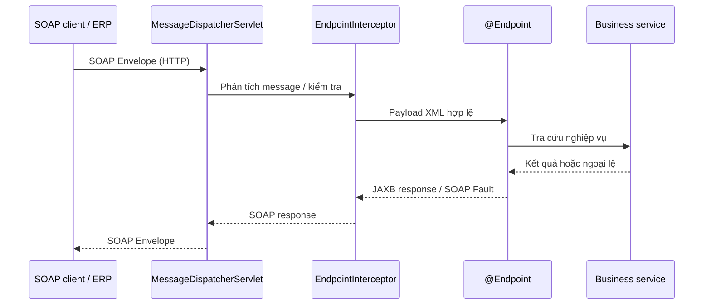

# Spring Web Services là gì và giải quyết bài toán tích hợp SOAP như thế nào?

## 1. Bối cảnh: vì sao hệ thống doanh nghiệp vẫn cần SOAP?

Giả sử một nền tảng thương mại điện tử cần tra cứu trạng thái đơn hàng trong hệ thống ERP của đối tác. ERP chỉ công bố dịch vụ SOAP, yêu cầu gửi XML đúng cấu trúc đã thống nhất, xác thực bằng chứng chỉ và trả về mã lỗi theo chuẩn SOAP Fault. Hai bên triển khai bằng ngôn ngữ khác nhau; việc tích hợp phải ổn định qua nhiều lần nâng cấp.

Ở đây, vấn đề không đơn thuần là gửi một HTTP request. Hệ thống cần một **hợp đồng tích hợp có thể kiểm chứng**, cơ chế biến đổi XML ↔ đối tượng Java, điểm tiếp nhận thông điệp, xử lý lỗi, bảo mật và kiểm thử khả năng tương thích giữa các bên.

**Spring Web Services (Spring-WS)** là một framework thuộc hệ sinh thái Spring để xây dựng và tiêu thụ dịch vụ web dựa trên XML/SOAP. Spring-WS ưu tiên cách tiếp cận **contract-first**: xác định hợp đồng XML của dịch vụ trước, sau đó triển khai Java theo hợp đồng đó. Framework cung cấp cơ chế phân phối thông điệp tới endpoint, ánh xạ XML, SOAP client, interceptor, kiểm thử và tích hợp các giải pháp WS-Security.

Sau bài này, người học có thể:

- Giải thích vai trò của SOAP, XSD, WSDL, JAXB và Spring-WS trong một giao dịch tích hợp.
- Nhận diện các thành phần xử lý một thông điệp SOAP từ client tới business service rồi quay lại.
- Minh họa quy trình contract-first bằng một dịch vụ tra cứu đơn hàng.
- Phân biệt trách nhiệm của hợp đồng dữ liệu, logic ứng dụng, SOAP Fault, bảo mật và kiểm thử tương thích.
- Quyết định khi nào nên dùng Spring-WS và những điểm cần xác minh trước khi tích hợp đối tác.

## 2. SOAP, XSD, WSDL và JAXB nằm ở đâu trong bài toán?

Các khái niệm này giải quyết những câu hỏi khác nhau:

| Thành phần | Trả lời câu hỏi | Vai trò thực tế |
|---|---|---|
| **SOAP** (Simple Object Access Protocol) | Thông điệp được bao gói và trao đổi ra sao? | Quy định cấu trúc XML gồm `Envelope`, tùy chọn `Header`, `Body` và `Fault`; có thể đi qua HTTP hoặc cơ chế truyền khác tùy giải pháp tích hợp. |
| **XSD** (XML Schema Definition) | Dữ liệu XML hợp lệ có cấu trúc và kiểu gì? | Quy định phần tử, kiểu dữ liệu, thứ tự trường, ràng buộc bắt buộc/tùy chọn và namespace. |
| **WSDL** (Web Services Description Language) | Dịch vụ công bố thao tác, thông điệp và địa chỉ nào? | Mô tả các operation, message, binding, protocol và endpoint để bên tiêu thụ lập trình theo hợp đồng. |
| **JAXB** (Jakarta XML Binding ở các stack Jakarta mới) | Chuyển XML thành đối tượng Java và ngược lại thế nào? | Unmarshal request XML sang Java; marshal response Java thành XML; thường dùng lớp sinh từ XSD. |
| **Spring-WS** | Ứng dụng Spring triển khai và gọi SOAP ra sao? | Đăng ký SOAP servlet, tìm endpoint theo payload, xử lý XML, interceptor, SOAP client và các tích hợp liên quan. |

### 2.1. Cấu trúc một SOAP message

SOAP 1.1 request minh họa:

```xml
<soapenv:Envelope
    xmlns:soapenv="http://schemas.xmlsoap.org/soap/envelope/"
    xmlns:ord="https://example.org/order/v1">
  <soapenv:Header/>
  <soapenv:Body>
    <ord:GetOrderRequest>
      <ord:orderId>PO-1001</ord:orderId>
    </ord:GetOrderRequest>
  </soapenv:Body>
</soapenv:Envelope>
```

- `Envelope` là lớp bao ngoài của thông điệp SOAP.
- `Header` tùy chọn, thường mang metadata phục vụ định tuyến, xác thực, chữ ký, timestamp hoặc các chính sách mở rộng.
- `Body` mang yêu cầu hoặc phản hồi nghiệp vụ. Trong ví dụ, payload nghiệp vụ là `GetOrderRequest`.
- `Fault` là cấu trúc báo lỗi theo SOAP, xuất hiện trong `Body` khi xử lý thất bại.

Namespace `http://schemas.xmlsoap.org/soap/envelope/` là namespace của **SOAP 1.1**. SOAP 1.2 sử dụng `http://www.w3.org/2003/05/soap-envelope` và có khác biệt về fault cũng như media type (thường là `application/soap+xml` thay cho `text/xml` của SOAP 1.1). Không được mặc định hai phiên bản có thể trao đổi tùy ý.

**Lưu ý quan trọng:** SOAP là giao thức thông điệp; WSDL là mô tả hợp đồng dịch vụ. Một dịch vụ SOAP có thể có WSDL, nhưng cần hiểu riêng phần cấu trúc thông điệp, kiểu dữ liệu và cách công bố endpoint.

### 2.2. “Contract-first” nghĩa là gì?

Với cách tiếp cận contract-first, nhóm tích hợp thống nhất **XML namespace, XSD, cấu trúc request/response, operation, kiểu Fault và binding** trước khi triển khai business logic. Java phải tuân theo hợp đồng; thay đổi tên class, package hoặc cấu trúc nội bộ không nên âm thầm làm thay đổi XML mà đối tác nhìn thấy.

Điều này đặc biệt hữu ích khi:

1. Client và server do hai tổ chức khác nhau triển khai.
2. Hợp đồng cần được review, quản lý phiên bản và kiểm tra bằng công cụ độc lập với Java.
3. Dữ liệu XML phải tương thích với hệ thống .NET, Java cũ, ESB hoặc phần mềm đóng gói sẵn.
4. Quy định bảo mật yêu cầu chữ ký XML, token, timestamp hoặc chứng chỉ.

**Không nên hiểu nhầm:** contract-first không có nghĩa là luôn phải viết tay toàn bộ WSDL. Có thể thiết kế XSD trước rồi dùng Spring-WS tạo WSDL 1.1 từ schema theo quy tắc đặt tên; cũng có thể quản lý một WSDL tĩnh làm hợp đồng chuẩn. Trong môi trường yêu cầu kiểm soát chặt operation, binding, policy và phiên bản, WSDL tĩnh được review là lựa chọn dễ dự đoán hơn.

## 3. Spring-WS giải quyết những phần nào?

Spring-WS tập trung vào **thông điệp XML** và hoạt động theo kiểu **payload-centric**: endpoint thường được chọn theo phần tử gốc của payload (QName, gồm namespace + local name), thay vì dựa vào tên method Java hay đường dẫn REST.



Các khối chính:

| Khối | Trách nhiệm |
|---|---|
| `MessageDispatcherServlet` | Tiếp nhận và phân phối SOAP message đến cơ chế xử lý của Spring-WS; thường ánh xạ dưới `/ws/*`. |
| `EndpointMapping` | Xác định endpoint dựa vào thông tin message, phổ biến là QName của phần tử payload. |
| `@Endpoint`, `@PayloadRoot` | Khai báo lớp xử lý XML payload và operation tương ứng. |
| `@RequestPayload`, `@ResponsePayload` | Liên kết payload request/response với tham số, giá trị trả về của endpoint thông qua adapter/marshaller phù hợp. |
| JAXB / `Jaxb2Marshaller` | Ánh xạ giữa XML và Java theo lớp tương ứng với schema. |
| `EndpointInterceptor` | Thực thi logic xuyên suốt như validate XML, kiểm tra bảo mật, audit hoặc quan sát thông điệp. |
| `WebServiceTemplate` | API phía client để gửi SOAP request, nhận SOAP response và ánh xạ dữ liệu. |
| `SoapFaultMappingExceptionResolver` | Hỗ trợ ánh xạ ngoại lệ Java thành SOAP Fault có kiểm soát. |

Các thành phần trên phục vụ lớp tích hợp. Logic nghiệp vụ thực tế vẫn nên nằm trong service/domain riêng, để endpoint chỉ làm nhiệm vụ chuyển đổi hợp đồng và điều phối lời gọi.

## 4. Ví dụ contract-first: xây dựng dịch vụ tra cứu đơn hàng

Tình huống: một đối tác gửi `GetOrderRequest` chứa mã đơn hàng. Hệ thống trả `GetOrderResponse` chứa mã đơn, trạng thái và tổng tiền. Namespace hợp đồng là `https://example.org/order/v1`. Các đoạn dưới đây minh họa Spring Boot dùng Spring-WS với hệ thư viện Jakarta (ví dụ Spring Boot 3.x và Java 17+); khi sử dụng phiên bản khác, cần kiểm tra tương thích dependency và gói JAXB `jakarta.*`/`javax.*`.

### Bước 1. Định nghĩa XSD trước

Lưu tại `src/main/resources/orders.xsd`:

```xml
<?xml version="1.0" encoding="UTF-8"?>
<xs:schema xmlns:xs="http://www.w3.org/2001/XMLSchema"
           targetNamespace="https://example.org/order/v1"
           xmlns:tns="https://example.org/order/v1"
           elementFormDefault="qualified">

  <xs:element name="GetOrderRequest">
    <xs:complexType>
      <xs:sequence>
        <xs:element name="orderId" type="xs:string"/>
      </xs:sequence>
    </xs:complexType>
  </xs:element>

  <xs:element name="GetOrderResponse">
    <xs:complexType>
      <xs:sequence>
        <xs:element name="orderId" type="xs:string"/>
        <xs:element name="status" type="xs:string"/>
        <xs:element name="totalAmount" type="xs:decimal"/>
      </xs:sequence>
    </xs:complexType>
  </xs:element>
</xs:schema>
```

Các điểm cần đọc trong XSD:

- `targetNamespace` là định danh của hợp đồng XML. Đổi namespace có thể khiến client không nhận ra operation cũ.
- `elementFormDefault="qualified"` khiến các phần tử con trong nội dung XML thuộc namespace hợp đồng.
- `xs:sequence` yêu cầu thứ tự phần tử đúng như khai báo. XML có đủ trường nhưng sai thứ tự vẫn có thể không hợp lệ.
- `xs:decimal` cho `totalAmount` hỗ trợ số thập phân theo XML Schema; phía Java thường ánh xạ thành `BigDecimal`.
- Các phần tử đang bắt buộc theo mặc định (`minOccurs="1"`). Khi cần mở rộng, phải cân nhắc `minOccurs`, `maxOccurs` và khả năng tương thích của client hiện có.

Trong sản phẩm thực, hợp đồng cần quy định thêm độ dài mã đơn, đơn vị tiền tệ, enum trạng thái, quy tắc phiên bản và cấu trúc lỗi nghiệp vụ. Không nên xem schema minh họa này là hợp đồng đủ cho mọi ERP.

### Bước 2. Bổ sung dependency và sinh lớp JAXB

Với Spring Boot, dependency nền tảng có thể khai báo như sau:

```xml
<dependency>
  <groupId>org.springframework.boot</groupId>
  <artifactId>spring-boot-starter-web-services</artifactId>
</dependency>
```

Thực hiện **generate JAXB classes từ XSD** bằng một plugin XJC/JAXB tương thích với phiên bản JDK và Jakarta của dự án. Kết quả mong muốn là các kiểu như `GetOrderRequest`, `GetOrderResponse` trong package ví dụ `com.example.orders.schema`. Một số cấu hình sinh mã trả về `JAXBElement<T>` thay vì object có `@XmlRootElement`; vì vậy client/endpoint cần tuân theo chính xác mã được sinh ra.

Trên các JDK hiện đại, JAXB không còn là thư viện tích hợp sẵn trong JDK: cấu hình build cần có JAXB API/runtime phù hợp. Không trộn classes dựa trên `javax.xml.bind` với runtime yêu cầu `jakarta.xml.bind`.

### Bước 3. Công bố WSDL và đăng ký SOAP servlet

Ví dụ cấu hình Java:

```java
import org.springframework.boot.web.servlet.ServletRegistrationBean;
import org.springframework.context.ApplicationContext;
import org.springframework.context.annotation.Bean;
import org.springframework.context.annotation.Configuration;
import org.springframework.core.io.ClassPathResource;
import org.springframework.ws.config.annotation.EnableWs;
import org.springframework.ws.transport.http.MessageDispatcherServlet;
import org.springframework.ws.wsdl.wsdl11.DefaultWsdl11Definition;
import org.springframework.xml.xsd.SimpleXsdSchema;
import org.springframework.xml.xsd.XsdSchema;

@EnableWs
@Configuration
public class SoapWebServiceConfig {

    @Bean
    public ServletRegistrationBean<MessageDispatcherServlet> soapServlet(
            ApplicationContext applicationContext) {
        MessageDispatcherServlet servlet = new MessageDispatcherServlet();
        servlet.setApplicationContext(applicationContext);
        servlet.setTransformWsdlLocations(true);
        return new ServletRegistrationBean<>(servlet, "/ws/*");
    }

    @Bean
    public XsdSchema ordersSchema() {
        return new SimpleXsdSchema(new ClassPathResource("orders.xsd"));
    }

    @Bean(name = "orders")
    public DefaultWsdl11Definition ordersWsdl(XsdSchema ordersSchema) {
        DefaultWsdl11Definition definition = new DefaultWsdl11Definition();
        definition.setPortTypeName("OrdersPort");
        definition.setLocationUri("/ws");
        definition.setTargetNamespace("https://example.org/order/v1");
        definition.setSchema(ordersSchema);
        return definition;
    }
}
```

Với cấu hình trên, Spring-WS có thể cung cấp WSDL tại đường dẫn dạng `/ws/orders.wsdl` (phụ thuộc context path và cách triển khai). `DefaultWsdl11Definition` suy ra operation từ các tên phần tử request/response theo hậu tố thông dụng như `Request` và `Response`; ở đây operation tương ứng là `GetOrder`. Nếu naming convention, SOAPAction, binding hoặc chính sách hợp đồng không khớp yêu cầu đối tác, hãy dùng WSDL tĩnh đã thống nhất (chẳng hạn qua `SimpleWsdl11Definition`) hoặc cấu hình tạo WSDL phù hợp.

`setTransformWsdlLocations(true)` có thể điều chỉnh địa chỉ công bố trong WSDL theo request. Với reverse proxy/API gateway, phải kiểm tra URL công khai, scheme HTTPS và forwarded headers; đừng giả định địa chỉ backend nội bộ luôn đúng cho client.

### Bước 4. Viết SOAP endpoint, tách nghiệp vụ khỏi giao thức

```java
import com.example.orders.schema.GetOrderRequest;
import com.example.orders.schema.GetOrderResponse;
import org.springframework.ws.server.endpoint.annotation.Endpoint;
import org.springframework.ws.server.endpoint.annotation.PayloadRoot;
import org.springframework.ws.server.endpoint.annotation.RequestPayload;
import org.springframework.ws.server.endpoint.annotation.ResponsePayload;

@Endpoint
public class OrderEndpoint {
    private static final String NAMESPACE = "https://example.org/order/v1";
    private final OrderQueryService orderQueryService;

    public OrderEndpoint(OrderQueryService orderQueryService) {
        this.orderQueryService = orderQueryService;
    }

    @PayloadRoot(namespace = NAMESPACE, localPart = "GetOrderRequest")
    @ResponsePayload
    public GetOrderResponse getOrder(@RequestPayload GetOrderRequest request) {
        // OrderQueryService là service nghiệp vụ do ứng dụng tự triển khai.
        Order order = orderQueryService.findById(request.getOrderId());

        GetOrderResponse response = new GetOrderResponse();
        response.setOrderId(order.id());
        response.setStatus(order.status());
        response.setTotalAmount(order.totalAmount());
        return response;
    }
}
```

Đoạn code giả định các lớp JAXB đã sinh có getter/setter như ví dụ và `Order` là kiểu domain của ứng dụng (với `id()`, `status()`, `totalAmount()`). Nếu XJC tạo `JAXBElement` hoặc API khác, điều chỉnh chữ ký cho đúng lớp sinh mã.

Ở đây, Spring-WS sẽ ánh xạ payload có QName `{https://example.org/order/v1}GetOrderRequest` tới method `getOrder`. Tên Java method không phải phần hợp đồng công khai; QName và dữ liệu XML mới là phần client dựa vào. Những lỗi như đơn hàng không tồn tại cần chuyển thành SOAP Fault có chủ đích, thay vì để lộ stack trace.

### Bước 5. Kiểm tra request/response SOAP thực tế

Ví dụ request gửi qua HTTP:

```http
POST /ws HTTP/1.1
Host: integration.example.org
Content-Type: text/xml; charset=utf-8

<soapenv:Envelope xmlns:soapenv="http://schemas.xmlsoap.org/soap/envelope/"
                  xmlns:ord="https://example.org/order/v1">
  <soapenv:Body>
    <ord:GetOrderRequest>
      <ord:orderId>PO-1001</ord:orderId>
    </ord:GetOrderRequest>
  </soapenv:Body>
</soapenv:Envelope>
```

Phần header `SOAPAction` có thể được yêu cầu tùy WSDL/binding và hệ thống đối tác; không nên tự đặt một giá trị khi chưa kiểm tra hợp đồng.

Response thành công có hình dạng:

```xml
<soapenv:Envelope xmlns:soapenv="http://schemas.xmlsoap.org/soap/envelope/"
                  xmlns:ord="https://example.org/order/v1">
  <soapenv:Body>
    <ord:GetOrderResponse>
      <ord:orderId>PO-1001</ord:orderId>
      <ord:status>PAID</ord:status>
      <ord:totalAmount>149.50</ord:totalAmount>
    </ord:GetOrderResponse>
  </soapenv:Body>
</soapenv:Envelope>
```

Khi kiểm thử, hãy so sánh **namespace, tên phần tử, thứ tự dữ liệu, kiểu dữ liệu và SOAP version** với hợp đồng, thay vì chỉ nhìn xem HTTP có trả 200 hay không.

## 5. Đóng vai trò SOAP client bằng `WebServiceTemplate`

Spring-WS hỗ trợ cả phía cung cấp lẫn phía tiêu thụ SOAP. Với một đối tác chỉ công bố WSDL/XSD, quy trình client thường là: đọc hợp đồng → sinh lớp JAXB → cấu hình marshaller và message sender → gửi request → xử lý response/Fault.

Ví dụ client cấu hình bằng Spring:

```java
import org.springframework.context.annotation.Bean;
import org.springframework.context.annotation.Configuration;
import org.springframework.oxm.jaxb.Jaxb2Marshaller;
import org.springframework.ws.client.core.WebServiceTemplate;

@Configuration
public class OrderSoapClientConfig {

    @Bean
    public Jaxb2Marshaller orderMarshaller() {
        Jaxb2Marshaller marshaller = new Jaxb2Marshaller();
        marshaller.setContextPath("com.example.orders.schema");
        return marshaller;
    }

    @Bean
    public WebServiceTemplate orderWebServiceTemplate(
            Jaxb2Marshaller orderMarshaller) {
        WebServiceTemplate template = new WebServiceTemplate();
        template.setMarshaller(orderMarshaller);
        template.setUnmarshaller(orderMarshaller);
        template.setDefaultUri("https://partner.example.org/ws");
        return template;
    }
}
```

Gọi dịch vụ:

```java
GetOrderRequest request = new GetOrderRequest();
request.setOrderId("PO-1001");

GetOrderResponse response = (GetOrderResponse)
        orderWebServiceTemplate.marshalSendAndReceive(request);
```

Với những service có SOAPAction quy định trong WSDL, có thể truyền `new SoapActionCallback("...")` vào overload tương ứng của `marshalSendAndReceive`. Với các kiểu JAXB được sinh thành `JAXBElement`, cần gửi phần tử root phù hợp bằng `ObjectFactory`.

**Ứng dụng cần bổ sung trước khi chạy production:** endpoint từ cấu hình môi trường, kết nối HTTPS và truststore, timeout kết nối/đọc, lựa chọn SOAP version, bảo mật, logging có che dữ liệu nhạy cảm, phân loại lỗi và chính sách retry có kiểm soát. `WebServiceTemplate` tự giải quyết phần cơ chế gửi/nhận SOAP, nhưng không tự quyết định các chính sách nghiệp vụ đó.

## 6. Spring-WS xử lý các vấn đề tích hợp thực tế như thế nào?

### 6.1. SOAP Fault: lỗi có cấu trúc thay vì thông điệp tùy ý

SOAP Fault biểu diễn lỗi ở cấp giao thức. Ví dụ SOAP 1.1 khi yêu cầu sai:

```xml
<soapenv:Envelope xmlns:soapenv="http://schemas.xmlsoap.org/soap/envelope/">
  <soapenv:Body>
    <soapenv:Fault>
      <faultcode>soapenv:Client</faultcode>
      <faultstring>Invalid order identifier</faultstring>
    </soapenv:Fault>
  </soapenv:Body>
</soapenv:Envelope>
```

Ở SOAP 1.1, mã `Client` thường thể hiện lỗi do request, `Server` thể hiện lỗi phía xử lý. SOAP 1.2 đổi hệ mã tương ứng, ví dụ `Sender` và `Receiver`, đồng thời thay đổi cấu trúc fault. Ứng dụng không nên tự tạo XML Fault mà bỏ qua phiên bản SOAP đang dùng.

Trong Spring-WS, `SoapFaultMappingExceptionResolver` có thể ánh xạ exception Java thành fault có mã và lý do phù hợp. Với hợp đồng phức tạp, có thể cung cấp `detail` theo XSD/WS policy mà đối tác yêu cầu. Một bảng phân loại tham khảo:

| Sự kiện | Hướng xử lý |
|---|---|
| XML sai schema hoặc thiếu trường bắt buộc | Fault phản ánh yêu cầu không hợp lệ, kèm mã nghiệp vụ nếu hợp đồng quy định. |
| Đơn hàng không tồn tại | Fault nghiệp vụ có định danh ổn định hoặc response nghiệp vụ riêng, tùy thiết kế hợp đồng. |
| Hệ thống lưu trữ tạm thời lỗi | Fault phía server; chỉ retry khi thao tác an toàn và chính sách cho phép. |
| Xác thực/chữ ký không hợp lệ | Từ chối request, không tiết lộ chi tiết chứng chỉ hay dữ liệu bí mật. |

Không đưa stack trace, chuỗi kết nối hoặc dữ liệu nội bộ vào `faultstring`/`detail`. HTTP status có ý nghĩa vận chuyển nhưng client SOAP vẫn phải kiểm tra cấu trúc Fault; không dùng riêng status code để suy luận thành công hay thất bại.

### 6.2. Interceptor và kiểm tra XML

`EndpointInterceptor` chạy quanh quá trình xử lý endpoint, thích hợp cho các concern xuyên suốt. `PayloadValidatingInterceptor` có thể dùng XSD để validate payload request/response:

- **Request validation** bắt lỗi dữ liệu sai schema trước khi logic nghiệp vụ được gọi.
- **Response validation** giúp phát hiện server vô tình trả XML không tuân hợp đồng.
- **Observability** ghi correlation ID, thời gian xử lý và loại operation, có che nội dung nhạy cảm.
- **Security** kiểm tra bảo mật ở mức thông điệp thông qua cấu hình tương ứng.

Validation XSD chỉ chứng minh XML đúng cấu trúc. Các điều kiện như “đơn hàng thuộc đúng khách hàng”, “mã đã bị khóa” hay “giao dịch bị trùng” vẫn cần kiểm tra ở business service.

### 6.3. XML Security, WS-Security và chứng chỉ

Ba lớp thường bị nhầm lẫn:

| Cơ chế | Đảm bảo chính | Giới hạn và điều kiện |
|---|---|---|
| **HTTPS/TLS** | Mã hóa đường truyền và xác thực phía server bằng chứng chỉ. | Chỉ bảo vệ kênh truyền trong phạm vi phiên kết nối; cần quản lý CA/truststore và xác minh hostname. |
| **mTLS** | Xác thực cả client lẫn server bằng chứng chỉ TLS. | Chủ yếu xác thực hai đầu kết nối; không thay thế chữ ký XML nếu hợp đồng yêu cầu an toàn thông điệp qua trung gian. |
| **WS-Security** | Bảo vệ mức message: UsernameToken, timestamp, chữ ký XML, mã hóa XML tùy policy. | Hai bên phải thống nhất thuật toán, vị trí token, chứng chỉ, thời gian hiệu lực và chính sách xác thực. |

Spring-WS tích hợp WS-Security thông qua module `spring-ws-security` và hệ thư viện Apache WSS4J; ví dụ `Wss4jSecurityInterceptor` để kiểm tra hoặc thêm thành phần bảo mật cho SOAP message. Cấu hình phải dựa theo **policy của đối tác**, chẳng hạn ký phần `Body`, dùng X.509 certificate, yêu cầu timestamp hoặc UsernameToken; không mặc định rằng thêm UsernameToken đã đáp ứng mọi tiêu chuẩn WS-Security.

Đối với chứng chỉ, cần phân biệt **keystore** (private key và certificate của phía mình) với **truststore** (certificate/CA được tin cậy). Khi chứng chỉ quay vòng, nên có kế hoạch triển khai, thời điểm đổi và khả năng tương thích đồng thời giữa client/server.

Các biện pháp quan trọng khác:

- Tắt xử lý external entities/DTD không cần thiết và cấu hình XML parser an toàn để giảm nguy cơ XXE, entity expansion.
- Giới hạn kích thước message, timeout, concurrency và tài nguyên xử lý XML.
- Kiểm tra timestamp, clock skew, chống replay khi chính sách yêu cầu; không coi chữ ký hợp lệ là đủ cho mọi lần gửi lại.
- Tránh lưu plain-text password, private key, raw SOAP header hoặc dữ liệu khách hàng trong log.
- Ưu tiên thuật toán mật mã và thư viện còn được duy trì, kiểm tra tương thích với WSS4J và Spring-WS đang sử dụng.

### 6.4. Quản lý phiên bản hợp đồng và tương thích đối tác

Một thay đổi nhỏ ở Java vẫn có thể làm mất tương thích XML. Ví dụ đổi `GetOrderRequest` thành `FetchOrderRequest` hoặc đổi namespace `/v1` thành `/v2` sẽ thay đổi QName mà endpoint/client nhận diện.

Khi sửa hợp đồng, cần xem:

1. **Cấu trúc XSD:** đổi thứ tự `xs:sequence`, kiểu dữ liệu, min/max occurrences, enum, trường bắt buộc hay trường có thể nil.
2. **WSDL:** operation, binding, SOAPAction, endpoint address và message part.
3. **Fault:** mã lỗi và phần `detail` mà client đang xử lý.
4. **Bảo mật:** certificate, policy, thuật toán, SOAP header, timestamp.
5. **Triển khai:** proxy, context path, SOAP 1.1/1.2 và môi trường thử nghiệm.

Với thay đổi gây breaking change, có thể công bố namespace/endpoint phiên bản mới và giữ hợp đồng cũ trong giai đoạn chuyển tiếp. Không nên tự động giả định “thêm trường” luôn tương thích: client có validate chặt theo XSD hoặc code được sinh từ schema cũ vẫn có thể từ chối phần tử lạ.

### 6.5. Hiệu năng, idempotency và khả năng quan sát

SOAP/XML thường làm phát sinh chi phí parse, validate, marshal/unmarshal và xử lý chữ ký lớn hơn giao tiếp JSON đơn giản. Khi có tải cao, cần đo độ trễ từng bước, kích thước payload, số lỗi Fault, timeout của đối tác và bão hòa thread pool/kết nối.

Đối với thao tác đọc như `GetOrder`, retry có thể phù hợp sau một lỗi kết nối tạm thời. Đối với thao tác ghi như `CreatePayment`, retry mù quáng có thể tạo giao dịch trùng; cần business key/idempotency key hoặc cơ chế đối soát được hợp đồng quy định. Không coi “SOAP over HTTP” là đảm bảo xử lý chính xác một lần.

## 7. Kiểm thử đúng hợp đồng, không chỉ kiểm thử method Java

Một bài test gọi trực tiếp `orderEndpoint.getOrder(...)` có thể chứng minh business logic chạy đúng nhưng chưa xác minh hệ thống xử lý SOAP thật. Spring-WS cung cấp module `spring-ws-test` với các tiện ích như `MockWebServiceClient` cho endpoint và `MockWebServiceServer` cho SOAP client.

Các lớp kiểm thử nên bao gồm:

| Lớp kiểm thử | Ví dụ cần xác minh |
|---|---|
| **Schema validation** | Request/response đúng XSD; sai namespace, thiếu `orderId`, sai thứ tự hoặc sai kiểu dữ liệu đều bị nhận diện. |
| **Endpoint integration** | Envelope đi qua `MessageDispatcherServlet` tới đúng `@PayloadRoot`; phản hồi đúng QName/payload. |
| **SOAP client contract** | `WebServiceTemplate` gửi SOAPAction/binding đúng, unmarshalling phản hồi hợp lệ, xử lý Fault và timeout đúng. |
| **Negative test** | XML sai, nghiệp vụ lỗi, exception nội bộ, certificate hoặc signature không hợp lệ, request trùng. |
| **Interoperability** | Client từ công nghệ khác đọc được WSDL, sinh mã thành công và trao đổi cùng XML với server. |
| **Security & operations** | TLS/mTLS, truststore, policy WS-Security, xoay chứng chỉ, giới hạn kích thước message và log an toàn. |

**Cách làm thực tế:** chuẩn bị các cặp request/response XML chuẩn (golden samples) được đối tác chấp nhận; chạy validation bằng schema và test SOAP thực tế. So sánh theo cấu trúc XML và namespace thay vì so chuỗi byte, vì tiền tố namespace (`ord` hay `ns2`) và khoảng trắng có thể khác nhau mà ngữ nghĩa vẫn giống nhau.

Ví dụ một bộ ca kiểm thử tối thiểu cho `GetOrder`:

1. `PO-1001` tồn tại → `GetOrderResponse` với `status=PAID` và tổng tiền chính xác.
2. Thiếu `orderId` → từ chối theo validation/Fault đã quy định.
3. Request có namespace `https://example.org/order/v2` → không khớp endpoint của v1 nếu chưa cấu hình v2.
4. Đơn hàng không tồn tại → mã Fault hoặc response nghiệp vụ ổn định theo hợp đồng.
5. Certificate hết hạn hoặc chữ ký sai → bị từ chối theo chính sách bảo mật.

## 8. Khi nào chọn Spring-WS thay vì cách tích hợp khác?

| Tiêu chí | Spring-WS / SOAP | REST với JSON (đối chiếu) |
|---|---|---|
| Hợp đồng | XSD/WSDL thể hiện rõ cấu trúc XML, operation và binding. | Thường dùng OpenAPI/JSON Schema; hợp đồng có thể được áp dụng nghiêm hoặc linh hoạt tùy dự án. |
| Kiểu giao tiếp | Message-centric với SOAP Envelope/Header/Body; hỗ trợ hệ sinh thái WS-*. | Resource-oriented theo HTTP phổ biến; dễ dùng với web/mobile và dịch vụ công khai. |
| Bảo mật | TLS và tùy chọn WS-Security ở mức message. | Thường dùng TLS, OAuth 2.0/OIDC, token và các cơ chế tầng ứng dụng khác. |
| Liên thông | Phù hợp khi đối tác đã công bố WSDL và yêu cầu SOAP/WS-Security. | Phù hợp khi các bên tự chủ hợp đồng HTTP/JSON và muốn giảm độ phức tạp XML. |
| Chi phí triển khai | Cần kiểm soát namespace, schema, binding, JAXB và policy SOAP. | Thường nhẹ hơn cho CRUD thông thường nhưng vẫn cần thiết kế versioning, security và contract test. |

**Nên ưu tiên Spring-WS** khi phải giao tiếp với hệ thống SOAP hiện có, tuân thủ WSDL/XSD bắt buộc, chia sẻ hợp đồng với nhiều nền tảng hoặc cần WS-Security theo yêu cầu đối tác. **Không cần ép sử dụng SOAP** cho hệ thống mới chỉ có giao tiếp JSON đơn giản và không tồn tại ràng buộc SOAP; lựa chọn nên dựa vào hợp đồng và hệ sinh thái tích hợp thực tế.

Spring-WS cũng khác với cách tiếp cận thuần JAX-WS: Spring-WS xây dựng quanh thông điệp XML và các thành phần Spring, với endpoint dựa trên payload; JAX-WS cung cấp mô hình dịch vụ SOAP riêng dựa trên API/annotation JAX-WS. Cả hai có thể hỗ trợ những tình huống SOAP nhất định; quyết định còn phụ thuộc stack hiện tại và yêu cầu đối tác.

## 9. Những lỗi thường gặp khi bắt đầu

| Triệu chứng | Nguyên nhân hay gặp | Hướng kiểm tra |
|---|---|---|
| Không gọi được operation dù URL đúng | `@PayloadRoot` sai namespace/localPart. | Kiểm tra QName thực tế trong SOAP Body và XSD/WSDL. |
| XML nhìn đúng nhưng JAXB unmarshal lỗi | Lớp sinh từ XSD khác namespace, thứ tự phần tử, `JAXBElement` hoặc phiên bản `javax/jakarta`. | So sánh XSD, generated code, runtime JAXB và golden XML. |
| Client tải WSDL nhưng gọi sai địa chỉ | Địa chỉ trong WSDL trỏ về backend HTTP hoặc context path sai sau proxy. | Kiểm tra URL public, forwarded headers và transform WSDL locations. |
| Có HTTP 500 nhưng không rõ lỗi | Server trả SOAP Fault hoặc lỗi hạ tầng. | Đọc Fault an toàn, phân biệt lỗi nghiệp vụ, validation và vận chuyển. |
| Tích hợp chạy ở test nhưng lỗi ở production | Chứng chỉ, TLS policy, SOAPAction, SOAP version hoặc timezone khác. | Đối chiếu cấu hình hai môi trường và thử với client thực của đối tác. |
| Retry tạo bản ghi trùng | Thao tác ghi không có cơ chế idempotency. | Thiết kế khóa nghiệp vụ và chính sách retry/đối soát. |
| Một bên “nâng cấp schema nhỏ” làm bên kia hỏng | Thay đổi XML/WSDL chưa được thử tương thích ngược. | Version contract và chạy consumer interoperability tests trước rollout. |

## 10. Quy trình triển khai tích hợp SOAP ở môi trường doanh nghiệp

Một quy trình có thể kiểm tra được theo thứ tự:

1. **Nhận hợp đồng từ đối tác:** lưu XSD/WSDL và tài liệu SOAP version, binding, SOAPAction, fault, authentication, signature policy.
2. **Xác nhận thông điệp mẫu:** thống nhất request/response/Fault với namespace chính xác; xác minh schema.
3. **Thiết kế contract-first:** nếu làm server, hoàn thiện XSD/WSDL trước khi viết endpoint; quản lý phiên bản trong source control.
4. **Sinh JAXB và triển khai:** tách endpoint/client adapter khỏi business service; dùng cấu hình Spring-WS thích hợp.
5. **Bổ sung an toàn và vận hành:** validate XML, TLS/mTLS/WS-Security, timeout, logging an toàn, giới hạn tài nguyên, giám sát Fault.
6. **Kiểm thử liên thông:** test cả thành công và lỗi với WSDL/XSD, golden XML và client thật; kiểm tra certificate rotation.
7. **Triển khai có kiểm soát:** version rõ ràng, theo dõi tỉ lệ lỗi/độ trễ và có phương án phục hồi khi đối tác không tương thích.

### Câu hỏi tự kiểm tra

1. Vì sao đổi tên method Java `getOrder` thường không làm thay đổi hợp đồng SOAP, trong khi đổi `localPart` của `@PayloadRoot` có thể làm client hỏng?
2. Tại sao chỉ kiểm thử lớp `OrderQueryService` không đủ để đảm bảo tích hợp SOAP với ERP hoạt động?
3. HTTPS đã bật nhưng đối tác vẫn yêu cầu chữ ký XML và timestamp. Hai cơ chế bảo vệ những phạm vi khác nhau như thế nào?
4. Nếu thêm một phần tử bắt buộc vào `GetOrderRequest`, client sinh từ XSD cũ có thể gặp chuyện gì?
5. Khi request `CreatePayment` bị timeout, cần điều kiện gì trước khi tự động retry?

### Bài tập thực hành đề xuất

Mở rộng `orders.xsd` bằng trường `currency` với giá trị được giới hạn theo tập mã tiền tệ mà hệ thống hỗ trợ. Sau đó sinh lại JAXB, cập nhật `OrderEndpoint`, viết request/response XML mẫu, tạo một test payload hợp lệ và hai test thất bại (thiếu `currency`; sai namespace). Cuối cùng, thử dùng một SOAP client độc lập để đọc `orders.wsdl` và gọi service. Nếu client cũ đang tồn tại, đánh giá tác động tương thích trước khi làm `currency` thành trường bắt buộc.

---

**Ghi nhớ:** Spring-WS giải quyết lớp tích hợp SOAP theo hướng contract-first: **XSD/WSDL định nghĩa điều hai hệ thống cam kết trao đổi; Spring-WS tiếp nhận và gửi thông điệp; JAXB ánh xạ XML; endpoint nối tới nghiệp vụ; Fault, interceptor, WS-Security và kiểm thử bảo đảm hợp đồng hoạt động ổn định trong môi trường doanh nghiệp.**
