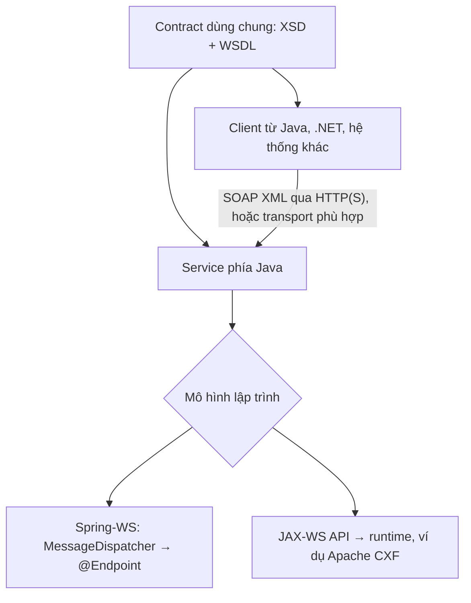

# Spring-WS, JAX-WS và Apache CXF: mô hình lập trình và ranh giới trách nhiệm

> **Chương:** Tổng quan Spring-WS  
> **Trọng tâm:** Phân biệt mô hình endpoint theo thông điệp của Spring Web Services (Spring-WS), chuẩn API JAX-WS và nền tảng triển khai Apache CXF; từ đó chọn đúng công cụ khi phát triển SOAP theo hướng **contract-first**.

## 1. Ba tên gọi, ba vai trò không cùng một tầng

Khi tích hợp SOAP trong Java, các tên **Spring-WS**, **JAX-WS** và **Apache CXF** thường xuất hiện cạnh nhau. Tuy nhiên, không nên xem chúng đơn giản là ba thư viện có thể thay thế nhau từng API:

- **Spring-WS (Spring Web Services)** là framework của hệ sinh thái Spring chuyên xử lý *XML message*. Endpoint được định tuyến chủ yếu theo nội dung SOAP Body, thường bằng `QName` của phần tử XML gốc. Thiết kế contract-first với XSD/WSDL là cách làm trung tâm.
- **JAX-WS** là tên lịch sử của **Java API for XML Web Services**; các phiên bản thuộc hệ Jakarta EE được gọi là **Jakarta XML Web Services**. Đây là **đặc tả/API lập trình** cho SOAP service và client, chẳng hạn `@WebService`, `@WebMethod`, `Service` và `BindingProvider`. API cần có một **runtime triển khai** để nhận, gửi và xử lý SOAP.
- **Apache CXF** là **framework/runtime** cung cấp triển khai JAX-WS, công cụ sinh mã từ WSDL, transport, interceptor và nhiều khả năng WS-*; CXF cũng hỗ trợ JAX-RS cho REST. Vì vậy, **JAX-WS và CXF có thể đi cùng nhau**: mã ứng dụng dùng API JAX-WS, còn CXF thực thi nó.

Điểm quan trọng nhất: **Spring-WS và JAX-WS khác nhau về mô hình lập trình; JAX-WS và CXF khác nhau về mức trừu tượng**. Một dự án có thể chạy endpoint JAX-WS bằng CXF mà không dùng Spring-WS; hoặc dùng Spring-WS hoàn toàn không cần runtime JAX-WS. CXF tích hợp được với Spring, nhưng điều đó không biến endpoint CXF thành `@Endpoint` của Spring-WS.

| Câu hỏi | Spring-WS | JAX-WS / Jakarta XML WS | Apache CXF |
|---|---|---|---|
| Bản chất | Framework SOAP của Spring | Đặc tả và API chuẩn | Runtime/framework, có triển khai JAX-WS |
| Đơn vị lập trình chính | XML payload, `@Endpoint`, `@PayloadRoot` | Service/port, Java operation, `@WebService`, `@WebMethod` | Endpoint JAX-WS hoặc API riêng của CXF |
| Điểm xuất phát quen thuộc | XSD/WSDL, rồi ánh xạ request/response | Có thể code-first hoặc WSDL-first | Có thể Java-first hoặc WSDL-first |
| Định tuyến request | `MessageDispatcher`, endpoint mapping theo payload hoặc SOAP action | Runtime ánh xạ SOAP operation với service/port/method theo binding | Bus, transport, interceptor chain và frontend JAX-WS |
| SOAP client | `WebServiceTemplate` | `Service` và proxy `port` | Proxy JAX-WS, client API/cấu hình CXF |
| Ánh xạ XML ↔ Java | JAXB, DOM, `Source`, StAX, v.v. tùy adapter | Binding theo đặc tả; JAXB là cơ chế thường gặp | JAXB và data binding khác do CXF cung cấp |
| Điểm mở rộng | `EndpointInterceptor`, resolver, marshaller | Handler và API mở rộng chuẩn | CXF interceptor, feature, policy, transport |
| WS-Security | Tích hợp WSS4J qua Spring-WS Security | Phụ thuộc runtime; API JAX-WS không tự bảo đảm mọi tính năng WS-* | WSS4J, policy và các extension của CXF |

**Lưu ý tên gói Java:** mã cũ thường import `javax.jws.*`, `javax.xml.ws.*`, `javax.xml.bind.*`; hệ Jakarta mới dùng `jakarta.jws.*`, `jakarta.xml.ws.*`, `jakarta.xml.bind.*`. Không trộn tùy tiện các bộ API/runtime giữa hai thế hệ. Từ JDK 11, JAX-WS và JAXB không còn được đóng gói sẵn trong JDK như thời Java 8; cần khai báo dependency và công cụ sinh mã tương ứng.

## 2. Ranh giới quan trọng nhất nằm ở SOAP contract

**Contract-first** nghĩa là xác định dữ liệu và giao thức mà hai hệ thống trao đổi **trước** khi thiết kế lớp Java triển khai:

1. **XSD** quy định tên phần tử, namespace, cấu trúc, kiểu dữ liệu và ràng buộc của XML.
2. **WSDL** mô tả service, operation, message, port, binding, endpoint và cách đặt payload vào SOAP.
3. **SOAP** là định dạng thông điệp trên đường truyền, gồm `Envelope`, phần `Header` tùy chọn, `Body` và quy ước `Fault`.
4. **Java framework/runtime** đọc và phát XML theo contract; lớp endpoint, proxy hay JAXB chỉ là cách hiện thực phía trong.



Đối tác phía ngoài **không cần biết** server dùng Spring-WS, CXF hay một stack khác. Điều quyết định khả năng tương thích là **WSDL/XSD và thông điệp SOAP thực tế**: `targetNamespace`, QName của body, tên operation, document/literal binding, SOAP version, header, fault, chính sách bảo mật… Nếu thay thư viện mà vô tình đổi WSDL, client vẫn có thể hỏng dù mã Java phía server biên dịch thành công.

### Ví dụ contract của dịch vụ tra cứu đơn hàng

Giả sử nghiệp vụ yêu cầu gửi `orderId` và nhận `status`. Ta định nghĩa XSD trước; ví dụ dưới đây là phần cốt lõi của `orders.xsd`:

```xml
<?xml version="1.0" encoding="UTF-8"?>
<xs:schema xmlns:xs="http://www.w3.org/2001/XMLSchema"
           targetNamespace="urn:demo:orders:v1"
           xmlns:tns="urn:demo:orders:v1"
           elementFormDefault="qualified">
  <xs:element name="GetOrderRequest">
    <xs:complexType>
      <xs:sequence>
        <xs:element name="orderId" type="xs:string"/>
      </xs:sequence>
    </xs:complexType>
  </xs:element>

  <xs:element name="GetOrderResponse">
    <xs:complexType>
      <xs:sequence>
        <xs:element name="status" type="xs:string"/>
      </xs:sequence>
    </xs:complexType>
  </xs:element>
</xs:schema>
```

Một SOAP 1.1 request hợp lệ về mặt cấu trúc cho XSD này có thể là:

```xml
<soapenv:Envelope
    xmlns:soapenv="http://schemas.xmlsoap.org/soap/envelope/"
    xmlns:ord="urn:demo:orders:v1">
  <soapenv:Header/>
  <soapenv:Body>
    <ord:GetOrderRequest>
      <ord:orderId>ORD-1001</ord:orderId>
    </ord:GetOrderRequest>
  </soapenv:Body>
</soapenv:Envelope>
```

Ở đây `GetOrderRequest` và namespace `urn:demo:orders:v1` là dữ liệu **trên wire**, không phải tên phương thức Java. Một client CXF/JAX-WS vẫn có thể gọi server Spring-WS nếu cả hai khớp cùng WSDL, binding và các yêu cầu vận hành.

## 3. Mô hình Spring-WS: nhận thông điệp, xử lý payload

Trong Spring-WS, `MessageDispatcherServlet` tiếp nhận SOAP request và chuyển cho `MessageDispatcher`. Dispatcher dùng endpoint mapping, endpoint adapter cùng các thành phần liên quan để gọi handler phù hợp. Một mô hình phổ biến là định tuyến bằng `@PayloadRoot`, dựa vào **namespace** và **localPart** của phần tử XML đầu tiên trong SOAP Body.

```java
@Endpoint
public class OrdersEndpoint {
    private static final String NS = "urn:demo:orders:v1";

    @PayloadRoot(namespace = NS, localPart = "GetOrderRequest")
    @ResponsePayload
    public GetOrderResponse getOrder(
            @RequestPayload GetOrderRequest request) {
        GetOrderResponse response = new GetOrderResponse();
        response.setStatus(findStatus(request.getOrderId()));
        return response;
    }

    private String findStatus(String orderId) {
        return "PROCESSING"; // Minh họa; thực tế gọi tầng nghiệp vụ.
    }
}
```

`GetOrderRequest` và `GetOrderResponse` trong ví dụ là **lớp JAXB tương ứng với XSD**, được sinh từ schema hoặc xây dựng với annotation JAXB phù hợp. Cần bảo đảm có XML binding và method argument/return adapter hỗ trợ kiểu đối tượng được sử dụng; JAXB không tự phát sinh chỉ vì thêm `@Endpoint`.

Một cấu hình minh họa để cung cấp WSDL 1.1 từ schema trong ứng dụng Spring-WS:

```java
@Configuration
@EnableWs
public class WsConfig {
    @Bean
    public XsdSchema ordersSchema() {
        return new SimpleXsdSchema(
                new ClassPathResource("orders.xsd"));
    }

    @Bean(name = "orders")
    public DefaultWsdl11Definition ordersWsdl(XsdSchema ordersSchema) {
        DefaultWsdl11Definition wsdl = new DefaultWsdl11Definition();
        wsdl.setPortTypeName("OrdersPort");
        wsdl.setLocationUri("/ws");
        wsdl.setTargetNamespace("urn:demo:orders:v1");
        wsdl.setSchema(ordersSchema);
        return wsdl;
    }
}
```

Để cấu hình trên hoạt động qua HTTP còn cần đăng ký `MessageDispatcherServlet` và mapping URL thích hợp, ví dụ `/ws/*` (hoặc dùng auto-configuration phù hợp với phiên bản Spring Boot). Khi servlet được map như vậy, bean WSDL tên `orders` thường được công bố tại `/ws/orders.wsdl`. `DefaultWsdl11Definition` suy ra operation theo các hậu tố mặc định `Request`/`Response`; do đó cách đặt tên `GetOrderRequest` và `GetOrderResponse` trong ví dụ là có chủ ý. **WSDL sinh động** cần được kiểm tra và ổn định hóa trước khi công bố cho đối tác; nếu WSDL được cung cấp cố định từ bên ngoài, cần tuân thủ nguyên bản contract đó.

Luồng xử lý thường có dạng:

```text
HTTP → MessageDispatcherServlet → MessageDispatcher
     → EndpointMapping (@PayloadRoot) → EndpointAdapter
     → JAXB/XML binding → @Endpoint → business service
     → response payload → SOAP response
```

Các ranh giới trách nhiệm trong Spring-WS khá rõ:

- **XSD/WSDL:** hợp đồng bên ngoài, version và tương thích dữ liệu.
- **`@Endpoint`:** ánh xạ thông điệp đến use case nghiệp vụ; không nên nhồi truy vấn database, quy tắc nghiệp vụ phức tạp hay logic xác thực phân tán vào đây.
- **JAXB/marshaller:** chuyển đổi XML ↔ Java; không thay thế kiểm tra ràng buộc nghiệp vụ.
- **`EndpointInterceptor`, resolver:** ghi log an toàn, kiểm tra schema, xử lý SOAP fault và các quan tâm xuyên suốt.
- **`WebServiceTemplate`:** client gửi/nhận SOAP, quản lý marshalling, transport, callback và lỗi phía client.

Điểm mạnh của Spring-WS là giữ trọng tâm ở **message contract**. Điều này rất phù hợp khi doanh nghiệp đang sở hữu XSD chặt chẽ, muốn tách XML boundary khỏi domain model và cần phát triển SOAP theo contract-first.

## 4. Mô hình JAX-WS: service, port và Java operation

JAX-WS cung cấp bộ annotation và API chuẩn để biểu diễn web service dưới dạng các operation Java. Trong mô hình **code-first**, runtime có thể dựa trên method/annotation để xuất WSDL:

```java
import jakarta.jws.WebMethod;
import jakarta.jws.WebParam;
import jakarta.jws.WebService;

@WebService(serviceName = "OrdersService",
            targetNamespace = "urn:demo:orders:v1")
public class OrdersServiceEndpoint {
    @WebMethod(operationName = "GetOrderStatus")
    public String getOrderStatus(
            @WebParam(name = "orderId") String orderId) {
        return "PROCESSING";
    }
}
```

Đây là **ví dụ riêng về code-first**, không ngụ ý rằng nó tạo WSDL giống hệt XSD `GetOrderRequest` ở phần trước. Tùy wrapper style, annotation và binding, runtime có thể sinh message XML khác với contract mong muốn. Với hệ thống tích hợp có WSDL cố định, **đừng bắt đầu bằng đoạn code-first rồi mặc định client sẽ tương thích**.

Trong mô hình **WSDL-first** của JAX-WS, thường dùng công cụ như `wsimport` hoặc `wsdl2java` để sinh:

1. **SEI (Service Endpoint Interface)** có `@WebService` mô tả operation/binding từ WSDL.
2. **JAXB model** cho kiểu XML dùng trong message.
3. **Service/port proxy** ở phía client.

Lớp triển khai phía server viết logic cho interface đã sinh, chẳng hạn (chữ ký method là minh họa và phải tuân thủ đúng SEI mà công cụ sinh ra):

```java
@WebService(endpointInterface = "demo.orders.OrdersPortType")
public class OrdersPortImpl implements OrdersPortType {
    @Override
    public GetOrderResponse getOrder(GetOrderRequest request) {
        GetOrderResponse response = new GetOrderResponse();
        response.setStatus("PROCESSING");
        return response;
    }
}
```

Trên thực tế chữ ký method phụ thuộc WSDL và quy tắc parameter style; code sinh ra có thể *unwrap* request/response thành các tham số khác. **Đọc SEI được sinh**, không sửa tay để khớp một chữ ký tưởng tượng.

Ở phía client, ứng dụng gọi proxy gần giống gọi một Java method, nhưng runtime vẫn gửi SOAP:

```java
// OrdersService và OrdersPortType do công cụ WSDL-first sinh ra.
OrdersService service = new OrdersService();
OrdersPortType port = service.getOrdersPort();
GetOrderResponse response = port.getOrder(request);
```

Các tên `getOrdersPort()`/`getOrder()` phụ thuộc WSDL và mã sinh; chúng chỉ là ví dụ minh họa. `BindingProvider` cho phép cấu hình endpoint address, request context và một số thuộc tính binding của proxy. **JAX-WS chỉ định API và quy tắc tương tác**; việc mở cổng HTTP, triển khai runtime, tích hợp servlet, SOAP handler, bảo mật và công cụ build còn cần lựa chọn tương thích bên ngoài API.

## 5. Apache CXF: runtime và lớp tích hợp

CXF có thể **triển khai JAX-WS**: lớp ứng dụng giữ các annotation/SEI chuẩn, còn CXF đảm nhiệm tạo endpoint, xử lý SOAP binding, data binding, transport, interceptor, feature và policy. CXF cũng cung cấp `wsdl2java` để sinh mã WSDL-first, `java2ws` cho một số trường hợp Java-first và các phương án cấu hình endpoint/client tích hợp với Spring.

Ví dụ khái niệm khi công bố một service JAX-WS thông qua CXF:

```java
JaxWsServerFactoryBean factory = new JaxWsServerFactoryBean();
factory.setServiceClass(OrdersPortType.class);
factory.setServiceBean(new OrdersPortImpl());
factory.setAddress("http://localhost:8080/services/orders");
factory.create();
```

Đây là **mảnh cấu hình runtime**, không phải một chương trình đầy đủ: ứng dụng còn phải có dependency CXF, transport/server phù hợp và interface/implementation hợp lệ. Cách công bố endpoint trong Spring Boot hoặc servlet container có thể khác.

Điểm mạnh riêng của CXF nằm ở **chuỗi xử lý và khả năng tích hợp**: một `Interceptor` có thể xử lý thông điệp ở các pha inbound/outbound; `Feature` đóng gói cấu hình; WS-Security/WSS4J và WS-SecurityPolicy hỗ trợ nhiều yêu cầu bảo mật doanh nghiệp, với phiên bản và module phù hợp. Khi đối tác trao WSDL + policy yêu cầu chữ ký XML, mã hóa, timestamp, token hoặc MTOM, cần xem **runtime cụ thể** có hỗ trợ đúng profile và cấu hình hay không.

**Không đồng nhất ba khái niệm sau:**

| Khái niệm | Nó chịu trách nhiệm gì? | Ví dụ |
|---|---|---|
| API/specification | Quy ước lập trình và semantics portable | `@WebService`, `BindingProvider` của Jakarta XML WS |
| Runtime/framework | Thực hiện dispatch, SOAP binding, transport, bảo mật, lifecycle | Apache CXF, Eclipse Metro; Spring-WS là một framework SOAP theo API riêng |
| Contract | Giao diện XML mà các hệ thống cam kết trao đổi | `orders.xsd`, `orders.wsdl`, fault và chính sách giao tiếp |

Việc dùng **Spring Framework/Boot** để quản lý bean của CXF cũng không làm cho CXF trở thành Spring-WS: `@WebService`/SEI của CXF và `@Endpoint`/`@PayloadRoot` của Spring-WS thuộc hai cơ chế dispatch khác nhau.

## 6. Cùng nghiệp vụ, hai cách xây endpoint

Giả sử WSDL quy định operation lấy trạng thái đơn hàng:

| Khâu | Spring-WS | JAX-WS chạy bằng CXF |
|---|---|---|
| Tạo hợp đồng | Viết XSD, định nghĩa/công bố WSDL và kiểm soát QName | Nhận WSDL, dùng `wsdl2java` sinh SEI/JAXB; cũng có thể Java-first nếu chưa có contract |
| Viết handler | `@Endpoint`, `@PayloadRoot(namespace, localPart)` | Lớp implement SEI được sinh, thường dùng `@WebService` |
| Dispatch | Match phần tử gốc trong SOAP Body tới method thích hợp | Match service/port/operation theo WSDL binding tới method |
| Xử lý dữ liệu | JAXB hoặc dạng XML `Source`/DOM; tự chọn mức tách khỏi domain | Data binding qua runtime và SEI; method có thể dùng Java type đã sinh |
| Client | `WebServiceTemplate.marshalSendAndReceive(...)` | `Service.getPort(...)`, gọi method proxy hoặc client CXF |
| Mở rộng hạ tầng | Spring-WS interceptor, fault resolver, security interceptor | CXF interceptor, handler, feature, WS-* policy |

**Tình huống A — nội bộ kiểm soát XSD, thay đổi Java thường xuyên:** Spring-WS giúp team nhìn rõ ranh giới XML request và business use case; JAXB model có thể độc lập với domain entity.

**Tình huống B — đối tác cấp WSDL lớn cùng nhiều operation và WS-SecurityPolicy:** JAX-WS qua CXF thường thuận tiện nhờ mã sinh từ WSDL, proxy và các extension của runtime. Tuy nhiên, vẫn cần kiểm chứng WSDL cụ thể vì công cụ sinh mã có quy tắc binding riêng.

**Tình huống C — hệ thống cần API JAX-WS và có khả năng thay runtime:** viết theo đặc tả giúp giảm phụ thuộc vào một nhà cung cấp tại lớp service/port cơ bản; nhưng mọi phần dùng API extension, policy, interceptor và cấu hình deployment vẫn phải được xem xét khi chuyển runtime.

## 7. SOAP Fault, validation, security: ai làm việc gì?

Các khía cạnh vận hành là nơi dễ nhầm giữa **chuẩn SOAP**, **contract** và **khả năng cụ thể của framework**.

### 7.1 Lỗi nghiệp vụ và SOAP Fault

SOAP Fault là **thông điệp lỗi theo định dạng SOAP**, không phải HTTP error tùy ý hay Java stack trace. WSDL có thể khai báo *modeled fault*, thường mang phần `detail` được định nghĩa bằng XSD. Vì thế, API nghiệp vụ cần thống nhất mã lỗi, SOAP fault code/reason và cấu trúc `detail` với đối tác.

- Spring-WS: có thể dùng `SoapFaultMappingExceptionResolver` hoặc resolver tùy biến để ánh xạ exception sang fault; `EndpointExceptionResolver` xử lý ở tầng endpoint.
- JAX-WS/CXF: lỗi khai báo trong WSDL có thể ánh xạ thành checked exception (thường gắn `@WebFault`); runtime cũng xử lý fault không khai báo và các `SOAPFaultException` tùy trường hợp.
- Cả hai: **không trả exception Java nội bộ trực tiếp** cho đối tác; cần giới hạn thông tin nhạy cảm và kiểm thử cấu trúc fault thực gửi.

### 7.2 XSD validation và bảo vệ XML

Tạo JAXB class từ XSD **không mặc nhiên** bảo đảm mọi SOAP request sẽ được validate đầy đủ theo schema ở runtime. Với Spring-WS, `PayloadValidatingInterceptor` có thể kiểm tra XML payload theo XSD; với CXF có thể bật schema validation bằng cơ chế phù hợp phiên bản/binding. Sau validation vẫn phải kiểm tra nghiệp vụ, như đơn hàng tồn tại hay người gọi có quyền truy cập.

Ở tầng XML parser cần cấu hình an toàn trước các rủi ro như XXE, external entity và xử lý tài nguyên quá mức; không nên cho phép DTD/external schema không tin cậy được tự tải trong pipeline. Các giới hạn kích thước payload, timeout và logging an toàn cũng thuộc cấu hình ứng dụng/hạ tầng, không được WSDL giải quyết thay.

### 7.3 TLS, WS-Security và chữ ký

**TLS/HTTPS** bảo vệ kênh truyền giữa hai điểm kết nối. **WS-Security** đặt token, chữ ký XML, mã hóa XML và timestamp ở mức SOAP message; nó đặc biệt quan trọng khi thông điệp phải đi qua trung gian hoặc đối tác yêu cầu chính sách bảo mật cụ thể. Đây là hai lớp có thể cần dùng cùng nhau.

- Spring-WS có module security sử dụng **WSS4J**, thường cấu hình qua `Wss4jSecurityInterceptor`.
- CXF tích hợp **WSS4J** qua interceptor và có khả năng xử lý các yêu cầu **WS-SecurityPolicy** tùy module/runtime.
- **JAX-WS API một mình không cam kết** tính năng WS-Security cụ thể; phải kiểm tra runtime và policy/profile đang dùng.

Quản lý keystore, truststore, chứng chỉ, xoay vòng khóa, kiểm tra certificate chain, chống replay và ủy quyền nghiệp vụ vẫn thuộc trách nhiệm ứng dụng và đơn vị vận hành. Có chứng chỉ hợp lệ **không đồng nghĩa** người gửi được phép thực hiện mọi operation.

## 8. Khả năng tương thích và bẫy khi thay stack

Một thay đổi từ Spring-WS sang CXF, hoặc thay runtime JAX-WS, chỉ được coi là tương thích khi **contract và thông điệp trên wire** còn đáp ứng yêu cầu của client thực tế.

| Cần kiểm tra | Vì sao quan trọng? |
|---|---|
| `targetNamespace`, QName của phần tử request/response | Sai namespace hoặc tên XML có thể làm endpoint không được định tuyến |
| WSDL `portType`, operation, `message`, `binding`, `service/port` | Client sinh mã dựa vào WSDL, không dựa vào tên method do server tự đặt |
| SOAP 1.1 / SOAP 1.2, HTTP `Content-Type`, SOAPAction (nếu binding yêu cầu) | Hai phiên bản SOAP và quy tắc dispatch không hoàn toàn đồng nhất |
| Document/literal, wrapped/bare, thứ tự XML và tùy chọn/nil | Ảnh hưởng trực tiếp đến JAXB/SEI và khả năng parse của client |
| Fault code, `detail` và HTTP status khi lỗi | Client có thể phụ thuộc chính xác vào fault schema và behavior |
| WS-Addressing, MTOM, WS-Security, chữ ký, thuật toán và chứng chỉ | Hai hệ thống có thể hiểu SOAP cơ bản nhưng không khớp extension/policy |
| WSDL công bố, địa chỉ endpoint và đường dẫn reverse proxy | WSDL động có thể chứa URL môi trường nội bộ, làm hỏng client bên ngoài |

Quy trình kiểm thử thiết thực cho tích hợp doanh nghiệp:

1. **Chốt contract:** lưu bản WSDL/XSD đã được đối tác phê duyệt; kiểm tra dependency và namespace của mọi schema import.
2. **Sinh client độc lập:** thử ít nhất một client dùng tooling/stack của phía tiêu thụ (ví dụ Java CXF/JAX-WS hoặc .NET), không chỉ gọi nội bộ qua cùng một marshaller.
3. **So sánh thông điệp:** lưu mẫu SOAP request/response và fault; đối chiếu QName, namespace, content type, header và giá trị thực tế.
4. **Thử ca lỗi:** schema sai, không tìm thấy dữ liệu, không đủ quyền, sai chứng chỉ, token hết hạn, timeout và retry khi thích hợp.
5. **Kiểm tra triển khai:** TLS, WS-SecurityPolicy, path qua gateway/proxy, WSDL URL thực tế và tương thích sau khi nâng phiên bản thư viện.

Ví dụ một lỗi thường gặp: hệ thống đang nhận `<ord:GetOrderRequest>`, nhưng sau khi đổi sang JAX-WS code-first, WSDL mới sinh operation wrapper `<ord:getOrderStatus>`. Java service vẫn khởi động, song client cũ gửi đúng message **theo contract cũ** và thất bại. Gốc lỗi là **contract bị đổi**, không phải SOAP nói chung không tương thích giữa các framework.

## 9. Chọn Spring-WS hay CXF/JAX-WS như thế nào?

| Bối cảnh | Hướng ưu tiên | Điều cần xác nhận |
|---|---|---|
| Thiết kế SOAP mới, XSD là nguồn sự thật, team đã dùng Spring | **Spring-WS** | WSDL, mapping payload, JAXB, validation, fault và security interceptor |
| WSDL-first từ đối tác; nhiều operation và Java port proxy | **JAX-WS với runtime như CXF** | SEI được sinh, binding style, package namespace, tính năng WS-* |
| Policy phức tạp: chữ ký, mã hóa, WS-Addressing, MTOM | **Đánh giá CXF** cùng hồ sơ policy thực | Module CXF/WSS4J, khả năng tương thích và cấu hình thuật toán/chứng chỉ |
| Muốn code dựa trên đặc tả Jakarta XML WS | **API JAX-WS** + runtime được chọn | Khả năng portable và các extension phụ thuộc runtime |
| Đã có Spring-WS chạy ổn định, contract không đổi | **Tiếp tục Spring-WS** nếu đáp ứng nhu cầu | Không chuyển chỉ vì bên kia dùng client CXF/JAX-WS |

Đây là **tiêu chí chọn**, không phải khẳng định framework nào luôn tốt hơn. Sự ổn định của hợp đồng XML, năng lực vận hành và yêu cầu từ đối tác thường quyết định nhiều hơn tên thư viện.

## 10. Bài tập tư duy và checklist tự đánh giá

**Tình huống:** Một ngân hàng gửi `PaymentStatusRequest` theo WSDL 1.1, yêu cầu SOAP 1.1 qua HTTPS, chữ ký XML cho SOAP Body, timestamp, fault theo XSD, và chỉ chấp nhận namespace `urn:bank:payment:v2`.

Hãy thử tự trả lời trước khi đọc gợi ý:

1. Nếu viết server bằng Spring-WS, thành phần nào match `PaymentStatusRequest`? **Gợi ý:** `@PayloadRoot` và endpoint mapping; không chỉ tên Java method.
2. Nếu dùng JAX-WS qua CXF, thứ gì giữ vai trò interface của endpoint? **Gợi ý:** SEI được sinh từ WSDL và class implement nó; CXF làm runtime.
3. Chỉ thêm HTTPS có đáp ứng yêu cầu chữ ký SOAP Body không? **Không.** Cần cấu hình WS-Security và kiểm tra chữ ký, timestamp theo policy đối tác.
4. Nếu JAXB unmarshalling thành công, có chắc request hợp lệ theo mọi ràng buộc XSD và nghiệp vụ không? **Không.** Cần validation theo schema và kiểm tra nghiệp vụ riêng.
5. Nếu đổi từ Spring-WS sang CXF nhưng giữ nguyên WSDL, đã đủ kết luận tương thích chưa? **Chưa.** Phải thử SOAP thực, header, fault, chữ ký, chứng chỉ, endpoint và hành vi lỗi.

Checklist trước khi bắt đầu một dự án SOAP contract-first:

- [ ] Có XSD/WSDL chuẩn và người chịu trách nhiệm version/compatibility.
- [ ] Hiểu rõ khác biệt giữa API JAX-WS, runtime CXF và framework Spring-WS.
- [ ] Biết dự án định tuyến theo QName của payload hay operation/SEI.
- [ ] Chọn cơ chế XML binding, schema validation và mapping fault rõ ràng.
- [ ] Xác định SOAP version, transport, WS-SecurityPolicy và yêu cầu chứng chỉ.
- [ ] Có test trao đổi SOAP với client độc lập và bộ thông điệp mẫu.

**Kết luận:** Với **Spring Web Services**, tư duy cốt lõi là *XML contract → SOAP message → endpoint theo payload → nghiệp vụ*. Với **JAX-WS**, ứng dụng lập trình quanh *service/port/operation* theo API chuẩn; với **Apache CXF**, một runtime cụ thể biến mô hình đó thành khả năng vận hành cùng các tích hợp doanh nghiệp. Nắm được ranh giới này giúp thiết kế XSD/WSDL đúng ngay từ đầu, bảo toàn khả năng tương thích và đặt JAXB, SOAP Fault, interceptor và WS-Security vào đúng trách nhiệm của chúng.
