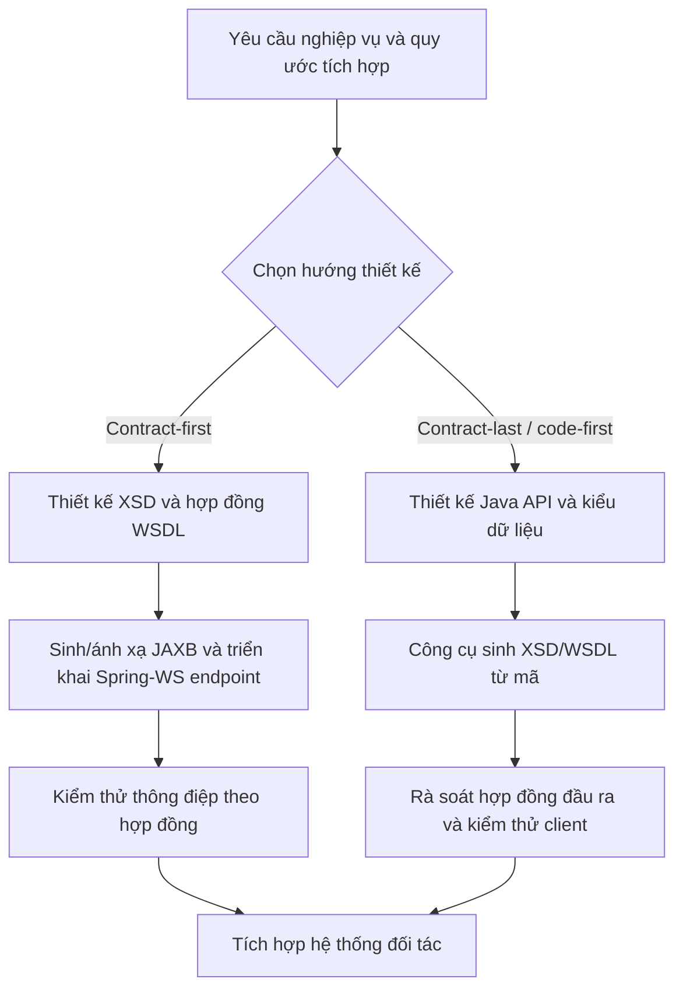

# Thiết kế từ hợp đồng (contract-first) và thiết kế từ mã (contract-last) trong Spring Web Services

Trong một hệ thống SOAP, **hợp đồng dịch vụ** xác định chính xác dữ liệu nào được trao đổi, thao tác nào được cung cấp và cách bên gọi kết nối tới dịch vụ. Có hai hướng phổ biến để xây dựng hợp đồng đó:

- **Contract-first** (thiết kế từ hợp đồng): xác định giao diện XML của dịch vụ trước, sau đó mới viết mã máy chủ và máy khách tuân thủ giao diện này.
- **Contract-last**, thường gọi là **code-first** (thiết kế từ mã): viết các lớp/phương thức Java trước, rồi dùng công cụ suy ra và công bố hợp đồng SOAP từ mã.

Đây là một quyết định kiến trúc quan trọng khi phát triển **Spring Web Services (Spring-WS)**. Spring-WS định hướng xây dựng dịch vụ SOAP theo thông điệp XML và đặc biệt phù hợp với contract-first: nhóm tích hợp có thể thống nhất XSD/WSDL, sinh lớp JAXB, xây dựng endpoint và kiểm thử tính tương thích của thông điệp trước khi đưa dịch vụ vào vận hành. Những chủ đề tiếp theo như SOAP Fault, interceptor, XML security, WS-Security và chứng chỉ đều dựa trên nền tảng hợp đồng rõ ràng này.

## 1. Mục tiêu học tập

Sau bài này, bạn có thể:

1. Giải thích contract-first và contract-last, nhận ra **nguồn sự thật** (source of truth) của từng hướng.
2. Phân biệt vai trò của XSD, WSDL, JAXB và `@Endpoint` trong Spring-WS.
3. Phác thảo một luồng contract-first từ yêu cầu nghiệp vụ đến thông điệp SOAP có thể kiểm thử.
4. Chỉ ra vì sao một endpoint Spring-WS có chú thích Java **không tự động** trở thành dịch vụ code-first theo kiểu JAX-WS.
5. Lựa chọn chiến lược phù hợp khi tích hợp hệ thống doanh nghiệp, quản lý phiên bản và tránh phá vỡ ứng dụng khách.

## 2. Hợp đồng SOAP thực sự bao gồm những gì?

Giả sử hệ thống bán hàng cung cấp thao tác `GetOrder`: ứng dụng đối tác gửi mã đơn hàng và nhận trạng thái đơn. Trước khi lập trình, hai bên phải trả lời được: phần tử XML gốc của yêu cầu tên gì, nằm trong namespace nào, `orderId` có bắt buộc không, trạng thái hợp lệ gồm những giá trị nào, và phía khách sẽ tìm dịch vụ ở địa chỉ nào?

| Thành phần | Chức năng | Ví dụ trong dịch vụ tra cứu đơn hàng |
| --- | --- | --- |
| **XSD (XML Schema)** | Định nghĩa các phần tử, kiểu, thứ tự, số lần xuất hiện và ràng buộc giá trị trong XML. | `GetOrderRequest` chứa `orderId`; `GetOrderResponse` chứa `status`. |
| **WSDL (Web Services Description Language)** | Mô tả các thao tác, thông điệp vào/ra, binding và cổng/địa chỉ dịch vụ. | Thao tác `GetOrder` dùng các phần tử được định nghĩa bởi XSD. |
| **SOAP Envelope** | Định dạng thông điệp trên đường truyền, gồm `Header` tùy chọn và `Body`. | `Body` chứa phần tử `GetOrderRequest`. |
| **JAXB** | Ánh xạ giữa Java object và XML theo cấu trúc đã định nghĩa. | Lớp `GetOrderRequest` được sinh từ XSD. |
| **Spring-WS endpoint** | Nhận XML, định tuyến theo thông điệp và thực hiện xử lý nghiệp vụ. | Phương thức có `@PayloadRoot` để xử lý `GetOrderRequest`. |

**XSD và WSDL có nhiệm vụ khác nhau.** XSD nói *dữ liệu có cấu trúc gì*; WSDL nói *dịch vụ trao đổi dữ liệu đó qua thao tác, binding và endpoint nào*. Không nên coi một lớp Java, file XSD hay WSDL là có thể thay thế hoàn toàn hai phần còn lại.

Trong WSDL 1.1 thường gặp các thành phần sau:

```text
wsdl:definitions
├── wsdl:types        → lược đồ dữ liệu (thường chứa/tham chiếu XSD)
├── wsdl:message      → các phần tử dùng cho thông điệp
├── wsdl:portType     → các thao tác trừu tượng và input/output
├── wsdl:binding      → giao thức, kiểu SOAP, cách đóng gói thông điệp
└── wsdl:service      → cổng cụ thể và địa chỉ kết nối
```

Một hợp đồng ổn định giúp bên gọi có thể viết client bằng Java, .NET hoặc công nghệ khác mà không cần biết cách máy chủ tổ chức các class, package hay cơ sở dữ liệu.

## 3. Hai quy trình và nơi đặt nguồn sự thật



**Contract-first** có hướng phụ thuộc: yêu cầu tích hợp → XML Schema/WSDL → mã triển khai. Hợp đồng phải được đối tác thẩm định trước hoặc đồng thời với việc phát triển; thay đổi Java nội bộ không được tự ý thay đổi XML công khai.

**Contract-last** có hướng phụ thuộc ngược lại: API/đối tượng Java → công cụ ánh xạ → XSD/WSDL. Hướng này có thể khởi tạo nhanh nếu tất cả bên dùng đều do một nhóm kiểm soát. Đổi tên trường Java, đổi annotation hoặc nâng cấp cơ chế sinh WSDL có thể làm thay đổi hợp đồng ngoài ý muốn.

> **Điểm phân biệt quan trọng:** Việc Spring-WS sinh **WSDL từ một XSD được thiết kế trước** vẫn thuộc contract-first. “Có file WSDL được sinh tự động” không đồng nghĩa với “code-first”; cần xem công cụ sinh từ **mã Java** hay từ **lược đồ XML đã được chốt**.

## 4. Triển khai một luồng contract-first với Spring-WS

Ví dụ bên dưới dùng dịch vụ SOAP 1.1 tra cứu đơn hàng. Để giữ ví dụ tập trung, ta dùng một thao tác yêu cầu–phản hồi và không triển khai lưu trữ dữ liệu thực. Trong dự án triển khai, các file mẫu đặt tại `src/main/resources/xsd/orders.xsd`, còn lớp Java thuộc package ứng dụng.

### Bước 1 — Xác định hợp đồng nghiệp vụ

- Thao tác: tra cứu đơn hàng theo `orderId`.
- Yêu cầu: `GetOrderRequest` phải có `orderId` dài từ 1 đến 40 ký tự.
- Phản hồi: `GetOrderResponse` trả `orderId` và `status` thuộc `PENDING`, `CONFIRMED`, `CANCELLED`.
- Namespace phiên bản 1: `https://example.com/orders/v1` (URI định danh, không nhất thiết là URL có thể truy cập).
- Trường hợp không tìm thấy đơn: cần có chiến lược lỗi riêng, chẳng hạn SOAP Fault với mã lỗi nghiệp vụ ổn định.

Việc thỏa thuận sớm tên phần tử, namespace, quy tắc bắt buộc và lỗi giúp tránh tình huống mỗi bên hiểu một kiểu dữ liệu khác nhau.

### Bước 2 — Viết XSD trước khi viết endpoint

File `orders.xsd`:

```xml
<?xml version="1.0" encoding="UTF-8"?>
<xs:schema xmlns:xs="http://www.w3.org/2001/XMLSchema"
           xmlns:tns="https://example.com/orders/v1"
           targetNamespace="https://example.com/orders/v1"
           elementFormDefault="qualified">

    <xs:simpleType name="OrderId">
        <xs:restriction base="xs:string">
            <xs:minLength value="1"/>
            <xs:maxLength value="40"/>
        </xs:restriction>
    </xs:simpleType>

    <xs:simpleType name="OrderStatus">
        <xs:restriction base="xs:string">
            <xs:enumeration value="PENDING"/>
            <xs:enumeration value="CONFIRMED"/>
            <xs:enumeration value="CANCELLED"/>
        </xs:restriction>
    </xs:simpleType>

    <xs:element name="GetOrderRequest">
        <xs:complexType>
            <xs:sequence>
                <xs:element name="orderId" type="tns:OrderId"/>
            </xs:sequence>
        </xs:complexType>
    </xs:element>

    <xs:element name="GetOrderResponse">
        <xs:complexType>
            <xs:sequence>
                <xs:element name="orderId" type="tns:OrderId"/>
                <xs:element name="status" type="tns:OrderStatus"/>
            </xs:sequence>
        </xs:complexType>
    </xs:element>
</xs:schema>
```

Lưu ý cách đọc schema:

- `targetNamespace` xác định tên định danh của các phần tử/kiểu do schema công bố; URI này phải khớp với namespace mà endpoint xử lý.
- `elementFormDefault="qualified"` yêu cầu các phần tử cục bộ như `orderId` và `status` thuộc namespace của schema. **Tiền tố** XML có thể thay đổi, nhưng **URI namespace** phải đúng.
- `xs:sequence` yêu cầu đúng thứ tự phần tử; `minOccurs` mặc định bằng `1`, nên `orderId` là bắt buộc.
- `xs:minLength` chỉ chặn chuỗi độ dài 0; nếu nghiệp vụ cần cấm toàn khoảng trắng, phải bổ sung ràng buộc thích hợp hoặc kiểm tra nghiệp vụ.
- Danh sách enumeration đóng tập giá trị hợp lệ; thêm một trạng thái mới có thể ảnh hưởng client sinh enum cũ, dù chỉ là “thêm giá trị”.

**Schema hợp lệ không có nghĩa là nghiệp vụ hợp lệ.** XSD xác nhận dạng thông điệp; mã nghiệp vụ vẫn phải kiểm tra sự tồn tại của đơn, quyền truy cập, giới hạn dữ liệu và các ràng buộc ngữ cảnh.

### Bước 3 — Công bố WSDL từ schema

Spring-WS hỗ trợ `DefaultWsdl11Definition` để tạo một WSDL 1.1 cơ bản dựa trên XSD. Với quy ước hậu tố `Request`/`Response`, công cụ có thể nhận diện cặp thông điệp vào/ra và tạo thao tác `GetOrder`.

```java
import org.springframework.context.annotation.Bean;
import org.springframework.context.annotation.Configuration;
import org.springframework.core.io.ClassPathResource;
import org.springframework.ws.config.annotation.EnableWs;
import org.springframework.ws.wsdl.wsdl11.DefaultWsdl11Definition;
import org.springframework.xml.xsd.SimpleXsdSchema;
import org.springframework.xml.xsd.XsdSchema;

@Configuration
@EnableWs
public class OrdersSoapConfiguration {

    @Bean
    public XsdSchema ordersSchema() {
        return new SimpleXsdSchema(new ClassPathResource("xsd/orders.xsd"));
    }

    @Bean(name = "orders")
    public DefaultWsdl11Definition ordersWsdl(XsdSchema ordersSchema) {
        var definition = new DefaultWsdl11Definition();
        definition.setPortTypeName("OrdersPort");
        definition.setTargetNamespace("https://example.com/orders/v1");
        definition.setLocationUri("/ws");
        definition.setSchema(ordersSchema);
        return definition;
    }
}
```

**Điều kiện để ví dụ chạy:** ứng dụng cần dependency Spring-WS, cơ chế xử lý SOAP/JAXB tương thích với phiên bản Spring đang dùng và một `MessageDispatcherServlet` được ánh xạ tới `/ws/*` (được cấu hình tự động hoặc đăng ký rõ ràng tùy cách thiết lập ứng dụng). Khi thiết lập theo cách thông dụng, bean WSDL có tên `orders` được công bố tại đường dẫn dạng `/ws/orders.wsdl`. Địa chỉ thực tế còn phụ thuộc servlet mapping, context path và reverse proxy.

WSDL được tạo từ XSD là cách tiện lợi để bắt đầu, nhưng với hợp đồng đối tác đã ký duyệt, nhiều hệ thống chọn **lưu và công bố WSDL cố định**. Khi đó có thể kiểm soát chính xác `binding`, `soapAction`, tên `service`/`port`, địa chỉ, các import và định nghĩa lỗi. Không nên phụ thuộc vào việc công cụ tái sinh WSDL luôn tạo ra nội dung giống hệt nhau sau mỗi lần thay cấu hình hoặc nâng cấp thư viện.

### Bước 4 — Sinh lớp JAXB từ XSD

Chạy một công cụ XJC/JAXB tương thích với JDK và phiên bản Jakarta XML Binding của dự án để sinh các kiểu ánh xạ. Kết quả minh họa:

```text
orders.xsd
   └── XJC/JAXB
       ├── GetOrderRequest
       ├── GetOrderResponse
       ├── OrderStatus
       └── ObjectFactory
```

Hai lớp `GetOrderRequest`/`GetOrderResponse` thể hiện cấu trúc XML công khai; ứng dụng có thể chuyển đổi sang mô hình nghiệp vụ riêng. **Không nên sửa tay mã JAXB được sinh**, vì lần sinh tiếp theo sẽ ghi đè sửa đổi. Hãy tùy biến thông qua schema, cấu hình binding hoặc lớp adapter/mapper do ứng dụng sở hữu.

Nếu dùng Spring Boot 3/Spring Framework 6 trở lên, chú ý hệ API `jakarta.xml.bind.*`; dự án cũ có thể còn dùng `javax.xml.bind.*`. Trộn hai hệ API hoặc dùng plugin XJC không tương thích dễ gây lỗi biên dịch hoặc marshal/unmarshal.

### Bước 5 — Xây dựng Spring-WS endpoint theo phần tử XML

```java
import org.springframework.ws.server.endpoint.annotation.Endpoint;
import org.springframework.ws.server.endpoint.annotation.PayloadRoot;
import org.springframework.ws.server.endpoint.annotation.RequestPayload;
import org.springframework.ws.server.endpoint.annotation.ResponsePayload;

@Endpoint
public class OrderEndpoint {
    private static final String NAMESPACE = "https://example.com/orders/v1";

    private final OrderQueryService orderQueryService;

    public OrderEndpoint(OrderQueryService orderQueryService) {
        this.orderQueryService = orderQueryService;
    }

    @PayloadRoot(namespace = NAMESPACE, localPart = "GetOrderRequest")
    @ResponsePayload
    public GetOrderResponse getOrder(@RequestPayload GetOrderRequest request) {
        // OrderQueryService là dịch vụ nghiệp vụ do ứng dụng triển khai.
        var order = orderQueryService.findById(request.getOrderId());

        var response = new GetOrderResponse();
        response.setOrderId(order.id());
        response.setStatus(OrderStatus.fromValue(order.status()));
        return response;
    }
}
```

Đoạn mã minh họa giả định `OrderQueryService.findById` trả về một DTO có `id()` và `status()`; `status()` là chuỗi trùng giá trị enum trong XSD. Các kiểu `GetOrderRequest`, `GetOrderResponse`, `OrderStatus` và import tương ứng đến từ mã JAXB được sinh. Trong dự án thật, cần triển khai dịch vụ nghiệp vụ, mapper và xử lý lỗi trường hợp không có đơn.

Spring-WS định tuyến endpoint dựa trên **QName của phần tử gốc trong SOAP Body**, gồm `{namespace URI}localPart`. Ở đây QName yêu cầu là `{https://example.com/orders/v1}GetOrderRequest`. Tên phương thức `getOrder` và tên package Java không tham gia định danh thông điệp trên đường truyền.

### Bước 6 — Quan sát XML trao đổi thực tế

Yêu cầu SOAP 1.1 hợp lệ theo XSD đã nêu:

```xml
<?xml version="1.0" encoding="UTF-8"?>
<soapenv:Envelope xmlns:soapenv="http://schemas.xmlsoap.org/soap/envelope/"
                  xmlns:ord="https://example.com/orders/v1">
    <soapenv:Header/>
    <soapenv:Body>
        <ord:GetOrderRequest>
            <ord:orderId>ORD-2026-001</ord:orderId>
        </ord:GetOrderRequest>
    </soapenv:Body>
</soapenv:Envelope>
```

Phản hồi:

```xml
<?xml version="1.0" encoding="UTF-8"?>
<soapenv:Envelope xmlns:soapenv="http://schemas.xmlsoap.org/soap/envelope/"
                  xmlns:ord="https://example.com/orders/v1">
    <soapenv:Body>
        <ord:GetOrderResponse>
            <ord:orderId>ORD-2026-001</ord:orderId>
            <ord:status>CONFIRMED</ord:status>
        </ord:GetOrderResponse>
    </soapenv:Body>
</soapenv:Envelope>
```

Để thử thủ công, lưu yêu cầu thành `request.xml` rồi gửi đến endpoint được cấu hình:

```bash
curl -X POST http://localhost:8080/ws \
  -H 'Content-Type: text/xml; charset=utf-8' \
  --data-binary @request.xml
```

Lệnh trên áp dụng cho SOAP 1.1. Nếu hợp đồng quy định `SOAPAction`, client cần gửi header phù hợp; SOAP 1.2 dùng media type khác (`application/soap+xml`) và phải được cấu hình tương ứng. Đừng dựa chỉ vào HTTP 200: cần xác nhận phần tử phản hồi, namespace, schema và các lỗi SOAP đúng hợp đồng.

## 5. Contract-last/code-first trông như thế nào?

Ở hướng code-first, nhóm xây dựng phương thức, lớp dữ liệu và annotation trước. Một runtime hỗ trợ JAX-WS có thể nhìn vào interface Java để tạo WSDL/XSD. Ví dụ sau chỉ minh họa **cách tư duy code-first bằng JAX-WS**, **không phải endpoint Spring-WS**:

```java
import jakarta.jws.WebMethod;
import jakarta.jws.WebService;

@WebService(
    name = "OrderPortType",
    targetNamespace = "https://example.com/orders/v1"
)
public interface OrderSoapApi {

    @WebMethod(operationName = "GetOrder")
    GetOrderResponse getOrder(GetOrderRequest request);
}
```

Nếu triển khai interface này trên một runtime JAX-WS thích hợp, toolchain có thể sinh các thông điệp, kiểu và WSDL theo quy tắc ánh xạ của runtime, annotation và cấu hình JAXB. **Ví dụ không đủ để chạy độc lập:** vẫn cần lớp triển khai, các DTO/annotation dữ liệu, runtime và cấu hình công bố endpoint. Cấu trúc XML được sinh có thể khác với XSD ở mục trước, chẳng hạn thông điệp bọc theo tên phương thức và tham số.

Với **Spring-WS**, `@Endpoint`, `@PayloadRoot`, `@RequestPayload` và `@ResponsePayload` dùng để **xử lý payload XML**. Chúng **không** tạo ra hợp đồng XSD/WSDL code-first từ chữ ký phương thức Java theo cách một runtime JAX-WS có thể làm. Nếu viết `@Endpoint` trước nhưng sau đó tự thiết kế XSD và khai báo `DefaultWsdl11Definition`, việc công bố hợp đồng vẫn lấy XML Schema làm đầu vào. Không nên hứa hẹn “Spring-WS tự suy ra WSDL từ mọi class endpoint”.

Các điểm dễ mất kiểm soát khi code-first:

1. **Tên và cấu trúc XML phụ thuộc công cụ sinh.** Thay chữ ký, tên tham số, annotation hoặc phiên bản toolchain có thể đổi thông điệp bên ngoài.
2. **Java type không diễn đạt mọi quy tắc tích hợp.** Ví dụ `String orderId` tự nó không biểu diễn giới hạn 40 ký tự, namespace và quy tắc lỗi như một schema đã được thẩm định.
3. **Khả năng tương tác đa nền tảng cần xác minh.** Hợp đồng có thể chạy với client sinh cùng tool nhưng gặp vấn đề trên client .NET hoặc client của đối tác.
4. **Tài liệu hợp đồng có thể đến muộn.** Người tiêu thụ dịch vụ chỉ thấy những gì runtime sinh ra sau khi API đã được viết, khiến thay đổi từ phía họ tốn kém hơn.

Code-first vẫn có chỗ dùng: thử nghiệm nhanh, hệ thống nội bộ đồng sở hữu server/client hoặc khi quy trình của tổ chức chủ động quản trị WSDL đầu ra như một artifact được phiên bản hóa và kiểm thử.

## 6. So sánh để lựa chọn

| Tiêu chí | Contract-first | Contract-last/code-first |
| --- | --- | --- |
| Nguồn sự thật | XSD/WSDL đã thống nhất. | Java API và cấu hình sinh hợp đồng. |
| Điểm bắt đầu | Thiết kế thông điệp XML, thao tác, lỗi, namespace. | Thiết kế class, interface, phương thức Java. |
| Thay đổi Java nội bộ | Có thể giữ nguyên hợp đồng nếu mapping không đổi. | Có nguy cơ làm đổi hợp đồng khi tái sinh. |
| Kiểm soát XML | Chủ động kiểm soát element, type, `minOccurs`, thứ tự, namespace. | Phụ thuộc khả năng annotation và công cụ ánh xạ. |
| Tích hợp nhiều công nghệ | Phù hợp vì hợp đồng được thiết kế độc lập với ngôn ngữ. | Phải kiểm tra thêm kết quả công cụ sinh và khả năng tương thích. |
| Thời gian khởi đầu | Cần trao đổi và thiết kế schema sớm hơn. | Thường có thể dựng prototype nhanh hơn. |
| Điểm mạnh trong Spring-WS | Khớp mô hình định tuyến theo payload; hỗ trợ công bố WSDL từ XSD. | Không phải luồng code-first tự động của `@Endpoint`; cần toolchain khác nếu muốn sinh WSDL từ Java. |
| Rủi ro chính | Hợp đồng thiết kế quá cứng, không diễn đạt tốt nhu cầu hoặc thiếu quản trị phiên bản. | Drift giữa mã và hợp đồng, thay đổi XML ngoài ý muốn. |

**Gợi ý lựa chọn:** Với dịch vụ SOAP doanh nghiệp có khách hàng bên ngoài, nhiều đội triển khai, hợp đồng tồn tại lâu và yêu cầu kiểm thử tương thích, hãy ưu tiên **contract-first**. Với thử nghiệm ngắn hạn hoặc hệ thống nội bộ do một đội kiểm soát, **code-first** có thể chấp nhận nếu WSDL sinh ra vẫn được review, lưu phiên bản và kiểm thử qua wire format.

## 7. Quản trị hợp đồng để tránh phá vỡ client

Với SOAP, lớp Java có thể thay đổi mà client không thấy; thay đổi XML công khai dù nhỏ có thể ảnh hưởng hàng loạt tích hợp.

### Namespace, QName và khả năng tương thích

Các thay đổi sau thường là **phá vỡ hợp đồng** hoặc có nguy cơ cao:

- Đổi tên phần tử gốc từ `GetOrderRequest` thành `FindOrderRequest` hoặc đổi `targetNamespace` khiến QName cũ không còn được endpoint nhận.
- Đổi thứ tự phần tử trong `xs:sequence`, đổi kiểu `xs:string` sang `xs:int`, hoặc khiến trường tùy chọn trở thành bắt buộc.
- Xóa một giá trị enum hay trả thêm giá trị enum mà client cũ chưa xử lý.
- Đổi từ SOAP 1.1 sang SOAP 1.2, hoặc sửa binding/`SOAPAction` trong khi client cũ vẫn dùng định dạng trước đó.
- Sửa WSDL service/port/address hoặc chính sách bảo mật mà không thông báo và thử nghiệm với các đối tác hiện hữu.

Đôi khi thêm một phần tử với `minOccurs="0"` là thay đổi có thể tương thích ở phía schema; tuy nhiên client sinh mã hoặc cơ chế kiểm tra XML nghiêm ngặt vẫn có thể bị ảnh hưởng. Vì thế **không kết luận tương thích chỉ dựa trên việc XSD còn hợp lệ**; cần chạy thử trên client thực tế và các mẫu XML cũ.

Khi cần thay đổi không tương thích, lựa chọn an toàn thường là phát hành namespace/hợp đồng mới như `.../v2`, giữ endpoint phiên bản cũ trong thời gian chuyển đổi, công bố mốc ngừng hỗ trợ và cung cấp ví dụ request/response cho từng phiên bản. URI có `/v1` hay `/v2` chỉ là quy ước; việc routing và cam kết tương thích phải được thực thi trong triển khai.

### Chống lệch giữa schema, WSDL và code

Một dự án contract-first cần có quy tắc quản trị rõ:

1. Lưu XSD và WSDL đã công bố trong hệ thống quản lý phiên bản cùng lịch sử thay đổi.
2. Sinh JAXB từ nguồn schema đã được duyệt; không chỉnh trực tiếp lớp sinh ra.
3. Khi build hoặc CI, kiểm tra schema hợp lệ và so sánh hợp đồng công bố với bản đã chấp nhận (nếu dự án yêu cầu ổn định ở mức file).
4. Kiểm thử các thông điệp XML độc lập với object Java, đặc biệt namespace, thứ tự và trường bắt buộc.
5. Cho đối tác thời gian thử tương thích trước khi thay hợp đồng trên môi trường chính thức.

Spring-WS có thể sử dụng `PayloadValidatingInterceptor` hoặc `SchemaValidatingInterceptor` tùy nhu cầu kiểm tra payload. Validator giúp phát hiện XML sai XSD ở ranh giới dịch vụ, nhưng không thay thế kiểm tra ủy quyền, nghiệp vụ, giới hạn kích thước thông điệp hay kiểm thử của client.

## 8. Kiểm thử contract-first theo nhiều lớp

Nên xem tính đúng đắn của hợp đồng theo **hành vi quan sát được trên đường truyền**, không chỉ qua unit test Java.

| Lớp kiểm thử | Câu hỏi cần trả lời | Gợi ý thực hiện |
| --- | --- | --- |
| Kiểm tra schema | XML đúng thứ tự, kiểu, namespace và constraint không? | Validate request/response mẫu bằng XSD; thêm mẫu thiếu `orderId`, sai enum, sai namespace. |
| Kiểm thử endpoint | Có định tuyến đúng QName và trả payload mong đợi không? | Dùng `MockWebServiceClient` của Spring-WS hoặc kiểm thử tương đương với SOAP request thực. |
| Kiểm thử hợp đồng WSDL | `operation`, binding, service/port và địa chỉ có đúng như công bố không? | Kiểm tra WSDL đã triển khai; so với WSDL chuẩn của dự án. |
| Kiểm thử client | Client sinh từ WSDL có marshal/unmarshal được hai chiều không? | Dùng `WebServiceTemplate` hoặc client Java/.NET của đối tác; chạy request/response thật. |
| Kiểm thử lỗi | Không tìm thấy đơn, XML sai hay lỗi hệ thống tạo fault phù hợp không? | Gửi negative cases; xác nhận SOAP Fault code, reason và detail theo chính sách. |
| Kiểm thử bảo mật | Kết nối và chính sách thông điệp có được thực thi không? | Xác minh TLS, xác thực, WS-Security/chữ ký nếu hợp đồng tích hợp yêu cầu. |

Ba ca tối thiểu cho ví dụ:

```text
Case A — hợp lệ:
  Body = {https://example.com/orders/v1}GetOrderRequest
  orderId = ORD-2026-001
  → trả GetOrderResponse có orderId và status hợp lệ.

Case B — sai schema:
  orderId = "" (chuỗi rỗng)
  → bị từ chối khi validation XSD được bật.

Case C — sai namespace:
  Body = {https://example.com/orders/v2}GetOrderRequest
  → không khớp @PayloadRoot của v1; kiểm tra fault/response xử lý lỗi.
```

Khi kiểm thử thực tế, cần phân biệt lỗi do validate XML, lỗi không tìm thấy endpoint và lỗi nghiệp vụ. Mỗi loại có thể được ánh xạ SOAP Fault khác nhau; **không giả định** mọi trường hợp đều trả cùng HTTP status hay cùng fault detail.

### Hợp đồng dữ liệu chưa đủ để bảo đảm an toàn

XSD chủ yếu mô tả **SOAP Body**; các yêu cầu về xác thực, timestamp, chữ ký số hoặc mã hóa thông điệp thường liên quan **SOAP Header và WS-Security**, đôi khi có mô tả qua chính sách kèm WSDL. Chứng chỉ TLS xác thực/bảo vệ kênh truyền, còn chữ ký WS-Security có thể bảo vệ nội dung ở mức thông điệp khi đi qua trung gian. Tùy kiến trúc, cần dùng cả hai, kèm kiểm tra quyền truy cập và cấu hình xử lý XML an toàn.

Khi thiết kế contract-first, hãy ghi rõ với đối tác phiên bản SOAP, chuẩn bảo mật, header bắt buộc, xử lý fault và giới hạn thông điệp. Một client được sinh thành công từ WSDL **chưa đủ** để chứng minh nó tương tác đúng hoặc an toàn trong môi trường doanh nghiệp.

## 9. Tình huống lựa chọn và cách chuyển đổi

**Tình huống A — Ngân hàng tích hợp đối tác lâu dài:** Các hệ thống Java/.NET của nhiều tổ chức cần duy trì giao dịch nhiều năm. Chốt XSD/WSDL và các thông điệp mẫu trước; kiểm thử client của từng đối tác; công bố phiên bản mới nếu thay đổi không tương thích. Đây là trường hợp nổi bật của contract-first.

**Tình huống B — Dịch vụ thử nghiệm nội bộ:** Một nhóm làm cả server lẫn client, cần kiểm tra ý tưởng nghiệp vụ trong thời gian ngắn. Toolchain code-first có thể giúp dựng dịch vụ nhanh; trước khi mở rộng đối tác, cần lưu WSDL sinh ra, rà soát dữ liệu và chuyển sang quy trình quản lý hợp đồng ổn định.

**Tình huống C — Hệ thống code-first cũ cần đưa sang Spring-WS:** Trích xuất WSDL/XSD đang được khách hàng sử dụng, thu thập các SOAP message thực tế, xác định khác biệt/ngoại lệ, rồi cố định hợp đồng đó làm đầu vào. Tiếp theo sinh JAXB, viết Spring-WS endpoint với `@PayloadRoot` phù hợp, ánh xạ exception thành SOAP Fault và chạy kiểm thử hồi quy trên client cũ. **Không nên thiết kế lại XML từ mô hình Java hiện tại** nếu mục tiêu là giữ tương thích bên ngoài.

## 10. Các nhầm lẫn thường gặp

| Nhầm lẫn | Cách hiểu đúng |
| --- | --- |
| “`@Endpoint` tự động tạo WSDL từ phương thức Java.” | Spring-WS xử lý thông điệp SOAP và thường công bố WSDL từ schema/định nghĩa được cấu hình; cơ chế JAX-WS code-first là mô hình khác. |
| “Dùng `DefaultWsdl11Definition` tức là code-first.” | Nếu đầu vào là XSD do nhóm thiết kế trước thì đó là contract-first với bước tạo WSDL tự động. |
| “Tên `GetOrderRequest` có thể thay bằng bất kỳ tên class nào.” | Spring-WS định tuyến theo QName trong SOAP Body. Thay tên class nội bộ không được tự ý thay tên phần tử XML. |
| “XSD hợp lệ thì xử lý nghiệp vụ và bảo mật đã đúng.” | XSD chỉ kiểm tra cấu trúc/giá trị XML trong phạm vi biểu đạt; cần business validation, auth, WS-Security/TLS và test lỗi. |
| “Thêm trường tùy chọn hay giá trị enum luôn an toàn.” | Phải kiểm thử client đã sinh code và các quy tắc validate thực tế; một số client không chấp nhận dữ liệu mới. |
| “Sinh lại WSDL mỗi lần triển khai không có rủi ro.” | Cấu hình, toolchain và môi trường công bố có thể làm đổi hợp đồng; cần kiểm tra drift và quản trị phiên bản. |

## 11. Câu hỏi tự kiểm tra

1. Nếu hai ứng dụng khác ngôn ngữ cần thống nhất SOAP trước khi viết server, bạn chọn hướng nào? Ai chịu trách nhiệm phê duyệt XSD/WSDL?
2. Trong ví dụ `GetOrderRequest`, nếu client gửi phần tử đúng tên nhưng URI namespace là `/v2` thì `@PayloadRoot` hiện tại có xử lý không? Vì sao?
3. `DefaultWsdl11Definition` lấy `orders.xsd` để tạo WSDL. Đây là contract-first hay contract-last?
4. Điều gì có thể xảy ra với client khi `OrderStatus` được bổ sung giá trị `RETURNED` nhưng client cũ chỉ có ba enum?
5. Tại sao kiểm thử `MockWebServiceClient` và kiểm thử client sinh từ WSDL của đối tác đều có giá trị, dù mã endpoint Java đã vượt qua unit test?

**Kết luận:** Trong Spring Web Services, hãy coi cấu trúc thông điệp và hợp đồng SOAP là giao diện công khai độc lập với cách triển khai Java. Contract-first đặc biệt hữu ích khi cần tương thích lâu dài, kiểm soát chặt chẽ XSD/WSDL và tích hợp doanh nghiệp. Contract-last giúp bắt đầu nhanh trong bối cảnh phù hợp, nhưng đầu ra WSDL/XSD vẫn phải được xem xét và bảo vệ như một API thực thụ.
