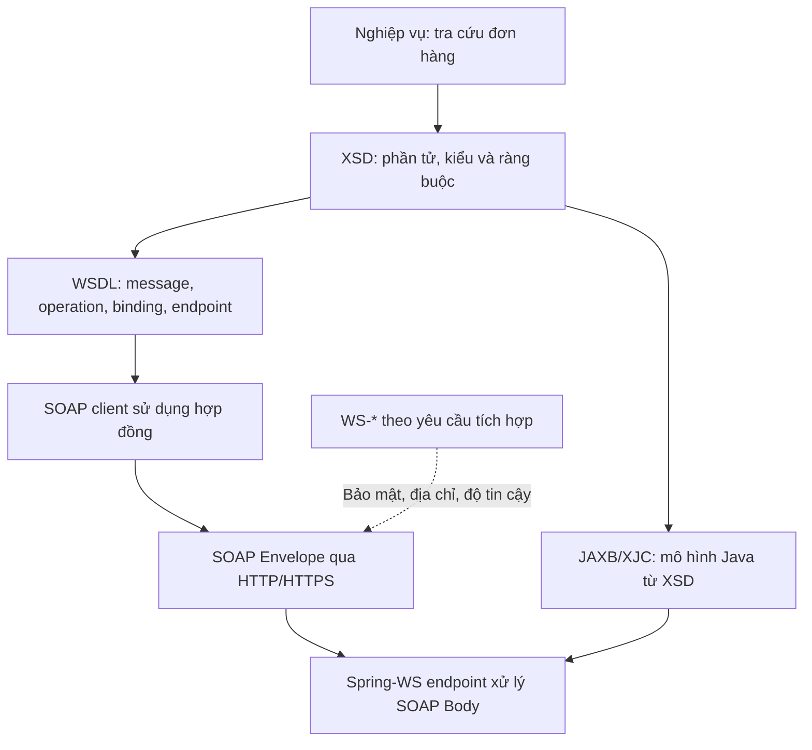

# Mối liên hệ giữa XML, XSD, WSDL, SOAP và các chuẩn WS-*

Trong hệ thống doanh nghiệp, một dịch vụ SOAP thường phải trao đổi thông điệp có cấu trúc chặt chẽ, cho phép các ứng dụng viết bằng Java, .NET hoặc ngôn ngữ khác hiểu cùng một hợp đồng. **XML, XSD, WSDL, SOAP và WS-*** giải quyết những phần khác nhau của bài toán này. Chúng liên quan mật thiết nhưng không thay thế nhau.

Bài học thuộc phần **Tổng quan Spring-WS**, đặt nền tảng cho việc phát triển dịch vụ SOAP theo hướng **contract-first** bằng Spring Web Services (Spring-WS): thiết kế lược đồ XSD và hợp đồng WSDL trước, sinh/ánh xạ dữ liệu với JAXB, triển khai endpoint và client, sau đó bổ sung xử lý lỗi, bảo mật và kiểm thử tương thích.

## 1. Bức tranh tổng thể: mỗi chuẩn trả lời câu hỏi gì?

Giả sử hệ thống bán hàng cần cho hệ thống kế toán truy vấn một đơn hàng theo mã số. Hai bên phải thống nhất *dữ liệu nào được gửi*, *dữ liệu hợp lệ có hình dạng gì*, *dịch vụ cung cấp thao tác nào*, *thông điệp được đóng gói ra sao* và *có cần ký số hoặc xác thực hay không*.

| Thành phần | Vai trò chính | Câu hỏi mà thành phần trả lời | Ví dụ |
| --- | --- | --- | --- |
| **XML** (Extensible Markup Language) | Biểu diễn dữ liệu dưới dạng các phần tử, thuộc tính và namespace | “Nội dung thông điệp trông như thế nào?” | `<ord:orderId>42</ord:orderId>` |
| **XSD** (XML Schema Definition) | Định nghĩa cấu trúc và ràng buộc kiểu dữ liệu của XML | “XML nào hợp lệ theo hợp đồng dữ liệu?” | `orderId` là số nguyên dương; `status` thuộc một tập giá trị |
| **WSDL** (Web Services Description Language) | Mô tả giao diện dịch vụ, message, operation, binding và địa chỉ | “Gọi chức năng gì, gửi/nhận loại message nào, ở đâu?” | Operation `GetOrder` nhận `GetOrderRequest` |
| **SOAP** (Simple Object Access Protocol) | Quy định cách đóng gói và xử lý thông điệp XML, gồm `Envelope`, `Header`, `Body`, `Fault` | “Thông điệp được truyền và xử lý theo khuôn dạng nào?” | Một SOAP Envelope chứa `GetOrderRequest` trong Body |
| **WS-*** (họ đặc tả Web Services) | Bổ sung các cơ chế như bảo mật thông điệp, định tuyến, chính sách và chuyển phát tin cậy | “Các yêu cầu tích hợp doanh nghiệp nâng cao được thực hiện thế nào?” | WS-Security ký số SOAP; WS-Addressing định danh thông điệp |

Hãy phân biệt hai quan hệ quan trọng:

- **XML là cú pháp; XSD là bộ quy tắc cho XML.** Một tài liệu XML *well-formed* (đúng cú pháp) chưa chắc *schema-valid* (đúng XSD).
- **WSDL mô tả hợp đồng; SOAP là định dạng thông điệp trên đường truyền.** WSDL thường tham chiếu các phần tử/kiểu dữ liệu từ XSD, còn SOAP Body chứa các phần tử XML tương ứng. SOAP có thể tồn tại mà không cần công bố WSDL, nhưng khi tích hợp contract-first, WSDL là đầu mối để hai bên hiểu cách gọi dịch vụ.



Sơ đồ thể hiện **luồng thiết kế và sử dụng hợp đồng**, không có nghĩa XSD, WSDL hay JAXB phải được gửi cùng từng SOAP request. Trên đường truyền, dữ liệu chủ yếu là một SOAP message; WSDL/XSD thường được lấy khi tích hợp hoặc khi thực hiện kiểm tra hợp đồng.

## 2. XML: ngôn ngữ chung của thông điệp

XML là nền tảng cú pháp của cả phần dữ liệu nghiệp vụ lẫn SOAP Envelope. Một đoạn XML có thể chứa tên phần tử, giá trị, thuộc tính và namespace:

```xml
<?xml version="1.0" encoding="UTF-8"?>
<ord:GetOrderRequest xmlns:ord="https://example.com/schema/orders/v1">
    <ord:orderId>42</ord:orderId>
</ord:GetOrderRequest>
```

Ở đây, `GetOrderRequest` và `orderId` là các phần tử; `42` là giá trị văn bản trong XML. Tiền tố `ord` liên kết với namespace `https://example.com/schema/orders/v1`. Danh tính đầy đủ của phần tử là **QName** (*qualified name*), về mặt khái niệm viết là `{https://example.com/schema/orders/v1}GetOrderRequest`.

**Tiền tố có thể thay đổi mà ý nghĩa không đổi**, miễn là nó vẫn trỏ đến cùng namespace URI. Ngược lại, hai phần tử cùng tên `GetOrderRequest` nhưng thuộc hai namespace khác nhau được coi là hai phần tử khác nhau. Trong Spring-WS, điều này đặc biệt quan trọng vì endpoint thường được tìm bằng cặp `namespace` và `localPart`.

Namespace URI là định danh logic; việc nó trông giống URL không có nghĩa trình xử lý XML phải gọi HTTP đến URI đó. Đường dẫn dùng để tải XSD là một khái niệm khác (ví dụ `schemaLocation`).

XML đúng cú pháp yêu cầu thẻ mở/đóng khớp nhau, phần tử có một root và nội dung được escape đúng cách. Tuy nhiên, trình phân tích XML không thể tự biết `orderId` có được phép là số âm hoặc response cần có trường `status` hay không. Đó là việc của XSD.

## 3. XSD: hợp đồng về hình dạng và kiểu dữ liệu

XSD định nghĩa các phần tử XML hợp lệ, thứ tự xuất hiện, số lần xuất hiện và kiểu dữ liệu. Ví dụ hợp đồng dữ liệu cho thao tác truy vấn đơn hàng:

```xml
<?xml version="1.0" encoding="UTF-8"?>
<xs:schema xmlns:xs="http://www.w3.org/2001/XMLSchema"
           xmlns:tns="https://example.com/schema/orders/v1"
           targetNamespace="https://example.com/schema/orders/v1"
           elementFormDefault="qualified">

    <xs:simpleType name="OrderStatus">
        <xs:restriction base="xs:string">
            <xs:enumeration value="NEW"/>
            <xs:enumeration value="PAID"/>
            <xs:enumeration value="SHIPPED"/>
        </xs:restriction>
    </xs:simpleType>

    <xs:element name="GetOrderRequest">
        <xs:complexType>
            <xs:sequence>
                <xs:element name="orderId" type="xs:positiveInteger"/>
            </xs:sequence>
        </xs:complexType>
    </xs:element>

    <xs:element name="GetOrderResponse">
        <xs:complexType>
            <xs:sequence>
                <xs:element name="status" type="tns:OrderStatus"/>
                <xs:element name="totalAmount" type="xs:decimal"/>
            </xs:sequence>
        </xs:complexType>
    </xs:element>
</xs:schema>
```

Một số ý nghĩa cần đọc được ngay từ XSD:

1. `targetNamespace` cho biết namespace của các khai báo toàn cục như `GetOrderRequest` và `GetOrderResponse`.
2. `elementFormDefault="qualified"` yêu cầu các phần tử cục bộ được khai báo trong schema (như `orderId`, `status`) mang namespace tương ứng.
3. `xs:sequence` yêu cầu các phần tử con xuất hiện đúng thứ tự đã định nghĩa. Trong response, `status` đi trước `totalAmount`.
4. `xs:positiveInteger` từ chối số `0` hoặc âm khi kiểm tra hợp lệ theo schema; `xs:decimal` mô tả số thập phân chính xác theo cú pháp XML Schema.
5. `xs:enumeration` giới hạn `status` trong `NEW`, `PAID` và `SHIPPED`.
6. Vì không khai báo `minOccurs`, giá trị mặc định là `1`: các trường được nêu là bắt buộc. Nếu cần trường tùy chọn, có thể thiết kế `minOccurs="0"` một cách có chủ đích.

Ví dụ `<ord:orderId>-1</ord:orderId>` vẫn là XML đúng cú pháp nhưng **không hợp lệ theo XSD** trên. Tương tự, `<ord:status>CANCELLED</ord:status>` chưa thuộc tập giá trị cho phép.

Trong **contract-first**, nhóm tích hợp thống nhất XSD trước khi triển khai code. Công cụ **JAXB/XJC** có thể sinh các lớp Java phục vụ marshal (Java → XML) và unmarshal (XML → Java); ví dụ `xs:positiveInteger` thường ánh xạ thành `BigInteger`, `xs:decimal` thành `BigDecimal`, còn `OrderStatus` thành enum. Chi tiết lớp sinh ra phụ thuộc cấu hình JAXB/XJC và phiên bản thư viện. **Mô hình Java là phần triển khai của hợp đồng, không phải nguồn định nghĩa thay thế XSD.**

Lưu ý: chỉ unmarshal bằng JAXB **không bảo đảm toàn bộ ràng buộc XSD đã được kiểm tra**. Nếu yêu cầu từ chối message sai schema, cần cấu hình bước schema validation rõ ràng.

## 4. WSDL: hợp đồng dịch vụ sử dụng những phần tử XSD nào?

XSD đủ để mô tả *dữ liệu*, nhưng chưa cho biết ai gọi ai, thao tác tên gì hay địa chỉ dịch vụ ở đâu. **WSDL** bổ sung những thông tin đó. Spring-WS thường làm việc với **WSDL 1.1** trong các hệ thống SOAP.

Các cấu phần hay gặp của WSDL 1.1:

| Cấu phần | Vai trò |
| --- | --- |
| `types` | Chứa hoặc import các định nghĩa XSD |
| `message` | Khai báo message logic; với document/literal thường có `part` tham chiếu đến một phần tử XSD toàn cục |
| `portType` | Khai báo interface trừu tượng và các `operation` cùng input/output |
| `binding` | Gắn interface với giao thức cụ thể, ví dụ SOAP qua HTTP, `document`/`literal` |
| `service` / `port` | Công bố endpoint cụ thể và địa chỉ truy cập |

WSDL 1.1 rút gọn sau dùng đúng các phần tử XSD ở ví dụ trên. Giả sử `orders.xsd` đã được công bố tại đường dẫn mà `schemaLocation` có thể phân giải:

```xml
<?xml version="1.0" encoding="UTF-8"?>
<wsdl:definitions
    xmlns:wsdl="http://schemas.xmlsoap.org/wsdl/"
    xmlns:soap="http://schemas.xmlsoap.org/wsdl/soap/"
    xmlns:xs="http://www.w3.org/2001/XMLSchema"
    xmlns:ord="https://example.com/schema/orders/v1"
    xmlns:tns="https://example.com/ws/orders/v1"
    targetNamespace="https://example.com/ws/orders/v1"
    name="OrdersService">

    <wsdl:types>
        <xs:schema targetNamespace="https://example.com/ws/orders/v1">
            <xs:import namespace="https://example.com/schema/orders/v1"
                       schemaLocation="orders.xsd"/>
        </xs:schema>
    </wsdl:types>

    <wsdl:message name="GetOrderInput">
        <wsdl:part name="parameters" element="ord:GetOrderRequest"/>
    </wsdl:message>
    <wsdl:message name="GetOrderOutput">
        <wsdl:part name="parameters" element="ord:GetOrderResponse"/>
    </wsdl:message>

    <wsdl:portType name="OrdersPortType">
        <wsdl:operation name="GetOrder">
            <wsdl:input message="tns:GetOrderInput"/>
            <wsdl:output message="tns:GetOrderOutput"/>
        </wsdl:operation>
    </wsdl:portType>

    <wsdl:binding name="OrdersSoapBinding" type="tns:OrdersPortType">
        <soap:binding style="document"
                      transport="http://schemas.xmlsoap.org/soap/http"/>
        <wsdl:operation name="GetOrder">
            <soap:operation soapAction="https://example.com/ws/orders/v1/GetOrder"/>
            <wsdl:input><soap:body use="literal"/></wsdl:input>
            <wsdl:output><soap:body use="literal"/></wsdl:output>
        </wsdl:operation>
    </wsdl:binding>

    <wsdl:service name="OrdersService">
        <wsdl:port name="OrdersSoapPort" binding="tns:OrdersSoapBinding">
            <soap:address location="https://api.example.com/ws/orders"/>
        </wsdl:port>
    </wsdl:service>
</wsdl:definitions>
```

Chú ý **có hai namespace khác nhau** trong ví dụ: namespace `ord` nhận diện *dữ liệu nghiệp vụ* từ XSD, còn `tns` nhận diện *các cấu phần WSDL* như message và portType. Điều này bình thường. `soap:address` là URL endpoint thực tế; namespace URI không thay thế được URL này.

`style="document"` và `use="literal"` nghĩa là phần nội dung SOAP Body tuân theo cấu trúc XML literal dựa trên schema. Đây là cách thiết kế phổ biến nhằm tăng khả năng tương thích giữa các nền tảng. `soapAction` ở binding SOAP 1.1 là metadata/action dùng khi gọi qua HTTP; nó **không đồng nhất** với QName của phần tử request, và cũng không đồng nhất với trường `Action` của WS-Addressing.

Để đối tác dùng được WSDL, tất cả XSD được import/include phải thực sự truy cập được từ vị trí công bố hợp đồng. Một file WSDL hợp lệ cú pháp nhưng tham chiếu `orders.xsd` sai đường dẫn vẫn có thể làm công cụ sinh client thất bại.

## 5. SOAP: thông điệp thực sự được gửi đi

**SOAP** định nghĩa khuôn dạng trao đổi message dựa trên XML. SOAP message có `Envelope` bao toàn bộ, `Header` tùy chọn để mang metadata và `Body` chứa payload hoặc `Fault`. Một ví dụ request theo **SOAP 1.1**:

```xml
<?xml version="1.0" encoding="UTF-8"?>
<soapenv:Envelope
    xmlns:soapenv="http://schemas.xmlsoap.org/soap/envelope/"
    xmlns:ord="https://example.com/schema/orders/v1">
    <soapenv:Header/>
    <soapenv:Body>
        <ord:GetOrderRequest>
            <ord:orderId>42</ord:orderId>
        </ord:GetOrderRequest>
    </soapenv:Body>
</soapenv:Envelope>
```

Response tương ứng:

```xml
<soapenv:Envelope
    xmlns:soapenv="http://schemas.xmlsoap.org/soap/envelope/"
    xmlns:ord="https://example.com/schema/orders/v1">
    <soapenv:Body>
        <ord:GetOrderResponse>
            <ord:status>PAID</ord:status>
            <ord:totalAmount>125.50</ord:totalAmount>
        </ord:GetOrderResponse>
    </soapenv:Body>
</soapenv:Envelope>
```

Đối chiếu từ trong ra ngoài:

1. `ord:GetOrderRequest` là phần tử toàn cục được **XSD** định nghĩa.
2. `GetOrderInput` trong **WSDL** tham chiếu đến phần tử đó và liên kết nó với operation `GetOrder`.
3. **SOAP Body** mang phần tử request; **SOAP Envelope** cung cấp cấu trúc thông điệp chuẩn.
4. **Spring-WS endpoint** nhận và xử lý payload từ Body, rồi trả phần tử `GetOrderResponse` đã được XSD mô tả.

Trong kết nối HTTP, SOAP 1.1 thường sử dụng `Content-Type: text/xml` cùng HTTP header `SOAPAction` khi binding yêu cầu. SOAP 1.2 thay đổi các quy ước liên quan:

| Khía cạnh | SOAP 1.1 | SOAP 1.2 |
| --- | --- | --- |
| Namespace của Envelope | `http://schemas.xmlsoap.org/soap/envelope/` | `http://www.w3.org/2003/05/soap-envelope` |
| Media type HTTP phổ biến | `text/xml` | `application/soap+xml` |
| Chỉ thị action với HTTP | HTTP `SOAPAction` (theo binding) | Có thể nằm trong tham số `action` của media type `application/soap+xml` |
| Cấu trúc Fault | `faultcode`, `faultstring`, `detail` | `Code`, `Reason`, `Detail` (và các phần tử liên quan) |

Hai phiên bản **không thể hoán đổi chỉ bằng việc thay Content-Type**. Envelope namespace, quy tắc fault và binding phải nhất quán với nhau và với client/server. SOAP thường được truyền qua HTTP(S), nhưng mô hình SOAP không bị giới hạn chỉ ở HTTP; transport cụ thể phải được hai phía hỗ trợ và thỏa thuận.

### SOAP Fault không phải lỗi HTTP thông thường

Khi không xử lý được một SOAP message, dịch vụ có thể trả **SOAP Fault**. Ví dụ dạng Fault của SOAP 1.1:

```xml
<soapenv:Envelope
    xmlns:soapenv="http://schemas.xmlsoap.org/soap/envelope/"
    xmlns:ord="https://example.com/schema/orders/v1">
    <soapenv:Body>
        <soapenv:Fault>
            <faultcode>soapenv:Client</faultcode>
            <faultstring>orderId không hợp lệ</faultstring>
            <detail>
                <ord:ValidationError>
                    <ord:code>INVALID_ORDER_ID</ord:code>
                </ord:ValidationError>
            </detail>
        </soapenv:Fault>
    </soapenv:Body>
</soapenv:Envelope>
```

`faultcode` phân loại lỗi theo SOAP 1.1 (chẳng hạn `Client` hoặc `Server`). `detail` có thể mang dữ liệu lỗi nghiệp vụ; `ValidationError` ở ví dụ là phần mở rộng minh họa, **chưa được khai báo trong XSD/WSDL rút gọn phía trên**. Để công bố một fault có cấu trúc cho đối tác, nên định nghĩa phần tử/kiểu lỗi trong XSD và khai báo `wsdl:fault` tương ứng khi hợp đồng cần. SOAP 1.2 dùng cách biểu diễn fault khác (`Sender`/`Receiver`, `Code`/`Reason`/`Detail`).

Mã trạng thái HTTP vẫn có ý nghĩa ở tầng transport, nhưng client SOAP phải đọc và hiểu *SOAP Fault* để xác định thông tin lỗi theo giao thức và nghiệp vụ. Trong Spring-WS, có thể ánh xạ exception thành Fault bằng các `EndpointExceptionResolver` thích hợp.

## 6. WS-*: mở rộng khả năng tích hợp doanh nghiệp

**WS-*** là cách gọi chung một họ đặc tả, **không phải một giao thức đơn lẻ**. Chúng thường bổ sung quy tắc cho SOAP Header và các bước xử lý thông điệp. Không phải hệ thống nào cũng cần tất cả chuẩn; việc chọn chuẩn phụ thuộc hợp đồng và yêu cầu phía đối tác.

| Chuẩn/nhóm chuẩn | Vấn đề giải quyết | Dấu hiệu sử dụng điển hình |
| --- | --- | --- |
| **WS-Security** | Bảo vệ nội dung và xác thực thông điệp SOAP: chữ ký XML, mã hóa XML, security token, timestamp | SOAP Header có thành phần `wsse:Security`, chữ ký, chứng chỉ X.509 hoặc token phù hợp chính sách |
| **WS-Addressing** | Gắn thông tin định tuyến/định danh vào chính message | Các header `Action`, `To`, `MessageID`, `ReplyTo` |
| **WS-Policy** / WS-SecurityPolicy | Biểu diễn và công bố các yêu cầu/khả năng kỹ thuật của endpoint | Các policy assertion yêu cầu ký, mã hóa hay loại token cụ thể |
| **WS-ReliableMessaging** | Hỗ trợ gửi nhận đáng tin cậy ở mức thông điệp thông qua sequence/acknowledgement | Sequence ID, acknowledgement, cơ chế phát hiện/khắc phục mất thông điệp |
| **WS-Trust**, **WS-SecureConversation** | Các kịch bản cấp/trao đổi token và thiết lập ngữ cảnh bảo mật | Security Token Service hoặc phiên bảo mật theo thỏa thuận |

Một SOAP request thông thường có thể chỉ chứa `Header` rỗng. Khi đối tác yêu cầu WS-Security, `Header` có thể chứa timestamp, token và chữ ký XML. **XSD/WSDL nghiệp vụ vẫn mô tả payload**, còn chính sách bảo mật và interceptor xử lý phần thông điệp bổ sung.

Ví dụ một phần header WS-Addressing (chỉ minh họa, chưa phải thông điệp đầy đủ):

```xml
<soapenv:Header xmlns:wsa="http://www.w3.org/2005/08/addressing">
    <wsa:Action>https://example.com/ws/orders/v1/GetOrder</wsa:Action>
    <wsa:MessageID>urn:uuid:5c51bfe1-7fad-4338-9e55-cb93512e4b8b</wsa:MessageID>
    <wsa:To>https://api.example.com/ws/orders</wsa:To>
</soapenv:Header>
```

`wsa:Action` thuộc SOAP Header của WS-Addressing. Trong SOAP 1.1 qua HTTP, `SOAPAction` lại là một HTTP header do SOAP binding quy định. Các hệ thống cần cấu hình nhất quán hai khái niệm khi cùng sử dụng, nhưng chúng không tự động là một trường duy nhất.

### TLS, chứng chỉ và WS-Security khác nhau thế nào?

**HTTPS/TLS** bảo vệ kênh kết nối giữa các điểm tham gia trao đổi. **WS-Security** có thể bảo vệ chính SOAP message bằng chữ ký và mã hóa XML, giúp bảo đảm tính toàn vẹn/xác thực thông điệp qua các bước trung gian phù hợp với mô hình tin cậy đã thiết kế. Hai cơ chế có thể được dùng đồng thời.

Trong tích hợp dùng chứng chỉ X.509, cần phân biệt các chức năng:

- **Keystore và private key**: thường được bên gửi sử dụng để ký hoặc bên nhận sử dụng để giải mã, tùy thiết kế.
- **Certificate/public key/truststore**: dùng để kiểm tra chữ ký, mã hóa cho người nhận hoặc xác minh chuỗi tin cậy theo chính sách.
- **Timestamp, chống replay và quản lý khóa/chứng chỉ**: cần có kiểm tra thời gian, nonce/định danh thông điệp khi phù hợp, phạm vi tin cậy và quy trình thay/thu hồi chứng chỉ.

Chỉ khai báo policy trong WSDL **không tự khiến dịch vụ Spring-WS thực thi policy đó**. Client và server phải có cấu hình thực tế tương ứng, ví dụ interceptor hỗ trợ WS-Security bằng WSS4J, quản lý khóa và kiểm thử liên thông. Các chuẩn WS-* có nhiều phiên bản/profile nên phải thống nhất phiên bản, thuật toán và cách đặt header với đối tác.

**WS-I Basic Profile** thường được nhắc cùng hệ SOAP để hướng dẫn khả năng tương tác của cách dùng SOAP/WSDL/XSD, nhưng đó là *bộ hướng dẫn/profile tương thích*, không phải một cơ chế SOAP Header độc lập như WS-Addressing.

## 7. Các thành phần kết nối với nhau trong Spring Web Services

Spring-WS tập trung vào xử lý **message/payload XML** và khuyến khích thiết kế **contract-first**. Dòng triển khai điển hình:

1. Phân tích nghiệp vụ và tạo **XSD** có namespace, request/response, kiểu dữ liệu và quy tắc tương thích rõ ràng.
2. Công bố **WSDL 1.1** mô tả operation, input/output, SOAP binding, endpoint; có thể duy trì WSDL tĩnh hoặc dùng `DefaultWsdl11Definition` tạo WSDL dựa trên XSD và các thông số cấu hình.
3. Sinh lớp dữ liệu với **JAXB/XJC** và cấu hình marshalling/unmarshalling XML ↔ Java; với các phiên bản hiện đại dùng package JAXB `jakarta.xml.bind`, trong ứng dụng cũ có thể gặp `javax.xml.bind`.
4. Viết **Spring-WS endpoint** để tiếp nhận payload phù hợp, gọi logic nghiệp vụ và tạo response theo schema.
5. Cấu hình **interceptor** nếu cần để kiểm tra schema, logging có kiểm soát hoặc WS-Security; ánh xạ exception thành SOAP Fault thích hợp.
6. Tạo **SOAP client** (Spring-WS `WebServiceTemplate` hoặc công cụ tương thích khác), kiểm thử bằng request/response thực tế và kiểm tra hợp đồng.

Ví dụ endpoint minh họa cách Spring-WS tìm handler bằng QName của phần tử đầu tiên trong SOAP Body:

```java
import org.springframework.ws.server.endpoint.annotation.Endpoint;
import org.springframework.ws.server.endpoint.annotation.PayloadRoot;
import org.springframework.ws.server.endpoint.annotation.RequestPayload;
import org.springframework.ws.server.endpoint.annotation.ResponsePayload;

@Endpoint
public class OrdersEndpoint {
    private static final String NS = "https://example.com/schema/orders/v1";
    private final OrderApplicationService service;

    public OrdersEndpoint(OrderApplicationService service) {
        this.service = service;
    }

    @PayloadRoot(namespace = NS, localPart = "GetOrderRequest")
    @ResponsePayload
    public GetOrderResponse getOrder(@RequestPayload GetOrderRequest request) {
        // Service ứng dụng thực hiện nghiệp vụ và tạo response hợp lệ theo XSD.
        return service.findOrder(request);
    }
}
```

`GetOrderRequest` và `GetOrderResponse` trong đoạn code là các lớp do JAXB sinh ra (đã import vào dự án); `OrderApplicationService` là abstraction nghiệp vụ minh họa. Endpoint **không cần phân tích thủ công chuỗi XML** khi đã cấu hình việc chuyển đổi payload phù hợp. Spring-WS dùng `@PayloadRoot` để định tuyến theo QName; vì vậy thay namespace trong request có thể làm endpoint không được chọn, dù local name vẫn là `GetOrderRequest`.

Một cấu hình WSDL động tối giản có thể trông như sau (giả sử servlet Spring-WS đã được đăng ký tại `/ws/*` và `orders.xsd` nằm trong classpath):

```java
import org.springframework.context.annotation.Bean;
import org.springframework.context.annotation.Configuration;
import org.springframework.core.io.ClassPathResource;
import org.springframework.ws.config.annotation.EnableWs;
import org.springframework.ws.wsdl.wsdl11.DefaultWsdl11Definition;
import org.springframework.xml.xsd.SimpleXsdSchema;
import org.springframework.xml.xsd.XsdSchema;

@EnableWs
@Configuration
public class OrdersWsConfig {

    @Bean
    public XsdSchema ordersSchema() {
        return new SimpleXsdSchema(new ClassPathResource("orders.xsd"));
    }

    @Bean(name = "orders")
    public DefaultWsdl11Definition ordersWsdl(XsdSchema ordersSchema) {
        DefaultWsdl11Definition wsdl = new DefaultWsdl11Definition();
        wsdl.setPortTypeName("OrdersPort");
        wsdl.setLocationUri("/ws");
        wsdl.setTargetNamespace("https://example.com/ws/orders/v1");
        wsdl.setSchema(ordersSchema);
        return wsdl;
    }
}
```

Với ánh xạ servlet và cấu hình phù hợp, bean tên `orders` có thể được công bố dưới URL dạng `/ws/orders.wsdl`. WSDL do Spring-WS **tạo tự động** có thể khác WSDL viết tay ở ví dụ trước (tên message, operation, binding, address). Nếu đối tác yêu cầu một WSDL cố định hoặc có chính sách/phần mở rộng phức tạp, cần kiểm soát chính xác artifact WSDL được công bố và thử sinh client từ chính artifact đó. XSD với hậu tố tên phần tử `Request`/`Response` thường được bộ tạo WSDL động sử dụng để suy ra các operation theo quy ước; đây là cơ chế cấu hình, không phải quy tắc bắt buộc của chuẩn WSDL.

Ở phía client, khi đã cấu hình `WebServiceTemplate` và `Jaxb2Marshaller` tương ứng với lớp JAXB, việc gọi có thể có dạng:

```java
GetOrderRequest request = new GetOrderRequest();
request.setOrderId(java.math.BigInteger.valueOf(42));

GetOrderResponse response = (GetOrderResponse)
        webServiceTemplate.marshalSendAndReceive(
                "https://api.example.com/ws/orders", request);
```

Mẫu code này tập trung vào cách payload đi qua marshaller và `WebServiceTemplate`; các phần như khởi tạo bean, xác thực WS-Security, timeout, SOAPAction hoặc SOAP 1.2 phải được cấu hình theo hợp đồng thực tế. Nếu API yêu cầu HTTP `SOAPAction`, client cần đặt action đúng cách (ví dụ callback `SoapActionCallback` trong Spring-WS).

## 8. Kiểm tra tính hợp lệ và tương thích theo từng lớp

Khi hệ thống báo “SOAP không chạy”, cần tách nguyên nhân theo lớp. Kiểm tra lần lượt từ contract đến runtime giúp tránh sửa sai chỗ:

| Triệu chứng | Lớp nên kiểm tra trước | Nguyên nhân thường gặp |
| --- | --- | --- |
| XML parser báo lỗi | XML | Sai thẻ, ký tự chưa escape, XML không well-formed |
| Request bị từ chối do validation | XSD | Sai kiểu, sai `xs:sequence`, thiếu phần tử bắt buộc, sai namespace |
| Công cụ sinh client thất bại | WSDL/XSD | `wsdl:part` trỏ sai phần tử; `xs:import`/`schemaLocation` không phân giải được |
| Không tìm thấy endpoint xử lý | SOAP Body / Spring-WS | QName của payload không khớp `@PayloadRoot` hoặc thiếu mapping |
| Client và server báo version mismatch | SOAP binding | Envelope SOAP 1.1/1.2 hoặc Content-Type không tương thích |
| Client nhận SOAP Fault | SOAP / nghiệp vụ | Yêu cầu sai, xử lý lỗi nghiệp vụ, lỗi service hoặc fault mapping |
| Chữ ký bị từ chối | WS-Security | Sai chứng chỉ/khóa tin cậy, timestamp, phần tử được ký hoặc thuật toán |
| Header/action không được chấp nhận | WSDL binding / WS-Addressing | `SOAPAction`, `wsa:Action`, chính sách hoặc phiên bản header không khớp |

### Một quy trình kiểm thử contract-first thực tế

1. **Kiểm tra XSD** bằng request/response hợp lệ và các mẫu sai có chủ đích: `orderId=-1`, thiếu `status`, sai thứ tự phần tử, namespace sai. Trong Spring-WS, `PayloadValidatingInterceptor` có thể giúp kiểm tra payload theo XSD nếu được cấu hình thích hợp.
2. **Kiểm tra WSDL được công bố**: operation có đúng tên, message trỏ đúng phần tử XSD, binding đúng SOAP version, endpoint address và tất cả import có thể truy cập. Thử sinh một client độc lập từ WSDL thực tế.
3. **Kiểm tra SOAP exchange**: gửi request bằng công cụ như SoapUI hoặc test HTTP, xem toàn bộ Envelope, Body, status HTTP, response và SOAP Fault. `MockWebServiceClient` của Spring-WS hỗ trợ kiểm thử endpoint trong ứng dụng; `MockWebServiceServer` hỗ trợ kiểm thử phía client.
4. **Kiểm tra policy/bảo mật**: gửi cả message có chữ ký/token hợp lệ lẫn trường hợp thiếu chữ ký, sai timestamp hoặc dùng chứng chỉ không được tin cậy. Cấu hình log cần tránh ghi mật khẩu, token và dữ liệu nhạy cảm.
5. **Kiểm tra tương thích hai chiều**: giữ bộ request/response mẫu từ các hệ thống đang tích hợp và kiểm thử lại khi XSD, WSDL hay cấu hình WS-* thay đổi.

Một số thay đổi hợp đồng cần đặc biệt thận trọng: đổi namespace hoặc QName thường làm client cũ không còn khớp; thêm trường bắt buộc có thể phá request cũ; thay thứ tự `xs:sequence` có thể gây lỗi validation; thêm giá trị enum đôi khi gây lỗi cho client sinh code với tập giá trị cố định. Thêm phần tử tùy chọn (`minOccurs="0"`) có thể giảm rủi ro nhưng **không bảo đảm** client cũ xử lý được mọi response. Đối với API đã được nhiều đối tác sử dụng, nên quản lý phiên bản schema, WSDL và kiểm thử backward compatibility trước khi triển khai.

## 9. Vận dụng: truy vết một thay đổi từ nghiệp vụ đến thông điệp

Giả sử hệ thống muốn trả thêm `currency` (ví dụ `VND`) trong `GetOrderResponse`. Hãy lần theo các lớp:

1. **XSD:** quyết định tên phần tử, kiểu dữ liệu và có bắt buộc hay không; cân nhắc ảnh hưởng đến client cũ. Ví dụ có thể thêm `currency` kiểu `xs:string` với `minOccurs="0"` ở vị trí xác định trong `xs:sequence`.
2. **WSDL:** nếu message đang trỏ đến phần tử XSD `GetOrderResponse`, tên operation có thể không đổi, nhưng artifact hợp đồng và các schema mà WSDL công bố phải phản ánh định nghĩa mới.
3. **JAXB:** sinh/cập nhật model Java từ XSD mới; sửa mapper nghiệp vụ để điền `currency`.
4. **SOAP:** response trên đường truyền có thêm `<ord:currency>VND</ord:currency>` bên trong `GetOrderResponse`, đúng namespace và thứ tự XSD.
5. **WS-*/runtime:** nếu payload được ký bằng WS-Security, chữ ký phải được tạo và kiểm tra trên nội dung thông điệp tương ứng; policy và các yêu cầu tương thích phải tiếp tục được đáp ứng.
6. **Kiểm thử:** xác nhận schema mới, client mới và cả các client cũ đang được hỗ trợ đều xử lý response như dự kiến.

Đây là điểm cốt lõi của **contract-first với Spring Web Services**: hợp đồng XML/XSD/WSDL giúp các bên thống nhất nghĩa và hình dạng message; SOAP mang message qua ranh giới hệ thống; WS-* bổ sung các cam kết kỹ thuật cần thiết. JAXB, endpoint, client, interceptor, SOAP Fault và kiểm thử là những cơ chế triển khai để ứng dụng Java tuân thủ hợp đồng đó trong thực tế.
