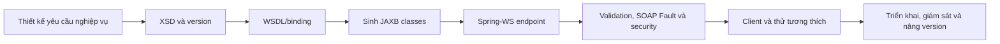
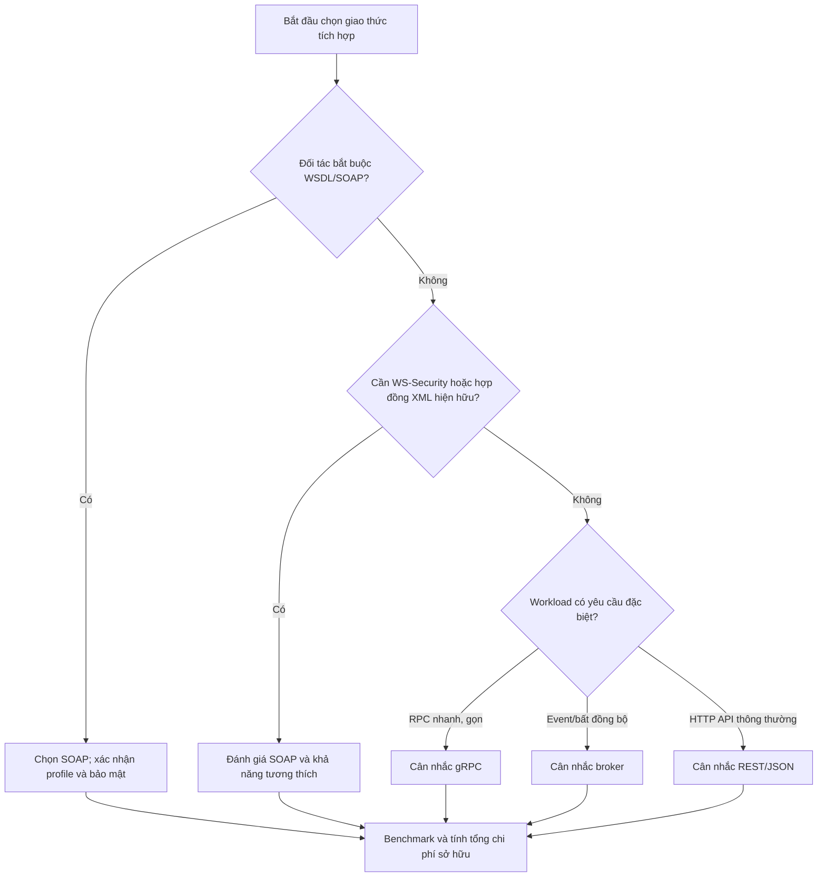

# Khi nào SOAP phù hợp và những đánh đổi về độ phức tạp, hiệu năng

## 1. Mục tiêu và bối cảnh

SOAP (Simple Object Access Protocol) là giao thức trao đổi thông điệp có cấu trúc XML. Trong các hệ thống doanh nghiệp, SOAP thường đi cùng WSDL để mô tả hợp đồng dịch vụ, XSD để quy định dữ liệu, và các đặc tả WS-* để xử lý một số yêu cầu bảo mật hoặc truyền thông liên hệ thống. Spring Web Services (Spring-WS) là lựa chọn phù hợp để xây dựng SOAP service theo hướng **contract-first**: xác định hợp đồng XML/XSD/WSDL trước, sau đó mới phát triển endpoint và client thực hiện hợp đồng đó.

Không phải mọi hệ thống cần SOAP. Điều cần quyết định là liệu các thuộc tính của SOAP và hệ sinh thái chuẩn đi kèm có tạo ra giá trị đủ lớn để bù lại chi phí thiết kế hợp đồng, xử lý XML, tích hợp bảo mật và vận hành hay không.

Sau bài học, bạn có thể:

- Nhận biết các tình huống SOAP có lợi thế rõ rệt và các tình huống nên cân nhắc REST/JSON, gRPC hoặc cơ chế bất đồng bộ.
- Phân biệt lợi ích của WSDL/XSD, SOAP Fault, WS-Security với những bảo đảm mà chính SOAP **không tự cung cấp**.
- Đánh giá chi phí phát triển, tương thích, bảo mật, dung lượng thông điệp, độ trễ và tài nguyên xử lý.
- Đưa ra quyết định dựa trên ràng buộc của đối tác và số liệu đo thực tế; áp dụng vào thiết kế Spring-WS theo hướng contract-first.

## 2. SOAP thực sự đem lại điều gì?

Một thông điệp SOAP có cấu trúc `Envelope`, `Header` (tùy chọn) và `Body`. `Body` mang dữ liệu nghiệp vụ hoặc `Fault`; `Header` có thể mang metadata và thông tin xử lý như thành phần của WS-Security. SOAP thường hoạt động trên HTTP/HTTPS, nhưng khái niệm SOAP không đồng nghĩa với HTTP hay HTTPS.

Trong một tích hợp SOAP điển hình, các tầng có vai trò khác nhau:

| Thành phần | Vai trò | Điều cần nhớ |
| --- | --- | --- |
| **SOAP Envelope** | Quy định khuôn dạng và cách trao đổi thông điệp XML. | SOAP không tự định nghĩa nghiệp vụ, xác thực người dùng hay chính sách retry. |
| **XSD** | Định nghĩa kiểu dữ liệu, phần tử, tính bắt buộc, ràng buộc và namespace. | XSD mạnh về cấu trúc XML; các luật nghiệp vụ liên quan đến dữ liệu hệ thống vẫn cần xử lý trong ứng dụng. |
| **WSDL** | Mô tả operation, request/response, binding và địa chỉ truy cập dịch vụ. | Hợp đồng rõ ràng giúp sinh mã client, nhưng phải thống nhất version và quy tắc tương thích. |
| **JAXB** | Ánh xạ giữa XML và đối tượng Java. | Mapping và các lớp được sinh phụ thuộc XSD và phiên bản môi trường JAXB. |
| **Spring-WS** | Ánh xạ SOAP payload vào endpoint, hỗ trợ marshalling, interceptor, client và SOAP Fault. | Cần cấu hình schema validation, bảo mật và quản lý lỗi theo yêu cầu; không mặc nhiên có mọi WS-* extension. |
| **WS-Security** | Họ cơ chế bảo mật ở cấp thông điệp, ví dụ chữ ký số, mã hóa, timestamp. | Phải cấu hình, quản trị khóa/chứng chỉ và thử tương thích với đối tác. |
| **TLS/HTTPS** | Bảo vệ kênh truyền giữa các đầu nối TLS. | Không thay thế chữ ký số ở cấp thông điệp khi yêu cầu xác minh nội dung xuyên các trung gian. |

Một lưu ý về cách so sánh: SOAP là giao thức thông điệp, còn REST là một phong cách kiến trúc API. Trong thực hành, người ta thường so sánh **SOAP/WSDL/XML qua HTTP** với **HTTP API theo phong cách REST, trao đổi JSON**; đây mới là hai phương án triển khai cụ thể để cân nhắc.

## 3. Những trường hợp nên chọn SOAP

### 3.1. Đối tác hoặc nền tảng hiện có yêu cầu WSDL/SOAP

Đây là lý do mạnh nhất. Ví dụ: một cổng thanh toán của đối tác, hệ thống lõi ngân hàng, bảo hiểm, khai báo hải quan hoặc hệ thống ERP lâu năm chỉ cung cấp WSDL và yêu cầu client gửi SOAP theo đúng binding.

Lúc này, việc lựa chọn SOAP chủ yếu là **đáp ứng hợp đồng tích hợp**. Thay đổi sang JSON ở phía ứng dụng nội bộ có thể làm tăng thêm một tầng chuyển đổi, trong khi kết nối với đối tác vẫn phải tuân theo SOAP.

Trước khi bắt đầu, cần xác nhận phiên bản SOAP, WSDL/XSD gốc, cách xác thực, chính sách chứng chỉ, mã lỗi, giới hạn kích thước, timeout, bộ test và môi trường thử nghiệm. Không nên suy luận các chi tiết này chỉ từ tên operation trong WSDL.

### 3.2. Hợp đồng dữ liệu phải được kiểm soát chặt và dùng lâu dài

WSDL/XSD hữu ích khi nhiều đội hoặc nhiều công ty sử dụng chung API trong nhiều năm:

- Phần tử, kiểu dữ liệu, thứ tự phần tử, namespace và mức độ bắt buộc được công bố theo hợp đồng.
- Công cụ của nhiều ngôn ngữ có thể sinh mô hình dữ liệu và client từ WSDL/XSD.
- Kiểm thử hợp đồng có thể xác minh request/response đúng schema trước khi chạy logic nghiệp vụ.
- Các thay đổi phá vỡ tương thích được nhận diện và quản lý theo phiên bản.

Ví dụ, với yêu cầu `paymentId` bắt buộc và `status` chỉ thuộc tập `PROCESSING`, `SETTLED`, `REJECTED`, XSD tạo ra ranh giới dữ liệu rõ ràng. Tuy nhiên, **WSDL hợp lệ chưa bảo đảm tương thích thực tế**: một client vẫn có thể hiểu khác về múi giờ, giá trị null, thứ tự chữ ký XML hoặc hành vi khi giao dịch bị trùng.

### 3.3. Cần bảo mật ở cấp thông điệp và phía đối tác quy định WS-Security

HTTPS thường đủ để bảo vệ dữ liệu trên một kết nối được kiểm soát. Nhưng nếu thông điệp đi qua các trung gian, được lưu trữ để xử lý lại hoặc cần xác minh chữ ký nội dung độc lập với từng kết nối TLS, WS-Security có thể cần thiết.

Chữ ký số XML có thể giúp bên nhận kiểm tra tính toàn vẹn và nguồn ký của phần nội dung được ký; mã hóa XML có thể bảo vệ các phần được mã hóa theo chính sách. Việc áp dụng đúng còn tùy phạm vi dữ liệu được ký/mã hóa, quản lý khóa, cách kiểm tra timestamp và ngăn phát lại thông điệp.

Spring-WS có thể tích hợp interceptor bảo mật như `Wss4jSecurityInterceptor`. Dù vậy, chỉ lựa chọn SOAP không có nghĩa là chữ ký, mã hóa, token, chống replay hoặc quản lý chứng chỉ được thiết lập sẵn.

### 3.4. Cần đồng bộ với hệ sinh thái chuẩn tích hợp doanh nghiệp

Một số đối tác yêu cầu chính sách hoặc đặc tả trong họ WS-* (chẳng hạn WS-Addressing, WS-Security, WS-ReliableMessaging) và có bộ kiểm thử tương thích riêng. SOAP phù hợp khi hai phía đã thống nhất cụ thể **đặc tả nào, phiên bản nào và cơ chế nào thực sự được hỗ trợ**.

Đặc biệt, không nên suy ra rằng mọi tiện ích WS-* đều có sẵn trong Spring-WS. Những yêu cầu như reliable messaging, điều phối giao dịch phân tán hoặc exactly-once cần kiểm tra khả năng của toàn bộ stack và thường phải triển khai thêm cơ chế nghiệp vụ.

### 3.5. Giao diện dịch vụ cần ổn định hơn tần suất thay đổi

Với các giao dịch doanh nghiệp có biểu mẫu chặt chẽ, tốc độ thay đổi thấp và vòng đời tích hợp dài, chi phí xây dựng hợp đồng từ đầu có thể được bù bằng tính ổn định khi vận hành, kiểm thử và thay đổi có kiểm soát.

Ngược lại, nếu API đổi nhanh theo từng phiên bản giao diện người dùng và không có yêu cầu WSDL/WS-*, độ cứng của hợp đồng XML có thể làm chậm vòng phát triển.

## 4. Khi nào SOAP thường không phải lựa chọn hiệu quả?

| Bối cảnh | Phương án thường đáng cân nhắc | Lý do |
| --- | --- | --- |
| API CRUD đơn giản cho web/mobile, dữ liệu trao đổi chủ yếu là JSON | HTTP API/REST với JSON | Dễ tiêu thụ trên trình duyệt và ứng dụng, tài liệu và quan sát thường đơn giản hơn. |
| Giao tiếp nội bộ tần suất rất cao, cần mã hóa gọn và quy trình RPC rõ | gRPC/Protocol Buffers hoặc giao thức phù hợp | Payload nhị phân và luồng RPC có thể giảm chi phí truyền/parse trong một số workload; cần benchmark thật. |
| Event, log hoặc thông báo liên tục, không cần request/response tức thì | Broker/message streaming | Hỗ trợ tách bên phát và bên nhận, backpressure và xử lý bất đồng bộ. |
| Truyền tệp lớn hoặc blob nhị phân | Object storage/file transfer; hoặc MTOM nếu hai phía bắt buộc dùng SOAP | Nhúng base64 trực tiếp làm tăng kích thước dữ liệu; MTOM cần tương thích và cấu hình riêng. |
| Hệ thống và đối tác không yêu cầu XML schema, WS-* hoặc WSDL | HTTP API/JSON hoặc lựa chọn nhẹ hơn | Chi phí vận hành công cụ XML, namespace và hợp đồng SOAP có thể không mang lại lợi ích tương xứng. |

Đây là xu hướng lựa chọn, không phải quy tắc tuyệt đối. Một ứng dụng có thể cung cấp API JSON cho mobile, dùng gRPC giữa vài dịch vụ nội bộ và đồng thời dùng Spring-WS tại biên kết nối với đối tác doanh nghiệp.

## 5. Các đánh đổi phải tính đến

### 5.1. Độ phức tạp phát triển và vòng đời hợp đồng

Với Spring-WS theo hướng contract-first, luồng làm việc thường là:



Chi phí thực tế phát sinh từ các việc cụ thể:

1. Duy trì namespace, định dạng ngày giờ, decimal, phần tử tùy chọn, cardinality và version của XSD/WSDL.
2. Đồng bộ lớp JAXB sinh từ XSD; kiểm soát môi trường build, kiểu dữ liệu và thay đổi hợp đồng.
3. Cấu hình `@Endpoint`, payload mapping, schema validation, SOAP Fault, interceptor và security.
4. Kiểm thử với client thực của đối tác, kể cả SOAPAction, namespace, header, certificate và cách parser xử lý XML.
5. Duy trì tài liệu và quy trình thay đổi khi nhiều bên chỉ cập nhật client theo lịch riêng.

Một thay đổi tưởng như nhỏ, chẳng hạn đổi namespace, tên phần tử hoặc thứ tự phần tử trong `xs:sequence`, có thể khiến client cũ không đọc được thông điệp. Ngay cả việc thêm trường tùy chọn cũng cần đánh giá khả năng chấp nhận phần tử mới của client và schema trước đó; **không thể mặc định mọi thay đổi cộng thêm đều tương thích**.

### 5.2. Kích thước dữ liệu và băng thông

SOAP dùng XML với tag, namespace, Envelope và đôi khi nhiều header. Với cùng một mô hình nghiệp vụ, thông điệp SOAP/XML thường dài hơn JSON, nhất là khi dữ liệu gốc nhỏ hoặc có nhiều metadata bảo mật.

Tác động phụ thuộc hoàn cảnh:

- **Thông điệp nhỏ, số lượng lớn:** phần overhead cố định và việc tạo/parse XML có thể đáng kể.
- **Thông điệp chứa cấu trúc phức tạp:** kích thước tăng theo mức lồng nhau, tên thẻ và namespace.
- **Thông điệp có chữ ký/mã hóa:** có thêm các phần tử, digest, chữ ký hoặc dữ liệu mã hóa.
- **Kết nối có nén:** gzip có thể giảm chênh lệch kích thước truyền tải, nhưng bản thân việc nén/giải nén cũng dùng CPU.
- **Tệp nhị phân:** base64 trực tiếp có thể làm lượng dữ liệu tăng đáng kể; MTOM/XOP hữu ích nếu đôi bên hỗ trợ và thử nghiệm chính xác.

Không có một con số cố định kiểu “SOAP luôn chậm hơn X%”: kết quả thay đổi theo payload, thư viện XML, security, mạng, dữ liệu, JVM và cách cấu hình.

### 5.3. Độ trễ, thông lượng và CPU

Có thể chia tổng thời gian xử lý một request thành những phần sau:

```text
Tổng thời gian ≈ mạng + TLS + chuyển đổi dữ liệu + parse XML
               + validation + kiểm tra chữ ký/mã hóa
               + xử lý nghiệp vụ và truy cập dữ liệu + xếp hàng/chờ tài nguyên
```

Đây là mô hình phân tích, không phải phép cộng có thể đo chính xác từng thành phần trong mọi hệ thống. Khi truy vấn cơ sở dữ liệu mất phần lớn thời gian, overhead SOAP có thể không đáng kể. Khi có hàng nghìn request nhỏ mỗi giây, chi phí xử lý XML và WS-Security có thể trở thành nút thắt.

Cần phân biệt ba chỉ số:

| Chỉ số | Câu hỏi cần trả lời |
| --- | --- |
| **Latency (p50, p95, p99)** | Bao nhiêu thời gian để hoàn tất một request? Những request chậm nhất có ảnh hưởng đến SLA không? |
| **Throughput** | Một instance xử lý được bao nhiêu request/giây tại mức lỗi và độ trễ cho phép? |
| **CPU, bộ nhớ, GC** | Parse/marshal XML, schema validation và XML signature tiêu hao bao nhiêu tài nguyên? |

SOAP không tự quyết định khả năng chịu tải. Kích thước connection pool, thread pool, timeout, caching, tốc độ backend, giới hạn ingress và mức đồng thời cũng quyết định kết quả cuối cùng.

### 5.4. Độ phức tạp bảo mật và vận hành

WS-Security có thể đáp ứng yêu cầu mà chỉ dùng TLS không giải quyết được, nhưng kèm chi phí:

- Lưu trữ khóa bí mật an toàn, theo dõi hạn chứng chỉ, thay khóa, chuỗi tin cậy và thu hồi chứng chỉ.
- Đồng bộ đồng hồ, xử lý `Timestamp`, kiểm tra replay/nonce khi chính sách yêu cầu.
- Thống nhất thuật toán, canonicalization XML, phần tử cần ký, thứ tự ký và mã hóa, định dạng token với đối tác.
- Tránh rò rỉ số tài khoản, token, payload nhạy cảm hoặc thông tin chứng chỉ trong log.
- Gia cố XML parser trước các dạng đầu vào độc hại (ví dụ external entities, entity expansion), giới hạn kích thước và độ sâu tài liệu.

Những chi phí này chỉ hợp lý khi có yêu cầu bảo mật tương ứng. Không nên bật các cơ chế phức tạp chỉ vì hệ thống sử dụng SOAP.

### 5.5. Khả năng quan sát và xử lý lỗi

SOAP Fault cung cấp khuôn dạng lỗi ở cấp giao thức. Nhưng ứng dụng vẫn phải định nghĩa cách phân biệt:

- **Lỗi hợp đồng/kỹ thuật:** XML không đúng schema, SOAP header không hợp lệ, chữ ký sai, endpoint không xử lý được.
- **Lỗi nghiệp vụ:** giao dịch chưa tồn tại, vượt hạn mức, bị từ chối theo quy tắc đối tác.
- **Lỗi hạ tầng tạm thời:** timeout, backend gián đoạn, quá tải.

Không có một cách ánh xạ duy nhất cho mọi nghiệp vụ. Có hệ thống dùng SOAP Fault cho yêu cầu không hợp lệ; có hệ thống mô tả lỗi nghiệp vụ như một response có cấu trúc trong WSDL. Điều cốt yếu là **định nghĩa ổn định trong hợp đồng** để client biết trường hợp nào nên sửa dữ liệu, dừng xử lý hoặc thử lại.

## 6. Ví dụ xuyên suốt: tra cứu trạng thái thanh toán

Giả sử một nhà cung cấp thanh toán yêu cầu đối tác gọi operation `GetPaymentStatus`. Hai phía thống nhất SOAP 1.1, namespace `urn:corp:payments:v1`, WSDL 1.1 và XSD định nghĩa request/response. Ví dụ sau chỉ minh họa các thành phần cần thống nhất; địa chỉ và tên đối tác là giả định.

### 6.1. Bắt đầu từ XSD

```xml
<xs:schema xmlns:xs="http://www.w3.org/2001/XMLSchema"
           xmlns:tns="urn:corp:payments:v1"
           targetNamespace="urn:corp:payments:v1"
           elementFormDefault="qualified">

  <xs:simpleType name="PaymentStatus">
    <xs:restriction base="xs:string">
      <xs:enumeration value="PROCESSING"/>
      <xs:enumeration value="SETTLED"/>
      <xs:enumeration value="REJECTED"/>
    </xs:restriction>
  </xs:simpleType>

  <xs:element name="GetPaymentStatusRequest">
    <xs:complexType>
      <xs:sequence>
        <xs:element name="paymentId" type="xs:string"/>
      </xs:sequence>
    </xs:complexType>
  </xs:element>

  <xs:element name="GetPaymentStatusResponse">
    <xs:complexType>
      <xs:sequence>
        <xs:element name="paymentId" type="xs:string"/>
        <xs:element name="status" type="tns:PaymentStatus"/>
      </xs:sequence>
    </xs:complexType>
  </xs:element>
</xs:schema>
```

XSD quy định chính xác tên, namespace, thứ tự trường và kiểu dữ liệu. WSDL sẽ bổ sung các operation, message, binding và endpoint address. Đối với hệ thống thực, cần mở rộng quy tắc về độ dài `paymentId`, thông tin thời điểm, phân loại lỗi và phân trang nếu nghiệp vụ cần.

### 6.2. SOAP request và response

Ví dụ request SOAP 1.1 trên HTTP (giá trị `SOAPAction` phải khớp hợp đồng WSDL thực tế):

```http
POST /ws/payments HTTP/1.1
Content-Type: text/xml; charset=utf-8
SOAPAction: "urn:GetPaymentStatus"
```

```xml
<soapenv:Envelope xmlns:soapenv="http://schemas.xmlsoap.org/soap/envelope/"
                  xmlns:pay="urn:corp:payments:v1">
  <soapenv:Header/>
  <soapenv:Body>
    <pay:GetPaymentStatusRequest>
      <pay:paymentId>PMT-2026-0042</pay:paymentId>
    </pay:GetPaymentStatusRequest>
  </soapenv:Body>
</soapenv:Envelope>
```

```xml
<soapenv:Envelope xmlns:soapenv="http://schemas.xmlsoap.org/soap/envelope/"
                  xmlns:pay="urn:corp:payments:v1">
  <soapenv:Body>
    <pay:GetPaymentStatusResponse>
      <pay:paymentId>PMT-2026-0042</pay:paymentId>
      <pay:status>SETTLED</pay:status>
    </pay:GetPaymentStatusResponse>
  </soapenv:Body>
</soapenv:Envelope>
```

Trong SOAP 1.1, Envelope dùng namespace `http://schemas.xmlsoap.org/soap/envelope/` và HTTP thường dùng `Content-Type: text/xml`. SOAP 1.2 dùng namespace Envelope khác (`http://www.w3.org/2003/05/soap-envelope`) và media type `application/soap+xml`; không được tự hoán đổi hai biến thể khi hai phía đã ký kết một binding cụ thể.

### 6.3. Ánh xạ vào Spring-WS

Sau khi tạo lớp JAXB từ XSD, endpoint nhận payload và gọi tầng nghiệp vụ. Đoạn dưới minh họa cấu trúc; giả định các lớp `GetPaymentStatusRequest` / `GetPaymentStatusResponse` đã được sinh và tầng `PaymentQueryService` tồn tại.

```java
@Endpoint
public class PaymentStatusEndpoint {
    private static final String NS = "urn:corp:payments:v1";
    private final PaymentQueryService paymentQueryService;

    public PaymentStatusEndpoint(PaymentQueryService paymentQueryService) {
        this.paymentQueryService = paymentQueryService;
    }

    @PayloadRoot(namespace = NS, localPart = "GetPaymentStatusRequest")
    @ResponsePayload
    public GetPaymentStatusResponse getPaymentStatus(
            @RequestPayload GetPaymentStatusRequest request) {

        PaymentResult result =
                paymentQueryService.findById(request.getPaymentId());

        GetPaymentStatusResponse response =
                new GetPaymentStatusResponse();
        response.setPaymentId(result.paymentId());
        response.setStatus(result.status());
        return response;
    }
}
```

`@PayloadRoot` lựa chọn endpoint theo tên đầy đủ (namespace + local name) của phần tử gốc trong SOAP Body. JAXB marshal/unmarshal giữa XML và Java; tùy cách sinh mã, lớp generated có thể sử dụng `JAXBElement<T>` thay vì ánh xạ trực tiếp như minh họa.

Ở phía client, `WebServiceTemplate` thường được dùng với marshaller/unmarshaller thích hợp. Khi WSDL yêu cầu SOAPAction, client phải gửi giá trị tương ứng (ví dụ qua `SoapActionCallback`). Một `WebServiceTemplate` chỉ giải quyết gửi/nhận thông điệp; retry, idempotency, chứng chỉ, kiểm tra lỗi và chính sách bảo mật vẫn phải được thiết kế.

### 6.4. SOAP Fault cần có hợp đồng rõ

Ví dụ SOAP 1.1 Fault cho request không hợp lệ:

```xml
<soapenv:Envelope xmlns:soapenv="http://schemas.xmlsoap.org/soap/envelope/">
  <soapenv:Body>
    <soapenv:Fault>
      <faultcode>soapenv:Client</faultcode>
      <faultstring>paymentId is invalid</faultstring>
    </soapenv:Fault>
  </soapenv:Body>
</soapenv:Envelope>
```

Trong thực tế, có thể bổ sung `detail` chứa lỗi có cấu trúc theo XSD, nếu hợp đồng quy định. Khi dùng SOAP 1.1 qua HTTP, SOAP Fault thường gắn với HTTP 500 theo binding; client nên hiểu lỗi từ SOAP Fault và hợp đồng, thay vì chỉ nhìn vào status code. SOAP 1.2 có cấu trúc Fault khác nên không được dùng lẫn ví dụ này.

Không trả về Java stack trace, truy vấn SQL hay thông tin bí mật trong `faultstring` hoặc `detail`. Những thông tin đó thuộc log nội bộ có kiểm soát.

## 7. Đo hiệu năng trước khi quyết định

So sánh SOAP và một phương án khác chỉ có ý nghĩa khi hai triển khai thực hiện **cùng nghiệp vụ, trên dữ liệu và hạ tầng tương đương**.

Một quy trình thực hành:

1. **Xác định SLA và workload:** ví dụ số request/giây, p95 tối đa, payload điển hình và payload lớn nhất, số client đồng thời, mức lỗi được phép.
2. **Tạo các ca tương đương:** cùng dữ liệu và cùng thao tác backend cho SOAP/XML và JSON/gRPC; ghi rõ có schema validation, WS-Security, TLS, nén hoặc cache hay không.
3. **Làm nóng ứng dụng:** bảo đảm kết quả không bị chi phối bởi thời gian khởi động JVM/JIT và thiết lập kết nối đầu tiên.
4. **Chạy nhiều mức tải:** từ bình thường đến sát giới hạn; ghi kích thước bytes trên mạng, p50/p95/p99, throughput, CPU, memory, GC, lỗi và timeout.
5. **Phân tích nút thắt:** đo riêng marshalling, validation, security interceptor và truy cập backend khi có khả năng; không quy mọi độ trễ cho SOAP.
6. **Đánh giá chi phí tổng thể:** bao gồm nhân lực vận hành, tương thích đối tác, rotation certificate, kiểm thử hợp đồng và rủi ro thay đổi trong nhiều năm.

Bảng đọc kết quả:

| Quan sát thực nghiệm | Hàm ý cần kiểm tra |
| --- | --- |
| Payload SOAP lớn hơn, nhưng p95 gần như bằng phương án khác | Backend/network có thể đang chi phối; tối ưu format có thể đem lại ít giá trị. |
| CPU tăng rõ khi bật XML signature | Kiểm tra thuật toán, cấu hình, khối lượng nội dung ký và khả năng mở rộng instance. |
| p99 xấu khi nhiều request đồng thời | Kiểm tra thread/connection pool, xếp hàng, GC, timeout và backend. |
| Client đối tác thất bại dù XML “trông đúng” | So lại XSD, namespace, SOAP version, SOAPAction, thứ tự phần tử và security policy. |
| Lỗi tăng sau khi retry tự động | Kiểm tra timeout, idempotency key, điều kiện retry và giới hạn tải. |

Không nên đưa ra mức “nhanh hơn” hoặc “chậm hơn” nếu chưa có kết quả đo trên chính workload cần triển khai.

## 8. Thiết kế Spring-WS để kiểm soát chi phí và rủi ro

### 8.1. Quản lý hợp đồng trước khi viết endpoint

- Coi XSD/WSDL là artifact có version và quy trình review rõ ràng.
- Tách kiểu XML công khai khỏi mô hình cơ sở dữ liệu nội bộ để thay đổi database không trực tiếp phá hợp đồng.
- Định nghĩa rõ trường bắt buộc/tùy chọn, kiểu decimal, timezone, lỗi hợp đồng và namespace.
- Sinh JAXB classes trong quy trình build có kiểm soát; đánh giá diff của mã sinh khi cập nhật XSD.
- Kiểm thử request/response của cả bên gửi và bên nhận so với đúng phiên bản XSD/WSDL được triển khai.

### 8.2. Dùng interceptor và validation có chủ đích

Trong Spring-WS, interceptor có thể xử lý những việc cắt ngang nhiều endpoint như logging phù hợp, schema validation hoặc WS-Security. Chọn thứ tự và hành vi interceptor dựa trên yêu cầu thực tế; lỗi validation/security phải được trả về theo chính sách đã công bố, đồng thời tránh ghi log dữ liệu nhạy cảm.

Schema validation bảo đảm dữ liệu XML đúng kiểu và cấu trúc, nhưng không thay thế xác thực, phân quyền hoặc validation nghiệp vụ. Ví dụ `paymentId` là chuỗi hợp lệ trong XSD không có nghĩa là người gọi được quyền xem trạng thái khoản thanh toán đó.

### 8.3. Tách xác thực danh tính khỏi phân quyền nghiệp vụ

- **TLS/mTLS:** kiểm tra kênh và/hoặc danh tính ở cấp kết nối tùy cấu hình.
- **WS-Security:** xác minh các thành phần thông điệp theo chính sách đối tác.
- **Authorization:** kiểm tra tài khoản gọi có được truy cập khoản thanh toán cụ thể hay không.
- **Audit:** lưu dấu vết nghiệp vụ và correlation ID đủ cho điều tra, nhưng loại bỏ dữ liệu nhạy cảm.

Không được coi request hợp lệ về chữ ký là mặc nhiên được phép thực hiện mọi operation.

### 8.4. Thiết kế retry và idempotency

SOAP không tự mang bảo đảm exactly-once. Với operation thay đổi trạng thái, ví dụ `SubmitPayment`, nếu client timeout sau khi server đã ghi nhận giao dịch, retry mù có thể gây xử lý hai lần.

Giải pháp thường dùng là định danh request duy nhất, lưu dấu yêu cầu đã xử lý, trả kết quả nhất quán khi nhận lại cùng ID, và phân biệt lỗi có thể retry với lỗi nghiệp vụ không nên retry. Cơ chế này nằm ở thiết kế nghiệp vụ và hạ tầng; không tự xuất hiện vì dùng WSDL hoặc Spring-WS.

### 8.5. Kiểm thử tương thích bằng thông điệp thực

Ít nhất cần có:

- Bộ request/response hợp lệ và không hợp lệ theo XSD, bao gồm phần tử thiếu, sai namespace, giá trị enum không hỗ trợ.
- Test SOAP 1.1 hoặc 1.2 đúng binding, `SOAPAction` và kiểu nội dung HTTP.
- Test SOAP Fault, timeout, lỗi downstream và trường hợp client retry.
- Test chứng chỉ hết hạn/sai trust, timestamp lệch, chữ ký sai hoặc replay khi bật WS-Security.
- Test với công cụ hoặc client thật của đối tác; WSDL đọc được không đủ để chứng minh hoạt động end-to-end.
- Test hiệu năng với security/validation giống môi trường dự kiến triển khai.

## 9. Khung ra quyết định thực tế

Sơ đồ gợi ý:



Trước khi chốt kiến trúc, hãy trả lời:

| Câu hỏi | Tác động đến quyết định |
| --- | --- |
| **Có ràng buộc hợp đồng từ đối tác không?** | WSDL/SOAP bắt buộc thường quyết định lựa chọn ở biên tích hợp. |
| **Dữ liệu và luồng nghiệp vụ cần cam kết gì?** | XSD, versioning, phân quyền, Fault, idempotency và SLA cần được xác định. |
| **Yêu cầu bảo mật thuộc kênh hay thông điệp?** | WS-Security có giá trị khi có chính sách cụ thể, nhưng chi phí tích hợp cao hơn. |
| **Client và server có cùng profile kỹ thuật không?** | SOAP version, encoding, WS-* policy và chứng chỉ quyết định khả năng tương thích. |
| **Payload, tần suất và độ trễ mục tiêu là bao nhiêu?** | Chỉ số thực tế cho biết XML/security có phải nút thắt hay không. |
| **Ai duy trì hợp đồng và vận hành lâu dài?** | Đội ngũ cần quy trình thay đổi XSD/WSDL, rotation certificate và giám sát lỗi. |

### Ba tình huống mẫu

**Tình huống A – Kết nối hệ thống thanh toán của đối tác.** Đối tác cung cấp WSDL cố định, SOAP 1.1, yêu cầu ký thông điệp bằng chứng chỉ X.509 và bộ test tương thích. **Nên chọn Spring-WS/SOAP** ở lớp tích hợp, thiết kế XSD/WSDL theo hợp đồng, cấu hình WS-Security và kiểm thử chéo với đối tác. Các API nội bộ khác vẫn có thể dùng cách trao đổi phù hợp hơn.

**Tình huống B – API danh mục sản phẩm cho ứng dụng mobile.** Client cần đọc, lọc và cập nhật danh mục, không có WSDL hay WS-Security, dữ liệu nhỏ và thay đổi thường xuyên. **HTTP API/JSON thường hợp lý hơn** nhờ dễ tiêu thụ và chi phí công cụ thấp hơn.

**Tình huống C – Giao tiếp nhiều dịch vụ trong trung tâm dữ liệu.** Các service gọi RPC ở tần suất cao, yêu cầu payload gọn và độ trễ ổn định; không có đối tác SOAP. **Nên benchmark gRPC/Protobuf và các phương án khác** theo workload cụ thể, rồi cân nhắc thêm khả năng debug, streaming, hỗ trợ client và chi phí vận hành.

## 10. Sai lầm thường gặp và cách tự kiểm tra

| Nhận định dễ nhầm | Cách hiểu chính xác |
| --- | --- |
| “SOAP bảo mật hơn vì dùng XML.” | XML không tự bảo mật. Phải có TLS, xác thực, phân quyền và cơ chế WS-Security thích hợp với threat model. |
| “SOAP chậm hơn JSON trong mọi trường hợp.” | Thông điệp và parse thường có overhead, nhưng độ trễ end-to-end phụ thuộc workload; cần đo. |
| “Có WSDL là các ngôn ngữ tự tương thích.” | Cần thử SOAP binding, WS-I/profile nếu áp dụng, namespace, các kiểu dữ liệu và chính sách bảo mật. |
| “Dùng SOAP Fault là đủ quản lý lỗi.” | Vẫn phải chuẩn hóa lỗi nghiệp vụ, retry, idempotency, giám sát và correlation ID. |
| “Chọn Spring-WS là có đủ mọi tính năng WS-*.” | Mỗi extension cần kiểm tra hỗ trợ trong stack, cấu hình cụ thể và test với đối tác. |
| “Thêm trường optional luôn không phá vỡ client cũ.” | Client/schema cũ có thể từ chối phần tử không được khai báo; cần kiểm thử và chiến lược versioning. |
| “Có chữ ký số thì không cần kiểm tra quyền truy cập.” | Chữ ký chứng minh thuộc tính của thông điệp theo chính sách ký; phân quyền nghiệp vụ là bước riêng. |

## 11. Kết luận

**SOAP phù hợp nhất khi hợp đồng tích hợp, tính tương thích và yêu cầu bảo mật cấp thông điệp là ràng buộc rõ ràng.** Với Spring-WS, chiến lược contract-first giúp nhóm phát triển xem XSD/WSDL như một giao diện ổn định, ánh xạ JAXB vào endpoint, chuẩn hóa SOAP Fault và đặt các interceptor validation/security tại điểm thích hợp.

Đổi lại là công sức quản lý hợp đồng, namespace, client codegen, chứng chỉ, kiểm thử liên hệ thống và tài nguyên xử lý XML. Quyết định kiến trúc tốt phải xét **ràng buộc của đối tác + SLA thực tế + tổng chi phí duy trì**, rồi xác minh bằng benchmark và kiểm thử tương thích. SOAP là công cụ mạnh khi những khả năng này thực sự cần thiết; còn với API đơn giản hoặc workload chuyên biệt, phương án khác có thể tối ưu hơn.
