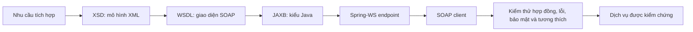

# Kiến thức tiên quyết và lộ trình từ hợp đồng đến dịch vụ được kiểm chứng

## 1. Đích đến của hành trình học Spring Web Services

**Spring Web Services (Spring-WS)** là bộ công cụ của hệ sinh thái Spring để xây dựng và gọi dịch vụ web dựa trên thông điệp XML, đặc biệt là SOAP. Với cách tiếp cận **contract-first**, nhóm phát triển thống nhất cấu trúc dữ liệu và giao diện trao đổi trước, sau đó mới triển khai Java. Đây là cách làm phù hợp khi tích hợp giữa các hệ thống doanh nghiệp có ngôn ngữ lập trình, chu kỳ phát hành và yêu cầu bảo mật khác nhau.

Bài này trả lời hai câu hỏi:

1. Cần biết những gì trước khi triển khai một dịch vụ SOAP bằng Spring-WS?
2. Cần đi qua những mốc nào để chứng minh dịch vụ thực sự tuân thủ hợp đồng, trả lỗi nhất quán và tương thích với client?

Sau bài học, bạn cần có khả năng đọc một thông điệp SOAP, giải thích mối liên hệ XSD–WSDL–JAXB–endpoint, tự thiết kế kế hoạch triển khai và xác định bằng chứng kiểm thử cần có trước khi tích hợp hoặc phát hành.

**Ví dụ xuyên suốt:** Một hệ thống bán hàng cung cấp thao tác `GetOrder`. Client gửi mã đơn hàng; dịch vụ trả về mã và trạng thái `NEW`, `CONFIRMED` hoặc `CANCELLED`. Các ví dụ sử dụng namespace giả định `https://example.org/orders/v1`; đây là định danh XML, không phải địa chỉ mạng bắt buộc phải truy cập được.



Một dịch vụ **chạy được** chỉ chứng minh mã Java đã xử lý một trường hợp. Một dịch vụ **được kiểm chứng** cần có bằng chứng rằng XML tuân thủ XSD, thông điệp tuân thủ WSDL, thao tác ánh xạ đúng, lỗi có định dạng ổn định, biện pháp bảo vệ được áp dụng và client độc lập sử dụng được giao diện đã công bố.

## 2. Các kiến thức tiên quyết

### 2.1. Bản đồ kiến thức tối thiểu

| Nền tảng | Cần hiểu trước khi làm | Bài tập tự kiểm tra |
|---|---|---|
| Java và Spring | Class, interface, exception, dependency injection, bean, cấu hình Spring Boot, Maven/Gradle | Giải thích cách một `@Endpoint` nhận dependency qua constructor |
| HTTP và HTTPS | Request/response, method POST, status, header, `Content-Type`, TLS | Phân biệt lỗi kết nối HTTP với SOAP Fault nằm trong body |
| XML và namespace | Element, attribute, `xmlns`, prefix, qualified name (QName), encoding | Nhận diện phần tử `{https://example.org/orders/v1}GetOrderRequest` |
| XML Schema (XSD) | `xs:element`, `xs:complexType`, `xs:sequence`, kiểu dữ liệu, `minOccurs`, `maxOccurs`, `nillable` | Chỉ ra trường nào bắt buộc và giá trị `status` nào hợp lệ |
| WSDL 1.1 | `types`, `message`, `portType`, `binding`, `service`, `port` | Tìm operation, SOAP binding và endpoint address |
| SOAP 1.1/1.2 | `Envelope`, `Header`, `Body`, `Fault`, phiên bản envelope và media type | Chỉ ra payload ứng dụng nằm ở đâu |
| JAXB | Marshalling, unmarshalling, lớp sinh từ XSD, `JAXBElement`, `Jaxb2Marshaller` | Chuyển một đối tượng request thành XML có đúng QName |
| Kiểm thử | JUnit, Spring Test, XML assertion, test tích hợp, kiểm thử âm tính | Viết tiêu chí kiểm tra response hợp lệ và trường hợp đơn hàng không tồn tại |
| Bảo mật tích hợp | TLS, xác thực, chữ ký số, chứng chỉ X.509, khóa công khai/bí mật, keystore/truststore | Phân biệt bảo vệ kênh truyền và bảo vệ từng SOAP message |

Không cần thành thạo toàn bộ WS-Security để bắt đầu viết endpoint. Tuy nhiên, phải nắm XML/XSD, SOAP và sự khác nhau giữa hợp đồng trao đổi với đối tượng Java trước khi thiết kế giao diện.

### 2.2. XML namespace quan trọng hơn tên prefix

Hai phần tử sau có **cùng QName**, vì prefix chỉ là bí danh:

```xml
<ord:GetOrderRequest xmlns:ord="https://example.org/orders/v1"/>
<o:GetOrderRequest xmlns:o="https://example.org/orders/v1"/>
```

Ngược lại, `<GetOrderRequest>` không khai báo default namespace là một phần tử ở **namespace rỗng**; nó khác với hai phần tử trên. Spring-WS xác định endpoint bằng cặp `namespace` và `localPart`, nên sai namespace thường dẫn tới không tìm thấy thao tác dù tên phần tử trông giống nhau.

Trong XSD, `elementFormDefault="qualified"` yêu cầu các phần tử cục bộ trong nội dung XML cũng thuộc target namespace. Cần thống nhất quy tắc này ngay từ hợp đồng và kiểm thử trên XML thực tế.

### 2.3. SOAP gồm phần phong bì và payload nghiệp vụ

Ví dụ request SOAP 1.1:

```xml
<soapenv:Envelope
    xmlns:soapenv="http://schemas.xmlsoap.org/soap/envelope/"
    xmlns:ord="https://example.org/orders/v1">
  <soapenv:Header/>
  <soapenv:Body>
    <ord:GetOrderRequest>
      <ord:orderId>ORD-001</ord:orderId>
    </ord:GetOrderRequest>
  </soapenv:Body>
</soapenv:Envelope>
```

`Envelope` và `Body` thuộc **namespace SOAP**; `GetOrderRequest` và `orderId` thuộc **namespace nghiệp vụ**. Payload trong `Body` được kiểm tra theo XSD của ứng dụng. `Header` có thể mang metadata như WS-Addressing hoặc token/chữ ký WS-Security.

SOAP 1.1 thường dùng `Content-Type: text/xml` và SOAP 1.2 thường dùng `application/soap+xml`. Hai phiên bản có namespace envelope và quy ước fault khác nhau; phải cấu hình đúng phiên bản được công bố trong WSDL/binding. Không giả định client SOAP 1.2 có thể gửi envelope 1.2 vào dịch vụ chỉ hỗ trợ SOAP 1.1.

### 2.4. Phân biệt trách nhiệm của XSD, WSDL và Java

| Thành phần | Trả lời câu hỏi | Nếu thay đổi thiếu kiểm soát |
|---|---|---|
| XSD | Phần tử, kiểu và ràng buộc XML nào hợp lệ? | Client không giải mã hoặc bị lỗi schema validation |
| WSDL | Có thao tác gì, message nào, giao thức/binding và địa chỉ nào? | Client sinh mã sai operation hoặc không gọi được dịch vụ |
| JAXB | Kiểu Java nào tương ứng với cấu trúc XML? | Sai tên phần tử, namespace, kiểu hoặc cách tuần tự hóa |
| Endpoint Spring-WS | Payload nào được xử lý, gọi logic nghiệp vụ nào? | Không định tuyến được hoặc trả nội dung sai |
| SOAP client | Gửi envelope và đọc response/fault ra sao? | Sai header, địa chỉ, phiên bản SOAP hoặc QName |
| Kiểm thử/CI | Hợp đồng, hành vi và bảo mật còn đúng sau mỗi thay đổi không? | Lỗi tương thích chỉ xuất hiện khi kết nối hệ thống thật |

XSD và WSDL là **hợp đồng bên ngoài**; class Java là hiện thực hóa bên trong. Không lấy tên class, tên method hay cấu trúc entity cơ sở dữ liệu làm chuẩn giao tiếp một cách ngẫu nhiên.

## 3. Bước 1 — Chốt kịch bản nghiệp vụ và hợp đồng dữ liệu

Trước khi viết XSD, đặt rõ:

- **Actor:** hệ thống quản lý kho cần tra cứu trạng thái đơn hàng từ hệ thống bán hàng.
- **Operation:** `GetOrder`.
- **Input:** `orderId`, chuỗi không rỗng.
- **Output thành công:** `orderId` và `status` thuộc tập giá trị được công bố.
- **Trường hợp lỗi:** `orderId` không hợp lệ; không tìm thấy đơn; lỗi nội bộ; request sai schema.
- **Yêu cầu ngoài chức năng:** xác thực hệ thống gọi, giới hạn thời gian đáp ứng, che dữ liệu nhạy cảm trong log, khả năng truy vết.

Một hợp đồng chất lượng còn mô tả ý nghĩa nghiệp vụ của từng trường: `CONFIRMED` là trạng thái đơn đã được xác nhận, không phải thanh toán đã hoàn tất; `orderId` có duy nhất trong phạm vi hệ thống nào; một mã không tồn tại dẫn đến loại lỗi gì.

### XSD minh họa

Lưu tại `src/main/resources/xsd/orders.xsd` trong dự án ví dụ:

```xml
<?xml version="1.0" encoding="UTF-8"?>
<xs:schema xmlns:xs="http://www.w3.org/2001/XMLSchema"
           xmlns:tns="https://example.org/orders/v1"
           targetNamespace="https://example.org/orders/v1"
           elementFormDefault="qualified">

  <xs:element name="GetOrderRequest">
    <xs:complexType>
      <xs:sequence>
        <xs:element name="orderId" type="xs:string"/>
      </xs:sequence>
    </xs:complexType>
  </xs:element>

  <xs:element name="GetOrderResponse">
    <xs:complexType>
      <xs:sequence>
        <xs:element name="orderId" type="xs:string"/>
        <xs:element name="status" type="tns:OrderStatus"/>
      </xs:sequence>
    </xs:complexType>
  </xs:element>

  <xs:simpleType name="OrderStatus">
    <xs:restriction base="xs:string">
      <xs:enumeration value="NEW"/>
      <xs:enumeration value="CONFIRMED"/>
      <xs:enumeration value="CANCELLED"/>
    </xs:restriction>
  </xs:simpleType>
</xs:schema>
```

XSD trên kiểm tra `status` thuộc một trong ba giá trị, nhưng **chưa** cấm `orderId` là chuỗi rỗng: `xs:string` vẫn cho phép `""`. Nếu điều kiện «không rỗng» là cam kết trong hợp đồng, cần thêm kiểu đơn giản có `xs:minLength value="1"` hoặc `xs:pattern` phù hợp. Kiểm tra nghiệp vụ bổ sung vẫn cần thiết, chẳng hạn quyền truy cập vào đơn hàng.

Đối với schema thật, cần cân nhắc:

1. Dùng kiểu chặt chẽ cho ngày giờ (`xs:dateTime`, quy ước múi giờ), số tiền (`xs:decimal` và đơn vị tiền) và định danh.
2. Nêu rõ trường bắt buộc bằng `minOccurs`, phân biệt **vắng mặt** với `xsi:nil="true"` thông qua `nillable`; hai trạng thái này không mặc nhiên tương đương.
3. Dùng `maxOccurs` để thể hiện tập hợp có giới hạn hoặc không giới hạn. Xác định thứ tự phần tử khi dùng `xs:sequence`.
4. Đặt tên phần tử theo nghiệp vụ và giữ namespace có quy ước phiên bản rõ ràng; cân nhắc khả năng tiến hóa hợp đồng ngay từ đầu.

**Điểm kiểm chứng đầu tiên:** mỗi request/response mẫu phải validate qua XSD; có ít nhất một XML hợp lệ và một XML cố tình sai kiểu, sai namespace hoặc thiếu phần tử bắt buộc để chứng minh validator thực sự hoạt động.

## 4. Bước 2 — Công bố giao diện WSDL nhất quán

WSDL 1.1 mô tả **operation** và các message trao đổi. Các phần quan trọng:

| Phần WSDL | Ý nghĩa trong ví dụ `GetOrder` |
|---|---|
| `types` | Chứa hoặc import XSD định nghĩa `GetOrderRequest`, `GetOrderResponse` |
| `message` | Tham chiếu các phần tử XML dùng làm request/response |
| `portType` | Giao diện trừu tượng chứa operation `GetOrder` |
| `binding` | Cách truyền message, ví dụ SOAP 1.1 qua HTTP với document/literal |
| `service` / `port` | Endpoint address để client gọi thực tế |

Trong thiết kế **document/literal**, nội dung SOAP Body được mô tả bằng các phần tử XSD thay vì mã hóa kiểu RPC cũ. Quy ước tên `GetOrderRequest` / `GetOrderResponse` phù hợp với khả năng sinh WSDL theo hậu tố request/response của `DefaultWsdl11Definition`.

Có hai cách làm contract-first thường gặp:

- **WSDL tĩnh được phê duyệt:** lưu WSDL và các XSD liên quan như artifact có phiên bản, kiểm tra thay đổi bằng diff và dùng chính hợp đồng đó để sinh mã/kiểm thử. Phù hợp nếu đối tác đã ký kết một WSDL cố định.
- **XSD được phê duyệt, WSDL được sinh ra:** Spring-WS tạo WSDL từ XSD, còn nhóm vẫn quản lý và kiểm tra nội dung WSDL đã xuất bản. Phù hợp khi XSD là nguồn chuẩn và cấu hình endpoint do đội phát triển quản lý.

Sinh WSDL lúc chạy **không** có nghĩa WSDL được phép thay đổi tùy ý. Khi có client độc lập, phải kiểm soát snapshot hoặc artifact WSDL mà họ dựa vào; việc đổi tên operation, binding, namespace hoặc địa chỉ có thể làm hỏng tích hợp.

**Điểm kiểm chứng:** mở được WSDL bằng công cụ client SOAP, xác định đúng `GetOrder`, cấu trúc request/response, endpoint address và phiên bản SOAP. Các XSD được `import`/`include` phải truy cập được hoặc đóng gói đúng cách.

## 5. Bước 3 — Sinh JAXB model từ hợp đồng

**Marshalling** là chuyển đối tượng Java thành XML; **unmarshalling** là đọc XML thành đối tượng Java. Trong dự án contract-first, lớp JAXB nên được **sinh từ XSD đã phê duyệt**, thường qua XJC được tích hợp vào Maven/Gradle. Với Java hiện đại, công cụ sinh mã JAXB là dependency hoặc plugin riêng, không mặc định có trong JDK.

Quy trình xây dựng nên cố định:

```text
orders.xsd (nguồn chuẩn)
  -> kiểm tra schema
  -> XJC / plugin sinh mã (cấu hình cố định phiên bản)
  -> các lớp JAXB và ObjectFactory
  -> biên dịch ứng dụng và chạy kiểm thử XML
```

Ví dụ sinh ra các kiểu như `GetOrderRequest`, `GetOrderResponse`, `OrderStatus` và `ObjectFactory`, tùy cấu trúc schema và cấu hình generator. Không tự sửa mã sinh ra; sửa XSD hoặc cấu hình binding rồi sinh lại để bảo đảm tái lập trong CI.

Một số lưu ý:

- Spring Boot 3 / Spring-WS 4 sử dụng hệ sinh thái **`jakarta.xml.bind`**; dự án Spring cũ có thể còn sử dụng **`javax.xml.bind`**. Không trộn hai namespace API trong cùng ví dụ triển khai.
- Nếu lớp JAXB có `@XmlRootElement`, nó có thể được marshal trực tiếp. Nếu generator tạo root qua `JAXBElement`, cần sử dụng factory/wrapper thích hợp.
- `Jaxb2Marshaller` nên dùng `contextPath` hoặc tập class ràng buộc đúng package được sinh; phép marshal/unmarshal phải được kiểm tra với namespace và kiểu thực của hợp đồng.
- Giữ DTO JAXB ở **ranh giới tích hợp**. Logic nghiệp vụ nên làm việc với domain model riêng, tránh để lớp sinh từ schema lan vào mọi tầng.

**Điểm kiểm chứng:** một đối tượng `GetOrderRequest` marshal ra XML có QName `{https://example.org/orders/v1}GetOrderRequest`, unmarshal lại được, và XML vẫn validate với XSD.

## 6. Bước 4 — Dựng Spring-WS endpoint từ hợp đồng

Ví dụ dưới đây minh họa ứng dụng Spring Boot dùng SOAP 1.1, với các lớp JAXB đã sinh nằm trong package `org.example.orders.contract`. Cần có dependency khởi động Spring Web Services, JAXB tương thích và các dependency kiểm thử tương ứng; mã giả định có một `OrdersService` làm việc với tầng nghiệp vụ.

### 6.1. Cấu hình servlet, schema và WSDL

```java
@EnableWs
@Configuration
public class WebServiceConfig extends WsConfigurerAdapter {

    @Bean
    public ServletRegistrationBean<MessageDispatcherServlet> messageDispatcherServlet(
            ApplicationContext applicationContext) {
        MessageDispatcherServlet servlet = new MessageDispatcherServlet();
        servlet.setApplicationContext(applicationContext);
        servlet.setTransformWsdlLocations(true);
        return new ServletRegistrationBean<>(servlet, "/ws/*");
    }

    @Bean
    public XsdSchema ordersSchema() {
        return new SimpleXsdSchema(
            new ClassPathResource("xsd/orders.xsd"));
    }

    @Bean(name = "orders")
    public DefaultWsdl11Definition ordersWsdl(XsdSchema ordersSchema) {
        DefaultWsdl11Definition wsdl = new DefaultWsdl11Definition();
        wsdl.setPortTypeName("OrdersPort");
        wsdl.setLocationUri("/ws");
        wsdl.setTargetNamespace("https://example.org/orders/v1");
        wsdl.setSchema(ordersSchema);
        return wsdl;
    }
}
```

Các kiểu được dùng ở đây nằm trong các package Spring tương ứng: `org.springframework.ws.config.annotation`, `org.springframework.ws.transport.http`, `org.springframework.ws.wsdl.wsdl11`, `org.springframework.xml.xsd`, `org.springframework.core.io` và Spring Boot servlet registration.

Với context path mặc định, bean WSDL tên `orders` thường được công bố tại `http://localhost:8080/ws/orders.wsdl`; endpoint SOAP nhận POST tại `http://localhost:8080/ws`. Đây là địa chỉ **minh họa**, còn host, HTTPS, context path, proxy và cấu hình triển khai quyết định địa chỉ thực. `setTransformWsdlLocations(true)` giúp điều chỉnh địa chỉ dịch vụ trong WSDL theo request, nhưng cấu hình reverse proxy vẫn phải được kiểm tra.

### 6.2. Định tuyến SOAP Body đến endpoint

```java
@Endpoint
public class OrdersEndpoint {
    private static final String NAMESPACE =
        "https://example.org/orders/v1";

    private final OrdersService ordersService;

    public OrdersEndpoint(OrdersService ordersService) {
        this.ordersService = ordersService;
    }

    @PayloadRoot(namespace = NAMESPACE, localPart = "GetOrderRequest")
    @ResponsePayload
    public GetOrderResponse getOrder(@RequestPayload GetOrderRequest request) {
        var order = ordersService.findById(request.getOrderId())
            .orElseThrow(() -> new OrderNotFoundException(request.getOrderId()));

        GetOrderResponse response = new GetOrderResponse();
        response.setOrderId(order.id());
        response.setStatus(OrderStatus.fromValue(order.statusCode()));
        return response;
    }
}
```

Trong ví dụ, `OrdersService` và `OrderNotFoundException` là các thành phần ứng dụng cần được cài đặt; `order.statusCode()` trả về mã được ánh xạ sang enum của hợp đồng. Các lớp JAXB, kiểu domain và import cần tương ứng với dự án thực tế.

Điểm mấu chốt:

- `@Endpoint` đánh dấu bean xử lý SOAP; đây không phải REST controller dùng `@RequestMapping`.
- `@PayloadRoot` chọn handler bằng **QName của phần tử gốc trong SOAP Body**; tên method Java không quyết định việc định tuyến.
- `@RequestPayload` và `@ResponsePayload` khai báo phần payload được chuyển đổi; cấu hình marshalling thích hợp giúp dùng object JAXB thay cho thao tác DOM thủ công.
- Tầng endpoint nên làm phần **chuyển đổi giao thức/DTO**, kiểm tra điều kiện đầu vào ở ranh giới và gọi service nghiệp vụ. Không nên nhúng truy vấn cơ sở dữ liệu hoặc chính sách xác thực vào một method khổng lồ.

Response thành công dự kiến:

```xml
<soapenv:Envelope
    xmlns:soapenv="http://schemas.xmlsoap.org/soap/envelope/"
    xmlns:ord="https://example.org/orders/v1">
  <soapenv:Body>
    <ord:GetOrderResponse>
      <ord:orderId>ORD-001</ord:orderId>
      <ord:status>CONFIRMED</ord:status>
    </ord:GetOrderResponse>
  </soapenv:Body>
</soapenv:Envelope>
```

Thử thủ công bằng file `get-order.xml` chứa envelope request ở mục 2:

```bash
curl -i -X POST "http://localhost:8080/ws" \
  -H "Content-Type: text/xml; charset=utf-8" \
  --data-binary @get-order.xml
```

Nếu binding yêu cầu `SOAPAction`, client phải gửi giá trị đã quy định; `SoapActionCallback` có thể dùng khi gọi bằng Spring-WS client. Khi có lỗi, cần phân biệt vấn đề HTTP/TLS/route với SOAP Fault đã được dịch vụ xử lý.

## 7. Bước 5 — Chuẩn hóa lỗi và interceptor

### 7.1. SOAP Fault là một phần giao diện

SOAP Fault biểu diễn lỗi ở mức SOAP. Với SOAP 1.1, `Fault` thường có các thành phần `faultcode`, `faultstring` và `detail` (nếu có). SOAP 1.2 dùng cấu trúc fault và tên mã khác. Trong SOAP 1.1, mã `Client` thường biểu thị request có vấn đề; `Server` thường biểu thị hệ thống không thể xử lý hợp lệ. Trong SOAP 1.2, tên tương ứng phổ biến là `Sender` và `Receiver`.

Ví dụ về lỗi nghiệp vụ có mã ổn định:

```xml
<soapenv:Envelope xmlns:soapenv="http://schemas.xmlsoap.org/soap/envelope/">
  <soapenv:Body>
    <soapenv:Fault>
      <faultcode>soapenv:Client</faultcode>
      <faultstring>ORDER_NOT_FOUND</faultstring>
    </soapenv:Fault>
  </soapenv:Body>
</soapenv:Envelope>
```

Trong một dự án đơn giản, có thể ánh xạ exception bằng annotation:

```java
@SoapFault(
    faultCode = FaultCode.CLIENT,
    faultStringOrReason = "ORDER_NOT_FOUND"
)
public class OrderNotFoundException extends RuntimeException {
    public OrderNotFoundException(String orderId) {
        super("Order not found");
    }
}

@Bean
public SoapFaultAnnotationExceptionResolver soapFaultResolver() {
    SoapFaultAnnotationExceptionResolver resolver =
        new SoapFaultAnnotationExceptionResolver();
    resolver.setOrder(1);
    return resolver;
}
```

Bean resolver được khai báo trong một lớp `@Configuration`. Với hợp đồng thực tế cần chi tiết lỗi có cấu trúc, hãy thiết kế **fault detail XML** ổn định và dùng resolver phù hợp (chẳng hạn lớp tùy biến từ `AbstractSoapFaultDefinitionExceptionResolver`) để sinh detail đúng schema; không đưa stack trace, thông tin máy chủ hoặc dữ liệu bí mật vào SOAP Fault.

**Lưu ý về hợp đồng:** nếu đối tác cần nhận biết lỗi cụ thể bằng cấu trúc XML, phần lỗi và ví dụ nên được mô tả, công bố và kiểm thử nhất quán trong hợp đồng WSDL/XSD, thay vì chỉ dựa vào chuỗi `faultstring`. Lỗi xác thực, lỗi schema và lỗi nghiệp vụ cần quy tắc ánh xạ rõ ràng, không dùng cùng một mã chung cho mọi tình huống.

### 7.2. Validation interceptor bảo vệ hợp đồng tại ranh giới

`PayloadValidatingInterceptor` có thể kiểm tra payload request **trước khi vào endpoint** và response **trước khi trả về client**. Ví dụ mở rộng cấu hình ở mục 6:

```java
@Override
public void addInterceptors(List<EndpointInterceptor> interceptors) {
    PayloadValidatingInterceptor validator =
        new PayloadValidatingInterceptor();
    validator.setXsdSchema(ordersSchema());
    validator.setValidateRequest(true);
    validator.setValidateResponse(true);
    interceptors.add(validator);
}
```

Đoạn này nằm trong `WebServiceConfig extends WsConfigurerAdapter`. Khi cấu hình thực tế, hãy xác nhận hành vi trả lỗi nếu request sai schema và đảm bảo schema được tải một lần theo cơ chế bean phù hợp.

Các mục đích khác của interceptor gồm:

- Gắn hoặc trích xuất correlation ID để nối log giữa các hệ thống.
- Thu thập thời gian xử lý, số lần lỗi theo operation mà không ghi toàn bộ payload nhạy cảm.
- Xác thực và kiểm tra thông điệp ở ranh giới giao thức.
- Kiểm tra yêu cầu chung trước/sau xử lý mà không lặp lại trong từng endpoint.

**Điểm kiểm chứng:** thử request thiếu `orderId`, sai namespace, `status` phản hồi ngoài enum và đơn hàng không tồn tại. Mỗi trường hợp phải dẫn đến kết quả đã xác định; response trái schema phải bị phát hiện trong kiểm thử.

## 8. Bước 6 — Tạo SOAP client và chứng minh khả năng liên thông

Client Spring-WS thường dùng `WebServiceTemplate` với `Jaxb2Marshaller`. Ví dụ:

```java
@Configuration
public class OrdersClientConfig {

    @Bean
    public Jaxb2Marshaller ordersMarshaller() {
        Jaxb2Marshaller marshaller = new Jaxb2Marshaller();
        marshaller.setContextPath("org.example.orders.contract");
        return marshaller;
    }

    @Bean
    public WebServiceTemplate ordersTemplate(Jaxb2Marshaller ordersMarshaller) {
        WebServiceTemplate template = new WebServiceTemplate();
        template.setMarshaller(ordersMarshaller);
        template.setUnmarshaller(ordersMarshaller);
        template.setDefaultUri("http://localhost:8080/ws");
        return template;
    }
}
```

Gọi operation:

```java
GetOrderRequest request = new GetOrderRequest();
request.setOrderId("ORD-001");

Object result = ordersTemplate.marshalSendAndReceive(request);
GetOrderResponse response = (GetOrderResponse) result;
System.out.println(response.getStatus());
```

Ví dụ giả định generator sinh root element class có thể marshal/unmarshal trực tiếp. Nếu schema/binding sinh `JAXBElement`, tạo request bằng `ObjectFactory` và giải bọc response tương ứng; không ép kiểu mù quáng.

Trong hệ thống thật, nên cấu hình thêm timeout kết nối và timeout đọc, xác thực, địa chỉ theo từng môi trường, HTTPS, xử lý `SoapFaultClientException` và chính sách retry. **Chỉ retry có kiểm soát đối với thao tác an toàn hoặc có cơ chế idempotency**; SOAP không tự bảo đảm một thao tác ghi có thể gửi lặp mà không gây tác dụng phụ.

Kiểm tra liên thông không dừng ở hai thành phần Java sử dụng cùng model. Client viết bằng nền tảng khác, chẳng hạn .NET hoặc Apache CXF, cần tạo được request từ WSDL/XSD và đọc được response/fault thực. Nếu chỉ kiểm thử hai ứng dụng cùng dùng JAXB, cả hai có thể cùng chia sẻ một giả định sai về hợp đồng.

## 9. Bước 7 — Bảo vệ kênh truyền và thông điệp

Tích hợp SOAP doanh nghiệp thường có hai lớp bảo vệ:

| Lớp | Bảo vệ gì? | Công nghệ điển hình |
|---|---|---|
| Bảo vệ đường truyền | Bí mật và toàn vẹn dữ liệu **trên một kết nối**; xác thực server, có thể xác thực client | HTTPS/TLS, mTLS, truststore |
| Bảo vệ cấp thông điệp | Chữ ký, mã hóa và tính xác thực gắn với **SOAP message**, hữu ích khi thông điệp đi qua nhiều điểm trung gian | WS-Security, X.509, XML Signature, XML Encryption, Timestamp |

TLS và WS-Security giải quyết các vấn đề có phần chồng lấn nhưng không thay thế lẫn nhau trong mọi kiến trúc. Nếu đối tác yêu cầu chữ ký SOAP message, bật HTTPS đơn thuần chưa đáp ứng hợp đồng bảo mật.

Spring-WS tích hợp với WSS4J thông qua `Wss4jSecurityInterceptor` để cấu hình các hành động như xác thực chữ ký, timestamp hoặc mã hóa phù hợp với profile bảo mật của hai bên. Trước khi cấu hình cần thống nhất **chính xác**:

1. SOAP version, thuật toán ký/mã hóa được chấp nhận, phần tử cần ký (Body, Timestamp và các header liên quan) và quy tắc canonicalization.
2. Chứng chỉ X.509, chuỗi CA tin cậy, mục đích sử dụng của khóa, cách phân phối/luân phiên chứng chỉ và chính sách thu hồi.
3. Kho khóa bí mật (keystore), kho chứng chỉ tin cậy (truststore), cách cấp quyền truy cập và quản lý mật khẩu/secret theo môi trường.
4. Cửa sổ chấp nhận timestamp, đồng bộ đồng hồ, chống replay và hành vi khi chữ ký không hợp lệ.
5. Phản ứng khi lỗi bảo mật: từ chối request, ghi log tối thiểu để điều tra, tuyệt đối không trả lại khóa hoặc nội dung token nhạy cảm.

**XML security** cũng là kiến thức tiên quyết khi nhận XML từ bên ngoài. Cần bảo đảm parser và thư viện xử lý XML dùng cấu hình an toàn trước DTD/entity expansion, external entity/XXE, tải tài nguyên từ bên ngoài, độ sâu hoặc kích thước payload quá mức. Schema validation **không thay thế** biện pháp hardening parser và giới hạn tài nguyên.

Một checklist bảo mật tối thiểu cho môi trường tích hợp: HTTPS hợp lệ, chứng chỉ đáng tin và còn hạn, quyền truy cập operation đúng yêu cầu, kiểm tra sai chữ ký/sai timestamp, không chấp nhận thuật toán yếu và có phương án xoay vòng chứng chỉ không gián đoạn.

## 10. Bước 8 — Kiểm thử để biến «đã triển khai» thành «được kiểm chứng»

### 10.1. Các tầng kiểm thử bổ sung cho nhau

| Tầng | Điều cần chứng minh | Bằng chứng mong đợi |
|---|---|---|
| XSD contract | XML hợp lệ đi qua, XML sai bị từ chối; QName và kiểu đúng | Bộ XML positive/negative và kết quả schema validation |
| Mapping JAXB | Marshalling và unmarshalling đúng cấu trúc, namespace, giá trị enum | Round-trip test và XML so với mẫu hợp đồng |
| Endpoint/service | Định tuyến đúng `PayloadRoot`, gọi nghiệp vụ và tạo response đúng | Test Spring-WS với input/output cố định |
| SOAP client | Client gửi đúng payload, xử lý response/fault, timeout theo cấu hình | Mock client transport, thử lỗi mạng |
| Fault và validation | Lỗi đầu vào, không tìm thấy, lỗi nội bộ cho fault phù hợp | Test mã fault, detail, thông tin không bị rò rỉ |
| Bảo mật | Request được phép đi qua; request bị sửa, chữ ký sai, token hết hạn bị chặn | Negative test bảo mật và log kiểm tra |
| Tương thích hệ thống | Consumer độc lập dùng được WSDL và endpoint | Kiểm thử với client khác stack và môi trường tích hợp |
| Hồi quy/CI | Thay đổi code không phá hợp đồng công bố | Snapshot/diff WSDL-XSD, test tự động trên pipeline |

### 10.2. Kiểm thử endpoint với MockWebServiceClient

Spring-WS cung cấp `MockWebServiceClient` trong thư viện test để gửi payload vào cấu hình endpoint mà không cần gọi HTTP thật. Minh họa một ca kiểm thử với dữ liệu `ORD-001` được chuẩn bị sẵn trong service/repository:

```java
@SpringBootTest
class OrdersEndpointTest {
    @Autowired
    private ApplicationContext applicationContext;

    @Test
    void getOrder_returnsContractResponse() {
        MockWebServiceClient client =
            MockWebServiceClient.createClient(applicationContext);

        String request = """
            <ord:GetOrderRequest xmlns:ord="https://example.org/orders/v1">
              <ord:orderId>ORD-001</ord:orderId>
            </ord:GetOrderRequest>
            """;

        String expected = """
            <ord:GetOrderResponse xmlns:ord="https://example.org/orders/v1">
              <ord:orderId>ORD-001</ord:orderId>
              <ord:status>CONFIRMED</ord:status>
            </ord:GetOrderResponse>
            """;

        client.sendRequest(withPayload(new StringSource(request)))
              .andExpect(noFault())
              .andExpect(payload(new StringSource(expected)));
    }
}
```

Các phương thức `withPayload` thuộc `RequestCreators`, còn `noFault`/`payload` thuộc `ResponseMatchers` của Spring-WS test; ví dụ dùng static import. Kiểm thử này cần một implementation `OrdersService` có dữ liệu test xác định. Tùy cấu hình XML comparison, có thể cần matcher theo XPath hoặc XMLUnit để tránh phụ thuộc chi tiết định dạng không liên quan.

Đối với **client**, có thể dùng `MockWebServiceServer` để thiết lập expectation cho request và giả lập SOAP response/fault, tách test client khỏi server chạy thật. Đối với **toàn hệ thống**, vẫn phải thử qua HTTP/TLS thực tế để bắt các vấn đề về servlet mapping, proxy, WSDL address, header và chứng chỉ mà unit test không phát hiện.

### 10.3. Ma trận ca kiểm thử bắt buộc

| Đầu vào / tình huống | Kỳ vọng |
|---|---|
`ORD-001` tồn tại | Trả `GetOrderResponse` hợp lệ với `status` đúng |
`orderId` bị thiếu | Payload bị chặn bởi validation hoặc lỗi đầu vào theo hợp đồng |
`orderId` rỗng | Bị từ chối nếu XSD có `minLength` hoặc rule nghiệp vụ được định nghĩa |
Sai namespace của `GetOrderRequest` | Không được xử lý như một request đúng của operation |
Đơn hàng không tồn tại | SOAP Fault nghiệp vụ ổn định, không lộ dữ liệu nội bộ |
Exception ngoài dự kiến | SOAP Fault phía server, log có correlation ID |
Response có `status=UNKNOWN` | Kiểm thử/schema validation phát hiện không hợp lệ |
Client dùng SOAP version không được hỗ trợ | Phản hồi lỗi phiên bản/giao thức theo cấu hình đã công bố |
Chữ ký/credential không hợp lệ | Bị từ chối trước khi thực thi nghiệp vụ bảo vệ |
Request hợp lệ từ client khác nền tảng | Đọc được response và fault theo hợp đồng |
Thay đổi schema/WSDL | CI phát hiện diff; nhóm đánh giá tương thích trước khi phát hành |

Test chỉ kiểm tra happy path là chưa đủ. Đặc biệt, cần có **test âm tính** để chứng minh validator, xử lý fault và lớp bảo mật thực sự từ chối dữ liệu không hợp lệ.

## 11. Quản lý phiên bản và tương thích hợp đồng

Đối tác có thể cập nhật client chậm hơn server nhiều tháng. Vì vậy, mọi thay đổi XSD/WSDL cần đánh giá ở cả phía **producer** (server) và **consumer** (client).

| Thay đổi | Đánh giá ban đầu |
|---|---|
Thêm phần tử **tùy chọn** vào response | Có thể tương thích về mặt XSD với một số client, nhưng client sinh mã hoặc validator chặt vẫn có thể không chấp nhận; phải kiểm thử |
Thêm phần tử **bắt buộc** vào request | Thường phá vỡ client cũ do không gửi trường mới |
Đổi tên phần tử/namespace | Thay đổi QName; thường là breaking change |
Xóa phần tử hoặc đổi kiểu dữ liệu | Thường phá vỡ schema hoặc logic phía consumer |
Thêm giá trị vào enum | Có thể làm client sinh enum tĩnh không parse được giá trị mới |
Thay operation, binding, SOAP version hoặc chính sách WS-Security | Có thể phá vỡ client hoặc cấu hình tích hợp |
Chỉ đổi địa chỉ endpoint | Không đổi cấu trúc message nhưng có thể cần cập nhật cấu hình kết nối, TLS và firewall |

Không có phép phân loại «tương thích» tuyệt đối nếu chưa biết cách consumer thực tế xử lý XML. Do đó, với mỗi thay đổi:

1. Giữ bản hợp đồng đã công bố và tạo diff giữa hai phiên bản.
2. Kiểm tra các XML mẫu từ consumer cũ trên producer mới, và khi cần cả chiều ngược lại.
3. Cập nhật version namespace/endpoint hoặc triển khai song song khi thay đổi phá vỡ hợp đồng.
4. Chỉ phát hành sau khi consumer quan trọng xác nhận kết quả thử tích hợp.

Nhóm nên lưu **XSD/WSDL, XML request/response/fault mẫu, bảng mã lỗi, yêu cầu bảo mật và test tương thích** cùng một phiên bản release hoặc trong kho artifact có truy vết.

## 12. Lộ trình thực hành theo cột mốc kiểm chứng

Lộ trình sau giúp học từ hợp đồng đến dịch vụ có thể bàn giao. Mỗi mốc tạo một hiện vật cụ thể và có tiêu chí hoàn thành rõ ràng.

| Mốc | Việc cần làm | Hiện vật | Qua mốc khi… |
|---|---|---|---|
**M0 — Chuẩn bị** | Ôn XML namespace, XSD, SOAP, WSDL, Java/JAXB, Spring bean | Ghi chú QName và 2 envelope mẫu | Phân tích đúng Body, namespace và operation |
**M1 — Xác định nghiệp vụ** | Chốt `GetOrder`, input/output, rule, danh mục lỗi | Bảng thao tác và kịch bản | Client và server hiểu giống nhau về trường, trạng thái, lỗi |
**M2 — Chốt hợp đồng** | Viết XSD, xây dựng/công bố WSDL, quản lý version | `orders.xsd`, `orders.wsdl` hoặc snapshot WSDL sinh ra, XML mẫu | Schema validate; WSDL mô tả đúng operation và binding |
**M3 — Sinh model** | Sinh JAXB và kiểm tra marshalling/unmarshalling | Lớp JAXB được sinh tự động, round-trip test | XML xuất ra đúng QName và hợp lệ theo XSD |
**M4 — Xây endpoint** | Cấu hình servlet, WSDL, `@PayloadRoot`, service | Spring-WS endpoint xử lý `GetOrder` | SOAP request thành công trả response đúng schema |
**M5 — Chuẩn hóa biên giới** | Thêm schema validation, fault resolver, logging/tracing | Bộ interceptor và mã lỗi | Test các request sai và lỗi nghiệp vụ đều có kết quả dự kiến |
**M6 — Tích hợp client và an toàn** | Cấu hình WebServiceTemplate, TLS, WS-Security nếu yêu cầu | Client mẫu, cấu hình bảo mật, chứng chỉ test | Client xử lý thành công/fault; test xác thực âm tính đạt |
**M7 — Chứng minh tương thích** | Mock test, HTTP/TLS integration test, client độc lập, regression CI | Báo cáo test, XML samples, WSDL/XSD phiên bản | Không có lỗi hợp đồng hoặc tương thích chưa giải quyết |

**Thứ tự hợp lý:** khóa mẫu XML và hợp đồng trước; sinh JAXB sau; dựng endpoint và client tiếp theo; thêm validation/fault/security; cuối cùng thử tích hợp độc lập và bảo vệ bằng CI. Lặp lại chu trình kiểm chứng sau mỗi lần thay đổi hợp đồng.

### Đề bài thực hành cuối bài

Hãy triển khai phiên bản tối thiểu của `GetOrder` bằng Spring-WS với các điều kiện:

1. XSD định nghĩa phần tử request/response và enum trạng thái; `orderId` được ràng buộc không rỗng.
2. WSDL có đúng operation dự kiến, document/literal binding và endpoint truy cập được.
3. Java model được sinh từ XSD; request/response validate được sau marshalling.
4. Endpoint trả `CONFIRMED` cho `ORD-001` và fault có mã `ORDER_NOT_FOUND` cho mã không tồn tại.
5. Validator bắt được ít nhất ba input sai khác nhau; response cũng được kiểm tra schema.
6. Client Spring-WS gọi thành công, xử lý được SOAP Fault; một client khác công nghệ đọc được WSDL.
7. Có kiểm thử âm tính cho bảo mật theo chính sách đã chốt, kiểm thử HTTP/TLS và kiểm tra tương thích khi thay đổi hợp đồng.

### Definition of Done: dịch vụ «được kiểm chứng»

Chỉ nên đánh dấu hoàn thành khi có bằng chứng cho **tất cả** các điểm sau:

- **Hợp đồng:** XSD và WSDL có phiên bản, namespace/binding/operation đúng, ví dụ XML hợp lệ được lưu kèm.
- **Thực thi:** server xử lý request đã công bố, JAXB ánh xạ đúng, response qua schema validation.
- **Lỗi:** trường hợp đầu vào sai, nghiệp vụ lỗi và server lỗi có SOAP Fault nhất quán; không lộ chi tiết nội bộ.
- **Bảo mật:** TLS và yêu cầu WS-Security/X.509 (nếu thuộc hợp đồng) được xác thực bằng cả test thành công lẫn test thất bại; XML parser được cấu hình an toàn.
- **Liên thông:** client ít nhất một hệ sinh thái độc lập thực thi được thao tác, hiểu response và fault.
- **Hồi quy:** pipeline kiểm tra schema, test endpoint/client, diff hợp đồng và lưu kết quả làm bằng chứng.

Khi hoàn thành các mốc này, bạn không chỉ biết cách viết một method SOAP trong Spring-WS mà còn biết cách **thiết kế, bảo vệ, kiểm chứng và duy trì một giao diện tích hợp doanh nghiệp theo contract-first**.
