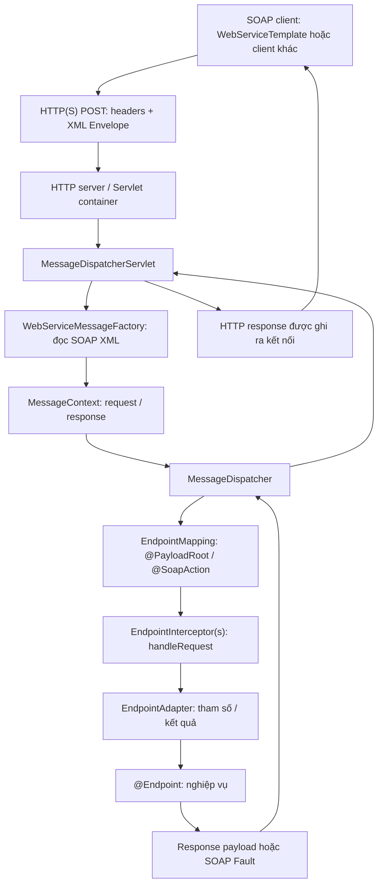
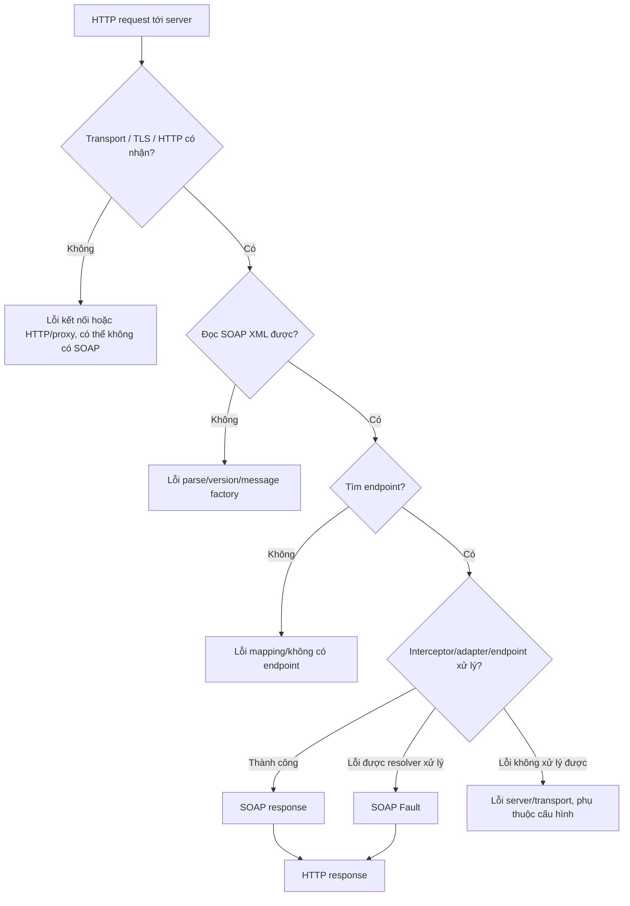
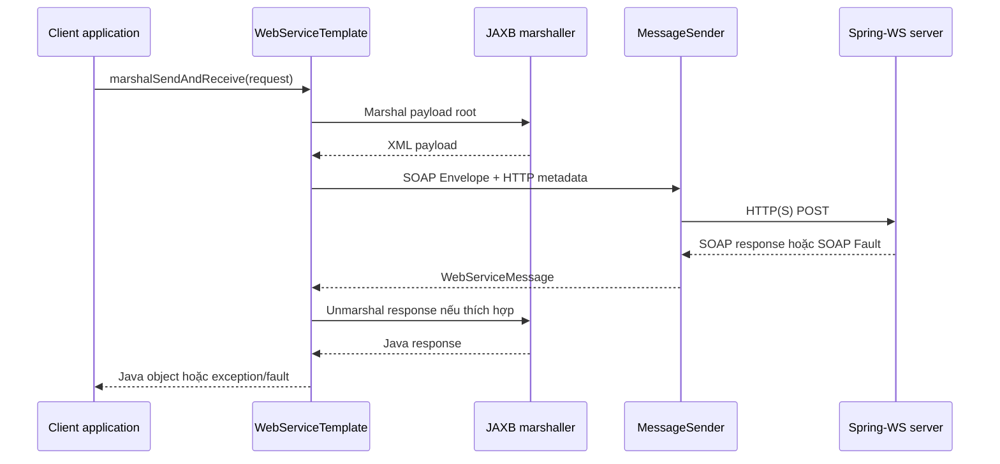

# Luồng yêu cầu từ phương tiện truyền tải đến endpoint rồi phản hồi

## 1. Bức tranh tổng thể: một request SOAP đi qua những lớp nào?

Khi xây dựng dịch vụ SOAP theo hướng **contract-first** với **Spring Web Services (Spring-WS)**, chúng ta thường bắt đầu từ XSD/WSDL, sinh JAXB model, viết `@Endpoint` và tạo SOAP client. Tuy nhiên, để chẩn đoán lỗi và thiết kế một tích hợp doanh nghiệp ổn định, cần hiểu **request thực tế đi qua đâu từ lúc tới mạng cho đến khi phản hồi được gửi về**.

Ví dụ: hệ thống kế toán công bố operation `GetInvoice`. Client gửi SOAP request chứa mã hóa đơn `INV-100` qua HTTPS. Spring-WS tiếp nhận thông điệp, tìm endpoint dựa vào QName của phần tử payload, chuyển XML thành dữ liệu mà method xử lý được, thực thi nghiệp vụ, tạo SOAP response hoặc SOAP Fault, rồi gửi qua HTTP.

Các khái niệm chính:

- **Transport**: cơ chế mang thông điệp, thường là HTTP/HTTPS; những transport khác cần bộ tiếp nhận/binding riêng.
- **`WebServiceMessage`**: mô hình thông điệp ở tầng Spring-WS, ví dụ một SOAP message, tách khỏi chi tiết servlet.
- **`MessageDispatcher`**: trung tâm điều phối thông điệp tới endpoint phù hợp.
- **`EndpointMapping`**: xác định endpoint cần gọi từ request, ví dụ theo QName của payload root.
- **`EndpointInterceptor`**: kiểm tra hoặc xử lý trước/sau endpoint, như validation, logging hoặc security theo cấu hình.
- **`EndpointAdapter`**: giúp dispatcher thực thi endpoint bằng cơ chế thích hợp, chuyển đổi tham số và kết quả.
- **`@Endpoint`**: thành phần triển khai nghiệp vụ SOAP trong Spring-WS.
- **`MessageContext`**: ngữ cảnh có thông điệp request, response (khi được tạo) và trạng thái xử lý.

**Mục tiêu học tập:** bạn sẽ theo dõi được luồng vào và luồng ra, phân biệt lỗi HTTP/SOAP/contract/nghiệp vụ, giải thích vị trí cấu hình JAXB, interceptor và Fault resolver, đồng thời viết kiểm thử quan sát đúng từng tầng.

### 1.1. Sơ đồ luồng xử lý HTTP SOAP



Sơ đồ này rút gọn nhiều nhánh để thấy đường đi chính. Thực tế:

1. `EndpointMapping` có thể không tìm thấy endpoint.
2. Interceptor có thể từ chối xử lý trước khi method nghiệp vụ chạy.
3. XML có thể lỗi ngay ở tầng parse hoặc JAXB binding.
4. Endpoint có thể ném exception được chuyển thành SOAP Fault bằng exception resolver.
5. Response và Fault có thể đi qua **những callback interceptor khác nhau**.
6. Lỗi HTTP/TLS/proxy có thể xảy ra **trước cả khi có `WebServiceMessage`**.

Vì vậy một dòng log “request tới servlet” chưa chứng minh request đã vào Java endpoint.

### 1.2. Ai chịu trách nhiệm điều gì?

| Tầng | Thành phần điển hình | Vai trò |
| --- | --- | --- |
| Network/transport | TCP, TLS, HTTP server, servlet container | Nhận kết nối, HTTPS, HTTP method/headers/body |
| HTTP adapter | `MessageDispatcherServlet` | Kết nối request/response HTTP với Spring-WS message processing |
| SOAP message | `SaajSoapMessageFactory` hoặc `WebServiceMessageFactory` tương ứng | Tạo/đọc `WebServiceMessage`, xử lý cấu trúc SOAP |
| Dispatch | `MessageDispatcher` | Điều phối tới mapping, interceptor, adapter và xử lý lỗi |
| Endpoint selection | `PayloadRootAnnotationMethodEndpointMapping`, mapping dựa trên action | Chọn endpoint phù hợp với message |
| Cross-cutting | `EndpointInterceptor` | Validation, security, logging và logic can thiệp tùy cấu hình |
| Endpoint invocation | `DefaultMethodEndpointAdapter` cùng argument/return handlers phù hợp | Gọi method và ánh xạ request/response |
| Business | `@Endpoint` → service/domain/repository | Thực hiện thao tác nghiệp vụ |
| Fault handling | `EndpointExceptionResolver` và resolver SOAP phù hợp | Tạo/điều chỉnh SOAP Fault khi có lỗi đã được xử lý |
| Response transport | Servlet/message connection | Serialize SOAP response ra HTTP body |

## 2. Contract đầu vào: XSD và WSDL quyết định QName payload

Trong module `SPRING_WEB_SERVICES`, contract-first nghĩa là **định nghĩa thông điệp XML trước khi viết endpoint**. Giả sử XSD có namespace `urn:example:invoice:v1` và hai global elements `GetInvoiceRequest`, `GetInvoiceResponse`.

```xml
<?xml version="1.0" encoding="UTF-8"?>
<xs:schema
    xmlns:xs="http://www.w3.org/2001/XMLSchema"
    xmlns:tns="urn:example:invoice:v1"
    targetNamespace="urn:example:invoice:v1"
    elementFormDefault="qualified">

    <xs:complexType name="GetInvoiceRequestType">
        <xs:sequence>
            <xs:element name="invoiceId" type="xs:string"/>
        </xs:sequence>
    </xs:complexType>

    <xs:complexType name="GetInvoiceResponseType">
        <xs:sequence>
            <xs:element name="invoiceId" type="xs:string"/>
            <xs:element name="status" type="xs:string"/>
            <xs:element name="amount" type="xs:decimal"/>
        </xs:sequence>
    </xs:complexType>

    <xs:element name="GetInvoiceRequest"
                type="tns:GetInvoiceRequestType"/>
    <xs:element name="GetInvoiceResponse"
                type="tns:GetInvoiceResponseType"/>
</xs:schema>
```

Hai tên quan trọng để xử lý request-response:

```text
Request payload root:  {urn:example:invoice:v1}GetInvoiceRequest
Response payload root: {urn:example:invoice:v1}GetInvoiceResponse
```

Một WSDL 1.1 document/literal thông dụng có thể dùng:

```xml
<wsdl:message name="GetInvoiceInput">
    <wsdl:part name="parameters"
               element="tns:GetInvoiceRequest"/>
</wsdl:message>
<wsdl:message name="GetInvoiceOutput">
    <wsdl:part name="parameters"
               element="tns:GetInvoiceResponse"/>
</wsdl:message>
```

Đây là **đoạn WSDL minh họa**, chưa đầy đủ `definitions`, `types`, `portType`, `binding` và `service`. Khi được tích hợp vào WSDL hoàn chỉnh, prefix `tns` phải trỏ tới đúng `urn:example:invoice:v1`.

WSDL cho client biết **phần tử request/response** và binding. Bản thân WSDL không thực thi logic, không tạo `@Endpoint` hay tự bật validation trên server. Các bước runtime trong bài sẽ diễn ra khi một request thực tế được gửi vào ứng dụng.

### 2.1. Tên phần tử chứ không phải tên class

Trong XSD, `GetInvoiceRequestType` là tên **kiểu phức**; `GetInvoiceRequest` là tên **phần tử toàn cục**. Spring-WS có thể dispatch theo QName của **phần tử payload root**, không dựa trên tên Java class hay tên WSDL operation.

Ví dụ hai payload này có QName root giống nhau:

```xml
<GetInvoiceRequest xmlns="urn:example:invoice:v1">
    <invoiceId>INV-100</invoiceId>
</GetInvoiceRequest>
```

```xml
<inv:GetInvoiceRequest xmlns:inv="urn:example:invoice:v1">
    <inv:invoiceId>INV-100</inv:invoiceId>
</inv:GetInvoiceRequest>
```

Prefix `inv` và default namespace chỉ khác cách biểu diễn. Nếu request có `<GetInvoiceRequest>` mà **không khai báo namespace**, root sẽ là `{}GetInvoiceRequest` và không khớp `@PayloadRoot(namespace = "urn:example:invoice:v1", ...)`.

## 3. Chặng đầu: transport nhận HTTP request

Một request SOAP 1.1 gửi qua HTTP có thể trông như sau:

```http
POST /ws HTTP/1.1
Host: api.example.org
Content-Type: text/xml; charset=utf-8
SOAPAction: "urn:example:invoice:v1:GetInvoice"

<?xml version="1.0" encoding="UTF-8"?>
<soap:Envelope
    xmlns:soap="http://schemas.xmlsoap.org/soap/envelope/"
    xmlns:inv="urn:example:invoice:v1">
    <soap:Body>
        <inv:GetInvoiceRequest>
            <inv:invoiceId>INV-100</inv:invoiceId>
        </inv:GetInvoiceRequest>
    </soap:Body>
</soap:Envelope>
```

Phân tích từ ngoài vào trong:

| Thành phần | Vai trò |
| --- | --- |
| `POST /ws` | HTTP method và đường dẫn được servlet container định tuyến |
| `Host` | Host HTTP đích, có thể đi qua reverse proxy |
| `Content-Type: text/xml` | Media type điển hình cho SOAP 1.1 qua HTTP |
| `SOAPAction` | HTTP header theo SOAP 1.1 binding, có thể dùng làm metadata định tuyến |
| `soap:Envelope` | Cấu trúc thông điệp SOAP 1.1 |
| `soap:Body` | Vùng chứa payload nghiệp vụ |
| `inv:GetInvoiceRequest` | Phần tử payload root để chọn `@PayloadRoot` endpoint |

Điểm quan trọng: **HTTP header không phải SOAP Header**. `SOAPAction` nằm ngoài XML, còn `<soap:Header>` (nếu có) nằm bên trong `Envelope`, chứa các XML header blocks như metadata của ứng dụng hoặc `wsse:Security`.

### 3.1. Những lỗi có thể chặn trước khi vào Spring-WS

- DNS, firewall hoặc kết nối TCP thất bại.
- TLS handshake không thành công do hostname, chứng chỉ hoặc truststore.
- Reverse proxy từ chối request do authentication, kích thước body, rate limit hoặc routing.
- HTTP method/path không khớp servlet mapping.
- HTTP request body bị cắt, vượt giới hạn hoặc không đọc được.

Ở những tình huống này, **chưa chắc có `MessageContext` hoặc SOAP Fault**. Một lỗi `401`, `403`, `404`, `413` hoặc gateway `502` có thể do tầng HTTP/proxy sinh ra. Đừng đi tìm lỗi trong `@Endpoint` khi request chưa tới servlet.

### 3.2. SOAP 1.1 và SOAP 1.2 không hoán đổi tùy tiện

| Đặc điểm | SOAP 1.1 qua HTTP | SOAP 1.2 qua HTTP |
| --- | --- | --- |
| Envelope namespace | `http://schemas.xmlsoap.org/soap/envelope/` | `http://www.w3.org/2003/05/soap-envelope` |
| Media type | Thường `text/xml` | `application/soap+xml` |
| Action | `SOAPAction` HTTP header | Tham số `action` của media type khi dùng |
| Fault | `faultcode`, `faultstring`, `detail` | `Code`, `Reason`, `Detail` |

Thông điệp và `WebServiceMessageFactory` phải thống nhất phiên bản. Chỉ đổi media type từ SOAP 1.1 sang `application/soap+xml` mà giữ Envelope cũ có thể gây lỗi SOAP version hoặc parsing trước bước gọi endpoint.

## 4. `MessageDispatcherServlet`: cầu nối HTTP và Spring-WS

Trong một ứng dụng servlet-based, `MessageDispatcherServlet` là đầu vào phổ biến cho SOAP-over-HTTP của Spring-WS. Nó dựa trên cấu hình servlet mapping để nhận HTTP request, làm việc với message factory và chuyển thông điệp vào cơ chế xử lý `MessageDispatcher`.

Ví dụ Java configuration với Spring Boot:

```java
import org.springframework.boot.web.servlet.ServletRegistrationBean;
import org.springframework.context.ApplicationContext;
import org.springframework.context.annotation.Bean;
import org.springframework.context.annotation.Configuration;
import org.springframework.ws.config.annotation.EnableWs;
import org.springframework.ws.transport.http.MessageDispatcherServlet;

@EnableWs
@Configuration
public class SoapTransportConfiguration {

    @Bean
    public ServletRegistrationBean<MessageDispatcherServlet> soapServlet(
            ApplicationContext applicationContext) {

        MessageDispatcherServlet servlet =
            new MessageDispatcherServlet();
        servlet.setApplicationContext(applicationContext);
        servlet.setTransformWsdlLocations(true);

        return new ServletRegistrationBean<>(servlet, "/ws/*");
    }
}
```

Ví dụ này minh họa vai trò servlet và đường dẫn `/ws/*`. Để chạy thật cần Spring-WS/Spring Boot dependencies phù hợp, endpoint, JAXB mapping và các bean khác theo lựa chọn của dự án.

### 4.1. URL nhận SOAP khác URL công bố WSDL

Một deployment có thể công bố:

```text
GET  /ws/invoices.wsdl    --> trả tài liệu WSDL nếu có bean tương ứng
POST /ws                  --> nhận SOAP Envelope để thực hiện operation
```

Hai URL này **phục vụ hai mục đích khác nhau**. Tên `GetInvoice` không tự tạo HTTP route `/ws/GetInvoice` như một REST controller. Với SOAP document/literal, operation thường được nhận diện từ contract, action và payload trong `Body`.

### 4.2. Servlet không tự diễn giải nghiệp vụ

`MessageDispatcherServlet` xử lý tầng vận chuyển và kích hoạt bộ nhận SOAP; nó **không chứa** logic tìm hóa đơn hay phép tính tiền. Trách nhiệm nghiệp vụ nằm ở `@Endpoint` và service phía sau.

Điều này giúp endpoint tập trung vào dữ liệu XML/SOAP thay vì phải tự đọc `HttpServletRequest.getInputStream()`, tự phân tích Envelope và tạo từng HTTP header.

### 4.3. Servlet khác Spring MVC controller

`@Endpoint` của Spring-WS không phải `@RestController`/`@RequestMapping` của Spring MVC. Bộ định tuyến cho `@Endpoint` dựa trên cơ chế **endpoint mappings của Spring-WS**, không phải MVC handler mappings cho REST URLs.

Nếu dự án dùng cả REST và SOAP, có thể có các servlet, handler mappings và quy tắc error response khác nhau. Đừng mặc định mọi exception đi qua cùng một `@ControllerAdvice` hoặc cùng một JSON error handler.

## 5. Từ bytes XML đến `WebServiceMessage` và `MessageContext`

Sau khi HTTP body đến được Spring-WS, một **`WebServiceMessageFactory`** tạo hoặc đọc thông điệp theo định dạng đã cấu hình. Với SOAP, `SaajSoapMessageFactory` là một lựa chọn phổ biến dựa trên SAAJ.

Có thể hình dung:

```text
HTTP request body bytes
         |
         v
WebServiceMessageFactory / SOAP parser
         |
         v
WebServiceMessage
  - SOAP Envelope
  - SOAP Header (nếu có)
  - SOAP Body và payload
         |
         v
MessageContext
  - request message
  - response message (khi được tạo/khởi tạo)
  - trạng thái liên quan tới vòng xử lý
```

`WebServiceMessage` trừu tượng hóa thông điệp ở tầng Spring-WS. `MessageContext` cho các thành phần dispatcher, interceptor và endpoint xử lý request/response trong một ngữ cảnh chung.

### 5.1. Message factory có thể phát hiện lỗi trước endpoint mapping

Ví dụ request:

```xml
<soap:Envelope
    xmlns:soap="http://schemas.xmlsoap.org/soap/envelope/">
    <soap:Body>
        <inv:GetInvoiceRequest>
            <inv:invoiceId>INV-100</inv:invoiceId>
        </inv:GetInvoiceRequest>
    </soap:Body>
</soap:Envelope>
```

Prefix `inv` chưa được khai báo. Đây là XML không hợp lệ về namespace. Parser có thể thất bại **trước khi `EndpointMapping` hoặc `@Endpoint` được gọi**.

Tương tự, SOAP version không phù hợp, body bị hỏng, XML declaration/encoding mâu thuẫn hoặc nội dung quá lớn có thể khiến request bị chặn ở giai đoạn đọc message.

**Giới hạn phân tích lỗi:** phản hồi chính xác (HTTP status, SOAP Fault hay lỗi transport) phụ thuộc SOAP version, message factory và cách Spring-WS/servlet container xử lý exception. Không nên hứa rằng mọi lỗi parse XML sẽ vào một `SoapFaultMappingExceptionResolver` của endpoint.

### 5.2. Khi nào response được tạo?

`MessageContext` cho phép truy cập request message và tạo/truy cập response trong cùng quá trình xử lý. Tùy API/message factory, response có thể được tạo khi cần chứ không phải nhất thiết đã có đầy đủ ngay khi request vừa vào servlet.

Khi endpoint trả về dữ liệu, endpoint adapter/return-value handler có thể ghi XML vào response message; khi xảy ra lỗi được giải quyết bằng fault resolver, SOAP Fault sẽ được đặt vào response phù hợp. Sau đó thông điệp được serialize trở lại transport.

## 6. `MessageDispatcher`: chọn endpoint dựa trên thông điệp

`MessageDispatcher` là thành phần trung tâm của Spring-WS, có vai trò tương tự dispatcher ở cấp message: xác định endpoint, áp dụng interceptor, chọn adapter để gọi endpoint và phối hợp xử lý exception/response.

Phần **endpoint mapping** là nơi nhiều lỗi “request không vào method” bắt đầu.

### 6.1. Mapping theo QName của payload root

Ví dụ:

```java
import org.springframework.ws.server.endpoint.annotation.Endpoint;
import org.springframework.ws.server.endpoint.annotation.PayloadRoot;

@Endpoint
public class InvoiceEndpoint {

    private static final String NS = "urn:example:invoice:v1";

    @PayloadRoot(namespace = NS, localPart = "GetInvoiceRequest")
    public Object getInvoice(/* tham số và response sẽ trình bày sau */) {
        // ...
        return null;
    }
}
```

`@PayloadRoot` yêu cầu phần tử payload root có QName:

```text
{urn:example:invoice:v1}GetInvoiceRequest
```

`PayloadRootAnnotationMethodEndpointMapping` là một mapping của Spring-WS hỗ trợ annotation này. Mục tiêu là tìm đúng **method endpoint** dựa trên QName của payload, **không chỉ** dựa trên tên method Java hoặc URL HTTP.

Đoạn Java trên là **minh họa cú pháp mapping**; method chưa triển khai nghiệp vụ và chưa thể dùng làm endpoint thực tế.

### 6.2. Mapping theo SOAPAction

Spring-WS cũng hỗ trợ mapping dựa trên SOAPAction, ví dụ thông qua annotation `@SoapAction`:

```java
import org.springframework.ws.soap.server.endpoint.annotation.SoapAction;

@SoapAction("urn:example:invoice:v1:GetInvoice")
public Object getInvoice(/* ... */) {
    // ...
    return null;
}
```

Điều này minh họa một **lựa chọn mapping khác**. Trong hệ thống thật, mapping theo SOAPAction và mapping theo QName có thể cùng được cấu hình, với thứ tự ưu tiên/logic lựa chọn phụ thuộc Spring-WS configuration. Không nên khai báo hai endpoint cạnh tranh cùng request mà không kiểm soát thứ tự mapping.

SOAPAction của SOAP 1.1 nằm trong HTTP header; **không đồng nhất** với phần tử payload và cũng không phải WSDL operation name. Hai message có SOAPAction giống nhau vẫn có thể khác QName payload.

### 6.3. Khi endpoint mapping thất bại

Các nguyên nhân phổ biến:

| Hiện tượng | Vì sao không khớp? |
| --- | --- |
| `<GetInvoiceRequest>` không có `xmlns` | Root thuộc namespace rỗng, không khớp `NS` |
| `xmlns="urn:example:invoice:v2"` | Namespace v2 khác v1 |
| Client gửi `GetInvoiceRequestType` làm root | Tên type không phải global element được contract quy định |
| Bean endpoint không được Spring scan | `@Endpoint` không hiện diện trong application context |
| Annotation sai localPart | `GetInvoice` khác `GetInvoiceRequest` |
| SOAPAction không đúng | Có thể ảnh hưởng mapping nếu server dùng action |

Nếu không tìm được endpoint, dispatcher có thể xử lý theo cơ chế lỗi riêng; **không nên giả định** một method nghiệp vụ hoặc interceptor gắn với endpoint chưa được tìm thấy sẽ được gọi.

### 6.4. Endpoint mapping khác endpoint adapter

**Mapping chọn “ai nhận request?”; adapter trả lời “gọi endpoint đó như thế nào?”**

```text
MessageDispatcher
  |
  +-- EndpointMapping --> xác định @Endpoint + method
  |
  +-- EndpointAdapter --> giải quyết tham số, gọi method,
                         xử lý giá trị trả về
```

Nếu mapping tìm được method nhưng adapter không hỗ trợ kiểu tham số hoặc annotation đã dùng, request vẫn có thể thất bại. Cần phân biệt lỗi tìm endpoint với lỗi chuyển XML/JAXB sang tham số Java.

## 7. `EndpointInterceptor`: kiểm tra và can thiệp quanh lời gọi

Trong Spring-WS, **server-side `EndpointInterceptor`** cho phép thực thi logic cắt ngang quá trình xử lý thông điệp sau khi endpoint phù hợp đã được xác định theo cơ chế dispatcher.

Ví dụ các nhu cầu:

- Validate payload theo XSD trước khi vào nghiệp vụ.
- Kiểm tra chữ ký/token WS-Security bằng interceptor chuyên dụng.
- Gắn correlation ID và đo thời gian xử lý.
- Ghi nhận metadata kỹ thuật (tránh log nội dung nhạy cảm).
- Bổ sung/xử lý SOAP Header theo contract khi phù hợp.

Một interceptor có các callback chính:

| Callback | Thời điểm/ý nghĩa thường gặp |
| --- | --- |
| `handleRequest` | Trước khi endpoint xử lý; có thể quyết định tiếp tục hay dừng chuỗi |
| `handleResponse` | Khi có response thông thường, trước khi response hoàn tất |
| `handleFault` | Khi response là SOAP Fault và đi qua nhánh xử lý fault |
| `afterCompletion` | Dọn dẹp/tổng kết sau giai đoạn dispatch tương ứng |

Thứ tự và những callback thực sự được gọi phụ thuộc interceptor chain cùng nhánh xử lý request, fault hoặc exception. Một lỗi xảy ra **trước khi xác định được endpoint** có thể chưa kích hoạt endpoint interceptor nào; do đó interceptor không phải công cụ quan sát đầy đủ mọi lỗi HTTP/XML.

### 7.1. Ví dụ interceptor kiểm tra metadata

Đoạn mã tối giản dưới đây chỉ đếm request và ghi metadata; trong production cần dùng logging/tracing framework phù hợp:

```java
import org.springframework.ws.context.MessageContext;
import org.springframework.ws.server.EndpointInterceptor;

public class AuditInterceptor implements EndpointInterceptor {

    @Override
    public boolean handleRequest(
            MessageContext messageContext, Object endpoint) {
        // Có thể lấy SOAP metadata để correlation/logging có kiểm soát.
        return true;  // Cho phép tiếp tục tới interceptor kế tiếp/endpoint.
    }

    @Override
    public boolean handleResponse(
            MessageContext messageContext, Object endpoint) {
        return true;
    }

    @Override
    public boolean handleFault(
            MessageContext messageContext, Object endpoint) {
        return true;
    }

    @Override
    public void afterCompletion(
            MessageContext messageContext,
            Object endpoint,
            Exception ex) {
        // Dọn dẹp tài nguyên theo phạm vi request nếu có.
    }
}
```

Đây là **ví dụ interface**, chưa có logic nghiệp vụ hoặc bean registration. Nếu `handleRequest` trả `false`, dispatcher có thể dừng thực thi các bước phía sau trong chuỗi; **không có nghĩa** nó mặc định tạo HTTP 403 hoặc SOAP Fault phù hợp. Interceptor có trách nhiệm tạo response/fault hoặc phối hợp cơ chế lỗi theo thiết kế.

### 7.2. Validation interceptor nằm ở đâu?

Trong contract-first service, có thể cấu hình `PayloadValidatingInterceptor` để kiểm tra nội dung request/response theo XSD khi ứng dụng cần. Với luồng thông thường:

```text
EndpointMapping
    -> EndpointInterceptor.handleRequest
         -> XSD validation (nếu cấu hình)
    -> EndpointAdapter
         -> JAXB unmarshalling
         -> @Endpoint
```

Không được hiểu rằng **cứ có XSD hoặc WSDL là tự động bật runtime validation**. Nếu không cấu hình, application có thể chấp nhận một phần dữ liệu sai contract hoặc chỉ lỗi ở bước JAXB/nghiệp vụ.

### 7.3. Client interceptor là loại khác

`ClientInterceptor` nằm trong luồng `WebServiceTemplate` ở **phía gọi service**, có thể quan sát request/response/fault phía client. Nó không phải `EndpointInterceptor` của server và không chứng minh request đã tới method `@Endpoint` của đối tác.

Khi trace một request, phải biết log thuộc phía client hay server để tránh nhầm vị trí lỗi.

## 8. `EndpointAdapter`: từ SOAP payload tới method Java

Sau khi dispatcher tìm được endpoint, một **`EndpointAdapter`** phù hợp sẽ thực hiện việc gọi endpoint theo dạng hỗ trợ. Với các method dùng annotation Spring-WS, `DefaultMethodEndpointAdapter` cùng các bộ giải quyết tham số/giá trị trả về đóng vai trò chính.

Trong ví dụ contract-first `GetInvoice`, thông tin có thể đi theo chuỗi:

```text
SOAP Body XML
    |
    v
QName {urn:example:invoice:v1}GetInvoiceRequest
    |
EndpointMapping chọn InvoiceEndpoint.getInvoice(...)
    |
EndpointAdapter giải quyết @RequestPayload
    |
JAXB unmarshalling (nếu dùng mapping JAXB)
    |
GetInvoiceRequestType / JAXBElement<GetInvoiceRequestType>
    |
Gọi method Java
```

**Điểm cần nhớ:** không phải mọi endpoint đều nhận kiểu JAXB. Spring-WS hỗ trợ nhiều kiểu tham số/response trong phạm vi các argument resolvers và return-value handlers được đăng ký, ví dụ XML `Source`/DOM hoặc JAXB. Loại adapter và cấu hình thực tế quyết định method signature nào hợp lệ.

### 8.1. Một endpoint dùng JAXB-generated model

Giả sử XJC đã tạo các thành phần sau từ XSD mục 2:

```text
GetInvoiceRequestType
GetInvoiceResponseType
ObjectFactory.createGetInvoiceRequest(...)
ObjectFactory.createGetInvoiceResponse(...)
```

Ví dụ `ObjectFactory` trả `JAXBElement` cho hai global elements. Ta có thể viết:

```java
import jakarta.xml.bind.JAXBElement;
import org.springframework.ws.server.endpoint.annotation.Endpoint;
import org.springframework.ws.server.endpoint.annotation.PayloadRoot;
import org.springframework.ws.server.endpoint.annotation.RequestPayload;
import org.springframework.ws.server.endpoint.annotation.ResponsePayload;

@Endpoint
public class InvoiceEndpoint {

    private static final String NS = "urn:example:invoice:v1";

    private final InvoiceService invoiceService;
    private final ObjectFactory objectFactory = new ObjectFactory();

    public InvoiceEndpoint(InvoiceService invoiceService) {
        this.invoiceService = invoiceService;
    }

    @PayloadRoot(namespace = NS, localPart = "GetInvoiceRequest")
    @ResponsePayload
    public JAXBElement<GetInvoiceResponseType> getInvoice(
            @RequestPayload JAXBElement<GetInvoiceRequestType> root) {

        GetInvoiceRequestType request = root.getValue();
        InvoiceRecord invoice =
            invoiceService.findById(request.getInvoiceId());

        GetInvoiceResponseType response =
            new GetInvoiceResponseType();
        response.setInvoiceId(invoice.id());
        response.setStatus(invoice.status());
        response.setAmount(invoice.amount());

        return objectFactory.createGetInvoiceResponse(response);
    }
}
```

Trong ví dụ:

- `InvoiceService` và `InvoiceRecord` là các thành phần ứng dụng giả định, không phải lớp có sẵn của Spring-WS.
- `GetInvoiceRequestType`, `GetInvoiceResponseType` và `ObjectFactory` đến từ JAXB binding; tên thực tế tùy cách sinh mã.
- `InvoiceRecord.id()`, `status()`, `amount()` là các phương thức được giả định ở model ứng dụng.
- Để chạy thật cần JAXB runtime, binding/endpoint adapter hỗ trợ `JAXBElement` và các bean cấu hình tương ứng.

Nếu compiler tạo class có `@XmlRootElement`, method có thể nhận/trả trực tiếp class root. **Đừng ép mọi project dùng `JAXBElement`**: hãy đọc generated classes và thử marshal/unmarshal đúng XSD.

### 8.2. Vai trò của annotation trong method

| Annotation | Trách nhiệm |
| --- | --- |
| `@Endpoint` | Khai báo bean là endpoint Spring-WS, không phải REST controller |
| `@PayloadRoot(namespace, localPart)` | Chọn method cho QName payload root |
| `@RequestPayload` | Chỉ định tham số lấy từ nội dung payload SOAP request |
| `@ResponsePayload` | Chỉ định giá trị trả về được ghi vào payload SOAP response |

Một method với `@RequestPayload` **không tự động được tìm ra** nếu thiếu endpoint mapping phù hợp. Tương tự, trả về Java object **không tự động thành đúng root XML** nếu JAXB binding không biết QName cần ghi.

### 8.3. Trường hợp JAXB unmarshalling thất bại

Giả sử XSD quy định:

```xml
<xs:sequence>
    <xs:element name="invoiceId" type="xs:string"/>
</xs:sequence>
```

Nếu client gửi root đúng nhưng phần tử con sai namespace hoặc JAXB runtime không nhận diện được loại dữ liệu, lỗi có thể xảy ra **ở bước resolve method argument**, trước khi thân method `getInvoice(...)` chạy.

Đó là lý do log “endpoint đã được mapping” vẫn **chưa chứng minh** business service được thực thi.

Thực thi JAXB mapping cũng **không mặc định tương đương XSD validation đầy đủ**. Để kiểm tra những ràng buộc như `minOccurs`, `xs:sequence`, `xs:restriction` chính xác theo contract, cần bật schema validation khi phù hợp.

## 9. Từ kết quả nghiệp vụ đến SOAP response

Khi method `getInvoice(...)` trả về thành công:

1. `EndpointAdapter`/return-value handler nhận kết quả Java.
2. Thành phần XML binding (ví dụ JAXB) chuyển object thành payload XML.
3. Payload được đưa vào `SOAP Body` của response message.
4. Các interceptor phù hợp có thể xử lý response.
5. Dispatcher hoàn tất, thành phần transport ghi SOAP message ra HTTP response.

Ví dụ payload:

```xml
<GetInvoiceResponse xmlns="urn:example:invoice:v1">
    <invoiceId>INV-100</invoiceId>
    <status>PAID</status>
    <amount>1250.50</amount>
</GetInvoiceResponse>
```

Trong SOAP 1.1, nó nằm trong Envelope:

```xml
<?xml version="1.0" encoding="UTF-8"?>
<soap:Envelope
    xmlns:soap="http://schemas.xmlsoap.org/soap/envelope/"
    xmlns:inv="urn:example:invoice:v1">
    <soap:Body>
        <inv:GetInvoiceResponse>
            <inv:invoiceId>INV-100</inv:invoiceId>
            <inv:status>PAID</inv:status>
            <inv:amount>1250.50</inv:amount>
        </inv:GetInvoiceResponse>
    </soap:Body>
</soap:Envelope>
```

HTTP response trong trường hợp thông thường:

```http
HTTP/1.1 200 OK
Content-Type: text/xml; charset=utf-8

<?xml version="1.0" encoding="UTF-8"?>
<soap:Envelope
    xmlns:soap="http://schemas.xmlsoap.org/soap/envelope/"
    xmlns:inv="urn:example:invoice:v1">
    <soap:Body>
        <inv:GetInvoiceResponse>
            <inv:invoiceId>INV-100</inv:invoiceId>
            <inv:status>PAID</inv:status>
            <inv:amount>1250.50</inv:amount>
        </inv:GetInvoiceResponse>
    </soap:Body>
</soap:Envelope>
```

**HTTP 200** xác nhận tầng HTTP gửi một phản hồi thành công, nhưng client còn cần kiểm tra SOAP version, QName response và dữ liệu theo XSD. Nếu client mong chờ `GetInvoiceResponse` mà server gửi `InvoiceResponse`, quá trình unmarshalling có thể thất bại dù HTTP 200.

### 9.1. Endpoint tạo payload, không cần tự viết HTTP response

Trong mô hình Spring-WS thông dụng, method `@Endpoint` trả về payload Java/XML. Dispatcher và transport đảm nhiệm SOAP Envelope và HTTP serialization theo cấu hình. Việc tự thao tác `HttpServletResponse` trong endpoint làm tăng coupling với HTTP, khó tái sử dụng message-level logic và dễ tạo response không nhất quán.

Đây là lợi ích kiến trúc của Spring-WS: business method xử lý dữ liệu hợp đồng, còn việc gửi qua HTTP thuộc tầng transport.

### 9.2. SOAP response không bắt buộc chỉ có Body

Một SOAP message có thể chứa `Header` với thông tin correlation, routing hoặc security theo contract. Nếu dùng WS-Security, chữ ký/bảo vệ message có thể được áp dụng bởi interceptor hoặc bộ xử lý chuyên dụng. Đừng đặt token/chữ ký thủ công vào một trường nghiệp vụ chỉ vì method endpoint chỉ nhìn thấy JAXB payload.

## 10. Nhánh lỗi: exception, SOAP Fault và HTTP status

Một request có thể thất bại ở nhiều giai đoạn. Không phải mọi lỗi trở thành SOAP Fault, cũng không phải mọi SOAP Fault đều biểu diễn cùng HTTP status trên mọi cấu hình.



### 10.1. SOAP Fault 1.1 minh họa

Giả sử service không tìm thấy mã `INV-404` và quyết định biểu diễn lỗi nghiệp vụ thành SOAP Fault:

```xml
<?xml version="1.0" encoding="UTF-8"?>
<soap:Envelope
    xmlns:soap="http://schemas.xmlsoap.org/soap/envelope/"
    xmlns:err="urn:example:invoice:fault:v1">
    <soap:Body>
        <soap:Fault>
            <faultcode>soap:Client</faultcode>
            <faultstring>Không tìm thấy hóa đơn</faultstring>
            <detail>
                <err:InvoiceError>
                    <err:code>INVOICE_NOT_FOUND</err:code>
                    <err:invoiceId>INV-404</err:invoiceId>
                </err:InvoiceError>
            </detail>
        </soap:Fault>
    </soap:Body>
</soap:Envelope>
```

Lưu ý ví dụ Fault ở trên là một **quyết định thiết kế API minh họa**; XSD mục 2 chưa định nghĩa `InvoiceError` hay WSDL fault message tương ứng. Nếu muốn client sinh model/cơ chế xử lý fault có hợp đồng ổn định, cần định nghĩa detail schema, thông điệp fault và cấu hình thực tế.

Với SOAP 1.1 HTTP binding, một SOAP Fault thường đi kèm HTTP `500 Internal Server Error` theo đặc tả binding. Nhưng các hệ thống có proxy, exception handler và cấu hình khác nhau có thể có hành vi khác; client nên kiểm tra cả **HTTP status, `Content-Type` và SOAP body**.

### 10.2. Vai trò của exception resolver

Trong Spring-WS, **`EndpointExceptionResolver`** là điểm mở rộng cho việc xử lý exception khi dispatcher gọi endpoint. Các triển khai có thể ánh xạ exception sang SOAP Fault, ví dụ:

- `SoapFaultMappingExceptionResolver`: mapping loại exception sang fault code/string theo cấu hình.
- `SimpleSoapExceptionResolver`: một cách tạo SOAP Fault tương ứng với exception theo cơ chế của Spring-WS.
- Resolver hoặc callback tùy biến để tạo fault detail nghiệp vụ khi cần.

Luồng mô hình:

```text
@Endpoint / adapter / interceptor (khi đã ở pha dispatcher)
             |
          exception
             |
    EndpointExceptionResolver
             |
      SOAP Fault response (nếu được xử lý)
             |
    EndpointInterceptor.handleFault (theo nhánh xử lý)
             |
      Transport gửi response
```

**Giới hạn:** lỗi do kết nối TLS, proxy, HTTP servlet routing hay XML parse trước khi dispatcher tìm endpoint không nhất thiết được xử lý bởi cùng một resolver. Vì thế **đặt Fault resolver không thay cho toàn bộ error handling của transport**.

### 10.3. Fault 1.2 khác Fault 1.1

Với SOAP 1.2, namespace Envelope là `http://www.w3.org/2003/05/soap-envelope` và Fault sử dụng `Code`, `Reason`, `Detail` (cùng các thành phần liên quan). Mã lỗi cấp cao có thể là `Sender` hoặc `Receiver`, khác cách đặt `Client`/`Server` của SOAP 1.1.

Không gửi một Fault SOAP 1.1 với Content-Type của SOAP 1.2 rồi mong client xử lý. SOAP version, Fault structure, HTTP binding và message factory cần nhất quán.

### 10.4. Lỗi nào thuộc tầng nào?

| Dấu hiệu | Tầng nghi ngờ trước | Bước kiểm tra |
| --- | --- | --- |
| Không kết nối TCP/HTTPS | Network/TLS | DNS, certificate chain, hostname, firewall |
| HTTP 404 và body HTML | HTTP route/proxy/servlet | URL, servlet mapping, reverse proxy |
| HTTP 415 | Media type/SOAP version | Content-Type và Envelope namespace |
| SOAP XML không parse được | Message factory/XML parser | Cấu trúc XML, encoding, prefix/namespace |
| Không tìm thấy endpoint | Mapping | QName payload root, `@PayloadRoot`, bean registration |
| Endpoint đã được tìm nhưng JAXB fail | EndpointAdapter/JAXB | Global root element, JAXB context và XSD |
| XSD validation fail | Interceptor/validator | `minOccurs`, `xs:sequence`, QName, restriction |
| Exception nghiệp vụ | Endpoint/service + resolver | Fault code/detail và mapping exception |
| HTTP 500 body HTML | Server/proxy | Access/error logs; body không phải SOAP Fault |
| HTTP 500 body SOAP Fault | SOAP processing | Đọc Fault code/reason/detail, correlation ID |

## 11. Luồng bên client: `WebServiceTemplate` gửi và nhận gì?

Để hiểu toàn bộ request-response, hãy nhìn quá trình từ phía client Spring-WS:



`WebServiceTemplate` điều phối việc tạo thông điệp, marshal payload, thực thi request callback/client interceptors, gửi qua transport và đọc response. Chi tiết xử lý lỗi SOAP Fault/transport có thể được tùy chỉnh bằng chiến lược và cấu hình của client.

### 11.1. Cấu hình JAXB cho client

Giả sử JAXB compiler đã sinh package `org.example.invoice.contract` chứa `ObjectFactory` và các model từ XSD mục 2.

```java
import org.springframework.context.annotation.Bean;
import org.springframework.context.annotation.Configuration;
import org.springframework.oxm.jaxb.Jaxb2Marshaller;
import org.springframework.ws.client.core.WebServiceTemplate;

@Configuration
public class InvoiceClientConfiguration {

    @Bean
    public Jaxb2Marshaller invoiceMarshaller() {
        Jaxb2Marshaller marshaller = new Jaxb2Marshaller();
        marshaller.setContextPath("org.example.invoice.contract");
        return marshaller;
    }

    @Bean
    public WebServiceTemplate invoiceTemplate(
            Jaxb2Marshaller invoiceMarshaller) {

        WebServiceTemplate template = new WebServiceTemplate();
        template.setMarshaller(invoiceMarshaller);
        template.setUnmarshaller(invoiceMarshaller);
        return template;
    }
}
```

Đây là cấu hình **XML binding cơ bản**. Trong production cần message sender phù hợp với HTTPS, timeout, xác thực, TLS/mTLS và có thể cần message factory cho đúng SOAP version.

### 11.2. Client gửi request có QName chính xác

```java
import jakarta.xml.bind.JAXBElement;
import org.springframework.ws.client.core.WebServiceTemplate;
import org.springframework.ws.soap.client.core.SoapActionCallback;

public class InvoiceSoapClient {

    private final WebServiceTemplate template;
    private final ObjectFactory factory = new ObjectFactory();

    public InvoiceSoapClient(WebServiceTemplate template) {
        this.template = template;
    }

    public GetInvoiceResponseType getInvoice(String invoiceId) {

        GetInvoiceRequestType request = new GetInvoiceRequestType();
        request.setInvoiceId(invoiceId);

        JAXBElement<GetInvoiceRequestType> root =
            factory.createGetInvoiceRequest(request);

        Object result = template.marshalSendAndReceive(
            "https://api.example.org/ws",
            root,
            new SoapActionCallback(
                "urn:example:invoice:v1:GetInvoice"
            )
        );

        if (!(result instanceof JAXBElement<?> element)
                || !(element.getValue()
                        instanceof GetInvoiceResponseType)) {
            throw new IllegalStateException(
                "Unexpected SOAP response representation"
            );
        }

        return (GetInvoiceResponseType) element.getValue();
    }
}
```

Ví dụ này minh họa trường hợp JAXB dùng `JAXBElement` cho global elements. Trong client thực tế nên kiểm tra cả **QName của response**, vì cùng một Java type có thể được dùng dưới các element names khác nhau. Code yêu cầu Java hỗ trợ pattern matching cho `instanceof` và cần import generated classes/Java dependencies tương ứng.

`SoapActionCallback` trong ví dụ giả định WSDL SOAP 1.1 công bố action đó. **Không suy action từ tên method**; nếu WSDL thực tế có action khác, client phải dùng contract thật.

### 11.3. Client Fault khác response thông thường

Khi server trả SOAP Fault, `WebServiceTemplate` thường đi qua nhánh fault handling và có thể ném exception đại diện SOAP Fault thay vì trả Java response object như ví dụ. Nếu nhận HTTP 500 HTML từ proxy, client có thể gặp lỗi transport/parse thay vì SOAP Fault.

Vì vậy phía client cần:

1. Phân biệt lỗi kết nối/timeout/TLS.
2. Nhận diện HTTP status và media type.
3. Nhận diện SOAP Fault khi response là thông điệp SOAP phù hợp.
4. Phân loại Fault nghiệp vụ và xác định khả năng retry.

Client **không** nên retry vô điều kiện chỉ vì nhận `500` hoặc timeout. Một operation tạo đơn/thanh toán có thể đã được server thực hiện trước khi mất response.

## 12. Tính độc lập với transport: phần nào được tái sử dụng?

SOAP là mô hình thông điệp không bị đồng nhất với HTTP. Spring-WS có kiến trúc message-oriented: `WebServiceMessage`, dispatcher, mapping và endpoint giúp tách nhiều bước SOAP processing khỏi servlet HTTP.

Tuy nhiên, **transport independence không nghĩa là có thể đổi URL HTTP sang một URI tùy ý rồi chạy trên mọi giao thức**. Với JMS hoặc transport khác, hai đầu phải hỗ trợ message sender/receiver, binding, destination, correlation, retry và bảo mật thích hợp.

| Thành phần | HTTP/HTTPS | Messaging/JMS (nếu có hỗ trợ) |
| --- | --- | --- |
| Điểm nhận | Servlet mapping, URL/path | Listener và destination/queue |
| Cơ chế gửi | HTTP POST và kết nối response | Message producer/consumer, có thể bất đồng bộ |
| Thông điệp SOAP | `Envelope` và payload theo contract | Có thể giữ cùng mô hình SOAP khi binding phù hợp |
| Metadata transport | HTTP headers/status | Message properties, acknowledgment, delivery state |
| Endpoint processing | Dispatcher/adapter/endpoint Spring-WS | Có thể tái sử dụng phần message-level nếu transport module hỗ trợ |
| Response | HTTP response tương ứng request | Cần reply destination và correlation nếu cần request-response |
| Lỗi | HTTP status, TLS, timeout | Broker/ack/redelivery/dead-letter và policy khác |

Trong dự án thật, endpoint thường nên làm việc với dữ liệu hợp đồng và service nghiệp vụ, thay vì phụ thuộc chặt vào `HttpServletRequest`. Nhờ vậy có thể tái sử dụng phần xử lý message khi thay kiến trúc transport, còn các trách nhiệm HTTP đặc thù được giải quyết ở tầng nhận/gửi.

Không phải mọi phiên bản Spring-WS đều cung cấp cùng transport module; hãy xác minh khả năng thực tế của stack trước khi hứa hẹn hỗ trợ JMS hoặc kênh khác.

## 13. Validation, WS-Security và observability đặt ở đâu trong luồng?

Một tích hợp doanh nghiệp ổn định cần kiểm tra request **ở nhiều lớp**. Tầng transport và tầng SOAP xử lý các rủi ro khác nhau; không thể thay một thứ bằng thứ còn lại.

### 13.1. HTTP/TLS authentication xảy ra trước hoặc ngoài SOAP dispatcher

Ví dụ khi client dùng HTTPS với mTLS:

```text
Client
  |
  +-- TLS handshake / xác thực certificate
  |
  +-- HTTP headers và HTTP authentication (nếu có)
  |
  +-- SOAP Envelope được ứng dụng đọc
  |
  +-- Spring-WS message processing
```

Nếu certificate không được tin cậy hoặc hostname không khớp, kết nối có thể thất bại **trước khi server nhận XML**. Không thể xử lý một lỗi TLS handshake bằng `EndpointExceptionResolver` hoặc `@PayloadRoot`.

Khi reverse proxy chấm dứt TLS, cần biết đoạn đường nào được bảo vệ bởi TLS nào. `HTTPS` bảo vệ kết nối; **WS-Security** có thể bảo vệ thông điệp và các thành phần của thông điệp qua nhiều hop nếu được triển khai đúng chuẩn.

### 13.2. WS-Security Header nằm trong SOAP Envelope

Với SOAP 1.1, một thông điệp có thể mang:

```xml
<soap:Envelope
    xmlns:soap="http://schemas.xmlsoap.org/soap/envelope/"
    xmlns:wsse="http://docs.oasis-open.org/wss/2004/01/oasis-200401-wss-wssecurity-secext-1.0.xsd"
    xmlns:inv="urn:example:invoice:v1">
    <soap:Header>
        <wsse:Security>
            <!-- Token/chữ ký hợp lệ do thư viện WS-Security tạo -->
        </wsse:Security>
    </soap:Header>
    <soap:Body>
        <inv:GetInvoiceRequest>
            <inv:invoiceId>INV-100</inv:invoiceId>
        </inv:GetInvoiceRequest>
    </soap:Body>
</soap:Envelope>
```

Đoạn này **chỉ minh họa vị trí**; phần `wsse:Security` chưa chứa token hay XML Signature dùng được. Trong Spring-WS, các giải pháp như `Wss4jSecurityInterceptor` (ở stack hỗ trợ) có thể thực hiện xác thực chữ ký, token hoặc mã hóa theo cấu hình.

Nếu chữ ký không hợp lệ, xử lý có thể dừng **trước khi gọi nghiệp vụ**. Điều này đúng theo thiết kế; nếu method `getInvoice` vẫn được gọi khi kiểm tra security đáng lẽ phải chặn, cần xem lại registration, thứ tự và chính sách interceptor.

### 13.3. Kiểm tra XSD và business validation không thay thế nhau

Ví dụ:

- XSD kiểm tra `invoiceId` có đúng cấu trúc, tên phần tử và namespace không.
- Business service kiểm tra hóa đơn `INV-100` có tồn tại hay người gọi có quyền xem không.
- Interceptor security kiểm tra thông tin xác thực/chữ ký theo chính sách.

Không nên đưa toàn bộ business rules vào schema. Một `xs:string` hợp lệ không chứng minh mã hóa đơn tồn tại hoặc thuộc về người gọi.

### 13.4. Xử lý XML an toàn

SOAP/XML có thể chứa đầu vào không đáng tin. Parser và validation pipeline cần được cấu hình phù hợp để giảm các nguy cơ như XXE, external entity resolution và tiêu thụ tài nguyên quá mức.

Những việc nên có:

- Dùng message factory/parser và thư viện Spring-WS được duy trì, cấu hình XML processing an toàn.
- Kiểm soát DTD/external entities, schema imports và URL resolver; không mở quyền truy cập nguồn ngoài tùy tiện.
- Giới hạn dung lượng/độ phức tạp request và thời gian xử lý.
- Validate theo XSD đã được kiểm soát phiên bản và chỉ chấp nhận kiểu payload/binding hợp đồng.
- Kiểm soát lỗi đầu ra, tránh trả stack trace hoặc thông tin nhạy cảm trong `faultstring`/`Detail`.

### 13.5. Logging/correlation xuyên tầng

Một trace có ích thường cần cùng **correlation ID** xuất hiện trong các tầng HTTP, SOAP và nghiệp vụ:

```text
HTTP access   requestId=req-9  method=POST path=/ws status=200
SOAP inbound  requestId=req-9  payload={urn:example:invoice:v1}GetInvoiceRequest
Dispatcher    requestId=req-9  endpoint=InvoiceEndpoint.getInvoice
Business      requestId=req-9  invoiceId=<redacted> result=FOUND
SOAP outbound requestId=req-9  payload={urn:example:invoice:v1}GetInvoiceResponse
HTTP access   requestId=req-9  durationMs=84
```

Đây là **log minh họa**, không phải định dạng Spring-WS tự sinh. Hệ thống cần cấu hình correlation/tracing và đặt ID xuyên suốt các bước. Nếu dùng SOAP Header để truyền correlation, cần đọc đúng QName của header block; nếu dùng HTTP header thì phải hiểu nó thuộc transport.

Đừng log password, bearer token, private key, toàn bộ `wsse:Security` hay dữ liệu cá nhân trong SOAP Body. Có thể ghi nhận QName, operation, thời gian, trạng thái và mã lỗi đã được lọc.

## 14. Thứ tự xử lý và những điểm đặt breakpoint hữu ích

Luồng dưới đây là **trình tự logic thường gặp** khi request vào endpoint có payload JAXB, không phải cam kết mọi callback được gọi trong mọi tình huống:

| Bước | Thành phần | Dữ liệu/điều cần quan sát |
| --- | --- | --- |
| 1 | HTTP server/reverse proxy | Method `POST`, URL, TLS, Content-Type, content length |
| 2 | `MessageDispatcherServlet` | Request đã tới ứng dụng Spring-WS chưa? |
| 3 | `WebServiceMessageFactory` | XML có được parse thành SOAP message đúng version không? |
| 4 | `MessageDispatcher` / `EndpointMapping` | Payload root QName và endpoint được chọn |
| 5 | `EndpointInterceptor.handleRequest` | Validation/security/correlation có chặn request không? |
| 6 | `EndpointAdapter` + JAXB resolver | XML được chuyển thành đúng Java type chưa? |
| 7 | `@Endpoint` / business service | Logic có chạy, kết quả hoặc exception là gì? |
| 8 | Return-value handler / JAXB | Có tạo đúng QName response và XML hợp schema không? |
| 9 | `handleResponse` hoặc `handleFault` | Những xử lý response/fault nào đã chạy? |
| 10 | Servlet/HTTP connection | SOAP message được serialize, status/header/body ra sao? |

### 14.1. Nếu không có log trong `@Endpoint`

Hãy hỏi theo thứ tự:

1. Có HTTP access log tại endpoint path đúng không?
2. Có parse được SOAP Envelope và Content-Type phù hợp không?
3. Payload root thực tế có QName nào?
4. `@Endpoint` đã được Spring scan/đăng ký chưa?
5. Mapping/interceptor có chặn request không?
6. `EndpointAdapter` có giải quyết được `@RequestPayload` và JAXB type không?

**Không bắt đầu bằng cách sửa business service khi chưa chứng minh endpoint đã được invoke.**

### 14.2. Nếu nghiệp vụ đã chạy nhưng client vẫn báo lỗi

Hãy xem:

- Endpoint có ném exception sau khi đã commit giao dịch không?
- JAXB có marshal được response root hay vấp lỗi `@XmlRootElement`/`JAXBElement`?
- Response có đúng QName/WSDL/XSD không?
- Interceptor response/security có lỗi ký hoặc thay đổi XML không?
- HTTP connection hoặc proxy có mất response trước khi client đọc không?
- Client có dùng model/WSDL phiên bản khác hoặc không hỗ trợ enum mới không?

Ví dụ: server ghi log “tìm hóa đơn thành công” nhưng `WebServiceTemplate` báo `unexpected element`. Nguyên nhân có thể nằm ở **QName response khác contract**, không phải ở truy vấn dữ liệu.

### 14.3. Một điểm quan trọng về transaction và retry

Giả sử operation `PayInvoice` ghi trạng thái thanh toán. Server đã commit transaction, nhưng HTTP connection bị ngắt trước khi client nhận response. Client không thể kết luận giao dịch chưa diễn ra.

Nếu thao tác có side effect, phải thiết kế **idempotency key**, mã giao dịch và quy tắc tra cứu trạng thái khi retry. Không dựa vào việc dùng SOAP/HTTP để mặc định có *exactly-once delivery* cho nghiệp vụ.

## 15. Kiểm thử từng lớp bằng Spring-WS và HTTP

Không một loại test đơn lẻ nào chứng minh toàn bộ pipeline hoạt động đúng. Nên tách kiểm thử theo điểm tương tác.

### 15.1. Kiểm thử mapping và SOAP payload với `MockWebServiceClient`

Spring-WS cung cấp module test hỗ trợ `MockWebServiceClient` để gửi message vào cơ chế xử lý server ở mức ứng dụng mà không cần dựng một HTTP client thật.

Ví dụ minh họa:

```java
import org.junit.jupiter.api.Test;
import org.springframework.beans.factory.annotation.Autowired;
import org.springframework.context.ApplicationContext;
import org.springframework.xml.transform.StringSource;
import org.springframework.ws.test.server.MockWebServiceClient;

import static org.springframework.ws.test.server.RequestCreators.withPayload;
import static org.springframework.ws.test.server.ResponseMatchers.payload;

class InvoiceEndpointTest {

    @Autowired
    private ApplicationContext applicationContext;

    @Test
    void getInvoiceReturnsExpectedPayload() {
        MockWebServiceClient client =
            MockWebServiceClient.createClient(applicationContext);

        StringSource request = new StringSource("""
            <GetInvoiceRequest xmlns="urn:example:invoice:v1">
                <invoiceId>INV-100</invoiceId>
            </GetInvoiceRequest>
            """);

        StringSource expected = new StringSource("""
            <GetInvoiceResponse xmlns="urn:example:invoice:v1">
                <invoiceId>INV-100</invoiceId>
                <status>PAID</status>
                <amount>1250.50</amount>
            </GetInvoiceResponse>
            """);

        client.sendRequest(withPayload(request))
              .andExpect(payload(expected));
    }
}
```

Đây là **khung kiểm thử minh họa**, chưa phải một test hoàn chỉnh có thể chạy độc lập: cần test context/runner Spring, beans `InvoiceEndpoint` và `InvoiceService` với dữ liệu cố định, JAXB support và dependency `spring-ws-test`. Java text block yêu cầu phiên bản Java tương ứng.

Kiểu test này xác minh mapping, adapter và kết quả XML theo cấu hình server. Nó **không kiểm chứng** trực tiếp HTTP servlet mapping, TLS, proxy hoặc network.

### 15.2. Kiểm thử HTTP end-to-end bằng SOAP request thật

Lưu SOAP XML sau vào file `get-invoice.xml`:

```xml
<?xml version="1.0" encoding="UTF-8"?>
<soap:Envelope
    xmlns:soap="http://schemas.xmlsoap.org/soap/envelope/"
    xmlns:inv="urn:example:invoice:v1">
    <soap:Body>
        <inv:GetInvoiceRequest>
            <inv:invoiceId>INV-100</inv:invoiceId>
        </inv:GetInvoiceRequest>
    </soap:Body>
</soap:Envelope>
```

Sau khi ứng dụng đã được cấu hình chạy ở local, có thể gửi:

```bash
curl -i -X POST "http://localhost:8080/ws" \
  -H "Content-Type: text/xml; charset=utf-8" \
  -H 'SOAPAction: "urn:example:invoice:v1:GetInvoice"' \
  --data-binary @get-invoice.xml
```

Lệnh sử dụng cú pháp Bash để minh họa. Trên PowerShell có thể dùng `curl.exe` và cách quote/tiếp dòng phù hợp. File và service trong ví dụ phải thực sự tồn tại trước khi chạy; các URL `example.org` chỉ đại diện hệ thống giả định.

Khi kiểm tra:

1. Đọc HTTP status, Content-Type và response body.
2. Kiểm tra SOAP Envelope đúng phiên bản.
3. Xác nhận response root QName là `{urn:example:invoice:v1}GetInvoiceResponse`.
4. Validate response với XSD.
5. Đối chiếu response với nghiệp vụ và logs correlation.

### 15.3. Các ca kiểm thử lỗi có ý nghĩa

| Ca kiểm thử | Tác động chủ đích | Cần xác nhận |
| --- | --- | --- |
| Sai URL | Gửi POST tới path không được map | Phản hồi ở HTTP/servlet, endpoint không chạy |
| Sai SOAP version | SOAP 1.2 Envelope với Content-Type SOAP 1.1 | Server từ chối/version fault phù hợp; không đi vào nghiệp vụ như request hợp lệ |
| XML hỏng | Thiếu đóng tag hoặc prefix chưa khai báo | Message parse thất bại, lỗi có thể chẩn đoán |
| Root QName sai | `xmlns="urn:example:invoice:v2"` | Mapping/XSD không khớp |
| Thiếu `invoiceId` | Gửi request không đủ trường | Validation chặn nếu được cấu hình; phản hồi đúng chính sách |
| JAXB type lỗi | Dữ liệu không phù hợp binding | Lỗi xảy ra trước hoặc trong bước adapter/unmarshalling |
| Business exception | Giả lập hóa đơn không tồn tại | SOAP Fault/detail theo contract nếu đã cấu hình |
| Response root sai | Trả `InvoiceResponse` thay vì `GetInvoiceResponse` | Client/schema test phát hiện |
| Lỗi WS-Security | Token/chữ ký không hợp lệ | Security layer chặn trước logic nghiệp vụ |
| Chứng chỉ TLS sai | Client không tin CA của server | Lỗi transport, thường không có SOAP Fault |
| Timeout sau khi commit | Chủ động cắt kết nối sau khi server xử lý | Xác minh idempotency và hành vi retry |

**Giới hạn kỳ vọng:** loại status/fault thực tế ở từng ca phụ thuộc phiên bản SOAP, Spring-WS setup, validation interceptor và exception resolver. Viết kiểm thử theo **hợp đồng hệ thống cụ thể**, không cố định một mã Fault cho mọi ứng dụng SOAP.

### 15.4. Công bố WSDL và gửi SOAP là hai bài kiểm tra khác nhau

```text
GET  http://localhost:8080/ws/invoices.wsdl
POST http://localhost:8080/ws
```

GET WSDL thành công chỉ chứng minh phần công bố metadata hoạt động. POST SOAP thành công cần thêm mapping, XML binding, security, endpoint, logic nghiệp vụ và response serialization. Khi debug, hãy kiểm thử cả hai đường nếu client đang tiêu thụ WSDL.

## 16. Tình huống luyện tập và lời giải

### Bài 1. Xếp đúng thứ tự

Cho các thành phần: `@Endpoint`, `MessageDispatcherServlet`, `EndpointAdapter`, `EndpointMapping`, HTTP POST, `WebServiceMessageFactory`, `MessageDispatcher`.

**Câu hỏi:** Với request SOAP hợp lệ và endpoint mapping thành công, thứ tự logic từ lúc request tới server là gì?

**Đáp án:**

```text
HTTP POST
  -> MessageDispatcherServlet
  -> WebServiceMessageFactory
  -> MessageDispatcher
  -> EndpointMapping
  -> (EndpointInterceptor.handleRequest nếu có)
  -> EndpointAdapter
  -> @Endpoint
```

Với response, kết quả từ method được xử lý qua adapter/return-value handlers và interceptor response trước khi Spring-WS gửi thông điệp ra HTTP.

### Bài 2. Đã có HTTP 200 từ WSDL nhưng SOAP POST trả lỗi

`GET /ws/invoices.wsdl` trả thành công, nhưng client gửi SOAP POST vẫn thấy thông báo “no endpoint found”.

**Đáp án:** Công bố WSDL không tự tạo `@Endpoint`. Cần kiểm tra XML payload root QName, `@PayloadRoot` hoặc SOAPAction mapping, component scanning và sự tồn tại bean endpoint. Không nên suy rằng WSDL tải được thì runtime dispatch đã đúng.

### Bài 3. Cùng local name nhưng khác namespace

Endpoint yêu cầu:

```java
@PayloadRoot(
    namespace = "urn:example:invoice:v1",
    localPart = "GetInvoiceRequest"
)
```

Client gửi:

```xml
<GetInvoiceRequest>
    <invoiceId>INV-100</invoiceId>
</GetInvoiceRequest>
```

**Đáp án:** Root client gửi là `{}GetInvoiceRequest`. Endpoint mong `{urn:example:invoice:v1}GetInvoiceRequest`. Vì namespace khác nên mapping không khớp. Cần marshal root có đúng namespace URI.

### Bài 4. EndpointMapping tìm được method nhưng method không chạy

Server log đã nhận `GetInvoiceRequest` đúng QName. `PayloadValidatingInterceptor` được cấu hình và từ chối XML vì thiếu `invoiceId`. Business method không có log nào.

**Đáp án:** Đây là hành vi có thể đúng: interceptor validation chặn request **trước** `EndpointAdapter` gọi method. Cần kiểm tra response/fault do validation tạo và log ở interceptor; không kết luận mapping hoặc dependency injection bị lỗi chỉ vì không có log trong method.

### Bài 5. Phân biệt SOAP Fault với lỗi HTTP

Trường hợp A: response HTTP 500 có `Content-Type: text/xml` và SOAP 1.1 `Fault` trong `Body`.

Trường hợp B: HTTP 500 có `Content-Type: text/html` và nội dung `<h1>Gateway error</h1>`.

**Đáp án:** A là một SOAP Fault và cần đọc `faultcode`/`faultstring`/`detail`. B không phải SOAP Fault; cần kiểm tra reverse proxy, server hoặc hạ tầng HTTP. **Mã HTTP 500 một mình không đủ để phân loại lỗi.**

### Bài 6. JAXB class đúng nhưng response sai

Server trả Java `GetInvoiceResponseType` và phần tử con hợp schema. Nhưng SOAP Body root lại có tên `GetInvoiceResponseType` thay vì `GetInvoiceResponse`.

**Đáp án:** Phần tử root đang dùng **tên type** thay vì QName của **global element**. Cần dùng JAXB root binding phù hợp, ví dụ `ObjectFactory.createGetInvoiceResponse(...)` trả `JAXBElement` nếu generated model yêu cầu. Sau đó validate XML và so với `wsdl:part element`.

### Bài 7. Vì sao không thấy log SOAP interceptor khi mTLS thất bại?

Client không hoàn tất TLS handshake do truststore không tin chứng chỉ server.

**Đáp án:** Kết nối thất bại ở tầng TLS trước khi XML SOAP vào Spring-WS. `EndpointInterceptor` không xử lý TLS handshake nên không được gọi. Kiểm tra certificate chain, truststore, hostname, reverse proxy và network logs.

### Bài 8. Timeout sau khi đã thực thi nghiệp vụ

SOAP request `PayInvoice` được server xử lý và commit thành công, nhưng client mất kết nối trước khi nhận SOAP response.

**Đáp án:** Client chưa thể kết luận thao tác thất bại. Retry không điều kiện có thể tạo giao dịch trùng. Cần idempotency key, trạng thái giao dịch hoặc cơ chế tra cứu kết quả theo correlation/transaction ID trước khi gửi lại.

### Bài 9. Chuyển từ HTTP sang JMS có cần sửa method nghiệp vụ?

Một tổ chức muốn chuyển transport để nhận thông điệp từ queue nhưng vẫn dùng payload `GetInvoiceRequest` cùng XSD.

**Đáp án:** Contract XML và một phần logic endpoint có thể được tái sử dụng nếu stack hỗ trợ SOAP/JMS phù hợp. Tuy nhiên phải bổ sung listener/sender, destination, reply correlation, message acknowledgment, retry/redelivery, bảo mật broker và xử lý lỗi/timeout. Không thể mặc định thay `https://...` bằng một chuỗi JMS URI là đủ.

## 17. Checklist triển khai và chẩn đoán một SOAP service

1. **Contract:** XSD/WSDL công bố đúng global element QName và SOAP binding cho request/response.
2. **Transport:** HTTP path, Content-Type, SOAP version, TLS/certificate và proxy được cấu hình nhất quán.
3. **Message factory:** SOAP Envelope được parse đúng; XML processor có giới hạn và cấu hình bảo mật phù hợp.
4. **Dispatcher/mapping:** `@Endpoint` được Spring đăng ký; QName `@PayloadRoot` hoặc SOAPAction mapping khớp contract.
5. **Interceptor:** request validation, WS-Security và logging được đặt đúng chỗ; biết nhánh từ chối tạo Fault/response như thế nào.
6. **Adapter/JAXB:** request root binding, method argument, return value và QName response được xử lý đúng.
7. **Business:** service nghiệp vụ có phân quyền, transaction và idempotency phù hợp tính chất operation.
8. **Fault:** exception resolver xử lý lỗi có chủ đích, không lộ thông tin nhạy cảm, Fault tương thích phiên bản SOAP.
9. **Response transport:** HTTP status, Content-Type, SOAP Envelope và payload/fault được kiểm tra từ phía client.
10. **Kiểm thử tích hợp:** thử WSDL public, SOAP request-response, invalid XML/XSD, authentication, Fault, TLS, timeout và client version cũ.

## 18. Tổng kết: đọc request như một chuỗi trách nhiệm

- **Transport** đưa bytes HTTP(S) tới ứng dụng; lỗi ở đây có thể chưa có SOAP message.
- **`MessageDispatcherServlet` và `WebServiceMessageFactory`** chuyển nội dung nhận được thành đối tượng message để Spring-WS xử lý.
- **`MessageDispatcher` và `EndpointMapping`** chọn endpoint theo nội dung SOAP như payload root QName, không mặc định theo URL REST.
- **`EndpointInterceptor`** thực thi các kiểm tra quanh endpoint theo cấu hình, còn **`EndpointAdapter`** giải quyết tham số và kết quả để gọi Java method.
- **`@Endpoint`** gọi nghiệp vụ, trả dữ liệu; JAXB/XML binding tạo payload response, hoặc một exception resolver có thể tạo SOAP Fault.
- **Response** đi qua Spring-WS và transport để được serialize ra HTTP; phía client còn phải kiểm tra SOAP version, QName, XSD và Fault.
- **WSDL/XSD, security, certificate và testing** ảnh hưởng toàn bộ luồng, nhưng mỗi thành phần hoạt động ở một tầng khác nhau.

Khi một request “không tới endpoint” hoặc “server đã xử lý nhưng client báo lỗi”, hãy lần theo các ranh giới **transport → SOAP message → dispatcher → mapping → interceptor → adapter → nghiệp vụ → response/fault → transport**. Cách tiếp cận này giúp tìm đúng nguyên nhân mà không sửa nhầm lớp.

### Tài liệu tham khảo

- [Spring Web Services — Reference Documentation](https://docs.spring.io/spring-ws/docs/current/reference/html/).
- [Spring Web Services — API Documentation](https://docs.spring.io/spring-ws/docs/current/api/).
- [W3C — SOAP 1.1](https://www.w3.org/TR/2000/NOTE-SOAP-20000508/).
- [W3C — SOAP Version 1.2, Part 1: Messaging Framework](https://www.w3.org/TR/soap12-part1/).
- [W3C — SOAP Version 1.2, Part 2: Adjuncts](https://www.w3.org/TR/soap12-part2/).
- [W3C — Web Services Description Language (WSDL) 1.1](https://www.w3.org/TR/2001/NOTE-wsdl-20010315).
- [W3C — XML Schema Part 1: Structures](https://www.w3.org/TR/xmlschema-1/).
