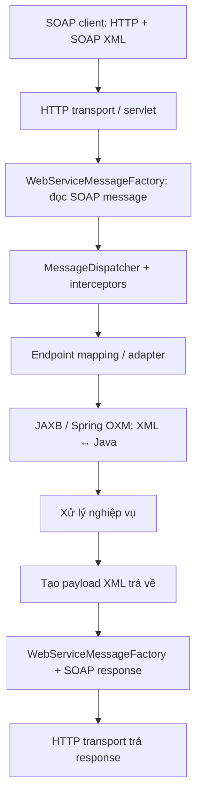
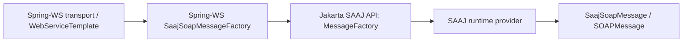
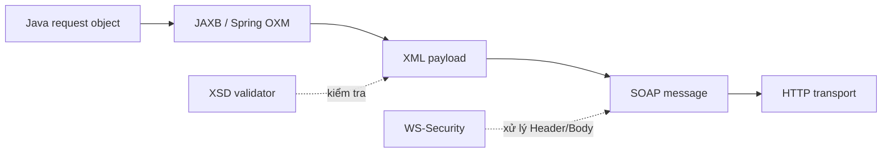
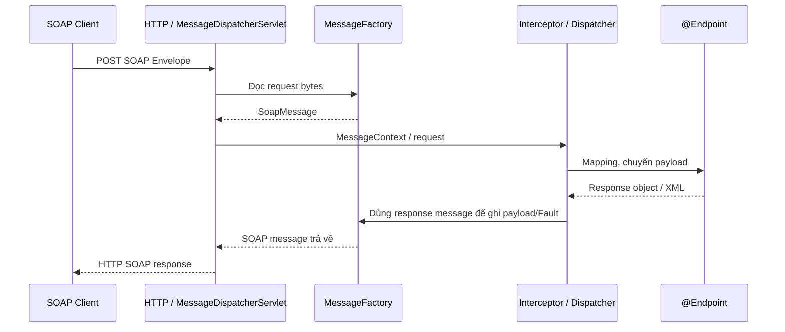

# WebServiceMessageFactory, SoapMessageFactory và trách nhiệm tạo thông điệp

Một SOAP endpoint có thể nhận đúng HTTP request nhưng vẫn không xử lý được vì sai SOAP version, không tạo được SOAP Envelope hoặc thiếu thư viện SAAJ ở runtime. Ngược lại, một lớp JAXB marshal được XML nghiệp vụ không có nghĩa ứng dụng đã tạo được **thông điệp SOAP hoàn chỉnh**. Để chẩn đoán chính xác, cần phân biệt tầng **tạo và đọc thông điệp** với tầng **ánh xạ XML**, **định tuyến endpoint**, **truyền HTTP** và **bảo mật**.

Bài thuộc chương **Kiến trúc xử lý** của module **SPRING_WEB_SERVICES**. Trong cách phát triển *contract-first* bằng Spring Web Services (Spring-WS), XSD/WSDL xác định cấu trúc và giao thức trao đổi; JAXB/Spring OXM ánh xạ payload; endpoint, SOAP client, SOAP Fault, interceptor, XML security, WS-Security và chứng chỉ hoạt động trên những tầng khác nhau. Trọng tâm ở đây là **`WebServiceMessageFactory`**, **`SoapMessageFactory`** và triển khai phổ biến **`SaajSoapMessageFactory`**: ai tạo thông điệp, ai parse đầu vào, và trách nhiệm nào nằm ngoài message factory.

Ví dụ sử dụng **Spring-WS thuộc hệ Jakarta**, Java hiện đại và SOAP 1.1 qua HTTP, trừ khi ghi rõ SOAP 1.2. Tên API có thể khác khi dùng Spring-WS thế hệ cũ với `javax.xml.soap`; cần chọn phiên bản Spring-WS/SAAJ phù hợp với hệ ứng dụng đang chạy.

## 1. Vị trí của message factory trong kiến trúc Spring-WS

Hãy theo dõi một SOAP request từ hệ thống bên ngoài:



Sơ đồ này là mô hình khái niệm. Tùy endpoint adapter, nội dung XML có thể được xử lý trực tiếp dưới dạng DOM, Source hoặc payload khác mà không cần JAXB. Một số interceptor (chẳng hạn kiểm tra WS-Security, schema hoặc xử lý header) chạy trước hoặc sau endpoint theo cấu hình; các bước không bắt buộc phải xuất hiện đúng một vị trí như sơ đồ.

Tầng tạo thông điệp cần làm việc với:

- **Thông điệp đầu vào**: đọc luồng byte và tạo đối tượng biểu diễn SOAP Envelope, Header, Body cùng thông tin liên quan.
- **Thông điệp đầu ra**: khởi tạo một thông điệp trống hoặc một cấu trúc SOAP hợp lệ để client/endpoint ghi payload, header hoặc Fault.
- **Đặc tính thông điệp SOAP**: phiên bản SOAP, namespace Envelope, khả năng truy cập Header/Body, Fault và attachment tùy implementation.

Nó **không tự quyết định** một request có quyền truy cập nghiệp vụ, một mã đơn hàng có tồn tại, hoặc có phải trả lỗi `OrderNotFound` hay không.

## 2. `WebServiceMessage` và `WebServiceMessageFactory`

### 2.1. Đối tượng thông điệp: `WebServiceMessage`

Trong Spring-WS, `org.springframework.ws.WebServiceMessage` là abstraction cho một thông điệp web service. Những khả năng quan trọng gồm:

| Thao tác ở mức khái niệm | Mục đích |
| --- | --- |
| `getPayloadSource()` | Lấy phần payload XML để đọc/xử lý dưới dạng `Source` |
| `getPayloadResult()` | Lấy đích `Result` để ghi payload XML |
| `writeTo(OutputStream)` | Ghi biểu diễn thông điệp ra stream để có thể truyền đi |

`Source` và `Result` thuộc JAXP của Java SE (`javax.xml.transform.*`), nên tên package vẫn có `javax` dù dự án sử dụng Jakarta SOAP/JAXB. API `WebServiceMessage` độc lập với lựa chọn POJO JAXB cụ thể; thông điệp có thể được đọc/ghi bằng công cụ XML thích hợp.

Khi thông điệp là SOAP, implementation như `SaajSoapMessage` cung cấp khả năng truy cập thêm vào Envelope, Header, Body và Fault thông qua interface `SoapMessage`.

### 2.2. Nhà máy thông điệp: `WebServiceMessageFactory`

`org.springframework.ws.WebServiceMessageFactory` xác định hợp đồng tạo/đọc message. Hai thao tác cốt lõi:

```java
// Chữ ký lược giản để thấy mục đích; throws và chi tiết
// phiên bản API được giản lược.
WebServiceMessage createWebServiceMessage();

WebServiceMessage createWebServiceMessage(InputStream inputStream);
```

- **Không có input stream:** tạo thông điệp mới, thường dùng cho request outbound hoặc response mới.
- **Có input stream:** đọc thông điệp từ dữ liệu truyền vào và dựng đối tượng message tương ứng.

Đây là **factory cho WebServiceMessage**, không phải factory tạo endpoint Java, bean Spring, hoặc lớp JAXB từ XSD. Việc tạo message mới cũng không đồng nghĩa đã gửi HTTP request hay đã có dữ liệu payload.

### 2.3. Luồng inbound và outbound

| Hướng | Điểm bắt đầu | Vai trò message factory | Việc tiếp theo |
| --- | --- | --- | --- |
| Server inbound | HTTP body bytes | Đọc và tạo `WebServiceMessage` | Mapping, interceptor, payload processing |
| Server outbound | Kết quả endpoint/Fault | Cung cấp message để ghi response | Payload/header/Fault, transport serialize |
| Client outbound | `WebServiceTemplate` gửi request | Tạo message mới | Marshal payload, callback, HTTP transport |
| Client inbound | HTTP response bytes | Đọc response thành message | Fault handling, unmarshal, callback/extractor |

Trên server, transport và xử lý message có thể tạo context chứa cả request và response. Thông điệp response không nhất thiết được tạo ngay trong mọi tình huống; ví dụ thao tác one-way hoặc lỗi xảy ra ở tầng transport có luồng xử lý riêng.

## 3. `SoapMessageFactory` bổ sung điều gì?

`org.springframework.ws.soap.SoapMessageFactory` là specialization của `WebServiceMessageFactory` dành cho SOAP. Nó tạo thông điệp thuộc giao diện `SoapMessage` và cung cấp thông tin liên quan đến **SOAP version**, thông qua API như `getSoapVersion()`.

```text
WebServiceMessageFactory
        │
        └── SoapMessageFactory
                 │
                 └── SaajSoapMessageFactory
                         │
                         └── tạo/đọc SaajSoapMessage
```

Điểm cần ghi nhớ:

1. **`WebServiceMessageFactory`** diễn đạt trách nhiệm tạo/đọc thông điệp theo abstraction chung của Spring-WS.
2. **`SoapMessageFactory`** là contract chuyên SOAP, nhấn mạnh các thông điệp SOAP và phiên bản giao thức.
3. **`SaajSoapMessageFactory`** là một implementation cụ thể dùng SAAJ ở bên dưới.
4. **`SoapMessage`** là đối tượng message, còn **`SoapMessageFactory`** là đối tượng tạo message. Hai loại có tên gần giống nhưng vai trò khác.

Không nên kết luận rằng `SoapMessageFactory` có thể tự xác thực WS-Security, sinh WSDL, ánh xạ JAXB hoặc triển khai nghiệp vụ. Các trách nhiệm đó cần các thành phần khác.

### 3.1. `SoapMessage` có gì thêm so với XML payload?

SOAP là một giao thức thông điệp có cấu trúc Envelope:

```xml
<soapenv:Envelope
    xmlns:soapenv="http://schemas.xmlsoap.org/soap/envelope/"
    xmlns:o="https://example.org/orders/v1">
    <soapenv:Header/>
    <soapenv:Body>
        <o:LookupOrderRequest>
            <o:orderId>ORD-1001</o:orderId>
        </o:LookupOrderRequest>
    </soapenv:Body>
</soapenv:Envelope>
```

Thông điệp có thể có Header chứa metadata hoặc thông tin WS-Security; Body chứa payload nghiệp vụ hoặc SOAP Fault. Thông qua `SoapMessage`, mã ứng dụng có thể truy cập những phần SOAP cụ thể, chẳng hạn `getSoapHeader()`, `getSoapBody()`, thao tác với SOAPAction khi phiên bản giao thức cho phép và xử lý Fault qua abstraction SOAP của Spring-WS.

Một payload `LookupOrderRequest` đơn lẻ **không phải** một SOAP Envelope. JAXB xử lý XML của payload, còn message factory tạo/đọc thông điệp SOAP chứa payload đó.

## 4. `SaajSoapMessageFactory` và SAAJ provider

**SAAJ** là *SOAP with Attachments API for Java*, với các lớp Jakarta như:

```java
import jakarta.xml.soap.MessageFactory;
import jakarta.xml.soap.SOAPMessage;
import jakarta.xml.soap.SOAPEnvelope;
import jakarta.xml.soap.SOAPHeader;
import jakarta.xml.soap.SOAPBody;
```

`SaajSoapMessageFactory` thuộc Spring-WS, còn `jakarta.xml.soap.MessageFactory` thuộc **API SAAJ**. Đây là hai tầng khác nhau:



Spring factory cung cấp interface Spring-WS để phần còn lại của framework không phải thao tác trực tiếp với SAAJ provider. Bên dưới, SAAJ provider chịu trách nhiệm tạo/parse đối tượng SOAP. Cần phân biệt **API** và **implementation**:

| Thư viện/vai trò | Ví dụ artifact trong hệ Jakarta | Ý nghĩa |
| --- | --- | --- |
| Spring-WS core | `org.springframework.ws:spring-ws-core` | Message factory abstraction, endpoint/client infrastructure |
| Jakarta SOAP API | `jakarta.xml.soap:jakarta.xml.soap-api` | Định nghĩa `MessageFactory`, `SOAPMessage` và các kiểu SAAJ |
| SAAJ runtime | `com.sun.xml.messaging.saaj:saaj-impl` | Provider thực thi việc tạo và xử lý SOAP message |
| JAXB API | `jakarta.xml.bind:jakarta.xml.bind-api` | API ánh xạ XML ↔ đối tượng Java |
| JAXB runtime | `org.glassfish.jaxb:jaxb-runtime` | Provider cho JAXB marshal/unmarshal |

Spring Boot starter có thể đã đưa một số thư viện trên vào dependency graph; phải kiểm tra phiên bản được BOM quản lý và **runtime classpath** thay vì luôn khai báo trùng. Với Java hiện đại, không được giả định JDK tự có SAAJ/JAXB provider.

### 4.1. Cấu hình message factory trong ứng dụng Spring

Ví dụ Spring-WS sử dụng SOAP 1.1:

```java
import org.springframework.context.annotation.Bean;
import org.springframework.context.annotation.Configuration;
import org.springframework.ws.soap.SoapVersion;
import org.springframework.ws.soap.saaj.SaajSoapMessageFactory;

@Configuration
public class SoapMessageConfig {

    @Bean(name = "messageFactory")
    public SaajSoapMessageFactory messageFactory() {
        SaajSoapMessageFactory factory = new SaajSoapMessageFactory();
        factory.setSoapVersion(SoapVersion.SOAP_11);
        return factory;
    }
}
```

Spring quản lý vòng đời bean nên bước khởi tạo provider của factory được thực hiện theo cơ chế framework. Tên `messageFactory` thường được Spring-WS server dùng trong cấu hình servlet/transport; cần kiểm tra cấu hình thực tế của ứng dụng, đặc biệt nếu đã có auto-configuration.

Khi **đã có factory phù hợp do Spring Boot hoặc ứng dụng tạo**, không định nghĩa thêm factory trùng tên chỉ để “bật SOAP”. Mục tiêu là bảo đảm cả server/client sử dụng đúng phiên bản SOAP và provider phù hợp.

Nếu khởi tạo `SaajSoapMessageFactory` **ngoài** Spring container để thử trực tiếp, cần gọi bước khởi tạo theo lifecycle trước khi tạo message:

```java
SaajSoapMessageFactory factory = new SaajSoapMessageFactory();
factory.setSoapVersion(SoapVersion.SOAP_11);
factory.afterPropertiesSet();
```

Tùy phiên bản Spring-WS, factory có thể nhận một SAAJ `MessageFactory` đã được tạo sẵn qua constructor. Khi cấu hình như vậy, phải kiểm tra SOAP protocol của SAAJ factory được cung cấp và cấu hình Spring có nhất quán không; đừng trông chờ thay đổi một property sẽ tự chuyển một SAAJ provider đã tạo sang phiên bản khác.

### 4.2. Smoke test tạo SOAP message

Có thể kiểm tra message factory độc lập với endpoint và JAXB:

```java
import java.io.ByteArrayOutputStream;
import java.io.StringReader;
import javax.xml.transform.Transformer;
import javax.xml.transform.TransformerFactory;
import javax.xml.transform.stream.StreamSource;
import org.springframework.ws.soap.SoapMessage;
import org.springframework.ws.soap.SoapVersion;
import org.springframework.ws.soap.saaj.SaajSoapMessageFactory;

public class SoapFactorySmoke {

    public static void main(String[] args) throws Exception {
        SaajSoapMessageFactory factory = new SaajSoapMessageFactory();
        factory.setSoapVersion(SoapVersion.SOAP_11);
        factory.afterPropertiesSet();

        SoapMessage message = factory.createWebServiceMessage();
        message.setSoapAction("https://example.org/orders/LookupOrder");

        String payload =
                "<o:LookupOrderRequest " +
                "xmlns:o='https://example.org/orders/v1'>" +
                "<o:orderId>ORD-1001</o:orderId>" +
                "</o:LookupOrderRequest>";

        Transformer transformer =
                TransformerFactory.newInstance().newTransformer();
        transformer.transform(
                new StreamSource(new StringReader(payload)),
                message.getPayloadResult());

        ByteArrayOutputStream output = new ByteArrayOutputStream();
        message.writeTo(output);
        System.out.println(output.toString("UTF-8"));
    }
}
```

Ví dụ dùng **payload cố định và đáng tin cậy** để tập trung vào factory. Với XML không tin cậy, phải cấu hình transformer/parser theo chính sách ngăn DTD, external entity và truy cập tài nguyên ngoài. Kết quả có một SOAP Envelope và Body chứa `LookupOrderRequest`; prefix namespace và chi tiết định dạng có thể khác theo provider.

Lưu ý `message.writeTo(output)` là **serialize message** vào stream; lệnh này **không tự gửi HTTP request**. Giá trị SOAPAction được đặt trên `SoapMessage` để SOAP transport có thể chuyển thành thông tin giao thức phù hợp; đừng đánh giá HTTP header chỉ bằng nội dung in ra từ `writeTo`.

### 4.3. Tạo message và parse message là hai nhánh riêng

SAAJ API có cơ chế tạo `SOAPMessage` mới hoặc đọc từ stream theo MIME/header phù hợp. Spring factory thể hiện cả hai chức năng qua các overload `createWebServiceMessage`. Khi parse inbound, message factory phải hiểu cấu trúc SOAP Envelope đúng version; một XML payload thuần như `<LookupOrderRequest>...` chưa phải một thông điệp SOAP hoàn chỉnh để đưa trực tiếp vào API đọc SOAP Envelope.

Khi viết integration test đọc inbound từ byte stream, phải cung cấp **SOAP Envelope đầy đủ** và metadata transport/MIME thích hợp theo API và provider. Một số lỗi được phát hiện khi parse, trước khi `@PayloadRoot` hoặc JAXB được gọi.

## 5. SOAP 1.1 và SOAP 1.2: factory ảnh hưởng thế nào?

SOAP version là một phần của hợp đồng giao thức, không phải thuộc tính trang trí của message.

| Đặc điểm | SOAP 1.1 | SOAP 1.2 |
| --- | --- | --- |
| Envelope namespace | `http://schemas.xmlsoap.org/soap/envelope/` | `http://www.w3.org/2003/05/soap-envelope` |
| HTTP media type điển hình | `text/xml` | `application/soap+xml` |
| SOAP action qua HTTP | Thường dùng header `SOAPAction` theo SOAP 1.1 binding | Có thể dùng tham số `action` trong media type `application/soap+xml` |
| Fault code thường gặp | `Client`, `Server` | `Sender`, `Receiver` |
| WSDL 1.1 SOAP extension | `http://schemas.xmlsoap.org/wsdl/soap/` | SOAP 1.2 binding extension riêng, thường dùng prefix `soap12` |

Ví dụ SOAP 1.2 Envelope:

```xml
<env:Envelope
    xmlns:env="http://www.w3.org/2003/05/soap-envelope"
    xmlns:o="https://example.org/orders/v1">
    <env:Body>
        <o:LookupOrderRequest>
            <o:orderId>ORD-1001</o:orderId>
        </o:LookupOrderRequest>
    </env:Body>
</env:Envelope>
```

Để tạo SOAP 1.2 với SAAJ-based factory khi provider hỗ trợ:

```java
SaajSoapMessageFactory factory = new SaajSoapMessageFactory();
factory.setSoapVersion(SoapVersion.SOAP_12);
factory.afterPropertiesSet();
```

**Không chỉ đổi factory rồi giữ nguyên WSDL SOAP 1.1.** Một hệ thống dùng SOAP 1.2 phải thống nhất binding, HTTP media type, Envelope namespace, Fault format, header/action và phía client. Nếu client gửi Envelope SOAP 1.2 đến endpoint chỉ tiếp nhận SOAP 1.1, lỗi version mismatch có thể xảy ra trước khi payload đi vào endpoint.

### 5.1. Ai chịu trách nhiệm đặt Content-Type?

Message factory tạo/đọc biểu diễn thông điệp tương ứng với SOAP version. **HTTP transport** sử dụng thông tin message và quy tắc transport để hình thành HTTP request/response, trong đó có `Content-Type` hoặc các header phù hợp. SAAJ provider cũng quản lý MIME metadata liên quan message. Không nên hard-code `text/xml` cho SOAP 1.2 hay giả định SOAPAction luôn là một header HTTP riêng ở mọi version.

Trong SOAP 1.1, `SOAPAction` trong WSDL (nếu có) có thể được Spring-WS client đặt qua `SoapActionCallback`. Trong SOAP 1.2, action có quy tắc biểu diễn khác. Việc đặt SOAPAction **không quyết định** endpoint URL và không làm payload tự khớp với schema.

## 6. Ranh giới với JAXB, Spring OXM và XSD validation

Xét hợp đồng XSD document/literal:

```xml
<xs:schema xmlns:xs="http://www.w3.org/2001/XMLSchema"
           targetNamespace="https://example.org/orders/v1"
           elementFormDefault="qualified">
    <xs:element name="LookupOrderRequest">
        <xs:complexType>
            <xs:sequence>
                <xs:element name="orderId" type="xs:string"/>
            </xs:sequence>
        </xs:complexType>
    </xs:element>
    <xs:element name="LookupOrderResponse">
        <xs:complexType>
            <xs:sequence>
                <xs:element name="orderId" type="xs:string"/>
                <xs:element name="status" type="xs:string"/>
            </xs:sequence>
        </xs:complexType>
    </xs:element>
</xs:schema>
```

Trong Spring-WS:

- **Message factory** tạo/đọc SOAP Envelope, cung cấp chỗ ghi payload XML.
- **JAXB/Jaxb2Marshaller** chuyển `LookupOrderRequest` Java thành phần tử XML `LookupOrderRequest` và đọc response XML thành Java object.
- **XSD validator** kiểm tra `orderId` có đúng kiểu, thứ tự, namespace và ràng buộc hợp đồng hay không.
- **Endpoint** tra cứu dữ liệu đơn hàng và tạo kết quả.
- **SOAP Fault handling** biến lỗi phù hợp thành Fault của SOAP version hiện tại.
- **WS-Security interceptor** xử lý chính sách token, chữ ký, mã hóa và certificate khi hợp đồng yêu cầu.



### 6.1. Chuyển đổi một object không tạo SOAP Envelope

Ví dụ chỉ dùng Spring OXM:

```java
StringWriter out = new StringWriter();
ordersMarshaller.marshal(
        new LookupOrderRequest("ORD-1001"),
        new StreamResult(out));
String xml = out.toString();
```

Giả định `ordersMarshaller` và `LookupOrderRequest` đã được cấu hình đúng (bao gồm `@XmlRootElement` hoặc wrapper JAXB thích hợp) và import `StringWriter`, `StreamResult` đầy đủ. Kết quả là **payload XML**, không phải SOAP Envelope.

### 6.2. Tạo Envelope cũng không tự tạo object Java

Ngược lại:

```java
SoapMessage message = soapMessageFactory.createWebServiceMessage();
```

chỉ tạo SOAP message mới để các thành phần phía sau ghi payload. Nó không biết `LookupOrderRequest` có trường `orderId` hay áp dụng quy tắc nào của XSD, trừ khi một thành phần riêng được cấu hình để làm điều đó.

### 6.3. XSD validation không phải trách nhiệm của factory

Thông điệp có thể có Envelope hợp lệ nhưng payload vi phạm XSD, chẳng hạn:

```xml
<o:LookupOrderRequest xmlns:o="https://example.org/orders/v1">
    <o:unexpectedField>X</o:unexpectedField>
</o:LookupOrderRequest>
```

Nhiệm vụ của message factory là tạo/đọc thông điệp; để phát hiện `unexpectedField` cần validation theo XSD, chẳng hạn `PayloadValidatingInterceptor` hoặc validation trên marshaller/unmarshaller được cấu hình phù hợp. Cũng không có gì bảo đảm một payload XSD-valid đã đúng nghiệp vụ hoặc có chữ ký WS-Security hợp lệ.

## 7. Message factory trong SOAP client với `WebServiceTemplate`

Spring-WS `WebServiceTemplate` điều phối các bước:

1. Nhận request object hoặc callback tạo payload.
2. Dùng message factory để tạo SOAP request mới.
3. Marshal object hoặc để callback ghi XML vào payload.
4. Áp dụng callback/interceptor như SOAPAction, header hoặc WS-Security theo cấu hình.
5. Đưa message tới HTTP transport.
6. Nhận SOAP response, để factory đọc lại thành message.
7. Kiểm tra Fault rồi unmarshal/extract payload response theo cấu hình.

### 7.1. Cấu hình factory và JAXB cho client

```java
import org.springframework.context.annotation.Bean;
import org.springframework.context.annotation.Configuration;
import org.springframework.oxm.jaxb.Jaxb2Marshaller;
import org.springframework.ws.client.core.WebServiceTemplate;
import org.springframework.ws.soap.SoapVersion;
import org.springframework.ws.soap.saaj.SaajSoapMessageFactory;

@Configuration
public class OrdersClientConfig {

    @Bean
    public Jaxb2Marshaller ordersMarshaller() {
        Jaxb2Marshaller oxm = new Jaxb2Marshaller();
        oxm.setClassesToBeBound(
                LookupOrderRequest.class,
                LookupOrderResponse.class);
        oxm.setSupportDtd(false);
        oxm.setProcessExternalEntities(false);
        return oxm;
    }

    @Bean
    public WebServiceTemplate ordersTemplate(
            SaajSoapMessageFactory messageFactory,
            Jaxb2Marshaller ordersMarshaller) {
        WebServiceTemplate template =
                new WebServiceTemplate(messageFactory);
        template.setMarshaller(ordersMarshaller);
        template.setUnmarshaller(ordersMarshaller);
        return template;
    }
}
```

Ví dụ giả định `SaajSoapMessageFactory` đã có bean được khởi tạo theo mục 4, còn hai class JAXB đã được sinh/viết tương ứng XSD. `WebServiceTemplate` sử dụng factory cho cả SOAP outbound và inbound, và marshaller cho **payload**. Khi framework đã auto-configure một `WebServiceTemplate` hoặc message factory, có thể dùng cấu hình đó thay vì tạo bean mới.

### 7.2. Gọi dịch vụ document/literal

```java
import org.springframework.ws.client.core.WebServiceTemplate;
import org.springframework.ws.soap.client.core.SoapActionCallback;

public final class OrdersClient {
    private final WebServiceTemplate template;
    private final String endpointUri;

    public OrdersClient(WebServiceTemplate template, String endpointUri) {
        this.template = template;
        this.endpointUri = endpointUri;
    }

    public LookupOrderResponse lookup(String orderId) {
        LookupOrderRequest request = new LookupOrderRequest(orderId);
        return (LookupOrderResponse) template.marshalSendAndReceive(
                endpointUri,
                request,
                new SoapActionCallback(
                        "https://example.org/orders/LookupOrder"));
    }
}
```

`SoapActionCallback` và endpoint URL là các thành phần **khác trách nhiệm**. `SoapActionCallback` dùng giá trị action theo binding WSDL đang tích hợp; `endpointUri` lấy từ cấu hình môi trường. Với SOAP 1.2, quy tắc HTTP/action cần tương thích với provider và binding, không sao chép nguyên ví dụ SOAP 1.1.

Nếu gọi trên endpoint SOAP 1.1 nhưng client cấu hình factory SOAP 1.2, việc marshaling JAXB có thể vẫn thành công. Lỗi sẽ bộc lộ ở **tầng giao thức/message** khi server parse Envelope hoặc kiểm tra Content-Type.

## 8. Message factory trên phía server

Spring-WS server thường nhận message thông qua `MessageDispatcherServlet` và các thành phần transport/dispatcher. Quá trình đọc SOAP message xảy ra trước khi endpoint được chọn:



Mối liên hệ:

- **Servlet/transport** xử lý kết nối và đọc HTTP request body, nhưng không thực hiện nghiệp vụ `LookupOrder`.
- **Factory** parse SOAP message và cho phép tạo message response.
- **Dispatcher** chọn endpoint bằng QName, annotation hoặc cơ chế mapping đã cấu hình.
- **Endpoint adapter** chuyển payload đến phương thức endpoint tương ứng.
- **Interceptor** xử lý trước/sau endpoint hoặc lỗi theo vòng đời Spring-WS đã đăng ký.

### 8.1. Định tuyến theo QName của payload

```java
import org.springframework.ws.server.endpoint.annotation.Endpoint;
import org.springframework.ws.server.endpoint.annotation.PayloadRoot;
import org.springframework.ws.server.endpoint.annotation.RequestPayload;
import org.springframework.ws.server.endpoint.annotation.ResponsePayload;

@Endpoint
public class OrdersEndpoint {
    private static final String NS = "https://example.org/orders/v1";

    @PayloadRoot(namespace = NS, localPart = "LookupOrderRequest")
    @ResponsePayload
    public LookupOrderResponse lookup(
            @RequestPayload LookupOrderRequest request) {
        LookupOrderResponse response = new LookupOrderResponse();
        response.setOrderId(request.getOrderId());
        response.setStatus("CONFIRMED");
        return response;
    }
}
```

`@PayloadRoot` định tuyến theo namespace và local name của payload **bên trong Body**. Factory đã tạo SOAP message nhưng **không quyết định** endpoint sẽ là `OrdersEndpoint`. JAXB/unmarshal và endpoint adapter phụ trách chuyển payload thành `LookupOrderRequest` theo cấu hình.

Mã là ví dụ minh họa: cần lớp JAXB với constructor/getter/setter và hợp đồng response tương ứng; cần cấu hình servlet, message factory và endpoint adapter thích hợp để chạy.

### 8.2. SOAP Fault tạo ở tầng nào?

Nếu client gửi thông điệp sai phiên bản SOAP, parser/factory hoặc hạ tầng SOAP có thể phát hiện lỗi **trước khi endpoint chạy**. Nếu payload sai XSD, interceptor xác thực có thể báo lỗi trước khi gọi nghiệp vụ. Nếu nghiệp vụ ném exception, exception resolver có thể biến nó thành SOAP Fault.

Factory cung cấp một SOAP message có khả năng chứa Fault; nó **không tự ánh xạ mọi Java exception sang Fault nghiệp vụ**. Ví dụ `SoapFaultMappingExceptionResolver` có thể ánh xạ các exception đã chọn thành Fault theo cấu hình; message factory và SOAP version ảnh hưởng tới dạng Fault trên đường truyền.

| Nguồn lỗi | Thành phần phát hiện điển hình | Hệ quả |
| --- | --- | --- |
| Envelope không hợp lệ, SOAP version không khớp | SOAP parser/message factory/transport | Lỗi giao thức trước endpoint, tùy cấu hình trả Fault hoặc HTTP error |
| QName payload không có endpoint phù hợp | Endpoint mapping/dispatcher | Không tìm thấy endpoint phù hợp |
| `xs:sequence` sai, thiếu phần tử bắt buộc | XSD validation interceptor | Từ chối payload vi phạm hợp đồng |
| JAXB annotation/root không phù hợp | Unmarshaller/endpoint adapter | Lỗi ánh xạ XML ↔ Java |
| Đơn hàng không tồn tại | Endpoint business logic | Fault nghiệp vụ nếu contract quy định |
| WS-Security signature sai | Security interceptor/library | Từ chối message theo chính sách bảo mật |

Không suy luận một lỗi sẽ luôn có đúng SOAP Fault code/HTTP status nhất định nếu chưa xác định SOAP version và cấu hình xử lý lỗi của ứng dụng. SOAP 1.1 và SOAP 1.2 cũng có định dạng Fault khác nhau.

## 9. Interceptor, SOAP Header và WS-Security

Message factory tạo/đọc cấu trúc thông điệp, để các thành phần khác có thể tương tác với **SOAP Header** và **SOAP Body**.

Ví dụ interceptor có thể đọc request:

```java
import org.springframework.ws.context.MessageContext;
import org.springframework.ws.server.EndpointInterceptor;
import org.springframework.ws.WebServiceMessage;
import org.springframework.ws.soap.SoapMessage;

public class AuditEnvelopeInterceptor implements EndpointInterceptor {

    @Override
    public boolean handleRequest(MessageContext context, Object endpoint) {
        WebServiceMessage request = context.getRequest();
        if (request instanceof SoapMessage soap) {
            // Có thể truy cập soap.getSoapHeader() và getSoapBody()
            // để ghi metadata phù hợp (không log token/chữ ký).
        }
        return true;
    }

    @Override
    public boolean handleResponse(MessageContext context, Object endpoint) {
        return true;
    }

    @Override
    public boolean handleFault(MessageContext context, Object endpoint) {
        return true;
    }

    @Override
    public void afterCompletion(MessageContext context,
                                Object endpoint, Exception ex) {
    }
}
```

Đây là **khung interceptor**; việc đăng ký vào chuỗi `WsConfigurer#addInterceptors` và logic audit thực tế cần được cấu hình phù hợp. Đọc trực tiếp và ghi toàn bộ SOAP Body/Header vào log có thể làm lộ mật khẩu, token, PII hoặc nội dung có chữ ký.

### 9.1. Trách nhiệm nào thuộc WS-Security?

**WS-Security** có thể dùng XML Signature, XML Encryption, timestamp, token, chứng chỉ và các thông tin trong SOAP Header để bảo vệ thông điệp. Một message factory có thể chứa các phần tử WS-Security trong message, nhưng **không tự xác minh chữ ký hoặc trust chain**. Để làm điều đó cần cấu hình thư viện/interceptor chuyên dụng như Spring-WS Security/WSS4J phù hợp.

Những kiểm tra cần tách biệt:

1. **Message factory:** Envelope có thể đọc/ghi đúng SOAP version?
2. **Schema validation:** payload có đúng XSD/WSDL không?
3. **Authentication/authorization:** người gửi có được phép thực hiện thao tác không?
4. **Signature/certificate verification:** dữ liệu được ký có nguyên vẹn, chứng chỉ có tin cậy và policy có được đáp ứng không?

Đừng biến đổi payload đã ký bằng cách parse rồi tái tạo XML tùy tiện giữa các bước xác minh. Canonicalization chuẩn hóa một số khác biệt biểu diễn, nhưng không cho phép tự thay nội dung, thứ tự hoặc vùng dữ liệu đã ký.

## 10. Chọn và cấu hình implementation: hiệu năng và tài nguyên

Một số phiên bản/hệ Spring-WS có thể hỗ trợ các implementation message factory khác ngoài SAAJ, chẳng hạn nhóm dựa trên mô hình AXIOM. Khả năng hỗ trợ, artifact và tùy chọn cấu hình cụ thể **phụ thuộc phiên bản Spring-WS** đang dùng. Bài này dùng SAAJ làm ví dụ nhất quán để không dựa vào một provider tùy chọn chưa được xác nhận.

Khi đánh giá implementation, cần xem:

| Tiêu chí | Câu hỏi thực tế |
| --- | --- |
| SOAP version | Có tạo/parse đúng SOAP 1.1/1.2 theo WSDL không? |
| Memory usage | Thông điệp được materialize vào bộ nhớ đến mức nào? |
| Attachment | Có hỗ trợ MIME/MTOM cần thiết theo hợp đồng không? |
| Streaming | Có thực sự streaming end-to-end hay interceptor sẽ đọc toàn bộ? |
| XML security | Có cơ chế cấu hình parser/provider chống xử lý entity ngoài ý muốn không? |
| WS-Security | Security interceptor và XML Signature có tương thích với mô hình message không? |
| Tương thích | Cả inbound, outbound, Fault và client đối tác có hoạt động cùng nhau không? |

**Không suy luận rằng có `InputStream` nghĩa là xử lý streaming toàn bộ.** SAAJ provider thường tạo cấu trúc SOAP trong bộ nhớ; JAXB, validation, WS-Security hoặc logging có thể khiến nội dung được đọc/materialize nhiều lần. Payload lớn và attachment nên được benchmark với thông điệp thực tế.

Với tài nguyên không tin cậy, áp dụng giới hạn kích thước request, độ sâu XML, số lượng phần tử, thời gian xử lý và chính sách XML parser phù hợp. Chỉ thay factory **không tự loại bỏ** nguy cơ XXE, denial of service, lỗi cấu hình TLS hoặc chứng chỉ.

## 11. Các lỗi khởi tạo và xử lý thường gặp

| Triệu chứng | Khả năng nguyên nhân | Cách kiểm tra |
| --- | --- | --- |
| Không tạo được `SaajSoapMessageFactory` | Thiếu SAAJ provider hoặc provider sai phiên bản | Kiểm tra `jakarta.xml.soap-api` và `saaj-impl` trong runtime classpath |
| `Unable to create SAAJ meta-factory` hoặc `SOAPException` tương tự | Không tìm thấy provider/không tương thích `javax` và `jakarta` | Xem exception cause và dependency graph |
| SOAP version mismatch | Client gửi SOAP 1.2, server chỉ đọc SOAP 1.1 (hoặc ngược lại) | Kiểm tra Envelope namespace, factory và WSDL binding |
| XML payload marshal được nhưng không gửi được SOAP | Factory/transport chưa đúng hoặc endpoint URL sai | Tách test OXM khỏi test message factory/HTTP |
| Gửi SOAP 1.2 nhưng HTTP vẫn là `text/xml` | Cấu hình message factory/transport sai version | Kiểm tra Content-Type thực tế và version WSDL |
| `@PayloadRoot` không được gọi | QName payload hoặc endpoint mapping sai | Đối chiếu namespace URI/local name, log dispatcher |
| Unmarshal thất bại sau khi SOAP parse thành công | JAXB model, root element, namespace hoặc schema lệch | Kiểm tra JAXB runtime, `ObjectFactory`/`JAXBElement`, XSD |
| Validation không chặn dữ liệu sai XSD | Chưa đăng ký interceptor hoặc dùng sai schema | Kiểm tra `PayloadValidatingInterceptor` và thứ tự interceptor |
| Chữ ký WS-Security sai sau khi sửa XML | Nội dung đã ký bị thay đổi/biến đổi không phù hợp | Kiểm tra bước ký/xác minh và canonicalization |
| Local thành công, production lỗi kết nối | URL, TLS, proxy, header hoặc truststore | Kiểm tra wire message và môi trường thực |

**Thứ tự chẩn đoán** hiệu quả là xác định lỗi xuất hiện trước hay sau việc tạo `SoapMessage`, sau đó tới dispatch, JAXB, schema, nghiệp vụ và bảo mật. Nếu thông điệp chưa parse được thành SOAP Envelope, đừng bắt đầu bằng cách sửa `@XmlRootElement` của DTO.

## 12. Kiểm thử message factory trong Spring-WS

### 12.1. Kiểm thử theo lớp trách nhiệm

| Cấp kiểm thử | Điều cần chứng minh | Công cụ/gợi ý |
| --- | --- | --- |
| Factory smoke | Có thể khởi tạo SOAP 1.1/1.2 message, serialize Envelope hợp lệ | Test trực tiếp `SaajSoapMessageFactory` |
| Payload OXM | POJO ↔ XML đúng QName, thứ tự và kiểu | Test `Jaxb2Marshaller` |
| XSD validation | Payload đúng được nhận, payload sai bị từ chối | XSD validator/`PayloadValidatingInterceptor` |
| Endpoint | Dispatcher chọn đúng method và trả response/Fault | `MockWebServiceClient` |
| SOAP client | Tạo request body, callback/action và xử lý response/Fault | `MockWebServiceServer` |
| Transport | HTTP path, Content-Type, SOAPAction và status hoạt động | Integration test với server thật |
| WS-Security | Signature, token, certificate và policy được thực thi | Integration test với cấu hình bảo mật thực |
| Phiên bản hợp đồng | Client/server khác phiên bản giao tiếp đúng phạm vi | Contract test với WSDL/XSD từng phiên bản |

Test mock rất hữu ích để kiểm tra SOAP payload và dispatch, nhưng nó không nhất thiết đi qua **HTTP thực**, **TLS**, **proxy** hoặc MIME/header giống môi trường production. Cần ít nhất một integration test với cấu hình message factory, transport và provider thực tế đã đóng gói.

### 12.2. Ma trận SOAP version tối thiểu

| Factory/client | Endpoint | Dự kiến |
| --- | --- | --- |
| SOAP 1.1 | SOAP 1.1 | Có thể thành công nếu binding, payload và policy đúng |
| SOAP 1.2 | SOAP 1.2 | Có thể thành công nếu binding, payload và policy đúng |
| SOAP 1.1 | Chỉ SOAP 1.2 | Có khả năng lỗi giao thức/version mismatch |
| SOAP 1.2 | Chỉ SOAP 1.1 | Có khả năng lỗi giao thức/version mismatch |
| Đúng SOAP version nhưng sai XSD | Cùng SOAP version | SOAP parse được, XSD validation/endpoint có thể từ chối |
| Đúng SOAP version và XSD nhưng sai chữ ký | Cùng SOAP version | Security interceptor phải từ chối theo policy |

Đây là **ma trận kỳ vọng theo nguyên tắc**; Fault code và HTTP status thực tế phụ thuộc implementation/transport và cách cấu hình xử lý lỗi. Nên assert kết quả cụ thể của stack đang chạy thay vì giả định một error message ổn định qua mọi phiên bản.

### 12.3. Tình huống kiểm thử minh họa

Giả sử `MessageDispatcherServlet` phục vụ `/ws/*`, Spring-WS có bean `SaajSoapMessageFactory` ở mục 4 và endpoint ở mục 8. Có thể tạo ba ca:

1. Gửi Envelope SOAP 1.1 hợp lệ chứa `LookupOrderRequest` → kiểm tra response SOAP 1.1 và `LookupOrderResponse`.
2. Gửi SOAP 1.2 Envelope trên cùng endpoint chỉ cấu hình SOAP 1.1 → kiểm tra lỗi version/protocol trước endpoint.
3. Gửi SOAP 1.1 hợp lệ về cấu trúc Envelope nhưng Body chứa `unexpectedField` → với interceptor XSD đã bật, kiểm tra việc từ chối payload hợp đồng.

Thêm ca WS-Security chữ ký sai nếu policy yêu cầu. Các ca trên xác định ranh giới **message parsing**, **schema validation** và **security validation**, nên giúp khoanh vùng nguyên nhân ngay cả khi client báo chung “SOAP Fault”.

## 13. Những nhầm lẫn thường gặp

**“Message factory tạo request DTO.”** Không. Nó tạo `WebServiceMessage` hoặc `SoapMessage`. JAXB/Spring OXM xử lý lớp DTO với payload XML.

**“Có XML Body hợp lệ là có một SOAP message hợp lệ.”** Chưa đủ. SOAP message còn Envelope namespace, Header/Body, SOAP version và các ràng buộc giao thức.

**“`SaajSoapMessageFactory` và `jakarta.xml.soap.MessageFactory` là một.”** Không. Một bên là implementation Spring-WS của abstraction message factory; bên kia là API SAAJ được dùng bên dưới.

**“Đặt `SoapVersion.SOAP_12` là có thể gửi SOAP 1.2 đến bất kỳ WSDL nào.”** Không. Cần WSDL binding, HTTP media type/action và server tương thích.

**“`WebServiceTemplate` chỉ cần JAXB marshaller, không cần message factory.”** Không. Client vẫn cần một cơ chế tạo/đọc SOAP message; Spring có thể cung cấp factory mặc định hoặc qua auto-configuration, nhưng factory vẫn tồn tại trong pipeline.

**“Có bean factory là XSD validation tự bật.”** Không. Validation cần schema và thành phần xác thực riêng, chẳng hạn interceptor hoặc marshaller validation đã cấu hình.

**“Factory tự xử lý tất cả SOAP Fault.”** Không. Fault format liên quan SOAP version; việc ánh xạ lỗi endpoint/validator/security thành Fault thuộc các lớp xử lý chuyên trách.

**“Có SAAJ API ở compile classpath là chắc chắn chạy được.”** Không. Cần runtime provider tương thích, tránh trộn `javax.xml.soap` và `jakarta.xml.soap`.

## 14. Bài tập tự kiểm tra

**Câu 1.** `Jaxb2Marshaller` có thể marshal một `LookupOrderRequest` ra XML nhưng `SaajSoapMessageFactory` không khởi tạo được. Nên sửa XSD trước hay kiểm tra provider?

**Đáp án:** Kiểm tra SAAJ API và runtime provider, phiên bản và runtime classpath trước. XSD/JAXB đã làm được nhiệm vụ của chúng; lỗi nằm ở tầng tạo SOAP message.

**Câu 2.** Vì sao hai factory cùng xử lý được payload `LookupOrderRequest` nhưng không thể tự động thay thế cho nhau nếu dùng SOAP version khác?

**Đáp án:** SOAP version quyết định Envelope namespace và các quy tắc giao thức/HTTP, độc lập với XSD payload. Client và server phải thống nhất SOAP binding/version.

**Câu 3.** `WebServiceMessageFactory#createWebServiceMessage()` trả về một message mới. Thao tác đó có tự điền `orderId` hoặc gửi HTTP không?

**Đáp án:** Không. Payload được ghi bằng JAXB/OXM hoặc XML callback; transport riêng đảm nhiệm việc gửi dữ liệu.

**Câu 4.** Một SOAP 1.1 Envelope parse thành công nhưng `@PayloadRoot` không chọn endpoint. Thành phần nào cần kiểm tra?

**Đáp án:** QName payload (namespace URI + local name), endpoint mapping/adapter và cấu hình Spring-WS. Factory đã parse được SOAP message nên lỗi có thể ở tầng dispatch.

**Câu 5.** XML payload vi phạm `xs:sequence` nhưng endpoint vẫn nhận object Java. Có chắc factory bị lỗi không?

**Đáp án:** Không. Message factory chỉ xử lý thông điệp; JAXB không mặc nhiên kiểm tra mọi ràng buộc XSD. Cần xác thực theo XSD chính thức.

**Câu 6.** Một SOAP message có chữ ký WS-Security hợp lệ có cần đúng SOAP version và đúng XSD nữa không?

**Đáp án:** Có. Signature verification, SOAP parsing và schema validation là các kiểm tra khác nhau; thành công ở tầng này không thay thế các tầng kia.

**Câu 7.** Tại sao `message.writeTo(OutputStream)` không đủ chứng minh header `Content-Type` trên HTTP là chính xác?

**Đáp án:** Nó serialize dữ liệu message. Việc gửi HTTP và thiết lập header còn thuộc transport/MIME processing; cần integration test quan sát request thực tế.

**Câu 8.** Có nên chia sẻ một instance SAAJ `SOAPMessage` đang được chỉnh sửa cho nhiều request đồng thời không?

**Đáp án:** Không. Mỗi request/response nên có message riêng; tái sử dụng **factory bean** được cấu hình phù hợp, không chia sẻ nội dung message mutable giữa các luồng.

## Ghi nhớ

- **`WebServiceMessageFactory`** cung cấp khả năng tạo message trống và đọc message từ stream; **`SoapMessageFactory`** chuyên cho SOAP và phiên bản SOAP.
- **`SaajSoapMessageFactory`** dùng SAAJ API/provider để tạo/đọc SOAP Envelope, Header và Body; cần phân biệt Spring factory với Jakarta SAAJ `MessageFactory`.
- **SOAP message khác payload XML.** JAXB/Spring OXM ánh xạ dữ liệu Java ↔ XML; message factory tạo container SOAP; transport gửi/nhận HTTP.
- **SOAP 1.1 và SOAP 1.2 khác namespace, media type, action và Fault.** Chọn factory phải phù hợp WSDL binding và server/client thực tế.
- **Factory không tự xác thực XSD, nghiệp vụ hay WS-Security.** Interceptor, validator, endpoint và security component có trách nhiệm riêng.
- **Kiểm thử từ factory đến transport thật** giúp phân biệt lỗi provider, SOAP version, mapping, schema, Fault và chữ ký/chứng chỉ khi tích hợp hệ thống doanh nghiệp.
