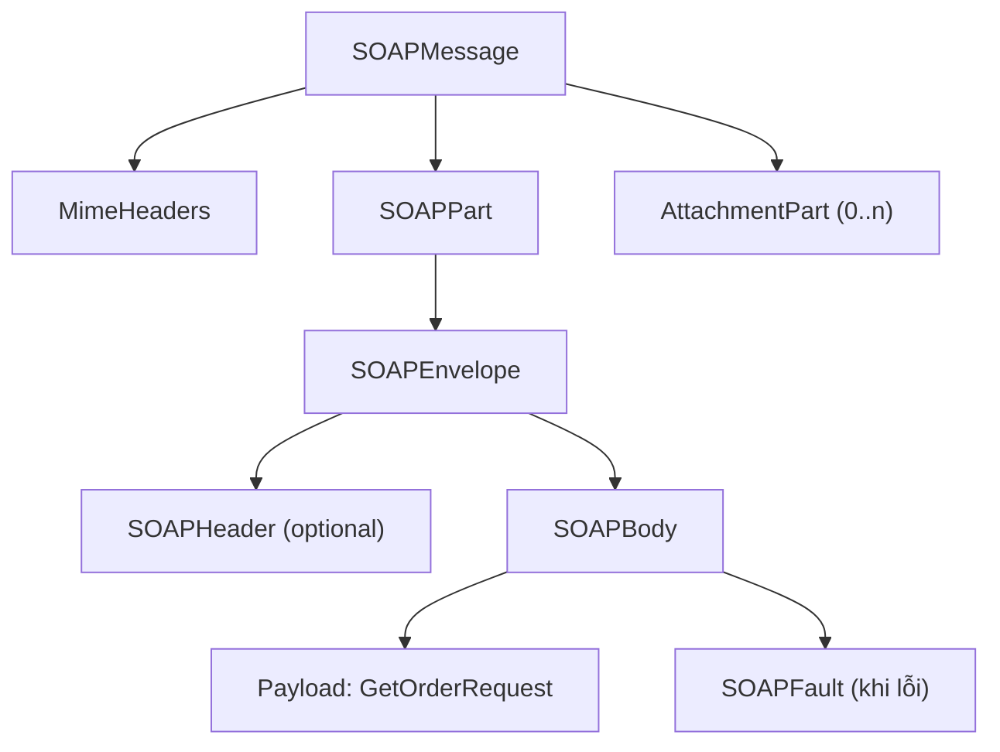
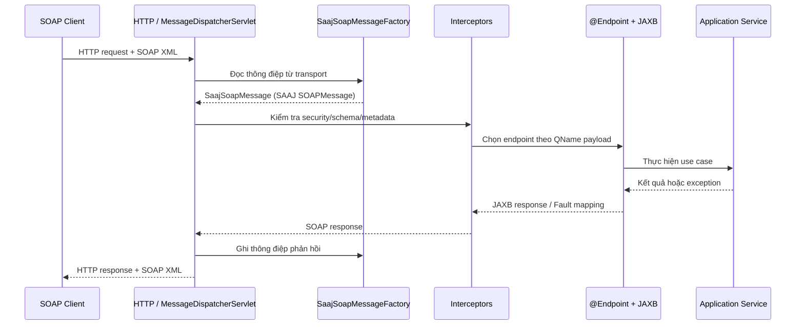
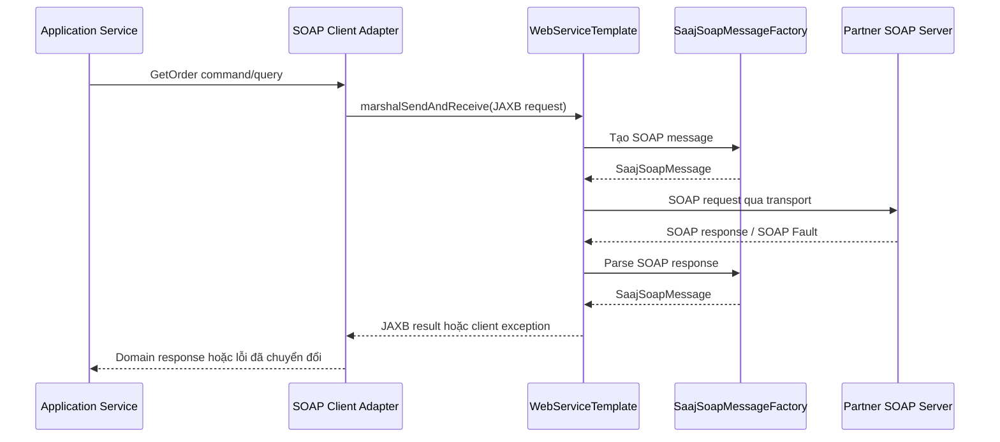

# SaajSoapMessageFactory và mô hình SOAP dựa trên SAAJ

## 1. Vấn đề kiến trúc: từ HTTP bytes đến SOAP message

Một ứng dụng tích hợp doanh nghiệp nhận request SOAP từ hệ thống ERP. Dữ liệu đi vào qua HTTP dưới dạng byte: có HTTP headers, XML chứa SOAP Envelope, có thể có MIME attachments và đôi khi có WS-Security Header. Spring Web Services (Spring-WS) cần biến dữ liệu đó thành một **thông điệp SOAP có cấu trúc** để interceptor kiểm tra, endpoint đọc payload, JAXB chuyển XML sang Java, và cuối cùng tạo response hoặc SOAP Fault.

Thành phần thực hiện việc **tạo và đọc SOAP message** trong kiến trúc này là một *message factory*. Một lựa chọn quen thuộc của Spring-WS là **`SaajSoapMessageFactory`**, dựa trên **SAAJ — SOAP with Attachments API for Java**. SAAJ biểu diễn thông điệp SOAP thành một mô hình đối tượng có thể đi qua và sửa đổi, về cơ bản là một cây XML trong bộ nhớ.

Ví dụ, một operation `GetOrder` nhận:

```xml
<soap:Envelope xmlns:soap="http://schemas.xmlsoap.org/soap/envelope/"
               xmlns:ord="urn:example:orders:v1">
  <soap:Header/>
  <soap:Body>
    <ord:GetOrderRequest>
      <ord:orderId>ORD-1001</ord:orderId>
    </ord:GetOrderRequest>
  </soap:Body>
</soap:Envelope>
```

Ở phía Spring-WS, endpoint Java thường chỉ nhìn thấy `GetOrderRequest`. Nhưng trước đó, message factory và các lớp giao thức đã tiếp nhận **toàn bộ SOAP Envelope**, bao gồm Header, Body và các thuộc tính liên quan.

Trong module **SPRING_WEB_SERVICES**, cần hiểu chính xác vị trí của SAAJ khi phát triển SOAP theo hướng **contract-first**: XSD/WSDL mô tả hợp đồng, JAXB ánh xạ payload, endpoint/client thực thi tương tác, còn `SaajSoapMessageFactory` cung cấp mô hình thông điệp để Spring-WS xử lý SOAP, Fault và các interceptor. Việc hiểu cơ chế này đặc biệt cần thiết khi tích hợp WS-Security, chứng chỉ, XML security, tệp đính kèm và kiểm thử tương thích.

**Sau bài này, người học có thể:**

1. Phân biệt SAAJ, `SaajSoapMessageFactory`, `SaajSoapMessage` và các thành phần Spring-WS khác.
2. Mô tả cấu trúc `SOAPMessage`, `SOAPPart`, `SOAPEnvelope`, `SOAPHeader`, `SOAPBody`, `SOAPFault` và attachment.
3. Theo dõi một SOAP request qua server và một SOAP response qua `WebServiceTemplate`.
4. Cấu hình SOAP 1.1 hoặc SOAP 1.2 với message factory thích hợp.
5. Nhận biết ảnh hưởng của mô hình cây SAAJ đến bộ nhớ, bảo mật, khả năng tương thích và kiểm thử.

## 2. SAAJ là gì và Spring-WS sử dụng nó ở lớp nào?

**SAAJ** là API Java dành cho xây dựng, đọc và thay đổi SOAP message, bao gồm SOAP Envelope, các header, body, SOAP Fault và các thành phần liên quan đến MIME attachment. Một ứng dụng dùng SAAJ thuần có thể tạo `SOAPMessage` bằng `MessageFactory` rồi tự điền phần tử XML.

**Spring-WS** xây dựng một lớp trừu tượng phía trên thông điệp, để endpoint và SOAP client không phải tự thao tác từng node SAAJ trong các tác vụ phổ biến.

| Thành phần | Thuộc về | Vai trò |
|---|---|---|
| `jakarta.xml.soap.MessageFactory` | Jakarta SAAJ API | Tạo hoặc parse `SOAPMessage` theo giao thức SOAP được cấu hình. |
| `jakarta.xml.soap.SOAPMessage` | Jakarta SAAJ API | Mô hình một thông điệp SOAP, có phần SOAP, MIME headers và attachments. |
| `SOAPPart`, `SOAPEnvelope`, `SOAPHeader`, `SOAPBody` | Jakarta SAAJ API | Các đối tượng tạo thành cấu trúc XML của SOAP Envelope. |
| `org.springframework.ws.soap.saaj.SaajSoapMessageFactory` | Spring-WS | Adapter của Spring-WS để tạo/đọc thông điệp dựa trên SAAJ. |
| `org.springframework.ws.soap.saaj.SaajSoapMessage` | Spring-WS | Wrapper một `SOAPMessage` của SAAJ, cung cấp giao diện `SoapMessage` của Spring-WS. |
| `SoapMessage` | Spring-WS | Trừu tượng thông điệp SOAP để code Spring-WS không lệ thuộc hoàn toàn implementation. |
| `MessageDispatcherServlet` | Spring-WS | Điểm vào SOAP qua HTTP, kết nối cơ chế message/dispatch vào hệ thống Spring. |
| `@Endpoint` và `@PayloadRoot` | Spring-WS | Xác định method Java xử lý phần tử payload theo QName. |
| `Jaxb2Marshaller` | Spring OXM | Chuyển đổi **payload XML ↔ Java** theo JAXB bindings, không phải implementation của SOAP message factory. |
| `WebServiceTemplate` | Spring-WS | API client điều phối việc tạo request, gọi transport và đọc response SOAP. |

Đặc biệt, **`MessageFactory` của SAAJ khác `SaajSoapMessageFactory` của Spring-WS**. Lớp Spring-WS dùng SAAJ provider để quản lý message trong pipeline; còn interface và cấu hình endpoint Spring vẫn nằm ở phía trên.

### 2.1. Phân biệt API Jakarta và Javax

Trong các stack hiện đại như **Spring Framework 6 / Spring-WS 4 với Jakarta**, API SAAJ sử dụng package `jakarta.xml.soap.*`. Các dự án Spring-WS/JAXB đời cũ có thể dùng `javax.xml.soap.*`. Không trộn hai họ API này trong cùng message pipeline nếu không có lớp tương thích được kiểm soát.

SAAJ **không còn là phần có sẵn của các JDK hiện đại** theo cách mà một số dự án Java cũ từng dựa vào. Cần có API và một **SAAJ provider/implementation** phù hợp trong dependency runtime; `spring-boot-starter-web-services` thường giúp đưa những phần cần thiết vào project theo dependency management của phiên bản Boot. Khi thấy lỗi “provider not found”, phải kiểm tra dependency tree và version, thay vì chỉ thêm import Java.

Các đoạn code dưới đây minh họa stack Jakarta; khi dùng Spring-WS cũ, phải thay cả bộ Spring/JAXB/SAAJ tương thích, không chỉ tìm-và-thay một dòng import.

## 3. Cấu trúc một SOAPMessage trong SAAJ

SAAJ phân biệt **phần XML SOAP** và **phần MIME** của thông điệp.



Đây là mô hình khái niệm: SOAP Body bình thường chứa payload nghiệp vụ; khi có lỗi thì chứa `SOAPFault` phù hợp với phiên bản SOAP. Không nên coi payload thành công và một Fault là hai kết quả nghiệp vụ được trả đồng thời cho cùng một invocation.

### 3.1. `SOAPPart` và cây XML

`SOAPPart` biểu diễn phần XML chính của `SOAPMessage`. Nó chứa `SOAPEnvelope`; qua Envelope có thể truy cập `SOAPHeader` và `SOAPBody`. Các node trong phần SOAP có giao diện DOM/SAAJ để truy vấn và chỉnh sửa.

Ưu điểm của mô hình cây:

- Có thể đọc cấu trúc Header/Body ở nhiều vị trí.
- Tiện bổ sung SOAP Header, correlation metadata hoặc thao tác với XML phức tạp.
- Phù hợp với nhiều thư viện cần duyệt hoặc biến đổi cây XML, chẳng hạn xử lý chữ ký và một số cơ chế WS-Security.

Đổi lại, parser cần tạo đối tượng và thường giữ **phần XML SOAP trong bộ nhớ**. Với payload rất lớn hoặc nhiều request đồng thời, áp lực heap và thời gian garbage collection có thể đáng kể.

### 3.2. `SOAPHeader` mang gì?

SOAP Header là vị trí của metadata ở cấp thông điệp: thông tin định tuyến, correlation, SOAP extension, security token, chữ ký/timestamp WS-Security hoặc yêu cầu xử lý qua nhiều hệ thống trung gian.

Không được nhầm:

| Thành phần | Vị trí | Ví dụ |
|---|---|---|
| **HTTP header** | Lớp vận chuyển HTTP | `Content-Type`, `SOAPAction` với SOAP 1.1 trong một số binding |
| **SOAP Header** | Bên trong `Envelope` | `wsse:Security`, `wsu:Timestamp`, correlation header |
| **SOAP Body** | Bên trong `Envelope` | `GetOrderRequest`, `GetOrderResponse` hoặc SOAP Fault |

HTTP `SOAPAction` **không phải một XML element trong SOAP Header**. Cần xem WSDL binding và SOAP version để biết action được biểu diễn như thế nào.

### 3.3. `SOAPBody` mang payload theo XSD

Trong cách tiếp cận contract-first, QName của phần tử đầu trong Body (ví dụ `{urn:example:orders:v1}GetOrderRequest`) thường là dữ liệu để Spring-WS dispatch tới đúng `@PayloadRoot`.

SAAJ quản lý Envelope và Body, nhưng việc khẳng định payload có đủ `orderId`, đúng kiểu hoặc đúng thứ tự phần tử là trách nhiệm của **schema validation** và nghiệp vụ. Một `SOAPMessage` tạo được không có nghĩa là payload hợp lệ theo WSDL/XSD.

### 3.4. MIME headers và attachment

`SOAPMessage` còn có MIME headers và có thể chứa các `AttachmentPart`. Phần này hữu ích khi SOAP trao đổi tài liệu hoặc nhị phân. Tuy nhiên **hỗ trợ AttachmentPart không tự động có nghĩa client/server đã bật MTOM/XOP**. Cách đóng gói attachment, mã hóa MIME, streaming và tối ưu băng thông cần đúng hợp đồng và cấu hình của stack.

## 4. Tự tạo một SOAP request bằng SAAJ thuần

Ví dụ Java sau minh họa **mô hình cây**. Trong ứng dụng Spring-WS có JAXB bình thường, không nhất thiết cần tự viết thao tác chi tiết này.

```java
import jakarta.xml.soap.MessageFactory;
import jakarta.xml.soap.SOAPBody;
import jakarta.xml.soap.SOAPBodyElement;
import jakarta.xml.soap.SOAPConstants;
import jakarta.xml.soap.SOAPEnvelope;
import jakarta.xml.soap.SOAPMessage;
import javax.xml.namespace.QName;

public final class SaajMessageExample {
    private static final String NS = "urn:example:orders:v1";

    public static void main(String[] args) throws Exception {
        MessageFactory factory =
                MessageFactory.newInstance(SOAPConstants.SOAP_1_1_PROTOCOL);

        SOAPMessage message = factory.createMessage();
        SOAPEnvelope envelope = message.getSOAPPart().getEnvelope();
        SOAPBody body = envelope.getBody();

        QName requestName = new QName(NS, "GetOrderRequest", "ord");
        SOAPBodyElement request = body.addBodyElement(requestName);
        request.addChildElement(new QName(NS, "orderId", "ord"))
               .addTextNode("ORD-1001");

        // Đồng bộ các thay đổi trước khi xuất thông điệp.
        message.saveChanges();
        message.writeTo(System.out);
    }
}
```

Các bước:

1. `MessageFactory` là factory của SAAJ, được yêu cầu tạo thông điệp SOAP 1.1.
2. `getSOAPPart().getEnvelope()` trả mô hình SOAP Envelope.
3. `getBody()` trả SOAP Body để thêm payload.
4. `QName` định danh phần tử bằng namespace URI và local name; tiền tố `ord` là dạng viết thuận tiện.
5. `saveChanges()` hoàn tất cập nhật cần thiết trong thông điệp trước khi `writeTo(...)` xuất nội dung.

Đoạn này **chỉ tạo và serialize SOAP message**, chưa gửi HTTP request đến server. Trong thực tế, `WebServiceTemplate` và transport của Spring-WS sẽ đảm nhận phần gửi/nhận.

Output có thể dùng tiền tố khác hoặc thêm khai báo namespace; không nên viết test bằng cách so sánh tuyệt đối chuỗi XML nếu các tiền tố khác nhau nhưng QName tương đương. Khi xử lý chữ ký XML, phải để công cụ XML Signature/WS-Security thực hiện canonicalization đúng policy thay vì tự chuẩn hóa XML bằng thay thế chuỗi.

### 4.1. Đọc SOAPMessage từ một InputStream

SAAJ có thể tạo thông điệp từ dữ liệu MIME/HTTP đã nhận:

```java
import jakarta.xml.soap.MessageFactory;
import jakarta.xml.soap.MimeHeaders;
import jakarta.xml.soap.SOAPConstants;
import jakarta.xml.soap.SOAPMessage;
import java.io.InputStream;

public SOAPMessage parseSoap11(InputStream input) throws Exception {
    MimeHeaders headers = new MimeHeaders();
    headers.addHeader("Content-Type", "text/xml; charset=utf-8");

    MessageFactory factory =
            MessageFactory.newInstance(SOAPConstants.SOAP_1_1_PROTOCOL);

    // Chỉ dùng với InputStream có giới hạn kích thước và parser an toàn.
    return factory.createMessage(headers, input);
}
```

Phương thức ví dụ cần nằm trong một class Java hợp lệ và phải được gọi với `InputStream` do tầng transport quản lý. Phần `Content-Type` phải dựa trên request thật, không hard-code SOAP 1.1 khi server chấp nhận SOAP 1.2. Với dữ liệu không tin cậy, cần áp dụng giới hạn kích thước, chính sách DTD/external entities và cấu hình provider phù hợp trước khi parse.

Việc dùng SAAJ trực tiếp nên giới hạn ở adapter hoặc utility thực sự cần đọc/chỉnh Envelope. Nếu ứng dụng chỉ cần `orderId`, tạo một SOAPMessage thủ công rồi đọc từng node thường phức tạp hơn dùng `@Endpoint` và JAXB.

## 5. `SaajSoapMessageFactory` trong pipeline Spring-WS

Spring-WS dùng giao diện message factory để tạo message mới hoặc đọc message từ transport. Với implementation SAAJ:

- **`SaajSoapMessageFactory`** làm cầu nối giữa cơ chế tạo message của Spring-WS và SAAJ.
- **`SaajSoapMessage`** bọc `jakarta.xml.soap.SOAPMessage` và cung cấp API Spring-WS như `SoapMessage`.
- **`SaajSoapMessage#getSaajMessage()`** cho phép truy cập message SAAJ bên dưới khi thật sự cần các thao tác SAAJ.

Vì thế, message factory **không** chịu trách nhiệm thực thi business use case, ánh xạ JAXB hay tự kiểm tra chữ ký. Nó cung cấp representation để các lớp khác dùng.

### 5.1. Luồng phía server



Sơ đồ diễn tả trình tự ở mức khái niệm. Chi tiết thời điểm khởi tạo message, chọn endpoint, chạy interceptor hoặc ánh xạ Fault phụ thuộc cấu hình và các extension cụ thể. Interceptor không nhất thiết chỉ “chạy một lần trước endpoint”: có cơ chế xử lý request, response và fault tương ứng.

Các trách nhiệm khác nhau:

| Bước | Câu hỏi cần kiểm soát |
|---|---|
| Transport | URL, HTTP method, Content-Type, TLS/mTLS, timeout và kích thước input có phù hợp không? |
| Message factory | Tạo/parse được SOAP Envelope đúng version và provider không? |
| Interceptor | Request có hợp lệ XSD? Header security/timestamp/signature hợp lệ? |
| Endpoint mapping | QName trong Body có khớp `@PayloadRoot` không? |
| JAXB / adapter | XML payload có ánh xạ được sang các class sinh từ XSD không? |
| Application service | Người gọi có quyền? Dữ liệu hợp lệ về nghiệp vụ? Có idempotency không? |
| Fault handling | Exception được chuyển thành SOAP Fault theo hợp đồng, không lộ chi tiết nội bộ? |

Ví dụ XML request sai namespace có thể vẫn là một SOAPMessage hợp lệ về mặt cú pháp, nhưng **endpoint mapping không tìm thấy handler** phù hợp. Vì vậy không nên chẩn đoán mọi lỗi SOAP là “lỗi SAAJ”.

### 5.2. Luồng phía client



`WebServiceTemplate` chịu trách nhiệm điều phối gửi/nhận, marshaller và fault handling của client; factory chỉ là một mắt xích. Nếu đối tác dùng SOAP 1.2 còn client tạo SOAP 1.1, lỗi có thể xảy ra trước khi thông điệp tới business endpoint.

## 6. Cấu hình message factory trong Spring Boot / Spring-WS

Trong ứng dụng Spring Boot, `spring-boot-starter-web-services` thường cung cấp các dependency và cấu hình cần thiết cho SOAP. Khi cần kiểm soát SOAP version, có thể khai báo một bean `SaajSoapMessageFactory`.

Ví dụ cho SOAP 1.1:

```java
import org.springframework.context.annotation.Bean;
import org.springframework.context.annotation.Configuration;
import org.springframework.ws.soap.SoapVersion;
import org.springframework.ws.soap.saaj.SaajSoapMessageFactory;

@Configuration
public class SoapMessageConfiguration {

    @Bean(name = "messageFactory")
    public SaajSoapMessageFactory messageFactory() {
        SaajSoapMessageFactory factory = new SaajSoapMessageFactory();
        factory.setSoapVersion(SoapVersion.SOAP_11);
        return factory;
    }
}
```

Khi Spring quản lý bean, vòng đời khởi tạo của factory được thực hiện theo cơ chế bean lifecycle. Nếu tự `new SaajSoapMessageFactory()` ngoài Spring container để dùng trong code riêng, phải bảo đảm đối tượng được khởi tạo đúng yêu cầu của API, bao gồm vòng đời `afterPropertiesSet()` khi áp dụng.

### 6.1. Chuyển sang SOAP 1.2

Khi **hợp đồng WSDL binding yêu cầu SOAP 1.2**, chọn:

```java
factory.setSoapVersion(SoapVersion.SOAP_12);
```

Đây là thay đổi có tác động tới namespace của SOAP Envelope và Content-Type của thông điệp, không phải chỉ là một tùy chọn hiệu năng. Việc đổi factory của server cần đi cùng WSDL binding, client compatibility và kiểm thử Fault.

**Cảnh báo về cấu hình:** cùng một application có thể có Spring Boot auto-configuration hoặc message factory đã được đăng ký. Nếu tự khai báo thêm bean, phải kiểm tra bean thực sự được `MessageDispatcherServlet` và `WebServiceTemplate` sử dụng. Với servlet Spring-WS, tên bean `messageFactory` thường là tên mặc định được tìm kiếm trong application context; tuy nhiên chi tiết wiring phụ thuộc cách đăng ký servlet và phiên bản framework.

Không nên vừa để auto-configuration tạo một factory SOAP 1.1 vừa tạo factory SOAP 1.2 khác rồi mặc định toàn bộ server/client đã chuyển sang SOAP 1.2.

### 6.2. Dùng riêng message factory cho client

Nếu client cần gọi một đối tác dùng SOAP 1.2, có thể tạo `WebServiceTemplate` với factory phù hợp:

```java
import org.springframework.context.annotation.Bean;
import org.springframework.context.annotation.Configuration;
import org.springframework.oxm.jaxb.Jaxb2Marshaller;
import org.springframework.ws.client.core.WebServiceTemplate;
import org.springframework.ws.soap.SoapVersion;
import org.springframework.ws.soap.saaj.SaajSoapMessageFactory;

@Configuration
public class PartnerSoapClientConfiguration {

    @Bean
    public SaajSoapMessageFactory partnerSoap12Factory() {
        SaajSoapMessageFactory factory = new SaajSoapMessageFactory();
        factory.setSoapVersion(SoapVersion.SOAP_12);
        return factory;
    }

    @Bean
    public WebServiceTemplate partnerTemplate(
            SaajSoapMessageFactory partnerSoap12Factory,
            Jaxb2Marshaller partnerMarshaller) {
        WebServiceTemplate template =
                new WebServiceTemplate(partnerSoap12Factory);
        template.setMarshaller(partnerMarshaller);
        template.setUnmarshaller(partnerMarshaller);
        template.setDefaultUri("https://partner.example.org/soap");
        return template;
    }
}
```

`partnerMarshaller` là một bean JAXB do ứng dụng cấu hình để ánh xạ đúng XSD/WSDL của đối tác; URL chỉ minh họa. Trước khi triển khai thực, cần cấu hình timeout, TLS/truststore, SOAPAction/action theo WSDL, cơ chế authentication/WS-Security và lỗi transport.

**Lưu ý phụ thuộc:** nếu ứng dụng đồng thời chạy server SOAP 1.1, đặt tên factory/client bean riêng để tránh một bean tự động bị tiêm nhầm vào endpoint hoặc template. Với dự án có nhiều partner, dùng `@Qualifier` hoặc cấu hình rõ ràng theo từng adapter, thay vì dựa hoàn toàn vào suy luận bean theo type.

## 7. SOAP 1.1 và SOAP 1.2: khác biệt mà factory phải tôn trọng

| Tiêu chí | SOAP 1.1 | SOAP 1.2 |
|---|---|---|
| Envelope namespace | `http://schemas.xmlsoap.org/soap/envelope/` | `http://www.w3.org/2003/05/soap-envelope` |
| HTTP media type thường gặp | `text/xml` | `application/soap+xml` |
| Action với HTTP binding | Thường dùng HTTP `SOAPAction` theo binding/WSDL | Có thể sử dụng tham số `action` của media type hoặc cơ chế theo binding |
| Fault codes cơ bản | `Client`, `Server` | `Sender`, `Receiver` |
| Cấu trúc Fault | `faultcode`, `faultstring`, có thể có `detail` | `Code`, `Reason`, có thể có `Detail`, `Subcode`, `Role` |

Ví dụ SOAP 1.2 Envelope:

```xml
<env:Envelope xmlns:env="http://www.w3.org/2003/05/soap-envelope"
              xmlns:ord="urn:example:orders:v1">
  <env:Body>
    <ord:GetOrderRequest>
      <ord:orderId>ORD-1001</ord:orderId>
    </ord:GetOrderRequest>
  </env:Body>
</env:Envelope>
```

Payload nghiệp vụ `GetOrderRequest` có thể giống nhau giữa SOAP 1.1 và 1.2, nhưng lớp Envelope, HTTP binding và Fault không hoàn toàn giống. Không được thay namespace của Envelope bằng thao tác text replacement rồi cho rằng phiên bản SOAP đã chuyển đổi đúng.

Một số cấu hình SAAJ cho phép tạo message factory theo hằng `SOAP_1_1_PROTOCOL` hoặc `SOAP_1_2_PROTOCOL`. Provider hỗ trợ thế nào phụ thuộc implementation; khi chọn một SOAP version, hãy kiểm thử message parser/serializer và binding thực tế. Đừng suy luận client/server có khả năng tự động negotiation version.

## 8. SAAJ và mô hình contract-first: ai xử lý phần nào?

Ví dụ XSD đơn giản:

```xml
<xs:schema xmlns:xs="http://www.w3.org/2001/XMLSchema"
           targetNamespace="urn:example:orders:v1"
           xmlns:tns="urn:example:orders:v1"
           elementFormDefault="qualified">
  <xs:element name="GetOrderRequest">
    <xs:complexType>
      <xs:sequence>
        <xs:element name="orderId" type="xs:string"/>
      </xs:sequence>
    </xs:complexType>
  </xs:element>
  <xs:element name="GetOrderResponse">
    <xs:complexType>
      <xs:sequence>
        <xs:element name="orderId" type="xs:string"/>
        <xs:element name="status" type="xs:string"/>
      </xs:sequence>
    </xs:complexType>
  </xs:element>
</xs:schema>
```

XSD và WSDL là **hợp đồng**, còn factory là implementation xử lý message.

| Thành phần | Quyết định điều gì? |
|---|---|
| **XSD** | Phần tử nghiệp vụ, QName, kiểu dữ liệu, thứ tự và các ràng buộc XML |
| **WSDL** | Operation, input/output/fault, SOAP binding, địa chỉ service |
| **`SaajSoapMessageFactory`** | Cách server/client tạo và đọc SOAP message trong Spring-WS |
| **JAXB/XJC** | Cách chuyển dữ liệu XML theo schema thành generated Java types |
| **`@PayloadRoot` / endpoint** | Phương thức xử lý payload nghiệp vụ |
| **Application service** | Business rules, quyền truy cập, transaction và idempotency |
| **Interceptor/security** | Validation, SOAP Header/WS-Security và các xử lý xuyên suốt |

Ví dụ endpoint chỉ quan tâm request payload:

```java
import org.springframework.ws.server.endpoint.annotation.Endpoint;
import org.springframework.ws.server.endpoint.annotation.PayloadRoot;
import org.springframework.ws.server.endpoint.annotation.RequestPayload;
import org.springframework.ws.server.endpoint.annotation.ResponsePayload;

@Endpoint
public class OrderEndpoint {
    private static final String NS = "urn:example:orders:v1";

    private final OrderQueryService service;
    private final OrderContractMapper mapper;

    public OrderEndpoint(
            OrderQueryService service, OrderContractMapper mapper) {
        this.service = service;
        this.mapper = mapper;
    }

    @PayloadRoot(namespace = NS, localPart = "GetOrderRequest")
    @ResponsePayload
    public GetOrderResponse getOrder(
            @RequestPayload GetOrderRequest request) {
        var order = service.findById(request.getOrderId());
        return mapper.toResponse(order);
    }
}
```

Đây là khung minh họa: `OrderQueryService`, `OrderContractMapper` và JAXB-generated `GetOrderRequest`/`GetOrderResponse` thuộc project cụ thể. Nếu XJC sinh `JAXBElement<T>` thay vì root object, adapter/endpoints cần tuân theo mã được sinh thực tế.

Điểm quan trọng: code endpoint **không cần biết SAAJ đã dùng bao nhiêu DOM node**. Thông thường Spring-WS và JAXB đủ để xử lý nghiệp vụ. Chỉ truy cập SAAJ khi cần thao tác cấp thông điệp mà trừu tượng sẵn có chưa đáp ứng.

### 8.1. Message factory không sinh WSDL

`SaajSoapMessageFactory` **không** tự tạo XSD/WSDL. Spring-WS có các thành phần như `DefaultWsdl11Definition` để sinh WSDL 1.1 dựa trên XSD và convention, hoặc `SimpleWsdl11Definition` để công bố WSDL tĩnh. Đây là trách nhiệm riêng của lớp contract exposure, không phải SOAP message parsing.

Một ứng dụng có SAAJ factory hoạt động hoàn hảo vẫn có thể công bố WSDL sai endpoint URL, sai binding hoặc thiếu policy, làm đối tác không thể tích hợp. Phải kiểm tra WSDL từ phía client bên ngoài môi trường.

## 9. Khi nào cần truy cập SAAJ trực tiếp?

Trong nhiều ứng dụng, lập trình viên chỉ cần `@Endpoint`, JAXB, interceptor và `WebServiceTemplate`. SAAJ trực tiếp hữu ích hơn khi:

1. Cần thao tác một SOAP Header/Body mà interface mức cao không có API phù hợp.
2. Cần phân tích cấu trúc SOAP message đặc biệt từ đối tác legacy.
3. Xử lý attachment/MIME ở mức thấp theo hợp đồng.
4. Viết adapter chẩn đoán/gateway có yêu cầu truy cập đối tượng `SOAPMessage`.

Ví dụ truy cập message bên dưới khi **đã biết** message là `SaajSoapMessage`:

```java
import jakarta.xml.soap.SOAPMessage;
import org.springframework.ws.soap.SoapMessage;
import org.springframework.ws.soap.saaj.SaajSoapMessage;

public SOAPMessage unwrapSaaj(SoapMessage message) {
    if (!(message instanceof SaajSoapMessage saaj)) {
        throw new IllegalArgumentException(
                "This operation requires a SAAJ-backed SOAP message");
    }
    return saaj.getSaajMessage();
}
```

Đây là phương thức dùng Java pattern matching cho `instanceof` (Java 17+). Nó phụ thuộc implementation SAAJ; nếu sau này ứng dụng đổi message factory, code cần được kiểm tra lại.

**Không nên làm mặc định:** tạo interceptor chỉ để duyệt toàn bộ DOM trên mỗi request rồi ghi body vào log; cách đó làm tăng chi phí, có thể tiết lộ dữ liệu bí mật và ảnh hưởng tới xử lý chữ ký.

### 9.1. Sửa message có thể ảnh hưởng chữ ký XML

Nếu `wsse:Security` chứa XML Signature, việc thêm/xóa/chỉnh sửa node Body hoặc Header sau khi ký có thể làm signature verification thất bại. Với luồng outbound, hãy hoàn thành marshal/transform payload theo contract **trước** bước ký và tránh thay đổi những phần được ký sau đó.

Với inbound, không được tin tưởng dữ liệu nghiệp vụ trước khi signature, timestamp, identity và authorization được kiểm tra theo policy. Thực hiện thao tác XML trên SAAJ không tự động tạo ra bảo đảm an toàn.

## 10. SOAP Fault dưới mô hình SAAJ

Khi request lỗi, response SOAP có thể chứa **SOAP Fault**. SAAJ cung cấp `SOAPFault` tương ứng với version, còn Spring-WS có API và exception resolver giúp tạo Fault từ lỗi ứng dụng.

Ví dụ SOAP 1.1 Fault:

```xml
<soap:Envelope xmlns:soap="http://schemas.xmlsoap.org/soap/envelope/">
  <soap:Body>
    <soap:Fault>
      <faultcode>soap:Client</faultcode>
      <faultstring>Invalid order request</faultstring>
      <detail>
        <e:code xmlns:e="urn:example:errors:v1">INVALID_ORDER_ID</e:code>
      </detail>
    </soap:Fault>
  </soap:Body>
</soap:Envelope>
```

Các tầng cần tách:

- **Parser/message factory**: thông điệp XML/Envelope có cấu trúc SOAP hợp lệ để xử lý hay không.
- **Schema validation**: payload có đúng XSD, namespace và data type hay không.
- **Application**: `orderId` tồn tại, người gọi có quyền, thao tác có hợp lệ về nghiệp vụ hay không.
- **Fault mapping**: trả mã, reason và detail theo hợp đồng mà không tiết lộ stack trace, SQL hoặc token.

Spring-WS hỗ trợ `SoapFaultMappingExceptionResolver` và các cơ chế exception resolver tùy biến. Không nhất thiết phải tự gọi `SOAPBody.addFault()` trong endpoint. Nếu WSDL yêu cầu typed Fault, phải thiết kế schema/detail rõ ràng và kiểm thử với client sinh từ WSDL.

**Lưu ý lỗi sớm:** nếu dữ liệu không đủ hợp lệ để tạo một SOAP message, lỗi có thể xảy ra ngay tại lớp parsing/transport; phản hồi tùy vào framework, SOAP version và tình trạng request. Không thể bảo đảm mọi byte đầu vào sai đều nhận một Fault nghiệp vụ đẹp.

## 11. Interceptor, schema validation và WS-Security

SAAJ tạo representation; các interceptor bổ sung chính sách xử lý:

| Mối quan tâm | Ví dụ công cụ/lớp | Trách nhiệm |
|---|---|---|
| XML schema | `PayloadValidatingInterceptor` | Kiểm tra payload request/response theo XSD đã thống nhất |
| Audit/observability | `EndpointInterceptor` tùy biến | Correlation ID, loại operation, thời lượng và trạng thái xử lý |
| SOAP Fault | `SoapFaultMappingExceptionResolver` | Map exception thành SOAP Fault có quy tắc |
| WS-Security | `Wss4jSecurityInterceptor` khi sử dụng stack phù hợp | Xác minh/chèn WS-Security signature, token, timestamp, encryption theo policy |
| Transport security | TLS/mTLS + chứng chỉ | Mã hóa kênh, xác thực endpoint/client theo cấu hình |
| Business authorization | Application/security service | Kiểm tra actor có quyền truy cập dữ liệu cụ thể |

### 11.1. Mối liên hệ SAAJ và WS-Security

WS-Security thường làm việc trên SOAP Header và các phần XML Body/Header được ký hoặc mã hóa. Một mô hình thông điệp có thể truy cập cây như SAAJ giúp các thư viện thực hiện nhiều tác vụ đó. Tuy nhiên việc **chọn `SaajSoapMessageFactory` không tự động bật WS-Security**.

Giả sử hợp đồng yêu cầu:

- TLS với certificate server hợp lệ.
- Chữ ký XML của Body bằng khóa X.509.
- `wsu:Timestamp` trong Header, kiểm tra thời gian hợp lệ và replay policy.
- Chỉ chấp nhận đối tác có identity trong trust policy.

Để đáp ứng, ứng dụng cần cấu hình transport TLS/truststore, module WS-Security (ví dụ WSS4J) và authorization; test cả request có chữ ký sai, hết hạn hoặc bị gửi lại. Việc chỉ parse thành `SOAPMessage` không kiểm tra được những điều đó.

### 11.2. XML security và dữ liệu không tin cậy

Các rủi ro liên quan đến XML gồm **XXE (external entities), DTD tải qua mạng, entity expansion, XML cực sâu, payload hoặc attachment quá lớn**.

Biện pháp phòng vệ:

1. Áp dụng giới hạn Content-Length, kích thước thực tế sau giải mã, thời gian đọc và đồng thời xử lý ở gateway/server.
2. Cấu hình SAAJ provider và XML parser dùng dưới nó để chặn external entity/DTD không cần thiết; kiểm tra cấu hình tương thích với provider đang chạy.
3. Giới hạn nguồn XSD/WSDL include/import; không tự tải schema qua URL do request đưa vào.
4. Dùng schema validation và kiểm tra nghiệp vụ độc lập.
5. Giới hạn attachment count/size và xử lý dữ liệu nhạy cảm trong log.
6. Giữ SAAJ, JAXB, Spring-WS và các dependency XML/Security được duy trì, kiểm tra behavior sau mỗi thay đổi provider.

**Không giả định có một setter chung trên `SaajSoapMessageFactory` giải quyết mọi rủi ro XML parser.** Tùy SAAJ implementation, chính sách XML parser có thể cần được cấu hình ở provider, tầng transport hoặc hệ thống triển khai; phải xác minh bằng negative tests với XML xấu. Nếu provider không áp dụng được giới hạn bắt buộc, cần chuyển sang cách triển khai được hỗ trợ an toàn thay vì bỏ qua exception cấu hình.

## 12. Ảnh hưởng hiệu năng và bộ nhớ của SAAJ

Mô hình DOM/cây của SAAJ thường thuận tiện cho thao tác Header, Body và security, nhưng có chi phí:

| Yếu tố | Ảnh hưởng | Cách quản lý |
|---|---|---|
| Parse SOAP Envelope thành cây | Số node/đối tượng tăng cùng kích thước XML | Giới hạn payload, đo peak heap, tránh message quá lớn |
| Nhiều request đồng thời | Nhiều cây SOAP tồn tại cùng thời điểm | Giới hạn concurrency và sizing thread/heap |
| JAXB unmarshal | Có thể tạo thêm một đồ thị object domain/DTO ngoài cây SOAP | Tránh giữ cả JAXB DTO, DOM và bản sao XML lâu hơn cần thiết |
| Interceptor truy cập XML | Có thể duyệt/biến đổi cây nhiều lần | Chỉ bật validation/logging cần thiết và đo chi phí |
| XML Signature / WS-Security | Hash, canonicalization và transform có thể tốn CPU/bộ nhớ | Kiểm thử trên payload thực tế và chính sách ký |
| SOAP attachments | MIME và binary content có thể rất lớn | Chọn cơ chế attachment phù hợp, đo behavior provider và giới hạn kích thước |

**Điều không nên suy luận:** “Vì dùng JAXB marshaller nên toàn bộ request/response sẽ streaming” hoặc “Vì SAAJ có attachments nên file nhị phân không bao giờ được giữ trong RAM”. Thực tế phụ thuộc implementation, Spring-WS message factory, bước security, validation, logging và code ứng dụng.

### 12.1. Khi nào SAAJ đủ phù hợp?

SAAJ thường phù hợp khi:

- SOAP payload nhỏ/vừa và rõ schema.
- Cần thao tác SOAP Header/Fault, kết hợp WS-Security/interceptor.
- Đối tác đòi hỏi SOAP 1.1/1.2 và stack thư viện hiện có hỗ trợ tốt SAAJ.
- Dễ kiểm thử và vận hành hơn việc tự quản lý XML stream hoặc parser cấp thấp.

Cần đánh giá phương án khác khi:

- SOAP Body có các batch dữ liệu rất lớn với nhiều request đồng thời.
- Hệ thống yêu cầu xử lý record sớm mà không materialize toàn bộ XML.
- Chi phí memory và GC từ XML tree là nút thắt đã được benchmark xác nhận.
- Workflow attachment rất lớn yêu cầu streaming thực sự, còn SAAJ provider hiện tại không đáp ứng.

Trong các trường hợp này, cần xem **toàn bộ kiến trúc** và tính tương thích Spring-WS/WS-Security, có thể thiết kế lại hợp đồng thành phân trang/batch hoặc dùng attachment, thay vì cho rằng chỉ thay một bean factory là bảo đảm streaming.

### 12.2. Một ví dụ sizing thực tế

Giả sử một SOAP Body có 5 MB XML. Không được suy ra mỗi request dùng đúng 5 MB heap: cây DOM có nhiều đối tượng, chuỗi ký tự, attribute, namespace và các bản sao khi JAXB/validation xử lý. Khi 100 request diễn ra đồng thời, peak memory có thể tăng mạnh.

Cách xác minh đúng là đo:

- Peak heap, GC pauses và allocation rate.
- Latency p50/p95/p99 khi có concurrency.
- Kích thước XML, số node, attachments và tác động của XML signature.
- Thời gian parse/marshal so với business/database/network.

Nếu payload tăng theo số bản ghi, cân nhắc phân trang hoặc thiết kế operation `GetOrdersPage` với cursor/token để giới hạn từng message. Hợp đồng mới phải quy định snapshot/ordering/cursor validity để không bỏ sót hoặc lặp dữ liệu.

## 13. SOAP attachments và giới hạn mô hình cây

SAAJ có khái niệm `AttachmentPart` bên ngoài SOAP Part chính. Một thông điệp SOAP with Attachments có thể đóng gói trong một MIME multipart message. Điều này khác với **base64 inline** ngay trong `SOAPBody`: inline base64 sẽ làm XML Body phình to và chịu chi phí parse như text.

| Cách truyền binary | Mô tả | Điểm cần kiểm tra |
|---|---|---|
| Inline base64 trong Body | Binary biểu diễn thành ký tự trong XML | Tăng kích thước message, ảnh hưởng DOM/JAXB và chữ ký |
| SOAP with Attachments (SwA) | Các phần MIME attachment ngoài SOAP Part | MIME boundary, Content-ID, content type, size/streaming |
| MTOM/XOP | Cơ chế tối ưu hóa binary theo hợp đồng/stack | WSDL policy, marshaller, message factory/provider và hỗ trợ hai phía |

Không nên tự gán mọi `AttachmentPart` là MTOM. Với WS-Security, việc ký/encrypt attachment có thể có profile và policy riêng; cần kiểm thử thực tế với đối tác.

Nếu mục tiêu là trao đổi tài liệu hàng trăm MB, hãy khảo sát khả năng dùng object storage, URL upload an toàn hoặc contract chia đoạn nếu các bên cho phép, vì bắt mọi byte đi qua một SOAP Body duy nhất có thể là nguyên nhân kiến trúc gây quá tải.

## 14. Chẩn đoán lỗi theo đúng lớp kiến trúc

| Hiện tượng | Nguyên nhân có thể | Cách kiểm tra |
|---|---|---|
| `No SAAJ provider` / không tạo được `MessageFactory` | Thiếu SAAJ implementation hoặc version Jakarta/Javax không tương thích | Xem dependency runtime, Spring/Boot/JAXB/SAAJ versions |
| Server không parse request SOAP 1.2 | Factory/binding đang dùng SOAP 1.1 hoặc Content-Type sai | So Envelope namespace, Content-Type và WSDL binding |
| Request parse thành công nhưng endpoint không được gọi | QName của payload không khớp `@PayloadRoot` | Kiểm tra namespace URI và local name trong Body |
| JAXB unmarshal lỗi | Schema, namespace, generated binding hoặc `JAXBElement` không khớp | So XML và generated classes, bật validation đúng chỗ |
| HTTP 500 nhưng không thấy response nghiệp vụ | Server trả SOAP Fault hoặc lỗi parser/transport | Đọc SOAP Fault, log an toàn, phân biệt lỗi sớm và lỗi ứng dụng |
| XML signature hết hiệu lực sau khi sửa body | Interceptor/adapter thay đổi node đã được ký | Kiểm tra thứ tự marshal/sign/transform và canonicalization |
| Client không gọi được sau đổi SOAP 1.1 → 1.2 | Thay đổi Envelope/Content-Type/Fault và WSDL binding | Contract test với client thật, không đổi factory riêng lẻ |
| OutOfMemoryError khi nhận batch SOAP lớn | SAAJ tree, JAXB object graph và nhiều request đồng thời | Đo heap và concurrency, giới hạn payload, phân trang |
| Attachment hoạt động ở test nhưng lỗi production | Proxy limit, MIME multipart/Content-ID, provider hoặc policy | Kiểm tra dữ liệu MIME thực tế, content type và giới hạn |
| WSDL hiển thị URL nội bộ | Reverse proxy/forwarded headers hoặc publication config | Đọc WSDL từ nơi client truy cập |
| `SOAPAction` không khớp dù QName đúng | WSDL SOAP binding và client callback sai | So HTTP action với WSDL và phiên bản SOAP |
| SOAP request có cấu trúc đúng nhưng vi phạm quyền | Nhầm XML validation với authorization | Kiểm tra identity từ TLS/WS-Security và rule theo dữ liệu |

## 15. Kiểm thử SAAJ và Spring-WS theo từng lớp

Kiểm thử cần xác nhận **bản thân factory** và **cách hệ thống sử dụng factory**.

### 15.1. Unit test tạo thông điệp SOAP bằng SAAJ

Ví dụ JUnit 5 kiểm tra namespace và phần tử payload, thay vì so byte XML:

```java
import static org.junit.jupiter.api.Assertions.assertEquals;
import jakarta.xml.soap.MessageFactory;
import jakarta.xml.soap.SOAPBodyElement;
import jakarta.xml.soap.SOAPConstants;
import jakarta.xml.soap.SOAPMessage;
import javax.xml.namespace.QName;
import org.junit.jupiter.api.Test;

class SaajMessageTest {
    @Test
    void createsSoap11MessageWithExpectedPayloadQName() throws Exception {
        SOAPMessage message = MessageFactory.newInstance(
                SOAPConstants.SOAP_1_1_PROTOCOL).createMessage();

        SOAPBodyElement payload = message.getSOAPBody()
                .addBodyElement(
                    new QName("urn:example:orders:v1",
                              "GetOrderRequest", "ord"));
        payload.addChildElement(
                new QName("urn:example:orders:v1", "orderId", "ord"))
               .addTextNode("ORD-1001");

        assertEquals(
                "http://schemas.xmlsoap.org/soap/envelope/",
                message.getSOAPPart().getEnvelope().getNamespaceURI());
        assertEquals("GetOrderRequest", payload.getLocalName());
        assertEquals("urn:example:orders:v1", payload.getNamespaceURI());
    }
}
```

Test này chỉ chứng minh SAAJ dựng cây đúng. Nó **chưa** kiểm tra XSD, WSDL, HTTP transport, WS-Security hay business endpoint.

### 15.2. Test Spring-WS server và client

Spring-WS có bộ công cụ `spring-ws-test`:

- **`MockWebServiceClient`** gửi payload XML vào dispatcher Spring và kiểm tra response hoặc Fault, dùng để xác minh dispatch/endpoint/interceptor ở mức tích hợp.
- **`MockWebServiceServer`** mô phỏng endpoint phía ngoài cho một `WebServiceTemplate` và kiểm tra XML mà SOAP client adapter gửi.

Các tình huống chính:

1. Gửi `GetOrderRequest` hợp lệ; JAXB unmarshal được và endpoint trả `GetOrderResponse` đúng namespace/XSD.
2. Gửi message SOAP 1.2 tới endpoint đã thống nhất SOAP 1.1; kỳ vọng từ chối hoặc phản hồi theo hợp đồng/stack, không dispatch nhầm.
3. Gửi payload sai QName; xác minh không gọi nhầm endpoint.
4. Gửi thiếu `orderId`; schema validator từ chối và trả Fault theo policy.
5. Business service ném exception nghiệp vụ; Fault code/detail không lộ stack trace.
6. Request có WS-Security signature/timestamp sai; bị từ chối trước khi tạo side effect.
7. SOAP client dùng WSDL binding đúng version và SOAPAction khi cần.
8. Gửi thông điệp lớn và attachment; đo heap, timeout, transport limit và cleanup.
9. Đọc WSDL từ bên ngoài reverse proxy; kiểm tra endpoint URI public.

### 15.3. Contract-first golden XML

Một bộ golden messages nên gồm:

```text
request/soap11-get-order.xml
request/soap12-get-order.xml
request/wrong-namespace.xml
request/invalid-schema.xml
response/soap11-get-order.xml
fault/soap11-client-fault.xml
fault/soap12-sender-fault.xml
security/invalid-signature.xml
```

Các tên file chỉ gợi ý tổ chức kiểm thử; không yêu cầu triển khai cả SOAP 1.1 và SOAP 1.2 trong cùng service. Chỉ giữ các phiên bản mà hợp đồng thật sự hỗ trợ.

Đối với XML, xác minh namespace URI, local name, giá trị và điều kiện schema; prefix và khoảng trắng có thể khác nhau mà ý nghĩa không đổi. Với WS-Security, việc kiểm tra chữ ký phải đi qua thư viện ký/xác minh đúng thuật toán và canonicalization, không dùng so sánh chuỗi thông thường.

## 16. Bài tập thực hành

### Bài tập 1 — Khảo sát cây SAAJ

Tạo SOAP 1.1 request `GetOrderRequest` bằng SAAJ thuần, thực hiện:

1. Tạo `MessageFactory` đúng `SOAP_1_1_PROTOCOL`.
2. Truy cập `SOAPPart → SOAPEnvelope → SOAPBody`.
3. Thêm payload bằng `QName` thay vì nối chuỗi XML.
4. Gọi `saveChanges()` và xuất thông điệp.
5. Đổi prefix từ `ord` thành `p`, xác minh QName không thay đổi.

Giải thích vì sao output text khác prefix vẫn có thể tương thích XSD/WSDL.

### Bài tập 2 — Cấu hình factory trong Spring-WS

Khởi tạo Spring Boot project có `spring-boot-starter-web-services`, một XSD cho `GetOrder` và một `@Endpoint`. Cấu hình `SaajSoapMessageFactory` đúng version, xác minh:

- Server nhận request với Envelope namespace đã định.
- `@PayloadRoot` dispatch theo QName payload.
- WSDL công bố đúng binding và URL mà client thấy.
- Một request sai schema trả phản hồi lỗi đúng policy.

Sau đó thử đổi server sang SOAP 1.2 trong một nhánh thử nghiệm và cập nhật các bài test liên quan. Không coi việc thay `SoapVersion` một mình là đủ cho mọi client.

### Bài tập 3 — Chẩn đoán bộ nhớ

Tạo một payload chứa hàng chục nghìn `order` theo XSD minh họa đã mở rộng. Đo peak heap và độ trễ khi:

1. Parse vào SAAJ `SOAPMessage`.
2. Parse rồi JAXB-unmarshal các phần tử thành đối tượng Java.
3. Chạy đồng thời nhiều request, có và không có schema validation/logging.

Viết kết luận dựa trên số đo: đâu là chi phí parse, đâu là chi phí JAXB, business logic hoặc logging; đề xuất giới hạn kích thước và phương án phân trang nếu cần.

### Bài tập 4 — SOAP Header, Fault và Security

Thiết kế yêu cầu có correlation header và một lỗi nghiệp vụ `ORDER_NOT_FOUND`. Thực hiện:

1. Thêm correlation header bằng API được Spring-WS hỗ trợ; chỉ truy cập SAAJ trực tiếp khi có lý do cụ thể.
2. Map exception nghiệp vụ thành SOAP Fault ổn định.
3. Tạo test Fault cho SOAP version mà hợp đồng hỗ trợ.
4. Mô tả interceptor nào xử lý XSD validation, WS-Security signature/timestamp và audit.
5. Kiểm tra không ghi mật khẩu, certificate private key hoặc dữ liệu nhạy cảm trong SOAP log.

## 17. Checklist lựa chọn và triển khai

- [ ] XSD/WSDL là hợp đồng độc lập với cách xử lý SOAP message.
- [ ] Đã biết stack dùng `jakarta.xml.soap` hay `javax.xml.soap` và dependency SAAJ provider tương ứng.
- [ ] `SaajSoapMessageFactory` thực sự là factory được servlet/client sử dụng, không có bean cấu hình trùng hoặc nhầm.
- [ ] SOAP 1.1/1.2 khớp Envelope namespace, Content-Type, Fault và WSDL binding.
- [ ] Endpoint xử lý payload theo QName; JAXB không phụ thuộc tiền tố namespace.
- [ ] XML parser và attachment có giới hạn kích thước/tài nguyên, chặn external entity theo policy.
- [ ] XSD validation, SOAP Fault mapping, WS-Security và authorization có lớp xử lý riêng.
- [ ] Đã đo hiệu năng và peak heap trên tải đại diện; không giả định SAAJ tự streaming toàn bộ.
- [ ] Có test server/client bằng SOAP XML, Fault, bảo mật và client liên thông thực tế.
- [ ] WSDL được đọc thử từ môi trường đối tác, qua proxy và TLS thật.

---

**Ghi nhớ:** `SaajSoapMessageFactory` là **cầu nối của Spring-WS tới SAAJ** để tạo và parse SOAP messages theo mô hình cây. Nó quản lý representation của SOAP Envelope/Header/Body và attachments; **XSD/WSDL** quyết định hợp đồng, **JAXB** ánh xạ payload, **endpoint/application service** xử lý nghiệp vụ, còn **interceptor, SOAP Fault mapping, XML/WS-Security và transport** bảo vệ đường đi của thông điệp. Hiểu rõ các ranh giới này giúp xây dựng SOAP endpoint và client tương thích, an toàn và có khả năng vận hành ổn định trong hệ thống doanh nghiệp.
