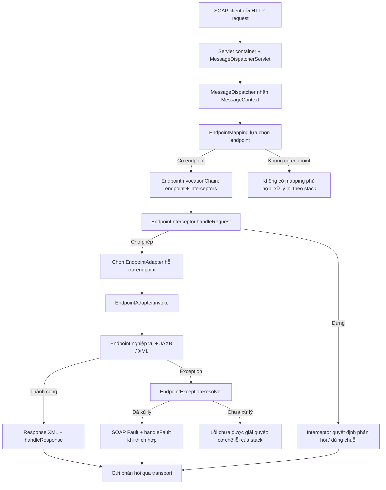

# EndpointMapping, EndpointAdapter và EndpointExceptionResolver

## Mục tiêu học tập

Trong chương **Kiến trúc xử lý** của module **SPRING_WEB_SERVICES**, bài này giải thích ba cơ chế trung tâm giúp một bản tin SOAP được đưa đến đúng logic nghiệp vụ và nhận phản hồi hoặc SOAP Fault phù hợp. Đây là nền tảng của dịch vụ Spring Web Services (Spring-WS) phát triển theo hướng **contract-first**: thiết kế XSD/WSDL, ánh xạ JAXB, viết endpoint, SOAP client, interceptor và cấu hình bảo mật.

Học xong, bạn có thể:

1. Mô tả đường đi của SOAP request qua `MessageDispatcherServlet`, `MessageDispatcher`, `EndpointMapping`, `EndpointAdapter`, interceptor và `EndpointExceptionResolver`.
2. Phân biệt chính xác ba câu hỏi: **gọi endpoint nào**, **gọi endpoint đó như thế nào**, và **xử lý exception ra sao**.
3. Giải thích `EndpointInvocationChain`, `MessageContext` và cách các interceptor được áp dụng.
4. Dùng `@Endpoint` và `@PayloadRoot` để ánh xạ payload QName đến phương thức, đồng thời hiểu vai trò của `@SoapAction` và WS-Addressing `@Action`.
5. Hiểu cách `DefaultMethodEndpointAdapter` phân giải tham số và kết quả qua JAXB hoặc XML payload, cũng như lý do xuất hiện lỗi không có adapter hỗ trợ.
6. Định nghĩa SOAP Fault cho exception nghiệp vụ bằng `@SoapFault` hoặc `SoapFaultMappingExceptionResolver`; phân biệt lỗi hợp đồng, lỗi nghiệp vụ và lỗi bảo mật.
7. Thiết kế interceptor kiểm tra schema, WS-Security và truy vết với trách nhiệm tách bạch.
8. Kiểm thử cả đường dispatch bằng `MockWebServiceClient`, cùng các trường hợp không khớp mapping, lỗi JAXB, Fault và tương thích SOAP client.

## 1. Vì sao Spring-WS cần ba cơ chế riêng?

Xét một dịch vụ SOAP tra cứu đơn hàng. Client gửi phần tử `GetOrderRequest` trong SOAP Body:

```xml
<ord:GetOrderRequest xmlns:ord="urn:example:orders:v1">
    <ord:orderId>42</ord:orderId>
</ord:GetOrderRequest>
```

Server cần trả lời ba câu hỏi khác nhau:

- **Chuyển request đến đâu?** Phần tử `{urn:example:orders:v1}GetOrderRequest` tương ứng phương thức xử lý `getOrder(...)` hay `cancelOrder(...)`? Đây là trách nhiệm của **`EndpointMapping`**.
- **Gọi phương thức đó bằng cách nào?** Làm thế nào lấy XML trong `MessageContext`, unmarshalling thành `GetOrderRequest` và đưa kết quả `GetOrderResponse` về SOAP Body? Đây là trách nhiệm của **`EndpointAdapter`** và các argument/return-value handlers.
- **Nếu xử lý thất bại thì làm gì?** Khi không tìm thấy đơn hàng hoặc có exception, phản hồi phải là SOAP Fault mã gì, có chi tiết lỗi theo XSD/WSDL không? Đây là trách nhiệm của **`EndpointExceptionResolver`** và logic xử lý Fault liên quan.

Ba cơ chế này hỗ trợ cách xây dựng ứng dụng theo nguyên tắc **tách lựa chọn, thực thi và xử lý lỗi**. Endpoint tập trung vào nghiệp vụ; WSDL/XSD là hợp đồng giữa hai phía; dispatcher phối hợp các thành phần xử lý bản tin.

### 1.1. So sánh nhanh

| Thành phần | Đầu vào khái niệm | Kết quả | Câu hỏi chính |
| --- | --- | --- | --- |
| `EndpointMapping` | `MessageContext` chứa request | `EndpointInvocationChain` hoặc không tìm thấy | **Endpoint nào?** |
| `EndpointAdapter` | Endpoint đã chọn cùng `MessageContext` | Thực thi endpoint, ghi response nếu có | **Gọi endpoint thế nào?** |
| `EndpointExceptionResolver` | `MessageContext`, endpoint và `Exception` | Xử lý được/không xử lý được exception; có thể tạo SOAP Fault | **Lỗi được biểu diễn ra sao?** |
| `EndpointInterceptor` | Request/response/fault cùng endpoint trong chain | Tiếp tục, chặn hoặc thay đổi xử lý | **Có bước dùng chung nào trước/sau endpoint?** |
| `MessageDispatcher` | Bản tin được transport chuyển thành `MessageContext` | Phối hợp các thành phần trên | **Điều phối toàn bộ vòng đời bản tin** |

`EndpointInterceptor` là thành phần liên quan mật thiết, nhưng không thay thế ba cơ chế được nêu trong đề bài.

## 2. Kiến trúc tổng thể từ HTTP SOAP request đến response

Với SOAP qua HTTP, luồng xử lý có thể được hình dung như sau:



Sơ đồ nhằm minh họa **trách nhiệm và thứ tự khái niệm**. Cách tạo response, việc gọi interceptor ở nhánh lỗi và hành vi HTTP khi không tìm được endpoint phụ thuộc tình huống và cấu hình thực tế. Đừng mặc định mọi thất bại đều tạo ra một SOAP Fault hoàn chỉnh.

### 2.1. Các đối tượng tham gia

- **`MessageDispatcherServlet`**: cầu nối giữa servlet/HTTP và Spring-WS. Nó nhận yêu cầu đi vào URL servlet mapping và chuyển cho hạ tầng xử lý SOAP. Đây là **servlet phục vụ Web Services**, không phải `DispatcherServlet` dùng cho REST `@RestController`.
- **`MessageDispatcher`**: bộ điều phối trung tâm của Spring-WS, hoạt động trên abstraction `MessageContext` thay vì gắn cứng với HTTP.
- **`MessageContext`**: ngữ cảnh cho bản tin yêu cầu, phản hồi và các thuộc tính liên quan trong một lần xử lý.
- **`EndpointInvocationChain`**: đối tượng gồm endpoint tìm được và tập interceptor liên quan.
- **Endpoint nghiệp vụ**: phương thức hoặc đối tượng nhận payload hợp đồng, ví dụ `OrderEndpoint.getOrder(...)`.

### 2.2. Một request SOAP đầy đủ

Ví dụ SOAP 1.1:

```xml
<?xml version="1.0" encoding="UTF-8"?>
<soapenv:Envelope
    xmlns:soapenv="http://schemas.xmlsoap.org/soap/envelope/"
    xmlns:ord="urn:example:orders:v1">
    <soapenv:Header/>
    <soapenv:Body>
        <ord:GetOrderRequest>
            <ord:orderId>42</ord:orderId>
        </ord:GetOrderRequest>
    </soapenv:Body>
</soapenv:Envelope>
```

Trong trường hợp ánh xạ theo payload root, dispatcher không dựa vào tên Java method mà sử dụng **QName** của phần tử con trực tiếp trong SOAP Body: `{urn:example:orders:v1}GetOrderRequest`.

**QName = namespace URI + local name**. Tiền tố `ord` chỉ là bí danh XML và có thể đổi sang `o` nếu cùng namespace; hai bản tin vẫn biểu diễn cùng QName.

## 3. `EndpointMapping`: tìm endpoint thích hợp

Interface `org.springframework.ws.server.EndpointMapping` có phương thức khái niệm:

```java
EndpointInvocationChain getEndpoint(MessageContext messageContext)
        throws Exception;
```

Một implementation có thể xem **QName payload**, **SOAPAction**, **WS-Addressing Action** hoặc tiêu chí định tuyến khác. Nếu không có match, nó trả `null`, để dispatcher xét các mapping còn lại. Khi có kết quả, `EndpointInvocationChain` chứa endpoint và có thể kèm interceptors.

### 3.1. Ánh xạ bằng `@PayloadRoot`

Đây là phương án tự nhiên với Spring-WS **contract-first**:

```java
package com.example.orders.endpoint;

import org.springframework.ws.server.endpoint.annotation.Endpoint;
import org.springframework.ws.server.endpoint.annotation.PayloadRoot;
import org.springframework.ws.server.endpoint.annotation.RequestPayload;
import org.springframework.ws.server.endpoint.annotation.ResponsePayload;

@Endpoint
public class OrderEndpoint {

    public static final String NS = "urn:example:orders:v1";

    private final OrderService service;

    public OrderEndpoint(OrderService service) {
        this.service = service;
    }

    @PayloadRoot(namespace = NS, localPart = "GetOrderRequest")
    @ResponsePayload
    public GetOrderResponse getOrder(
            @RequestPayload GetOrderRequest request) {

        Order order = service.findById(request.getOrderId());

        GetOrderResponse response = new GetOrderResponse();
        response.setOrderId(order.id());
        response.setStatus(order.status());
        return response;
    }
}
```

Đây là **khung ứng dụng**: giả sử `GetOrderRequest`/`GetOrderResponse` là lớp JAXB đã sinh đúng XSD và `OrderService`/`Order` là các kiểu nghiệp vụ được ứng dụng định nghĩa. Bài này không triển khai toàn bộ project hay chương trình có thể biên dịch độc lập.

Cơ chế `PayloadRootAnnotationMethodEndpointMapping` nhận diện phương thức gắn `@PayloadRoot`. Khi nhận request có QName khớp, nó trả về một endpoint đại diện cho **phương thức cụ thể**, không chỉ chọn tên lớp `OrderEndpoint` chung chung.

Ví dụ mở rộng:

```java
@PayloadRoot(namespace = NS, localPart = "CancelOrderRequest")
@ResponsePayload
public CancelOrderResponse cancelOrder(
        @RequestPayload CancelOrderRequest request) {
    // ...
}
```

Hai phương thức có thể nằm trong cùng một lớp `@Endpoint` nhưng được chọn bởi **hai QName payload khác nhau**.

### 3.2. Mapping bằng SOAPAction

Với SOAP 1.1 qua HTTP, WSDL binding có thể khai báo `soapAction`. Spring-WS hỗ trợ `SoapActionAnnotationMethodEndpointMapping` kết hợp annotation `@SoapAction`:

```java
import org.springframework.ws.soap.server.endpoint.annotation.SoapAction;

@SoapAction("urn:example:orders:v1/GetOrder")
@ResponsePayload
public GetOrderResponse getOrderByAction(
        @RequestPayload GetOrderRequest request) {
    // ...
}
```

SOAP client tương ứng có thể gửi HTTP header:

```http
SOAPAction: "urn:example:orders:v1/GetOrder"
```

**SOAPAction là thông tin binding/HTTP, còn payload QName là thông tin XML/XSD.** Chúng có thể được dùng bởi những mapping khác nhau và không nhất thiết phải giống nhau về chuỗi.

Không đặt đồng thời nhiều phương thức hoặc nhiều mapping có khả năng cạnh tranh trên cùng một request mà không có chủ đích rõ ràng. Nếu cả `@SoapAction` và `@PayloadRoot` được dùng, **thứ tự và độ ưu tiên** của các `EndpointMapping` có thể quyết định phương thức được chọn. Không giả định một phương thức `@SoapAction` luôn được ưu tiên chỉ vì giá trị SOAPAction tồn tại.

### 3.3. WS-Addressing `@Action`

Với dịch vụ dùng **WS-Addressing**, Action được đặt trong SOAP Header và dùng cho định tuyến ở mức thông điệp, khác HTTP `SOAPAction`. Spring-WS cung cấp mapping/annotation `@Action` tương ứng.

Ba dấu hiệu dễ bị nhầm:

| Cơ chế | Dữ liệu được xem | Đặc điểm |
| --- | --- | --- |
| `@PayloadRoot` | QName phần tử payload trong SOAP Body | Phù hợp với hợp đồng XSD và document/literal. |
| `@SoapAction` | SOAPAction theo SOAP binding/transport | Có thể hữu ích khi tích hợp client được sinh từ WSDL hoặc hệ thống legacy. |
| WS-Addressing `@Action` | Action header theo WS-Addressing | Dành cho hệ thống có chính sách WS-Addressing. |

Hãy chọn **một chiến lược định tuyến chính** theo hợp đồng của bạn, kiểm thử cả SOAP Body và header liên quan.

### 3.4. `EndpointInvocationChain` và mức ưu tiên

`EndpointInvocationChain` có thể hiểu như:

```text
EndpointInvocationChain
  endpoint     = MethodEndpoint(OrderEndpoint.getOrder)
  interceptors = [SchemaValidation, Security, CorrelationLogging]
```

Danh sách interceptor là ví dụ; việc gắn interceptor và thứ tự thực tế phụ thuộc cấu hình.

Khi dispatcher có nhiều `EndpointMapping`, chúng có thể sử dụng `Ordered`/`@Order` hoặc thứ tự cấu hình để quyết định mapping nào được thử trước. Nếu mapping đầu tiên đã trả một chain, mapping sau không còn cơ hội chọn endpoint khác trong lần dispatch đó.

**Cẩn thận với `defaultEndpoint`:** một số mapping cho phép endpoint dự phòng khi không có match. Nếu đặt default quá rộng, request có QName sai hoặc operation không được hỗ trợ có thể bị đưa vào endpoint không mong muốn. Với SOAP contract-first nên ưu tiên mapping rõ ràng và phản hồi lỗi phù hợp khi payload không hợp lệ.

### 3.5. Khi nào cần custom `EndpointMapping`?

Thông thường **không cần** vì Spring-WS đã có mapping theo payload, SOAPAction và WS-Addressing. Một mapping tùy biến chỉ có lý do khi định tuyến phụ thuộc quy tắc đặc thù, ví dụ:

- Header hợp đồng quy định phiên bản xử lý cùng namespace.
- Nhiều phiên bản legacy cùng tồn tại, cần ánh xạ dựa trên thông tin đã được xác thực.
- Một gateway SOAP nội bộ chọn handler theo thông tin đã chuẩn hóa.

Nếu routing dựa trên token/tenant trong header, **đừng xem thông tin chưa xác minh là đáng tin**. Việc chọn endpoint không thay thế authentication/authorization. Hãy cân nhắc interceptor bảo mật và ranh giới tin cậy trước khi dùng dữ liệu này để quyết định.

## 4. `EndpointAdapter`: gọi endpoint đã được chọn

Sau khi chọn endpoint, dispatcher cần biết **cách thực thi đối tượng endpoint**. Interface `org.springframework.ws.server.EndpointAdapter` có hai phương thức:

```java
boolean supports(Object endpoint);

void invoke(MessageContext messageContext, Object endpoint)
        throws Exception;
```

- `supports(endpoint)` trả lời “adapter này có xử lý được loại endpoint được mapping trả về không?”.
- `invoke(...)` thực hiện việc gọi endpoint và phối hợp với `MessageContext` để nhận/yêu cầu hoặc tạo phản hồi.

Đây là ranh giới rất quan trọng: **`EndpointMapping` chọn đối tượng đích, còn `EndpointAdapter` là thứ biết cách sử dụng đối tượng đó**.

### 4.1. Adapter thường gặp

| Adapter | Loại endpoint | Khi nào gặp |
| --- | --- | --- |
| `DefaultMethodEndpointAdapter` | Phương thức `@Endpoint` có annotation và kiểu tham số/kết quả được hỗ trợ | Phổ biến trong Spring-WS hiện đại. |
| `MessageEndpointAdapter` | Endpoint triển khai `MessageEndpoint` | Phù hợp các endpoint thao tác trực tiếp với `MessageContext`. |
| `PayloadEndpointAdapter` | Endpoint triển khai `PayloadEndpoint` | Dành cho kiểu endpoint payload mức thấp hơn. |
| Custom adapter | Một loại endpoint đặc thù do dự án tạo | Chỉ cân nhắc khi không thể sử dụng adapter có sẵn hoặc mở rộng argument resolver. |

`DefaultMethodEndpointAdapter` thường được thiết lập khi bật cấu hình Spring-WS qua `@EnableWs` và xử lý các phương thức annotation. Các adapter khác có thể tồn tại tùy bean và cấu hình ứng dụng. Không nên mặc định mọi adapter đều được tự đăng ký trong tất cả trường hợp.

### 4.2. Argument resolvers và return value handlers

Giả sử phương thức:

```java
@PayloadRoot(namespace = NS, localPart = "GetOrderRequest")
@ResponsePayload
public GetOrderResponse getOrder(
        @RequestPayload GetOrderRequest request) {
    // ...
}
```

`DefaultMethodEndpointAdapter` phải:

1. Xem endpoint method có được hỗ trợ không.
2. Chọn **`MethodArgumentResolver`** phù hợp với `@RequestPayload` và kiểu `GetOrderRequest`.
3. Đọc XML từ request payload, chuyển sang đối tượng Java qua cơ chế JAXB/OXM được hỗ trợ và cấu hình.
4. Gọi phương thức endpoint.
5. Chọn **`MethodReturnValueHandler`** phù hợp với `@ResponsePayload` và `GetOrderResponse`.
6. Ghi XML response vào `MessageContext` để SOAP stack tạo thông điệp trả về.

`@RequestPayload` **không phải phép validate XSD đầy đủ**. JAXB unmarshalling thành công không có nghĩa các facet như `xs:pattern`, `maxLength` hoặc `minOccurs` đều được kiểm tra theo hợp đồng. Nếu cần strict validation, hãy cấu hình cơ chế schema validation.

Các dạng tham số/response được Spring-WS hỗ trợ có thể bao gồm XML `Source`, DOM element, JAXB object hoặc một số kiểu SOAP header/context tùy adapter và thư viện có trên classpath. Danh sách chính xác phụ thuộc phiên bản Spring-WS và các resolver được đăng ký.

### 4.3. Vai trò của JAXB trong adapter

JAXB là **cầu nối XML ↔ Java**. Với XSD:

```xml
<xs:element name="GetOrderRequest">
    <xs:complexType>
        <xs:sequence>
            <xs:element name="orderId" type="xs:long"/>
        </xs:sequence>
    </xs:complexType>
</xs:element>
```

XJC có thể sinh lớp Java `GetOrderRequest` có `getOrderId()`. Khi runtime nhận:

```xml
<ord:GetOrderRequest xmlns:ord="urn:example:orders:v1">
    <ord:orderId>42</ord:orderId>
</ord:GetOrderRequest>
```

adapter/resolver sử dụng JAXB mapping tương ứng để biến payload thành Java object. Nhưng cần bảo đảm:

- Generated classes thuộc **Jakarta JAXB** (`jakarta.xml.bind.*`) nếu dùng thế hệ Spring-WS/Jakarta tương ứng.
- Đúng namespace trong `@XmlSchema`, `@XmlRootElement` hoặc `ObjectFactory`.
- Đủ JAXB runtime provider và resolver trong classpath.
- Phương thức có signature mà adapter hỗ trợ; nếu XJC sinh `JAXBElement<T>`, xử lý wrapper đúng cách.
- Output XML vẫn hợp lệ theo XSD, nhất là response.

Không nên thay đổi schema/WSDL để chữa một lỗi do thiếu JAXB runtime hoặc method signature unsupported.

### 4.4. Lỗi “endpoint được mapping nhưng không có adapter hỗ trợ”

Nếu dispatcher chọn được `MethodEndpoint` nhưng không adapter nào `supports(...)` thành công, kết quả sẽ là lỗi cấu hình/chưa hỗ trợ khi thực thi; lỗi này **khác** với không tìm được endpoint.

Các nguyên nhân có thể:

- Chưa bật cấu hình annotation-driven hoặc cấu hình `@EnableWs` tương ứng.
- Dùng kiểu tham số hoặc kiểu return mà `DefaultMethodEndpointAdapter` không hỗ trợ.
- Thiếu JAXB runtime/OXM hoặc generated classes không đúng.
- Custom mapping trả về object chưa có adapter tương ứng.
- Dependency Spring-WS bị trộn phiên bản làm adapter hoặc method resolver không tương thích.

**Quy trình xác minh:** ghi nhận payload QName → kiểm tra mapping chọn method nào → kiểm tra bean `DefaultMethodEndpointAdapter` và `supports` → kiểm tra argument resolvers/return value handlers → mới kiểm tra JAXB/XSD.

### 4.5. Có cần tự viết `EndpointAdapter` không?

Rất hiếm khi cần với SOAP contract-first thông thường. Nếu một tham số đặc thù không được hỗ trợ, ưu tiên xem **`WsConfigurer.addArgumentResolvers(...)`** hoặc `addReturnValueHandlers(...)` có giải quyết được không. Các hook này cho phép mở rộng `DefaultMethodEndpointAdapter` mà không viết lại toàn bộ dispatch.

Custom adapter chỉ phù hợp nếu **loại endpoint hoàn toàn khác**: ví dụ một handler framework nội bộ có giao diện riêng và cần chuẩn hóa cách tạo response. Việc đưa thêm adapter phải có test xác nhận `supports` không tranh giành với adapter có sẵn.

## 5. `EndpointExceptionResolver`: biến exception thành phản hồi được kiểm soát

Khi endpoint (hoặc bước xử lý liên quan) phát sinh exception, dispatcher có thể tham vấn danh sách `EndpointExceptionResolver` đã đăng ký. Interface:

```java
boolean resolveException(
        MessageContext messageContext,
        Object endpoint,
        Exception ex);
```

Ý nghĩa kết quả:

- **`true`:** resolver tuyên bố đã xử lý exception; thường đã tạo SOAP Fault hoặc phản hồi thích hợp.
- **`false`:** resolver không xử lý exception, để resolver khác có thể được thử.

Tham số `endpoint` có thể là `null` nếu exception xảy ra trước khi xác định được endpoint.

Không mặc định mọi lỗi HTTP/TLS/parser đều đi qua `EndpointExceptionResolver`. Một số lỗi có thể xảy ra **trước khi MessageDispatcher có SOAP MessageContext hợp lệ**, hoặc được xử lý tại gateway, message factory, interceptor bảo mật hay transport.

### 5.1. Ba resolver phổ biến

| Resolver | Cách làm việc | Phù hợp |
| --- | --- | --- |
| `SoapFaultAnnotationExceptionResolver` | Đọc annotation `@SoapFault` trên exception. | Lỗi nghiệp vụ có quy tắc Fault đơn giản, cố định. |
| `SoapFaultMappingExceptionResolver` | Ánh xạ loại/tên exception sang cấu hình `SoapFaultDefinition`. | Quản lý tập trung nhiều exception không muốn sửa class exception. |
| `SimpleSoapExceptionResolver` | Tạo Fault mặc định dạng Server/Receiver, thường lấy message từ exception. | Fallback cho exception không có mapping chuyên biệt; cần hạn chế lộ thông tin nội bộ. |

Spring-WS có thể cung cấp các resolver mặc định theo cấu hình annotation-driven. Khi khai báo resolver riêng, hãy xem **thứ tự `Ordered`** để chắc chắn resolver đặc thù được xét trước fallback quá rộng.

### 5.2. Cách 1: annotation `@SoapFault`

Ví dụ một lỗi request có mã đơn hàng không hợp lệ:

```java
package com.example.orders.fault;

import org.springframework.ws.soap.server.endpoint.annotation.FaultCode;
import org.springframework.ws.soap.server.endpoint.annotation.SoapFault;

@SoapFault(
    faultCode = FaultCode.CLIENT,
    faultStringOrReason = "Invalid order ID",
    locale = "en")
public class InvalidOrderIdException extends RuntimeException {

    public InvalidOrderIdException() {
        super("Invalid order ID");
    }
}
```

Trong endpoint/domain:

```java
if (request.getOrderId() == null || request.getOrderId().signum() <= 0) {
    throw new InvalidOrderIdException();
}
```

Khi `SoapFaultAnnotationExceptionResolver` được đăng ký và exception được xử lý qua nó, resolver tạo một SOAP Fault theo annotation.

**Lưu ý về version:** `FaultCode.CLIENT` tương ứng ý nghĩa lỗi phía client đối với SOAP 1.1; trong SOAP 1.2, thuật ngữ chuẩn là **Sender**. Spring-WS có abstraction phù hợp, nhưng luôn kiểm tra Fault trên wire theo SOAP version đã chọn.

**Lưu ý về hợp đồng:** `@SoapFault` mô tả mã/lý do của SOAP Fault. Nó **không tự tạo phần tử `detail` theo XSD** chỉ vì WSDL có khai báo `wsdl:fault`. Nếu hợp đồng yêu cầu `<ord:InvalidOrderFault>...`, phải cấu hình việc tạo fault detail thích hợp.

### 5.3. Cách 2: `SoapFaultMappingExceptionResolver`

Khi muốn cấu hình bên ngoài exception class:

```java
import java.util.Properties;
import org.springframework.context.annotation.Bean;
import org.springframework.context.annotation.Configuration;
import org.springframework.core.Ordered;
import org.springframework.ws.soap.server.endpoint.SoapFaultMappingExceptionResolver;

@Configuration
class SoapFaultConfig {

    @Bean
    SoapFaultMappingExceptionResolver domainFaultResolver() {
        Properties mappings = new Properties();

        mappings.setProperty(
            "com.example.orders.fault.OrderNotFoundException",
            "CLIENT,Order not found,en");

        SoapFaultMappingExceptionResolver resolver =
                new SoapFaultMappingExceptionResolver();

        resolver.setExceptionMappings(mappings);
        resolver.setOrder(Ordered.HIGHEST_PRECEDENCE);
        return resolver;
    }
}
```

Trong ví dụ, `OrderNotFoundException` được giả định là một class exception nghiệp vụ có thật trong dự án. Chuỗi giá trị mapping dùng định dạng **`faultCode,faultString,locale`**. Đối với trường hợp cần SOAP Fault detail, cần thêm logic sinh detail theo contract.

**Hai cách cấu hình `@SoapFault` và mapping bằng class exception là hai phương án minh họa.** Không cần cấu hình cả hai cho cùng loại exception nếu không có chủ ý về precedence.

Không nên đặt `defaultFault` trong một resolver ưu tiên rất cao rồi vô tình bắt mọi exception, khiến `SoapFaultAnnotationExceptionResolver` hoặc resolver chuyên biệt khác không được chạy. Khi cần fallback, để nó ở cuối chuỗi xử lý.

### 5.4. Cách 3: custom Fault detail theo hợp đồng XSD

Với WSDL contract-first, ví dụ `GetOrder` khai báo fault detail `OrderNotFoundFault`:

```xml
<ord:OrderNotFoundFault xmlns:ord="urn:example:orders:v1">
    <ord:code>ORDER_NOT_FOUND</ord:code>
    <ord:message>Order does not exist</ord:message>
</ord:OrderNotFoundFault>
```

Phần tử này cần được mô tả bằng **global element XSD** và tham chiếu từ `wsdl:message/wsdl:fault` theo binding phù hợp.

Cách thực hiện có thể là:

1. Định nghĩa exception nghiệp vụ chứa mã lỗi an toàn và các trường cần thiết.
2. Viết resolver mở rộng `AbstractSoapFaultDefinitionExceptionResolver` hoặc resolver phù hợp, hoặc dùng cơ chế tạo SOAP Fault của ứng dụng.
3. Chọn fault code/reason và thêm **`SoapFaultDetail`** với XML đúng QName, thứ tự và kiểu XSD.
4. Không đưa stack trace, SQL, token, private key hoặc chi tiết server vào fault gửi cho client.
5. Dùng SOAP contract test xác minh cấu trúc `detail` và khả năng giải mã lỗi ở client.

Khả năng tạo Fault **không đồng nghĩa** Fault đó tuân thủ WSDL. Phải kiểm tra phần detail và phiên bản SOAP độc lập.

## 6. SOAP Fault: lỗi nghiệp vụ và lỗi hạ tầng khác nhau

Ví dụ SOAP 1.1 Fault dành cho order ID không hợp lệ:

```xml
<soap:Envelope
    xmlns:soap="http://schemas.xmlsoap.org/soap/envelope/">
    <soap:Body>
        <soap:Fault>
            <faultcode>soap:Client</faultcode>
            <faultstring>Invalid order ID</faultstring>
        </soap:Fault>
    </soap:Body>
</soap:Envelope>
```

Trong SOAP 1.2, cấu trúc Fault là `env:Fault/env:Code/env:Value` và `env:Fault/env:Reason`; các mã tương ứng thường là `Sender` và `Receiver`. Không nên xây client parser chỉ hỗ trợ `<faultcode>` nếu hợp đồng có SOAP 1.2.

### 6.1. Bảng phân loại trách nhiệm lỗi

| Tình huống | Lớp xử lý phù hợp | Ghi chú |
| --- | --- | --- |
| Payload QName không có endpoint | Mapping/dispatcher | Thường là lỗi định tuyến hoặc hợp đồng; phản hồi cụ thể tùy cấu hình. |
| Endpoint có nhưng method signature không được hỗ trợ | Adapter/configuration | Kiểm tra resolver cho tham số và kiểu return, không chỉ `@PayloadRoot`. |
| XML không well-formed | XML parser/message factory | Có thể thất bại trước logic endpoint và resolver nghiệp vụ. |
| XML well-formed nhưng sai XSD | Schema validation interceptor | Có thể tạo Fault Client/Sender theo cấu hình; không nhất thiết vào endpoint. |
| Không tìm thấy đơn hàng | Domain service + EndpointExceptionResolver | Tạo Fault nghiệp vụ đúng WSDL detail nếu hợp đồng yêu cầu. |
| Exception hệ thống bất ngờ | Resolver fallback + logging nội bộ | Giữ fault string an toàn, không lộ stack trace. |
| SOAP Header bắt buộc không được hiểu | SOAP protocol/header processor | Fault `MustUnderstand` theo role/actor; khác lỗi nghiệp vụ. |
| Chữ ký, token hoặc chứng chỉ không hợp lệ | WSS4J/TLS/security layer | Fault hoặc HTTP/TLS failure theo lớp và security policy. |
| Quá kích thước request tại gateway | HTTP gateway/transport | Có thể bị HTTP 413 trước khi tạo SOAP Fault. |

Không có một `EndpointExceptionResolver` chung nào có thể tự khắc phục tất cả trường hợp trong bảng. Bảo mật và XML parsing phải có cấu hình riêng.

## 7. `EndpointInterceptor` phối hợp với ba cơ chế như thế nào?

`EndpointInvocationChain` có thể gắn một hoặc nhiều `EndpointInterceptor`. Interface này hỗ trợ:

```java
boolean handleRequest(MessageContext context, Object endpoint);
boolean handleResponse(MessageContext context, Object endpoint);
boolean handleFault(MessageContext context, Object endpoint);
void afterCompletion(
        MessageContext context, Object endpoint, Exception ex);
```

Các chữ ký trên rút gọn phần `throws Exception` để dễ đọc.

**Vòng đời cơ bản:**

1. **Mapping trước:** cần xác định endpoint/chain trước khi có danh sách interceptor đi kèm chain.
2. **`handleRequest`:** chạy trước khi endpoint được adapter gọi. Nếu trả `true` thì tiếp tục; `false` dừng phần còn lại của chuỗi. Interceptor có thể tự xây phản hồi theo cơ chế của nó.
3. **`handleResponse`:** xử lý response bình thường sau khi adapter hoàn tất, thường theo thứ tự **ngược** so với các interceptor đã chạy `handleRequest` thành công.
4. **`handleFault`:** xử lý SOAP Fault được tạo trong chu trình khi phù hợp, ví dụ bổ sung thông tin tracking an toàn.
5. **`afterCompletion`:** dọn dẹp ngữ cảnh/tài nguyên cho interceptor đã tham gia `handleRequest` thành công; cũng thường chạy theo thứ tự đảo ngược.

Không nên tuyên bố `handleFault` được gọi cho **mọi** lỗi: một exception có thể bị chặn trước khi có SOAP MessageContext hợp lệ, hoặc parser/gateway không đi qua chain bình thường.

### 7.1. Những gì nên đặt trong interceptor

| Nhu cầu | Vị trí đề xuất | Lưu ý |
| --- | --- | --- |
| Xác thực payload theo XSD | `PayloadValidatingInterceptor` | Xác nhận schema, version và chính sách validate request/response. |
| Kiểm tra WS-Security | `Wss4jSecurityInterceptor` hoặc security stack được hỗ trợ | Xác minh token, chữ ký, timestamp, chứng chỉ; không xem header tồn tại là đã an toàn. |
| Gắn correlation ID và metrics | Custom `EndpointInterceptor` | Tránh log toàn bộ XML có dữ liệu nhạy cảm. |
| Phân quyền nghiệp vụ theo order/tenant | Application service hoặc security layer phù hợp | Không dựa vào SOAP Header chưa xác minh. |
| Chuyển exception nghiệp vụ thành SOAP Fault | `EndpointExceptionResolver` | Đây là chức năng chuyên biệt của resolver. |
| Xác định operation từ QName payload | `EndpointMapping` | Không viết lại routing trong mỗi interceptor. |
| Chuyển XML thành JAXB object | `EndpointAdapter`/method argument resolver | Interceptor không cần tự unmarshal mọi request. |

Interceptor phù hợp cho chính sách cắt ngang; không nên biến nó thành endpoint nghiệp vụ thứ hai.

### 7.2. Cấu hình interceptor qua `WsConfigurer`

```java
import java.util.List;

import org.springframework.context.annotation.Configuration;
import org.springframework.core.io.ClassPathResource;
import org.springframework.ws.config.annotation.EnableWs;
import org.springframework.ws.config.annotation.WsConfigurer;
import org.springframework.ws.server.EndpointInterceptor;
import org.springframework.ws.soap.server.endpoint.interceptor.PayloadValidatingInterceptor;

@Configuration
@EnableWs
public class WsConfig implements WsConfigurer {

    @Override
    public void addInterceptors(List<EndpointInterceptor> interceptors) {
        PayloadValidatingInterceptor validator =
                new PayloadValidatingInterceptor();

        validator.setSchema(
                new ClassPathResource("xsd/orders-v1.xsd"));
        validator.setValidateRequest(true);
        validator.setValidateResponse(true);

        interceptors.add(validator);
    }
}
```

Giả sử `xsd/orders-v1.xsd` có sẵn trong classpath và đúng payload dùng cho request/response. Đoạn này minh họa cách đăng ký bằng `@EnableWs`/`WsConfigurer`; cần có phần cấu hình Servlet, endpoint, JAXB và schema của ứng dụng thực tế.

**Không để việc kiểm tra XSD thay thế WS-Security**. XSD kiểm tra hình dạng dữ liệu; WS-Security kiểm tra token/chữ ký/timestamp/chứng chỉ theo policy.

## 8. Ví dụ contract-first từ XSD đến endpoint, response và Fault

Hãy xây hợp đồng `GetOrder` để gắn ba abstraction lại với nhau.

### 8.1. XSD rút gọn

```xml
<?xml version="1.0" encoding="UTF-8"?>
<xs:schema
    xmlns:xs="http://www.w3.org/2001/XMLSchema"
    xmlns:tns="urn:example:orders:v1"
    targetNamespace="urn:example:orders:v1"
    elementFormDefault="qualified">

    <xs:element name="GetOrderRequest">
        <xs:complexType>
            <xs:sequence>
                <xs:element name="orderId" type="xs:positiveInteger"/>
            </xs:sequence>
        </xs:complexType>
    </xs:element>

    <xs:element name="GetOrderResponse">
        <xs:complexType>
            <xs:sequence>
                <xs:element name="orderId" type="xs:positiveInteger"/>
                <xs:element name="status" type="xs:string"/>
            </xs:sequence>
        </xs:complexType>
    </xs:element>

    <xs:element name="OrderNotFoundFault">
        <xs:complexType>
            <xs:sequence>
                <xs:element name="code" type="xs:string"/>
                <xs:element name="message" type="xs:string"/>
            </xs:sequence>
        </xs:complexType>
    </xs:element>
</xs:schema>
```

`GetOrderRequest` và `GetOrderResponse` có global QName được mapping/JAXB sử dụng. `OrderNotFoundFault` là payload detail có thể khai báo thêm ở WSDL; việc sinh Fault detail cần resolver phù hợp.

### 8.2. Bản tin vào

```xml
<soapenv:Envelope
    xmlns:soapenv="http://schemas.xmlsoap.org/soap/envelope/"
    xmlns:ord="urn:example:orders:v1">
    <soapenv:Body>
        <ord:GetOrderRequest>
            <ord:orderId>42</ord:orderId>
        </ord:GetOrderRequest>
    </soapenv:Body>
</soapenv:Envelope>
```

### 8.3. Điểm đi qua của từng abstraction

```text
1. MessageDispatcherServlet nhận HTTP SOAP.
2. MessageDispatcher bắt đầu xử lý MessageContext.
3. PayloadRootAnnotationMethodEndpointMapping phát hiện:
      {urn:example:orders:v1}GetOrderRequest.
4. Mapping trả EndpointInvocationChain cho OrderEndpoint.getOrder(...).
5. EndpointInterceptor.handleRequest kiểm tra request/safety policy.
6. DefaultMethodEndpointAdapter kiểm tra supports(MethodEndpoint).
7. Adapter đọc JAXB request, gọi OrderEndpoint.getOrder(...).
8a. Thành công: JAXB response → handleResponse → SOAP Body response.
8b. OrderNotFoundException:
      EndpointExceptionResolver → SOAP Fault → handleFault khi phù hợp.
9. Transport trả SOAP response hoặc thông tin lỗi.
```

### 8.4. Response thành công

```xml
<soapenv:Envelope
    xmlns:soapenv="http://schemas.xmlsoap.org/soap/envelope/"
    xmlns:ord="urn:example:orders:v1">
    <soapenv:Body>
        <ord:GetOrderResponse>
            <ord:orderId>42</ord:orderId>
            <ord:status>CONFIRMED</ord:status>
        </ord:GetOrderResponse>
    </soapenv:Body>
</soapenv:Envelope>
```

### 8.5. Request thất bại do không tìm thấy đơn hàng

Giả sử domain ném `OrderNotFoundException` và resolver nghiệp vụ đã được cấu hình. SOAP 1.1 Fault có thể có dạng:

```xml
<soapenv:Envelope
    xmlns:soapenv="http://schemas.xmlsoap.org/soap/envelope/">
    <soapenv:Body>
        <soapenv:Fault>
            <faultcode>soapenv:Client</faultcode>
            <faultstring>Order not found</faultstring>
        </soapenv:Fault>
    </soapenv:Body>
</soapenv:Envelope>
```

Nếu WSDL yêu cầu fault detail `OrderNotFoundFault`, resolver hoặc thành phần tạo lỗi phải bổ sung một `detail` tương ứng. Trả `faultcode` và `faultstring` đúng chưa đủ để client giải mã typed fault theo WSDL.

### 8.6. WSDL đóng vai trò gì?

Trong WSDL 1.1, `types` mô tả XSD, `message` tham chiếu element, `portType` định nghĩa operation, `binding` định nghĩa SOAP action/serialization, còn `service` công bố endpoint URL.

**MessageDispatcher không chọn Java endpoint dựa trên toàn bộ cây WSDL mỗi khi có request.** Routing runtime phụ thuộc các `EndpointMapping` đã cấu hình, thường dựa trên payload QName hoặc SOAPAction. Vì vậy có thể xảy ra lỗi **WSDL công bố một operation nhưng endpoint runtime không có mapping tương ứng**. Phải có conformance test để phát hiện.

## 9. Thứ tự lựa chọn và cơ chế mặc định

Khi dùng `@Configuration @EnableWs`, Spring-WS cung cấp một cấu hình mặc định hữu ích:

- Các mapping cho `@PayloadRoot`, `@SoapAction` và WS-Addressing `@Action`.
- `DefaultMethodEndpointAdapter` dành cho annotated endpoint methods.
- Các resolver như `SoapFaultAnnotationExceptionResolver` và `SimpleSoapExceptionResolver`.

Danh sách chính xác, thứ tự và khả năng mở rộng phụ thuộc phiên bản Spring-WS và cách Boot/application context tổ chức bean. Nên **kiểm tra các bean thực tế** trong ứng dụng khi thay đổi major Spring.

### 9.1. Nếu có nhiều mapping cùng khớp

Giả sử phương thức A gắn `@PayloadRoot`, phương thức B gắn `@SoapAction`, và một SOAP request có cả QName và SOAPAction trùng điều kiện. Dispatcher sẽ chọn mapping dựa trên **order** của các mapping được đăng ký. Hành vi có thể gây bất ngờ nếu nhóm chỉ nhìn annotation mà không quan sát cấu hình.

Cách tránh:

1. Dùng một quy ước routing được WSDL và tài liệu phát triển thể hiện rõ.
2. Tránh đăng ký trùng QName, SOAPAction hay custom default không có mục đích.
3. Khi cần nhiều mapping, đặt và kiểm thử thứ tự cụ thể.
4. Viết integration test với trường hợp SOAPAction mâu thuẫn payload QName để xác định rõ phản hồi.

Không phụ thuộc vào thứ tự ngẫu nhiên của classpath hoặc bean scanning.

### 9.2. Nếu có nhiều resolver cùng xử lý một exception

Nếu một resolver đặc thù tạo Fault trước, fallback không cần chạy. Nếu fallback ưu tiên quá cao và nhận mọi exception, resolver nghiệp vụ có thể bị bỏ qua.

Hãy đặt **resolver chuyên biệt trước**, fallback sau; khi triển khai custom resolver trả `false` đối với những exception không thuộc phạm vi của nó. Không nên dùng một resolver tự tạo SOAP Fault cho mọi lỗi, làm mờ khác biệt giữa lỗi contract và lỗi infrastructure/security.

## 10. Khi nào mở rộng từng thành phần?

| Tình huống | Điểm mở rộng đầu tiên nên xem |
| --- | --- |
| Một SOAP operation mới theo namespace hiện hành | Thêm global XSD element, WSDL operation nếu cần, và `@PayloadRoot` method. |
| Cần định tuyến theo SOAPAction của đối tác | `@SoapAction` và mapping tương ứng. |
| Cần giải quyết tham số Java đặc thù | `MethodArgumentResolver` qua `WsConfigurer`. |
| Cần ghi response dưới dạng XML đặc biệt | `MethodReturnValueHandler` hoặc dạng return mà adapter hỗ trợ. |
| Dùng legacy endpoint API hoàn toàn khác | Xem `MessageEndpoint`/`PayloadEndpoint` rồi mới cân nhắc custom `EndpointAdapter`. |
| Muốn gắn correlation ID hoặc metrics | `EndpointInterceptor`; không log thông tin nhạy cảm. |
| Muốn kiểm tra schema XSD | `PayloadValidatingInterceptor`. |
| Muốn xác thực chữ ký WS-Security | WSS4J security interceptor và chính sách phù hợp. |
| Muốn ánh xạ domain exception ra SOAP Fault | `@SoapFault` hoặc `SoapFaultMappingExceptionResolver`. |
| Muốn thêm typed fault detail theo WSDL | Custom SOAP fault resolver hoặc thành phần tạo detail phù hợp. |
| SOAP request không có mapping nào | Kiểm tra QName, SOAPAction, cấu hình mapping và WSDL trước tiên. |

Điểm mở rộng phù hợp giúp giảm mức độ phụ thuộc vào nội bộ của dispatcher và thuận lợi khi nâng cấp Spring-WS.

## 11. Đặc điểm của SOAP Header và xử lý bảo mật trong kiến trúc này

Một SOAP Header có thể mang correlation ID, WS-Addressing, WS-Security hoặc quy tắc gateway. Các header này **không thuộc XSD payload một cách mặc định**.

### 11.1. mustUnderstand, actor và role

- SOAP 1.1 dùng `soap:actor`; SOAP 1.2 dùng `env:role` để chỉ ra node được nhắm tới.
- `mustUnderstand` yêu cầu node được nhắm tới phải hiểu/xử lý header bắt buộc, hoặc sinh SOAP Fault `MustUnderstand`.
- Quy tắc này áp dụng ở cấp **SOAP node/header processing**; không suy ra endpoint nghiệp vụ đã xử lý an toàn chỉ vì `DefaultMethodEndpointAdapter` nhận được payload JAXB.

Nếu một gateway xử lý header bảo mật, cần xác định rõ **nút nào chịu trách nhiệm** và cách header được chuyển tiếp. Endpoint runtime không thể tự xem việc nhận `GetOrderRequest` là bằng chứng rằng chữ ký đã hợp lệ.

### 11.2. WS-Security và lỗi xác minh

Một Spring-WS application có thể dùng `Wss4jSecurityInterceptor` để xác minh header WS-Security theo policy: token, chữ ký, timestamp, encryption và chứng chỉ. Nếu xác minh không thành công, thành phần security có thể dừng chuỗi hoặc tạo SOAP Fault phù hợp.

Đừng gộp tất cả security failure vào `OrderNotFoundException` hay Fault nghiệp vụ. Phải phân biệt:

- **Không hiểu header bắt buộc** → quy tắc `MustUnderstand`.
- **Hiểu header nhưng chữ ký/timestamp sai** → lỗi xác minh bảo mật.
- **Chữ ký hợp lệ nhưng caller không có quyền với order** → authorization failure.
- **Payload sai XSD** → schema validation failure.
- **Order không tồn tại** → domain error.

Từng loại có chính sách phản hồi và logging khác nhau. Cũng cần cấu hình parser an toàn chống **XXE**, external entities, entity expansion, XML Signature Wrapping và giới hạn kích thước tài nguyên trước khi dữ liệu được xử lý đầy đủ.

## 12. Kiểm thử MessageDispatcher bằng `MockWebServiceClient`

Spring-WS Test có `MockWebServiceClient` để gửi request qua `MessageDispatcher` trong ApplicationContext, cùng mapping/adapter/interceptor/resolver được đăng ký. Kiểm thử loại này có giá trị hơn việc gọi trực tiếp `endpoint.getOrder(...)` khi mục tiêu là xác nhận đường dispatch.

### 12.1. Kiểm thử thành công

Giả sử ứng dụng đã cấu hình:

- Bean `OrderEndpoint` và `OrderService`.
- `@EnableWs` hoặc auto-configuration tạo mapping/adapter/resolver.
- JAXB classes cho request/response và XML schema đúng.
- Test configuration sử dụng `MessageDispatcher` phù hợp.

Ví dụ dùng JUnit 5 và Spring-WS Test:

```java
import static org.springframework.ws.test.server.RequestCreators.withPayload;
import static org.springframework.ws.test.server.ResponseMatchers.noFault;
import static org.springframework.ws.test.server.ResponseMatchers.payload;

import org.junit.jupiter.api.Test;
import org.springframework.beans.factory.annotation.Autowired;
import org.springframework.context.ApplicationContext;
import org.springframework.xml.transform.StringSource;
import org.springframework.ws.test.server.MockWebServiceClient;

class OrderSoapDispatchTest {

    @Autowired
    ApplicationContext applicationContext;

    @Test
    void routesGetOrderToEndpoint() {
        MockWebServiceClient client =
                MockWebServiceClient.createClient(applicationContext);

        String request = """
            <ord:GetOrderRequest xmlns:ord="urn:example:orders:v1">
                <ord:orderId>42</ord:orderId>
            </ord:GetOrderRequest>
            """;

        String response = """
            <ord:GetOrderResponse xmlns:ord="urn:example:orders:v1">
                <ord:orderId>42</ord:orderId>
                <ord:status>CONFIRMED</ord:status>
            </ord:GetOrderResponse>
            """;

        client.sendRequest(withPayload(new StringSource(request)))
                .andExpect(noFault())
                .andExpect(payload(new StringSource(response)));
    }
}
```

Đoạn này **giả định test đã nạp Spring ApplicationContext** và service có dữ liệu test nhất quán. Trong project thật, phải bổ sung annotation test context phù hợp, mock/stub repository hoặc chuẩn bị dữ liệu cho order 42.

`MockWebServiceClient` không tạo HTTP socket thật; nó tập trung vào pipeline Spring-WS **sau transport**. Để kiểm thử TLS, reverse proxy, Content-Type, kích thước HTTP và client bên ngoài, cần bài kiểm thử tích hợp qua network thật.

### 12.2. Kiểm thử Fault

Với `InvalidOrderIdException` được gắn `@SoapFault` và thực sự ném ra ở endpoint:

```java
import static org.springframework.ws.test.server.RequestCreators.withPayload;
import static org.springframework.ws.test.server.ResponseMatchers.clientOrSenderFault;

// ... bên trong test:
String invalid = """
    <ord:GetOrderRequest xmlns:ord="urn:example:orders:v1">
        <ord:orderId>0</ord:orderId>
    </ord:GetOrderRequest>
    """;

client.sendRequest(withPayload(new StringSource(invalid)))
        .andExpect(clientOrSenderFault("Invalid order ID"));
```

**Chú ý thiết kế case:** XSD ví dụ định nghĩa `orderId` là `xs:positiveInteger`. Nếu `PayloadValidatingInterceptor` đã bật `validateRequest=true`, request có giá trị `0` **bị XSD validation chặn trước endpoint**, nên test sẽ kiểm tra Fault validation thay vì `InvalidOrderIdException`. Để kiểm thử resolver nghiệp vụ, dùng **request hợp lệ theo XSD nhưng vi phạm điều kiện domain**, ví dụ order 42 không tồn tại. Hoặc tách một test cấu hình resolver độc lập, nhưng phải ghi rõ đang kiểm tra tầng nào.

Kiểm thử đúng tầng giúp phân biệt lỗi schema, lỗi domain và lỗi adapter.

### 12.3. Bộ case tối thiểu

| Case | Dữ liệu/kích hoạt | Điều cần khẳng định |
| --- | --- | --- |
| Payload QName đúng | `{urn:example:orders:v1}GetOrderRequest` | Mapping chọn endpoint đúng; adapter xử lý request. |
| Sai namespace | `{urn:example:wrong}GetOrderRequest` | Không map nhầm; hành vi lỗi được cấu hình rõ. |
| Sai local name | `GetOrdersRequest` | Không âm thầm rơi vào endpoint khác/default sai. |
| SOAPAction sai | Header action mâu thuẫn WSDL | Mapping/transport xử lý theo chiến lược đã chọn; không bất ngờ gọi sai operation. |
| Signature JAXB không hỗ trợ | Đổi method argument type không được resolver xử lý | Lỗi adapter/configuration được phát hiện. |
| XSD invalid | Thiếu element bắt buộc, sai thứ tự, kiểu sai | Validation chặn request nếu đã bật. |
| Domain exception | Request hợp lệ nhưng order không tồn tại | Resolver tạo SOAP Fault nghiệp vụ đúng code/reason/detail. |
| Lỗi hệ thống | Repository ném exception không mong muốn | Fault fallback an toàn, có log nội bộ. |
| Security invalid | Thiếu/sai chữ ký, timestamp, token | Security layer từ chối trước hiệu ứng nghiệp vụ. |
| Response invalid | Endpoint trả XML không khớp XSD | Response validation phát hiện nếu bật. |
| Header `mustUnderstand` | Header bắt buộc nhắm tới node nhưng không được hỗ trợ | SOAP Fault `MustUnderstand` khi giao thức yêu cầu. |
| SOAP 1.2 | Đổi Envelope, binding và client tương thích | Fault code/reason và dispatch phù hợp với SOAP 1.2. |

## 13. Chẩn đoán lỗi theo vị trí trong pipeline

### 13.1. “No endpoint mapping found” hoặc request không được xử lý

Kiểm tra theo thứ tự:

1. SOAP Envelope có đúng phiên bản và XML well-formed không?
2. Phần tử đầu tiên trong Body mang **QName** nào? Đọc URI namespace, không chỉ tiền tố.
3. `@PayloadRoot` của endpoint dùng đúng `namespace` và `localPart` không?
4. Class có `@Endpoint`, được Spring component scanning tạo bean không?
5. Có mapping `PayloadRootAnnotationMethodEndpointMapping` trong ApplicationContext không?
6. Có custom default/mapping khác ưu tiên trước không?
7. Nếu WSDL khai báo operation, phần tử request trong `wsdl:message` có trùng payload QName runtime không?

### 13.2. “No adapter for endpoint” hoặc lỗi khi gọi phương thức

Sau khi xác nhận endpoint đã được mapping:

1. `DefaultMethodEndpointAdapter` có trong context không?
2. Method có signature/annotation đúng hỗ trợ không?
3. `@RequestPayload` đang dùng JAXB root class, `JAXBElement<T>`, `Source` hay DOM? Có resolver tương ứng không?
4. Mã JAXB đã sinh theo đúng thế hệ `jakarta.xml.bind`/`javax.xml.bind` chưa?
5. JAXB runtime/provider có được resolve trong dependency tree không?
6. Type trả về và `@ResponsePayload` có handler phù hợp không?
7. Có library Spring-WS bị override lệch BOM không?

### 13.3. Trả Fault sai hoặc lỗi nội bộ bị lộ

Xác minh:

- Exception thực sự phát sinh ở **đâu**: parser, interceptor, adapter, endpoint hay domain service?
- Resolver nào được đăng ký và có **order** thế nào?
- Exception đã được xử lý bởi resolver cụ thể hay fallback?
- SOAP version là 1.1 hay 1.2; fault code/reason và detail đúng contract?
- Fault có vô tình chứa exception message nội bộ, stack trace, SQL, token hoặc chứng chỉ không?
- Test Fault qua `MockWebServiceClient` và qua client tích hợp thực có khớp không?

### 13.4. “WSDL tồn tại nhưng endpoint không chạy”

WSDL mô tả **hợp đồng**; không phải bằng chứng method runtime đã được đăng ký. Khi gặp tình huống này, lần theo:

```text
WSDL service/port
   → WSDL binding
      → WSDL portType operation
         → WSDL message/part
            → XSD global element QName
               → Spring-WS @PayloadRoot
                  → EndpointMapping
                     → EndpointAdapter
                        → Endpoint method
```

Tìm điểm đầu tiên bị lệch. Ví dụ WSDL dùng `{urn:example:orders:v2}GetOrderRequest` nhưng endpoint vẫn gắn namespace `v1` thì request đúng WSDL v2 sẽ không map tới method v1.

## 14. Phân biệt Spring-WS MessageDispatcher với Spring MVC DispatcherServlet

Hai stack có ý tưởng điều phối tương tự nhưng **abstraction và tiêu chí định tuyến khác**:

| Spring Web Services | Spring MVC/REST |
| --- | --- |
| `MessageDispatcherServlet` + `MessageDispatcher` xử lý thông điệp Web Services. | `DispatcherServlet` xử lý các yêu cầu web/MVC. |
| `EndpointMapping` chọn endpoint theo QName, SOAPAction hoặc WS-Addressing. | `HandlerMapping` thường chọn handler theo URL/HTTP method, header, content negotiation. |
| `EndpointAdapter` gọi kiểu endpoint SOAP. | `HandlerAdapter` gọi controller/handler MVC. |
| `EndpointExceptionResolver` xử lý exception trong SOAP pipeline. | `HandlerExceptionResolver` xử lý exception ở MVC. |
| `@Endpoint`, `@PayloadRoot`, `@RequestPayload`, `@ResponsePayload`. | `@RestController`, `@RequestMapping`, `@GetMapping`, `@PostMapping`. |
| SOAP Fault theo SOAP version/binding. | HTTP status và response body theo thiết kế REST. |

**Không** sửa lỗi routing SOAP bằng cách thêm `@PostMapping("/ws")` vào một `@Endpoint` rồi giả định Spring-WS sẽ gọi đúng method. URL servlet thường chỉ đưa request tới dispatcher; **payload QName** hoặc action mới xác định endpoint nghiệp vụ theo mapping của SOAP.

## 15. Thiết kế production: bảo mật, logging và độ ổn định

Khi triển khai trong môi trường doanh nghiệp, cần kết hợp ba cơ chế dispatch với giới hạn runtime:

### 15.1. Quan sát đủ nhưng không lộ dữ liệu

Có thể ghi log/metrics:

- SOAP version, payload QName và action được nhận diện.
- Endpoint mapping/adapter được lựa chọn ở mức không tiết lộ bí mật.
- Correlation ID được xác thực/chuẩn hóa.
- Thời gian xử lý, số request thành công, SOAP Fault theo loại.
- Mức tải XML, validation failure, WS-Security failure và thời gian timeout.

Tránh log nguyên SOAP Header khi có password token, security token, chữ ký, thông tin riêng tư hoặc dữ liệu nhạy cảm. `PayloadLoggingInterceptor` và `SoapEnvelopeLoggingInterceptor` có thể hữu ích trong phát triển, nhưng cần kiểm soát log level, masking và chính sách lưu trữ.

### 15.2. Bảo vệ parser và tài nguyên

Dịch vụ có mapping và adapter đúng vẫn có thể bị cạn bộ nhớ nếu XML quá lớn hoặc có entity expansion. Cần:

- Giới hạn kích thước HTTP body tại gateway/transport.
- Giới hạn số lượng phần tử, độ sâu, thời gian parse và kích thước sau giải nén khi nền tảng hỗ trợ.
- Tắt DTD/external entities nếu không cần; dùng XML parser an toàn.
- Cấu hình XSD validation phù hợp, kiểm tra chữ ký/timestamp trước hiệu ứng nghiệp vụ.
- Giới hạn connection/concurrency, timeout và quota theo client.
- Không dùng Fault reason để tiết lộ thông tin cài đặt hoặc cấu hình bảo mật.

### 15.3. Quản lý phiên bản contract

Khi tăng phiên bản XSD/WSDL hoặc thay đổi Spring-WS:

1. Giữ bản golden request/response/Fault cũ và mới.
2. Kiểm tra QName dùng bởi `@PayloadRoot` có đúng với schema công bố.
3. Kiểm tra adapter/JAXB serialization không đổi ngoài dự kiến.
4. Kiểm tra custom `EndpointExceptionResolver` vẫn tạo Fault detail đúng version.
5. Kiểm tra WS-Security header, chứng chỉ và policy tương thích.
6. Nếu chạy song song v1/v2, không cho custom mapping/default route nhầm dữ liệu của phiên bản này sang endpoint phiên bản kia.
7. Kiểm thử qua client/gateway thực tế bên cạnh `MockWebServiceClient`.

## 16. Bài tập thực hành có đáp án

### Bài 1. Phân biệt trách nhiệm

Request có payload `{urn:example:orders:v1}GetOrderRequest`. Hỏi thành phần nào chọn method; thành phần nào chuyển XML thành object; thành phần nào tạo SOAP Fault khi method ném exception nghiệp vụ?

**Đáp án:** `EndpointMapping` chọn method; `EndpointAdapter` cùng method argument/return handlers thực thi và xử lý JAXB; `EndpointExceptionResolver` ánh xạ exception thành Fault khi đã cấu hình.

### Bài 2. Đổi tiền tố XML

Client đổi `<ord:GetOrderRequest>` thành `<o:GetOrderRequest>` nhưng cả `ord` và `o` đều trỏ `urn:example:orders:v1`. Endpoint `@PayloadRoot` có bị đổi match không?

**Đáp án:** Không. Mapping theo QName gồm **namespace URI và local name**, không theo tiền tố XML.

### Bài 3. Sai namespace

WSDL v2 công bố `urn:example:orders:v2` nhưng `@PayloadRoot` ở server dùng `urn:example:orders:v1`. Việc đổi `@SoapAction` sang một chuỗi mới có bảo đảm endpoint sẽ hoạt động không?

**Đáp án:** Không. Nếu định tuyến chính theo `@PayloadRoot` thì QName vẫn sai. Cần thống nhất WSDL/XSD/endpoint mapping, và kiểm tra thứ tự nếu dùng nhiều cơ chế mapping.

### Bài 4. Lỗi adapter

Mapping đã chọn đúng `OrderEndpoint.getOrder(...)` nhưng tham số của method là một class tùy biến không có argument resolver. Nên sửa gì?

**Đáp án:** Xem liệu có thể dùng kiểu JAXB/`Source` hỗ trợ sẵn không. Nếu thật sự cần kiểu tùy biến, thêm `MethodArgumentResolver` phù hợp qua `WsConfigurer` và kiểm thử. Không viết custom `EndpointMapping` để giải quyết lỗi adapter.

### Bài 5. Hai resolver cạnh tranh

Một custom resolver có `setOrder(HIGHEST_PRECEDENCE)` và đặt default fault cho mọi exception. `@SoapFault` trên `InvalidOrderIdException` không tạo đúng kết quả. Vì sao?

**Đáp án:** Resolver đứng trước có thể giải quyết exception trước khi `SoapFaultAnnotationExceptionResolver` được chạy. Cần điều chỉnh order/scope; resolver chuyên biệt chỉ xử lý loại exception nó chịu trách nhiệm, fallback đặt sau.

### Bài 6. Validation và domain exception

XSD yêu cầu `orderId` là số dương, request gửi `0` và validation interceptor bật. Test kỳ vọng `InvalidOrderIdException` từ endpoint có đúng không?

**Đáp án:** Thường không. Validation có thể chặn request trước khi adapter gọi endpoint. Muốn test domain resolver, dùng một request **hợp lệ theo XSD** nhưng vi phạm nghiệp vụ, ví dụ một ID dương không tồn tại.

### Bài 7. Fault detail theo WSDL

Một service khai báo `OrderNotFoundFault` trong WSDL. Code chỉ ném exception có `@SoapFault(faultCode=CLIENT)`. Client có chắc nhận được `OrderNotFoundFault` detail không?

**Đáp án:** Không. Annotation có thể tạo Fault code/reason nhưng không tự bảo đảm typed detail theo XSD. Cần implement detail mapping và kiểm thử XML thực.

### Bài 8. Bảo mật

Client gửi SOAP Header `wsse:Security` bắt buộc, nhưng ứng dụng chỉ có `@PayloadRoot` và JAXB adapter. Điều đó có chứng minh chữ ký đã được xác minh không?

**Đáp án:** Không. Mapping/adapter xử lý payload; cần cấu hình và chạy WS-Security stack/interceptor phù hợp, kiểm tra chữ ký, token, timestamp, chứng chỉ và chính sách phân quyền.

### Bài 9. Chọn công cụ kiểm thử

Nếu chỉ có unit test gọi `new OrderEndpoint(...).getOrder(...)` thì đã kiểm tra `EndpointMapping`, `EndpointAdapter` và `EndpointExceptionResolver` chưa?

**Đáp án:** Chưa. Unit test đó chỉ xác minh logic Java của method. Hãy dùng `MockWebServiceClient` để đi qua `MessageDispatcher`, sau đó kiểm thử qua transport thật cho TLS, SOAPAction/Content-Type, reverse proxy và tương thích đối tác.

## 17. Checklist kiến trúc trước khi công bố SOAP endpoint

- [ ] XSD/WSDL có QName và operation/binding rõ ràng; endpoint runtime thống nhất.
- [ ] `@Endpoint` được tạo bean và `@PayloadRoot` ánh xạ chính xác payload root QName.
- [ ] Nếu dùng `@SoapAction` hoặc WS-Addressing, có quy tắc và test thứ tự mapping.
- [ ] Không có `defaultEndpoint` hoặc mapping trùng khiến request lạ được route nhầm.
- [ ] `DefaultMethodEndpointAdapter` hỗ trợ mọi method signature đã công bố.
- [ ] JAXB generated classes và runtime đúng thế hệ; không trộn `javax`/`jakarta` ngoài chủ ý.
- [ ] Schema validation cho request/response được bật theo chính sách hợp đồng.
- [ ] Domain exceptions có resolver riêng; fallback fault không lộ dữ liệu nhạy cảm.
- [ ] Fault code/reason/detail đúng WSDL và SOAP version khi áp dụng.
- [ ] Interceptors được đăng ký đúng thứ tự; hành vi `handleRequest`/`handleResponse`/`handleFault` đã được kiểm thử.
- [ ] WS-Security, TLS/mTLS, XML parser safety và authorization không bị bỏ qua.
- [ ] Các trường hợp no mapping, no adapter, XML invalid, business exception và security exception được kiểm thử riêng.
- [ ] `MockWebServiceClient` kiểm tra pipeline server, test HTTP/gateway thực kiểm tra transport và bảo mật tích hợp.
- [ ] Có metrics/logging và kế hoạch versioning khi thay đổi XSD/WSDL.

## 18. Tài liệu tham khảo chính thức

Những nguồn giúp đối chiếu API theo đúng phiên bản Spring-WS đang dùng:

1. [Spring Web Services Reference — Endpoints, Mapping và Exception Handling](https://docs.spring.io/spring-ws/docs/4.1.4/reference/html/) — quá trình dispatch, `@PayloadRoot`, `@SoapAction`, interceptor và Fault resolver.
2. [EndpointMapping API](https://docs.spring.io/spring-ws/docs/4.1.4/api/org/springframework/ws/server/EndpointMapping.html) — `getEndpoint(MessageContext)` và `EndpointInvocationChain`.
3. [EndpointInvocationChain API](https://docs.spring.io/spring-ws/docs/4.1.4/api/org/springframework/ws/server/EndpointInvocationChain.html) — endpoint và interceptors trong chain.
4. [DefaultMethodEndpointAdapter API](https://docs.spring.io/spring-ws/docs/4.1.4/api/org/springframework/ws/server/endpoint/adapter/DefaultMethodEndpointAdapter.html) — argument resolvers và return value handlers.
5. [EndpointExceptionResolver API](https://docs.spring.io/spring-ws/docs/4.1.4/api/org/springframework/ws/server/EndpointExceptionResolver.html) — xử lý exception bằng `resolveException`.
6. [SoapFaultMappingExceptionResolver API](https://docs.spring.io/spring-ws/docs/4.1.4/api/org/springframework/ws/soap/server/endpoint/SoapFaultMappingExceptionResolver.html) — ánh xạ class exception.
7. [WsConfigurer API](https://docs.spring.io/spring-ws/docs/4.1.4/api/org/springframework/ws/config/annotation/WsConfigurer.html) — đăng ký interceptor và tùy biến adapter.
8. [EndpointInterceptor API](https://docs.spring.io/spring-ws/docs/4.1.4/api/org/springframework/ws/server/EndpointInterceptor.html) — request, response, Fault và callback hoàn tất.
9. [MockWebServiceClient API](https://docs.spring.io/spring-ws/docs/4.1.4/api/org/springframework/ws/test/server/MockWebServiceClient.html) — kiểm thử MessageDispatcher mà không cần HTTP socket.
10. [ResponseMatchers API](https://docs.spring.io/spring-ws/docs/4.1.4/api/org/springframework/ws/test/server/ResponseMatchers.html) — so sánh payload và SOAP Fault.

Các tên API trong bài được đối chiếu theo **Spring-WS 4.1.4**. Dự án dùng Spring-WS 5.x hoặc một bản phát hành khác cần kiểm tra migration notes, Java/Jakarta baseline và khả năng tương thích của cấu hình thực tế trước khi áp dụng nguyên vẹn ví dụ.

## Ghi nhớ

**`EndpointMapping` quyết định endpoint nào sẽ được gọi; `EndpointAdapter` quyết định cách gọi endpoint đó; `EndpointExceptionResolver` quyết định cách xử lý exception khi request thất bại.** `MessageDispatcher` phối hợp các thành phần này, còn `EndpointInterceptor` thực hiện chính sách trước/sau xử lý.

Đối với Spring Web Services theo hướng **contract-first**, một đường dispatch ổn định chỉ đạt được khi **QName từ XSD/WSDL**, **JAXB mapping**, **SOAP binding**, **Fault detail**, **interceptor**, **XML security** và **WS-Security** được cấu hình nhất quán và kiểm thử bằng thông điệp SOAP thực tế.

