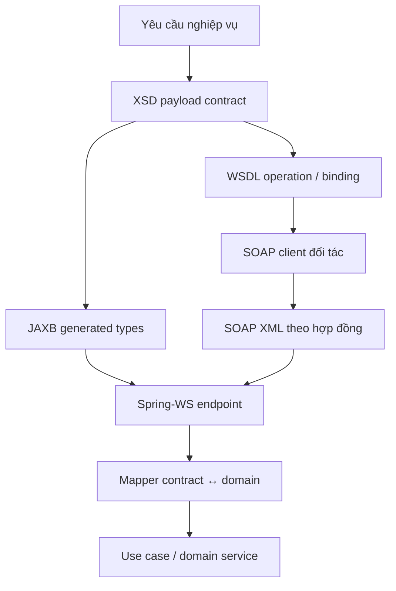
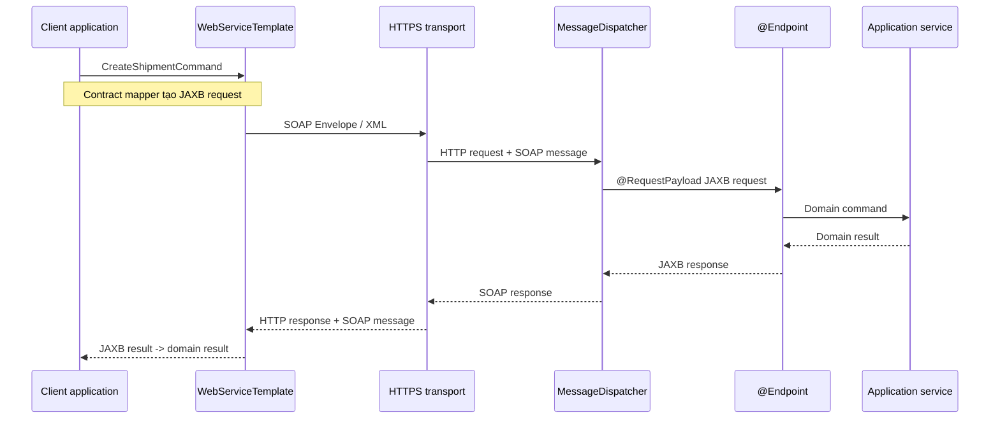
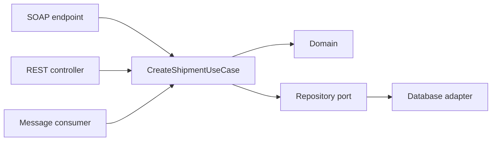
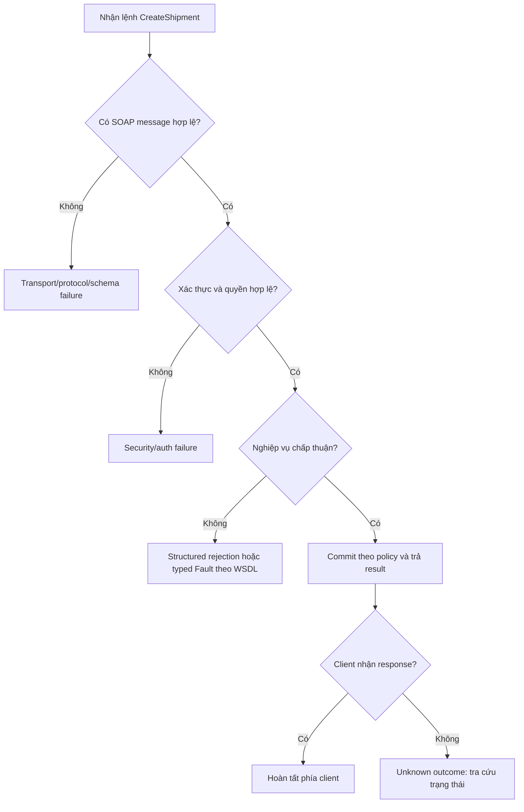
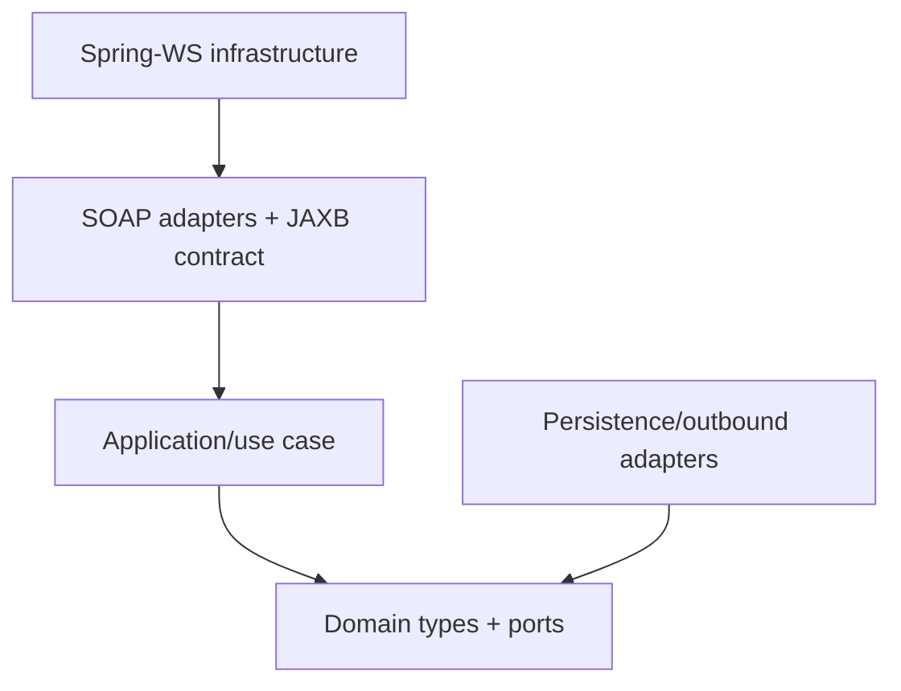

# Ranh giới giữa transport, giao thức SOAP và nghiệp vụ ứng dụng

## 1. Bài toán kiến trúc

Khi xây dựng dịch vụ SOAP bằng **Spring Web Services (Spring-WS)**, một lời gọi tưởng như đơn giản — “tạo vận đơn” hoặc “tra cứu trạng thái thanh toán” — thực tế đi qua nhiều loại trách nhiệm:

- **Transport** chuyển bytes giữa hai hệ thống, quản lý kết nối, TLS, timeout và tín hiệu thành công/thất bại ở cấp truyền tải.
- **Giao thức SOAP** quy định cấu trúc thông điệp XML, cách diễn giải Envelope, Header, Body, phiên bản SOAP và Fault.
- **Ứng dụng/nghiệp vụ** quyết định lời gọi có được phép thực hiện, dữ liệu có hợp lệ về nghiệp vụ, trạng thái nào phải thay đổi và kết quả nào phải được lưu.

Một thiết kế thiếu ranh giới rõ sẽ làm endpoint chứa cả HTTP headers, XML parsing, SQL, xác thực và xử lý nghiệp vụ; một thay đổi nhỏ ở binding SOAP hoặc security policy có thể lan đến những lớp không liên quan. Ngược lại, nếu tách đúng trách nhiệm, hệ thống dễ kiểm thử bằng XML thực, dễ sửa khi thay đổi WSDL/XSD và dễ tích hợp với các nền tảng doanh nghiệp khác.

Bài học thuộc chương **Kiến trúc xử lý** của module **SPRING_WEB_SERVICES**. Bối cảnh xuyên suốt là phát triển SOAP service **contract-first** với XSD/WSDL, JAXB, Spring-WS endpoint và SOAP client; có xét xử lý SOAP Fault, interceptor, XML security, WS-Security, chứng chỉ và kiểm thử tương thích.

Sau bài học, bạn sẽ có thể:

1. Vẽ đường đi của SOAP request/response và chỉ đúng tầng chịu trách nhiệm cho mỗi bước.
2. Phân biệt **lỗi transport**, **lỗi giao thức SOAP**, **lỗi hợp đồng XML** và **kết quả nghiệp vụ bị từ chối**.
3. Tổ chức Spring-WS endpoint, JAXB mapper, application service và repository để không trộn các lớp.
4. Đặt TLS/mTLS, SOAP Header, WS-Security, schema validation, phân quyền và transaction đúng vị trí.
5. Thiết kế timeout/retry/idempotency an toàn, kể cả khi client không biết giao dịch đã được xử lý hay chưa.
6. Viết kiểm thử riêng cho transport, SOAP boundary và nghiệp vụ, rồi xác minh tương thích bằng thông điệp thật.

## 2. Ba ranh giới chính

### 2.1. Bảng trách nhiệm

| Ranh giới | Đầu vào/đầu ra | Trách nhiệm | Không nên phụ trách |
| --- | --- | --- | --- |
| **Transport** | Kết nối HTTP(S), request/response bytes, status code, TLS session | Định tuyến mạng, kết nối, certificate trust, proxy, timeout, giới hạn kích thước, HTTP status | Kiểm tra hạn mức tài khoản, định nghĩa mã lỗi nghiệp vụ |
| **SOAP protocol/binding** | SOAP Envelope, Header, Body, Fault, version, SOAPAction | Giải mã thông điệp, định tuyến operation, hiểu header, Fault, SOAP message policy | SQL, tính phí, quyết định quyền sở hữu tài nguyên |
| **Contract/XML mapping** | XSD/WSDL, QName, JAXB object | Ràng buộc cấu trúc, marshal/unmarshal, version hợp đồng, schema validation | Tạo connection pool, retry mạng, xử lý giao dịch |
| **Application/domain** | Command/query và domain result | Kiểm tra quyền/nghiệp vụ, điều phối tác vụ, transaction, idempotency, trạng thái | SOAP Envelope, HTTP status, namespace XML |
| **Infrastructure adapter** | Database, broker, đối tác | Lưu dữ liệu, gửi event, gọi downstream, triển khai cổng tích hợp | Định nghĩa ý nghĩa nghiệp vụ công khai bằng exception của thư viện |

Có thể gom contract/XML mapping vào ranh giới SOAP khi nhìn tổng quát, nhưng trong mã nguồn nên xem **JAXB model và OXM** là lớp chuyển đổi riêng: chúng nối XML contract với dữ liệu ứng dụng, không nắm quy tắc nghiệp vụ.

### 2.2. Minh họa tổng thể

```mermaid
flowchart LR
    subgraph Client["Hệ thống gọi"]
      C1[Business caller] --> C2[SOAP client adapter]
      C2 --> C3[WebServiceTemplate + JAXB]
    end
    subgraph Edge["Đường truyền"]
      N1[HTTPS / TLS / proxy]
    end
    subgraph Server["Spring-WS server"]
      S1[MessageDispatcherServlet]
      S2[SOAP message + EndpointMapping]
      S3[Interceptor / Adapter / OXM]
      S4["@Endpoint"]
      S5[Contract Mapper]
      S6[Application Service]
      S7[Domain / Repository]
    end
    C3 --> N1 --> S1 --> S2 --> S3 --> S4 --> S5 --> S6 --> S7
```



Trong thực tế, endpoint mapping và endpoint interceptor có thứ tự thực thi cụ thể bên trong `MessageDispatcher`; sơ đồ mô tả **ranh giới chịu trách nhiệm**, không khẳng định tất cả interceptor chạy trước khi chọn endpoint. Các bộ lọc bảo mật HTTP hoặc reverse proxy có thể xử lý yêu cầu trước servlet. Không nên suy ra từ sơ đồ rằng một bean OXM tự cấu hình mọi interceptor.

## 3. Contract-first: XSD/WSDL định nghĩa ranh giới công khai

Một dịch vụ SOAP đáng tin cậy xác định **hợp đồng trước khi triển khai endpoint**:

- **XSD** công bố các global elements, kiểu dữ liệu, namespace, thứ tự phần tử, cardinality và những ràng buộc có thể kiểm tra ở XML.
- **WSDL** mô tả operation, input/output message, Fault, binding và endpoint address.
- **JAXB/XJC** tạo hoặc ánh xạ Java contract model từ XSD.
- **Spring-WS** nhận/gửi SOAP theo hợp đồng; endpoint giải quyết ứng dụng qua service interface.
- **Client đối tác** có thể sinh proxy từ WSDL hoặc dựng thông điệp XML tương thích, không cần biết domain class Java.

Mối quan hệ:



Vì vậy, tên `GetShipmentRequest` trong XSD, namespace `urn:example:shipment:v1` và mã `ALREADY_EXISTS` công khai phải ổn định theo contract; tên class Java bên trong hệ thống có thể thay đổi mà không ảnh hưởng đối tác nếu XML không đổi.

**Điều không được suy luận:** XSD đúng không tự xác nhận SOAP binding đúng; WSDL đọc được không tự chứng minh WS-Security tương thích; một client Java sinh mã thành công không tự chứng minh client .NET hay Python đọc được các edge cases.

## 4. Từ byte HTTP đến phương thức endpoint trong Spring-WS

Một lần gọi đồng bộ điển hình qua HTTP(S) có các giai đoạn:

1. **Client** dùng `WebServiceTemplate` để marshal payload JAXB, tạo SOAP message và gửi qua transport đã cấu hình.
2. **TLS/proxy/HTTP server** tiếp nhận kết nối, xác minh certificate/chính sách kênh truyền và áp dụng giới hạn cần thiết.
3. **`MessageDispatcherServlet`** (trong cấu hình Spring-WS servlet) xử lý HTTP request, lấy SOAP message qua `WebServiceMessageFactory` thích hợp.
4. **`MessageDispatcher`** tìm endpoint dựa trên mapping, ví dụ `@PayloadRoot`, rồi điều phối các endpoint interceptors đã cấu hình.
5. **Endpoint adapter/argument resolver** chuyển SOAP Body thành kiểu Java phù hợp, sử dụng JAXB/OXM hoặc một phương thức xử lý XML khác tùy cấu hình.
6. **`@Endpoint`** chuyển request contract thành command/query, gọi application service và nhận domain result.
7. **Response mapper** chuyển domain result sang JAXB response; framework marshal thành XML trong SOAP Body.
8. **Spring-WS và transport** gửi SOAP response hoặc SOAP Fault đến client; client phân biệt payload bình thường, Fault và lỗi mạng.



Một số cấu hình khác có thể dùng `Source`/`DOM` hoặc SOAP message trực tiếp. Điểm kiến trúc không đổi: **một lời gọi nghiệp vụ không nên phải biết Servlet API hoặc XML parser chỉ để trả kết quả**.

### 4.1. `MessageDispatcherServlet` và các thành phần xử lý

| Thành phần Spring-WS | Vai trò thường gặp |
| --- | --- |
| `MessageDispatcherServlet` | Cầu nối giữa HTTP servlet infrastructure và mô hình SOAP của Spring-WS. |
| `WebServiceMessageFactory` | Tạo/đọc `WebServiceMessage`; với SOAP có thể sử dụng `SaajSoapMessageFactory` tùy stack và phiên bản. |
| `MessageDispatcher` | Chọn và gọi endpoint qua các mapping/adapter và xử lý interceptor/Fault. |
| `PayloadRootAnnotationMethodEndpointMapping` | Hỗ trợ định tuyến dựa trên QName của phần tử gốc trong SOAP Body từ `@PayloadRoot`. |
| `DefaultMethodEndpointAdapter` | Gọi endpoint method khi argument/return value resolvers hỗ trợ kiểu dữ liệu tương ứng. |
| `Jaxb2Marshaller` | Chuyển JAXB model ↔ XML khi được cấu hình và sử dụng đúng tại boundary. |
| `EndpointInterceptor` | Điểm xử lý chung trước/sau endpoint ở Spring-WS, ví dụ validation, logging an toàn hoặc security. |
| `EndpointExceptionResolver` | Giúp biến exception phù hợp thành SOAP Fault theo chính sách và hợp đồng. |

Không cần cố định toàn bộ tên các lớp này trong mã nghiệp vụ. Chúng thuộc **bộ máy tiếp nhận và xử lý SOAP**. Khả năng hỗ trợ cụ thể của adapter/resolver phụ thuộc phiên bản Spring-WS và cấu hình endpoint.

## 5. Ranh giới transport: HTTP, TLS, proxy và kết nối

Transport quan tâm đến khả năng mang thông điệp đến nơi nhận và đưa phản hồi về, không biết số tiền có vượt hạn mức hoặc vận đơn có được chấp thuận hay không.

### 5.1. Những cấu hình transport cần có

| Vấn đề | Ví dụ quyết định |
| --- | --- |
| Endpoint URL | Domain, đường dẫn `/ws/shipments`, môi trường staging/production. |
| TLS | Phiên bản TLS chấp nhận, trust store, certificate validation. |
| mTLS (nếu dùng) | Server yêu cầu client certificate; quản lý vòng đời và trust của certificate. |
| HTTP client | Connection/read timeout hoặc các timeout cụ thể của transport, pool và giới hạn đồng thời. |
| Proxy/load balancer | Header chuyển tiếp, giới hạn request, khả năng keep-alive, định tuyến và health check. |
| Kích thước request | Giới hạn body, attachment và thời gian đọc để giảm nguy cơ quá tải. |
| Truy vết | Correlation ID, request metadata được phép, không log payload nhạy cảm mặc định. |

Mối quan hệ với SOAP:

- HTTP 200 chỉ cho biết một HTTP response thành công ở lớp transport, **không khẳng định nghiệp vụ được chấp thuận**.
- Một kết nối timeout có thể không có bất kỳ SOAP response nào; client không thể biết chắc server đã thực hiện command hay chưa.
- HTTP 401/403 từ proxy hoặc server có thể được trả trước khi xử lý SOAP và không chứa SOAP Fault.
- TLS thành công bảo vệ kết nối đã xác thực theo cấu hình, nhưng không tự xác minh nội dung SOAP xuyên qua mọi trung gian hoặc cấp quyền nghiệp vụ.

### 5.2. Không đặt network retry trong domain service

Nếu endpoint có mã kiểu:

```java
if (httpStatus == 503) {
    Thread.sleep(3000);
    retrySamePayment();
}
```

thì code đang lẫn trách nhiệm client transport với nghiệp vụ và có nguy cơ retry một thao tác đã hoàn thành. HTTP status ở tầng thấp phải được client adapter diễn giải thành **lỗi khả dụng** hoặc **trạng thái chưa rõ kết quả**; application layer mới quyết định quy trình phục hồi theo idempotency và yêu cầu nghiệp vụ.

## 6. Ranh giới SOAP: Envelope, Header, Body và Fault

SOAP quy định cấu trúc thông điệp. Với SOAP 1.1:

```xml
<soapenv:Envelope
    xmlns:soapenv="http://schemas.xmlsoap.org/soap/envelope/"
    xmlns:sh="urn:example:shipment:v1">
  <soapenv:Header>
    <!-- Header SOAP kỹ thuật nếu hợp đồng yêu cầu. -->
  </soapenv:Header>
  <soapenv:Body>
    <sh:CreateShipmentRequest>
      <sh:requestId>REQ-2026-1042</sh:requestId>
      <sh:accountId>ACCT-009</sh:accountId>
      <sh:recipientCode>DEST-78</sh:recipientCode>
    </sh:CreateShipmentRequest>
  </soapenv:Body>
</soapenv:Envelope>
```

Đây là một thông điệp SOAP 1.1 mang payload nghiệp vụ `CreateShipmentRequest`. Prefix `sh` có thể khác; định danh thực của payload là QName `{urn:example:shipment:v1}CreateShipmentRequest`.

| Phần SOAP | Chức năng | Tầng nên xử lý |
| --- | --- | --- |
| `Envelope` | Bao bọc thông điệp, xác định phiên bản SOAP qua namespace. | SOAP message stack. |
| `Header` | Metadata/protocol extensions, security, routing theo chính sách. | SOAP interceptor/callback/security adapter. |
| `Body` | Payload nghiệp vụ hoặc SOAP Fault. | Endpoint mapping, OXM và contract adapter. |
| `Fault` | Diễn đạt lỗi xử lý SOAP theo phiên bản giao thức. | SOAP exception resolver và client Fault handler. |

### 6.1. SOAP 1.1 khác SOAP 1.2

| Thuộc tính | SOAP 1.1 | SOAP 1.2 |
| --- | --- | --- |
| Envelope namespace | `http://schemas.xmlsoap.org/soap/envelope/` | `http://www.w3.org/2003/05/soap-envelope` |
| Media type HTTP thông thường | `text/xml` | `application/soap+xml` |
| Fault cơ bản | `faultcode`, `faultstring`, tùy chọn `detail` | `Code`, `Reason`, tùy chọn `Detail` |
| Mã phía gửi/nhận | `Client` / `Server` | `Sender` / `Receiver` |
| Action | SOAPAction HTTP header thường được dùng theo SOAP 1.1 binding | Action parameter và chính sách SOAP 1.2 binding tùy WSDL |

Không hoán đổi hai namespace hay Fault format. Nếu đối tác yêu cầu SOAP 1.1, client dùng SOAP 1.2 có thể thất bại trước khi endpoint nhận request dù XSD của phần payload vẫn giống hệt.

### 6.2. SOAP header là dữ liệu giao thức, không phải thuộc tính domain tùy tiện

Header có thể chứa thông tin WS-Addressing, token WS-Security, timestamp hoặc routing metadata. Một số header có `mustUnderstand` yêu cầu node SOAP phải hiểu/xử lý theo quy tắc giao thức; không nên bỏ qua hoặc “nuốt” header bắt buộc chỉ vì `Body` vẫn parse được.

Những thông tin như private key, certificate key material, bearer token hoặc giá trị security header không nên được copy vào domain command hay persist như trường dữ liệu nghiệp vụ nếu không có lý do rõ ràng.

### 6.3. Dispatch bằng payload QName và SOAPAction

Spring-WS thường định tuyến endpoint bằng `@PayloadRoot` theo **namespace + localPart của phần tử gốc Body**. SOAPAction, nếu được WSDL quy định, là một tín hiệu binding khác; có thể được dùng bởi một số mapping hoặc infrastructure, nhưng không phải mọi `@Endpoint` đều tự chuyển route theo SOAPAction.

Không nên tin rằng đúng SOAPAction là đủ khi QName của payload sai. Đối tác cần đúng cả SOAP version, WSDL binding, message structure và policy đã thỏa thuận.

## 7. Ranh giới JAXB/OXM: dịch XML nhưng không quyết định nghiệp vụ

Marshaller/Unmarshaller thực hiện Java object ↔ XML. Ví dụ Spring OXM:

```java
@Bean
Jaxb2Marshaller shipmentMarshaller() {
    Jaxb2Marshaller marshaller = new Jaxb2Marshaller();
    marshaller.setContextPath("com.example.shipment.contract");
    return marshaller;
}
```

Bean này chỉ là ví dụ cấu hình, giả định generated JAXB classes nằm ở package trên và JAXB API/runtime phù hợp với Spring-WS. Đối với Spring Framework 6/Spring-WS 4 kiểu Jakarta, mã sinh phải dùng `jakarta.xml.bind.*`, không trộn annotation `javax.xml.bind.*` từ toolchain cũ.

Sơ đồ trách nhiệm:

```text
SOAP Body XML
  |
  v
Spring-WS/JAXB OXM
  |
  v
Generated contract DTO (CreateShipmentRequest)
  |
  v
ContractMapper -> Domain command
  |
  v
Application service / domain
```

Marshaller không tự:

- Quyết định một `accountId` có được tạo vận đơn hay không.
- Áp dụng transaction hoặc idempotency.
- Đàm phán TLS/mTLS hoặc timeout.
- Tạo WS-Security signature mà không có stack bảo mật.
- Xử lý SOAP Fault theo WSDL chỉ vì schema có `FaultDetail`.

**Schema validation cũng cần cấu hình.** Tạo JAXB object thành công chưa chắc đã kiểm tra toàn bộ XSD facets; định tuyến/parse XML thành công chưa chứng minh nghiệp vụ hợp lệ.

### 7.1. Optional, null và QName ở ranh giới mapping

Generated Java model có thể khác nhau theo XSD:

- `@XmlRootElement` hoặc `JAXBElement<T>` quyết định cách marshal root.
- `minOccurs="0"` cho phép phần tử vắng mặt; `nillable="true"` có thể cho phép `xsi:nil="true"`.
- `xs:sequence` yêu cầu đúng thứ tự trong XML.
- `xs:dateTime` có thể biểu diễn giá trị thiếu timezone nếu không có quy tắc bổ sung.
- `xs:decimal` phù hợp tiền hơn số dấu phẩy động nhị phân.

Mapper nên là nơi chuyển các chi tiết này thành domain types có ý nghĩa rõ; không cho domain service phải phân biệt tên prefix XML hoặc tự kiểm tra `JAXBElement`.

## 8. Ranh giới nghiệp vụ: application service quyết định điều gì?

Với use case **CreateShipment**, application layer có thể cần:

1. Xác nhận bên gọi đã được xác thực và có quyền tạo vận đơn cho tài khoản chỉ định.
2. Kiểm tra `recipientCode` có thể sử dụng hay không.
3. Phát hiện yêu cầu trùng theo `requestId` để bảo đảm idempotency.
4. Tạo hoặc lấy lại vận đơn hiện có theo quy tắc đã công bố.
5. Lưu thay đổi trạng thái trong transaction phù hợp.
6. Ghi nhận event/audit khi cần; không mặc định gửi event ra hệ thống ngoài trong cùng transaction nếu không có cơ chế bảo đảm.
7. Trả kết quả nghiệp vụ độc lập với HTTP/SOAP.

Ví dụ domain model (Java 17):

```java
public record CreateShipmentCommand(
        String requestId,
        String accountId,
        String recipientCode,
        String callerId) {}

public record ShipmentCreation(
        String requestId,
        String shipmentId,
        String status) {}

public interface CreateShipmentUseCase {
    ShipmentCreation create(CreateShipmentCommand command);
}
```

`callerId` ở command phải lấy từ **danh tính đã xác thực tại boundary** — ví dụ security context đã được kiểm tra — chứ không được tin một chuỗi tùy ý do bên gọi tự khai trong SOAP Body. Nếu `accountId` nằm trong payload, domain/application authorization phải kiểm tra quyền trên chính tài khoản đó.

### 8.1. Nghiệp vụ có thể được gọi bằng adapter khác

Một use case được tách tốt có thể được gọi từ SOAP endpoint, một HTTP/JSON adapter, message consumer hoặc job nội bộ:



Không cần thực hiện cả ba adapter. Sơ đồ cho thấy logic nghiệp vụ **không biết thông điệp đến bằng SOAP hay cách khác**. Nếu domain service có method tham số `HttpServletRequest` hoặc trả `SoapFault`, ranh giới đã bị trộn.

### 8.2. Transaction nằm ở đâu?

Thông thường, application service phối hợp các thao tác cần nhất quán và xác định ranh giới transaction. SOAP endpoint chỉ nhận request và gọi use case; không nên đặt transaction chỉ để che giấu logic truy cập dữ liệu phân tán.

Với việc vừa ghi database vừa phát event ra broker, một database transaction đơn lẻ không tự bảo đảm atomic với broker. Các phương án như **transactional outbox** hoặc workflow trạng thái là lựa chọn cần cân nhắc khi có yêu cầu nhất quán và phục hồi. SOAP và WSDL không mang đến exactly-once cho nghiệp vụ.

## 9. Ví dụ contract-first: tạo vận đơn

Ví dụ dưới đây có **một thao tác ghi dữ liệu** để thấy rõ ranh giới xử lý lỗi và idempotency. Namespace giả định: `urn:example:shipment:v1`.

### 9.1. XSD cho request/response và fault detail

```xml
<?xml version="1.0" encoding="UTF-8"?>
<xs:schema
    xmlns:xs="http://www.w3.org/2001/XMLSchema"
    xmlns:tns="urn:example:shipment:v1"
    targetNamespace="urn:example:shipment:v1"
    elementFormDefault="qualified">

  <xs:simpleType name="NonBlankId">
    <xs:restriction base="xs:string">
      <xs:whiteSpace value="collapse"/>
      <xs:minLength value="1"/>
      <xs:maxLength value="80"/>
    </xs:restriction>
  </xs:simpleType>

  <xs:element name="CreateShipmentRequest">
    <xs:complexType>
      <xs:sequence>
        <xs:element name="requestId" type="tns:NonBlankId"/>
        <xs:element name="accountId" type="tns:NonBlankId"/>
        <xs:element name="recipientCode" type="tns:NonBlankId"/>
      </xs:sequence>
    </xs:complexType>
  </xs:element>

  <xs:element name="CreateShipmentResponse">
    <xs:complexType>
      <xs:sequence>
        <xs:element name="requestId" type="tns:NonBlankId"/>
        <xs:element name="shipmentId" type="tns:NonBlankId"/>
        <xs:element name="status" type="xs:string"/>
      </xs:sequence>
    </xs:complexType>
  </xs:element>

  <xs:complexType name="ServiceFaultType">
    <xs:sequence>
      <xs:element name="code" type="xs:string"/>
      <xs:element name="message" type="xs:string"/>
      <xs:element name="correlationId"
                  type="xs:string" minOccurs="0"/>
    </xs:sequence>
  </xs:complexType>

  <xs:element name="ShipmentFaultDetail"
              type="tns:ServiceFaultType"/>
</xs:schema>
```

Để triển khai đầy đủ, WSDL 1.1 phải khai báo `CreateShipment` operation, `wsdl:message` tham chiếu các global elements, binding document/literal và `soapAction` đã thống nhất. Nếu `ShipmentFaultDetail` là typed Fault được công bố, cần có `wsdl:fault` và `soap:fault` tương ứng. **Chỉ khai báo một global element trong XSD không có nghĩa WSDL hoặc Spring-WS tự tạo typed SOAP Fault.**

### 9.2. Endpoint làm nhiệm vụ adapter

Giả định XJC sinh JAXB classes tương ứng và mapper xử lý mọi chi tiết XML/JAXB:

```java
@Endpoint
public final class ShipmentEndpoint {
    private static final String NS = "urn:example:shipment:v1";

    private final CreateShipmentUseCase useCase;
    private final ShipmentContractMapper mapper;
    private final CallerIdentityProvider identities;

    public ShipmentEndpoint(
            CreateShipmentUseCase useCase,
            ShipmentContractMapper mapper,
            CallerIdentityProvider identities) {
        this.useCase = useCase;
        this.mapper = mapper;
        this.identities = identities;
    }

    @PayloadRoot(namespace = NS,
                 localPart = "CreateShipmentRequest")
    @ResponsePayload
    public CreateShipmentResponse create(
            @RequestPayload CreateShipmentRequest request) {

        String callerId = identities.requireAuthenticatedCaller();
        CreateShipmentCommand command =
                mapper.toCommand(request, callerId);

        ShipmentCreation result = useCase.create(command);
        return mapper.toResponse(result);
    }
}
```

`ShipmentContractMapper` và `CallerIdentityProvider` là **abstraction của ứng dụng**, không phải các lớp có sẵn trong Spring-WS. Ví dụ giả định JAXB model được ánh xạ trực tiếp; tùy XSD/codegen và adapter, parameter/return có thể là `JAXBElement<T>`. Cấu hình JAXB, method argument resolver, schema validation và security phải được thiết lập phù hợp trước khi mã chạy.

**Điểm quan trọng:** endpoint không chứa SQL, `HttpServletResponse.setStatus(...)`, logic parse XML hoặc retry HTTP. Nó chuyển contract → use case → contract.

### 9.3. Ví dụ mapper riêng

```java
public final class ShipmentContractMapper {

    public CreateShipmentCommand toCommand(
            CreateShipmentRequest request, String callerId) {
        return new CreateShipmentCommand(
                request.getRequestId(),
                request.getAccountId(),
                request.getRecipientCode(),
                callerId);
    }

    public CreateShipmentResponse toResponse(
            ShipmentCreation result) {
        CreateShipmentResponse response =
                new CreateShipmentResponse();
        response.setRequestId(result.requestId());
        response.setShipmentId(result.shipmentId());
        response.setStatus(result.status());
        return response;
    }
}
```

Mapper không tự kiểm tra quyền truy cập; nó chỉ chuyển dữ liệu. Tham số `callerId` đã đến từ security boundary và use case vẫn phải kiểm tra account/resource authorization. Nếu một ngày client đối tác thay đổi cấu trúc JAXB response nhưng domain result vẫn giữ nguyên, mapper là nơi chịu trách nhiệm chuyển đổi.

### 9.4. Trả response SOAP thành công

```xml
<soapenv:Envelope
    xmlns:soapenv="http://schemas.xmlsoap.org/soap/envelope/"
    xmlns:sh="urn:example:shipment:v1">
  <soapenv:Body>
    <sh:CreateShipmentResponse>
      <sh:requestId>REQ-2026-1042</sh:requestId>
      <sh:shipmentId>SHP-51042</sh:shipmentId>
      <sh:status>CREATED</sh:status>
    </sh:CreateShipmentResponse>
  </soapenv:Body>
</soapenv:Envelope>
```

Phần `CreateShipmentResponse` tuân theo XSD; mọi phần tử con mang đúng namespace và đúng thứ tự. Client khác nền tảng có thể dùng prefix khác nhưng vẫn hiểu đúng XML dựa trên QName.

## 10. Đặt validation ở đúng tầng

“Validation” có nhiều nghĩa khác nhau, không nên dồn vào một method duy nhất.

| Kiểm tra | Câu hỏi | Nơi đặt |
| --- | --- | --- |
| HTTP/transport | Body có quá lớn, kết nối có hợp lệ, TLS có tin cậy? | Reverse proxy, HTTP server/client, transport config. |
| SOAP protocol | Envelope có đúng phiên bản, header bắt buộc được hiểu, Fault format hợp lệ? | Spring-WS SOAP message stack/interceptor. |
| XML/XSD | QName, kiểu, `xs:sequence`, min/max, cardinality đúng? | Schema validator/interceptor, OXM validation và contract tests. |
| Authentication | Bên gọi là ai? Certificate/token/signature đúng policy? | TLS/security filter/WS-Security. |
| Authorization | Caller có quyền tạo vận đơn cho `accountId` này? | Application/security/domain authorization. |
| Business rules | Địa chỉ nhận có được hỗ trợ, hạn mức vận đơn có đạt? | Domain/application service. |
| Data integrity | Request ID có trùng với payload khác, constraint DB đúng? | Application service + persistence constraint. |

Trong Spring-WS, `PayloadValidatingInterceptor` có thể giúp kiểm tra payload theo XSD. `Wss4jSecurityInterceptor` có thể dùng cho các chính sách WS-Security trong stack tương thích. Tuy nhiên, **không có nghĩa chỉ khai báo XSD hoặc chọn SOAP thì các interceptor được bật tự động**.

Thứ tự interceptor phải kiểm tra theo cấu hình thực tế; ví dụ nếu validation cần xử lý trước use case, phải đảm bảo request lỗi bị từ chối trước khi mã nghiệp vụ chạy. Authentication/authorization phải đủ sớm để không cung cấp dữ liệu nhạy cảm, nhưng vẫn cần phân biệt lỗi XML do parser, lỗi SOAP do message stack và lỗi chính sách security.

## 11. Ranh giới lỗi: transport failure, SOAP Fault và từ chối nghiệp vụ

Một câu hỏi thực tế: **“Tạo vận đơn thất bại” nghĩa là gì?** Có ít nhất bốn trường hợp khác nhau.

### 11.1. Ma trận phân loại

| Hiện tượng | Ví dụ | Điều client có thể kết luận | Cách xử lý |
| --- | --- | --- | --- |
| **Transport failure** | TLS handshake fail, timeout, connection reset | Không có SOAP response; kết quả tạo vận đơn có thể chưa rõ | Kiểm tra kết nối, tra cứu bằng request ID; retry chỉ khi an toàn |
| **SOAP protocol/contract Fault** | Sai SOAP version, header bắt buộc không hiểu, payload sai schema | Thông điệp không được xử lý bình thường theo contract | Sửa binding/schema/security; đọc fault code/detail |
| **Lỗi kỹ thuật khi xử lý** | Service phụ thuộc hỏng, database không sẵn sàng | Operation có thể thất bại hoặc chưa rõ khi mất phản hồi | Nhận diện Fault/transport; áp dụng recovery theo contract |
| **Từ chối nghiệp vụ** | Tài khoản bị khóa, dịch vụ không phục vụ khu vực | Server có thể đã xử lý thành công yêu cầu và đưa ra quyết định từ chối | Đọc mã lỗi nghiệp vụ có cấu trúc; không tự retry mù |
| **Thành công** | Tạo vận đơn, trả `shipmentId` | Có kết quả được công bố | Dùng ID trạng thái để tiếp tục luồng |

**HTTP 200 không đồng nghĩa nghiệp vụ thành công**. Một response SOAP bình thường có thể mang nhánh `rejected` nếu XSD thiết kế kết quả nghiệp vụ theo cách đó. Ngược lại, HTTP 500 có thể chứa SOAP 1.1 Fault, hoặc cũng có thể là lỗi HTTP/proxy không có SOAP Envelope. Client cần kiểm tra thực tế loại thông điệp.

### 11.2. SOAP 1.1 Fault minh họa

```xml
<soapenv:Envelope
    xmlns:soapenv="http://schemas.xmlsoap.org/soap/envelope/"
    xmlns:sh="urn:example:shipment:v1">
  <soapenv:Body>
    <soapenv:Fault>
      <faultcode>soapenv:Client</faultcode>
      <faultstring>Invalid shipment request</faultstring>
      <detail>
        <sh:ShipmentFaultDetail>
          <sh:code>RECIPIENT_CODE_INVALID</sh:code>
          <sh:message>Recipient code is invalid</sh:message>
          <sh:correlationId>CORR-9204</sh:correlationId>
        </sh:ShipmentFaultDetail>
      </detail>
    </soapenv:Fault>
  </soapenv:Body>
</soapenv:Envelope>
```

Ở SOAP 1.1 qua HTTP, SOAP Fault thường đi cùng HTTP 500 theo binding. Phần `faultcode`/`faultstring` tuân theo giao thức; `ShipmentFaultDetail` chứa lỗi ứng dụng đã được thiết kế trong XSD/WSDL. Nếu đối tác sử dụng SOAP 1.2, cấu trúc Fault và fault code khác; không thể dùng nguyên XML này.

Không trả stack trace, SQL, internal hostname hoặc private key trong `faultstring` hay `detail`. `correlationId` chỉ là dữ liệu truy vết đã được kiểm soát, không phải token xác thực.

### 11.3. Fault có typed detail cần resolver theo hợp đồng

Các exception Java như `IllegalArgumentException` hoặc `DataIntegrityViolationException` không nên tự trở thành dữ liệu công khai. Spring-WS có cơ chế `EndpointExceptionResolver` và các triển khai liên quan như `SoapFaultMappingExceptionResolver` để chuyển một exception thành SOAP Fault.

Tuy nhiên, cấu hình mapping fault code/reason **chưa tự đảm bảo** `detail` khớp `ShipmentFaultDetail`. Nếu WSDL khai báo typed Fault, cần custom handling phù hợp để tạo XML detail đúng QName và schema; thử với client thực được sinh từ WSDL.

Với từ chối nghiệp vụ thường gặp, nhóm phát triển có thể chọn **response có nhánh kết quả rejected** thay vì Fault. Hai lựa chọn đều cần hợp đồng rõ. Không chuyển ngẫu nhiên cùng mã `ACCOUNT_BLOCKED` lúc thành response, lúc thành SOAP Fault vì client khó xử lý ổn định.

### 11.4. Ánh xạ lỗi theo trách nhiệm



Sơ đồ này là quyết định về **ngữ nghĩa kết quả**, không có nghĩa bước SOAP endpoint mapping luôn diễn ra sau một interceptor cụ thể. Khi kết nối bị ngắt, không phải mọi lỗi phía client đều có thể được server nhận biết hoặc tạo SOAP Fault trả về.

## 12. SOAP client: tách transport config khỏi nghiệp vụ gọi dịch vụ

Phía bên gọi cũng nên tách ranh giới. `WebServiceTemplate` xử lý SOAP message, gọi marshaller/unmarshaller và transport. Một adapter client nhận đầu vào nghiệp vụ, chuyển sang JAXB request và dịch SOAP response/Fault về kết quả phù hợp.

```java
public final class ShipmentSoapGateway {
    private final WebServiceTemplate template;
    private final ShipmentClientMapper mapper;

    public ShipmentSoapGateway(
            WebServiceTemplate template,
            ShipmentClientMapper mapper) {
        this.template = template;
        this.mapper = mapper;
    }

    public ShipmentCreation create(CreateShipmentCommand command) {
        CreateShipmentRequest request = mapper.toRequest(command);

        Object payload = template.marshalSendAndReceive(
                request,
                new SoapActionCallback(
                        "urn:example:shipment:v1/CreateShipment"));

        CreateShipmentResponse response =
                mapper.requireCreateShipmentResponse(payload);
        return mapper.toDomain(response);
    }
}
```

`ShipmentClientMapper` là adapter giả định. SOAPAction trong ví dụ phải khớp WSDL thực tế. Nếu XJC tạo `JAXBElement<T>`, mapper phải tạo wrapper đúng QName trước khi marshal. `WebServiceTemplate` cần được cấu hình message factory, marshaller/unmarshaller, transport và Fault handling phù hợp; đoạn trên chỉ minh họa ranh giới trách nhiệm.

### 12.1. Client adapter xử lý gì?

- Chọn endpoint URI theo cấu hình, message factory và SOAPAction theo WSDL.
- Cấu hình connection timeout/read timeout, TLS/mTLS, proxy và certificate trust.
- Dùng OXM marshal/unmarshal XML payload.
- Phân biệt response nghiệp vụ, SOAP Fault và lỗi kết nối không có response.
- Gán correlation/request ID và policy retry theo use case, với giới hạn an toàn.
- Chuyển mã lỗi theo hợp đồng thành exception/result ở mức ứng dụng, không làm lộ mọi class exception của SOAP stack.

### 12.2. Client adapter không nên xử lý gì?

Không quyết định hạn mức, không kiểm tra dữ liệu tài chính từ database nội bộ của server, không tự bịa SOAP Fault code cho đối tác và không coi “không nhận được phản hồi” là “server chưa xử lý”.

## 13. Retry, idempotency và transaction: ranh giới không được nhầm

Với một lệnh ghi dữ liệu, có tình huống:

1. Client gửi `CreateShipmentRequest` với `requestId=REQ-2026-1042`.
2. Server xử lý và commit tạo vận đơn `SHP-51042`.
3. Kết nối bị reset trước khi SOAP response đến client.
4. Client nhận `WebServiceIOException` hoặc transport exception tương ứng.

Nếu client gửi lại yêu cầu với ID mới và server tạo tiếp một vận đơn, hệ thống có thể sinh dữ liệu trùng, dù lần gọi đầu đã thành công.

**SOAP, WSDL và HTTP timeout không tự mang bảo đảm exactly-once.** Phải có quy tắc nghiệp vụ.

### 13.1. Thiết kế idempotency theo command

Một triển khai có thể dùng `requestId` ổn định gắn với danh tính/tài khoản và fingerprint của payload:

```text
CreateShipment(account, requestId, payloadHash)
  ├── requestId chưa thấy
  │   └── Tạo shipment, lưu kết quả, commit
  ├── requestId đã có + cùng payload
  │   └── Trả kết quả đã lưu hoặc trạng thái đang xử lý
  └── requestId đã có + payload khác
      └── Trả lỗi conflict có mã ổn định
```

Chính sách cần xác định: khóa idempotency scoped theo ai, lưu trong bao lâu, trạng thái `PROCESSING` xử lý ra sao, khi nào được retry và trường hợp nào phải tra cứu trạng thái trước. Nên sử dụng constraint/transaction của dữ liệu để tránh race condition giữa hai request cùng ID.

### 13.2. Nơi đặt retry

| Tình huống | Gợi ý |
| --- | --- |
| GET/query thuần, idempotent, lỗi tạm thời | Client adapter có thể retry có giới hạn nếu đáp ứng SLA và chính sách. |
| Command tạo dữ liệu, có request ID/idempotency chắc chắn | Retry theo contract, giữ nguyên request ID và payload; giới hạn backoff. |
| Timeout sau khi gửi command, chưa biết kết quả | Ưu tiên query status bằng request ID; không tạo command mới ngay. |
| Business rejection cố định | Không retry y nguyên nếu đầu vào hoặc điều kiện nghiệp vụ chưa thay đổi. |
| Sai SOAP schema, security signature hoặc credential | Sửa nguyên nhân; retry liên tục sẽ không giúp và có thể gây khóa/quá tải. |

Các giá trị `Retry-After`, HTTP 503 hoặc Fault code có thể là tín hiệu hữu ích nếu hợp đồng/stack công bố cách sử dụng; **không có tín hiệu nào thay thế idempotency**.

## 14. Security: phân tầng để bảo vệ đúng tài sản

Trong tích hợp hệ thống doanh nghiệp, bảo mật có thể tồn tại cùng lúc ở nhiều lớp:

| Lớp | Cơ chế | Bảo vệ điều gì |
| --- | --- | --- |
| Transport | HTTPS/TLS, mTLS, certificate validation | Kênh truyền và/hoặc danh tính peer ở kết nối. |
| SOAP message | WS-Security XML Signature, Encryption, Timestamp, token | Tính toàn vẹn, nguồn ký, bảo mật phần thông điệp theo chính sách. |
| XML parsing | Tắt DTD/external entities khi không cần; giới hạn entity expansion | Giảm rủi ro XML parser bị khai thác hoặc quá tải. |
| Application | Authentication context, authorization theo account/resource, audit | Quyền thực hiện operation và quyền truy cập dữ liệu cụ thể. |
| Infrastructure | Secret/keystore management, rotation và kiểm tra thu hồi theo policy | Vòng đời khóa, certificate và dữ liệu bí mật. |

Một chứng chỉ mTLS hợp lệ **không đồng nghĩa** tài khoản thuộc mọi customer; một chữ ký WS-Security hợp lệ **không đồng nghĩa** command được phép thay đổi mọi vận đơn.

### 14.1. Trình tự xử lý security

Tùy topology:

- Reverse proxy/HTTP container có thể kiểm tra TLS/mTLS trước `MessageDispatcherServlet`.
- SOAP security interceptor có thể xác minh chữ ký, timestamp, token và các header thích hợp khi thông điệp đã được parse.
- Application service kiểm tra authorization trên account/resource đã xác định.
- Repository/adapter có thể bảo đảm kiểm soát dữ liệu theo tenant, constraint và audit.

Không ghi mã nghiệp vụ dựa trên assumption rằng `request.getAccountId()` đã đáng tin chỉ vì SOAP Body có trường đó. Cần kết hợp danh tính từ authentication với quy tắc quyền tương ứng.

### 14.2. Phòng tránh XML wrapping và ghi log quá mức

Khi dùng XML Signature, phạm vi phần tử được ký và phần tử mà ứng dụng sử dụng phải khớp chính sách. Không tự ý reserialize thông điệp đã ký hoặc chỉ kiểm tra “chữ ký tồn tại” rồi chấp nhận một SOAP Body khác.

Tất cả log nên tránh token, mật khẩu, chữ ký, private key, dữ liệu tài chính hoặc thông tin cá nhân không cần thiết. Ghi operation, kết quả, correlation ID và mã lỗi đã được phép có thể đủ cho quan sát hệ thống.

## 15. Interceptor: nơi xử lý chung, không phải nơi đặt nghiệp vụ

Spring-WS interceptor phù hợp cho logic cắt ngang nhiều endpoint: schema validation, WS-Security, trace/correlation, kiểm soát lỗi hoặc ghi log an toàn.

Ví dụ khái niệm cấu hình validation và security:

```java
@Configuration
@EnableWs
public class SoapInfrastructureConfig implements WsConfigurer {

    private final PayloadValidatingInterceptor validator;

    public SoapInfrastructureConfig(
            PayloadValidatingInterceptor validator) {
        this.validator = validator;
    }

    @Override
    public void addInterceptors(
            List<EndpointInterceptor> interceptors) {
        interceptors.add(validator);
    }
}
```

Đây là mẫu cấu trúc, giả định `validator` đã được tạo và gán XSD phù hợp, đồng thời Spring context có `MessageDispatcherServlet` và JAXB endpoint adapter cần thiết. Cấu hình thực tế có thể cần thêm các beans và import. Không nên copy đoạn rút gọn này rồi cho rằng schema validation hoặc WS-Security đã được cấu hình đầy đủ.

### 15.1. Những việc không phù hợp để đưa vào interceptor

- Tính phí hay quyết định hạn mức tài khoản.
- Ghi bản ghi vận đơn như tác dụng phụ của logging.
- Thực hiện transaction nghiệp vụ xuyên nhiều endpoint.
- Thay đổi payload XML sau khi kiểm tra chữ ký mà không có thiết kế phù hợp.
- Trả business error code khác nhau chỉ dựa trên class exception hạ tầng.

Nếu interceptor cần gọi domain service để đưa ra quyết định nghiệp vụ cốt lõi, hãy xem lại việc đặt logic trong use case và authorization service thay vì tạo cơ chế ẩn khó kiểm thử.

### 15.2. Thứ tự interceptor là một phần của kiến trúc

Khi có nhiều interceptor, phải kiểm tra quy tắc thứ tự và xử lý lỗi của phiên bản Spring-WS đang dùng:

- Validation cần diễn ra trước khi use case xử lý dữ liệu XML không hợp lệ.
- WS-Security phải thực thi policy trước khi payload được ứng dụng tin cậy.
- Việc audit/logging không được đọc lộ dữ liệu nhạy cảm hoặc “nuốt” Fault.
- Nếu một interceptor từ chối request, endpoint có thể không được gọi; test phải xác minh điều này bằng SOAP XML thực.

Không mặc định thứ tự chỉ dựa trên thứ tự khai báo trong một sơ đồ trừ khi đã kiểm tra hành vi runtime.

## 16. Quan sát hệ thống và hiệu năng theo từng ranh giới

Muốn tìm nút thắt chính xác, hãy đo các thành phần thay vì chỉ đo “SOAP chậm”.

| Chỉ số | Tầng | Giúp phát hiện |
| --- | --- | --- |
| DNS/TCP/TLS handshake, connection reuse | Transport | Kết nối chậm, certificate trust lỗi, pool cấu hình kém |
| Request size, upload/download time | Transport | Payload lớn, nén chưa phù hợp |
| XML parse/marshal time, validation cost | SOAP/OXM | Overhead XML, schema, object allocation |
| WS-Security signature/encryption time | SOAP security | CPU tăng, policy/timestamp khác kỳ vọng |
| Endpoint dispatch và interceptor latency | Spring-WS boundary | Handler mapping, validation hoặc security gây chậm |
| Business service latency, database queries | Application/infra | Lock, pool DB, downstream, transaction |
| p50/p95/p99, throughput, error rate | End-to-end | SLA/SLO dưới tải thực |

Có thể gắn correlation ID qua client adapter, SOAP header hoặc metadata thích hợp theo hợp đồng. Cần truyền ID đến logs/traces mà không làm thay đổi chữ ký XML theo cách không hợp lệ. Tránh dùng full SOAP message logging làm mặc định trong production.

### 16.1. Một tình huống phân tích

Giả sử p95 của `CreateShipment` tăng từ 200 ms lên 900 ms sau khi bật chữ ký WS-Security. Không nên kết luận “SOAP không phù hợp” trước khi đo:

1. TLS handshake có được reuse không?
2. XML signature có ký những phần cần thiết với thuật toán đúng policy không?
3. Payload size/DOM có tăng không?
4. DB query hoặc lock có thay đổi không?
5. CPU/GC có quá tải ở mức đồng thời đang chạy không?

Việc phân biệt tầng giúp tránh sửa domain code khi nút thắt thực tế nằm ở security/transport hoặc ngược lại.

## 17. Anti-pattern và cách sửa theo ranh giới

### 17.1. Endpoint thao tác trực tiếp `HttpServletRequest` để quyết định nghiệp vụ

**Dấu hiệu:** method endpoint kiểm tra HTTP header rồi tự quyết định trạng thái vận đơn, thay vì lấy danh tính từ security boundary và gọi use case.

**Cải thiện:** chuyển thông tin danh tính đã xác thực thành context/command, để application authorization kiểm tra quyền. HTTP header chỉ là dữ liệu bên ngoài cho đến khi được xác thực bởi cơ chế tin cậy.

### 17.2. Domain service trả `SoapFault` hoặc HTTP status

**Dấu hiệu:** `CreateShipmentUseCase` phụ thuộc `SoapFault`, `WebServiceTemplate` hoặc `HttpStatus`.

**Cải thiện:** domain trả kết quả/exception nghiệp vụ nội bộ có mã ổn định; SOAP adapter ánh xạ theo WSDL. Những adapter khác có thể ánh xạ cùng kết quả theo protocol của chúng.

### 17.3. Chuyển tất cả lỗi thành SOAP Fault `Server`

**Dấu hiệu:** tài khoản bị khóa, payload sai schema, database timeout đều được trả cùng `Server` Fault không có mã.

**Cải thiện:** thiết kế bảng phân loại và typed detail/response bị từ chối nhất quán. Không lộ exception nội bộ; client hiểu được xử lý tiếp theo.

### 17.4. Tự parse chuỗi XML trong endpoint

**Dấu hiệu:** endpoint dùng regex hoặc `String.indexOf("<accountId>")` để tìm dữ liệu.

**Cải thiện:** dùng QName, XSD validation và OXM/JAXB hoặc XML parser an toàn. Prefix/namespace thay đổi có thể làm regex sai; dữ liệu XML cũng có encoding và entity rules riêng.

### 17.5. Retry bất kỳ request nào bị timeout

**Dấu hiệu:** client gửi lại command với request ID mới sau khi mất kết nối.

**Cải thiện:** xác định idempotency key và query status. Mất kết nối không chứng minh server chưa commit.

### 17.6. Chuyển DTO JAXB thẳng vào repository

**Dấu hiệu:** repository interface nhận `CreateShipmentRequest`, schema đổi khiến persistence đổi theo.

**Cải thiện:** dùng mapper contract → command/domain, repository phụ thuộc domain types hoặc persistence types riêng.

### 17.7. Bỏ qua WS-Security hoặc certificate policy vì đã có HTTPS

**Dấu hiệu:** WSDL đối tác yêu cầu ký thông điệp nhưng ứng dụng chỉ cấu hình TLS và cho rằng đã đáp ứng.

**Cải thiện:** phân biệt TLS/mTLS với XML Signature/Encryption; kiểm tra policy, trust, timestamp và interoperability trên SOAP message thực.

## 18. Kiểm thử theo từng ranh giới

Một thiết kế có ranh giới tốt cho phép kiểm thử riêng từng phần và kết hợp ở tầng cuối.

### 18.1. Unit test nghiệp vụ

Không cần khởi tạo SOAP Envelope hoặc HTTP server để kiểm tra:

- Caller không có quyền trên `accountId` → từ chối.
- `recipientCode` không được hỗ trợ → trả mã nghiệp vụ phù hợp.
- Cùng `requestId` và cùng payload → không tạo vận đơn thứ hai.
- Cùng `requestId` nhưng payload khác → trả conflict.
- Repository fail hoặc transaction rollback → không để lại trạng thái nửa vời theo contract nội bộ.
- Có event cần phát → đảm bảo quy tắc outbox hoặc recovery đã thiết kế.

Mục tiêu là chứng minh **nghiệp vụ đúng** ngay cả khi chưa có SOAP transport.

### 18.2. Test XML/XSD và JAXB

- Request/response đúng QName, namespace và `xs:sequence`.
- Thiếu trường required, sai kiểu, vượt max length và phần tử namespace sai bị phát hiện.
- `JAXBElement`/`@XmlRootElement` có root QName đúng.
- SOAP version 1.1/1.2 dùng binding tương ứng.
- Typed Fault detail được sinh đúng schema nếu hợp đồng yêu cầu.

Round-trip Java object → XML → Java object là hữu ích, nhưng phải thêm XSD validation; hai phía cùng dùng một serializer sai vẫn có thể round-trip thành công.

### 18.3. Test Spring-WS endpoint và client

Spring-WS cung cấp những hỗ trợ mock như `MockWebServiceClient` và `MockWebServiceServer` để thử SOAP message mà không cần gọi mạng thật. Ví dụ ở mức khái niệm:

```java
MockWebServiceClient client =
        MockWebServiceClient.createClient(applicationContext);

client.sendRequest(withPayload(new StringSource(requestXml)))
      .andExpect(noFault())
      .andExpect(payload(new StringSource(expectedResponseXml)));
```

Ví dụ giả định `applicationContext` đã cấu hình endpoint/mapping, `requestXml` và `expectedResponseXml` là **payload XML** thuộc SOAP Body, không phải toàn bộ HTTP response. Các static imports cần dùng phù hợp với API test của Spring-WS version trong dự án.

Với client, có thể dùng `MockWebServiceServer` để xác minh payload, SOAPAction và Fault; test timeout/TLS nên kiểm tra bằng transport giả lập hoặc integration environment phù hợp.

### 18.4. Ma trận tích hợp và tương thích

| Kịch bản | Kết quả mong đợi |
| --- | --- |
| Request hợp lệ, quyền hợp lệ | SOAP response đúng XSD và domain result. |
| XML sai QName hoặc thiếu required field | Bị từ chối tại boundary; không gọi nghiệp vụ. |
| SOAP 1.2 gửi vào endpoint SOAP 1.1 | Bị từ chối theo version/binding policy. |
| WS-Security signature không hợp lệ | Không được thực hiện nghiệp vụ; lỗi theo security policy. |
| Caller hợp lệ nhưng sai quyền account | Application authorization từ chối, không lộ thông tin nhạy cảm. |
| Domain business rejection | Response `rejected` hoặc typed Fault đúng WSDL; client xử lý mã. |
| Backend hỏng | Lỗi hạ tầng được ánh xạ có kiểm soát; không lộ stack trace. |
| Timeout sau commit | Client tra cứu bằng request ID; không tạo lại vận đơn. |
| Retry cùng ID cùng payload | Kết quả idempotent, không sinh bản ghi trùng. |
| Java/JAXB và client .NET | Cùng hiểu namespace, data types, Fault và security policy. |

## 19. Thiết kế thư mục và dependency cho dự án lớn

Một cách tổ chức mang tính tham khảo:

```text
src/main/java/com/example/shipment/
├── contract/               # JAXB classes sinh từ XSD (thường đặt build/)
├── soap/
│   ├── ShipmentEndpoint.java
│   ├── ShipmentSoapGateway.java
│   ├── ShipmentContractMapper.java
│   └── SoapInfrastructureConfig.java
├── application/
│   ├── CreateShipmentUseCase.java
│   ├── CreateShipmentCommand.java
│   └── CreateShipmentService.java
├── domain/
│   ├── Shipment.java
│   ├── ShipmentPolicy.java
│   └── ShipmentRepository.java
└── infrastructure/
    ├── JpaShipmentRepository.java
    └── OutboxPublisher.java
```

**Lưu ý:** phần `contract/` trong sơ đồ là package Java logic; generated JAXB source thực tế nên được sinh vào `target/generated-sources/...` hoặc `build/generated/...` và đưa vào compiler source roots, không sửa tay trong `src/main/java`.

Chiều phụ thuộc cần kiểm soát:



Domain không import `org.springframework.ws.*`, `jakarta.xml.bind.*` hoặc `jakarta.servlet.*` để biểu diễn nghiệp vụ. Tầng outer adapter biết những thư viện đó và chuyển đổi dữ liệu. Ở dự án nhỏ có thể dùng package thay vì module riêng; quan trọng là chiều phụ thuộc và trách nhiệm.

## 20. Bài tập thực hành

### Bài tập 1 — Phân loại trách nhiệm

Cho các nhiệm vụ: TLS handshake, kiểm tra `mustUnderstand`, parse XSD, tính phí giao hàng, tìm vận đơn trong DB, retry timeout, mã hóa XML Signature, phát sinh SOAP Fault. Hãy gắn từng nhiệm vụ vào transport, SOAP/protocol, OXM/contract, application hoặc infrastructure. Với mục liên quan nhiều tầng, nêu tầng nào quyết định và tầng nào thực thi.

### Bài tập 2 — Refactor endpoint quá tải

Giả sử một `@Endpoint` đang tự mở HTTP connection, parse XML bằng DOM, kiểm tra quyền bằng query SQL và cập nhật database. Thiết kế lại thành endpoint + contract mapper + application service + repository port; mô tả dependency direction và phạm vi unit test.

### Bài tập 3 — Kiểm chứng timeout sau commit

Xây dựng use case `CreateShipment` có `requestId` và lưu dấu request đã xử lý. Mô phỏng server commit thành công nhưng cắt kết nối trước response. Thực hiện retry cùng ID và truy vấn trạng thái; chứng minh không sinh vận đơn thứ hai.

### Bài tập 4 — SOAP Fault có hợp đồng

Định nghĩa mã `RECIPIENT_CODE_INVALID` và `DEPENDENCY_UNAVAILABLE`. Quyết định tình huống nào là business rejection, tình huống nào cần SOAP Fault; thiết kế typed `detail` và client action tương ứng. Thử với SOAP 1.1/1.2 đúng binding.

### Bài tập 5 — Security xuyên nhiều lớp

Thiết lập môi trường kiểm thử có mTLS và WS-Security theo policy; gửi lần lượt message có certificate không được tin, signature sai, XML đúng nhưng account không có quyền. Xác nhận request bị chặn tại đúng ranh giới và không có thay đổi dữ liệu trái phép.

## 21. Checklist review kiến trúc

- [ ] XSD/WSDL là nguồn chuẩn của contract, có namespace và version rõ.
- [ ] Transport quản lý URI, TLS/mTLS, timeout, connection pool và HTTP errors.
- [ ] SOAP layer quản lý Envelope, Header, Body, Fault, version và binding.
- [ ] JAXB/OXM chuyển đổi payload XML, không chứa luật nghiệp vụ.
- [ ] `@Endpoint` chuyển contract request → use case → contract response; không parse XML thủ công hay truy cập DB trực tiếp.
- [ ] Application service nhận command/domain types độc lập SOAP/HTTP.
- [ ] Identity được xác thực, authorization kiểm tra tài khoản và tài nguyên thật.
- [ ] Schema validation, SOAP security và Fault mapping được cấu hình/test cụ thể.
- [ ] Business rejection, SOAP Fault và lỗi kết nối không có response được phân biệt.
- [ ] Có idempotency/recovery cho command có tác dụng phụ khi timeout/retry.
- [ ] SOAPAction, SOAP version, typed Fault và client interoperability đã được thử bằng XML thực.
- [ ] Logging/tracing không làm lộ dữ liệu nhạy cảm hay phá chữ ký XML.
- [ ] CI có contract tests, endpoint/client tests và security/integration tests cần thiết.

## 22. Tổng kết

**Transport trả lời “thông điệp có được chuyển qua kết nối hay không”; SOAP trả lời “thông điệp có đúng cấu trúc và ngữ nghĩa giao thức hay không”; ứng dụng trả lời “yêu cầu này có được phép thực hiện và phải tạo kết quả nghiệp vụ nào”.** XSD/WSDL, JAXB/OXM và Spring-WS endpoint nối các ranh giới đó thành một hệ thống có thể kiểm thử được.

Trong một kiến trúc Spring Web Services theo hướng contract-first, endpoint chỉ là adapter của SOAP; ứng dụng/domain giữ quy tắc nghiệp vụ, transaction và idempotency; security và validation được đặt tại các điểm kiểm soát thích hợp. Ranh giới rõ ràng giúp xử lý SOAP Fault chính xác, phục hồi an toàn khi timeout, bảo vệ dữ liệu bằng TLS/WS-Security/chứng chỉ và duy trì khả năng tương thích khi kết nối các hệ thống doanh nghiệp khác nhau.
