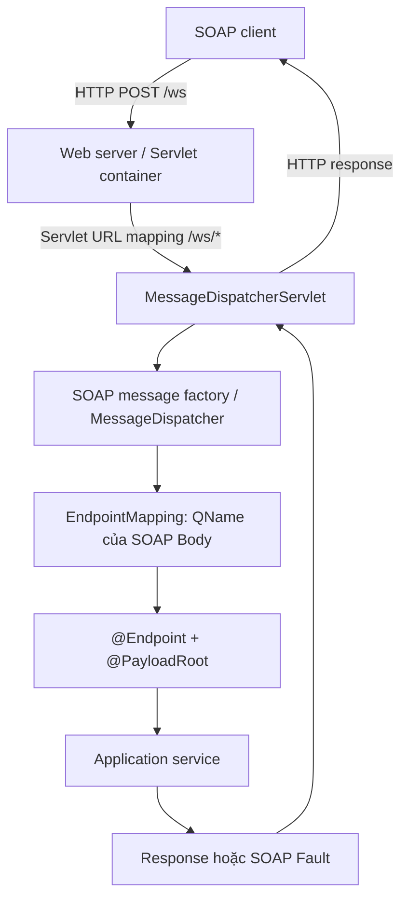

# Đăng ký MessageDispatcherServlet và xác định URL tiếp nhận SOAP

Trong Spring Web Services (Spring-WS), một SOAP endpoint chỉ có thể nhận thông điệp từ hệ thống khác khi ứng dụng đã có một thành phần nhận HTTP request, tạo SOAP message và chuyển thông điệp đến endpoint phù hợp. Thành phần đảm nhiệm vai trò đó trong mô hình servlet là **`MessageDispatcherServlet`**.

Bài học thuộc chương **Cấu hình máy chủ**, tập trung vào việc đăng ký `MessageDispatcherServlet`, thiết kế URL tiếp nhận SOAP, phân biệt URL gọi dịch vụ với URL tải WSDL, và kiểm tra đường đi của request từ HTTP đến `@Endpoint`. Đây là nền tảng để triển khai SOAP **contract-first** với XSD/WSDL, lớp JAXB, client SOAP, interceptor, xử lý SOAP Fault và các yêu cầu bảo mật của tích hợp doanh nghiệp.

## 1. Vì sao có `@Endpoint` vẫn chưa đủ?

Giả sử đã viết một lớp:

```java
@Endpoint
public class OrdersEndpoint {
    // Các handler xử lý SOAP payload sẽ được khai báo ở đây.
}
```

Annotation `@Endpoint` đánh dấu một bean xử lý thông điệp SOAP ở phía server. Tuy nhiên, nó **không tự mở một cổng HTTP** hay tạo URL public. Cần có máy chủ HTTP/Servlet, đăng ký servlet Spring-WS và ánh xạ URL để các request phù hợp được chuyển tới hệ thống dispatcher của Spring-WS.

Trong ứng dụng dùng Servlet API, luồng khái niệm như sau:



Các vai trò cần phân biệt:

| Thành phần | Trách nhiệm |
| --- | --- |
| Servlet container (Tomcat/Jetty/...) | Nhận kết nối HTTP, áp dụng context path, filter và servlet mapping |
| `MessageDispatcherServlet` | Cầu nối từ Servlet HTTP sang hệ thống xử lý message của Spring-WS; có thể phục vụ tài liệu WSDL/XSD được cấu hình |
| `MessageDispatcher` | Điều phối SOAP message tới endpoint mapping, adapter và các cơ chế xử lý liên quan |
| `EndpointMapping` | Chọn endpoint từ thông tin thông điệp, thường là QName phần tử gốc trong SOAP Body |
| `@Endpoint` / `@PayloadRoot` | Đánh dấu và ánh xạ phương thức xử lý payload SOAP |
| JAXB/OXM | Ánh xạ XML ↔ Java nếu cấu hình phù hợp |
| Interceptor / exception resolver | Thực hiện kiểm tra schema, bảo mật, xử lý lỗi hoặc những chức năng cắt ngang |

**Điểm cốt lõi:** servlet mapping xác định *request HTTP nào đi vào Spring-WS*; endpoint mapping xác định *operation/handler nào xử lý SOAP Body*. Hai cơ chế ở hai tầng khác nhau và không thể thay thế nhau.

## 2. Ba loại URL cần gọi đúng tên

Trong một dịch vụ Spring-WS, thường thấy ba địa chỉ:

| Loại địa chỉ | Ví dụ | Phương thức/ý nghĩa |
| --- | --- | --- |
| **SOAP endpoint URL** | `https://api.example.com/ws` | Client gửi HTTP `POST` mang SOAP Envelope |
| **WSDL document URL** | `https://api.example.com/ws/orders.wsdl` | Client hoặc công cụ tích hợp dùng HTTP `GET` để tải hợp đồng WSDL |
| **XSD document URL** (nếu được công bố riêng) | `https://api.example.com/ws/xsd/orders.xsd` | Công cụ tải schema mà WSDL/XSD tham chiếu |

Địa chỉ trong bảng chỉ là ví dụ minh họa. Đường dẫn chính xác phải được kiểm chứng từ **servlet registration**, **context path**, **cấu hình WSDL**, và **cách publish resource** của ứng dụng thực tế.

Đối với SOAP, URL `/ws` **không nhất thiết mang tên nghiệp vụ `GetOrder`**. Khi dùng `@PayloadRoot`, các operation khác nhau có thể cùng được POST tới `/ws`; Spring-WS đọc QName của payload để chọn handler.

Ngược lại, `/ws/orders.wsdl` là một địa chỉ **truy xuất tài liệu hợp đồng**. Đừng lấy URL tải WSDL làm nơi POST SOAP chỉ vì nó chứa tên `orders`; `/ws/orders.wsdl` thường được dùng cho `GET` WSDL.

### Quan hệ giữa hostname, context path và servlet mapping

Một URL có thể hình thành từ:

```text
scheme://host:port + context-path + servlet-path / path-info
```

Ví dụ:

- Host: `http://localhost:8080`.
- Context path: `/integration`.
- Servlet mapping: `/ws/*`.
- SOAP endpoint được cấu hình: `/ws` bên trong ứng dụng.

Khi đó SOAP client gọi `http://localhost:8080/integration/ws`. Nếu ứng dụng công bố bean WSDL tên `orders`, URL WSDL thường ở dạng `http://localhost:8080/integration/ws/orders.wsdl`.

**Không cộng context path hai lần.** `server.servlet.context-path` của Spring Boot là prefix cấp ứng dụng; mapping `/ws/*` là phần nằm **bên trong context path**.

## 3. Đăng ký `MessageDispatcherServlet` trong Spring Boot

Một lựa chọn rõ ràng khi muốn kiểm soát đường dẫn là tự đăng ký bean `ServletRegistrationBean<MessageDispatcherServlet>`. Giả sử dự án sử dụng Spring Boot, Spring Web và Spring-WS tương thích, cấu hình Java có thể viết:

```java
import org.springframework.boot.web.servlet.ServletRegistrationBean;
import org.springframework.context.ApplicationContext;
import org.springframework.context.annotation.Bean;
import org.springframework.context.annotation.Configuration;
import org.springframework.ws.config.annotation.EnableWs;
import org.springframework.ws.transport.http.MessageDispatcherServlet;

@EnableWs
@Configuration
public class WebServiceServerConfig {

    @Bean
    public ServletRegistrationBean<MessageDispatcherServlet>
    messageDispatcherServlet(ApplicationContext applicationContext) {
        MessageDispatcherServlet servlet = new MessageDispatcherServlet();
        servlet.setApplicationContext(applicationContext);
        servlet.setTransformWsdlLocations(true);

        return new ServletRegistrationBean<>(servlet, "/ws/*");
    }
}
```

Giải thích từng dòng quan trọng:

1. **`@Configuration`** đưa bean registration vào Spring application context.
2. **`@EnableWs`** bật các thành phần cấu hình annotation cần thiết để xử lý Spring-WS endpoint.
3. **`MessageDispatcherServlet`** là servlet tiếp nhận request SOAP qua HTTP.
4. **`setApplicationContext(applicationContext)`** cung cấp application context để servlet tìm các thành phần Spring-WS như endpoint, endpoint mapping và WSDL definition.
5. **`ServletRegistrationBean<>(servlet, "/ws/*")`** đăng ký servlet với URL pattern `/ws/*`.
6. **`setTransformWsdlLocations(true)`** yêu cầu servlet có khả năng điều chỉnh vị trí SOAP service trong WSDL được trả về theo request khi phù hợp. Việc công bố URL đúng sau reverse proxy vẫn cần kiểm tra và cấu hình proxy.

Với servlet mapping `/ws/*`, các request vào `/ws` hoặc đường dẫn con như `/ws/orders.wsdl` có thể được chuyển đến servlet; xử lý bên trong tùy phương thức HTTP và tài nguyên/hợp đồng được cấu hình.

**Lưu ý về Spring Boot auto-configuration:** khi dùng starter Spring Web Services, Boot có thể đã cấu hình một `MessageDispatcherServlet` và thuộc tính đường dẫn như `spring.webservices.path` (tùy phiên bản). Nếu chọn cấu hình thủ công ở trên, phải kiểm tra bean và servlet registration đang hoạt động để tránh đăng ký trùng hoặc hiểu nhầm đường dẫn mặc định. Không nên đoán URL mặc định chỉ từ tên starter.

### Ví dụ cấu hình thêm context path

```properties
server.port=8080
server.servlet.context-path=/integration
```

Khi dùng hai thuộc tính này cùng servlet mapping `/ws/*`, URL tiếp nhận SOAP ví dụ là:

```text
http://localhost:8080/integration/ws
```

Nếu ứng dụng chạy sau API gateway có đường dẫn public khác, URL đối tác sử dụng sẽ phụ thuộc cấu hình gateway và forwarded headers, không chỉ hai dòng properties.

## 4. Công bố WSDL và liên kết nó với SOAP endpoint

Trong thiết kế contract-first, hệ thống nên tạo XSD trước để xác định cấu trúc request/response. WSDL sau đó mô tả operation, message, binding và địa chỉ dịch vụ.

Ví dụ có tệp `src/main/resources/xsd/orders.xsd`:

```xml
<?xml version="1.0" encoding="UTF-8"?>
<xs:schema xmlns:xs="http://www.w3.org/2001/XMLSchema"
           xmlns:tns="https://example.com/schema/orders/v1"
           targetNamespace="https://example.com/schema/orders/v1"
           elementFormDefault="qualified">

    <xs:element name="GetOrderRequest">
        <xs:complexType>
            <xs:sequence>
                <xs:element name="orderId" type="xs:positiveInteger"/>
            </xs:sequence>
        </xs:complexType>
    </xs:element>

    <xs:element name="GetOrderResponse">
        <xs:complexType>
            <xs:sequence>
                <xs:element name="status" type="xs:string"/>
            </xs:sequence>
        </xs:complexType>
    </xs:element>
</xs:schema>
```

Ta có thể dùng `DefaultWsdl11Definition` để tạo WSDL 1.1 từ schema. Cấu hình tiếp theo có thể đặt **trong cùng lớp `WebServiceServerConfig` ở phần 3** hoặc trong một lớp `@Configuration` khác được quét:

```java
import org.springframework.context.annotation.Bean;
import org.springframework.core.io.ClassPathResource;
import org.springframework.ws.wsdl.wsdl11.DefaultWsdl11Definition;
import org.springframework.xml.xsd.SimpleXsdSchema;
import org.springframework.xml.xsd.XsdSchema;

@Bean
public XsdSchema ordersSchema() {
    return new SimpleXsdSchema(
            new ClassPathResource("xsd/orders.xsd"));
}

@Bean(name = "orders")
public DefaultWsdl11Definition ordersWsdl(XsdSchema ordersSchema) {
    DefaultWsdl11Definition wsdl = new DefaultWsdl11Definition();
    wsdl.setPortTypeName("OrdersPort");
    wsdl.setTargetNamespace("https://example.com/ws/orders/v1");
    wsdl.setLocationUri("/ws");
    wsdl.setSchema(ordersSchema);
    return wsdl;
}
```

Hai phương thức trên là **các phương thức bean cần đặt bên trong một lớp `@Configuration`**, không phải hai phương thức tự do ngoài class. `@Bean(name = "orders")` là chi tiết quan trọng: với servlet mapping `/ws/*` và cách xử lý mặc định tương ứng, Spring-WS thường cung cấp WSDL ở **`/ws/orders.wsdl`**.

`DefaultWsdl11Definition` thường suy ra operation từ phần tử XSD có hậu tố `Request`/`Response`; ví dụ `GetOrderRequest` và `GetOrderResponse` có thể hình thành operation `GetOrder`. Đây là **quy ước của bộ tạo WSDL**, không phải quy tắc bắt buộc của giao thức SOAP.

`setLocationUri("/ws")` chỉ định vị trí endpoint trong WSDL được tạo. Khi có context path và reverse proxy, hãy **GET WSDL thực tế** để xác nhận giá trị `soap:address location="..."` client nhìn thấy có đúng địa chỉ public hay không.

### Vì sao WSDL URL khác SOAP endpoint URL?

Trong WSDL 1.1, phần `service/port` có thể chứa:

```xml
<wsdl:service name="OrdersService"
              xmlns:wsdl="http://schemas.xmlsoap.org/wsdl/"
              xmlns:soap="http://schemas.xmlsoap.org/wsdl/soap/">
    <wsdl:port name="OrdersPort" binding="tns:OrdersBinding">
        <soap:address location="https://api.example.com/ws"/>
    </wsdl:port>
</wsdl:service>
```

Đoạn XML trên chỉ minh họa trường `soap:address`; trong WSDL hoàn chỉnh phải khai báo prefix `tns` và binding `tns:OrdersBinding` tương ứng. **WSDL document URL** là địa chỉ lấy hợp đồng, còn **`soap:address`** mô tả nơi gọi SOAP operation. Chúng có thể nằm cùng host nhưng phục vụ hai loại thao tác khác nhau.

Nếu hệ thống dùng WSDL tĩnh, có thể sử dụng `SimpleWsdl11Definition` thay cho WSDL tạo động. Khi đó phải chủ động giữ nội dung WSDL, `soap:address` và các XSD import nhất quán với đường dẫn đã đăng ký.

## 5. Định tuyến operation bằng QName, không phải tên đường dẫn

Spring-WS thường sử dụng `@PayloadRoot` để ánh xạ phương thức xử lý theo **QName** (*qualified name*) của phần tử gốc bên trong SOAP Body:

```text
QName = {namespace URI}localPart
```

Với XSD ở phần 4, request phải mang QName:

```text
{https://example.com/schema/orders/v1}GetOrderRequest
```

Endpoint minh họa dùng các lớp `GetOrderRequest` và `GetOrderResponse` được sinh từ XSD bằng JAXB/XJC:

```java
import org.springframework.ws.server.endpoint.annotation.Endpoint;
import org.springframework.ws.server.endpoint.annotation.PayloadRoot;
import org.springframework.ws.server.endpoint.annotation.RequestPayload;
import org.springframework.ws.server.endpoint.annotation.ResponsePayload;

@Endpoint
public class OrdersEndpoint {
    private static final String NS =
            "https://example.com/schema/orders/v1";

    @PayloadRoot(namespace = NS, localPart = "GetOrderRequest")
    @ResponsePayload
    public GetOrderResponse getOrder(
            @RequestPayload GetOrderRequest request) {

        GetOrderResponse response = new GetOrderResponse();
        // Trình bày tối giản: service nghiệp vụ phải tra cứu thực tế.
        response.setStatus("PAID");
        return response;
    }
}
```

Đoạn mã giả định lớp JAXB được sinh có các getter/setter và annotation cần thiết, cùng với endpoint adapter hỗ trợ chuyển đổi payload theo cấu hình Spring-WS. Tùy kiểu XSD và binding JAXB, các global element có thể cần `JAXBElement`/`ObjectFactory` thay vì marshal trực tiếp object; phải kiểm tra mã thực tế được sinh.

Nếu viết client POST tới **cùng URL `/ws`** với payload `CancelOrderRequest`, Spring-WS có thể chuyển tới **handler khác** nếu endpoint mapping đã có `@PayloadRoot` khớp QName đó. **Không có quy tắc tự động** rằng POST `/ws/GetOrder` sẽ chọn `GetOrder` hoặc POST `/ws/CancelOrder` sẽ chọn `CancelOrder`.

### QName khác Java package và HTTP SOAPAction

- Java package do JAXB tạo ra không nhất thiết trùng XML namespace.
- QName của SOAP payload dựa trên **namespace URI + localPart**, không dựa vào tiền tố `ord` cụ thể.
- SOAP 1.1 HTTP header `SOAPAction` là metadata theo binding; khi dùng `@PayloadRoot`, nó **không phải yếu tố chọn handler mặc định**. Spring-WS cũng có thể dùng kiểu mapping khác, như `@SoapAction`, nếu ứng dụng cấu hình theo nhu cầu.
- WS-Addressing `Action` trong SOAP Header là một khái niệm khác với HTTP `SOAPAction`.

Vì thế, lỗi “không tìm thấy endpoint” thường cần kiểm tra QName thực nhận, `@PayloadRoot`, component scanning và `@EnableWs` trước khi đổi URL HTTP.

## 6. Gửi request SOAP 1.1 đến URL vừa đăng ký

Với cấu hình chạy local ở `localhost:8080` và **không đặt context path** (hoặc đã bỏ ví dụ `/integration` ở phần 3), giả sử tệp `request.xml` là:

```xml
<?xml version="1.0" encoding="UTF-8"?>
<soap:Envelope
    xmlns:soap="http://schemas.xmlsoap.org/soap/envelope/"
    xmlns:ord="https://example.com/schema/orders/v1">
    <soap:Header/>
    <soap:Body>
        <ord:GetOrderRequest>
            <ord:orderId>42</ord:orderId>
        </ord:GetOrderRequest>
    </soap:Body>
</soap:Envelope>
```

Gửi HTTP `POST` (mẫu minh họa cho hệ thống có `curl`):

```bash
curl -i -X POST "http://localhost:8080/ws" \
  -H "Content-Type: text/xml; charset=utf-8" \
  -H 'SOAPAction: ""' \
  --data-binary @request.xml
```

Trong PowerShell, dùng `curl.exe` khi muốn chắc chắn gọi binary curl. `Content-Type: text/xml` và Envelope namespace trên tương ứng với **SOAP 1.1**. Header `SOAPAction` cần theo giá trị binding WSDL và chính sách của bên nhận; ví dụ để chuỗi rỗng vì endpoint minh họa định tuyến bằng payload root. Với SOAP 1.2, media type và namespace Envelope khác, đồng thời message factory/server phải được cấu hình tương thích.

Response mong đợi ở mức payload (chỉ minh họa):

```xml
<soap:Envelope
    xmlns:soap="http://schemas.xmlsoap.org/soap/envelope/"
    xmlns:ord="https://example.com/schema/orders/v1">
    <soap:Body>
        <ord:GetOrderResponse>
            <ord:status>PAID</ord:status>
        </ord:GetOrderResponse>
    </soap:Body>
</soap:Envelope>
```

Tiền tố `soap` hoặc `ord` có thể được serializer đổi thành tiền tố khác. Khi kiểm thử, so sánh **namespace URI và local name**, không so sánh chuỗi XML nguyên văn từng ký tự.

Nếu đang dùng `server.servlet.context-path=/integration`, hãy thay URL POST thành `http://localhost:8080/integration/ws`; đường dẫn tới servlet không tự bỏ context path.

## 7. Kiểm tra WSDL bằng HTTP GET

Vì đã khai báo bean WSDL tên `orders`, thử:

```bash
curl -i "http://localhost:8080/ws/orders.wsdl"
```

Khi có context path ở phần 3:

```bash
curl -i "http://localhost:8080/integration/ws/orders.wsdl"
```

Không chỉ nhìn HTTP status. Hãy kiểm tra body thực sự có phần tử WSDL phù hợp (thường là `wsdl:definitions` của WSDL 1.1), namespace, operation `GetOrder`, SOAP binding và `soap:address`.

Nếu WSDL có `xs:import`/`xs:include`, phải tải và kiểm chứng **toàn bộ các XSD phụ thuộc**, kể cả những tài liệu ở tầng sâu. Một XSD đặt tại `src/main/resources/xsd/orders.xsd` **không tự động trở thành URL HTTP** `/ws/xsd/orders.xsd`; nếu WSDL công bố đường dẫn đó, ứng dụng cần có resource mapping hoặc cách publish schema phù hợp.

Một dịch vụ có thể **POST SOAP thành công** nhưng WSDL không tải được vì thiếu bean `WsdlDefinition`; hoặc WSDL tải được nhưng `soap:address` sai khiến client sinh từ WSDL gọi nhầm máy. Vì vậy cần kiểm thử **GET WSDL** và **POST SOAP** độc lập.

## 8. Servlet mapping `/ws/*` khác `/ws` và `/*` như thế nào?

Servlet API hỗ trợ các kiểu URL pattern khác nhau. Việc chọn pattern ảnh hưởng đến những request mà servlet Spring-WS nhận được.

| Pattern | Ý nghĩa thực tế | Khi nào cần cân nhắc |
| --- | --- | --- |
| `/ws/*` | Prefix mapping: servlet nhận `/ws` và những path dưới `/ws/` theo quy tắc Servlet | Lựa chọn thông dụng khi công bố SOAP và WSDL dưới một nhánh |
| `/soap/*` | Tương tự, nhưng prefix công khai là `/soap` | Khi muốn URL tường minh cho hệ thống tích hợp |
| `/ws` | Exact mapping cho đường dẫn `/ws` | Dùng nếu chỉ muốn khớp đúng đường đó; URL con `/ws/orders.wsdl` cần mapping khác |
| `/*` | Mapping rất rộng, có thể nhận cả các URL không liên quan | Chỉ phù hợp nếu ứng dụng chỉ xử lý tập request đó và đã kiểm soát mapping |

Nếu đồng thời có REST controllers, static resources hoặc các servlet khác, prefix riêng `/ws/*` giúp tránh chiếm các URL không liên quan. Đặc biệt không nên đổi sang `/*` để “chữa” một lỗi 404 trước khi xác định request đang bị chặn ở context path, servlet registration hay gateway.

Lưu ý sự khác nhau giữa **URL pattern tại servlet container** và `setLocationUri` trong WSDL:

- `"/ws/*"`: quy tắc lựa chọn **servlet** cho HTTP request.
- `"/ws"`: địa chỉ **service** dự kiến được mô tả trong WSDL.

Giá trị của hai nơi có thể liên quan nhưng không phải cùng loại cấu hình. `setLocationUri("/ws")` không tự đăng ký servlet và `/ws/*` cũng không tự tạo WSDL.

## 9. Khi deploy dạng WAR với servlet container bên ngoài

Nếu không dùng cách đăng ký servlet thủ công của Spring Boot, ứng dụng WAR truyền thống có thể khai báo trực tiếp trong `WEB-INF/web.xml`. Ví dụ dành cho một container tương thích cấu hình Servlet tương ứng:

```xml
<web-app xmlns="http://xmlns.jcp.org/xml/ns/javaee"
         version="3.1">
    <servlet>
        <servlet-name>spring-ws</servlet-name>
        <servlet-class>
            org.springframework.ws.transport.http.MessageDispatcherServlet
        </servlet-class>
        <init-param>
            <param-name>contextConfigLocation</param-name>
            <param-value>/WEB-INF/spring-ws-servlet.xml</param-value>
        </init-param>
        <load-on-startup>1</load-on-startup>
    </servlet>
    <servlet-mapping>
        <servlet-name>spring-ws</servlet-name>
        <url-pattern>/ws/*</url-pattern>
    </servlet-mapping>
</web-app>
```

Ví dụ `web.xml` trên phản ánh **kiểu triển khai WAR truyền thống**, nơi servlet đọc cấu hình Spring từ `/WEB-INF/spring-ws-servlet.xml`. Trong dự án dựa trên Jakarta Servlet và Spring Framework hiện đại, descriptor namespace/phiên bản cần được lựa chọn tương thích với container thực tế; tránh sao chép phiên bản Servlet cũ mà không kiểm tra.

Nếu WAR được deploy với context path `/orders-service`, endpoint có thể xuất hiện ở `/orders-service/ws`. Tên file WAR hoặc cấu hình deploy có thể ảnh hưởng context path trong container bên ngoài.

**Chọn một cơ chế đăng ký servlet phù hợp với kiến trúc.** Không vừa đăng ký cùng một servlet/mapping qua `web.xml`, vừa tạo một registration bean trùng mà không kiểm soát kết quả.

## 10. Reverse proxy, HTTPS và URL công bố ra ngoài

Khi chạy sau Nginx, API gateway, load balancer hoặc Kubernetes ingress, client thường thấy URL khác với ứng dụng nội bộ.

Ví dụ:

| Thành phần | URL minh họa |
| --- | --- |
| Ứng dụng nội bộ | `http://orders-service:8080/ws` |
| Đường dẫn bên ngoài | `https://partner.example.com/orders/ws` |
| WSDL công khai dự kiến | `https://partner.example.com/orders/ws/orders.wsdl` |

Nếu proxy loại bỏ prefix `/orders` trước khi chuyển tiếp request, servlet bên trong vẫn có thể map `/ws/*`. Nhưng client phải gọi **đường dẫn public**, còn WSDL phải mô tả `soap:address` phù hợp với địa chỉ đó.

`setTransformWsdlLocations(true)` giúp điều chỉnh địa chỉ WSDL theo request khi phù hợp, nhưng kết quả phụ thuộc **scheme, host, port và path** mà ứng dụng nhận sau proxy. Nếu forwarded headers không được xử lý đúng, WSDL có thể chứa `http://orders-service:8080/ws`, địa chỉ đối tác không truy cập được.

Trong Spring Boot, cơ chế nhận forwarded headers có thể được cấu hình theo phiên bản và môi trường, ví dụ thông qua thuộc tính:

```properties
server.forward-headers-strategy=framework
```

Đây là một **lựa chọn cấu hình minh họa**, không phải giá trị bắt buộc cho mọi hạ tầng. Chỉ tin các forwarded headers do proxy/gateway đáng tin cậy quản lý; cần cấu hình proxy để ngăn client giả mạo `X-Forwarded-Host` hoặc `X-Forwarded-Proto`. Một số hệ thống dùng xử lý `Forwarded`/`X-Forwarded-*` ở container hoặc cách rewrite WSDL riêng.

### Checklist sau proxy

1. GET WSDL qua **hostname công khai** và xác nhận scheme `https`, host, port, prefix đúng.
2. Kiểm tra `soap:address` trên nội dung WSDL, thay vì chỉ xem URL trong cấu hình Java.
3. Lấy mọi XSD được WSDL import/include từ chính mạng của đối tác; tránh URL `localhost`, tên service nội bộ và đường dẫn chỉ tồn tại trong classpath.
4. POST SOAP đến URL công khai, kiểm tra TLS, authentication, Content-Type, SOAP version và response/Fault.
5. Kiểm tra khi chạy nhiều instance: tất cả instance công bố **cùng phiên bản WSDL/XSD** và cùng endpoint address.

## 11. Ứng dụng có nhiều SOAP service thì thiết kế URL ra sao?

Một ứng dụng có thể phục vụ nhiều operation và nhiều hợp đồng WSDL. Ví dụ:

```text
GET  /ws/orders.wsdl
GET  /ws/customers.wsdl
POST /ws
```

Hai WSDL bean `orders` và `customers` có thể cùng được phục vụ bởi một `MessageDispatcherServlet`; các SOAP payload tương ứng có thể cùng đi qua `/ws` và được dispatcher định tuyến bằng QName.

Nếu yêu cầu bên ngoài phải có URL riêng `/orders` và `/customers`, cần thiết kế có chủ đích cách mapping servlet, context và endpoint mapping. Đừng mặc định Spring-WS sẽ ánh xạ mỗi `@Endpoint` thành một HTTP route tương ứng với tên class như Spring MVC `@RestController`.

| Quyết định thiết kế | Câu hỏi cần trả lời |
| --- | --- |
| Dùng một SOAP URL chung | Client có thể dựa trên QName/SOAPAction và WSDL tương ứng để định tuyến không? |
| Chia service theo nhiều URL | Có yêu cầu phân quyền, giới hạn tải, routing gateway hoặc version URL khác nhau không? |
| Công bố nhiều WSDL | Tên bean `WsdlDefinition` có rõ ràng và không trùng nhau không? |
| Giữ WSDL tĩnh | Địa chỉ `soap:address` và các import có đúng với deployment hiện tại không? |
| Nâng version `v1`/`v2` | Namespace payload, schema, client và URL có chính sách tương thích nhất quán không? |

Tách URL theo nghiệp vụ có thể hữu ích, nhưng không thay thế việc quản lý **QName, namespace, WSDL/XSD version**. Một request gửi đúng URL nhưng sai QName vẫn có thể bị từ chối.

## 12. SOAP request đi qua servlet: validation và WS-Security ở đâu?

`MessageDispatcherServlet` tạo đầu vào cho Spring-WS message pipeline; nó **không tự biến mọi SOAP request thành dữ liệu hợp lệ hoặc đáng tin cậy**.

| Nhu cầu | Thành phần/cấu hình thường liên quan |
| --- | --- |
| Kiểm tra XML theo XSD | `PayloadValidatingInterceptor` hoặc validation của JAXB/OXM |
| Ánh xạ XML ↔ Java | JAXB/XJC-generated classes, `Jaxb2Marshaller`, endpoint adapter |
| SOAP Fault khi lỗi nghiệp vụ | Exception resolver và quy ước fault của dịch vụ |
| Kiểm tra chữ ký XML, timestamp, token | WS-Security interceptor, chính sách và keystore/truststore phù hợp |
| Bảo vệ transport | HTTPS/TLS ở server, gateway hoặc proxy, cấu hình chứng chỉ |
| Theo dõi và chẩn đoán | Correlation ID, logging đã lọc dữ liệu nhạy cảm, metric HTTP/SOAP |

Spring-WS có cơ chế đăng ký interceptors để chạy các bước kiểm tra ở biên message, chẳng hạn `WsConfigurer#addInterceptors`. Cần cấu hình riêng theo nhu cầu: việc `@EnableWs` và servlet hoạt động **không mặc định bật** schema validation, WS-Security, kiểm soát replay hay xác minh chứng chỉ phía client.

Một SOAP Envelope ký số hợp lệ vẫn có thể sai schema; một payload hợp lệ theo XSD vẫn có thể không được phép thực hiện nghiệp vụ. Đặc biệt khi dùng XML Signature, phải bảo đảm dữ liệu được kiểm tra chữ ký chính là dữ liệu endpoint xử lý; không đọc/ghi lại SOAP Body tùy tiện sau bước bảo mật.

Nếu servlet chỉ nhận SOAP 1.1, client gửi SOAP 1.2 với `application/soap+xml` có thể gặp lỗi giao thức. Khả năng chấp nhận SOAP version phụ thuộc `WebServiceMessageFactory` và cấu hình phiên bản tương ứng, không chỉ phụ thuộc URL pattern.

## 13. Chẩn đoán lỗi theo tầng

Khi client báo “không gọi được SOAP”, nên xác định **request đã đi qua tầng nào**:

| Triệu chứng | Lớp nên kiểm tra | Nguyên nhân thường gặp |
| --- | --- | --- |
| `Connection refused` hoặc timeout | Network, port, TLS, gateway | Ứng dụng chưa chạy, sai port, firewall hoặc proxy |
| `404` khi POST `/ws` | Context path, servlet registration, proxy | Quên prefix, mapping sai, thiếu registration |
| `404` khi GET `/ws/orders.wsdl` | WSDL publication/servlet mapping | Bean `orders` không được tạo, servlet không nhận URL này |
| `405 Method Not Allowed` | Phương thức HTTP và servlet | Dùng GET để gọi SOAP thay vì POST, hoặc URL được xử lý bởi thành phần khác |
| `401/403` | Filter, gateway, authentication/authorization | Chưa có credential hoặc thiếu quyền |
| `415 Unsupported Media Type` hoặc lỗi protocol | Content-Type/SOAP version | Envelope SOAP 1.1/1.2 không nhất quán |
| SOAP Fault “no endpoint mapping” | QName payload, component scanning | Namespace/localPart không khớp `@PayloadRoot` hoặc endpoint bean không được phát hiện |
| Lỗi “no adapter for endpoint” | Adapter và chữ ký phương thức | Payload binding/JAXB converter chưa phù hợp |
| SOAP Fault schema validation | XSD, interceptor | Thiếu field, sai thứ tự, sai kiểu, sai namespace |
| WSDL chứa `localhost` hoặc HTTP nội bộ | Proxy/forwarded headers, WSDL transform | Client nhận endpoint URL không thể truy cập |
| Sinh SOAP client thất bại | WSDL/XSD publication | Import XSD sai đường dẫn hoặc document không hợp lệ |
| Lỗi chứng chỉ hoặc WS-Security | TLS/security interceptor | Trust chain, chữ ký, timestamp hoặc token không đúng |

Một `404` là bằng chứng của lỗi định tuyến tại một lớp nào đó, nhưng **không đủ để khẳng định endpoint Java thiếu**. Hãy xác nhận URL, HTTP method, context path và servlet registration trước. Ngược lại, nếu request đã vào Spring-WS và có lỗi “No endpoint mapping found”, lúc đó cần kiểm tra QName và `@PayloadRoot`.

### Quy trình chẩn đoán ngắn

1. Xác nhận ứng dụng đang nghe ở host/port đúng bằng kiểm tra môi trường deploy.
2. GET WSDL từ URL client sử dụng; xem response body và `soap:address`.
3. POST một SOAP Envelope hợp lệ tới endpoint URL trong WSDL.
4. Nếu không tới servlet, kiểm tra context path, servlet mapping, filter và gateway.
5. Nếu tới servlet nhưng không tìm thấy endpoint, kiểm tra QName Body và annotation.
6. Nếu tìm được endpoint nhưng lỗi marshalling, kiểm tra JAXB/XSD và cách tạo root element.
7. Nếu có SOAP Fault, đọc fault code/detail phù hợp SOAP version và kiểm tra log đã lọc nội dung nhạy cảm.
8. Sau mỗi sửa đổi, kiểm tra lại **cả GET WSDL lẫn POST SOAP** từ môi trường gần với đối tác.

## 14. Kiểm thử tự động cho cấu hình servlet và URL

Đối với module contract-first, nên có hai lớp kiểm thử:

**Kiểm thử Spring-WS endpoint bằng mock:** `MockWebServiceClient` cho phép kiểm tra endpoint, payload, interceptor và response mà không cần khởi động HTTP server. Đây là cách tốt để xác nhận `@PayloadRoot` và logic SOAP.

**Kiểm thử HTTP integration:** khởi động ứng dụng với embedded servlet container hoặc môi trường staging, rồi thực hiện GET WSDL và POST SOAP qua URL thật. Bài kiểm thử này cần thiết để phát hiện mapping `/ws/*`, context path, prefix gateway, security filter hoặc `soap:address` sai, những thứ mock endpoint không bao phủ đầy đủ.

| Ca | Điều kiện | Kết quả mong đợi |
| --- | --- | --- |
| T01 | Boot app chạy với servlet mapping `/ws/*`, không context path | POST `/ws` vào Spring-WS |
| T02 | Đặt `server.servlet.context-path=/integration` | POST `/integration/ws` vào Spring-WS |
| T03 | POST `/ws` khi context path là `/integration` | Không vào endpoint đúng URL dự kiến |
| T04 | GET `/ws/orders.wsdl` | Tải được WSDL hợp lệ nếu bean `orders` được công bố |
| T05 | WSDL có import XSD | Mọi XSD phụ thuộc được giải quyết |
| T06 | POST SOAP 1.1 với `GetOrderRequest` đúng namespace | Chọn được `OrdersEndpoint#getOrder` |
| T07 | Đổi root QName sang namespace khác | Không định tuyến đến handler cũ |
| T08 | Gửi SOAP `GetOrderRequest` sai kiểu `orderId` khi bật XSD validation | Bị từ chối theo contract; không chạy thành công nghiệp vụ |
| T09 | Gửi HTTP GET vào URL SOAP `/ws` | Không xử lý như một SOAP POST thành công |
| T10 | Gửi SOAP 1.2 vào server chỉ hỗ trợ SOAP 1.1 | Nhận lỗi SOAP version/protocol phù hợp |
| T11 | Server sau reverse proxy và TLS termination | WSDL công bố `soap:address` đúng URL HTTPS public |
| T12 | Một XSD import bị bỏ khỏi deployment | Kiểm tra hợp đồng báo lỗi sớm |
| T13 | Thêm operation khác dùng QName riêng, cùng `/ws` | Định tuyến đúng endpoint theo payload |
| T14 | Không có `@EnableWs` hoặc bean endpoint không được quét trong cấu hình thủ công | Bài kiểm tra phát hiện không tìm thấy mapping/adapter phù hợp |
| T15 | Yêu cầu WS-Security được cấu hình và token/chữ ký sai | Request bị từ chối trước khi xử lý nghiệp vụ theo chính sách |

Không chỉ assert HTTP `200`. Với SOAP, cần kiểm tra **Envelope/Body namespace, response element, SOAP Fault khi lỗi và tính đúng đắn của WSDL**. Một HTTP response có thể chứa SOAP Fault dù lớp transport trả về một status mà công cụ gọi HTTP coi là thành công hoặc thất bại.

## 15. Bài tập: tìm URL đúng sau khi thay deployment

Cho ứng dụng Spring Boot có:

```properties
server.port=9090
server.servlet.context-path=/erp
```

Servlet được đăng ký với `"/soap/*"`, WSDL bean có tên `inventory` và `setLocationUri("/soap")`. Endpoint có:

```java
@PayloadRoot(
    namespace = "https://example.com/schema/inventory/v1",
    localPart = "CheckStockRequest"
)
```

**Câu hỏi:** trong môi trường local (không có proxy), đường dẫn nào dùng để tải WSDL, đường dẫn nào dùng để POST SOAP, và trường nào quyết định handler?

**Lời giải:**

- WSDL GET thường có dạng `http://localhost:9090/erp/soap/inventory.wsdl`.
- SOAP POST tới `http://localhost:9090/erp/soap`.
- Handler được chọn theo QName `{https://example.com/schema/inventory/v1}CheckStockRequest`, không phải chuỗi `inventory` hay hậu tố `/soap`.
- Nếu client gửi `<CheckStockRequest>` **không có namespace**, QName không khớp và handler này không được chọn theo `@PayloadRoot`.
- Nếu sau này triển khai qua `https://gateway.example.com/api/erp/soap`, phải kiểm chứng rule rewrite của proxy và nội dung WSDL công bố; không thể lấy đường dẫn local làm địa chỉ cho đối tác.

## 16. Checklist trước khi bàn giao endpoint SOAP

1. **Biết chính xác ai đăng ký `MessageDispatcherServlet`**: cấu hình thủ công, Spring Boot auto-configuration hay `web.xml` của WAR; không vô ý tạo mapping trùng.
2. **Servlet URL pattern rõ ràng**, ví dụ `/ws/*`, không chiếm các route REST/static ngoài dự kiến.
3. **Host, port, context path và proxy prefix đúng**, được xác minh từ nơi client sẽ gọi.
4. **Phân biệt được URL GET WSDL và URL POST SOAP**, không sử dụng nhầm `/orders.wsdl` làm SOAP endpoint.
5. **WSDL bean và URL công bố hoạt động**, `soap:address` chỉ tới endpoint public phù hợp.
6. **Mọi XSD/WSDL import tải được**, đúng namespace và cùng phiên bản contract.
7. **`@EnableWs`, `@Endpoint`, `@PayloadRoot` và component scanning** được cấu hình đủ để chọn handler.
8. **JAXB/OXM dùng đúng model đã sinh từ XSD**; biết khi nào cần `JAXBElement` hoặc `ObjectFactory`.
9. **SOAP version, Content-Type và SOAPAction** nhất quán với WSDL/binding và message factory.
10. **Validation, Fault và interceptor bảo mật** được bật theo chính sách, không dựa vào servlet mapping để kiểm tra dữ liệu.
11. **Proxy và forwarded headers được tin cậy có kiểm soát**, WSDL không lộ hostname nội bộ.
12. **Có hai nhóm kiểm thử riêng**: Spring-WS endpoint mock và HTTP integration qua URL/WSDL công bố.

**Kết luận:** `MessageDispatcherServlet` là điểm nối giữa HTTP Servlet và message pipeline của Spring Web Services. Đăng ký đúng servlet tạo được nơi tiếp nhận SOAP; khai báo WSDL và `soap:address` giúp client biết phải gọi đâu; còn `@PayloadRoot` ánh xạ SOAP Body đến operation. Phân biệt rõ ba lớp **URL HTTP, WSDL contract và QName payload** là điều kiện quan trọng để triển khai dịch vụ SOAP contract-first ổn định và dễ tích hợp.
