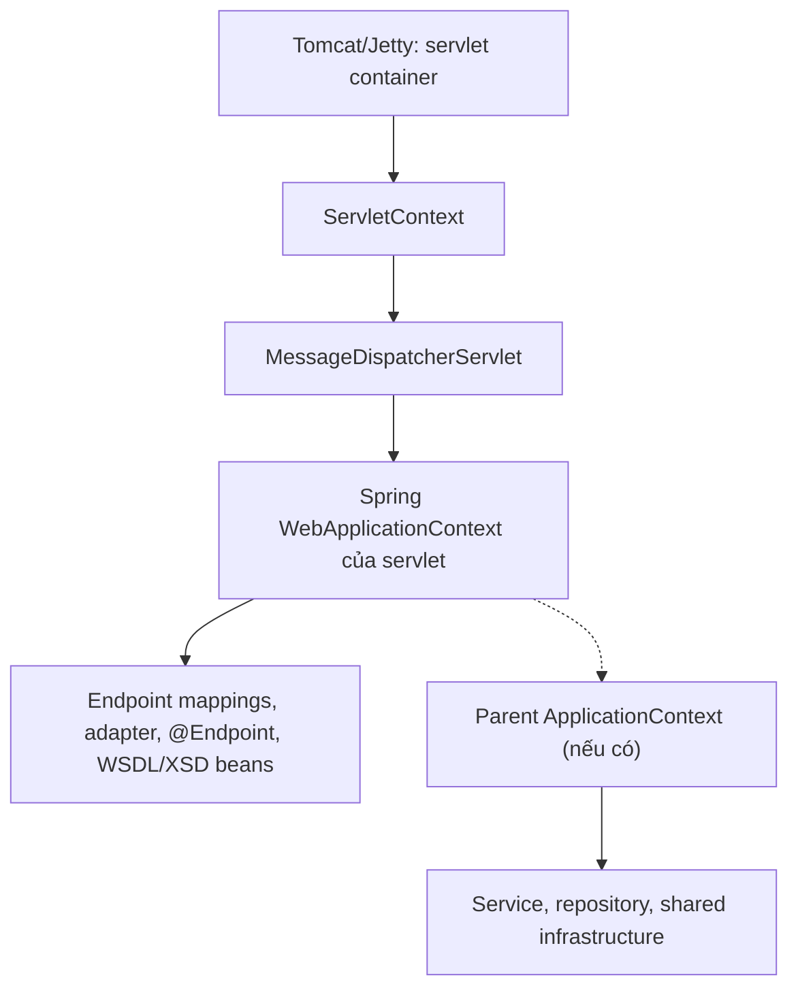
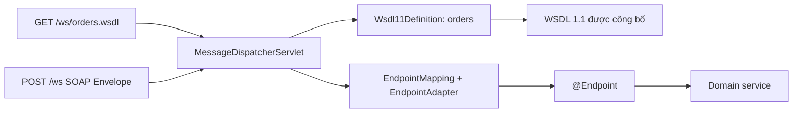

# ApplicationContext của servlet và ngữ cảnh ứng dụng cha

## 1. Vì sao ApplicationContext ảnh hưởng đến SOAP endpoint?

Trong **Spring Web Services (Spring-WS)**, `MessageDispatcherServlet` tiếp nhận HTTP request chứa SOAP Envelope, chuyển thông điệp đến endpoint, rồi tạo SOAP response hoặc SOAP Fault. Servlet chỉ làm việc đúng nếu các bean như `@Endpoint`, `EndpointMapping`, `EndpointAdapter`, WSDL definition và interceptor được đăng ký trong **Spring ApplicationContext mà servlet sử dụng hoặc truy cập được**.

Đây là một điểm quan trọng trong cách phát triển **SOAP contract-first**: XSD/WSDL đã mô tả đúng request/response và JAXB đã sinh đúng các class Java vẫn chưa đủ. Nếu endpoint nằm ở một Spring context khác mà servlet không thấy, request có thể không được định tuyến; nếu WSDL bean nằm sai context, `GET /ws/orders.wsdl` có thể trả 404; nếu cấu hình interceptor nằm ngoài SOAP pipeline, yêu cầu xác thực/chữ ký hoặc validation có thể không được thực thi như mong đợi.

Bài tập trung vào hai mô hình cấu hình máy chủ:

- **Một ApplicationContext chung trong Spring Boot:** một ứng dụng web thường dùng một context chứa service, endpoint, WSDL và cấu hình SOAP.
- **Ngữ cảnh cha (root/parent) và ngữ cảnh con (servlet child):** thường gặp trong WAR truyền thống hoặc khi chủ động tách SOAP và MVC thành các servlet độc lập.

Sau bài học, bạn cần biết phân biệt `ServletContext` với `ApplicationContext`, giải thích chiều nhìn thấy bean giữa parent và child, cấu hình servlet không tạo bean trùng, xác minh endpoint/WSDL tồn tại trong context đúng, và kiểm thử toàn bộ đường đi từ SOAP client tới endpoint.

Ví dụ xuyên suốt: `OrdersService` cung cấp operation `GetOrder`. Hợp đồng đã thống nhất namespace `https://example.org/orders/v1`, request QName `{https://example.org/orders/v1}GetOrderRequest` và response `GetOrderResponse`. Các đường dẫn `/ws`, `/ws/orders.wsdl` và tên domain là ví dụ, không phải địa chỉ dịch vụ thật.

## 2. Ba khái niệm context khác nhau

| Thành phần | Thuộc API | Vai trò |
|---|---|---|
| `jakarta.servlet.ServletContext` | Jakarta Servlet | Quản lý phạm vi web application ở servlet container: registrations, init parameters, tài nguyên và attributes |
| `org.springframework.context.ApplicationContext` | Spring Core | IoC container quản lý bean, dependency injection, cấu hình, sự kiện và tài nguyên |
| `org.springframework.web.context.WebApplicationContext` | Spring Web | ApplicationContext tích hợp với web environment và `ServletContext` |

**`ServletContext` không phải Spring `ApplicationContext`.** Tomcat/Jetty tạo phạm vi servlet web app; Spring tạo một hoặc nhiều IoC containers. `WebApplicationContext` là loại Spring context phục vụ web app và có thể được gắn với `ServletContext`.

Trong ứng dụng Spring Boot servlet web, context nền thường là `ServletWebServerApplicationContext`. Trong WAR truyền thống, `ContextLoaderListener` thường tạo root `WebApplicationContext`; `MessageDispatcherServlet` hoặc `DispatcherServlet` có thể tạo child `WebApplicationContext` riêng. Mô hình Boot một context không bắt buộc phải có child như WAR truyền thống.



Điểm dễ nhầm: file Java đã được biên dịch và có mặt trong JAR không chứng minh rằng Spring đã khởi tạo bean của lớp đó. `@Endpoint` chỉ trở thành bean khi được component scan hoặc đăng ký vào một ApplicationContext. Cũng không nên coi `ServletContext.setAttribute(...)` là một cách tự động đăng ký Spring bean.

## 3. Mô hình root parent và servlet child

Một kiến trúc có cấu trúc:

```text
Root WebApplicationContext
  ├── OrdersService
  ├── OrdersRepository
  ├── DataSource / transaction infrastructure
  └── Shared authentication/business configuration
          |
          +--- SOAP WebApplicationContext (child)
          |      ├── @EnableWs / annotation infrastructure
          |      ├── OrdersEndpoint
          |      ├── EndpointMapping / EndpointAdapter
          |      ├── SOAP interceptors / fault resolver
          |      └── Wsdl11Definition / XsdSchema
          |
          +--- MVC WebApplicationContext (child)
                 ├── MVC controllers
                 └── MVC mappings/views
```

Các quy tắc quan trọng của Spring context hierarchy:

1. **Child có thể tìm bean ở parent.** Do đó `OrdersEndpoint` trong SOAP child có thể inject `OrdersService` thuộc root.
2. **Parent không tự nhìn thấy bean chỉ có ở child.** Root service không nên phụ thuộc trực tiếp vào `OrdersEndpoint` chỉ được tạo trong SOAP child.
3. **Hai sibling child không tự nhìn thấy bean của nhau.** MVC child không tự nhìn thấy `OrdersEndpoint` nằm trong SOAP child.
4. **Tên bean ở child có thể che tên ở parent** khi lookup từ child. Hai bean cùng tên nhưng khác kiểu/phạm vi dễ gây lỗi khó phát hiện.
5. **Bean cùng class được scan ở cả hai context có thể tạo hai instance.** Tùy state, cache, transaction và interceptor, việc tạo trùng có thể gây lỗi hành vi ngoài mong đợi.

Cần phân biệt **khả năng nhìn thấy bean** với **cách một Spring framework strategy cụ thể tìm bean**. Một số cơ chế tra cứu theo kiểu có thể tìm cả ancestor; những cơ chế khác chỉ xem bean trong context hiện tại. Vì vậy, không nên dựa vào suy đoán «parent có bean thì servlet chắc chắn tự đăng ký toàn bộ endpoint mapping». Hãy đặt các thành phần SOAP trong context được chỉ định và kiểm thử pipeline thực.

### Phân chia trách nhiệm hợp lý

| Root / parent | SOAP child |
|---|---|
| Repository, domain service, transaction, shared infrastructure | `@Endpoint`, `@EnableWs`, SOAP endpoint mapping và adapter |
| Service nghiệp vụ không phụ thuộc SOAP | `PayloadValidatingInterceptor`, SOAP fault resolver |
| Tài nguyên dùng chung được thiết kế rõ | WSDL/XSD definitions phục vụ servlet |
| Cấu hình identity/security chung, nếu được tổ chức như shared service | Xác thực SOAP message, WS-Security interceptor khi cần |

Trong mô hình **một context**, tất cả các bean trên có thể nằm trong cùng context; vẫn nên tách package/module để ranh giới trách nhiệm rõ ràng.

## 4. MessageDispatcherServlet và Spring-WS pipeline

`MessageDispatcherServlet` kế thừa cơ chế servlet của Spring và được dùng như điểm vào HTTP cho Spring-WS. Dữ liệu từ transport được đưa vào `MessageDispatcher`, sau đó các thành phần liên quan chọn endpoint và xử lý request.

| Thành phần | Công việc |
|---|---|
| `MessageDispatcherServlet` | Nhận HTTP, xử lý yêu cầu tài liệu WSDL/XSD, chuyển SOAP message cho dispatcher |
| `MessageDispatcher` | Phối hợp endpoint mappings, adapters và exception handling |
| `EndpointMapping` | Chọn handler theo nội dung SOAP, ví dụ payload QName hoặc SOAP action |
| `EndpointAdapter` | Gọi endpoint method phù hợp annotation/chữ ký |
| `@Endpoint`, `@PayloadRoot` | Đăng ký bean và xác định payload QName của operation |
| `EndpointInterceptor` | Validation, logging, WS-Security và xử lý trước/sau khi gọi endpoint |
| `Wsdl11Definition` | Nguồn WSDL công bố |
| `XsdSchema` | Schema được dùng để công bố hoặc validate payload |

`@EnableWs` thường được dùng để kích hoạt cấu hình annotation support trong Java config; WAR XML truyền thống có thể dùng `<sws:annotation-driven/>`. Nếu bean endpoint trong SOAP child nhưng mapping/adapter không được kích hoạt đúng ở context tương ứng, Spring có thể không tìm thấy method handler.

### Hai đường đi độc lập



**Công bố WSDL thành công không chứng minh endpoint chạy đúng.** GET WSDL chỉ xác nhận tài liệu có thể tải và bean thích hợp được tìm thấy. POST SOAP vẫn phải qua endpoint mapping, JAXB conversion, validation, lỗi và bảo mật.

## 5. Trường hợp 1: Spring Boot và một ApplicationContext chung

Đây là cách thường đủ cho ứng dụng Spring Boot cung cấp một SOAP API.

### 5.1. Đăng ký servlet bằng Java config

```java
import org.springframework.boot.web.servlet.ServletRegistrationBean;
import org.springframework.context.ApplicationContext;
import org.springframework.context.annotation.Bean;
import org.springframework.context.annotation.Configuration;
import org.springframework.ws.config.annotation.EnableWs;
import org.springframework.ws.transport.http.MessageDispatcherServlet;

@Configuration
@EnableWs
public class SoapServerConfiguration {

    @Bean
    public ServletRegistrationBean<MessageDispatcherServlet> soapServlet(
            ApplicationContext applicationContext) {
        MessageDispatcherServlet servlet =
            new MessageDispatcherServlet();

        servlet.setApplicationContext(applicationContext);

        // Bật transform chỉ khi chính sách WSDL/proxy cho phép.
        servlet.setTransformWsdlLocations(false);

        return new ServletRegistrationBean<>(servlet, "/ws/*");
    }
}
```

Ở đây servlet được cấu hình dùng **ApplicationContext đã tồn tại của Spring Boot**, nên các bean được khai báo và scan trong ứng dụng có thể nằm cùng context với cấu hình SOAP.

**Lưu ý về auto-configuration:** tùy phiên bản Spring Boot starter, `MessageDispatcherServlet` có thể đã được auto-configure/auto-register. Nếu chọn cấu hình servlet thủ công, hãy kiểm tra cơ chế tự động và tránh đăng ký **hai servlet SOAP chồng mapping**. Cách dùng property auto-configure và cách đăng ký thủ công là hai lựa chọn cần quyết định rõ, không áp dụng cả hai một cách máy móc.

### 5.2. WSDL đã được phê duyệt

Nếu hợp đồng tĩnh nằm tại `src/main/resources/wsdl/orders.wsdl`:

```java
import org.springframework.context.annotation.Bean;
import org.springframework.context.annotation.Configuration;
import org.springframework.core.io.ClassPathResource;
import org.springframework.ws.wsdl.wsdl11.SimpleWsdl11Definition;

@Configuration
public class OrdersWsdlConfiguration {
    @Bean(name = "orders")
    public SimpleWsdl11Definition ordersWsdl() {
        SimpleWsdl11Definition definition =
            new SimpleWsdl11Definition();
        definition.setWsdl(
            new ClassPathResource("wsdl/orders.wsdl"));
        return definition;
    }
}
```

Với servlet mapping `/ws/*` và context path mặc định, bean tên `orders` thường được công bố tại `GET /ws/orders.wsdl`. Tên bean ảnh hưởng đường dẫn tải hợp đồng. **Địa chỉ SOAP POST** lại đến từ `soap:address location` của WSDL hoặc endpoint URL mà client được cấp, chẳng hạn `/ws`.

Nếu dự án dùng `DefaultWsdl11Definition` để sinh WSDL từ XSD, cũng cần đặt bean trong context được servlet sử dụng. Với hợp đồng đã phê duyệt, không tùy ý thay WSDL tĩnh bằng WSDL sinh ra: tên operation, binding, SOAPAction và fault definition có thể khác.

### 5.3. Endpoint nhận payload theo QName

```java
import org.springframework.ws.server.endpoint.annotation.Endpoint;
import org.springframework.ws.server.endpoint.annotation.PayloadRoot;
import org.springframework.ws.server.endpoint.annotation.RequestPayload;
import org.springframework.ws.server.endpoint.annotation.ResponsePayload;

@Endpoint
public class OrdersEndpoint {
    private static final String NS =
        "https://example.org/orders/v1";

    private final OrdersService ordersService;

    public OrdersEndpoint(OrdersService ordersService) {
        this.ordersService = ordersService;
    }

    @PayloadRoot(namespace = NS, localPart = "GetOrderRequest")
    @ResponsePayload
    public GetOrderResponse getOrder(
            @RequestPayload GetOrderRequest request) {

        Order order = ordersService.findById(request.getOrderId());
        GetOrderResponse result = new GetOrderResponse();
        result.setOrderId(order.id());
        result.setStatus(order.status());
        return result;
    }
}
```

Ví dụ giả định `OrdersService`, `Order` và JAXB DTO được định nghĩa/sinh từ XSD đã duyệt; `order.status()` có kiểu tương thích với JAXB setter. Nếu JAXB generator sinh root thông qua `JAXBElement`/`ObjectFactory` thay vì `@XmlRootElement`, endpoint mapping và cách marshalling cần điều chỉnh theo model thực tế.

`@PayloadRoot` so khớp **namespace URI + local name** của root element trong SOAP Body. Cần tránh nhầm địa chỉ namespace XML với HTTP endpoint URL: namespace có thể trông như URL nhưng không phải nơi gửi request.

### 5.4. Component scan vẫn là điều kiện bắt buộc

Để ví dụ chạy, `SoapServerConfiguration`, `OrdersWsdlConfiguration` và `OrdersEndpoint` phải được Spring nạp/scan, đồng thời `OrdersService` cũng phải được đăng ký bean. Một class có annotation `@Endpoint` nhưng nằm ngoài vùng scan vẫn không tồn tại trong context.

Trong Boot, vùng component scan mặc định bắt đầu từ package của lớp `@SpringBootApplication`. Nếu cấu hình và endpoint nằm ngoài cây package đó, cần `@Import` hoặc explicit `@ComponentScan` phù hợp. Không mở rộng scan tràn lan để chữa lỗi thiếu một bean; xác nhận package nào thuộc trách nhiệm của ứng dụng và loại bỏ bean trùng.

## 6. Trường hợp 2: WAR truyền thống với root và SOAP child

Một ứng dụng WAR trên servlet container có thể tạo root context bằng `ContextLoaderListener`, rồi để `MessageDispatcherServlet` khởi tạo child WebApplicationContext của riêng nó.

### 6.1. Khai báo bằng `web.xml`

```xml
<web-app xmlns="https://jakarta.ee/xml/ns/jakartaee"
         version="6.0">

  <context-param>
    <param-name>contextConfigLocation</param-name>
    <param-value>/WEB-INF/root-context.xml</param-value>
  </context-param>

  <listener>
    <listener-class>
      org.springframework.web.context.ContextLoaderListener
    </listener-class>
  </listener>

  <servlet>
    <servlet-name>spring-ws</servlet-name>
    <servlet-class>
      org.springframework.ws.transport.http.MessageDispatcherServlet
    </servlet-class>
    <init-param>
      <param-name>contextConfigLocation</param-name>
      <param-value>/WEB-INF/spring-ws-servlet.xml</param-value>
    </init-param>
    <load-on-startup>1</load-on-startup>
  </servlet>

  <servlet-mapping>
    <servlet-name>spring-ws</servlet-name>
    <url-pattern>/ws/*</url-pattern>
  </servlet-mapping>
</web-app>
```

Đoạn trên minh họa bố cục với **Jakarta Servlet 6**; file triển khai thực cần đúng schema/version của container. Hệ Spring/Servlet cũ sử dụng `javax.servlet` và cấu hình namespace/version tương ứng.

`ContextLoaderListener` tạo root context theo `root-context.xml`; `MessageDispatcherServlet` sử dụng servlet context cấu hình bởi `spring-ws-servlet.xml`. Với bố cục root/child của Spring, child có thể lấy service từ root, còn root không tự lấy endpoint chỉ nằm trong child.

### 6.2. Root context chỉ đăng ký bean dùng chung

Ví dụ `root-context.xml`:

```xml
<beans xmlns="http://www.springframework.org/schema/beans"
       xmlns:context="http://www.springframework.org/schema/context"
       xmlns:xsi="http://www.w3.org/2001/XMLSchema-instance"
       xsi:schemaLocation="
         http://www.springframework.org/schema/beans
         https://www.springframework.org/schema/beans/spring-beans.xsd
         http://www.springframework.org/schema/context
         https://www.springframework.org/schema/context/spring-context.xsd">

  <context:component-scan
      base-package="org.example.orders.domain,org.example.orders.persistence"/>
</beans>
```

SOAP child config trong `spring-ws-servlet.xml`:

```xml
<beans xmlns="http://www.springframework.org/schema/beans"
       xmlns:context="http://www.springframework.org/schema/context"
       xmlns:sws="http://www.springframework.org/schema/web-services"
       xmlns:xsi="http://www.w3.org/2001/XMLSchema-instance"
       xsi:schemaLocation="
         http://www.springframework.org/schema/beans
         https://www.springframework.org/schema/beans/spring-beans.xsd
         http://www.springframework.org/schema/context
         https://www.springframework.org/schema/context/spring-context.xsd
         http://www.springframework.org/schema/web-services
         https://www.springframework.org/schema/web-services/web-services.xsd">

  <sws:annotation-driven/>

  <context:component-scan
      base-package="org.example.orders.soap.endpoint"/>

  <bean id="orders"
        class="org.springframework.ws.wsdl.wsdl11.SimpleWsdl11Definition">
    <property name="wsdl" value="classpath:wsdl/orders.wsdl"/>
  </bean>
</beans>
```

Hai ví dụ XML chỉ là **phương án của WAR truyền thống**, không cần thêm vào Spring Boot ứng dụng đã cấu hình bằng Java. Mỗi mô hình phải được kiểm tra theo version Spring-WS/Spring Framework và servlet container của dự án.

### 6.3. Nếu còn có Spring MVC servlet

Một WAR có thể phục vụ cả SOAP và MVC:

```text
Root WebApplicationContext
    |
    +-- SOAP child -> MessageDispatcherServlet (/ws/*)
    |
    +-- MVC child  -> DispatcherServlet (/app/*)
```

Hai child dùng chung domain service ở parent. MVC controller nằm trong MVC child không tự trở thành SOAP endpoint; `@Endpoint` của SOAP child cũng không cần xuất hiện trong MVC child. Việc chia theo package/contex rõ ràng giảm nguy cơ scanner tạo hai instance của cùng service.

## 7. Khi nào cần tự tạo child context bằng Java?

Đôi khi Spring Boot có nhiều SOAP servlet với mappings và interceptors độc lập hoặc cần cô lập SOAP module khỏi cấu hình MVC. Khi đó có thể cấu hình một child `WebApplicationContext` có parent rõ ràng.

### 7.1. Đăng ký servlet với child context

```java
import org.springframework.boot.web.servlet.ServletRegistrationBean;
import org.springframework.context.ApplicationContext;
import org.springframework.context.annotation.Bean;
import org.springframework.context.annotation.Configuration;
import org.springframework.web.context.support.AnnotationConfigWebApplicationContext;
import org.springframework.ws.transport.http.MessageDispatcherServlet;

@Configuration
public class SoapChildRegistration {

    @Bean
    public ServletRegistrationBean<MessageDispatcherServlet> soapChildServlet(
            ApplicationContext parentContext) {

        AnnotationConfigWebApplicationContext child =
            new AnnotationConfigWebApplicationContext();
        child.setParent(parentContext);
        child.register(SoapChildConfiguration.class);

        MessageDispatcherServlet servlet =
            new MessageDispatcherServlet(child);
        servlet.setTransformWsdlLocations(false);

        return new ServletRegistrationBean<>(servlet, "/ws/*");
    }
}
```

Ví dụ child configuration:

```java
import org.springframework.context.annotation.Bean;
import org.springframework.context.annotation.ComponentScan;
import org.springframework.context.annotation.Configuration;
import org.springframework.core.io.ClassPathResource;
import org.springframework.ws.config.annotation.EnableWs;
import org.springframework.ws.wsdl.wsdl11.SimpleWsdl11Definition;

@EnableWs
@Configuration
@ComponentScan(basePackages = "org.example.orders.soap.endpoint")
public class SoapChildConfiguration {
    @Bean(name = "orders")
    public SimpleWsdl11Definition ordersWsdl() {
        SimpleWsdl11Definition definition =
            new SimpleWsdl11Definition();
        definition.setWsdl(new ClassPathResource("wsdl/orders.wsdl"));
        return definition;
    }
}
```

**Điều kiện rất quan trọng:** `SoapChildConfiguration` và các endpoint chỉ thuộc child phải không bị scan/đăng ký lại vào parent. Với `@SpringBootApplication`, component scan mặc định thường đi qua toàn bộ các subpackage, vì vậy cần tách package scan hoặc exclude/import rõ ràng. Nếu cả parent lẫn child scan cùng SOAP endpoint, thiết kế cô lập sẽ không còn đúng.

Ngoài ra cần tránh auto-configuration đăng ký servlet thứ hai với mapping giao nhau; xác nhận child được khởi tạo/đóng đúng vòng đời; test đường request bằng HTTP thật. Đây là phương án nâng cao, chỉ nên chọn nếu nhu cầu cô lập giữa servlet thực sự có lợi hơn độ phức tạp bổ sung.

## 8. Đặt nhầm bean trong context: triệu chứng và cách sửa

### 8.1. `No endpoint mapping found`

Nguyên nhân khả dĩ:

- `OrdersEndpoint` không nằm trong vùng component scan của SOAP servlet context.
- `@EnableWs` và endpoint mappings không được thiết lập ở vùng SOAP pipeline đang dùng.
- Request có QName khác `@PayloadRoot` vì sai namespace hoặc tên phần tử.
- Request bị route vào servlet khác do URL mapping/gateway.
- Các bean cùng tên hoặc config bị ghi đè/che khuất.

Cách điều tra: xác định servlet thực nhận request, kiểm tra context thực của servlet, kiểm tra bean endpoint/mapping và đối chiếu **QName của XML trong SOAP Body** với XSD.

### 8.2. Không inject được service

Ví dụ thông báo:

```text
No qualifying bean of type 'OrdersService' available
```

Nếu `OrdersService` nằm đúng trong parent thì SOAP child có thể inject. Nếu service chỉ nằm ở một **sibling child**, SOAP child sẽ không nhìn thấy. Ngoài ra, có thể do profile, conditional bean, component scan thiếu package hoặc ambiguity khi có nhiều implementation.

Đừng vội tạo thêm `OrdersService` ở child để hết lỗi. Hãy làm rõ bean ownership, constructor injection và context hierarchy; tạo trùng bean có thể làm mất state dùng chung hoặc cấu hình transaction.

### 8.3. WSDL trả 404

Nếu bean `@Bean(name="orders")` nằm trong MVC child còn SOAP servlet phục vụ `/ws/*`, GET `/ws/orders.wsdl` có thể không tìm được WSDL definition. Kiểm tra bean name, `Wsdl11Definition` type, SOAP servlet mapping, nơi đăng ký bean và file WSDL trong runtime classpath.

Một lỗi khác là tên bean đúng nhưng URL GET sai context path, chẳng hạn ứng dụng được deploy tại `/orders-app` nên tài liệu có URL `/orders-app/ws/orders.wsdl`.

### 8.4. Có bean nhưng SOAP interceptor không hoạt động

Một `PayloadValidatingInterceptor` hoặc `Wss4jSecurityInterceptor` bean tồn tại trong root không bảo đảm nó đã được gắn vào endpoint mappings mà servlet sử dụng. Cần cấu hình registrar/`WsConfigurer` phù hợp và **test request âm tính** để chứng minh interceptor thật sự chạy.

Tương tự, fault resolver chỉ được khai báo trong một context khác không tự đảm bảo SOAP dispatcher sử dụng resolver đó. Kiểm tra SOAP Fault thực tế khi request sai XML, đơn hàng không tồn tại hoặc lỗi nội bộ.

### 8.5. Bean duplicate hoặc shadowing

Nếu child và parent cùng có bean tên `ordersMarshaller`, lookup có thể chọn child bean trong khi bean parent có cấu hình JAXB package khác. Có thể phát sinh lỗi XML namespace/`JAXBElement` dù endpoint đã được tìm đúng.

Khi nhiều client hoặc contract version tồn tại, đặt tên rõ và dùng `@Qualifier`:

```java
public OrdersClient(
        @Qualifier("ordersV1WebServiceTemplate")
        WebServiceTemplate template) {
    this.template = template;
}
```

Ví dụ cần có bean `ordersV1WebServiceTemplate` thực tế. Nếu client và server sử dụng JAXB khác nhau, cần xác nhận context/marshaller mà từng đường xử lý thực sự dùng. Tạo bean `Jaxb2Marshaller` cho client **không tự buộc mọi `@Endpoint` của server phải dùng bean đó**.

## 9. SOAP interceptor, JAXB, fault và bảo mật trong hierarchy

| Bean / trách nhiệm | Vị trí khuyến nghị khi có root và SOAP child |
|---|---|
| Domain service, repository, transaction | Root |
| SOAP `@Endpoint` và endpoint mapping/adapter | SOAP child |
| `PayloadValidatingInterceptor` | SOAP child và được gắn vào SOAP pipeline |
| SOAP Fault resolver | SOAP child |
| `Wsdl11Definition` / `XsdSchema` dùng cho publication | Context SOAP servlet có thể truy cập |
| `Jaxb2Marshaller` cho SOAP client | Context sở hữu `WebServiceTemplate` tương ứng |
| TLS/mTLS và HTTP connector | Servlet container, gateway hoặc HTTP transport |
| WS-Security interceptor/crypto | Pipeline SOAP được bảo vệ, secret ở môi trường tin cậy |

### 9.1. Ví dụ validation interceptor

```java
@EnableWs
@Configuration
public class SoapValidationConfiguration extends WsConfigurerAdapter {

    private final XsdSchema ordersSchema;

    public SoapValidationConfiguration(XsdSchema ordersSchema) {
        this.ordersSchema = ordersSchema;
    }

    @Override
    public void addInterceptors(List<EndpointInterceptor> interceptors) {
        PayloadValidatingInterceptor validator =
            new PayloadValidatingInterceptor();
        validator.setXsdSchema(ordersSchema);
        validator.setValidateRequest(true);
        validator.setValidateResponse(true);
        interceptors.add(validator);
    }
}
```

Ví dụ cần import `WsConfigurerAdapter`, `XsdSchema`, `EndpointInterceptor`, `PayloadValidatingInterceptor` và `java.util.List`; `ordersSchema` phải là bean đã đăng ký đúng schema. Nếu dùng child context, đặt cấu hình này trong **SOAP child** và tránh duplicate `@EnableWs`/registrations giữa parent và child.

Một XSD đã được công bố qua WSDL không đồng nghĩa payload tự động được validate. Việc JAXB unmarshal thành công cũng không tự chứng minh tất cả XSD facets đều đúng. Khi triển khai, test request sai namespace, thiếu phần tử bắt buộc, enum không hợp lệ và response không khớp schema.

### 9.2. WS-Security và XML security

Spring-WS có thể tích hợp WS-Security với `Wss4jSecurityInterceptor` để kiểm tra chữ ký, timestamp, chứng chỉ X.509 hoặc mã hóa theo chính sách. HTTPS/mTLS bảo vệ tầng kết nối. Những biện pháp này cần được cấu hình đúng **trên request pipeline mà SOAP servlet sử dụng**, không đơn thuần là khai báo bean bất kỳ.

Test tối thiểu:
 
- Request hợp lệ với chữ ký/chứng chỉ được tin cậy được chấp nhận.
- Chữ ký sai, timestamp quá hạn, credential thiếu hoặc không hợp lệ bị từ chối trước khi xử lý nghiệp vụ được bảo vệ.
- XML parser chống DTD/external entities (XXE) và có giới hạn tài nguyên.
- SOAP Fault và log không làm lộ khóa, token, dữ liệu nhạy cảm hoặc stack trace.

Quan hệ context quyết định khả năng nhìn thấy bean; **kiểm thử bảo mật thực** mới chứng minh biện pháp được kích hoạt.

## 10. URL servlet, địa chỉ WSDL và reverse proxy là những lớp riêng

Servlet mapping trả lời «request HTTP vào servlet nào?»; context hierarchy trả lời «servlet đó thấy bean nào?». WSDL trả lời «client nên gọi SOAP service bằng giao diện nào?».

Ví dụ:
 
```text
Client GET  https://soap.example.org/ws/orders.wsdl
Client POST https://soap.example.org/ws
                   |
                   v
         HTTPS reverse proxy
                   |
                   v
         http://orders-service:8080/ws
                   |
                   v
         MessageDispatcherServlet
```

Khi SOAP servlet chạy sau proxy:

- `setTransformWsdlLocations(false)` giữ `soap:address` có trong WSDL đã xuất bản.
- `setTransformWsdlLocations(true)` cho phép biến đổi địa chỉ trong WSDL dựa trên request; chỉ phù hợp khi hợp đồng cho phép.
- `Forwarded`/`X-Forwarded-Host`/`X-Forwarded-Proto` cần được cung cấp qua **proxy đáng tin**. Không tin vào header host do client ngoài tự ý đặt.
- Nếu WSDL import `orders.xsd` bằng đường dẫn tương đối, client phải tải được schema qua URL được giải quyết từ nơi WSDL đã được tải; tài nguyên trong classpath không tự thành HTTP resource.

Một WSDL GET thành công nhưng SOAP POST 404 có thể do `soap:address` sai, reverse proxy rewrite path sai hoặc servlet mapping không đúng; không nhất thiết do Spring ApplicationContext.

## 11. Kiểm thử ApplicationContext của servlet đúng cách

### 11.1. Smoke test bean

```java
@SpringBootTest
class OrdersContextTest {

    @Autowired
    ApplicationContext applicationContext;

    @Test
    void ordersEndpointIsRegistered() {
        assertNotNull(applicationContext.getBean(OrdersEndpoint.class));
    }
}
```

Test này chỉ chứng minh `OrdersEndpoint` thuộc **test application context đang được inject**. Nếu runtime có **child WebApplicationContext**, test trên root không đủ để chứng minh servlet thấy đúng endpoint. Cần kiểm tra chính context mà servlet dùng.

### 11.2. Test parent–child visibility

Nếu test fixture đã tạo `ApplicationContext parent` và `ConfigurableApplicationContext child` đúng cấu hình:
 
```java
assertSame(parent, child.getParent());
assertNotNull(child.getBean(OrdersService.class));

assertThrows(
    NoSuchBeanDefinitionException.class,
    () -> parent.getBean(OrdersEndpoint.class)
);
assertNotNull(child.getBean(OrdersEndpoint.class));
```

Ví dụ giả định `OrdersService` được đăng ký ở parent còn `OrdersEndpoint` **chỉ** nằm trong child, và đã import các hàm assertion/JUnit tương ứng. Quan hệ bean đúng vẫn chưa chứng minh HTTP request đang đi tới servlet gắn với child này.

### 11.3. Test SOAP qua HTTP

Request SOAP 1.1 minh họa:
 
```xml
<env:Envelope
    xmlns:env="http://schemas.xmlsoap.org/soap/envelope/"
    xmlns:ord="https://example.org/orders/v1">
  <env:Body>
    <ord:GetOrderRequest>
      <ord:orderId>ORD-000123</ord:orderId>
    </ord:GetOrderRequest>
  </env:Body>
</env:Envelope>
```

Gửi bằng shell tương thích POSIX, với `get-order-soap11.xml` chứa Envelope trên:
 
```bash
curl -i -X POST "http://localhost:8080/ws" \
  -H 'Content-Type: text/xml; charset=utf-8' \
  -H 'SOAPAction: "urn:example:orders:GetOrder"' \
  --data-binary @get-order-soap11.xml
```

Request phải đến đúng servlet, chọn đúng `@PayloadRoot`, nhận service từ context thích hợp, trả XML response phù hợp XSD và xử lý SOAP Fault đúng hợp đồng.

Một kiểm thử đầy đủ có các lớp:
 
| Tầng | Bằng chứng cần có |
|---|---|
| Context hierarchy | Parent relation và bean ownership đúng |
| Bean wiring | Endpoint, mapping, adapter, WSDL, interceptor và service có trong vùng phù hợp |
| Spring-WS mock test | `MockWebServiceClient` dùng đúng Spring context và chọn handler |
| HTTP GET metadata | WSDL/XSD tải được qua đường servlet thực |
| HTTP POST SOAP | QName, SOAPAction, binding và response/fault đúng |
| Proxy/transport | HTTPS, hostname, cert, forwarded headers và SOAP path đúng |
| Security | Request sai chữ ký, credential, schema bị từ chối |
| Interoperability | Client khác stack Java/Spring có thể gọi theo hợp đồng |

**`MockWebServiceClient` không thay thế test HTTP qua servlet/proxy.** Nó xác minh Spring-WS dispatch trong context kiểm thử, nhưng không bao phủ đầy đủ servlet registration, reverse proxy hay TLS.

## 12. Ma trận chẩn đoán lỗi phổ biến

| Triệu chứng | Khả năng liên quan tới context | Việc kiểm tra |
|---|---|---|
| GET WSDL trả 404 | Bean WSDL ở sai context hoặc sai tên | Servlet mapping, bean `orders`, resource |
| POST SOAP 404 | Route tới sai servlet hoặc sai context path | URL, servlet registrations và proxy |
| `No endpoint mapping found` | Endpoint không được scan vào context phục vụ SOAP | Bean endpoint, mapping, QName |
| `No qualifying bean of type OrdersService` | Service không nằm ở parent/child mà endpoint nhìn thấy | Component scan, context parent |
| Hai instance domain service | Parent và child scan trùng | Bean ownership và package scope |
| Exception resolver không được dùng | Resolver ở context khác hoặc không được dispatcher gắn | SOAP pipeline, resolver ordering |
| Validator không chạy | Interceptor chưa được đăng ký vào endpoint mapping | Test request sai schema |
| WS-Security bị bỏ qua | Security interceptor chỉ được khai báo nhưng chưa gắn vào mapping | Test chữ ký/token sai |
| WSDL dùng URL nội bộ | Proxy forwarding hoặc WSDL transform sai | GET qua public URL, kiểm tra `soap:address` |
| Client marshal nhưng server lỗi JAXB | Hai đường JAXB context/adapter khác nhau | Root QName, JAXB model và endpoint adapter |
| Sau deploy mới lỗi | Runtime profile/scan/autoconfig/classpath khác | Startup logs, bean registrations, artifact thực |
| HTTP 415 hoặc VersionMismatch | SOAP version/media type khác WSDL | `Content-Type`, Envelope namespace và binding |

Quy trình điều tra:

1. Xác nhận URL, method, servlet mapping, context path và gateway thực nhận request.
2. Xác định servlet đang sử dụng Spring context chung hay child; nếu là child, parent của nó là context nào?
3. Kiểm tra endpoint/mapping/adapter/WSDL/XSD/interceptor/fault resolver nằm ở đâu.
4. So sánh payload QName, SOAP version, SOAPAction với WSDL/XSD đã phê duyệt.
5. Kiểm thử từng tầng: GET WSDL, XSD imports, SOAP POST, SOAP Fault, negative validation và security.
6. Sửa đúng tầng: scan/context nếu bean thiếu; servlet/proxy nếu route sai; XML/hợp đồng nếu QName sai.
7. Đưa request gây lỗi thành regression test.

## 13. Quyết định kiến trúc và kiểm soát thay đổi

| Điều kiện | Mô hình thường phù hợp |
|---|---|
| Một SOAP API trên Spring Boot | Một ApplicationContext chung |
| WAR có SOAP và MVC servlet | Root context dùng chung và child riêng cho mỗi servlet |
| Nhiều SOAP endpoint cần mapping/security độc lập | Cân nhắc nhiều SOAP child contexts |
| Chỉ có nhiều SOAP client outbound | Tách `WebServiceTemplate` beans, không nhất thiết tách servlet contexts |
| Nhiều version WSDL/XSD | Phân vùng JAXB/marshaller và endpoint theo version; chỉ tạo child khi thực sự cần |
| Lỗi scan trùng, bean shadowing | Làm rõ package, naming, visibility trước khi thêm context |

Một ranh giới thiết kế có ích:

```text
SOAP servlet / child:
  SOAP Envelope -> JAXB DTO -> OrdersEndpoint
                                |
                                v
Parent/domain:
                          OrdersService
                                |
                                v
                         OrdersRepository
                                |
                                v
SOAP servlet / child:
  Domain result -> JAXB response / SOAP Fault
```

Endpoint phụ trách giao thức, JAXB và ánh xạ lỗi SOAP; service phụ trách nghiệp vụ. Parent/child hỗ trợ chiều phụ thuộc này: **SOAP child có thể dùng bean ở root**, còn domain service không cần phụ thuộc vào SOAP endpoint.

Việc nâng cấp Spring Boot/Spring-WS hay thay đổi cách bootstrap từ WAR sang Boot có thể làm thay đổi context topology. Cần xem đó là **thay đổi cấu hình có ảnh hưởng đến hợp đồng runtime**, xác minh với kiểm thử WSDL/SOAP/Fault/Security thay vì chỉ xác nhận application start.

## 14. Bài tập thực hành

Giả sử WAR có root context chứa `OrdersService` và `OrdersRepository`, SOAP child phục vụ `/ws/*` với `OrdersEndpoint`, `Wsdl11Definition` tên `orders`, endpoint mapping và interceptor; MVC child phục vụ `/app/*` với controller riêng. Hãy thực hiện:

1. Vẽ sơ đồ context hierarchy, ghi rõ nơi sở hữu từng bean.
2. Chứng minh SOAP child inject được `OrdersService` từ parent; root không tự thấy endpoint chỉ có trong child.
3. Cố tình đặt `OrdersEndpoint` ngoài component scan của SOAP child; gửi SOAP request và ghi nhận lỗi.
4. Đưa endpoint về đúng context rồi xác minh `@PayloadRoot` khớp QName.
5. Cố tình đặt WSDL bean `orders` trong MVC sibling; kiểm tra GET `/ws/orders.wsdl`; trả về đúng context.
6. Cho root và child cùng scan `OrdersService`, quan sát số instance và phân tích rủi ro.
7. Đăng ký `PayloadValidatingInterceptor` trong SOAP child và gửi request sai XSD; chứng minh validator chạy.
8. Gửi SOAP request lỗi nghiệp vụ; kiểm tra fault resolver trả mã và detail đúng hợp đồng.
9. Kiểm tra WSDL qua public HTTPS URL, imported XSD và `soap:address` sau reverse proxy.
10. Dùng client độc lập sinh từ WSDL để xác minh khả năng tương thích.

**Câu hỏi tự kiểm tra:** Một bean trong parent có phải tự động là endpoint không? Vì sao GET WSDL 200 vẫn có thể POST SOAP thất bại? Tại sao `ServletContext` không phải một IoC container? Khi nào nên tạo child riêng thay vì dùng context chung của Boot? Vì sao cần test HTTP thật thay vì chỉ test `@Autowired OrdersEndpoint`?

## 15. Definition of Done

Trước khi bàn giao cấu hình Spring-WS server, cần có bằng chứng:

- [ ] Đã xác định `ServletContext`, Spring `ApplicationContext` của servlet và parent/child (nếu có).
- [ ] Mỗi bean có phạm vi rõ, không scan trùng service/endpoint hoặc đăng ký servlet chồng mapping.
- [ ] `@EnableWs`/annotation infrastructure, endpoint mappings, adapters và `@Endpoint` thuộc pipeline được servlet sử dụng.
- [ ] Endpoint inject được domain service từ context thích hợp, không phụ thuộc ngược sai chiều.
- [ ] GET WSDL và các XSD import thành công qua URL thực mà client sẽ dùng.
- [ ] SOAP POST tới đúng servlet, chọn QName phù hợp, trả response/fault theo XSD/WSDL.
- [ ] Validation, fault resolver và WS-Security interceptor đã được kiểm chứng bằng cả test thành công và test lỗi.
- [ ] Reverse proxy, TLS, hostname và `soap:address` công bố đúng chính sách.
- [ ] Có context tests, HTTP tests, XML schema validation và interoperability tests trong quy trình hồi quy.

Một cấu hình máy chủ Spring-WS đáng tin cậy cho phép đội phát triển trả lời chính xác: **request đến servlet nào, servlet dùng ApplicationContext nào, bean được tìm ở đâu, và hệ thống đã kiểm chứng các khâu SOAP nào?** Đây là nền tảng để triển khai dịch vụ SOAP contract-first ổn định qua nhiều môi trường và vòng đời phát hành.

## 16. Tài liệu tham khảo

- [Spring Framework — ApplicationContext](https://docs.spring.io/spring-framework/reference/core/beans/basics.html): bean container và dependency injection.
- [Spring Framework — WebApplicationContext](https://docs.spring.io/spring-framework/docs/current/javadoc-api/org/springframework/web/context/WebApplicationContext.html): Spring context dành cho web application.
- [Spring Framework — FrameworkServlet](https://docs.spring.io/spring-framework/docs/current/javadoc-api/org/springframework/web/servlet/FrameworkServlet.html): lifecycle và cấu hình Spring servlet web application context.
- [Spring Framework — DispatcherServlet](https://docs.spring.io/spring-framework/reference/web/webmvc/mvc-servlet.html): root/child context và chiến lược web servlet.
- [Spring Web Services — MessageDispatcherServlet API](https://docs.spring.io/spring-ws/docs/current/api/org/springframework/ws/transport/http/MessageDispatcherServlet.html): servlet xử lý SOAP và metadata.
- [Spring Web Services — Reference Documentation](https://docs.spring.io/spring-ws/docs/current/reference/html/): endpoint configuration, annotation mapping, WSDL/XSD, interceptor và SOAP Fault.
- [Spring Boot — Web Services](https://docs.spring.io/spring-boot/reference/io/webservices.html): cơ chế Spring-WS trong Spring Boot.
- [W3C — WSDL 1.1](https://www.w3.org/TR/wsdl.html): hợp đồng message, binding, operation và SOAP address.
