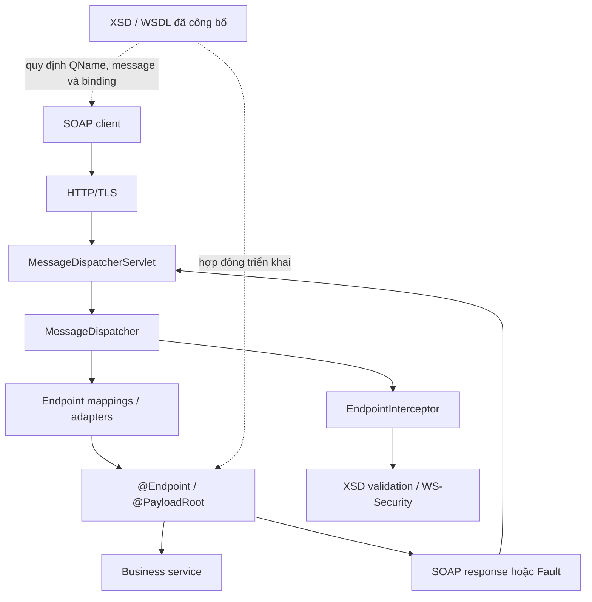

# Kích hoạt cấu hình bằng @EnableWs

Trong dự án **Spring Web Services (Spring-WS)**, việc có thư viện SOAP trên classpath không tự bảo đảm server biết xử lý một thông điệp SOAP. Spring cần hạ tầng nhận thông điệp, tìm endpoint, gọi phương thức đã đánh dấu annotation và đưa kết quả trở lại SOAP Body. Annotation **`@EnableWs`** là một điểm khởi đầu quan trọng để kích hoạt hạ tầng xử lý SOAP bằng cấu hình Java.

Bài học thuộc chương **Cấu hình máy chủ** trong module **SPRING_WEB_SERVICES**. Bối cảnh xuyên suốt là phát triển SOAP **contract-first**: XSD/WSDL là hợp đồng, JAXB ánh xạ XML với Java, `@Endpoint` xử lý nghiệp vụ, client gửi SOAP qua HTTP và hệ thống phải kiểm soát SOAP Fault, interceptor, XML security, WS-Security, chứng chỉ cũng như kiểm thử tương thích.

Nội dung quan trọng nhất không chỉ là biết đặt `@EnableWs` ở đâu, mà còn hiểu **nó kích hoạt những gì, không tự kích hoạt những gì**, và cách kết nối các thành phần để một dịch vụ thực sự nhận được request từ bên ngoài.

## 1. Mục tiêu học tập

Sau bài này, bạn có thể:

- Giải thích vai trò của `@EnableWs` trong cấu hình Spring Web Services dựa trên annotation.
- Phân biệt hạ tầng SOAP dispatch với `MessageDispatcherServlet`, `@Endpoint`, cấu hình JAXB, XSD/WSDL và bảo mật.
- Tạo cấu hình máy chủ SOAP có `@EnableWs`, servlet mapping, XSD và WSDL bean.
- Giải thích vì sao `@PayloadRoot` định tuyến theo **QName của phần tử payload** thay vì theo tên Java method.
- Mở rộng cấu hình bằng `WsConfigurer` để đăng ký interceptor kiểm tra XSD và chuẩn bị cho WS-Security.
- Nhận biết lỗi khi thiếu servlet, sai namespace, sai đường dẫn WSDL hoặc XML không khớp schema.
- Xây dựng kiểm thử xác minh endpoint, SOAP Fault và đường đi thực tế qua HTTP/TLS.

## 2. Vị trí của `@EnableWs` trong kiến trúc Spring-WS

Một dịch vụ SOAP có nhiều thành phần và vòng đời khác nhau:



Trong luồng này:

1. **`MessageDispatcherServlet`** tiếp nhận request HTTP được ánh xạ vào URL SOAP.
2. **`MessageDispatcher`** xử lý SOAP message và phối hợp việc tìm endpoint, chạy interceptor, gọi endpoint adapter và tạo response.
3. **Endpoint mapping** nhận diện SOAP request và tìm phương thức phù hợp, điển hình bằng `@PayloadRoot`.
4. **Endpoint adapter/argument resolver/return value handler** chuyển payload vào tham số Java và đưa kết quả vào response.
5. **`@Endpoint`** cung cấp logic điều phối tới business service.
6. **Interceptor** có thể kiểm tra payload, ghi log, xác minh WS-Security hoặc bổ sung xử lý liên quan SOAP.
7. **XSD/WSDL** là hợp đồng của thông điệp; chúng không tự chạy nghiệp vụ.

`@EnableWs` kích hoạt cấu hình hạ tầng xử lý SOAP bằng annotation trong Spring application context. Tuy nhiên, **annotation không tự thay thế mọi thành phần còn lại**. Đặc biệt cần phân biệt việc cấu hình Spring-WS với việc mở một HTTP servlet để mạng bên ngoài có thể truy cập.

## 3. `@EnableWs` thực sự làm gì?

Annotation sử dụng trong cấu hình Java:

```java
import org.springframework.context.annotation.Configuration;
import org.springframework.ws.config.annotation.EnableWs;

@EnableWs
@Configuration
public class SoapConfiguration {
}
```

Khi Spring xử lý lớp cấu hình, `@EnableWs` import hạ tầng cấu hình Spring-WS cần thiết cho cách khai báo endpoint bằng annotation. Trong các phiên bản Spring-WS hiện đại, hạ tầng này cung cấp các chiến lược mặc định cho **message dispatch**, gồm endpoint mapping/adapter phù hợp với `@Endpoint` và các annotation xử lý payload thông dụng; nó cũng hỗ trợ các điểm mở rộng qua `WsConfigurer`.

Có thể hiểu ngắn gọn:

**`@EnableWs` giúp Spring hiểu cách gọi endpoint SOAP đã được khai báo**, còn một request từ bên ngoài có thực sự đi tới hệ thống đó hay không phụ thuộc thêm servlet/transport và cấu hình web.

### `@EnableWs` không tự làm những việc nào?

| Điều thường bị hiểu nhầm | Thực tế cần thêm |
|---|---|
| “Đặt `@EnableWs` là tự có URL `/ws`.” | Cần `MessageDispatcherServlet` hoặc cơ chế servlet auto-configuration/mapping phù hợp. |
| “Đặt annotation là WSDL xuất hiện.” | Cần WSDL definition bean hoặc cơ chế công bố hợp đồng. |
| “WSDL đã có nghĩa là endpoint chạy.” | Cần `@Endpoint` được Spring phát hiện và ánh xạ đúng QName. |
| “JAXB sẽ tự hoạt động với mọi class.” | Cần lớp JAXB phù hợp XSD, runtime và adapter/marshalling theo kiểu dữ liệu sử dụng. |
| “Request được validate theo XSD mặc định.” | Cần chủ động cấu hình validation nếu hợp đồng yêu cầu. |
| “SOAP Fault sẽ tự có detail nghiệp vụ đúng XSD.” | Cần quy tắc exception/Fault mapping phù hợp. |
| “SOAP Header tự có xác thực WS-Security.” | Cần thư viện và interceptor WS-Security cùng cấu hình crypto/policy. |
| “SOAP API đã được bảo vệ HTTPS.” | Cần cấu hình TLS, certificate, network và HTTP security riêng. |
| “Service đã sẵn sàng cho đối tác dùng.” | Cần công bố WSDL/XSD, kiểm thử client thật và xác minh URL public. |

Không nên ghi `@EnableWs` ở nhiều lớp chỉ để “chắc chắn được bật”. Trong một Spring application context, thông thường một cấu hình kích hoạt rõ ràng là đủ; các cấu hình khác nên tập trung vào endpoint, schema, security và phụ thuộc.

## 4. Quan hệ giữa Spring Boot và `@EnableWs`

Khi sử dụng Spring Boot, dependency thường bắt đầu từ:

```xml
<dependency>
    <groupId>org.springframework.boot</groupId>
    <artifactId>spring-boot-starter-web-services</artifactId>
</dependency>
```

Starter cung cấp tích hợp cần thiết cho Spring-WS theo bộ phiên bản do Spring Boot quản lý. Spring Boot còn có thể auto-configure **`MessageDispatcherServlet`** và servlet mapping theo điều kiện của phiên bản và cấu hình dự án. Vì vậy, cần tránh đăng ký trùng servlet nếu Boot đã cung cấp một servlet phù hợp.

Một cấu hình server có thể dùng:

- **Phương án A:** dựa vào web services auto-configuration của Boot để cung cấp servlet và sử dụng `@EnableWs`/cấu hình Spring-WS phù hợp với phiên bản đang dùng.
- **Phương án B:** chủ động khai báo `MessageDispatcherServlet`, bean WSDL, XSD và các interceptor để kiểm soát rõ URL, behavior và chính sách publish.

Bài học dùng **phương án B** làm ví dụ đầy đủ, bởi nó cho thấy rành mạch trách nhiệm của từng thành phần. Nếu dự án đã có servlet do Boot tự tạo, hãy chọn một chiến lược rõ ràng và kiểm tra danh sách servlet mapping khi chạy.

### Phân biệt `@EnableWs` và `@EnableWebMvc`

- `@EnableWs` kích hoạt cấu hình **Spring Web Services** cho SOAP endpoint.
- `@EnableWebMvc` kích hoạt cấu hình **Spring MVC** dành cho controller HTTP/MVC theo cơ chế riêng.
- REST controller dùng `@RestController` và SOAP endpoint dùng `@Endpoint` không phải cùng một mô hình định tuyến.
- Không cần thêm `@EnableWebMvc` để gọi SOAP. Trong ứng dụng Spring Boot, tự bật `@EnableWebMvc` có thể làm thay đổi hoặc vô hiệu hóa một phần MVC auto-configuration mong đợi, nên chỉ sử dụng khi có chủ đích.

SOAP và REST có thể cùng tồn tại trong một ứng dụng nếu đường dẫn servlet/filter được thiết kế rõ ràng, ví dụ `/ws/*` cho SOAP và `/api/*` cho REST.

## 5. Ví dụ cấu hình hoàn chỉnh: `@EnableWs`, servlet và WSDL

Giả sử contract được công bố dưới tên `orders`. Ứng dụng phục vụ SOAP tại đường dẫn `/ws` và WSDL dự kiến ở `/ws/orders.wsdl`. Ví dụ sau dành cho **Spring Boot có servlet stack, Spring-WS và các phụ thuộc phù hợp**.

```java
package org.example.soap.config;

import org.springframework.boot.web.servlet.ServletRegistrationBean;
import org.springframework.context.ApplicationContext;
import org.springframework.context.annotation.Bean;
import org.springframework.context.annotation.Configuration;
import org.springframework.core.io.ClassPathResource;
import org.springframework.ws.config.annotation.EnableWs;
import org.springframework.ws.transport.http.MessageDispatcherServlet;
import org.springframework.ws.wsdl.wsdl11.DefaultWsdl11Definition;
import org.springframework.xml.xsd.SimpleXsdSchema;
import org.springframework.xml.xsd.XsdSchema;

@EnableWs
@Configuration
public class WebServiceConfiguration {

    private static final String ORDER_NS =
        "https://example.org/contracts/order/v1";

    @Bean
    public ServletRegistrationBean<MessageDispatcherServlet>
            messageDispatcherServlet(ApplicationContext context) {

        MessageDispatcherServlet servlet =
            new MessageDispatcherServlet();
        servlet.setApplicationContext(context);
        servlet.setTransformWsdlLocations(true);

        return new ServletRegistrationBean<>(
            servlet,
            "/ws/*"
        );
    }

    @Bean
    public XsdSchema ordersSchema() {
        return new SimpleXsdSchema(
            new ClassPathResource("xsd/orders-v1.xsd")
        );
    }

    @Bean(name = "orders")
    public DefaultWsdl11Definition ordersWsdl(
            XsdSchema ordersSchema) {

        DefaultWsdl11Definition definition =
            new DefaultWsdl11Definition();

        definition.setPortTypeName("OrdersPort");
        definition.setLocationUri("/ws");
        definition.setTargetNamespace(ORDER_NS);
        definition.setSchema(ordersSchema);

        return definition;
    }
}
```

Đoạn mã thể hiện bốn trách nhiệm độc lập:

1. **`@EnableWs`** kích hoạt cấu hình xử lý annotation endpoint của Spring-WS.
2. **`MessageDispatcherServlet`** tiếp nhận request khớp servlet mapping `/ws/*`.
3. **`XsdSchema`** nạp XSD nghiệp vụ từ classpath.
4. **`DefaultWsdl11Definition`** dùng schema và quy ước tên để xây dựng WSDL 1.1.

`orders-v1.xsd` phải thực sự có trong classpath, ví dụ `src/main/resources/xsd/orders-v1.xsd`. Các đường dẫn `/ws` và `/ws/orders.wsdl` phụ thuộc vào context path, servlet mapping và quy tắc công bố WSDL của phiên bản đang chạy; không nên hard-code URL public trong tài liệu đối tác trước khi kiểm tra bản WSDL đã xuất thực tế.

### Vai trò của bean name `orders`

Spring-WS thường công bố WSDL definition bean tên `orders` theo URL tương ứng `orders.wsdl` dưới mapping của `MessageDispatcherServlet`. Tên bean **không phải** QName của SOAP payload và không phải tên operation WSDL.

Ví dụ:

```text
Bean name:              orders
URL WSDL dự kiến:       /ws/orders.wsdl
SOAP endpoint dự kiến:  /ws
Input XML element:      GetOrderStatusRequest
Operation WSDL:         GetOrderStatus
```

Bốn tên này thuộc bốn lớp cấu hình khác nhau. Có thể đặt gần giống nhau để dễ quản lý, nhưng chúng không tự động thay thế nhau.

### `setTransformWsdlLocations(true)` có tác dụng gì?

Tùy cấu hình, servlet có thể biến đổi địa chỉ `soap:address` trong WSDL đã công bố để phản ánh URL mà request đang dùng. Cơ chế này giúp khi triển khai trên nhiều host, nhưng **không sửa toàn bộ vấn đề reverse proxy**: nếu gateway không truyền đúng thông tin scheme/host/port hoặc cấu hình xử lý forwarded headers chưa phù hợp, WSDL vẫn có thể chứa địa chỉ nội bộ, HTTP thay vì HTTPS, hoặc cổng sai.

Hãy kiểm tra WSDL qua **URL đối tác thật sự truy cập**, không chỉ `localhost`.

## 6. XSD contract-first và quy ước sinh operation

Một schema rút gọn phù hợp với ví dụ trên:

```xml
<?xml version="1.0" encoding="UTF-8"?>
<xs:schema
    xmlns:xs="http://www.w3.org/2001/XMLSchema"
    xmlns:ord="https://example.org/contracts/order/v1"
    targetNamespace="https://example.org/contracts/order/v1"
    elementFormDefault="qualified">

    <xs:element name="GetOrderStatusRequest">
        <xs:complexType>
            <xs:sequence>
                <xs:element name="orderId" type="xs:string"/>
            </xs:sequence>
        </xs:complexType>
    </xs:element>

    <xs:element name="GetOrderStatusResponse">
        <xs:complexType>
            <xs:sequence>
                <xs:element name="orderId" type="xs:string"/>
                <xs:element name="status" type="xs:string"/>
            </xs:sequence>
        </xs:complexType>
    </xs:element>
</xs:schema>
```

Với `DefaultWsdl11Definition` và các quy ước suffix input/output mặc định phù hợp, Spring-WS có thể suy ra thao tác `GetOrderStatus` từ cặp phần tử `GetOrderStatusRequest` / `GetOrderStatusResponse`. Khi hợp đồng sử dụng quy ước khác, có thể cần cấu hình suffix hoặc dùng WSDL tĩnh.

Chuỗi liên hệ cần nắm:

```text
XSD global element GetOrderStatusRequest
    ↓
WSDL message / part của input
    ↓
WSDL portType operation GetOrderStatus
    ↓
SOAP binding và service address
    ↓
SOAP Body có GetOrderStatusRequest
    ↓
Spring-WS @PayloadRoot localPart="GetOrderStatusRequest"
```

**Tên `GetOrderStatus` của operation** không đồng nghĩa tên phần tử root `GetOrderStatusRequest`. Khi ánh xạ `@PayloadRoot`, phải dựa vào **QName của phần tử đầu tiên trong SOAP Body**, không dựa vào tên Java method, WSDL bean hay URI endpoint.

### Khi nào dùng WSDL tĩnh?

`DefaultWsdl11Definition` hữu ích để học và để sinh các hợp đồng đơn giản từ schema, nhưng không phải giải pháp duy nhất cho mọi WSDL. Nếu đối tác đã ký một WSDL cụ thể có `wsdl:fault`, SOAPAction, binding hoặc tên operation đặc thù, dùng **`SimpleWsdl11Definition`** để công bố WSDL tĩnh có thể phù hợp hơn.

```java
@Bean(name = "orders")
public org.springframework.ws.wsdl.wsdl11.SimpleWsdl11Definition
        ordersWsdl() {

    return new org.springframework.ws.wsdl.wsdl11.SimpleWsdl11Definition(
        new ClassPathResource("wsdl/orders.wsdl")
    );
}
```

Đây là **phương án thay thế**, không được đồng thời định nghĩa thêm bean `orders` của `DefaultWsdl11Definition` trong cùng context. Với WSDL tĩnh, ứng dụng phải bảo đảm `xs:import`, `wsdl:import` và mọi `schemaLocation` được công bố/truy cập đúng từ phía client. Spring-WS không tự bảo đảm các tệp phụ trợ ấy được publish chỉ vì WSDL bean tồn tại.

## 7. Từ `@EnableWs` đến `@Endpoint` và `@PayloadRoot`

Bây giờ khai báo một SOAP endpoint thực sự xử lý input:

```java
package org.example.soap.endpoint;

import org.springframework.ws.server.endpoint.annotation.Endpoint;
import org.springframework.ws.server.endpoint.annotation.PayloadRoot;
import org.springframework.ws.server.endpoint.annotation.RequestPayload;
import org.springframework.ws.server.endpoint.annotation.ResponsePayload;

@Endpoint
public class OrderEndpoint {

    private static final String NAMESPACE =
        "https://example.org/contracts/order/v1";

    private final OrderQueryService service;

    public OrderEndpoint(OrderQueryService service) {
        this.service = service;
    }

    @PayloadRoot(
        namespace = NAMESPACE,
        localPart = "GetOrderStatusRequest"
    )
    @ResponsePayload
    public GetOrderStatusResponse getStatus(
            @RequestPayload GetOrderStatusRequest request) {

        GetOrderStatusResponse response =
            new GetOrderStatusResponse();

        response.setOrderId(request.getOrderId());
        response.setStatus(
            service.findStatus(request.getOrderId())
        );

        return response;
    }
}
```

Ví dụ giả định:

- `GetOrderStatusRequest`, `GetOrderStatusResponse` là kiểu JAXB đã sinh từ XSD hoặc đã được ánh xạ tương thích.
- `OrderQueryService` là service nghiệp vụ của ứng dụng và trả về trạng thái dưới dạng chuỗi; trong dự án thực phải định nghĩa và đăng ký bean đó.
- Mã có import các annotation của Spring-WS; các import JAXB/generated model được lược bỏ.
- Runtime chứa JAXB implementation phù hợp phiên bản Spring/Spring-WS; cấu hình endpoint adapter hỗ trợ loại tham số/giá trị trả về đang dùng.
- Nếu generator sinh `JAXBElement<T>` hoặc lớp không có `@XmlRootElement`, chữ ký endpoint và wrapper phải điều chỉnh theo binding thực tế.

Điểm cốt lõi của `@EnableWs` là nó cho phép hạ tầng Spring-WS sử dụng các annotation này để xác định và gọi endpoint. Tuy nhiên, **`@EnableWs` không tự sinh Java class JAXB hoặc business service**.

### Component scan có phát hiện `@Endpoint` không?

`@Endpoint` là một Spring stereotype. Trong ứng dụng Spring Boot, `@SpringBootApplication` thông thường kích hoạt component scanning từ package chứa ứng dụng trở xuống. Nếu lớp endpoint nằm ngoài các package được quét, Spring không tạo bean và mọi mapping tương ứng cũng không tồn tại.

Ví dụ cấu trúc package nên dễ quét:

```text
org.example.soap
├── SoapApplication.java          (@SpringBootApplication)
├── config
│   └── WebServiceConfiguration.java  (@EnableWs)
├── endpoint
│   └── OrderEndpoint.java         (@Endpoint)
├── service
│   └── OrderQueryService.java
└── contract
    └── [generated JAXB classes]
```

Nếu cấu hình nằm ngoài đường quét, có thể dùng `@Import` hoặc cấu hình component scan có chủ đích. Đừng kết luận “`@EnableWs` không hoạt động” khi lỗi thực tế là **bean `@Endpoint` chưa được tạo**.

## 8. SOAP request và response đi qua server như thế nào?

Request SOAP 1.1 có thể được client gửi tới URL `/ws`:

```http
POST /ws HTTP/1.1
Host: api.example.org
Content-Type: text/xml; charset=utf-8
SOAPAction: "urn:order:GetOrderStatus"

[SOAP Envelope]
```

Phần SOAP Envelope minh họa:

```xml
<soap:Envelope
    xmlns:soap="http://schemas.xmlsoap.org/soap/envelope/"
    xmlns:ord="https://example.org/contracts/order/v1">
    <soap:Header/>
    <soap:Body>
        <ord:GetOrderStatusRequest>
            <ord:orderId>ORD-1024</ord:orderId>
        </ord:GetOrderStatusRequest>
    </soap:Body>
</soap:Envelope>
```

Khi `MessageDispatcherServlet` nhận request và hạ tầng mapping hoạt động, `@PayloadRoot` tìm:

```text
Namespace URI: https://example.org/contracts/order/v1
Local part:    GetOrderStatusRequest

QName mở rộng:
{https://example.org/contracts/order/v1}GetOrderStatusRequest
```

Nếu endpoint trả kết quả thành công, phản hồi có thể là:

```xml
<soap:Envelope
    xmlns:soap="http://schemas.xmlsoap.org/soap/envelope/"
    xmlns:ord="https://example.org/contracts/order/v1">
    <soap:Body>
        <ord:GetOrderStatusResponse>
            <ord:orderId>ORD-1024</ord:orderId>
            <ord:status>SHIPPED</ord:status>
        </ord:GetOrderStatusResponse>
    </soap:Body>
</soap:Envelope>
```

Đây là ví dụ request–response document/literal ở mức ý tưởng. Kết quả thật còn phụ thuộc WSDL binding, JAXB serialization, version SOAP và cách endpoint xử lý. Hãy luôn validate **SOAP Body payload** theo XSD đã công bố.

### Vì sao prefix không quan trọng bằng namespace?

Ví dụ:

```xml
<x:GetOrderStatusRequest
    xmlns:x="https://example.org/contracts/order/v1">
    <x:orderId>ORD-1024</x:orderId>
</x:GetOrderStatusRequest>
```

có cùng QName với phần tử `ord:GetOrderStatusRequest` ở trên. Endpoint mapping không nên so chuỗi prefix như `ord` hoặc `x`. Ngược lại, nếu prefix vẫn là `ord` nhưng URI đổi sang `https://example.org/contracts/order/v2`, QName đã đổi và mapping `v1` không còn khớp.

## 9. Mở rộng `@EnableWs` bằng `WsConfigurer`

Một khi hạ tầng SOAP đã bật, ứng dụng thường cần thêm interceptor hoặc handler. Spring-WS cung cấp `WsConfigurer` làm điểm mở rộng cấu hình theo annotation.

Ví dụ đăng ký **XSD payload validation interceptor** qua `WsConfigurer`. Schema được inject vào lớp cấu hình, còn interceptor được tạo và đăng ký khi Spring-WS xây dựng danh sách interceptor:

```java
import java.util.List;

import org.springframework.context.annotation.Configuration;
import org.springframework.ws.config.annotation.WsConfigurer;
import org.springframework.ws.server.EndpointInterceptor;
import org.springframework.ws.soap.server.endpoint.interceptor.PayloadValidatingInterceptor;
import org.springframework.xml.xsd.XsdSchema;

@Configuration
public class SoapValidationConfiguration implements WsConfigurer {

    private final XsdSchema ordersSchema;

    public SoapValidationConfiguration(XsdSchema ordersSchema) {
        this.ordersSchema = ordersSchema;
    }

    @Override
    public void addInterceptors(
            List<EndpointInterceptor> interceptors) {

        PayloadValidatingInterceptor interceptor =
            new PayloadValidatingInterceptor();

        interceptor.setXsdSchema(ordersSchema);
        interceptor.setValidateRequest(true);
        interceptor.setValidateResponse(true);

        interceptors.add(interceptor);
    }
}
```

Chỉ **đăng ký interceptor một lần** trên luồng SOAP để tránh kiểm tra lặp hoặc phản hồi lỗi khó dự đoán. Ví dụ này sử dụng schema bean đã được định nghĩa trong `WebServiceConfiguration` ở mục 5.

### Validation xảy ra ở lớp nào?

`PayloadValidatingInterceptor` kiểm tra **payload XML của SOAP Body** theo XSD được cấu hình. Nó không thay thế:

- Phân tích cú pháp XML: tài liệu không well-formed có thể bị chặn trước khi tới endpoint.
- SOAP protocol validation: version Envelope, header hoặc cấu trúc SOAP có chính sách riêng.
- Nghiệp vụ: `orderId` tồn tại hay không, người gọi có quyền truy vấn hay không.
- Security: TLS, authentication, WS-Security signature và certificate.
- Schema versioning: request `/v2` không thể tự động được chấp nhận bởi endpoint `/v1`.

Cấu hình `setValidateResponse(true)` có thể phát hiện phản hồi do code server tạo không khớp XSD, nhưng cũng tăng chi phí; cần kiểm tra tác động đến latency và cách lỗi được chuyển thành SOAP Fault. Trong quá trình phát triển contract-first, việc kiểm tra cả request/response là hữu ích; cấu hình production cần theo tiêu chí vận hành đã thỏa thuận.

### Thứ tự interceptor

Nếu có nhiều interceptor, thứ tự và điểm chúng được gọi ảnh hưởng tới validation, logging, security và fault. Một hệ thống có chữ ký XML không được tùy tiện chỉnh sửa payload sau khi ký. Khi thêm WS-Security interceptor vào `WsConfigurer`, hãy xác định rõ chính sách xử lý bảo mật và thứ tự hợp lý theo phiên bản/framework; không chỉ thêm interceptor vào một danh sách mà coi như đã bảo vệ dịch vụ.

## 10. `@EnableWs` không tự giải quyết SOAP Fault

Một SOAP endpoint có thể gặp lỗi nghiệp vụ: đơn hàng không tồn tại, caller gửi mã sai định dạng, service đích timeout hoặc hệ thống thiếu quyền truy cập. Thông điệp lỗi có thể là **SOAP Fault**, nhưng cần có chiến lược chuyển exception phù hợp.

Ví dụ SOAP 1.1 Fault:

```xml
<soap:Envelope
    xmlns:soap="http://schemas.xmlsoap.org/soap/envelope/"
    xmlns:ord="https://example.org/contracts/order/v1">
    <soap:Body>
        <soap:Fault>
            <faultcode>soap:Client</faultcode>
            <faultstring>Order ID is invalid</faultstring>
            <detail>
                <ord:ValidationFault>
                    <ord:code>INVALID_ORDER_ID</ord:code>
                    <ord:message>Invalid order identifier</ord:message>
                </ord:ValidationFault>
            </detail>
        </soap:Fault>
    </soap:Body>
</soap:Envelope>
```

Phần `ord:ValidationFault` trong `detail` là ví dụ về **contract lỗi tùy biến**, chỉ hợp lệ nếu XSD/WSDL thực tế có khai báo hoặc chính sách lỗi tương ứng. XSD ở mục 6 chưa khai báo phần tử này, vì vậy không nên coi đoạn Fault là output được schema mẫu đó tự sinh ra.

Để xử lý lỗi có hệ thống, có thể cấu hình các **exception resolver** của Spring-WS, ví dụ ánh xạ exception sang Fault code/reason; nếu muốn `detail` nghiệp vụ cố định, cần bổ sung logic tạo detail và kiểm thử. Không phải mọi exception runtime đều mặc nhiên cho ra đúng `wsdl:fault` đã công bố.

Cần phân biệt:

| Tình huống | Lớp lỗi | Khả năng phản hồi |
|---|---|---|
| `orderId` không tồn tại | Nghiệp vụ | Business response hoặc SOAP Fault theo contract. |
| Payload không tuân theo XSD | Validation | SOAP Fault hoặc lỗi theo interceptor/configuration. |
| Prefix namespace không khai báo | XML parser | Lỗi sớm, không nhất thiết gọi endpoint. |
| SOAP Envelope sai version | SOAP protocol | Version mismatch/error tùy SOAP binding. |
| Chứng chỉ TLS bị từ chối | Transport/TLS | Có thể thất bại trước khi hình thành SOAP Fault. |
| WS-Security signature sai | SOAP security | Lỗi bảo mật/WS-Security Fault theo policy. |
| Database hỏng | Server nội bộ | Fault/HTTP error phù hợp, không lộ stack trace. |

Với SOAP 1.2, namespace Envelope và cấu trúc Fault (`Code`, `Reason`, `Detail`) khác SOAP 1.1. `@EnableWs` không tự lựa chọn SOAP version phù hợp cho mọi client; thông điệp phải khớp binding/message factory được cấu hình.

## 11. SOAP version, message factory và transport

Thông thường server dùng một SOAP message factory tương thích với phiên bản mà đối tác yêu cầu. Nếu cần chủ động cấu hình SOAP 1.1/1.2, có thể dùng `SaajSoapMessageFactory` trong stack có Jakarta SOAP/SAAJ implementation phù hợp.

Ví dụ minh họa một **message factory SOAP 1.1**:

```java
import org.springframework.context.annotation.Bean;
import org.springframework.context.annotation.Configuration;
import org.springframework.ws.soap.SoapVersion;
import org.springframework.ws.soap.saaj.SaajSoapMessageFactory;

@Configuration
public class SoapMessageConfiguration {

    @Bean
    public SaajSoapMessageFactory messageFactory() {
        SaajSoapMessageFactory factory =
            new SaajSoapMessageFactory();
        factory.setSoapVersion(SoapVersion.SOAP_11);
        return factory;
    }
}
```

Đây là **cấu hình tùy chọn**, không bắt buộc trong mọi ứng dụng Boot: starter có thể đã cung cấp message factory qua auto-configuration, và việc khai báo bean riêng cần tránh xung đột với bean hiện hữu. Để đổi sang SOAP 1.2, không chỉ thay `SoapVersion.SOAP_12` mà còn phải bảo đảm WSDL binding, client Envelope, content type và Fault theo SOAP 1.2 đồng bộ.

Những điểm khác biệt đáng nhớ:

| Yếu tố | SOAP 1.1 | SOAP 1.2 |
|---|---|---|
| Envelope namespace | `http://schemas.xmlsoap.org/soap/envelope/` | `http://www.w3.org/2003/05/soap-envelope` |
| Content type HTTP thường gặp | `text/xml` | `application/soap+xml` |
| SOAP Fault | `faultcode`, `faultstring`, `detail` | `Code`, `Reason`, `Detail` |
| Hành vi HTTP | Theo SOAP 1.1 HTTP binding | Theo SOAP 1.2 HTTP binding |

SOAPAction của SOAP 1.1 có thể được middleware sử dụng, nhưng `@PayloadRoot` vẫn dựa trên QName payload. Một request có SOAPAction đúng nhưng namespace payload sai không nhất thiết vào đúng endpoint.

## 12. XML security và WS-Security trong cấu hình server

Một SOAP server cần phân biệt **XML parser safety**, **HTTP/TLS security**, và **WS-Security** trên message:

- **XML parser safety**: giới hạn DTD, external entities, entity expansion, kích thước/depth XML và đường dẫn schema import để giảm XXE/DoS.
- **TLS/HTTPS**: xác thực server certificate, truyền thông mã hóa; có thể dùng mutual TLS để xác thực client.
- **HTTP authentication/authorization**: ví dụ Spring Security filter chain để bảo vệ `/ws/*` và quy định ai được truy cập WSDL/XSD.
- **WS-Security**: xử lý SOAP Header chứa UsernameToken, Timestamp, XML Signature, XML Encryption hoặc các policy khác; thường cần module `spring-ws-security` cùng WSS4J/crypto configuration tương thích.

`@EnableWs` không tự bật bất kỳ cơ chế nào trong các cơ chế trên.

Ví dụ một yêu cầu kiến trúc:

```text
Internet / đối tác
    |
    v
HTTPS / TLS / mTLS (gateway hoặc server)
    |
    v
HTTP Security (nếu cần xác thực theo HTTP)
    |
    v
MessageDispatcherServlet / SOAP message factory
    |
    v
WS-Security interceptor (signature, token, timestamp)
    |
    v
XSD validation và endpoint mapping
    |
    v
@Endpoint + business service
```

Đây là **sơ đồ chức năng**; thứ tự thực tế giữa xử lý SOAP, mapping và các interceptor phụ thuộc cấu hình framework. Không giả định một SOAP interceptor sẽ chạy đối với mọi yêu cầu bị chặn trước khi tìm được endpoint.

### Cẩn trọng khi tạo Fault và logging

Một SOAP Fault do XML validation có thể chứa chi tiết path hoặc nội dung request. Không đưa stack trace, token, private key, mật khẩu keystore hoặc dữ liệu khách hàng vào `faultstring`/`detail` hay log truy cập rộng rãi.

Nếu dùng WS-Security signature, hãy kiểm tra nội dung đã được ký theo policy trước khi tin dữ liệu. Việc biến đổi payload sau khi ký hoặc không kiểm soát canonicalization/header có thể gây lỗi xác minh chữ ký giữa client và server.

### Phân biệt bảo mật với endpoint mapping

Một request bị HTTP 401/403 có thể chưa tới `MessageDispatcherServlet` hoặc `@PayloadRoot`. Ngược lại, một request được xác thực HTTP vẫn có thể không match endpoint vì QName sai. Ghi nhận hai loại lỗi riêng trong quan sát và test để tránh “sửa” namespace khi vấn đề nằm ở certificate.

## 13. Kiểm thử `@EnableWs` và toàn bộ đường xử lý

### 13.1. Kiểm thử endpoint không cần HTTP server thật

Spring-WS cung cấp `MockWebServiceClient` để gửi XML payload vào cấu hình endpoint của application context và kiểm tra response. Ví dụ giả định cấu hình server/endpoint và XSD đã nạp:

```java
import static org.springframework.ws.test.server.RequestCreators.withPayload;
import static org.springframework.ws.test.server.ResponseMatchers.noFault;
import static org.springframework.ws.test.server.ResponseMatchers.validPayload;

import org.springframework.beans.factory.annotation.Autowired;
import org.springframework.context.ApplicationContext;
import org.springframework.core.io.ClassPathResource;
import org.springframework.xml.transform.StringSource;
import org.springframework.ws.test.server.MockWebServiceClient;

class OrderEndpointTest {

    @Autowired
    private ApplicationContext applicationContext;

    void acceptsValidRequest() {
        MockWebServiceClient client =
            MockWebServiceClient.createClient(applicationContext);

        StringSource request = new StringSource("""
            <ord:GetOrderStatusRequest
                xmlns:ord="https://example.org/contracts/order/v1">
                <ord:orderId>ORD-1024</ord:orderId>
            </ord:GetOrderStatusRequest>
            """);

        client.sendRequest(withPayload(request))
              .andExpect(noFault())
              .andExpect(validPayload(
                  new ClassPathResource("xsd/orders-v1.xsd")
              ));
    }
}
```

Ví dụ thể hiện **phương thức test lõi**, chưa phải test class hoàn chỉnh: cần annotation JUnit `@Test`, khởi tạo Spring test context thích hợp (ví dụ `@SpringBootTest`), bean `OrderQueryService`/JAXB runtime và assertion nghiệp vụ. Ngoài `noFault()`, nên assert QName `GetOrderStatusResponse` và `status` cụ thể để tránh test pass khi endpoint trả sai dữ liệu nhưng vẫn hợp lệ XSD.

**Không chạy vòng HTTP thực trong mock test:** nó kiểm tra phần xử lý endpoint/dispatcher, nhưng không khẳng định URL servlet, WSDL publication, reverse proxy, TLS hoặc HTTP status ngoài mạng đã chính xác.

### 13.2. Kiểm thử servlet, WSDL và XSD thật

Một bộ integration test cần kiểm:

1. Ứng dụng khởi động mà không thiếu Spring-WS/JAXB/SAAJ/WSDL runtime.
2. HTTP GET tới URL công bố `orders.wsdl` nhận WSDL hợp lệ và tải được XSD import nếu có.
3. WSDL có đúng `soap:address` từ góc nhìn client qua proxy/ingress.
4. SOAP POST tới đúng servlet mapping có thể đi tới `@Endpoint` và trả SOAP response theo XSD.
5. Request sai namespace hoặc thiếu `orderId` bị xử lý đúng theo chính sách và không gây tác động nghiệp vụ ngoài ý muốn.
6. Request với SOAP version sai bị từ chối/hành xử đúng theo binding.
7. Security policy chặn token/certificate/chữ ký sai và cho phép request hợp lệ.
8. SOAP Fault không rò dữ liệu nhạy cảm, có fault code/detail phù hợp khi contract công bố lỗi.

Nếu có SOAP client thực, nên dùng `WebServiceTemplate` hoặc công cụ độc lập tiêu thụ **WSDL/XSD thực tế đã công bố** để kiểm tra tương thích. Nếu chỉ mock XML nội bộ, có thể bỏ sót một `schemaLocation` 404 hoặc địa chỉ SOAP không truy cập được.

### 13.3. Thử prefix khác nhưng giữ QName

Trong test, thay prefix `ord` thành `x`, giữ URI `https://example.org/contracts/order/v1`. Kết quả mapping và validation phải tương đương nếu nội dung không thay đổi. Ngược lại, đổi URI sang `/v2` và giữ tên element sẽ đổi QName; endpoint `v1` không nên xử lý như request đúng hợp đồng.

Đây là kiểm thử đơn giản nhưng giúp phát hiện việc ứng dụng phân tích SOAP bằng string/prefix thay vì XML namespace đúng chuẩn.

## 14. Chẩn đoán khi `@EnableWs` có nhưng SOAP vẫn không chạy

| Triệu chứng | Nguyên nhân khả dĩ | Cách kiểm tra |
|---|---|---|
| HTTP POST trả 404 | Servlet mapping/context path sai hoặc service chưa chạy. | Xem URL thực, `MessageDispatcherServlet`, đường dẫn `/ws/*` và reverse proxy. |
| GET `/ws/orders.wsdl` trả 404 | Chưa có bean WSDL đúng tên, servlet mapping không khớp hoặc publication khác. | Kiểm tra `@Bean(name="orders")`, đường dẫn và điều kiện Boot auto-config. |
| WSDL xem được, SOAP POST vẫn không có endpoint | Chỉ công bố hợp đồng, chưa có `@Endpoint` hoặc QName không match. | Kiểm tra component scanning và `@PayloadRoot`. |
| Có `@Endpoint` nhưng bean không xuất hiện | Package nằm ngoài vùng component scan. | Kiểm tra `@SpringBootApplication` package, `@ComponentScan`/`@Import`. |
| Endpoint mapping không tìm được method | Namespace URI/local name khác thực tế. | Đọc QName của phần tử đầu tiên trong SOAP Body, không so prefix. |
| Lỗi adapter hoặc marshal/unmarshal | Kiểu tham số/response không được adapter/JAXB hỗ trợ hoặc thiếu runtime. | Kiểm tra `@RequestPayload`, `@ResponsePayload`, JAXB annotations/ObjectFactory. |
| Request đúng XML nhưng validator từ chối | XSD khác phiên bản, sai thứ tự `xs:sequence` hoặc schema import. | So SOAP payload với XSD, `elementFormDefault`, namespace. |
| Fault không như WSDL | Resolver chưa tạo đúng Fault detail hoặc lỗi xảy ra trước business layer. | Kiểm tra declared `wsdl:fault`, exception mapping và lỗi parser/security. |
| Trả 401/403 trước khi vào endpoint | HTTP filter, mTLS hoặc gateway chặn. | Kiểm tra Spring Security, TLS, client certificate, logs gateway. |
| SOAP 1.1 client không giao tiếp với SOAP 1.2 server | Message factory/binding không cùng version. | Kiểm tra Envelope URI, content type, WSDL binding, SOAP Fault. |
| WSDL public chứa host nội bộ | Chưa cấu hình forwarding/proxy hoặc transform location không phản ánh URL ngoài. | Mở WSDL từ host public; kiểm tra forwarded headers, gateway và `soap:address`. |
| Interceptor không chạy | Chưa đăng ký qua `WsConfigurer` hoặc message không đi qua chuỗi endpoint mong đợi. | Kiểm tra bean/configuration, endpoint mapping và interceptor order. |
| Vừa bật Boot auto-config vừa đăng ký servlet bằng tay gây trùng | Nhiều servlet hoặc mapping chồng lấn do cấu hình. | Chọn một chiến lược servlet registration, kiểm tra registered mappings. |

### Trình tự debug thực tế

Nếu đối tác nói “SOAP không chạy” nhưng WSDL vẫn mở được, hãy kiểm theo thứ tự:

1. **Network/HTTP:** request có đến đúng host, port, context path và servlet mapping không?
2. **SOAP parser/message factory:** Envelope version và content type có phù hợp không?
3. **Endpoint discovery:** `@Endpoint` đã được tạo bean chưa?
4. **QName mapping:** namespace URI/local part của payload có đúng `@PayloadRoot`?
5. **Adapter/JAXB:** phương thức endpoint có kiểu tham số/return value được hỗ trợ không?
6. **Interceptor:** XSD, SOAP header và WS-Security có từ chối request không?
7. **Nghiệp vụ:** service có ném exception, timeout hay commit dữ liệu không?
8. **Response/Fault:** output QName, schema, SOAP version và detail đúng contract chưa?

Cách này nhanh hơn so với thêm/xóa `@EnableWs` nhiều lần mà không biết request đã đi tới lớp nào.

## 15. Bài thực hành: hoàn thiện server SOAP contract-first

**Bài toán:** tạo dịch vụ tra cứu trạng thái đơn hàng với hợp đồng XSD ở mục 6. Khách hàng gọi SOAP 1.1 và nhận trạng thái `SHIPPED` khi `orderId=ORD-1024`. Hệ thống cần công bố WSDL, validate payload, trả Fault phù hợp khi request sai và ghi log an toàn.

### Yêu cầu

1. Tạo ứng dụng Spring Boot có phụ thuộc Spring Web Services tương thích.
2. Khai báo `@EnableWs` trong `@Configuration` và chọn một cấu hình `MessageDispatcherServlet` rõ ràng.
3. Đặt XSD mẫu dưới classpath, tạo bean `XsdSchema`.
4. Dùng `DefaultWsdl11Definition` hoặc WSDL tĩnh để công bố hợp đồng `orders`.
5. Tạo `@Endpoint` xử lý `GetOrderStatusRequest` và trả `GetOrderStatusResponse`.
6. Sử dụng `WsConfigurer` để đăng ký `PayloadValidatingInterceptor`.
7. Gửi SOAP request đúng namespace và kiểm tra response đúng QName.
8. Gửi request sai namespace, thiếu `orderId` và sai SOAP version, ghi nhận lỗi theo đúng tầng.
9. Kiểm tra WSDL/XSD qua URL public và xác minh `soap:address` không chứa host nội bộ.
10. Viết test ngăn SOAP Fault/log để lộ dữ liệu nhạy cảm; bổ sung TLS/WS-Security nếu hợp đồng đối tác yêu cầu.

### Ma trận test gợi ý

| ID | Đầu vào / trạng thái | Kết quả mong đợi |
|---|---|---|
| P01 | GET URL `orders.wsdl` | WSDL tải được, định nghĩa `GetOrderStatus` và `soap:address` đúng. |
| P02 | `GetOrderStatusRequest`, `orderId=ORD-1024` | SOAP output `GetOrderStatusResponse`, `status=SHIPPED`. |
| P03 | Đổi prefix `ord` thành `x` nhưng giữ URI | Endpoint vẫn nhận đúng QName. |
| N01 | Đổi URI `/v1` thành `/v2` | Không định tuyến thành request `v1`; lỗi theo chính sách. |
| N02 | Bỏ `orderId` | XSD validation từ chối nếu interceptor được cấu hình. |
| N03 | Gửi SOAP 1.2 Envelope tới binding chỉ SOAP 1.1 | Không được xử lý như request SOAP 1.1 hợp lệ. |
| N04 | Gửi bằng HTTP credentials/certificate sai | Từ chối đúng lớp security, không vào nghiệp vụ. |
| N05 | Service báo không tìm thấy đơn | Response/Fault theo business contract đã thiết kế. |
| N06 | WSDL tải được nhưng XSD import không tồn tại | Test publication thất bại, phải sửa đường dẫn/tài nguyên. |
| N07 | Bean endpoint nằm ngoài component scan | Không có mapping; xác nhận nguyên nhân trong configuration. |

### Câu hỏi tự kiểm tra

1. Vì sao thêm `@EnableWs` nhưng không có servlet mapping thì client vẫn không gọi được SOAP?
2. Vì sao bean `ordersWsdl` công bố WSDL mà không tự tạo được endpoint nghiệp vụ?
3. `@PayloadRoot` so sánh tên Java method, SOAPAction hay QName của payload?
4. `@EnableWs` có tự bật schema validation và WS-Security không?
5. Khi `@Endpoint` không được scan, việc thêm `@EnableWs` lần thứ hai có giải quyết vấn đề không?
6. Vì sao `/ws/orders.wsdl` có thể truy cập được nhưng `/ws` trả lỗi?
7. Nếu SOAP response marshal thiếu phần tử `status`, kiểm thử nào giúp phát hiện?
8. Khi client nhận HTTP 401, nên kiểm tầng nào trước?

**Gợi ý trả lời:** (1) Servlet/transport là điểm nhận HTTP độc lập với cấu hình dispatcher; (2) WSDL chỉ mô tả contract; (3) QName của SOAP Body payload; (4) không; (5) không, cần sửa component scanning; (6) WSDL publication và xử lý POST là hai trách nhiệm khác nhau; (7) XSD response validation và endpoint integration test; (8) HTTP filter/TLS/authentication trước SOAP endpoint.

## 16. Tổng kết

`@EnableWs` là annotation **kích hoạt hạ tầng Spring Web Services dựa trên annotation** để các bean `@Endpoint`, `@PayloadRoot` và cơ chế endpoint adapter có thể tham gia xử lý SOAP message. Nó **không phải** lệnh tự tạo HTTP endpoint, sinh WSDL/XSD, bật JAXB cho mọi model, thực thi XSD validation hay cấu hình WS-Security.

Để xây dựng một máy chủ SOAP **contract-first** đáng tin cậy, cần kết hợp `@EnableWs` với `MessageDispatcherServlet`, schema/WSDL definition, lớp JAXB đúng QName, business endpoint, `WsConfigurer`/interceptor, chính sách SOAP Fault, TLS/chứng chỉ và kiểm thử qua HTTP thực. Cách phân tách trách nhiệm này giúp dịch vụ dễ chẩn đoán, tránh cấu hình trùng, bảo toàn hợp đồng và tích hợp ổn định giữa các hệ thống doanh nghiệp.
