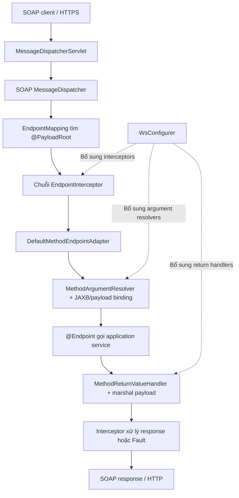
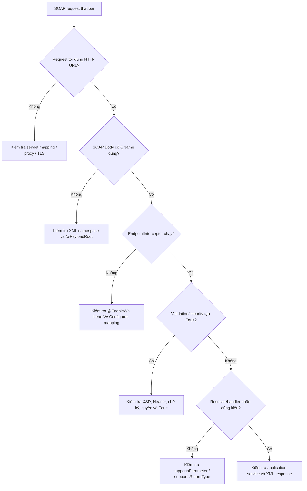

# Tùy chỉnh cấu hình qua WsConfigurer trong Spring Web Services

## 1. Bài toán: điều chỉnh cách SOAP server xử lý thông điệp

Một dịch vụ SOAP doanh nghiệp không chỉ cần nhận XML và gọi phương thức Java. Trước khi nghiệp vụ thực thi, máy chủ thường phải **kiểm tra schema**, **xác minh bảo mật**, **ghi nhận mã truy vết** và **chọn đúng endpoint**. Sau khi xử lý, nó cần tạo phản hồi hoặc **SOAP Fault** phù hợp với hợp đồng. Khi số lượng endpoint tăng, việc chép các bước xử lý chung vào mỗi lớp `@Endpoint` gây lặp mã, khó kiểm soát thứ tự và dễ bỏ sót chính sách.

Trong **Spring Web Services (Spring-WS)**, `@EnableWs` kích hoạt hạ tầng xử lý SOAP theo mô hình Java configuration. Giao diện **`WsConfigurer`** cho phép mở rộng phần cấu hình chung đó thông qua những callback dành cho:

- Chuỗi **`EndpointInterceptor`** trước và sau lời gọi endpoint.
- Bộ **`MethodArgumentResolver`** chuyển những tham số đặc biệt của endpoint thành giá trị Java.
- Bộ **`MethodReturnValueHandler`** chuyển giá trị trả về đặc biệt của endpoint thành nội dung phản hồi phù hợp.

Đây là bài học thuộc chương **Cấu hình máy chủ** trong module `SPRING_WEB_SERVICES`. Kiến thức liên quan trực tiếp tới quy trình SOAP **contract-first** (XSD/WSDL → JAXB → `@Endpoint`), xử lý SOAP Fault, interceptor, XML security, WS-Security, chứng chỉ và kiểm thử tương thích giữa những hệ thống doanh nghiệp.

> `WsConfigurer` là điểm mở rộng cho **cấu hình xử lý endpoint của SOAP server**. Nó không phải nơi thay đổi XML Schema, không tự tạo WSDL, không thay thế servlet vận chuyển HTTP, không tự bảo vệ kết nối TLS và cũng không phải cấu hình `WebServiceTemplate` của SOAP client.

### Mục tiêu sau bài học

Sau bài này, bạn có thể:

1. Giải thích quan hệ giữa `@EnableWs`, `DelegatingWsConfiguration`, `WsConfigurer`, endpoint mapping và endpoint adapter.
2. Đăng ký các `EndpointInterceptor` bằng `addInterceptors` với thứ tự được xác định rõ.
3. Hiểu cách bổ sung `MethodArgumentResolver` và `MethodReturnValueHandler` khi endpoint có kiểu tham số/kết quả đặc biệt.
4. Thiết kế Java configuration hoàn chỉnh ở mức minh họa: servlet mapping, công bố XSD/WSDL, schema validation và interceptor.
5. Phân biệt phạm vi server `WsConfigurer` với bảo mật transport, WS-Security, SOAP client và cấu hình Spring MVC.
6. Chẩn đoán lỗi cấu hình, kiểm thử SOAP request/response/Fault và bảo đảm tính tương thích hợp đồng.

## 2. Luồng xử lý: WsConfigurer nằm ở đâu?

Ví dụ một SOAP client gửi `GetOrderRequest` theo namespace `https://example.com/orders/v1`. Luồng khái niệm như sau:



Đây là **sơ đồ trách nhiệm**, không cam kết mọi runtime gọi từng bước theo đúng thứ tự vẽ. Ví dụ interceptor có thể chặn request trước khi vào endpoint, exception resolver có thể tạo Fault và các xử lý bảo mật/validation phụ thuộc cấu hình thực tế. Thứ tự của từng callback và các nhánh lỗi phải được kiểm chứng bằng integration test.

| Thành phần | Vai trò | Cấu hình bằng WsConfigurer? |
| --- | --- | --- |
| `@EnableWs` | Nhập hạ tầng cấu hình SOAP server vào Spring context. | Là điều kiện để callbacks của `WsConfigurer` được áp dụng qua cơ chế chuẩn. |
| `MessageDispatcherServlet` | Nhận HTTP request, phân phối SOAP message và có thể công bố WSDL/XSD. | **Không trực tiếp**; cấu hình bằng servlet/bean riêng. |
| `EndpointMapping` | Chọn endpoint dựa trên QName của Body, SOAPAction hoặc mapping khác. | Interceptor được bổ sung vào hạ tầng mapping; các thuộc tính mapping chuyên sâu cần cấu hình khác. |
| `EndpointInterceptor` | Xử lý request, response, Fault và dọn dẹp trước/sau endpoint. | **Có**, qua `addInterceptors`. |
| `DefaultMethodEndpointAdapter` | Gọi phương thức `@Endpoint` và chọn chiến lược xử lý tham số/giá trị trả về. | **Có**, thêm resolvers và handlers qua callbacks. |
| `XsdSchema` / `DefaultWsdl11Definition` | Mô tả payload và công bố WSDL. | **Không trực tiếp**; đăng ký bean hợp đồng riêng. |
| `WebServiceTemplate` | Gửi SOAP request từ phía client. | **Không**; cấu hình client riêng. |
| TLS, mTLS, proxy/gateway | Bảo vệ transport, chứng chỉ và đường truy cập. | **Không trực tiếp**; thuộc web container/network/security stack. |

## 3. Ba callback của WsConfigurer

API chuẩn của `org.springframework.ws.config.annotation.WsConfigurer` có ba callback chính:

```java
import java.util.List;
import org.springframework.ws.server.EndpointInterceptor;
import org.springframework.ws.server.endpoint.adapter.method.MethodArgumentResolver;
import org.springframework.ws.server.endpoint.adapter.method.MethodReturnValueHandler;

// Diễn giải chữ ký callback, không phải khai báo lại interface của thư viện.
void addInterceptors(List<EndpointInterceptor> interceptors);
void addArgumentResolvers(List<MethodArgumentResolver> argumentResolvers);
void addReturnValueHandlers(List<MethodReturnValueHandler> returnValueHandlers);
```

| Callback | Được gọi để làm gì? | Ví dụ nhu cầu |
| --- | --- | --- |
| `addInterceptors` | Bổ sung những interceptor chung vào cấu hình endpoint mapping. | Validate XSD, kiểm tra WS-Security, tracing, metadata bắt buộc. |
| `addArgumentResolvers` | Cung cấp bộ phân giải tham số đặc biệt của phương thức endpoint. | Một kiểu tham số `@CorrelationId String` lấy từ ngữ cảnh request. |
| `addReturnValueHandlers` | Cung cấp bộ xử lý kiểu trả về đặc biệt mà các handler JAXB/XML mặc định không đủ. | Một kiểu kết quả ứng dụng cần chuyển thành XML payload theo hợp đồng. |

**Quan trọng về phiên bản Spring-WS:**

- Với **Spring-WS 4.0.x** và nhiều bản trước đó, ba phương thức của `WsConfigurer` là **abstract**. Khi `implements WsConfigurer`, lớp triển khai phải khai báo cả ba phương thức, dù hai phương thức chỉ có thân rỗng. Một lựa chọn ở dòng phiên bản này là kế thừa `WsConfigurerAdapter`, vốn cung cấp phần triển khai rỗng.
- Từ **Spring-WS 4.1**, `WsConfigurer` có **default methods**, vì vậy có thể `implements WsConfigurer` và chỉ override callback cần dùng. `WsConfigurerAdapter` đã được **deprecated từ 4.1**; với dự án mới nên dùng trực tiếp interface.
- Từ **Spring-WS 4.1**, danh sách đưa tới `addArgumentResolvers` và `addReturnValueHandlers` có thể chứa **các bộ xử lý mặc định**, cho phép người viết cân nhắc thứ tự tương đối với chúng. Trên 4.0.x các danh sách custom bắt đầu rỗng; đừng dựa vào giả định mọi phiên bản đều có danh sách cùng trạng thái.

Sự khác biệt phiên bản này đặc biệt quan trọng khi copy code từ ví dụ `WsConfigurerAdapter` cũ sang dự án mới: code có thể vẫn chạy trên một số phiên bản nhưng phát sinh cảnh báo deprecated hoặc cách sắp xếp resolver khác kỳ vọng.

### 3.1. Điểm cấu hình đơn giản nhất

Một ví dụ tương thích với **Spring-WS 4.0.x và 4.1.x**, tự triển khai đủ ba callback:

```java
import java.util.List;
import org.springframework.context.annotation.Configuration;
import org.springframework.ws.config.annotation.WsConfigurer;
import org.springframework.ws.server.EndpointInterceptor;
import org.springframework.ws.server.endpoint.adapter.method.MethodArgumentResolver;
import org.springframework.ws.server.endpoint.adapter.method.MethodReturnValueHandler;

@Configuration
public class SoapCustomization implements WsConfigurer {
    private final EndpointInterceptor correlationInterceptor;

    public SoapCustomization(EndpointInterceptor correlationInterceptor) {
        this.correlationInterceptor = correlationInterceptor;
    }

    @Override
    public void addInterceptors(List<EndpointInterceptor> interceptors) {
        interceptors.add(correlationInterceptor);
    }

    @Override
    public void addArgumentResolvers(
            List<MethodArgumentResolver> argumentResolvers) {
        // Không bổ sung kiểu tham số riêng trong ví dụ này.
    }

    @Override
    public void addReturnValueHandlers(
            List<MethodReturnValueHandler> returnValueHandlers) {
        // Giữ các bộ xử lý mặc định của Spring-WS.
    }
}
```

Đoạn code giả định có một bean `EndpointInterceptor` phù hợp, được đưa vào constructor; cần cấu hình `@EnableWs` ở **một lớp cấu hình hạ tầng** trong cùng Spring context như phần sau. Nếu có nhiều bean `EndpointInterceptor`, nên dùng `@Qualifier` để chọn chính xác; không dựa vào kiểu chung nếu gây lỗi ambiguous injection.

Lưu ý: đoạn code dùng `implements WsConfigurer`, **không kế thừa** `WsConfigurerAdapter`. Việc định nghĩa đầy đủ các callback giữ được tương thích với giao diện 4.0.x. Khi dự án chắc chắn dùng 4.1+, có thể bỏ hai phương thức không dùng.

### 3.2. Vì sao cần @EnableWs và chỉ một cấu hình kích hoạt?

`@EnableWs` nhập `DelegatingWsConfiguration`, dựa trên `WsConfigurationSupport` để thiết lập các thành phần SOAP server. Cơ chế ủy quyền phát hiện các bean thuộc kiểu `WsConfigurer` trong context và gọi callback của chúng để điều chỉnh hạ tầng.

Một ứng dụng **chỉ nên có một cấu hình `@EnableWs`** để tránh nhập cấu hình cùng loại nhiều lần. Tuy nhiên, có thể có **nhiều bean `WsConfigurer`** trong những `@Configuration` khác nhau nhằm chia trách nhiệm — ví dụ cấu hình validation riêng, cấu hình tracing riêng.

Đừng chỉ tạo một class implements `WsConfigurer` mà quên `@EnableWs` hoặc đưa nó vào package nằm ngoài Spring component scan; callback có thể không được áp dụng, dù mã class đã compile được.

## 4. Cấu hình SOAP server hoàn chỉnh ở mức minh họa

Phần này dùng **Spring Boot 3 + Spring-WS tương thích Jakarta Servlet** làm ngữ cảnh minh họa. Đầu vào XML được mô tả theo hợp đồng SOAP 1.1; cấu hình TLS, WS-Security và repository sẽ được bổ sung riêng.

### 4.1. XML contract: GetOrderRequest và GetOrderResponse

Giả sử XSD được lưu ở `src/main/resources/xsd/orders.xsd`:

```xml
<?xml version="1.0" encoding="UTF-8"?>
<xs:schema xmlns:xs="http://www.w3.org/2001/XMLSchema"
           xmlns:ord="https://example.com/orders/v1"
           targetNamespace="https://example.com/orders/v1"
           elementFormDefault="qualified">
    <xs:element name="GetOrderRequest">
        <xs:complexType>
            <xs:sequence>
                <xs:element name="orderId" type="xs:string"/>
            </xs:sequence>
        </xs:complexType>
    </xs:element>

    <xs:element name="GetOrderResponse">
        <xs:complexType>
            <xs:sequence>
                <xs:element name="orderId" type="xs:string"/>
                <xs:element name="status" type="xs:string"/>
            </xs:sequence>
        </xs:complexType>
    </xs:element>
</xs:schema>
```

XSD này tập trung vào luồng cấu hình. Hợp đồng thật nên ràng buộc `orderId`, trạng thái, kiểu dữ liệu, lỗi và namespace theo nhu cầu nghiệp vụ; `status` trong ví dụ là string để giảm độ dài, không có nghĩa dùng string tùy ý là thiết kế tốt nhất.

### 4.2. Bật Spring-WS, đăng ký servlet và công bố WSDL

```java
import org.springframework.boot.web.servlet.ServletRegistrationBean;
import org.springframework.context.ApplicationContext;
import org.springframework.context.annotation.Bean;
import org.springframework.context.annotation.Configuration;
import org.springframework.core.io.ClassPathResource;
import org.springframework.ws.config.annotation.EnableWs;
import org.springframework.ws.transport.http.MessageDispatcherServlet;
import org.springframework.ws.wsdl.wsdl11.DefaultWsdl11Definition;
import org.springframework.xml.xsd.SimpleXsdSchema;
import org.springframework.xml.xsd.XsdSchema;

@Configuration
@EnableWs
public class SoapInfrastructureConfiguration {

    @Bean
    public ServletRegistrationBean<MessageDispatcherServlet>
            messageDispatcherServlet(ApplicationContext context) {

        MessageDispatcherServlet servlet = new MessageDispatcherServlet();
        servlet.setApplicationContext(context);
        servlet.setTransformWsdlLocations(true);
        return new ServletRegistrationBean<>(servlet, "/ws/*");
    }

    @Bean
    public XsdSchema ordersSchema() {
        return new SimpleXsdSchema(
            new ClassPathResource("xsd/orders.xsd"));
    }

    @Bean(name = "orders")
    public DefaultWsdl11Definition ordersWsdl(XsdSchema ordersSchema) {
        DefaultWsdl11Definition wsdl = new DefaultWsdl11Definition();
        wsdl.setPortTypeName("OrdersPort");
        wsdl.setTargetNamespace("https://example.com/orders/v1");
        wsdl.setLocationUri("/ws");
        wsdl.setSchema(ordersSchema);
        return wsdl;
    }
}
```

Trong cấu hình ví dụ:

1. `@EnableWs` kích hoạt các thành phần mặc định để phát hiện và gọi `@Endpoint`.
2. `MessageDispatcherServlet` được đăng ký cho URL pattern `/ws/*`, làm cửa nhận SOAP HTTP request.
3. Bean `XsdSchema` công bố schema nền cho thông điệp nghiệp vụ.
4. Bean tên `orders` thuộc `DefaultWsdl11Definition` có thể được servlet công bố ở đường dẫn như `/ws/orders.wsdl` theo mapping cấu hình.
5. `setTransformWsdlLocations(true)` hỗ trợ điều chỉnh địa chỉ được công bố trong WSDL dựa trên URL request; khi chạy sau reverse proxy cần xác minh cấu hình forwarded headers, public host/scheme và chính sách tin cậy proxy, không tự động giả định WSDL luôn có URL public đúng.

`DefaultWsdl11Definition` có thể suy ra operation từ các phần tử có hậu tố `Request`/`Response` trong XSD. **Đây là bước tạo WSDL, không phải bước đăng ký `WsConfigurer`.** Với WSDL đã được cam kết cho đối tác, nên kiểm tra WSDL sinh ra hoặc công bố WSDL tĩnh để tránh thay đổi không mong muốn sau khi nâng cấp dependency.

### 4.3. Đăng ký interceptor validate XSD

Phần cấu hình validation được tách khỏi cấu hình `@EnableWs`:

```java
import org.springframework.context.annotation.Bean;
import org.springframework.context.annotation.Configuration;
import org.springframework.ws.soap.server.endpoint.interceptor.PayloadValidatingInterceptor;
import org.springframework.xml.xsd.XsdSchema;

@Configuration
public class SoapValidationConfiguration {

    @Bean
    public PayloadValidatingInterceptor payloadValidatingInterceptor(
            XsdSchema ordersSchema) {

        PayloadValidatingInterceptor interceptor =
            new PayloadValidatingInterceptor();
        interceptor.setXsdSchema(ordersSchema);
        interceptor.setValidateRequest(true);
        interceptor.setValidateResponse(false);
        return interceptor;
    }
}
```

`PayloadValidatingInterceptor` ở phía **SOAP server** dùng schema để validate phần **payload XML**, không phải kiểm tra toàn bộ HTTP request hoặc SOAP Header. Mặc định nó validate request và không validate response; ví dụ ghi rõ ý định. Nếu chọn `setValidateResponse(true)`, cần kiểm thử kỹ các phản hồi hợp lệ, cách xử lý validation error và các luồng Fault.

**Điểm quan trọng:** bean `PayloadValidatingInterceptor` **chưa được gắn vào chain chỉ bằng việc khai báo `@Bean`**. Phải đăng ký qua `WsConfigurer.addInterceptors` như dưới đây.

### 4.4. Tùy chỉnh interceptor chain bằng WsConfigurer

```java
import java.util.List;
import org.springframework.context.annotation.Configuration;
import org.springframework.ws.config.annotation.WsConfigurer;
import org.springframework.ws.server.EndpointInterceptor;
import org.springframework.ws.server.endpoint.adapter.method.MethodArgumentResolver;
import org.springframework.ws.server.endpoint.adapter.method.MethodReturnValueHandler;
import org.springframework.ws.soap.server.endpoint.interceptor.PayloadValidatingInterceptor;

@Configuration
public class SoapValidationConfigurer implements WsConfigurer {
    private final PayloadValidatingInterceptor validator;

    public SoapValidationConfigurer(PayloadValidatingInterceptor validator) {
        this.validator = validator;
    }

    @Override
    public void addInterceptors(List<EndpointInterceptor> interceptors) {
        interceptors.add(validator);
    }

    // Hai phương thức dưới đây cần thiết cho WsConfigurer 4.0.x;
    // với 4.1+ có thể bỏ vì interface đã có default methods.
    @Override
    public void addArgumentResolvers(
            List<MethodArgumentResolver> argumentResolvers) {
    }

    @Override
    public void addReturnValueHandlers(
            List<MethodReturnValueHandler> returnValueHandlers) {
    }
}
```

Vì `SoapValidationConfigurer` là bean `@Configuration` được Spring phát hiện, cấu hình `@EnableWs` ở `SoapInfrastructureConfiguration` có thể chuyển callback này vào hạ tầng mapping. Tách các lớp theo cách trên còn tránh phụ thuộc vòng khi một `@Configuration` tự yêu cầu qua constructor một bean được khai báo bằng `@Bean` ngay trong chính lớp đó.

### 4.5. Endpoint nghiệp vụ vẫn theo hợp đồng

```java
import org.springframework.ws.server.endpoint.annotation.Endpoint;
import org.springframework.ws.server.endpoint.annotation.PayloadRoot;
import org.springframework.ws.server.endpoint.annotation.RequestPayload;
import org.springframework.ws.server.endpoint.annotation.ResponsePayload;

@Endpoint
public class OrderEndpoint {
    private static final String NS = "https://example.com/orders/v1";
    private final OrderQueryService orderQueryService;

    public OrderEndpoint(OrderQueryService orderQueryService) {
        this.orderQueryService = orderQueryService;
    }

    @PayloadRoot(namespace = NS, localPart = "GetOrderRequest")
    @ResponsePayload
    public GetOrderResponse getOrder(
            @RequestPayload GetOrderRequest request) {

        return orderQueryService.findAsContractResponse(
            request.getOrderId());
    }
}
```

Các class `GetOrderRequest` và `GetOrderResponse` trong ví dụ là **JAXB types được sinh từ XSD**; `OrderQueryService` là service do ứng dụng triển khai và vẫn cần kiểm tra quyền truy cập. Cần dependency JAXB/OXM cùng endpoint adapter/processor tương thích; đoạn code không đủ để khởi chạy dự án độc lập.

Khi request đi qua server, việc routing dựa trên **QName `{https://example.com/orders/v1}GetOrderRequest`** trong SOAP Body, không dựa vào tên phương thức `getOrder` hoặc tên class `SoapValidationConfigurer`.

## 5. addInterceptors: xử lý xuyên suốt một cách có thứ tự

`EndpointInterceptor` có các hook xử lý request, response, Fault và hoàn tất chu trình. Một interceptor giúp áp dụng quy tắc chung lên nhiều endpoint thay vì lặp lại trong code nghiệp vụ.

| Callback của EndpointInterceptor | Ý nghĩa | Điều cần tránh |
| --- | --- | --- |
| `handleRequest(context, endpoint)` | Xử lý request trước khi gọi endpoint. Trả `true` để tiếp tục hoặc `false` để dừng chain theo cơ chế dispatcher. | Trả `false` mà không thiết lập phản hồi hoặc SOAP Fault thích hợp khi client đang chờ response. |
| `handleResponse(context, endpoint)` | Xử lý phản hồi thông thường. | Thay đổi payload sau khi được ký mà không tính tới XML Signature. |
| `handleFault(context, endpoint)` | Xử lý trường hợp response là SOAP Fault. | Ghi lộ secret, stack trace hoặc dữ liệu khách hàng vào log. |
| `afterCompletion(context, endpoint, exception)` | Dọn dẹp state/tài nguyên theo vòng đời interceptors. | Quên dọn tài nguyên per-request hoặc giả định callback luôn chạy với mọi lỗi phát sinh ngoài dispatcher. |

### 5.1. Ví dụ interceptor truy vết và đo thời gian

```java
import org.slf4j.Logger;
import org.slf4j.LoggerFactory;
import org.springframework.ws.context.MessageContext;
import org.springframework.ws.server.endpoint.interceptor.EndpointInterceptorAdapter;

public final class RequestTimingInterceptor
        extends EndpointInterceptorAdapter {

    private static final Logger log =
        LoggerFactory.getLogger(RequestTimingInterceptor.class);
    private static final String START_KEY =
        RequestTimingInterceptor.class.getName() + ".startedAt";

    @Override
    public boolean handleRequest(MessageContext context, Object endpoint) {
        context.setProperty(START_KEY, System.nanoTime());
        return true;
    }

    @Override
    public void afterCompletion(
            MessageContext context, Object endpoint, Exception ex) {
        Object start = context.getProperty(START_KEY);
        if (start instanceof Long started) {
            long durationMillis =
                (System.nanoTime() - started) / 1_000_000L;

            log.info("SOAP endpoint finished in {} ms; failed={}",
                durationMillis, ex != null);
        }
        context.removeProperty(START_KEY);
    }
}
```

`MessageContext` lưu các property dành cho vòng đời **một thông điệp**, nên ví dụ không dùng trường mutable của singleton interceptor để chứa thời điểm bắt đầu; như vậy tránh trộn dữ liệu của nhiều request đồng thời. `System.nanoTime()` thích hợp đo thời lượng, không biểu diễn timestamp nghiệp vụ.

Đoạn code là ví dụ metric rất đơn giản; trong production nên dùng metrics/tracing framework, thêm thông tin định danh an toàn khi có phép, không ghi toàn bộ SOAP Envelope hoặc token vào log. Một số lỗi xảy ra trước khi dispatcher chọn endpoint sẽ không đi qua các hook này, nên cần telemetry ở servlet/gateway cho phần ngoài phạm vi interceptor.

Đăng ký thêm nó qua `WsConfigurer`:

```java
@Override
public void addInterceptors(List<EndpointInterceptor> interceptors) {
    interceptors.add(requestTimingInterceptor);
    interceptors.add(payloadValidatingInterceptor);
}
```

Đoạn trên là **minh họa thay thế** thân hàm `addInterceptors` trước đó; giả định hai interceptor đã được inject dưới dạng bean. Không chép nhiều phương thức cùng chữ ký vào một class. **Thứ tự khi thêm vào list có ý nghĩa** với request path và callback phản hồi/Fault; giữ thứ tự có chủ đích, kiểm thử các nhánh và không tùy tiện trông chờ thứ tự của nhiều `WsConfigurer` độc lập.

### 5.2. Thứ tự interceptor là một phần của chính sách

Giả sử một hệ thống dùng ba quy tắc:

1. Kiểm tra dữ liệu bảo mật thông điệp với một interceptor WS-Security đã được cấu hình.
2. Validate payload request dựa trên XSD.
3. Ghi nhận dữ liệu truy vết/métric không chứa thông tin nhạy cảm.

Việc lựa chọn thứ tự tùy vào mô hình tin cậy, chữ ký, quy tắc logging và chi phí xử lý. Một cấu hình **minh họa** có thể trông như:

```java
@Override
public void addInterceptors(List<EndpointInterceptor> interceptors) {
    interceptors.add(wss4jSecurityInterceptor);
    interceptors.add(payloadValidatingInterceptor);
    interceptors.add(requestTimingInterceptor);
}
```

Đây là **thân phương thức minh họa**, không phải code đầy đủ: các bean cần được inject và `wss4jSecurityInterceptor` phải được cấu hình thật về hành động bảo mật, chữ ký, timestamp, chứng chỉ/truststore, callback handler và chính sách phù hợp. **Chỉ thêm một đối tượng interceptor có tên “security” vào chain không tự động cung cấp bảo mật.**

Thứ tự trên chỉ là ví dụ thiết kế; yêu cầu logging/tracing từ đầu request có thể cần đặt tracing trước validation, trong khi không được ghi payload nhạy cảm trước khi áp dụng chính sách bảo vệ. Khi dùng nhiều bean `WsConfigurer`, đừng mặc định chúng sẽ được gọi theo thứ tự file Java hoặc thứ tự component scan; hãy gom các phần có phụ thuộc thứ tự vào một nơi cấu hình tường minh và kiểm thử.

### 5.3. Trả false có ý nghĩa gì?

Khi `handleRequest` trả `false`, dispatcher hiểu interceptor đã xử lý tình huống và **không tiếp tục gọi những interceptor phía sau hoặc endpoint tương ứng**. Đây không phải là một cách “throw exception” tự động sinh ra SOAP Fault chuẩn.

Ví dụ interceptor phát hiện request bị từ chối nhưng chỉ trả:

```java
@Override
public boolean handleRequest(MessageContext context, Object endpoint) {
    if (requestIsRejected(context)) {
        return false; // Chưa cho thấy SOAP response/Fault nào được tạo.
    }
    return true;
}
```

thì ví dụ này **chưa phải cơ chế từ chối hoàn chỉnh**. Trong tích hợp thực, phải dùng interceptor/cơ chế exception resolver có khả năng tạo phản hồi lỗi đúng SOAP version và hợp đồng, hoặc thiết lập phản hồi theo API SOAP phù hợp trước khi dừng chain. Tránh để client phải chờ một phản hồi không rõ ràng.

Với `handleResponse` và `handleFault`, việc trả `false` cũng có thể khiến quá trình gửi phản hồi bị chặn theo cơ chế dispatcher; không dùng bừa nếu chưa nắm toàn bộ vòng đời callback.

### 5.4. Không nhầm endpoint interceptor với các interceptor khác

| Loại | Phía nào? | Tác dụng chính |
| --- | --- | --- |
| **`EndpointInterceptor`** | SOAP server | Hook trước/sau khi server gọi endpoint qua endpoint mapping. |
| **`ClientInterceptor`** | SOAP client (`WebServiceTemplate`) | Hook khi client gửi request/nhận response hoặc Fault. |
| **Spring MVC `HandlerInterceptor`** | Servlet MVC HTTP controller | Can thiệp lời gọi MVC handler; không mặc nhiên can thiệp SOAP `MessageDispatcherServlet`. |
| **Servlet Filter** | HTTP transport/container | Có thể áp dụng trên URL pattern HTTP, ví dụ header, logging, security chain. |
| **Security/WS-Security interceptor** | Server hoặc client tùy loại | Xác minh/áp dụng token, chữ ký và các chính sách SOAP message theo cấu hình. |

Một dự án có thể cần **cả HTTP filter và `EndpointInterceptor`**, nhưng mỗi thành phần được giao một vai trò cụ thể. Đừng cố dùng `WsConfigurer.addInterceptors` để thay thế mọi tính năng của servlet security hoặc client transport.

## 6. addArgumentResolvers: bổ sung kiểu tham số cho @Endpoint

Spring-WS có sẵn nhiều cách nhận tham số endpoint: `@RequestPayload` cho XML/JAXB payload, `MessageContext`, những kiểu XML Source/DOM và các dạng header tùy adapter. Khi cần kiểu tham số mang ý nghĩa riêng, có thể viết `MethodArgumentResolver` và đăng ký qua `WsConfigurer`.

### 6.1. Tình huống: truyền request trace ID vào endpoint

Giả sử một interceptor upstream đã chuẩn hóa mã truy vết vào `MessageContext` dưới tên `trace.id`. Ta muốn khai báo:

```java
@PayloadRoot(namespace = NS, localPart = "GetOrderRequest")
@ResponsePayload
public GetOrderResponse getOrder(
        @RequestPayload GetOrderRequest request,
        @RequestTraceId String traceId) {

    return service.getOrder(request.getOrderId(), traceId);
}
```

`@RequestTraceId` là **annotation tự định nghĩa** của dự án, không phải annotation tích hợp sẵn của Spring-WS. Cần resolver hỗ trợ loại tham số trên.

### 6.2. Tạo annotation và MethodArgumentResolver

```java
import java.lang.annotation.ElementType;
import java.lang.annotation.Retention;
import java.lang.annotation.RetentionPolicy;
import java.lang.annotation.Target;

@Retention(RetentionPolicy.RUNTIME)
@Target(ElementType.PARAMETER)
public @interface RequestTraceId {
}
```

```java
import org.springframework.core.MethodParameter;
import org.springframework.ws.context.MessageContext;
import org.springframework.ws.server.endpoint.adapter.method.MethodArgumentResolver;

public final class RequestTraceIdResolver
        implements MethodArgumentResolver {

    @Override
    public boolean supportsParameter(MethodParameter parameter) {
        return parameter.hasParameterAnnotation(RequestTraceId.class)
            && String.class.equals(parameter.getParameterType());
    }

    @Override
    public Object resolveArgument(
            MessageContext context, MethodParameter parameter) {

        Object traceId = context.getProperty("trace.id");
        if (traceId instanceof String text && !text.isBlank()) {
            return text;
        }
        throw new IllegalStateException(
            "Trace ID chưa được chuẩn hóa trước khi gọi endpoint");
    }
}
```

Đoạn này minh họa rõ hai nhiệm vụ:

- `supportsParameter` kiểm tra annotation và kiểu Java; không nên trả `true` với mọi `String` vì sẽ chiếm những tham số khác.
- `resolveArgument` lấy dữ liệu **đã được chuẩn hóa và xác thực theo chính sách** từ `MessageContext`, không tin trực tiếp một giá trị tùy ý trong SOAP Header/Body.

`IllegalStateException` ở đây minh họa lỗi cấu hình khi hệ thống chưa đưa trace ID vào context; ứng dụng thực tế cần bảo đảm interceptor cung cấp giá trị và ánh xạ lỗi phù hợp, không để thông điệp nội bộ lọt vào SOAP Fault. Một trace ID là **thông tin quan sát**, không phải căn cứ xác thực hoặc phân quyền.

Để ví dụ hoạt động, có thể cung cấp một interceptor khởi tạo mã trace an toàn theo request:

```java
import java.util.UUID;
import org.springframework.ws.context.MessageContext;
import org.springframework.ws.server.endpoint.interceptor.EndpointInterceptorAdapter;

public final class TraceIdInitializer
        extends EndpointInterceptorAdapter {

    @Override
    public boolean handleRequest(MessageContext context, Object endpoint) {
        context.setProperty("trace.id", UUID.randomUUID().toString());
        return true;
    }
}
```

Đây là ví dụ **server sinh trace ID**. Nếu nhận correlation ID do đối tác gửi qua SOAP Header hoặc HTTP header, phải kiểm tra định dạng, độ dài, nguồn tin cậy, khả năng giả mạo và quy tắc ghi log. Không dùng UUID tự sinh của ví dụ làm danh tính người gọi.

### 6.3. Đăng ký resolver qua WsConfigurer

```java
@Override
public void addArgumentResolvers(
        List<MethodArgumentResolver> argumentResolvers) {
    argumentResolvers.add(requestTraceIdResolver);
}

@Override
public void addInterceptors(List<EndpointInterceptor> interceptors) {
    interceptors.add(traceIdInitializer);
    interceptors.add(payloadValidatingInterceptor);
}
```

Đây là những phần của một `WsConfigurer` có các bean đã được inject, **không phải một class đầy đủ**. Cần bảo đảm interceptor tạo property trước khi resolver đọc và annotation `@RequestTraceId` được dùng trên đúng tham số.

**Giới hạn quan trọng:** callback này **bổ sung** custom argument resolvers vào hạ tầng thích hợp. Nó không làm đổi XML contract; `@RequestTraceId` chỉ là cơ chế đưa dữ liệu Java đã chuẩn hóa vào endpoint. Nếu không cần annotation riêng, việc đọc `MessageContext` hoặc xử lý trong application service đôi khi đơn giản hơn.

### 6.4. Khác biệt thứ tự resolver giữa Spring-WS 4.0 và 4.1

- Trong **4.0.x**, list mà `addArgumentResolvers` nhận ban đầu dành cho **custom resolvers** và thường rỗng; những resolver built-in được kết hợp theo cơ chế của adapter.
- Trong **4.1+**, list được callback cung cấp có thể đã chứa **default resolvers**; thêm `requestTraceIdResolver` vào cuối nghĩa là ưu tiên sau các mục có sẵn, trong khi chèn vào đầu có thể khiến custom resolver được xét trước mặc định.

Do đó, không gọi `argumentResolvers.clear()` như một “thủ tục bắt đầu” chung: với Spring-WS 4.1+, thao tác này có thể **xóa chính các resolver mặc định**, làm hỏng `@RequestPayload` hoặc kiểu tham số vốn đang hoạt động. Khi custom resolver có `supportsParameter` hẹp, thêm vào list là cách ít xâm lấn hơn; nếu thực sự muốn thay thế built-in behavior, cần nắm rõ API phiên bản và kiểm thử phạm vi tác động.

## 7. addReturnValueHandlers: khi kiểu trả về không được hỗ trợ mặc định

Đối với endpoint contract-first thông thường:

```java
@PayloadRoot(namespace = NS, localPart = "GetOrderRequest")
@ResponsePayload
public GetOrderResponse getOrder(
        @RequestPayload GetOrderRequest request) {
    return mapper.toResponse(service.getOrder(request.getOrderId()));
}
```

Các dạng return value JAXB/XML được Spring-WS hỗ trợ tùy loại và cấu hình adapter. **Không nên tạo custom handler chỉ vì đã thấy `addReturnValueHandlers` trong interface**.

Một `MethodReturnValueHandler` chỉ có ích khi ứng dụng cố ý trả một **kiểu Java đặc biệt** và muốn chuyển nó thành SOAP response theo contract, thay vì chuyển về JAXB DTO trong mapper trước khi return.

Interface có hai phương thức cốt lõi:

```java
import org.springframework.core.MethodParameter;
import org.springframework.ws.context.MessageContext;
import org.springframework.ws.server.endpoint.adapter.method.MethodReturnValueHandler;

// Mô tả chữ ký; không phải class triển khai hoàn chỉnh.
boolean supportsReturnType(MethodParameter returnType);

void handleReturnValue(
    MessageContext context,
    MethodParameter returnType,
    Object returnValue) throws Exception;
```

Khi triển khai:

1. `supportsReturnType` phải nhận diện **chính xác** kiểu/annotation được handler hỗ trợ.
2. `handleReturnValue` phải tạo payload **đúng QName, namespace và cấu trúc XSD/WSDL** trong SOAP response; không được serialize một chuỗi XML tùy ý từ dữ liệu không tin cậy.
3. Nếu dùng JAXB, hãy ưu tiên dùng mapper/JAXB marshaller phù hợp thay vì viết tay XML không an toàn.
4. Xử lý lỗi bằng chiến lược SOAP Fault phù hợp; không ghi đè Fault đã được tạo mà không xem chính sách.
5. Kiểm thử thứ tự handler nếu kiểu trả về có thể đồng thời được một handler mặc định hỗ trợ.

Đăng ký handler có hình dạng:

```java
@Override
public void addReturnValueHandlers(
        List<MethodReturnValueHandler> returnValueHandlers) {
    returnValueHandlers.add(customOrderReturnValueHandler);
}
```

Đoạn này giả định `customOrderReturnValueHandler` là bean tự triển khai đủ hai phương thức và biết cách phát XML phù hợp; đây không phải class có sẵn của Spring-WS. Trong đa số dịch vụ SOAP **contract-first**, cách dễ quản lý nhất vẫn là **application result → mapper → JAXB response type → `@ResponsePayload`**.

### 7.1. Đừng thay đổi handler mặc định ngoài ý muốn

Tương tự argument resolvers, từ Spring-WS **4.1** danh sách return handlers trong callback có thể đã chứa các handler mặc định, nên việc `clear()` hoặc sắp xếp lại có thể gây thay đổi hành vi rộng. Trên một số phiên bản trước đó, callback nhận custom list ban đầu rỗng và được ghép sau. Hãy xác định phiên bản thực tế, chỉ thêm phần cần thiết và có test cho các kiểu return value cũ.

Nếu cần cấu hình sâu hơn cả những gì `WsConfigurer` hỗ trợ, có thể phải tùy chỉnh `WsConfigurationSupport` / `DelegatingWsConfiguration` hoặc `DefaultMethodEndpointAdapter` theo phiên bản. Việc đó là thay đổi kiến trúc hạ tầng, không phải lý do để xóa mọi built-in handler khỏi callback.

## 8. Ranh giới bảo mật, schema và SOAP Fault khi dùng WsConfigurer

Điều chỉnh interceptor chain có thể giúp thực thi những quy tắc xuyên suốt, nhưng không phải mọi mối quan tâm đều nên nhét vào cùng callback. Hãy phân lớp trách nhiệm.

| Mối quan tâm | Thành phần phù hợp | Vì sao không chỉ dựa vào WsConfigurer? |
| --- | --- | --- |
| **HTTPS/TLS** | Web container, gateway, message sender và cấu hình chứng chỉ. | `WsConfigurer` không mở socket TLS, không thiết lập truststore cho mọi kết nối. |
| **mTLS** | Container/proxy và chính sách xác thực chứng chỉ client. | Là một phần bảo vệ transport, trước khi thông điệp được định tuyến tới SOAP endpoint. |
| **WS-Security** | Security interceptor phù hợp cùng policy, WSS4J, token, timestamp và trust config. | `addInterceptors` chỉ *đăng ký* interceptor, không cấu hình đầy đủ xác minh chữ ký/chứng chỉ. |
| **Validate SOAP Body theo XSD** | `PayloadValidatingInterceptor` phía server, hoặc cơ chế validation phù hợp. | Bật bằng callback nhưng yêu cầu XSD đúng, bean đã khởi tạo, error policy và test. |
| **SOAP Header `mustUnderstand`** | SOAP processing layer và những thành phần hỗ trợ header block tương ứng. | Là quy tắc giao thức SOAP riêng; không thể chỉ đọc một field rồi xem như đã tuân thủ. |
| **Phân quyền nghiệp vụ** | Security context + application service + kiểm soát tài nguyên cụ thể. | XSD hợp lệ hay token hiện diện không chứng minh người gọi được xem một đơn hàng. |
| **SOAP Fault** | Exception resolver/fault handler, security interceptor và schema error handling. | Không phải mọi lỗi đều nên bị interceptor tự tạo Fault thủ công. |
| **XML parser hardening** | Parser/transformer/schema resolver, giới hạn hạ tầng, dependency bảo mật. | Interceptor có thể chỉ chạy sau khi thông điệp XML đã được parse. |

### 8.1. SOAP Fault không phải một exception Java gửi nguyên trạng

Ví dụ một request chứa `orderId` không hợp lệ, schema validator có thể chặn trước endpoint và tạo SOAP Fault thuộc nhóm lỗi phía gửi theo cấu hình. Nếu đơn hàng không tồn tại, application service có thể ném exception riêng, sau đó một resolver đổi nó thành Fault ổn định về QName/code/reason/detail.

Những trường hợp này **khác nhau**:

1. **Sai SOAP Envelope version:** có thể gây `VersionMismatch` trước khi endpoint chạy.
2. **Header `mustUnderstand` không được hỗ trợ:** có thể gây `MustUnderstand` ở tầng xử lý SOAP.
3. **Body vi phạm XSD:** có thể tạo lỗi validation theo chính sách Spring-WS.
4. **Request hợp schema nhưng không được phép hoặc không tìm thấy dữ liệu:** lỗi nghiệp vụ/bảo mật cần quy tắc Fault riêng.
5. **Lỗi hệ thống:** không nên lộ connection string, stack trace, tên bảng, bí mật hay nội dung token trong `detail`.

Khi SOAP client sử dụng `WebServiceTemplate`, Fault sẽ được nhận và xử lý theo cấu hình **client-side fault handling**, không thông qua `WsConfigurer` của server.

### 8.2. Cẩn trọng với logging và chữ ký XML

Một interceptor ghi toàn bộ SOAP Envelope có thể đưa token WS-Security, thông tin cá nhân và chữ ký vào log. Ngoài vấn đề lưu trữ dữ liệu nhạy cảm, việc thay đổi node XML sau khi đã xác minh hoặc ký có thể làm ứng dụng dùng **dữ liệu khác với dữ liệu đã được bảo vệ**.

Hướng triển khai an toàn:

- Ưu tiên ghi QName, mã trace đã chuẩn hóa, thời lượng, kết quả chung và mã lỗi công khai.
- Chỉ log payload khi có nhu cầu chẩn đoán được phê duyệt, lọc/redact thông tin nhạy cảm.
- Đảm bảo việc xác minh chữ ký WS-Security áp dụng lên **đúng node mà nghiệp vụ tiêu thụ**.
- Không tự thực thi thuộc tính hoặc nội dung không tin cậy từ SOAP Header/Body, kể cả khi interceptor đã đọc được chúng.
- Có hạn mức byte, độ sâu XML, số phần tử, thời gian xử lý và chính sách ngăn truy cập external entity/schema ngoài ý muốn.

### 8.3. Mặc định server và client có hai chuỗi interceptor khác nhau

Giả sử server đã cài một `PayloadValidatingInterceptor` vào `WsConfigurer`. Điều đó **không có nghĩa** một SOAP client trong cùng ứng dụng sẽ tự validate request/response. Client cần cấu hình độc lập, ví dụ `WebServiceTemplate` với marshaller và `ClientInterceptor` thích hợp. Cùng tên “interceptor” không tạo nên cùng lifecycle hoặc cùng hook.

## 9. Nhiều WsConfigurer và nhu cầu cấu hình nâng cao

Spring-WS cho phép có nhiều bean `WsConfigurer` nhằm chia nhỏ cấu hình. Tuy nhiên, có các giới hạn thiết kế nên chủ động quản lý.

### 9.1. Dùng nhiều bean không có nghĩa tự động bảo đảm thứ tự mong muốn

Ví dụ một dự án có:

```text
SoapInfrastructureConfiguration   → @EnableWs (chỉ một nơi)
SchemaValidationConfigurer        → implements WsConfigurer
SecurityConfigurer                → implements WsConfigurer
TracingConfigurer                 → implements WsConfigurer
```

Spring context phát hiện những configurer tương ứng và gọi callback của chúng. Tuy nhiên, với chính sách cần thứ tự cụ thể — như security trước một bước xử lý payload — không nên dựa vào tên class, tên file hay thứ tự component scan. **Khi thứ tự là yêu cầu nghiệp vụ/bảo mật, tập trung việc đăng ký interceptor vào một callback có thứ tự tường minh**, hoặc xác minh chắc chắn cơ chế ordering của phiên bản/thành phần cụ thể rồi khóa bằng test.

### 9.2. Phân biệt thay đổi hạ tầng và thay đổi hợp đồng

| Yêu cầu | Thay đổi ở đâu? |
| --- | --- |
| Thêm một bước tracing cho mọi endpoint SOAP | `WsConfigurer.addInterceptors`. |
| Endpoint có một annotation tham số tùy chỉnh | `addArgumentResolvers`. |
| Endpoint trả một loại Java mà handler hiện có không nhận | `addReturnValueHandlers`, khi thật sự cần. |
| Đổi URI `/ws/*` hoặc cấu hình servlet | `MessageDispatcherServlet` / servlet registration. |
| Công bố thêm operation `CancelOrder` | XSD/WSDL + endpoint `@PayloadRoot` / mapping. |
| Đổi namespace SOAP payload hoặc field XML | XSD/WSDL và JAXB mapping; có thể là breaking change. |
| Chọn SOAP 1.1 hoặc SOAP 1.2 | SOAP message factory, binding/transport và chính sách tương ứng. |
| Thay chứng chỉ hoặc bật mTLS | Transport/container/gateway/security config. |
| Thêm trường JPA trong bảng đơn hàng | Domain/persistence + mapper; không tự sửa SOAP contract. |

Nếu thấy một thay đổi cần sửa cả `WsConfigurer`, WSDL, schema và SOAP client, hãy xác định đâu là **lý do thật** của từng thay đổi. Không dùng interceptor tùy ý để che sự không khớp QName giữa request và hợp đồng.

### 9.3. Khi nào cần WsConfigurationSupport?

`WsConfigurer` cố ý cung cấp **ba điểm mở rộng chính**, không cho phép điều chỉnh mọi chi tiết bean hạ tầng. Nếu cần kiểm soát sâu hơn default endpoint mapping, adapter hoặc exception resolver, Spring-WS có `WsConfigurationSupport` và những class cấu hình liên quan.

Một hướng nâng cao — **chọn thay thế cơ chế `@EnableWs`**, không đặt đồng thời một cấu hình import mặc định khác — có dạng:

```java
import java.util.List;
import org.springframework.context.annotation.Configuration;
import org.springframework.ws.config.annotation.WsConfigurationSupport;
import org.springframework.ws.server.EndpointInterceptor;

@Configuration
public class AdvancedWsConfiguration extends WsConfigurationSupport {

    @Override
    protected void addInterceptors(List<EndpointInterceptor> interceptors) {
        interceptors.add(customEndpointInterceptor());
    }

    private EndpointInterceptor customEndpointInterceptor() {
        // Trả về interceptor được cấu hình đúng, ví dụ từ một bean.
        throw new UnsupportedOperationException("Ví dụ ý tưởng");
    }
}
```

Đây là **khung minh họa**, cố ý không phải cấu hình chạy được: cần thay `customEndpointInterceptor()` bằng bean thực tế, quản lý vòng đời và các thành phần khác. Điểm đáng chú ý là **không gắn `@EnableWs` trên class này** khi đang chủ động kế thừa cấu hình nền. Cách làm nâng cao đòi hỏi đọc và kiểm tra API đúng phiên bản; nó thường không cần thiết nếu chỉ thêm validation hoặc tracing.

> Với những nhu cầu thường gặp, ưu tiên `@EnableWs` + `WsConfigurer` thay vì sao chép/override toàn bộ bean hạ tầng. Việc tùy biến sâu không có kiểm thử rất dễ làm mất endpoint mapping mặc định hoặc làm sai thứ tự xử lý.

## 10. Kiểm thử cấu hình WsConfigurer

Một callback có thể được gọi đúng về mặt Java nhưng vẫn không được áp dụng vào SOAP request thực. Bộ test nên phân biệt **unit test interceptor/resolver**, **integration test server** và **HTTP/deployment test**.

### 10.1. Test chức năng của interceptor riêng

Với `RequestTimingInterceptor`, unit test cần kiểm tra:

- `handleRequest` lưu property bắt đầu trong `MessageContext` và trả `true`.
- `afterCompletion` không ném lỗi khi property vắng mặt.
- Không dùng biến instance mutable làm state của một request.
- Không log payload/token nhạy cảm.

Với interceptor kiểm tra dữ liệu hoặc policy, test cả hai nhánh **chấp nhận** và **từ chối**, xác nhận đúng SOAP Fault hoặc phản hồi theo hợp đồng — không chỉ kiểm tra biến boolean.

### 10.2. Test endpoint với MockWebServiceClient

Spring-WS cung cấp `MockWebServiceClient` để gửi request vào hạ tầng `MessageDispatcher` của server trong test. Ví dụ logic test với ApplicationContext đã chứa cấu hình, interceptor và service mock:

```java
import org.springframework.context.ApplicationContext;
import org.springframework.xml.transform.StringSource;
import org.springframework.ws.test.server.MockWebServiceClient;
import static org.springframework.ws.test.server.RequestCreators.withPayload;
import static org.springframework.ws.test.server.ResponseMatchers.noFault;
import static org.springframework.ws.test.server.ResponseMatchers.payload;

MockWebServiceClient client =
    MockWebServiceClient.createClient(applicationContext);

StringSource request = new StringSource("""
    <ord:GetOrderRequest xmlns:ord="https://example.com/orders/v1">
      <ord:orderId>ORD-2026-001</ord:orderId>
    </ord:GetOrderRequest>
    """);

StringSource expected = new StringSource("""
    <ord:GetOrderResponse xmlns:ord="https://example.com/orders/v1">
      <ord:orderId>ORD-2026-001</ord:orderId>
      <ord:status>CONFIRMED</ord:status>
    </ord:GetOrderResponse>
    """);

client.sendRequest(withPayload(request))
    .andExpect(noFault())
    .andExpect(payload(expected));
```

Đây là **đoạn thân test**, chưa bao gồm class JUnit, khởi tạo `ApplicationContext` và mock service để tạo phản hồi mong đợi. Nó hữu ích để xác nhận mapping, adapter, resolver và interceptor hoạt động **trong context test**.

Thử thêm payload thiếu `orderId`:

```xml
<ord:GetOrderRequest xmlns:ord="https://example.com/orders/v1"/>
```

Với `PayloadValidatingInterceptor` đã được đăng ký và XSD ở mục 4, request này phải bị xem là **không hợp lệ**. Test nên kiểm tra đã trả SOAP Fault phía gửi theo SOAP version/cấu hình, và **application service không được gọi**.

Các matcher `ResponseMatchers.clientOrSenderFault()`, `serverOrReceiverFault()` và `mustUnderstandFault()` có thể hỗ trợ việc kiểm tra loại SOAP Fault trong ngữ cảnh phù hợp. Nếu exception resolver hay security interceptor có policy riêng, kỳ vọng Fault phải theo hợp đồng của hệ thống.

### 10.3. Test callback argument resolver

Với `@RequestTraceId`:

1. Gửi request để `TraceIdInitializer` thiết lập `trace.id`.
2. Dùng endpoint test/mocking để xác minh tham số `@RequestTraceId String` đã được cung cấp.
3. Xác nhận request thiếu property — nếu giả lập trực tiếp resolver — gây lỗi cấu hình đã dự đoán.
4. Xác nhận resolver **không** tự nhận tham số `String` không có annotation.
5. Thử lại khi nâng Spring-WS 4.0 → 4.1 để phát hiện thay đổi thứ tự resolver.

Nếu thêm custom return value handler, kiểm tra phần tử response đúng QName/XSD và bảo đảm các handler JAXB mặc định vẫn xử lý được những endpoint khác.

### 10.4. Test HTTP, WSDL và bảo mật bên ngoài MockWebServiceClient

`MockWebServiceClient` hữu ích ở tầng dispatcher nhưng **không thay thế** kiểm tra đường đi HTTP thực tế:

- `GET /ws/orders.wsdl` có công bố WSDL đúng không? `soap:address` có đúng public host, scheme HTTPS và URL sau reverse proxy không?
- `POST /ws` hoặc đường URL binding thực tế có nhận SOAP request đúng version, content type và SOAPAction theo hợp đồng không?
- Chứng chỉ TLS/mTLS, truststore, reverse proxy và forwarded headers có hoạt động không?
- Một request thiếu hoặc sai token/chữ ký WS-Security có bị từ chối không?
- Header `mustUnderstand` không được xử lý có tạo Fault tương ứng không?
- Lỗi schema, lỗi nghiệp vụ và lỗi server có được trả về đúng code/reason/detail theo phiên bản SOAP không?
- Thông tin nhạy cảm có bị ghi vào application log, access log, tracing hoặc metric label không?

### 10.5. Ma trận kiểm thử thay đổi cấu hình

| Tình huống | Điều cần xác nhận |
| --- | --- |
| Không đăng ký `PayloadValidatingInterceptor` | Test phát hiện sự thiếu validation, không tạo cảm giác an toàn giả. |
| Đăng ký đúng interceptor | Request sai XSD bị từ chối trước khi vào nghiệp vụ. |
| Resolver tùy chỉnh được thêm | Endpoint dùng annotation đặc biệt nhận đúng dữ liệu; tham số mặc định vẫn chạy. |
| Handler tùy chỉnh được thêm | Kiểu trả về mới hoạt động; JAXB response cũ vẫn hợp lệ. |
| Hai interceptor có phụ thuộc thứ tự | Hành vi xử lý và Fault ổn định khi chạy song song/có lỗi. |
| Thay đổi namespace `GetOrderRequest` | Mapping/contract test phát hiện sai QName. |
| Nâng Spring-WS 4.0 → 4.1 | Không mất built-in resolvers/handlers do vô tình xóa danh sách. |
| Nâng thư viện JAXB/Jakarta | Payload Java ↔ XML không thay QName, prefix không bị dùng như danh tính. |
| Triển khai sau reverse proxy | WSDL công bố đúng địa chỉ công khai và transport security hoạt động. |

## 11. Lỗi thường gặp khi tùy chỉnh WsConfigurer

| Dấu hiệu | Nguyên nhân có thể | Cách xử lý |
| --- | --- | --- |
| Callback `addInterceptors` không chạy | Thiếu `@EnableWs`, configurer không phải Spring bean hoặc không ở context được quét. | Kiểm tra có đúng một cấu hình `@EnableWs` và bean `WsConfigurer` được phát hiện. |
| Interceptor bean tồn tại nhưng request vẫn đi thẳng endpoint | Chưa thêm bean vào list trong `addInterceptors` hoặc đang dùng endpoint mapping/config khác. | Kiểm tra callback, mapping và invocation chain trong test. |
| Servlet không nhận SOAP request | Chưa đăng ký `MessageDispatcherServlet` hoặc URL mapping khác nơi client gọi. | Kiểm tra `ServletRegistrationBean`, servlet path, reverse proxy, HTTP POST. |
| `GET /ws/orders.wsdl` trả lỗi | Sai bean WSDL name, servlet mapping hoặc schema/resource không có. | Kiểm tra `DefaultWsdl11Definition`, `orders.xsd` và URL publish. |
| `No endpoint mapping found` | QName Body không trùng `@PayloadRoot` hoặc endpoint không được tạo bean. | Kiểm tra namespace URI/localName, `@Endpoint` và component scanning. |
| Request sai XSD vẫn vào endpoint | `PayloadValidatingInterceptor` chưa được gắn vào chain hoặc thiếu schema đúng. | Kiểm tra bean, `addInterceptors`, `setXsdSchema` và test invalid request. |
| SOAP Fault `MustUnderstand` | Có Header bắt buộc nhưng nút không hiểu/xử lý đúng. | Cấu hình SOAP/WS-Security Header processing và kiểm tra vai trò, policy. |
| Lỗi thiếu `MethodArgumentResolver` cho kiểu custom | Chưa đăng ký resolver hoặc `supportsParameter` không nhận đúng annotation/type. | Kiểm tra callback và chữ ký phương thức endpoint. |
| `@RequestPayload` đột ngột không hoạt động sau nâng cấp | Custom config đã `clear()` list có cả built-in resolvers ở 4.1+. | Không xóa mặc định; chỉ thêm resolver với phạm vi `supportsParameter` hẹp. |
| Return handler khác bắt nhầm kiểu | `supportsReturnType` quá rộng hoặc thứ tự ưu tiên không đúng. | Thu hẹp điều kiện, kiểm tra thứ tự và giữ handler mặc định. |
| Ứng dụng lỗi circular dependency lúc startup | `@Configuration` inject vào constructor một bean tự định nghĩa bằng `@Bean` trong cùng cấu hình. | Tách configurer khỏi class cung cấp bean hoặc tổ chức dependency không vòng. |
| Cấu hình security hoạt động ở client nhưng không ở server | Đang dùng `ClientInterceptor` thay vì `EndpointInterceptor` hoặc ngược lại. | Xác định đúng phía và bean tương ứng. |
| WSDL có `soap:address` sai sau proxy | Chưa cấu hình transform WSDL và forwarded headers/public scheme đúng. | Kiểm tra công bố WSDL qua URL bên ngoài và chính sách tin proxy. |
| SOAP client lỗi JAXB nhưng interceptor không thấy | Lỗi parse, marshalling/transport xảy ra trước hoặc ngoài chuỗi endpoint interceptor. | Phân lớp log, schema, JAXB, transport và kiểm thử riêng từng tầng. |

### 11.1. Luồng chẩn đoán theo loại lỗi



Một request có thể thất bại **trước khi vào interceptor** vì lỗi parser, SOAP version, TLS hoặc servlet mapping; không nên kết luận interceptor lỗi chỉ vì không thấy log callback.

## 12. Bài tập thực hành: thay đổi chính sách trên server

**Bối cảnh:** Dịch vụ `GetOrder` đang xử lý yêu cầu hợp lệ nhưng đôi khi nhận request thiếu `orderId`, thiếu mã truy vết hoặc bị gửi với namespace sai. Bạn được giao bổ sung validation và tracing mà **không đổi XSD/WSDL**.

### Yêu cầu

1. Tạo `SoapInfrastructureConfiguration` với `@EnableWs`, `MessageDispatcherServlet` và `DefaultWsdl11Definition` như mục 4.
2. Đưa `orders.xsd` vào classpath và đăng ký `PayloadValidatingInterceptor`.
3. Tạo một `WsConfigurer` triển khai `addInterceptors` để gắn validation cùng một interceptor truy vết; thứ tự rõ ràng.
4. Viết `@RequestTraceId` và `RequestTraceIdResolver`, truyền trace ID đến endpoint bằng tham số Java nhưng không thêm trường vào SOAP Body.
5. Dùng `MockWebServiceClient` xác minh request hợp lệ trả `GetOrderResponse` đúng namespace.
6. Gửi request thiếu `orderId`; bảo đảm nhận Fault và application service không chạy.
7. Gửi request với namespace `.../orders/v2` trong khi endpoint còn `.../v1`; quan sát lỗi mapping và giải thích tại sao đổi `contextPath` JAXB không khắc phục.
8. Kiểm tra sự khác nhau của callback resolver list nếu nâng Spring-WS từ 4.0 lên 4.1; không dùng `clear()` làm mất resolver mặc định.
9. Sau cùng chạy kiểm tra HTTP/HTTPS, WSDL URL, SOAP Fault, log và policy bảo mật theo môi trường triển khai.

### Tiêu chí đạt

Hợp đồng XML không thay đổi; server từ chối payload sai XSD, xác nhận interceptor/resolver chạy đúng; có đủ test cho response, Fault, QName và không làm mất tính năng mặc định. Việc nâng cấp framework không làm thay đổi wire format hoặc chính sách bảo mật mà không được xem xét.

## 13. Các nhầm lẫn phổ biến

| Nhầm lẫn | Cách hiểu đúng |
| --- | --- |
| “`WsConfigurer` là bắt buộc cho mọi `@Endpoint`.” | Nhiều SOAP server chỉ cần `@EnableWs` và endpoint mapping mặc định; `WsConfigurer` để tùy chỉnh khi cần. |
| “Đăng ký interceptor là chỉ cần khai báo `@Bean`.” | Cần thêm vào chain thích hợp qua callback hoặc endpoint mapping tương ứng. |
| “`@EnableWs` tự đăng ký HTTP servlet và WSDL theo mọi URL.” | Servlet mapping, bean schema/WSDL và URL deployment phải được cấu hình/kiểm thử. |
| “`addInterceptors` chính là Spring MVC interceptor.” | Đây là `EndpointInterceptor` của Spring-WS server. |
| “`EndpointInterceptor` là cùng kiểu với `ClientInterceptor`.” | Hai kiểu ở hai phía khác nhau và lifecycle không giống nhau. |
| “`handleRequest` trả false sẽ tự tạo SOAP Fault hợp lệ.” | Interceptor/cơ chế khác phải thực sự tạo response/Fault phù hợp khi dừng xử lý. |
| “Dùng `WsConfigurer` là đã bật WS-Security.” | Còn phải cấu hình WSS4J, token, chữ ký, chứng chỉ và policy xác thực/ủy quyền. |
| “`PayloadValidatingInterceptor` kiểm tra cả SOAP Header.” | Nó chủ yếu kiểm tra XML payload; Header có xử lý giao thức/security riêng. |
| “Thêm `MethodArgumentResolver` là thay thế tất cả resolver mặc định.” | Callback dành cho việc bổ sung; từ 4.1 list có thể chứa cả defaults. |
| “`WsConfigurerAdapter` luôn là lựa chọn mới nhất.” | 4.1 đã deprecated adapter; dùng trực tiếp `WsConfigurer` khi tương thích. |
| “Có thể có bao nhiêu `@EnableWs` cũng được.” | Tài liệu API hướng dẫn chỉ một cấu hình kích hoạt, dù nhiều bean `WsConfigurer` được phép. |
| “Đổi tên Java endpoint sẽ đổi SOAP operation.” | SOAP dispatch chủ yếu dựa trên QName payload hoặc mapping được khai báo, không phải tên phương thức Java. |

## 14. Checklist trước khi phát hành

- [ ] Cả XSD/WSDL và bộ mã JAXB được quản trị theo hướng **contract-first**.
- [ ] Ứng dụng chỉ có **một vị trí `@EnableWs`** và những bean `WsConfigurer` được phát hiện đúng context.
- [ ] `MessageDispatcherServlet` có mapping đúng URL; WSDL/XSD được công bố đúng địa chỉ public.
- [ ] `@PayloadRoot` khớp QName của phần tử gốc trong SOAP Body.
- [ ] `EndpointInterceptor` được đăng ký tường minh, có thứ tự và chính sách Fault rõ ràng.
- [ ] Schema validation dùng đúng phiên bản XSD; test request sai không lọt vào nghiệp vụ.
- [ ] Bảo mật WS-Security được **cấu hình và xác minh thật**, không chỉ tồn tại bean interceptor.
- [ ] TLS, chứng chỉ/mTLS, reverse proxy và trusted forwarded headers được kiểm tra riêng.
- [ ] Resolver tùy chỉnh có `supportsParameter` hẹp; return handler không ghi đè kiểu XML mặc định ngoài ý muốn.
- [ ] Không xóa built-in resolver/handler khi nâng Spring-WS 4.0 → 4.1.
- [ ] Các endpoint là bean thread-safe; state per-request nằm trong `MessageContext` hoặc abstraction phù hợp.
- [ ] SOAP Fault đúng phiên bản, không tiết lộ stack trace, token hoặc dữ liệu nội bộ.
- [ ] Có unit tests cho interceptor/resolver, server tests bằng `MockWebServiceClient` và HTTP/security tests thực tế.
- [ ] Các client đối tác dùng WSDL/XSD cũ vẫn được thử tương thích khi cập nhật cấu hình server.

## 15. Câu hỏi tự kiểm tra

1. `@EnableWs` nhập hạ tầng gì, và `WsConfigurer` tác động vào những điểm mở rộng nào của hạ tầng đó?
2. Ba callback chính của `WsConfigurer` có tên, tham số và trách nhiệm gì?
3. Tại sao khai báo `PayloadValidatingInterceptor` bằng `@Bean` chưa đảm bảo nó được gọi với mọi SOAP request?
4. Nếu một interceptor trả `false` trong `handleRequest`, những điều gì không được phép giả định về phản hồi cho SOAP client?
5. Vì sao `@RequestTraceId String` cần `MethodArgumentResolver` nhưng `@RequestPayload GetOrderRequest` thường dùng cơ chế JAXB/payload được Spring-WS hỗ trợ?
6. Vì sao `argumentResolvers.clear()` có thể gây lỗi đặc biệt sau khi nâng Spring-WS 4.0 lên 4.1?
7. Khi nào nên dùng `MethodReturnValueHandler` thay vì đơn giản trả JAXB DTO từ endpoint?
8. `WsConfigurer` có tự công bố WSDL tại `/ws/orders.wsdl` hoặc bật TLS/mTLS không?
9. Tại sao test với `MockWebServiceClient` chưa đủ chứng minh WSDL public URL và chứng chỉ HTTPS hoạt động?
10. Một SOAP request chứa `GetOrderRequest` đúng local name nhưng sai namespace: cần sửa `@PayloadRoot`, XSD, client hay tất cả? Hãy phân tích dựa trên hợp đồng đã công bố.
11. Tại sao state như thời điểm bắt đầu xử lý không nên lưu trong field mutable của interceptor singleton?
12. Nếu muốn thay đổi trực tiếp bean endpoint mapping mặc định mà `WsConfigurer` không hỗ trợ, cần cân nhắc phương án cấu hình nâng cao nào và rủi ro tương ứng?

## 16. Tham khảo API và cách đối chiếu phiên bản

- Spring-WS `WsConfigurer` 4.0.x: [Javadoc interface](https://docs.spring.io/spring-ws/docs/4.0.x/api/org/springframework/ws/config/annotation/WsConfigurer.html).
- Spring-WS `WsConfigurer` 4.1.x: [Javadoc interface](https://docs.spring.io/spring-ws/docs/4.1.1/api/org/springframework/ws/config/annotation/WsConfigurer.html).
- `@EnableWs`: [Javadoc cấu hình](https://docs.spring.io/spring-ws/docs/4.0.x/api/org/springframework/ws/config/annotation/EnableWs.html).
- `PayloadValidatingInterceptor`: [Javadoc server interceptor](https://www.springframework.org/spring-ws/docs/4.0.x/api/org/springframework/ws/soap/server/endpoint/interceptor/PayloadValidatingInterceptor.html).
- `MockWebServiceClient`: [Javadoc kiểm thử server](https://docs.spring.io/spring-ws/docs/4.1.x/api/org/springframework/ws/test/server/MockWebServiceClient.html).

Các đường dẫn tham khảo dùng để xác định **đúng phiên bản API**, không có nghĩa ứng dụng đang sử dụng phiên bản đó. Khi triển khai thực tế, nên đối chiếu dependency mà dự án đã khóa phiên bản và kiểm thử với đúng stack Java/Spring Boot/Spring-WS/JAXB được phân phối.

**Ghi nhớ:** `WsConfigurer` là cách **bổ sung hành vi vào hạ tầng SOAP server** được `@EnableWs` kích hoạt, qua ba callback `addInterceptors`, `addArgumentResolvers` và `addReturnValueHandlers`. Nó giúp tách schema validation, tracing và xử lý kiểu Java đặc biệt khỏi business endpoint, nhưng không thay thế quản trị XSD/WSDL, SOAP Fault, XML security, WS-Security, chứng chỉ, HTTP transport hay kiểm thử tương thích. Một cấu hình đúng phải được xác minh bằng **SOAP messages thực tế**, nhất là ở các nhánh lỗi và khi thay đổi phiên bản framework.
