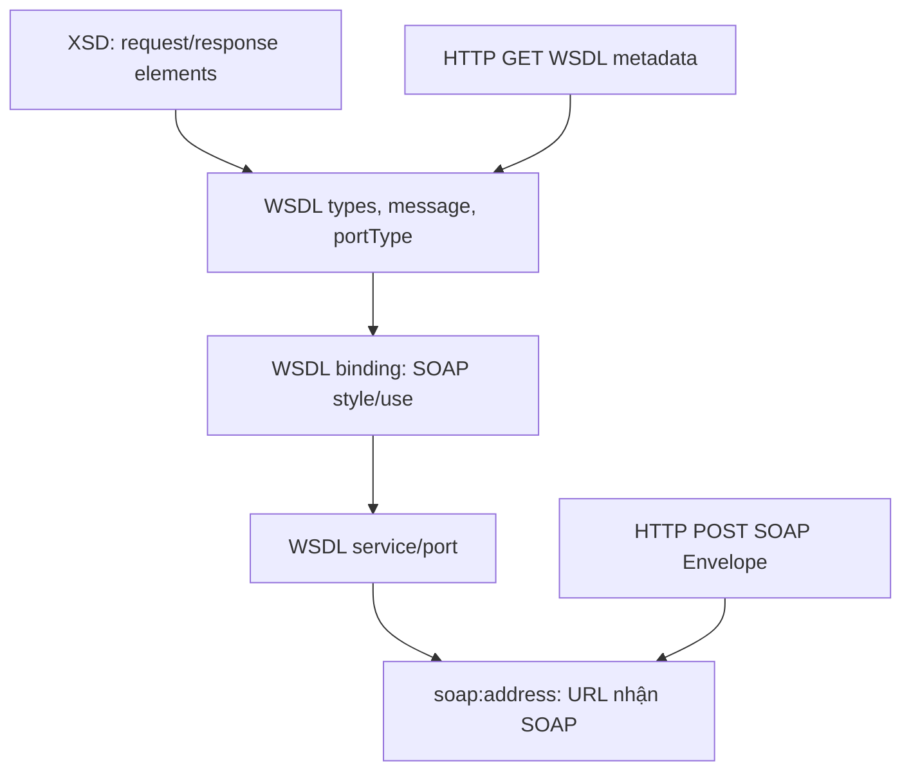
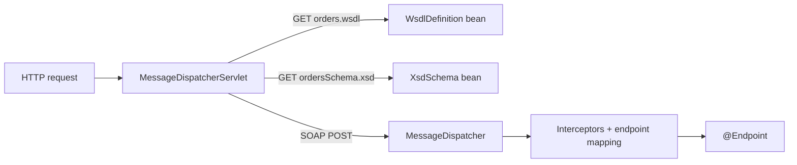
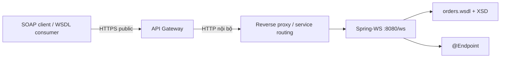

# Công bố WSDL, XSD và cấu hình biến đổi địa chỉ

Một SOAP service có thể chạy tốt tại `http://localhost:8080/ws` nhưng client đối tác vẫn không tích hợp được: URL WSDL trả về `404`, file XSD được `import` không tải được, hoặc `soap:address` bên trong WSDL trỏ về hostname nội bộ thay vì địa chỉ public của API Gateway. Đó là vấn đề **cấu hình và công bố hợp đồng tại máy chủ**, khác với việc endpoint có xử lý đúng Java object hay không.

Bài thuộc chương **Cấu hình máy chủ** của module **SPRING_WEB_SERVICES**. Mục tiêu là triển khai hợp đồng SOAP theo hướng **contract-first** với Spring Web Services (Spring-WS): công bố XSD/WSDL ổn định, ánh xạ đúng URL SOAP, hỗ trợ JAXB và endpoint, đồng thời tránh lỗi khi đi qua reverse proxy, TLS, WS-Security, chứng chỉ và môi trường doanh nghiệp. Chúng ta tập trung vào `MessageDispatcherServlet`, `DefaultWsdl11Definition`, `SimpleWsdl11Definition`, `XsdSchema` và cấu hình **biến đổi địa chỉ WSDL/XSD**.

Ví dụ sử dụng Spring Boot 3, Spring Framework 6 và Spring-WS thuộc hệ Jakarta với Java 17 trở lên; tùy bản Spring Boot/WS thực tế, cấu hình tự động và dependency management có thể khác. Các địa chỉ `example.org` chỉ dùng minh họa, không phải dịch vụ thật.

## 1. Phân biệt URL tải hợp đồng với URL nhận SOAP

Một triển khai thường có ít nhất hai loại URL:

| URL | Phương thức thường gặp | Chức năng |
| --- | --- | --- |
| `/ws/orders.wsdl` | HTTP GET | Công bố metadata WSDL mô tả dịch vụ |
| `/ws/ordersSchema.xsd` | HTTP GET | Công bố XML Schema cho request/response |
| `/ws` hoặc một đường dẫn SOAP được cấu hình | HTTP POST | Nhận SOAP Envelope và xử lý thao tác |

Các URL này **không bắt buộc trùng nhau**. Client có thể lấy WSDL từ một repository riêng, nhưng gửi SOAP tới địa chỉ trong `soap:address` hoặc endpoint được cấu hình rõ ràng. Trong WSDL 1.1, các thành phần có quan hệ:



**`targetNamespace` của XSD/WSDL là định danh hợp đồng XML, không phải URL phải truy cập được.** Ví dụ `https://example.org/contracts/orders/v1` có thể dùng làm namespace mà không có web server nào phục vụ ở địa chỉ đó. Ngược lại, `soap:address location="https://api.example.org/ws"` là địa chỉ mạng thật mà client cần kết nối.

Khi cần chẩn đoán, hãy kiểm tra riêng **GET metadata**, **GET XSD imports** và **POST SOAP**; một phép thử thành công không chứng minh hai phép còn lại hoạt động.

## 2. Vai trò của `MessageDispatcherServlet`

`MessageDispatcherServlet` là servlet Spring-WS nhận yêu cầu trong vùng URL được ánh xạ, điều phối SOAP message tới `MessageDispatcher` và phục vụ các bean WSDL/XSD được đăng ký. Đường đi tổng quát:



Một servlet mapping như `/ws/*` quyết định **vùng URL** mà servlet xử lý. Nó không tự sinh WSDL, XSD hay endpoint. Những khả năng đó đến từ bean `WsdlDefinition`/`XsdSchema` và cấu hình Spring-WS tương ứng.

Điểm cần phân biệt:

- **Servlet mapping**: quyết định request tới servlet nào.
- **Bean name của `WsdlDefinition` và `XsdSchema`**: thường quyết định tên tài liệu được công bố với đuôi `.wsdl` hoặc `.xsd`.
- **`soap:address` trong WSDL**: thông báo cho client gửi SOAP tới đâu.
- **`@PayloadRoot`**: định tuyến SOAP Body tới endpoint bằng QName payload, không dựa vào tên file WSDL.
- **HTTP reverse proxy**: có thể đổi host, scheme và path bên ngoài, nên địa chỉ được công bố phải phản ánh góc nhìn client.

## 3. Ví dụ contract-first: viết XSD làm nguồn sự thật

Giả sử hệ thống cung cấp thao tác `CreateOrder`. XSD dưới đây khai báo phần tử yêu cầu và phản hồi:

```xml
<?xml version="1.0" encoding="UTF-8"?>
<xs:schema xmlns:xs="http://www.w3.org/2001/XMLSchema"
           targetNamespace="https://example.org/orders/v1"
           xmlns:tns="https://example.org/orders/v1"
           elementFormDefault="qualified">

    <xs:element name="CreateOrderRequest">
        <xs:complexType>
            <xs:sequence>
                <xs:element name="customerId" type="xs:string"/>
                <xs:element name="sku" type="xs:string"/>
                <xs:element name="quantity" type="xs:positiveInteger"/>
            </xs:sequence>
        </xs:complexType>
    </xs:element>

    <xs:element name="CreateOrderResponse">
        <xs:complexType>
            <xs:sequence>
                <xs:element name="orderId" type="xs:string"/>
                <xs:element name="accepted" type="xs:boolean"/>
            </xs:sequence>
        </xs:complexType>
    </xs:element>
</xs:schema>
```

Lưu file theo quy ước minh họa `src/main/resources/xsd/orders.xsd`. Cặp phần tử có hậu tố `Request` và `Response` phù hợp với quy ước mặc định thường dùng khi Spring-WS sinh WSDL từ XSD. Hợp đồng quy định `quantity` phải dương, `customerId` đứng trước `sku` và namespace của các phần tử con; đó là những ràng buộc **không thể thay bằng việc chỉ cấu hình địa chỉ WSDL**.

Client gửi SOAP 1.1 payload theo XSD có thể là:

```xml
<soapenv:Envelope
    xmlns:soapenv="http://schemas.xmlsoap.org/soap/envelope/"
    xmlns:o="https://example.org/orders/v1">
    <soapenv:Header/>
    <soapenv:Body>
        <o:CreateOrderRequest>
            <o:customerId>C-100</o:customerId>
            <o:sku>BOOK-01</o:sku>
            <o:quantity>2</o:quantity>
        </o:CreateOrderRequest>
    </soapenv:Body>
</soapenv:Envelope>
```

Trong Spring-WS, JAXB/Spring OXM có thể ánh xạ phần tử `CreateOrderRequest` sang Java object. Địa chỉ triển khai không làm thay đổi QName `{https://example.org/orders/v1}CreateOrderRequest`.

## 4. Công bố WSDL động bằng `DefaultWsdl11Definition`

`DefaultWsdl11Definition` có thể **sinh WSDL 1.1** từ XSD và quy ước đặt tên thao tác/request/response. Nó hữu ích khi muốn khởi tạo nhanh SOAP document/literal và để XSD là nguồn hợp đồng chính.

Ví dụ cấu hình tập trung cho Spring Boot:

```java
import org.springframework.boot.web.servlet.ServletRegistrationBean;
import org.springframework.context.ApplicationContext;
import org.springframework.context.annotation.Bean;
import org.springframework.context.annotation.Configuration;
import org.springframework.core.io.ClassPathResource;
import org.springframework.ws.config.annotation.EnableWs;
import org.springframework.ws.transport.http.MessageDispatcherServlet;
import org.springframework.ws.wsdl.wsdl11.DefaultWsdl11Definition;
import org.springframework.xml.xsd.SimpleXsdSchema;
import org.springframework.xml.xsd.XsdSchema;

@Configuration
@EnableWs
public class OrdersSoapServerConfig {

    @Bean
    public ServletRegistrationBean<MessageDispatcherServlet>
            messageDispatcherServlet(ApplicationContext applicationContext) {
        MessageDispatcherServlet servlet = new MessageDispatcherServlet();
        servlet.setApplicationContext(applicationContext);
        servlet.setTransformWsdlLocations(true);
        servlet.setTransformSchemaLocations(true);
        return new ServletRegistrationBean<>(servlet, "/ws/*");
    }

    @Bean(name = "ordersSchema")
    public XsdSchema ordersSchema() {
        return new SimpleXsdSchema(
                new ClassPathResource("xsd/orders.xsd"));
    }

    @Bean(name = "orders")
    public DefaultWsdl11Definition ordersWsdl(XsdSchema ordersSchema) {
        DefaultWsdl11Definition definition =
                new DefaultWsdl11Definition();
        definition.setPortTypeName("OrdersPortType");
        definition.setTargetNamespace("https://example.org/orders/v1");
        definition.setLocationUri("/ws");
        definition.setSchema(ordersSchema);
        return definition;
    }
}
```

Đoạn mã minh họa một ứng dụng **tự đăng ký `MessageDispatcherServlet`**. Nếu Spring Boot của dự án đã tự cấu hình servlet/message factory và cung cấp property điều chỉnh tương ứng, hãy chọn **một chiến lược cấu hình** để tránh nhiều servlet hoặc bean xung đột.

Với ứng dụng chạy `localhost:8080` và các bean trên, các URL thường là:

```text
GET  http://localhost:8080/ws/orders.wsdl
GET  http://localhost:8080/ws/ordersSchema.xsd
POST http://localhost:8080/ws
```

Ý nghĩa:

| Cấu hình | Kết quả dự kiến |
| --- | --- |
| `@Bean(name = "orders")` với `DefaultWsdl11Definition` | Công bố WSDL với tên `orders.wsdl` dưới servlet mapping |
| `@Bean(name = "ordersSchema")` với `XsdSchema` | Công bố schema với tên `ordersSchema.xsd` dưới servlet mapping |
| `setPortTypeName("OrdersPortType")` | Tên giao diện trừu tượng trong WSDL được sinh |
| `setTargetNamespace(...)` | Namespace của WSDL được sinh |
| `setLocationUri("/ws")` | Đặt địa chỉ service trong WSDL theo cấu hình triển khai |
| `setSchema(ordersSchema)` | Cấp XSD đầu vào để xây dựng WSDL |

WSDL được sinh phụ thuộc vào **quy ước, lớp provider và phiên bản Spring-WS**. Nếu cần kiểm soát tuyệt đối tên message, operation, SOAPAction, fault binding hoặc policy, WSDL viết sẵn thường dễ kiểm soát hơn; không nên coi WSDL sinh động có thể thay thế mọi hợp đồng có yêu cầu đặc biệt.

### 4.1. Không nhầm `setLocationUri` với địa chỉ công bố WSDL

Trong ví dụ trên:

- `/ws/orders.wsdl` là **đường dẫn GET tài liệu**.
- `/ws` là **đường dẫn SOAP POST dự kiến**, được dùng trong `setLocationUri`.

Nếu đổi `setLocationUri("/soap/orders")` nhưng servlet vẫn chỉ ánh xạ `/ws/*` mà không có route/servlet xử lý `/soap/orders`, WSDL có thể công bố một URL **không có SOAP handler**. Tài liệu chỉ mô tả địa chỉ; nó không tự tạo HTTP route.

### 4.2. XSD có thể được phục vụ riêng hoặc hiện diện trong WSDL

`DefaultWsdl11Definition` có thể sử dụng schema để tạo các định nghĩa trong WSDL; tùy cách sinh/biến đổi, tài liệu WSDL có thể chứa schema bên trong hoặc tham chiếu schema ngoài. **Không mặc định GET WSDL sẽ luôn có một `xs:import` trỏ tới `ordersSchema.xsd`**. Hãy tải WSDL thật và đọc cấu trúc `wsdl:types` của phiên bản triển khai.

Việc khai báo một bean `XsdSchema` có tên `ordersSchema` là cách công bố **đường dẫn XSD riêng**. Đó là một URL mà công cụ tích hợp có thể dùng khi cần truy cập schema trực tiếp.

## 5. Công bố WSDL tĩnh bằng `SimpleWsdl11Definition`

Với hợp đồng đã được đối tác phê duyệt hoặc có binding phức tạp, có thể lưu **WSDL viết sẵn** trong repository:

```text
src/main/resources/
  wsdl/
    orders.wsdl
  xsd/
    orders.xsd
```

Ví dụ bean thay thế cho `DefaultWsdl11Definition`:

```java
import org.springframework.context.annotation.Bean;
import org.springframework.core.io.ClassPathResource;
import org.springframework.ws.wsdl.wsdl11.SimpleWsdl11Definition;

@Bean(name = "orders")
public SimpleWsdl11Definition ordersWsdl() {
    return new SimpleWsdl11Definition(
            new ClassPathResource("wsdl/orders.wsdl"));
}
```

**Đây là lựa chọn thay thế**, không khai báo đồng thời với bean động `orders` của mục 4. Có thể giữ bean `ordersSchema` riêng để phục vụ XSD.

Trong WSDL tĩnh, đoạn chỉ địa chỉ triển khai có thể như sau (đã giản lược, giả định namespace prefix được khai báo trên tài liệu đầy đủ):

```xml
<wsdl:service name="OrdersService"
              xmlns:wsdl="http://schemas.xmlsoap.org/wsdl/"
              xmlns:soap="http://schemas.xmlsoap.org/wsdl/soap/"
              xmlns:tns="https://example.org/orders/v1">
    <wsdl:port name="OrdersPort"
               binding="tns:OrdersSoap11Binding">
        <soap:address location="http://localhost:8080/ws"/>
    </wsdl:port>
</wsdl:service>
```

Phần `wsdl:binding` và `wsdl:portType` được tham chiếu phải có định nghĩa hợp lệ ở phần còn lại của WSDL; riêng fragment trên không phải WSDL chạy độc lập. `SimpleWsdl11Definition` phục vụ nội dung WSDL đã có, nên tên thao tác/message/binding và namespace xuất phát từ **file này**, không được sinh lại theo hậu tố XSD.

### 5.1. Khi nào chọn tĩnh, khi nào chọn động?

| Tiêu chí | WSDL động | WSDL tĩnh |
| --- | --- | --- |
| Nguồn cấu trúc | XSD và quy ước Spring-WS | WSDL/XSD viết sẵn, được quản lý phiên bản |
| Cấu hình chính | `DefaultWsdl11Definition` | `SimpleWsdl11Definition` |
| Kiểm soát tên message/operation/binding | Phụ thuộc quy ước và tùy chọn generator | Trực tiếp theo định nghĩa WSDL |
| Hợp đồng đối tác đã chốt | Cần so sánh output generator với bản đã duyệt | Thường dễ giữ nguyên tài liệu đã duyệt |
| Đổi URL môi trường | `setLocationUri` hoặc biến đổi khi phục vụ | Sửa `soap:address` hoặc biến đổi khi phục vụ |
| Import nhiều WSDL/XSD/policy | Cần xem giới hạn cách sinh | Có thể chủ động tổ chức, nhưng phải công bố tất cả tài liệu phụ |

**Địa chỉ biến đổi động và “WSDL sinh động” là hai khái niệm khác nhau.** WSDL viết sẵn vẫn có thể được servlet cập nhật `soap:address` lúc trả về nếu bật `transformWsdlLocations`. Ngược lại, WSDL được sinh từ XSD vẫn có thể chứa địa chỉ sai nếu cấu hình proxy hoặc `locationUri` không đúng.

## 6. Biến đổi `soap:address` bằng `transformWsdlLocations`

Khi đưa ứng dụng từ local lên staging rồi production, cùng một SOAP service thường có nhiều địa chỉ:

| Môi trường | Địa chỉ SOAP mà client nhìn thấy |
| --- | --- |
| Local | `http://localhost:8080/ws` |
| Staging | `https://staging-api.example.org/soap/ws` |
| Production | `https://api.example.org/soap/ws` |

Về mặt hợp đồng XML, XSD/WSDL `portType` và binding có thể giữ nguyên. Phần cần cập nhật là **địa chỉ triển khai**. Thuộc tính:

```java
servlet.setTransformWsdlLocations(true);
```

cho phép `MessageDispatcherServlet` **biến đổi thông tin địa chỉ trong WSDL được phục vụ** để phản ánh request HTTP tới metadata, theo cơ chế của Spring-WS. Tùy phiên bản/cấu hình, việc biến đổi tập trung vào các thuộc tính `location` của SOAP address trong WSDL; nó **không đảm bảo sửa mọi URL tùy ý trong tài liệu**.

### 6.1. Ví dụ trước và sau khi biến đổi

WSDL gốc được đóng gói có:

```xml
<soap:address xmlns:soap="http://schemas.xmlsoap.org/wsdl/soap/"
              location="http://localhost:8080/ws"/>
```

Client tải metadata qua public URL:

```text
GET https://api.example.org/soap/ws/orders.wsdl
```

Nếu servlet nhận và hiểu đúng scheme/host/path public, URL công bố có thể trở thành:

```xml
<soap:address xmlns:soap="http://schemas.xmlsoap.org/wsdl/soap/"
              location="https://api.example.org/soap/ws"/>
```

Đây là **kết quả mong muốn**, cần xác minh bằng HTTP GET từ phía ngoài hệ thống. `transformWsdlLocations` không phải cơ chế discovery toàn năng: nếu reverse proxy che giấu public prefix `/soap` hoặc không chuyển tiếp đúng thông tin host/scheme, WSDL có thể vẫn chứa địa chỉ nội bộ hoặc sai đường dẫn.

### 6.2. Bật transform có làm thay đổi hợp đồng nghiệp vụ?

Trong điều kiện dịch vụ vẫn dùng cùng binding, thao tác và schema:

- Thay `soap:address` **không thay** `targetNamespace`, QName payload hay thứ tự XSD.
- JAXB class và `@PayloadRoot` thường **không cần đổi** chỉ vì hostname thay.
- Client có thể **cần cập nhật endpoint URL**, nhất là client đã cache/hard-code URL lúc sinh mã.
- TLS, DNS, proxy, firewall và chứng chỉ vẫn phải được kiểm tra ở URL mới.

Không đánh đồng “WSDL trả về đã có URL mới” với “mọi client sẽ tự động sử dụng URL đó”: nhiều SOAP client nhận endpoint cố định từ cấu hình hoặc mã đã sinh từ WSDL cũ.

## 7. Biến đổi và công bố đường dẫn XSD

### 7.1. Các kiểu tham chiếu schema cần phân biệt

Một WSDL hoặc XSD có thể chứa tài liệu phụ:

```xml
<!-- Trong phần types của WSDL, ví dụ sử dụng import XSD: -->
<xs:import xmlns:xs="http://www.w3.org/2001/XMLSchema"
           namespace="https://example.org/common/v1"
           schemaLocation="common.xsd"/>
```

Hoặc trong XSD có:

```xml
<xs:include xmlns:xs="http://www.w3.org/2001/XMLSchema"
            schemaLocation="order-types.xsd"/>
```

`xs:include` dùng để đưa schema cùng target namespace (hoặc no-namespace theo quy tắc chameleon) vào; `xs:import` phục vụ namespace khác. `wsdl:import` dùng để nhập **tài liệu WSDL**, khác với hai chỉ thị XSD này.

Đường dẫn tương đối `common.xsd` được client giải quyết theo **URL tài liệu chứa tham chiếu**. Ví dụ nếu một schema được tải tại `https://api.example.org/soap/ws/ordersSchema.xsd`, tham chiếu `common.xsd` thường được giải tới `https://api.example.org/soap/ws/common.xsd`. Vì vậy server cần công bố được tài liệu tại địa chỉ tương ứng.

### 7.2. `transformSchemaLocations` giải quyết phần nào?

Khi Spring-WS cung cấp API cấu hình phù hợp, có thể bật:

```java
servlet.setTransformSchemaLocations(true);
```

Thiết lập này cho phép servlet xem xét biến đổi các địa chỉ `schemaLocation` trong schema được phục vụ theo request/URL hiện tại theo khả năng của implementation. Nó là **cơ chế hỗ trợ phục vụ tài liệu schema**, không phải quy tắc tự động sinh tất cả các XSD bị thiếu. Tùy phiên bản và cách schema được nhập, không phải mọi tham chiếu trong WSDL/XSD đều được viết lại như mong muốn.

Vẫn cần bảo đảm:

1. Mỗi XSD được tham chiếu có một **public URL tải được**.
2. URL tương đối/URL tuyệt đối được phân giải đúng từ góc nhìn client.
3. Namespace và `schemaLocation` chỉ đúng schema, đúng phiên bản.
4. Công cụ sinh client có thể tải toàn bộ chuỗi import/include mà không cần quyền truy cập filesystem nội bộ.

### 7.3. Ví dụ tránh lỗi file import không công bố

Giả sử `orders.xsd` có:

```xml
<xs:import xmlns:xs="http://www.w3.org/2001/XMLSchema"
           namespace="https://example.org/common/v1"
           schemaLocation="common.xsd"/>
```

Nếu servlet chỉ công bố bean `ordersSchema` và không có tài nguyên ở `/ws/common.xsd`, client tải `ordersSchema.xsd` có thể gặp `404` ở bước import. Cách khắc phục có thể là đăng ký và công bố schema dùng chung tại URL trùng tham chiếu, triển khai tuyến phục vụ static resources thích hợp hoặc thay địa chỉ import cho phù hợp kiến trúc. **Đừng đặt `schemaLocation` là đường dẫn `C:\\...` hoặc `file:/srv/...`** vì nó chỉ có ý nghĩa trong máy chủ, không thể dùng cho client từ xa.

Nếu import bên trong WSDL tĩnh, cần kiểm tra thêm đường dẫn `wsdl:import location`. Bật biến đổi địa chỉ SOAP không có nghĩa tất cả import trong WSDL và schema đều được công bố đúng.

## 8. Reverse proxy, API Gateway và forwarded headers

Kiến trúc triển khai:



Ứng dụng có thể thực sự lắng nghe tại `http://orders-app:8080/ws`, còn client truy cập qua `https://api.example.org/soap/ws`. Nếu WSDL công bố hostname `orders-app` hoặc `http`, bên ngoài có thể không kết nối được, dù GET WSDL thành công.

### 8.1. Kiểm tra host, scheme và prefix

Ba thành phần thường bị proxy làm thay đổi:

| Thuộc tính | Nội bộ | Public | Tác động |
| --- | --- | --- | --- |
| Scheme | `http` | `https` | WSDL sai scheme làm client hạ xuống HTTP hoặc thất bại TLS/policy |
| Host | `orders-app` | `api.example.org` | Client ngoài không phân giải được hostname nội bộ |
| Path/prefix | `/ws` | `/soap/ws` | Client POST nhầm đường dẫn nếu WSDL thiếu prefix |

Gateway có thể truyền thông tin public bằng các header chuẩn như `Forwarded` hoặc những header `X-Forwarded-*`, nhưng **chỉ tin forwarded headers từ proxy đáng tin cậy**. Nếu ứng dụng tin giá trị host tùy ý từ request bên ngoài, metadata WSDL có thể bị viết lại chứa địa chỉ do kẻ tấn công chọn (*host header poisoning*).

Với Spring Boot, một số môi trường có thể dùng:

```yaml
server:
  forward-headers-strategy: framework
```

Đây là ví dụ cấu hình xử lý forwarded headers ở tầng framework, **không bảo đảm phù hợp mọi topology**. Cần kiểm tra Spring Boot version, servlet filter/cấu hình server, proxy nào được tin cậy, thứ tự filter và các header thật sự được gateway gửi; không bật nhiều cơ chế forwarded handling chồng chéo mà không thử nghiệm.

### 8.2. Cách xác minh từ bên ngoài

Đánh giá bằng URL công bố thật:

```bash
curl -i https://api.example.org/soap/ws/orders.wsdl
curl -i https://api.example.org/soap/ws/ordersSchema.xsd
```

Sau đó đọc nội dung response: `soap:address` phải chỉ tới **public SOAP endpoint**. Nếu WSDL còn chứa `http://orders-app:8080/ws`, đừng sửa XSD hoặc `@PayloadRoot`; kiểm tra servlet transform, `locationUri`, forwarded host/proto/prefix và proxy rewrite.

Khi phải dùng xác thực/tokens để tải metadata, thêm các header phù hợp theo chính sách; không đưa thông tin xác thực thật vào tài liệu đào tạo hoặc log. Không dùng tùy chọn bỏ kiểm tra TLS như giải pháp lâu dài cho lỗi chứng chỉ.

## 9. Cấu hình endpoint Spring-WS và ranh giới bảo mật

Một endpoint có thể được định tuyến theo QName của SOAP payload:

```java
import org.springframework.ws.server.endpoint.annotation.Endpoint;
import org.springframework.ws.server.endpoint.annotation.PayloadRoot;
import org.springframework.ws.server.endpoint.annotation.RequestPayload;
import org.springframework.ws.server.endpoint.annotation.ResponsePayload;

@Endpoint
public class OrdersEndpoint {
    private static final String NS = "https://example.org/orders/v1";

    @PayloadRoot(namespace = NS, localPart = "CreateOrderRequest")
    @ResponsePayload
    public CreateOrderResponse create(
            @RequestPayload CreateOrderRequest request) {
        CreateOrderResponse response = new CreateOrderResponse();
        response.setOrderId("ORD-1001");
        response.setAccepted(true);
        return response;
    }
}
```

`CreateOrderRequest` và `CreateOrderResponse` ở đây là các lớp JAXB được sinh/ánh xạ từ XSD, cần cấu hình marshaller/endpoint adapter phù hợp. Ví dụ chưa phải ứng dụng hoàn chỉnh vì phần persistence, kiểm tra nghiệp vụ, xử lý lỗi và cấu hình Servlet có thể khác.

Ranh giới quan trọng:

- `@PayloadRoot` quyết định **định tuyến SOAP payload**, không công bố WSDL.
- `DefaultWsdl11Definition` tạo **metadata**, không tự sinh một endpoint đang hoạt động.
- `PayloadValidatingInterceptor` xác thực **SOAP payload** theo XSD khi được đăng ký; nó không tự làm cho file XSD xuất hiện ở một public URL.
- `SoapFaultMappingExceptionResolver` có thể ánh xạ exception nghiệp vụ thành SOAP Fault; điều đó khác với lỗi HTTP `404` khi tải WSDL/XSD.
- WS-Security interceptor kiểm tra/chèn token, chữ ký, encryption theo cấu hình; nó không thay thế TLS hoặc bảo mật các GET metadata theo chính sách truy cập.

### 9.1. WSDL/XSD metadata có nên public không?

Việc cho GET WSDL/XSD công khai hay cần xác thực phụ thuộc yêu cầu tích hợp. Nếu dùng quyền truy cập riêng:

1. Client và công cụ code generation phải tải được **cả WSDL chính và tất cả import**.
2. Gateway và security filter phải cho phép hoặc xác thực đường dẫn metadata phù hợp.
3. Không giả định interceptor SOAP sẽ xử lý GET metadata; GET WSDL/XSD thường là luồng phục vụ tài liệu, không qua endpoint SOAP nghiệp vụ.
4. Đảm bảo response không tiết lộ host nội bộ, cổng quản trị hoặc URL nhạy cảm.

Cần phân biệt **TLS/chứng chỉ server** dùng để bảo vệ HTTPS với **WS-Security** bảo vệ thông điệp SOAP. Một WSDL hợp lệ không đảm bảo certificate chain, token, XML Signature hoặc quyền gọi dịch vụ hợp lệ.

## 10. Lựa chọn công bố metadata theo môi trường

Có ba chiến lược thường gặp:

| Chiến lược | Cách làm | Ưu điểm | Điều phải kiểm tra |
| --- | --- | --- | --- |
| WSDL tĩnh theo môi trường | Mỗi môi trường có bản chứa `soap:address` riêng | Địa chỉ được kiểm soát và duyệt tường minh | Tránh sửa nhầm schema/binding giữa các bản |
| Một WSDL + servlet transform | Tài liệu chung, `transformWsdlLocations=true` | Tự phản ánh URL request khi cấu hình đúng | Forwarded host/scheme/prefix, cache, độ tin cậy của proxy |
| WSDL tĩnh tại registry, endpoint client cấu hình riêng | Contract ổn định ngoài server | Tách publication khỏi runtime | Client không dùng nhầm `soap:address` cũ, quản lý version/URL rõ ràng |

Khi contract-first được quản lý nghiêm ngặt, luôn lưu **bản nguồn WSDL/XSD** dưới source control hoặc nơi quản lý hợp đồng. Biến đổi `soap:address` tại runtime không nên làm thay đổi XSD nghiệp vụ hoặc portType mà không có quy trình versioning.

### 10.1. Cache metadata và hiệu ứng chuyển môi trường

Proxy, CDN, client generator hoặc IDE có thể cache WSDL/XSD. Nếu thay URL SOAP hoặc triển khai schema mới nhưng consumer dùng bản cũ, có thể xuất hiện lỗi:

- Gửi tới endpoint đã ngừng hoạt động.
- XML request đúng schema mới nhưng không đúng schema cũ.
- Namespace/QName vẫn giống nhau nhưng cấu trúc message đã thay đổi.
- `soap:address` trong WSDL tải qua public URL khác với WSDL đã cache.

Tùy yêu cầu, cấu hình cache headers, version path và quy trình invalidation phù hợp. Đừng dựa duy nhất vào `?wsdl` hoặc query string ngẫu nhiên để coi hai hợp đồng khác phiên bản.

## 11. Kiểm thử công bố WSDL/XSD từ góc nhìn consumer

### 11.1. Trình tự kiểm tra thực tế

1. **Khởi động server và xác nhận servlet mapping.** Mở `/ws/orders.wsdl` đúng port/context path và kiểm tra HTTP status.
2. **Kiểm tra nội dung WSDL.** Xác định `wsdl:service`, `wsdl:port`, `soap:address`, binding version, `portType` và operation.
3. **Tải XSD trực tiếp.** Xác minh `/ws/ordersSchema.xsd` và các XSD được import/include ở đúng public URL.
4. **Thử từ ngoài proxy.** Chạy GET WSDL/XSD qua domain HTTPS public, không chỉ dùng `localhost` bên trong container.
5. **Kiểm tra địa chỉ SOAP công bố.** `soap:address` phải dùng scheme/host/path thực mà client kết nối được.
6. **Sinh SOAP client từ public WSDL.** Xác minh công cụ resolve tất cả import và tạo model đúng namespace.
7. **Gửi SOAP POST thật.** Kiểm tra response, SOAPAction (nếu binding dùng), SOAP version, JAXB và validation.
8. **Thử lỗi cấu trúc/bảo mật.** Request sai XSD phải được xử lý theo cấu hình; message sai chữ ký hoặc chứng chỉ phải bị từ chối khi WS-Security/TLS yêu cầu.

### 11.2. Ma trận kiểm thử

| Tình huống | Kỳ vọng |
| --- | --- |
| `GET /ws/orders.wsdl` | Trả WSDL 1.1 đúng service, binding và operation |
| `GET /ws/ordersSchema.xsd` | Trả schema có đúng `targetNamespace` |
| GET một XSD được `xs:import` | Không bị `404` hoặc trỏ tới đường dẫn file nội bộ |
| WSDL được tải từ public HTTPS URL | `soap:address` phản ánh endpoint HTTPS public |
| Proxy đổi `/ws` thành `/soap/ws` | WSDL vẫn công bố đúng prefix public |
| Client codegen từ WSDL public | Resolve mọi import và dựng model/request đúng |
| SOAP POST tới `soap:address` | Endpoint tiếp nhận payload QName phù hợp |
| SOAP Body sai `xs:sequence` | XSD validation chặn nếu đã bật |
| SOAP 1.2 Envelope gửi tới binding chỉ SOAP 1.1 | Phát hiện lỗi giao thức/version phù hợp |
| WSDL tĩnh có SOAPAction đặc biệt | Client gửi action theo hợp đồng |
| TLS hostname/chứng chỉ sai | Kết nối được từ chối hoặc báo lỗi theo chính sách |
| WS-Security chữ ký/token sai | Từ chối theo security policy |
| Đổi staging sang production | XSD/portType không vô tình đổi, endpoint public đúng |
| Cache WSDL/XSD sau triển khai | Client nhận đúng phiên bản metadata đã công bố |

`MockWebServiceClient` và `MockWebServiceServer` hữu ích cho SOAP payload và xử lý endpoint/client trong Spring-WS. Tuy nhiên, những phép thử mock **không thay thế** kiểm thử công bố WSDL/XSD trên HTTP public, TLS, proxy path rewrite, caching hoặc các tài liệu `import`.

### 11.3. Ví dụ kiểm tra bằng lệnh

```bash
# Xác nhận metadata thực sự tồn tại:
curl -fS https://api.example.org/soap/ws/orders.wsdl
curl -fS https://api.example.org/soap/ws/ordersSchema.xsd

# Gửi request SOAP 1.1 từ file được chuẩn bị theo hợp đồng:
curl -i +  -H 'Content-Type: text/xml; charset=utf-8' +  -H 'SOAPAction: "https://example.org/orders/v1/CreateOrder"' +  --data-binary @create-order-request.xml +  https://api.example.org/soap/ws
```

Trong ví dụ SOAPAction chỉ là **giá trị minh họa**; cần đọc `soap:operation soapAction` của WSDL thật. File `create-order-request.xml` phải chứa SOAP Envelope và Body hợp lệ. Lệnh `curl -fS` trả mã lỗi khi HTTP 4xx/5xx; một phản hồi HTTP 200 vẫn cần được kiểm tra nội dung XML và import trong WSDL.

## 12. Chẩn đoán sự cố theo triệu chứng

| Triệu chứng | Nguyên nhân có thể | Kiểm tra đầu tiên |
| --- | --- | --- |
| `/ws/orders.wsdl` trả `404` | Sai servlet mapping, thiếu `WsdlDefinition` bean hoặc sai bean name | Kiểm tra URL thực, mapping và bean `orders` |
| `/ws/ordersSchema.xsd` trả `404` | Chưa công bố `XsdSchema` bean hoặc sai bean name | Kiểm tra bean `ordersSchema` và đường dẫn servlet |
| WSDL có `soap:address` là `localhost` | LocationUri/transform chưa đúng hoặc proxy headers thiếu | GET WSDL qua public URL, kiểm tra servlet và forwarded config |
| WSDL có hostname đúng nhưng thiếu prefix `/soap` | Gateway path rewrite chưa được phản ánh | Kiểm tra forwarded prefix và transform/public routing |
| WSDL tải được nhưng XSD import `404` | Tài liệu phụ chưa public hoặc `schemaLocation` sai | Lần theo từng import/include từ URL của tài liệu cha |
| Client gửi đúng URL nhưng endpoint không chạy | SOAP Body QName sai, mapping/adapter không phù hợp | Đọc QName, `@PayloadRoot`, SOAP version và log dispatcher |
| Client báo lỗi TLS | Hostname không khớp cert hoặc trust chain sai | Kiểm tra HTTPS hostname, chứng chỉ và truststore |
| SOAP request sai schema vẫn được xử lý | Chưa bật schema validation hoặc đang dùng XSD khác | Kiểm tra `PayloadValidatingInterceptor` và nguồn schema |
| WSDL/WSDL import hợp lệ nhưng codegen lỗi | Công cụ không truy cập được tài liệu nhập, không hỗ trợ binding/policy | Dùng public URL, inspect import và compatibility tool |
| Production trả WSDL cũ sau deploy | Cache/gateway/địa chỉ phục vụ metadata cũ | Kiểm tra response headers, cache policy, pod/backend thực |

Để khoanh vùng nhanh, xác định **GET WSDL/XSD có hoạt động hay không** trước, rồi kiểm tra **SOAP POST**. Nếu GET XSD báo 404, sửa metadata publication; nếu SOAP Envelope đã tới nhưng `@PayloadRoot` không khớp, sửa QName/mapping; nếu chữ ký sai, kiểm tra WS-Security. Cách tiếp cận này tránh sửa sai tầng.

## 13. Bài tập tự kiểm tra

**Câu 1.** Servlet được ánh xạ `/ws/*`, bean `DefaultWsdl11Definition` tên `orders`, bean `XsdSchema` tên `ordersSchema`. Hai URL GET metadata thường là gì?

**Đáp án:** `/ws/orders.wsdl` và `/ws/ordersSchema.xsd`, cộng host, port và context path của ứng dụng. URL SOAP POST có thể là `/ws` theo `setLocationUri`/route thực tế.

**Câu 2.** Bật `setTransformWsdlLocations(true)` có tự tạo endpoint tại `/soap/ws` không?

**Đáp án:** Không. Nó phục vụ việc biến đổi địa chỉ được công bố trong WSDL. Endpoint phải có route qua servlet/proxy thực sự xử lý SOAP POST.

**Câu 3.** Vì sao client tải WSDL thành công nhưng sinh mã lỗi `404 common.xsd`?

**Đáp án:** WSDL/XSD tham chiếu schema phụ chưa được công bố hoặc `schemaLocation` được phân giải sai từ URL tài liệu cha. Cần đảm bảo mọi tài liệu trong chuỗi import/include đều tải được.

**Câu 4.** Spring-WS có thể dùng `SimpleWsdl11Definition` và vẫn bật biến đổi `soap:address` không?

**Đáp án:** Có thể. WSDL tĩnh và biến đổi URL khi phục vụ là hai cơ chế độc lập. Phải kiểm tra kết quả WSDL thật sự nhận bởi client.

**Câu 5.** `targetNamespace="https://example.org/orders/v1"` có yêu cầu tồn tại một HTTP GET tại đúng URL đó không?

**Đáp án:** Không. Namespace là định danh XML. URL tải XSD/WSDL và URL endpoint được xác định riêng bởi cơ chế publication/transport.

**Câu 6.** Ứng dụng nội bộ phục vụ HTTP nhưng gateway public dùng HTTPS. WSDL vẫn công bố `http://orders-app:8080/ws`. Sửa phần nào?

**Đáp án:** Kiểm tra public routing, forwarded host/proto/prefix và `MessageDispatcherServlet` transform hoặc cấu hình `soap:address`/`locationUri` tường minh; không cần đổi XSD QName chỉ vì địa chỉ mạng.

**Câu 7.** SOAP endpoint đã xác thực WS-Security thành công. Điều đó có chứng minh GET WSDL và các XSD import công bố đúng không?

**Đáp án:** Không. Đó là hai luồng độc lập: bảo mật/xử lý SOAP message và metadata publication. Phải kiểm thử tải hợp đồng riêng.

**Câu 8.** Nếu đã dùng dynamic WSDL, có chắc mọi SOAPAction/binding của WSDL đối tác được sinh chính xác từ XSD?

**Đáp án:** Không. XSD mô tả dữ liệu; các chi tiết operation, SOAPAction, Fault, policy và binding có thể cần cấu hình thêm hoặc WSDL tĩnh được kiểm soát theo hợp đồng đối tác.

## Ghi nhớ

- **`MessageDispatcherServlet` công bố metadata và điều phối SOAP**, nhưng mỗi chức năng phụ thuộc cấu hình bean và servlet mapping tương ứng.
- **`DefaultWsdl11Definition` sinh WSDL từ XSD**, còn **`SimpleWsdl11Definition` phục vụ WSDL viết sẵn**; chọn theo mức kiểm soát hợp đồng cần thiết.
- **Tên bean WSDL/XSD thường quyết định tên file GET**, còn **`soap:address` chỉ nơi SOAP client gửi POST**. Đừng nhầm URL tải WSDL với endpoint.
- **`transformWsdlLocations` và `transformSchemaLocations` hỗ trợ biến đổi địa chỉ khi phục vụ**, nhưng không tự triển khai URL còn thiếu hoặc sửa mọi tham chiếu tùy ý.
- **Đặt sau proxy phải kiểm chứng scheme, host và path public** bằng cách tải WSDL/XSD từ môi trường client; forwarded headers chỉ được tin từ proxy đáng tin cậy.
- **Contract-first cần kiểm thử cả metadata và runtime**: WSDL/XSD/import, JAXB, endpoint, SOAP Fault, TLS, WS-Security, chứng chỉ và tương thích phiên bản.
