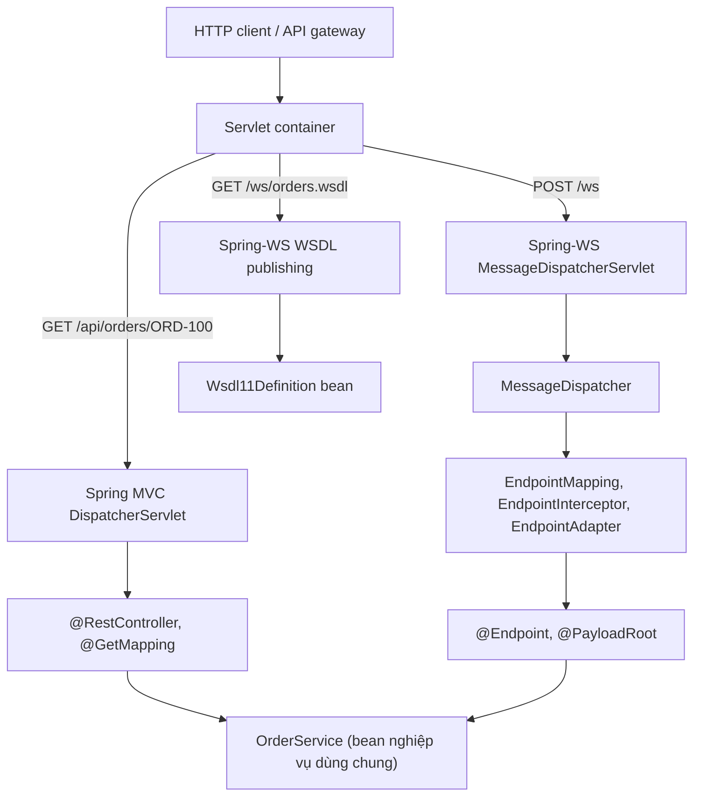
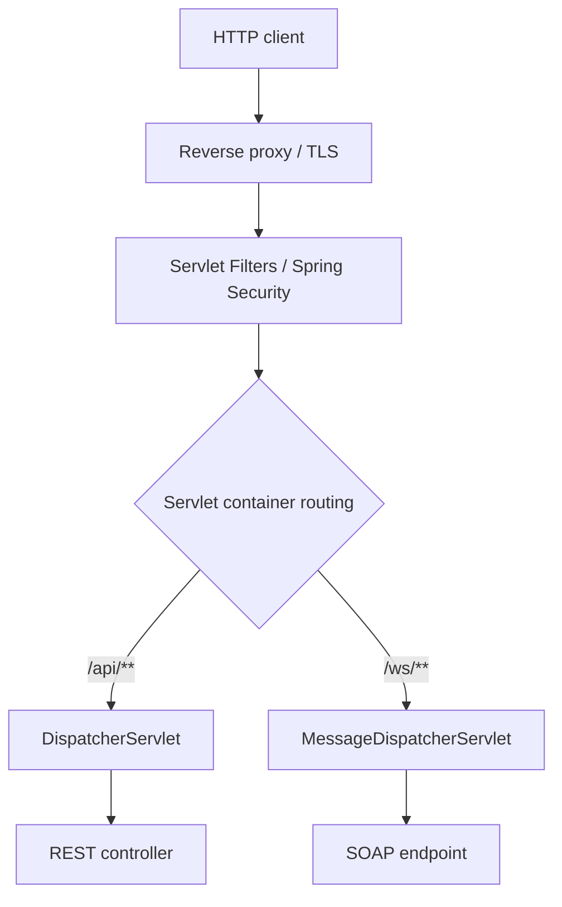
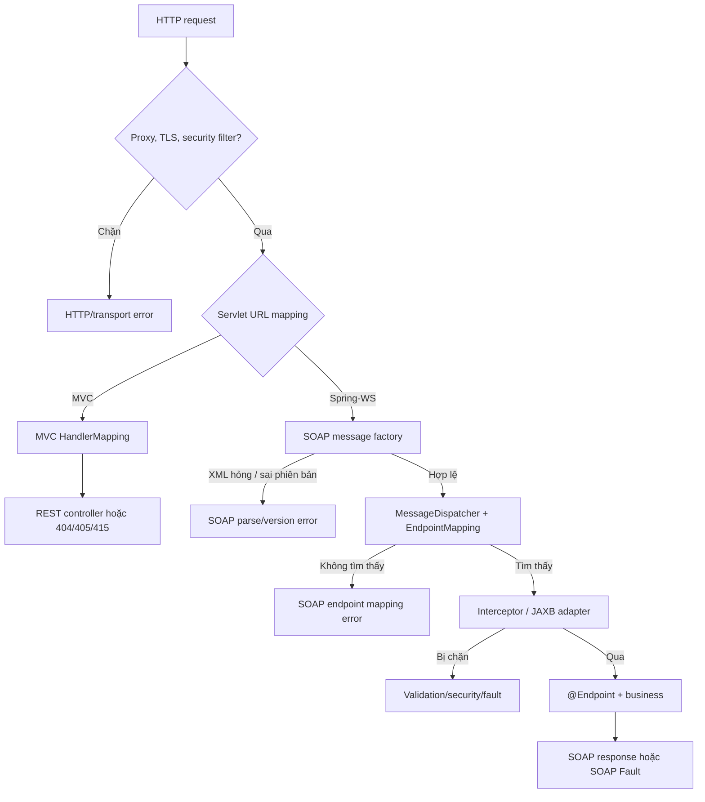

# Dùng chung ứng dụng với Spring MVC và tránh xung đột servlet mapping

## 1. Bài toán: REST và SOAP cùng chạy trong một ứng dụng Spring

Một doanh nghiệp có hệ thống quản lý đơn hàng. Các ứng dụng web/mobile mới gọi **REST API** dạng JSON tại `/api/orders/**`, còn hệ thống kế toán cũ cần **SOAP service** contract-first tại `/ws` theo XSD/WSDL. Đội phát triển muốn dùng chung Spring Boot application, service nghiệp vụ, database và hệ thống logging, nhưng vẫn giữ hai hợp đồng bên ngoài độc lập.

Nếu cấu hình sai servlet mapping, có thể gặp những hiện tượng khó hiểu: mở URL WSDL trả 404 dù bean WSDL đã tồn tại; SOAP POST bị Spring MVC xử lý như REST; REST controller không nhận được request; hoặc endpoint SOAP không bao giờ được gọi dù XML hợp lệ.

**Nguyên tắc kiến trúc:** Spring MVC và Spring Web Services (Spring-WS) là **hai cơ chế phân phối request khác nhau** trong cùng ứng dụng. Có thể chia sẻ các service/repository bean, nhưng mỗi cơ chế cần một đường vào HTTP rõ ràng.

Trong module **SPRING_WEB_SERVICES**, điều này kết nối trực tiếp phương pháp SOAP **contract-first**, XSD/WSDL, JAXB, `@Endpoint`, `WebServiceTemplate`, SOAP Fault, interceptor, WS-Security, chứng chỉ và kiểm thử tương thích. Trước khi tìm lỗi ở XML hay SOAP Fault, phải chứng minh HTTP request đã đến **đúng servlet**.

### Mục tiêu học tập

Sau bài này, bạn có thể:

1. Phân biệt `DispatcherServlet` của Spring MVC với `MessageDispatcherServlet` của Spring-WS.
2. Giải thích cơ chế Servlet container chọn servlet theo URL mapping.
3. Cấu hình REST `/api/**` và SOAP `/ws/**` trong cùng một Spring Boot application.
4. Hiểu vì sao `@RequestMapping` không thay thế servlet mapping và `@PayloadRoot` không phải REST route.
5. Tránh xung đột với auto-configuration, security filters, WSDL location và reverse proxy.
6. Chẩn đoán lỗi 404/405/415, no endpoint found, JAXB và SOAP Fault theo đúng tầng.
7. Viết kiểm thử độc lập cho MVC, SOAP endpoint và HTTP servlet routing tích hợp.

## 2. Hai dispatcher có vai trò khác nhau



| Đặc điểm | Spring MVC | Spring Web Services |
| --- | --- | --- |
| Servlet vào phổ biến | `org.springframework.web.servlet.DispatcherServlet` | `org.springframework.ws.transport.http.MessageDispatcherServlet` |
| Thành phần xử lý nghiệp vụ | `@Controller` / `@RestController` | `@Endpoint` |
| Mapping đến method | `@RequestMapping`, `@GetMapping`, `@PostMapping` và các điều kiện MVC | `@PayloadRoot`, `@SoapAction` hoặc endpoint mappings khác |
| Dữ liệu nhận | JSON, form, path/query, request body… | SOAP Envelope và XML payload theo contract |
| Nội dung trả thường gặp | JSON, HTML, response HTTP | SOAP Envelope chứa payload hoặc SOAP Fault |
| Tài liệu API điển hình | OpenAPI (nếu tích hợp) | WSDL/XSD |
| Cơ chế interceptor | MVC `HandlerInterceptor` | Spring-WS `EndpointInterceptor` |
| Bộ điều phối bên trong | MVC handler mappings/adapters | Spring-WS `MessageDispatcher` và endpoint mappings/adapters |

Trong trường hợp thông thường, request SOAP sẽ được `MessageDispatcherServlet` tiếp nhận, tạo `WebServiceMessage` rồi chuyển cho `MessageDispatcher`; request REST sẽ được MVC `DispatcherServlet` chuyển đến controller tương ứng. **Một servlet không tự động chuyển tiếp request bị lỗi sang servlet còn lại.**

### 2.1. Không nhầm hai lớp điều phối mang tên “Dispatcher”

`DispatcherServlet` (MVC) và `MessageDispatcherServlet` (WS) là **hai servlet** ở tầng HTTP. Bên trong Spring-WS, `MessageDispatcher` lại là **thành phần xử lý message**, không phải servlet container mapping.

Luồng SOAP điển hình:

```text
HTTP POST /ws
  -> Servlet container chọn MessageDispatcherServlet
  -> WebServiceMessageFactory đọc SOAP Envelope
  -> MessageDispatcher
  -> EndpointMapping tìm @PayloadRoot phù hợp
  -> EndpointInterceptor(s) nếu được cấu hình
  -> EndpointAdapter/JAXB
  -> @Endpoint gọi OrderService
  -> SOAP response hoặc SOAP Fault
  -> HTTP response
```

Luồng REST điển hình:

```text
HTTP GET /api/orders/ORD-100
  -> Servlet container chọn DispatcherServlet
  -> MVC HandlerMapping tìm @GetMapping("/{id}")
  -> MVC HandlerAdapter
  -> @RestController gọi OrderService
  -> JSON response qua HTTP message converter
```

Chia sẻ `OrderService` là hợp lý; chia sẻ nguyên cơ chế mapping giữa hai framework thì không.

## 3. Servlet mapping được quyết định trước handler mapping

Khi có nhiều servlet trong một ứng dụng, **Servlet container** chọn servlet theo các URL pattern đã đăng ký. Chỉ **sau khi** một servlet được chọn, Spring MVC hoặc Spring-WS mới thực hiện mapping nội bộ để tìm controller/endpoint.

Những pattern servlet thường gặp:

| Dạng pattern | Ví dụ | Ý nghĩa |
| --- | --- | --- |
| **Exact mapping** | `/status` | Khớp đúng đường dẫn đó |
| **Path-prefix mapping** | `/ws/*` | Khớp đường dẫn theo tiền tố `/ws`; gồm `/ws` và các đường dẫn dưới nó theo quy tắc Servlet |
| **Extension mapping** | `*.svc` | Khớp URL có phần mở rộng tương ứng, nếu servlet container hỗ trợ cấu hình đó |
| **Default mapping** | `/` | Servlet dự phòng cho request chưa được mapping chính xác hơn |

Quy tắc chọn của Servlet specification ưu tiên **exact match**, rồi **longest path-prefix match**, rồi extension match, cuối cùng default servlet mapping. Không được nhầm default mapping `/` với path-prefix mapping `/*`: chúng có hành vi ưu tiên rất khác nhau.

### 3.1. Cấu hình phân vùng rõ ràng

Giả sử:

```text
Spring MVC DispatcherServlet           -> /
Spring-WS MessageDispatcherServlet     -> /ws/*
```

Với giả định không có servlet khác có mapping đặc hiệu hơn:

| Request | Servlet được chọn | Sau đó ai xử lý? |
| --- | --- | --- |
| `GET /api/orders/ORD-100` | MVC `DispatcherServlet` mặc định | MVC tìm `@GetMapping` |
| `POST /api/orders` | MVC `DispatcherServlet` | MVC tìm `@PostMapping` |
| `POST /ws` | Spring-WS `MessageDispatcherServlet` | Spring-WS parse SOAP và dispatch endpoint |
| `POST /ws/` | Spring-WS `MessageDispatcherServlet` | Spring-WS xử lý SOAP nếu endpoint/mapping phù hợp |
| `GET /ws/orders.wsdl` | Spring-WS `MessageDispatcherServlet` | WSDL definition có tên `orders` (nếu cấu hình) |
| `GET /ws/unknown` | Spring-WS `MessageDispatcherServlet` | Thường không có WSDL/handler phù hợp; **không** tự quay về REST |
| `GET /api/unknown` | MVC `DispatcherServlet` | MVC xử lý 404 hoặc route fallback tương ứng |

Điểm then chốt: MVC được map `/` có thể phục vụ `/api/**` và các URL thông thường, nhưng **`/ws/*` là path-prefix cụ thể hơn**, nên nó nhận request SOAP. Khi servlet được chọn là Spring-WS, một MVC controller có `@RequestMapping("/ws/anything")` sẽ **không nhận** request đó.

### 3.2. Những kiểu mapping nguy hiểm

**Ví dụ A — cả hai servlet muốn chiếm cùng đường dẫn:**

```text
MVC DispatcherServlet        -> /ws/*
Spring-WS MessageDispatcherServlet -> /ws/*
```

Đây là xung đột đăng ký servlet. Servlet container hoặc framework có thể từ chối duplicate mapping, báo lỗi khởi động, hoặc có hành vi phụ thuộc cấu hình; **không** nên trông đợi request được tự chia cho cả hai servlet theo `Content-Type`.

**Ví dụ B — SOAP servlet chiếm toàn bộ prefix:**

```text
MVC DispatcherServlet        -> /
Spring-WS MessageDispatcherServlet -> /*
```

Path-prefix `/*` bao trùm hầu hết URL và có độ ưu tiên cao hơn default `/`, vì vậy nhiều request REST sẽ bị Spring-WS nhận nhầm. Đây không phải cách khuyến nghị để “công bố SOAP toàn cục”.

**Ví dụ C — tưởng rằng `@RequestMapping` quyết định servlet:**

```java
@RestController
@RequestMapping("/ws")
public class AccidentalWsController {
    @GetMapping("/health")
    public String health() { return "ok"; }
}
```

Nếu `MessageDispatcherServlet` chiếm `/ws/*`, `GET /ws/health` sẽ không tự đến controller trên, dù mapping MVC hợp cú pháp. Muốn health endpoint dạng REST, hãy đặt ngoài prefix SOAP, ví dụ `/api/health` hoặc một management path có chủ đích.

### 3.3. Servlet mapping không dựa vào media type

Đừng giả định rằng container gửi request có `Content-Type: text/xml` vào SOAP và `application/json` vào MVC. Quyết định đầu tiên dựa trên URL servlet mapping, **không phải SOAPAction hay JSON/XML**.

Nếu client gửi JSON vào `/ws`, Spring-WS vẫn có thể nhận được HTTP request rồi từ chối do media type/format. Nếu client gửi SOAP XML vào `/api/orders`, MVC vẫn có thể nhận request trước, rồi trả lỗi vì không có controller hoặc converter phù hợp.

## 4. Thiết kế URL có ranh giới rõ ràng

Ví dụ một quy ước dễ vận hành:

| Loại traffic | Public URL minh họa | Cơ chế xử lý |
| --- | --- | --- |
| REST read | `GET https://api.example.org/api/orders/ORD-100` | MVC `@RestController` |
| REST create | `POST https://api.example.org/api/orders`, JSON | MVC |
| SOAP request | `POST https://api.example.org/ws`, SOAP Envelope | Spring-WS `@Endpoint` |
| SOAP WSDL | `GET https://api.example.org/ws/orders.wsdl` | Spring-WS WSDL definition |
| SOAP XSD | `GET https://api.example.org/ws/orders.xsd`, nếu công bố schema bean | Spring-WS schema publishing |
| Health/metrics | Management endpoint tách biệt theo chính sách | Cấu hình management/Actuator phù hợp |

Các URL `example.org` chỉ là địa chỉ minh họa, không đại diện cho service đang tồn tại. Đường dẫn tuyệt đối còn có thể có **context path** như `/myapp` hoặc bị thay đổi bởi reverse proxy.

### 4.1. Namespace XSD không phải HTTP servlet path

Trong XSD có thể khai báo:

```xml
targetNamespace="urn:example:orders:v1"
```

Trong WSDL:

```xml
<soap:address location="https://api.example.org/ws"/>
```

Trong Spring-WS:

```java
@PayloadRoot(namespace = "urn:example:orders:v1",
             localPart = "GetOrderRequest")
```

Ba thành phần này có **trách nhiệm riêng**:

- `urn:example:orders:v1` định danh QName của phần tử/kiểu XML.
- `https://api.example.org/ws` là URL transport để SOAP client kết nối.
- `@PayloadRoot` xác định endpoint **sau khi** Spring-WS servlet đã nhận SOAP message.

Đổi đường dẫn public `/ws` sang `/services/soap` có thể **không cần đổi XSD namespace**. Ngược lại, đổi `targetNamespace` là thay đổi QName của contract, có thể phá tương thích dù URL giữ nguyên.

### 4.2. SOAP operation không phải REST route

SOAP `GetOrder` có thể được gọi bằng:

```text
POST /ws
SOAPAction: "urn:example:orders:v1:GetOrder"
Body root: {urn:example:orders:v1}GetOrderRequest
```

Không nhất thiết có đường dẫn `POST /ws/GetOrder`. Nếu muốn nhiều SOAP endpoints theo đường dẫn, cần công bố các WSDL `soap:address` tương ứng và cấu hình servlet/message routing rõ ràng; không suy từ tên operation một cách tự động.

## 5. Một XSD đơn giản làm contract cho SOAP endpoint

Giả sử tạo file `src/main/resources/xsd/orders.xsd`. XSD dưới đây phục vụ operation `GetOrder` trong ví dụ:

```xml
<?xml version="1.0" encoding="UTF-8"?>
<xs:schema
    xmlns:xs="http://www.w3.org/2001/XMLSchema"
    xmlns:tns="urn:example:orders:v1"
    targetNamespace="urn:example:orders:v1"
    elementFormDefault="qualified">

    <xs:complexType name="GetOrderRequestType">
        <xs:sequence>
            <xs:element name="orderId" type="xs:string"/>
        </xs:sequence>
    </xs:complexType>

    <xs:complexType name="GetOrderResponseType">
        <xs:sequence>
            <xs:element name="orderId" type="xs:string"/>
            <xs:element name="status" type="xs:string"/>
        </xs:sequence>
    </xs:complexType>

    <xs:element name="GetOrderRequest"
                type="tns:GetOrderRequestType"/>
    <xs:element name="GetOrderResponse"
                type="tns:GetOrderResponseType"/>
</xs:schema>
```

`GetOrderRequest` và `GetOrderResponse` là **global elements**. Chúng xác định payload root QName; các kiểu `GetOrderRequestType` và `GetOrderResponseType` chỉ mô tả cấu trúc Java/XML, không phải tên endpoint.

Request SOAP 1.1 tương ứng:

```xml
<?xml version="1.0" encoding="UTF-8"?>
<soap:Envelope
    xmlns:soap="http://schemas.xmlsoap.org/soap/envelope/"
    xmlns:ord="urn:example:orders:v1">
    <soap:Body>
        <ord:GetOrderRequest>
            <ord:orderId>ORD-100</ord:orderId>
        </ord:GetOrderRequest>
    </soap:Body>
</soap:Envelope>
```

Response SOAP 1.1 tương ứng:

```xml
<soap:Envelope
    xmlns:soap="http://schemas.xmlsoap.org/soap/envelope/"
    xmlns:ord="urn:example:orders:v1">
    <soap:Body>
        <ord:GetOrderResponse>
            <ord:orderId>ORD-100</ord:orderId>
            <ord:status>CREATED</ord:status>
        </ord:GetOrderResponse>
    </soap:Body>
</soap:Envelope>
```

**Lưu ý:** `xs:string` không cấm chuỗi rỗng hoặc chỉ có khoảng trắng. Nếu nghiệp vụ cần mã đơn đúng format, cần thêm restriction hoặc business validation. Đặt XSD trong classpath cũng không tự bật validation trên mọi SOAP request.

## 6. Cấu hình Spring Boot: hai servlet với mapping tách biệt

Một cách cấu hình rõ ràng là **đăng ký `MessageDispatcherServlet` cho `/ws/*`** và để MVC servlet phục vụ các route REST theo cơ chế auto-configuration của Spring Boot.

### 6.1. Spring-WS servlet registration

```java
import org.springframework.boot.web.servlet.ServletRegistrationBean;
import org.springframework.context.ApplicationContext;
import org.springframework.context.annotation.Bean;
import org.springframework.context.annotation.Configuration;
import org.springframework.ws.config.annotation.EnableWs;
import org.springframework.ws.transport.http.MessageDispatcherServlet;

@EnableWs
@Configuration
public class SoapServerConfiguration {

    @Bean
    public ServletRegistrationBean<MessageDispatcherServlet>
            soapMessageDispatcherServlet(ApplicationContext context) {

        MessageDispatcherServlet servlet =
            new MessageDispatcherServlet();
        servlet.setApplicationContext(context);
        servlet.setTransformWsdlLocations(true);

        return new ServletRegistrationBean<>(
            servlet, "/ws/*"
        );
    }
}
```

Ở đây:

- `@EnableWs` kích hoạt cấu hình xử lý Spring-WS annotation-based theo cách sử dụng của dự án.
- `MessageDispatcherServlet` nhận request trong vùng `/ws/*`.
- `setApplicationContext(context)` cho phép servlet truy cập các bean WSDL, endpoint và cấu hình có liên quan.
- `setTransformWsdlLocations(true)` cho phép biến đổi địa chỉ WSDL khi công bố theo URL ứng dụng nhìn thấy; **không thay thế cấu hình reverse proxy đúng**.
- MVC `DispatcherServlet` do Spring Boot quản lý thường được map làm servlet mặc định ở `/`, phục vụ những URL không bị servlet mapping cụ thể hơn chiếm giữ.

Đây là **một phương án đăng ký chủ động**, không phải cấu hình bắt buộc duy nhất. **Không** đăng ký thêm servlet WS bằng tay nếu application/phiên bản Spring Boot đã tạo một WS servlet với cùng mapping qua auto-configuration. Hãy chọn một nơi làm chủ servlet registration và kiểm tra danh sách servlet đã đăng ký khi khởi động.

### 6.2. Công bố WSDL được tạo từ XSD

Spring-WS cung cấp `DefaultWsdl11Definition` để sinh WSDL 1.1 từ schema và quy ước tên global elements:

```java
import org.springframework.context.annotation.Bean;
import org.springframework.context.annotation.Configuration;
import org.springframework.core.io.ClassPathResource;
import org.springframework.xml.xsd.SimpleXsdSchema;
import org.springframework.xml.xsd.XsdSchema;
import org.springframework.ws.wsdl.wsdl11.DefaultWsdl11Definition;

@Configuration
public class OrdersWsdlConfiguration {

    @Bean
    public XsdSchema ordersSchema() {
        return new SimpleXsdSchema(
            new ClassPathResource("xsd/orders.xsd")
        );
    }

    @Bean(name = "orders")
    public DefaultWsdl11Definition ordersWsdl(XsdSchema ordersSchema) {
        DefaultWsdl11Definition definition =
            new DefaultWsdl11Definition();
        definition.setPortTypeName("OrdersPortType");
        definition.setLocationUri("/ws");
        definition.setTargetNamespace("urn:example:orders:v1");
        definition.setSchema(ordersSchema);
        return definition;
    }
}
```

Nếu servlet WS được ánh xạ ở `/ws/*` và definition bean có tên `orders`, một URL công bố thường là:

```text
GET http://localhost:8080/ws/orders.wsdl
```

Trong ví dụ, `setLocationUri("/ws")` chỉ định địa chỉ SOAP service được khai báo; giá trị tuyệt đối thực sự trong `soap:address` còn chịu ảnh hưởng chính sách transform WSDL, host/port, proxy và context path.

Với `GetOrderRequest` và `GetOrderResponse`, `DefaultWsdl11Definition` có thể suy ra operation `GetOrder` từ hậu tố `Request`/`Response`. **Phải đọc WSDL được công bố thực tế** để xác minh binding, tên operation và SOAPAction, không suy ra mọi trường chỉ từ source Java.

### 6.3. Một lựa chọn khác: để Spring Boot tự cấu hình WS servlet

Với các phiên bản Spring Boot hỗ trợ auto-configuration của Spring Web Services, có thể cấu hình đường dẫn SOAP thông qua application properties thay vì tự tạo `ServletRegistrationBean`. Ví dụ dạng YAML thường gặp:

```yaml
spring:
  webservices:
    path: /ws
```

Cần xác nhận thuộc tính và hành vi với **đúng phiên bản Spring Boot** và starter đang dùng. Nếu chọn auto-configuration, **bỏ phương thức đăng ký thủ công ở mục 6.1**, trừ khi có lý do cụ thể để thay thế hoàn toàn cơ chế mặc định. Không dùng cả hai rồi dựa vào servlet order để “may mắn” chọn đúng.

Đường dẫn tự cấu hình có thể khác dạng đăng ký `/ws/*` trong API Java; hãy kiểm tra **mapping thực tế** của servlet trong application đang chạy thay vì chỉ đoán từ property.

### 6.4. REST controller nằm trong vùng MVC

Giả sử `OrderService` là bean nghiệp vụ dùng chung giữa REST và SOAP; REST controller có thể viết:

```java
import org.springframework.http.ResponseEntity;
import org.springframework.web.bind.annotation.GetMapping;
import org.springframework.web.bind.annotation.PathVariable;
import org.springframework.web.bind.annotation.RequestMapping;
import org.springframework.web.bind.annotation.RestController;

@RestController
@RequestMapping("/api/orders")
public class OrdersRestController {

    private final OrderService orderService;

    public OrdersRestController(OrderService orderService) {
        this.orderService = orderService;
    }

    @GetMapping("/{id}")
    public ResponseEntity<OrderSummary> getOrder(
            @PathVariable String id) {
        OrderDetails details = orderService.getOrder(id);
        OrderSummary body = new OrderSummary(
            details.id(), details.status()
        );
        return ResponseEntity.ok(body);
    }

    public record OrderSummary(String orderId, String status) { }
}
```

Trong ví dụ, `OrderService`/`OrderDetails` là kiểu ứng dụng giả định; `OrderDetails` có các accessors `id()` và `status()`. Mã dùng Java record nên cần phiên bản Java phù hợp. Controller trả JSON khi ứng dụng có HTTP message converter thích hợp (ví dụ Jackson trong Spring Boot web starter).

Điểm cần chú ý là `@RequestMapping("/api/orders")` **không đăng ký servlet mới**. Nó chỉ khai báo handler mapping **bên trong MVC dispatcher servlet đã được container lựa chọn**.

## 7. SOAP `@Endpoint` nằm trong luồng Spring-WS, không phải MVC

### 7.1. Endpoint dùng JAXB-generated model

Giả sử XJC sinh từ `orders.xsd` các kiểu `GetOrderRequestType`, `GetOrderResponseType` và `ObjectFactory`, với factory methods tạo `JAXBElement` cho global elements. Endpoint có thể viết như sau:

```java
import jakarta.xml.bind.JAXBElement;
import org.springframework.ws.server.endpoint.annotation.Endpoint;
import org.springframework.ws.server.endpoint.annotation.PayloadRoot;
import org.springframework.ws.server.endpoint.annotation.RequestPayload;
import org.springframework.ws.server.endpoint.annotation.ResponsePayload;

@Endpoint
public class OrdersSoapEndpoint {

    private static final String NS = "urn:example:orders:v1";

    private final OrderService orderService;
    private final ObjectFactory objectFactory = new ObjectFactory();

    public OrdersSoapEndpoint(OrderService orderService) {
        this.orderService = orderService;
    }

    @PayloadRoot(namespace = NS, localPart = "GetOrderRequest")
    @ResponsePayload
    public JAXBElement<GetOrderResponseType> getOrder(
            @RequestPayload JAXBElement<GetOrderRequestType> root) {

        GetOrderRequestType request = root.getValue();
        OrderDetails details =
            orderService.getOrder(request.getOrderId());

        GetOrderResponseType response =
            new GetOrderResponseType();
        response.setOrderId(details.id());
        response.setStatus(details.status());

        return objectFactory.createGetOrderResponse(response);
    }
}
```

Đây là mã **minh họa**, chưa phải dự án hoàn chỉnh: `OrderService`/`OrderDetails` do ứng dụng định nghĩa; các lớp JAXB và `ObjectFactory` phải được sinh hoặc khai báo theo schema, đồng thời endpoint adapter/JAXB hỗ trợ dạng root thực tế. Ở binding khác, XJC có thể sinh class `@XmlRootElement` để nhận/trả trực tiếp, không nhất thiết là `JAXBElement`. Với Spring-WS/JAXB đời cũ, import `javax.xml.bind.*` có thể được dùng thay cho `jakarta.xml.bind.*`; các dependency phải tương thích đồng bộ.

Điều làm method được gọi không phải URL `/ws/GetOrder`, mà là **sau khi request đã tới servlet WS**, endpoint mapping khớp payload root:

```text
{urn:example:orders:v1}GetOrderRequest
```

Kể cả REST controller cũng có method `getOrder`, hai method vẫn không xung đột nếu HTTP servlet routing và endpoint mappings được tổ chức đúng.

### 7.2. Dùng chung `OrderService` mà không gộp contract

Mô hình đúng về trách nhiệm:

```text
                  +----------------------+
GET /api/orders/* | OrdersRestController | --> JSON REST contract
                  +----------+-----------+
                             |
                             v
                        OrderService
                             ^
                             |
                  +----------+-----------+
POST /ws          | OrdersSoapEndpoint   | --> XSD/WSDL SOAP contract
                  +----------------------+
```

`OrderService` nên xử lý nghiệp vụ độc lập với HTTP hay SOAP: tìm đơn hàng, tính trạng thái, xác thực quyền theo ứng dụng và trả model domain. REST controller chuyển model domain thành JSON DTO; SOAP endpoint chuyển sang JAXB/XSD response. Hai contract có thể tiến hóa khác nhau mà không buộc thay đổi lớp nghiệp vụ.

Điều cần tránh là trả **thẳng** entity JPA chung ra cả JSON và JAXB rồi kỳ vọng schema nào cũng ổn định: JPA proxy, vòng tham chiếu object, lazy loading và thay đổi database có thể làm rò rỉ cấu trúc nội bộ hoặc phá contract.

### 7.3. `@Endpoint` và component scanning

`@Endpoint` được Spring-WS nhận diện khi bean tồn tại trong application context mà endpoint mappings sử dụng. Một class có annotation nhưng nằm ngoài `@ComponentScan` hoặc bị profile/conditional configuration loại bỏ sẽ **không được đăng ký**.

Ví dụ SOAP POST đã được `MessageDispatcherServlet` nhận nhưng trả thông báo không tìm được endpoint:

1. Xác nhận HTTP request tới đúng `/ws`.
2. Kiểm tra SOAP Envelope được parse đúng phiên bản.
3. Kiểm tra QName root của `soap:Body`.
4. Kiểm tra bean `OrdersSoapEndpoint` hiện diện và mapping annotation đúng.
5. Kiểm tra endpoint adapter/JAXB sau khi mapping thành công.

Đừng sửa `@GetMapping` hoặc Spring MVC route khi đang gặp lỗi **SOAP endpoint mapping**.

## 8. Application context dùng chung và context tách biệt

Một Spring Boot application thông thường có application context chứa MVC controllers, WS endpoints và service beans. `MessageDispatcherServlet` có thể được cấu hình dùng context phù hợp để tìm các WS components. Khi dùng WAR truyền thống hoặc nhiều servlet child contexts, cần chú ý **quan hệ root/child context**.

### 8.1. Dùng chung root context

Kiến trúc đơn giản:

```text
Spring ApplicationContext
  ├── OrderService
  ├── OrdersRestController
  ├── OrdersSoapEndpoint
  ├── Wsdl11Definition
  └── endpoint adapter / mapping / interceptors

Servlet container
  ├── DispatcherServlet         -> /
  └── MessageDispatcherServlet  -> /ws/*
```

Tại đây, chia sẻ bean service tương đối thuận tiện. Tuy vậy, **bean chung context không có nghĩa controller sẽ nhận SOAP request**: servlet mapping và Spring-WS mappings vẫn giữ trách nhiệm riêng.

### 8.2. Hai child contexts trong WAR truyền thống

Cũng có thể tổ chức:

```text
Root context
  └── OrderService, repository, shared infrastructure
       |
       +-- MVC servlet context
       |     └── OrdersRestController, MVC config
       |
       +-- SOAP servlet context
             └── OrdersSoapEndpoint, WSDL config, WS adapters
```

Thông thường child context có thể truy cập bean của parent; các sibling child contexts **không mặc nhiên nhìn thấy bean riêng của nhau**. Vì vậy nếu `OrdersSoapEndpoint` chỉ nằm trong MVC child context, WS servlet context không nhất thiết tìm thấy nó.

Khi debug “bean có thật nhưng endpoint mapping không thấy”, hãy kiểm tra **bean nằm trong context nào** và servlet đang dùng context nào. Đừng chỉ kiểm tra ứng dụng có start thành công.

### 8.3. Một số lựa chọn triển khai khác không cần servlet tự đăng ký

Trong Spring Boot, starter và auto-configuration có thể tự đăng ký servlet WS hoặc cho phép đặt path bằng properties. Trong WAR truyền thống, có thể đăng ký servlet bằng `web.xml` hoặc `ServletContextInitializer`. Các cơ chế này đều có thể hợp lệ; **không nên trộn nhiều cơ chế cùng chủ sở hữu một URL pattern**.

| Môi trường | Cách cấu hình thường gặp | Cần kiểm tra |
| --- | --- | --- |
| Spring Boot với auto-configuration phù hợp | Property đường dẫn WS và bean definitions | Servlet nào được tạo, mapping thực tế |
| Spring Boot đăng ký thủ công | `ServletRegistrationBean<MessageDispatcherServlet>` | Không tạo bản thứ hai qua auto-config |
| WAR với cấu hình truyền thống | `web.xml` hoặc Java initializer | Tên servlet, pattern và child context |
| Nhiều web modules trong một ứng dụng | Phân tách path/context/port | Context path, root mapping, proxy |

## 9. Những lỗi cấu hình servlet mapping thường gặp

### 9.1. Trùng exact/path pattern

**Sai về chủ đích:**

```java
// Chỉ minh họa cấu hình XUNG ĐỘT; đừng dùng.
new ServletRegistrationBean<>(mvcDispatcherServlet, "/ws/*");
new ServletRegistrationBean<>(soapDispatcherServlet, "/ws/*");
```

Hai servlet muốn được đăng ký cùng pattern `/ws/*`. Container có thể từ chối một phần hoặc toàn bộ mapping theo cơ chế đăng ký và báo lỗi. Đừng chọn bằng cách “đổi thứ tự bean” hoặc “ưu tiên SOAP khi Content-Type text/xml” — giải pháp đúng là phân vùng URL hoặc chỉ giữ một servlet thực sự sở hữu prefix đó.

### 9.2. SOAP servlet vô tình chiếm mọi URL

**Sai:**

```java
new ServletRegistrationBean<>(soapServlet, "/*");
```

`/*` là path-prefix rộng, có thể chiếm cả `/api/**` và nhiều URL mà MVC servlet mặc định `/` lẽ ra phục vụ. Với REST ở `/api/**` và SOAP ở `/ws/**`, dùng path-prefix `/ws/*` mới là cách phù hợp cho SOAP.

### 9.3. Chỉ dùng `@RequestMapping("/ws")` để mong “tạo SOAP”

**Không đủ:**

```java
@Controller
@RequestMapping("/ws")
public class SoapLookingController { }
```

Đây là một MVC controller, không phải `@Endpoint`. Nó không tự khởi tạo message factory, SOAP endpoint mappings hay WSDL publishing. Một MVC controller có thể tự nhận XML và xử lý thủ công, nhưng khi đó không phải luồng chuẩn của Spring-WS và đòi hỏi tự giải quyết protocol details.

### 9.4. Servlet path khác nội dung WSDL `soap:address`

Giả sử Spring-WS servlet được map `/ws/*`, nhưng WSDL công bố:

```xml
<soap:address location="https://api.example.org/legacy/soap"/>
```

Client sinh từ WSDL có thể gọi `/legacy/soap` thay vì `/ws`. Nếu proxy/application không hỗ trợ path này, client nhận 404, mặc dù `/ws/orders.wsdl` vẫn tải được.

Vì thế phải kiểm tra **URL công bố trong WSDL thực tế**, không chỉ Java servlet mapping.

### 9.5. Mismatch do context path

Giả sử:

```yaml
server:
  servlet:
    context-path: /order-service
```

Khi đó nếu SOAP servlet map `/ws/*`, đường dẫn bên ngoài trực tiếp vào ứng dụng có thể là:

```text
POST /order-service/ws
GET  /order-service/ws/orders.wsdl
```

Mapping `/ws/*` được hiểu **tương đối với context path của ứng dụng**. Nếu reverse proxy đưa public path về context khác, phải kiểm tra rewrite tương ứng. Đừng ghép context path hai lần vào servlet mapping hoặc `@PayloadRoot`.

## 10. Security filter áp dụng trước servlet dispatch

Ngay cả khi MVC và SOAP có servlet mapping độc lập, chúng vẫn có thể đi qua **cùng Servlet Filter chain**, chẳng hạn Spring Security, CORS filters, request logging, tracing, compression hoặc giới hạn kích thước.



Các filter **không thuộc riêng MVC** chỉ vì MVC và SOAP cùng dùng Spring Boot. Một `OncePerRequestFilter` được đăng ký rộng có thể xử lý cả hai path. Nếu filter parse toàn bộ request thành JSON, chặn `Content-Type: text/xml` hoặc tiêu thụ request body mà không phục hồi đúng, SOAP service có thể lỗi trước khi SOAP message factory đọc được dữ liệu.

### 10.1. Phân biệt xác thực transport và WS-Security

| Phạm vi | Vị trí | Ví dụ |
| --- | --- | --- |
| HTTP authentication | Filter/proxy | Basic auth, bearer token |
| TLS/mTLS | Kết nối/đầu TLS | Certificate chain, client certificate |
| SOAP message security | SOAP Header + interceptor/bộ xử lý SOAP | `wsse:Security`, XML Signature |
| Business authorization | Domain/application service | Có quyền xem `ORD-100` không? |

`HTTP Authorization` và `wsse:Security` không phải cùng một trường dữ liệu. Khi thiết kế tích hợp với đối tác, phải thỏa thuận cơ chế thực sự sử dụng và xử lý lỗi riêng cho từng tầng.

### 10.2. Match đường dẫn bảo mật đủ chính xác

Quy tắc thường gặp:

- `GET /ws/orders.wsdl` có thể công bố công khai, hoặc cần xác thực nếu chính sách đối tác quy định.
- `POST /ws` và các SOAP endpoints thường cần xác thực theo transport hoặc message-level policy.
- REST `/api/**` có thể dùng bearer token và CORS khác SOAP.
- `/actuator/**` hoặc management endpoints có chính sách riêng.

Đừng mở toàn bộ `/ws/**` chỉ vì muốn client tải WSDL. Việc công bố metadata và cho phép thực thi SOAP operation là **hai quyết định bảo mật khác nhau**.

### 10.3. CSRF cần quyết định theo mô hình xác thực

Spring Security có thể bảo vệ các HTTP method thay đổi trạng thái như POST bằng CSRF. SOAP thường dùng POST, nên một cấu hình CSRF mặc định có thể trả **HTTP 403** trước khi request vào `MessageDispatcherServlet`.

Không nên mặc định “SOAP luôn tắt CSRF”:

- Nếu SOAP endpoint được truy cập bằng **session cookie từ trình duyệt**, CSRF là rủi ro thực sự cần đánh giá.
- Nếu đây là API SOAP **stateless, machine-to-machine** dùng mTLS/Authorization header và không dùng cookie để tự động xác thực, có thể xem xét **loại trừ CSRF chỉ cho route SOAP** theo threat model.
- Không tắt CSRF cho toàn bộ ứng dụng nếu REST/web session vẫn cần bảo vệ.

**Ví dụ** chỉ dành cho một tích hợp SOAP stateless đã đánh giá CSRF; đoạn code cần được ghép với chính sách xác thực/phân quyền phù hợp chứ không nên copy nguyên vào production:

```java
import org.springframework.context.annotation.Bean;
import org.springframework.core.annotation.Order;
import org.springframework.http.HttpMethod;
import org.springframework.security.config.Customizer;
import org.springframework.security.config.annotation.web.builders.HttpSecurity;
import org.springframework.security.web.SecurityFilterChain;

@Bean
@Order(1)
SecurityFilterChain soapSecurity(HttpSecurity http) throws Exception {
    http
        .securityMatcher("/ws", "/ws/**")
        .authorizeHttpRequests(auth -> auth
            .requestMatchers(HttpMethod.GET, "/ws/*.wsdl")
                .permitAll()
            .anyRequest().authenticated()
        )
        .httpBasic(Customizer.withDefaults())
        .csrf(csrf -> csrf
            .ignoringRequestMatchers("/ws", "/ws/**")
        );

    return http.build();
}
```

Với Spring Security hiện đại, matcher có thể phụ thuộc loại request matcher/servlet context và phiên bản thư viện. Cần kiểm tra behavior trong ứng dụng thực, nhất là khi nhiều servlet cùng có URL patterns. Ví dụ cũng giả định có thêm **security filter chain khác** cho REST/các URL còn lại; nếu không, những route ngoài phạm vi này có thể không được bảo vệ như ý định. Trong deployment thật, nếu WSDL cũng cần xác thực, bỏ `permitAll()`.

**Thận trọng:** Basic auth chỉ an toàn cho credential khi đi trên HTTPS với TLS được kiểm chứng và chính sách bảo mật phù hợp. Đoạn code không cấu hình user store, mTLS hoặc WS-Security.

### 10.4. CORS và Content-Type không giống giữa hai API

REST browser clients có thể cần CORS preflight `OPTIONS`, còn SOAP tích hợp máy-máy thường không dùng trình duyệt và có thể không cần CORS. Nếu có browser-based SOAP client, preflight phải được xét riêng.

Một filter hoặc API gateway chỉ cho phép `application/json` có thể chặn SOAP 1.1 `text/xml` hoặc SOAP 1.2 `application/soap+xml`. Đây là lỗi đường vào HTTP/security, không phải `@PayloadRoot`.

### 10.5. Filter đọc SOAP Body phải tránh làm mất dữ liệu

Các filter logging thường đọc `ServletInputStream` để ghi nội dung. Đọc request body mà không dùng cơ chế cache/wrapper phù hợp có thể khiến `MessageDispatcherServlet` nhận **stream rỗng**.

Trong production, không nên log toàn bộ SOAP payload một cách mặc định: XML có thể chứa dữ liệu cá nhân, mật khẩu, token và `wsse:Security`. Ưu tiên correlation ID, QName payload root, status, thời gian và các trường đã được lọc.

## 11. Reverse proxy và việc công bố WSDL

Trong hệ thống thật:

```text
Client
  -> https://services.example.org/integration/orders/ws
  -> API gateway / reverse proxy
  -> http://order-app:8080/ws
  -> MessageDispatcherServlet
```

Đường dẫn client thấy và đường dẫn ứng dụng nhận có thể khác. Proxy phải rewrite phù hợp và bảo vệ chính sách TLS; Spring-WS phải công bố `soap:address` dùng được cho client bên ngoài.

### 11.1. Vì sao tải WSDL được nhưng SOAP POST vẫn 404?

WSDL được GET qua:

```text
https://services.example.org/integration/orders/ws/orders.wsdl
```

nhưng bên trong có:

```xml
<soap:address location="http://order-app:8080/ws"/>
```

Client sinh stub có thể gửi SOAP POST đến host nội bộ mà đối tác không truy cập được. Có trường hợp URL WSDL qua proxy đúng, nhưng `soap:address` bên trong chưa rewrite nên client vẫn lỗi.

`MessageDispatcherServlet#setTransformWsdlLocations(true)` hỗ trợ điều chỉnh WSDL address dựa trên thông tin request mà ứng dụng nhìn thấy. Tuy nhiên, nếu proxy không truyền/sử dụng thông tin forwarded headers đúng hoặc rewrite context path phức tạp, kết quả có thể chưa đúng.

**Quy trình xác nhận:** tải WSDL **bằng URL public** → đọc `soap:address` → gửi SOAP POST theo địa chỉ công bố → kiểm tra proxy/access logs ở cả hai chặng.

### 11.2. Không tin mù quáng forwarded headers

Các HTTP headers như `Forwarded` hoặc `X-Forwarded-Proto` có thể giúp ứng dụng tái dựng URL public khi proxy đáng tin cậy đặt chúng. Không nên tin dữ liệu header do bất kỳ client Internet nào tự gửi: cần cấu hình trusted proxies và xử lý forwarded headers theo chính sách framework/hạ tầng để tránh sinh URL bị giả mạo.

### 11.3. Cấu hình nào không nên ràng buộc vào hostname?

`targetNamespace="urn:example:orders:v1"` nên ổn định theo chính sách version contract, trong khi `soap:address` thường thay đổi theo môi trường. Đừng đổi namespace XML chỉ vì chuyển server từ `dev.example.org` sang `prod.example.org`, trừ khi có quyết định versioning có chủ đích.

## 12. Xác minh đường đi HTTP bằng các request thật

Để xác minh servlet mapping, không chỉ nhìn annotation. Hãy gửi request **vào ứng dụng đang chạy trên cùng một HTTP server** và quan sát response. Giả sử service chạy tại `localhost:8080`, không có context path và không có security gate gây cản trở môi trường thử nghiệm.

### 12.1. REST request

```bash
curl -i -H "Accept: application/json" \
  "http://localhost:8080/api/orders/ORD-100"
```

Nếu `OrdersRestController` được đăng ký và `OrderService` tìm thấy đơn, response kỳ vọng:

```http
HTTP/1.1 200 OK
Content-Type: application/json

{"orderId":"ORD-100","status":"CREATED"}
```

Đây là dữ liệu giả lập. Nếu security yêu cầu token, cần thêm credential phù hợp. HTTP `401` hoặc `403` không nhất thiết chứng minh MVC routing sai; nó có thể cho thấy filter chain đã chặn trước khi controller chạy.

### 12.2. Lấy WSDL

```bash
curl -i "http://localhost:8080/ws/orders.wsdl"
```

Response phù hợp cần trả **WSDL 1.1 XML** chứ không phải JSON/HTML lỗi. Kiểm tra ít nhất:

- Phần tử root `wsdl:definitions`.
- Global elements `GetOrderRequest` và `GetOrderResponse` hoặc schema tham chiếu hợp lệ.
- Operation `GetOrder` nếu được tạo theo convention.
- SOAP binding, SOAP version, SOAPAction thực tế.
- `soap:address` và URI endpoint client cần gọi.

Nếu GET bị 404 nhưng REST vẫn chạy, xác minh bean `orders`, servlet mapping `/ws/*`, context path và WSDL publishing configuration trước khi chỉnh XSD.

### 12.3. SOAP request

Lưu XML SOAP 1.1 trong mục 5 vào file `get-order.xml` rồi gửi:

```bash
curl -i -X POST "http://localhost:8080/ws" \
  -H "Content-Type: text/xml; charset=utf-8" \
  -H 'SOAPAction: "urn:example:orders:v1:GetOrder"' \
  --data-binary @get-order.xml
```

**SOAPAction ở đây là giá trị minh họa** cho hợp đồng SOAP 1.1 có action tương ứng; nếu dùng `DefaultWsdl11Definition`, trước tiên phải xem action được công bố thực tế trong WSDL rồi điều chỉnh lời gọi. XML request phải có đúng QName root `{urn:example:orders:v1}GetOrderRequest`.

Đối với một ứng dụng được triển khai và cấu hình hoàn chỉnh, response thành công sẽ là SOAP Envelope chứa `GetOrderResponse`. Nếu có SOAP Fault, cần đọc code/reason/detail cùng HTTP status thay vì chỉ xem một dòng log.

Các lệnh dùng cú pháp shell Unix/Bash để minh họa; trên Windows PowerShell có thể dùng `curl.exe` và viết một dòng hoặc điều chỉnh ký tự tiếp dòng.

### 12.4. Thử cố ý gửi nhầm loại request

```bash
# Gửi JSON vào đường SOAP:
curl -i -X POST "http://localhost:8080/ws" \
  -H "Content-Type: application/json" \
  --data '{"orderId":"ORD-100"}'

# Gửi XML SOAP vào đường REST:
curl -i -X POST "http://localhost:8080/api/orders" \
  -H "Content-Type: text/xml" \
  --data-binary @get-order.xml
```

Kỳ vọng: hai request **không được âm thầm xử lý thành công bởi framework còn lại**. HTTP status chi tiết phụ thuộc endpoint, security filter, converter và message factory; có thể gặp 400, 404, 405, 415 hoặc lỗi khác theo cấu hình.

Mục tiêu test là xác nhận sai format không “đi vòng” từ REST sang SOAP hoặc ngược lại. Nếu server trả HTML lỗi mặc dù client mong SOAP Fault, trước hết phải xác định **request có tới Spring-WS servlet hay không**.

## 13. Phân tầng lỗi: servlet, mapping, payload, bảo mật và nghiệp vụ

Một request có thể thất bại ở nhiều điểm:



| Biểu hiện | Điểm cần kiểm tra đầu tiên | Không nên kết luận vội |
| --- | --- | --- |
| REST `/api/**` trả 404 sau khi thêm SOAP servlet | SOAP servlet có map `/*` hoặc chiếm path REST không? | “REST controller bị hỏng” |
| `GET /ws/orders.wsdl` trả 404 | WSDL bean, servlet mapping, context path | “XSD không hợp lệ” |
| `POST /ws` trả HTML 404 | Proxy/Servlet mapping và URL thực tế | “Spring-WS không tìm `@PayloadRoot`” |
| `POST /ws` trả 403 | Spring Security/CSRF/authorization | “SOAP Fault bảo mật” |
| `POST /ws` trả 415 | HTTP media type, SOAP version và gateway | “Business service không tìm thấy đơn” |
| SOAP Envelope được đọc nhưng no endpoint found | QName payload, `@Endpoint` scanning, `@PayloadRoot` | “Servlet mapping sai” nếu đã vào dispatcher |
| Mapping thành công nhưng JAXB lỗi | Generated classes, root `JAXBElement`, namespace, adapter | “HTTP route không đến” |
| SOAP Fault có `detail` nghiệp vụ | Exception mapping/service logic | “Mọi HTTP 500 là lỗi proxy” |
| WSDL công bố hostname nội bộ | `soap:address`, forwarded headers, proxy | “Chỉ cần đổi XSD targetNamespace” |
| REST security đúng nhưng SOAP POST bị mở quyền | Security matcher/chain có bao phủ `/ws` không? | “Hai servlet luôn có security độc lập” |

### 13.1. 404 có nhiều nguồn

Một HTTP 404 có thể được tạo bởi proxy, servlet container, MVC hoặc việc không tìm thấy tài nguyên WSDL. Cần xem:

1. **Response body** là HTML/JSON/SOAP hay dữ liệu khác?
2. **Access log** của reverse proxy và ứng dụng có cùng correlation ID không?
3. **Servlet mapping** nào đã khớp request?
4. Request có tới `MessageDispatcher` không?

Một lỗi “no endpoint found” ở bên trong Spring-WS là chuyện **khác** với URL không có servlet nhận. Không nên sửa SOAP JAXB model để khắc phục path bị proxy rewrite sai.

### 13.2. 405 và 415 liên quan HTTP, không nhất thiết contract root

`405 Method Not Allowed` có thể xảy ra khi đường dẫn/method không được hỗ trợ. Ví dụ gửi `GET` vào SOAP service runtime nhưng không truy cập đúng tài nguyên WSDL có thể không được chấp nhận.

`415 Unsupported Media Type` có thể do client gửi JSON vào SOAP endpoint hoặc dùng `Content-Type` sai SOAP version. SOAP 1.1 qua HTTP thường dùng `text/xml`, SOAP 1.2 dùng `application/soap+xml`. Không nên thay Content-Type một mình mà giữ SOAP Envelope namespace không khớp.

### 13.3. SOAP Fault khác lỗi Spring MVC

Spring MVC có thể trả JSON error theo cấu hình HTTP/exception handler. Spring-WS xử lý SOAP Fault thông qua message processing và exception resolvers dành cho endpoint SOAP khi lỗi thuộc phạm vi tương ứng.

`@ControllerAdvice` của MVC **không tự động đảm nhiệm** mọi lỗi `@Endpoint` Spring-WS. Ngược lại, `SoapFaultMappingExceptionResolver` cũng không giải quyết một REST request đã vào MVC servlet.

Một SOAP 1.1 Fault hợp lệ có dạng:

```xml
<soap:Envelope
    xmlns:soap="http://schemas.xmlsoap.org/soap/envelope/">
    <soap:Body>
        <soap:Fault>
            <faultcode>soap:Server</faultcode>
            <faultstring>Không xử lý được yêu cầu</faultstring>
        </soap:Fault>
    </soap:Body>
</soap:Envelope>
```

Theo SOAP 1.1 HTTP binding, SOAP Fault thường đi với HTTP `500`. Nhưng HTTP `500` trả HTML/JSON chưa chắc là SOAP Fault. Phải kiểm tra `Content-Type` và SOAP Envelope thực tế.

## 14. Kiểm thử đúng từng lớp

### 14.1. Kiểm thử MVC controller với `MockMvc`

`MockMvc` phù hợp để kiểm tra MVC handler mappings/controllers mà không nhất thiết khởi chạy một HTTP server đầy đủ:

```java
import org.junit.jupiter.api.Test;
import org.springframework.beans.factory.annotation.Autowired;
import org.springframework.boot.test.autoconfigure.web.servlet.AutoConfigureMockMvc;
import org.springframework.boot.test.context.SpringBootTest;
import org.springframework.test.web.servlet.MockMvc;

import static org.springframework.test.web.servlet.request.MockMvcRequestBuilders.get;
import static org.springframework.test.web.servlet.result.MockMvcResultMatchers.*;

@SpringBootTest
@AutoConfigureMockMvc
class OrdersRestControllerTest {

    @Autowired
    MockMvc mvc;

    @Test
    void readOrderReturnsJson() throws Exception {
        mvc.perform(get("/api/orders/ORD-100"))
           .andExpect(status().isOk())
           .andExpect(jsonPath("$.orderId").value("ORD-100"));
    }
}
```

Đây là **test minh họa**: cần có `OrderService` trả dữ liệu thử và security configuration phù hợp. Quan trọng hơn, `MockMvc` chủ yếu kiểm tra **MVC DispatcherServlet pipeline**; nó **không phải** bằng chứng đủ để xác nhận servlet container thật đang định tuyến `/ws/*` sang `MessageDispatcherServlet`.

### 14.2. Kiểm thử Spring-WS endpoint với `MockWebServiceClient`

Spring-WS có `MockWebServiceClient` để gửi request vào message dispatch infrastructure, phù hợp kiểm thử SOAP endpoint mapping, interceptor và response XML:

```java
import org.junit.jupiter.api.Test;
import org.springframework.beans.factory.annotation.Autowired;
import org.springframework.context.ApplicationContext;
import org.springframework.xml.transform.StringSource;
import org.springframework.ws.test.server.MockWebServiceClient;

import static org.springframework.ws.test.server.RequestCreators.withPayload;
import static org.springframework.ws.test.server.ResponseMatchers.payload;

class OrdersSoapEndpointTest {

    @Autowired
    ApplicationContext context;

    @Test
    void getOrderReturnsSoapPayload() {
        MockWebServiceClient client =
            MockWebServiceClient.createClient(context);

        StringSource request = new StringSource("""
            <GetOrderRequest xmlns="urn:example:orders:v1">
                <orderId>ORD-100</orderId>
            </GetOrderRequest>
            """);

        StringSource expected = new StringSource("""
            <GetOrderResponse xmlns="urn:example:orders:v1">
                <orderId>ORD-100</orderId>
                <status>CREATED</status>
            </GetOrderResponse>
            """);

        client.sendRequest(withPayload(request))
              .andExpect(payload(expected));
    }
}
```

Đây là khung test giả định Spring test context và `OrderService` được cấu hình, dữ liệu cố định, JAXB/endpoint adapter thích hợp và `spring-ws-test` có trên classpath. Text block yêu cầu Java hỗ trợ cú pháp đó.

**Giới hạn của phép thử:** test message-level có thể pass dù `/ws/*` được register sai ở servlet container hoặc reverse proxy. Vì vậy, để chắc REST và SOAP chia sẻ HTTP server đúng, cần thêm test tích hợp chạy qua mạng thực.

### 14.3. Kiểm thử full HTTP integration

Khi dùng embedded servlet container trên một cổng thực (có thể là random port trong integration test), xác minh ít nhất:

| Request | Kỳ vọng |
| --- | --- |
| `GET /api/orders/ORD-100` | JSON response qua MVC |
| `GET /ws/orders.wsdl` | WSDL XML được Spring-WS công bố |
| `POST /ws` với SOAP 1.1 hợp lệ | SOAP Envelope response theo XSD |
| `GET /ws/unknown` | Không bị âm thầm chuyển thành một REST controller `/ws/unknown` |
| `POST /api/orders` với SOAP XML | Không tự chuyển vào Spring-WS endpoint |
| Request thiếu credential | HTTP hoặc SOAP security behavior đúng theo chính sách |
| SOAP payload root sai namespace | Endpoint không xử lý như request hợp lệ |
| Public WSDL qua reverse proxy | `soap:address` chính xác, client có thể gọi từ ngoài |

Kết hợp `MockMvc`, `MockWebServiceClient` và full HTTP integration test để đánh giá **hai framework riêng và ranh giới servlet mapping giữa chúng**. Mỗi loại test phát hiện một lớp lỗi khác nhau.

### 14.4. Test xung đột mapping theo phương pháp phủ định

Không chỉ kiểm thử “đường đúng chạy được” mà cần kiểm tra “đường sai không bị framework khác nhận”:

- REST controller không nên nhận `/ws/orders.wsdl`.
- SOAP servlet không nên nhận `/api/orders/ORD-100`.
- Thay `Content-Type` không tự đổi servlet owner của URL.
- Đổi tên operation SOAP không tự tạo route `/ws/NewOperation`.
- Đổi context path hoặc proxy prefix không làm namespace SOAP tự thay đổi.

Các phép thử phủ định đặc biệt có giá trị khi ứng dụng được refactor routing, thêm reverse proxy hoặc cập nhật Spring Boot/Spring-WS versions.

## 15. Quy trình tích hợp REST và SOAP từng bước

Nếu thêm SOAP vào một ứng dụng Spring MVC đang chạy, có thể thực hiện theo thứ tự sau:

1. **Kiểm kê URL đang dùng:** REST prefixes, static resources, Actuator, login/logout, custom servlet và các mappings trong proxy. Không tự nhận `/ws` đang rảnh khi chưa kiểm tra.
2. **Dành một prefix SOAP rõ ràng:** ví dụ `/ws/*`; xem lại context path và phương án public URL khi đi qua gateway.
3. **Chọn cơ chế đăng ký servlet duy nhất:** Boot auto-configuration hoặc `ServletRegistrationBean` thủ công, không trộn một cách vô thức.
4. **Thiết kế XSD/WSDL:** global elements, namespace, SOAP version, `soap:address` và tài nguyên XSD import phải rõ ràng.
5. **Thêm bean WSDL:** `DefaultWsdl11Definition` để sinh từ XSD hoặc `SimpleWsdl11Definition` để công bố bản tĩnh đã kiểm duyệt.
6. **Thêm `@Endpoint`:** mapping payload QName, JAXB-generated classes, input validation và fault resolver theo contract.
7. **Giữ nghiệp vụ tách khỏi transport:** REST controller và SOAP endpoint gọi chung service, không dùng DTO JSON làm mặc định cho JAXB.
8. **Phân vùng security chính xác:** xác thực API, CSRF, CORS, WS-Security và TLS với các trust boundaries rõ ràng.
9. **Chạy thử đường REST cũ:** xác minh thêm SOAP không vô tình phá `/api/**`, static resources hoặc health check.
10. **Kiểm thử SOAP:** GET WSDL, POST request hợp lệ/không hợp lệ, SOAP Fault và client interoperability.
11. **Kiểm thử qua proxy public:** kiểm tra `soap:address`, forwarding, hostname/certificates và route được rewrite.
12. **Quan sát production:** có correlation ID và log phân biệt REST/SOAP ở từng tầng mà không lộ dữ liệu nhạy cảm.

### 15.1. Nên kiểm tra runtime servlet registrations ở đâu?

Tùy phiên bản và cách deploy, có thể quan sát:

- Startup logs liên quan tới servlet registration/mapping.
- Cấu hình bean `ServletRegistrationBean` và auto-configuration đã được áp dụng.
- Servlet container metadata/management diagnostics, nếu môi trường cho phép.
- Một vài HTTP request thật đến path đại diện của từng servlet.

Nếu cả MVC và SOAP đang được đăng ký từ nhiều nơi, chỉ đọc một class cấu hình chưa chắc cho thấy kết quả cuối cùng. Quy tắc an toàn là xác định **toàn bộ nơi đăng ký servlet** và **mapping thực tế**.

### 15.2. Có cần map MVC vào `/api/*` thay cho `/` không?

Không bắt buộc. Giữ MVC ở default `/` và dành `/ws/*` cho Spring-WS là cấu hình hợp lệ, phổ biến, ít phải thay đổi khi thêm REST endpoints.

Map MVC thành `/api/*` chỉ có ý nghĩa nếu ứng dụng thiết kế hẳn ranh giới servlet theo prefix và hiểu ảnh hưởng đến các URL khác. Với Spring MVC, một servlet prefix mapping còn có thể ảnh hưởng tới cách framework xác định lookup path và các công cụ static resources/management; cần kiểm thử theo cấu hình thực tế.

**Không** đổi cả hai servlet sang `/*` để hy vọng framework tự nhận biết JSON/SOAP bằng annotation. Đây là nguyên nhân rất thường gặp của tình trạng request đến sai dispatcher.

### 15.3. Khi nào nên tách REST và SOAP thành hai ứng dụng?

Chạy chung ứng dụng giúp tiết kiệm vận hành và tái sử dụng domain logic, nhưng không phải lựa chọn duy nhất. Có thể cần tách khi:

- Đối tác SOAP có chính sách mTLS/WS-Security hoặc network isolation riêng khó chia sẻ với REST.
- SOAP tải XML lớn, xử lý chậm hoặc có nhu cầu scale khác REST.
- Release/versioning SOAP theo hợp đồng đối tác không cùng nhịp REST.
- Hai bên đòi hỏi dependency/JAXB/SOAP stack khác nhau làm tăng rủi ro chung runtime.
- Cần ranh giới ownership, auditing và incident response độc lập.

Ngay cả khi tách deployment, vẫn có thể tái sử dụng các thư viện domain theo kiến trúc phù hợp. **Đừng chọn tách chỉ để che lỗi servlet mapping có thể sửa bằng cấu hình đơn giản**; hãy cân nhắc đầy đủ các yêu cầu kỹ thuật và vận hành.

## 16. Bài thực hành có đáp án

### Bài 1. Servlet nào nhận request?

Ứng dụng đăng ký:

```text
DispatcherServlet        -> /
MessageDispatcherServlet -> /ws/*
```

Có bốn request:

```text
A. GET  /api/orders/ORD-1
B. GET  /ws/orders.wsdl
C. POST /ws
D. GET  /ws/health
```

**Câu hỏi:** Mỗi request vào servlet nào? Một REST `@GetMapping("/ws/health")` có xử lý được D không?

**Đáp án:** A vào MVC `DispatcherServlet`; B, C, D vào Spring-WS `MessageDispatcherServlet` vì prefix `/ws/*` khớp và ưu tiên hơn default `/`. Một `@GetMapping("/ws/health")` trên MVC controller không tự nhận D; cần đặt URL health ngoài SOAP prefix hoặc thay đổi kiến trúc mapping một cách rõ ràng.

### Bài 2. Phân biệt `/` và `/*`

Hai servlet được đăng ký:

```text
MVC  -> /
SOAP -> /*
```

**Câu hỏi:** Vì sao REST API có thể đột ngột trả lỗi sau khi thêm SOAP servlet?

**Đáp án:** `/*` là path-prefix mapping có độ ưu tiên cao hơn default `/`. Nó có thể nhận các URL REST và khiến MVC không được gọi. Nên thu hẹp SOAP servlet vào một prefix riêng như `/ws/*`.

### Bài 3. Cùng tên method không phải xung đột

Ứng dụng có:

```java
@RestController
@RequestMapping("/api/orders")
class OrdersRestController {
    @GetMapping("/{id}")
    public Object getOrder(@PathVariable String id) { return null; }
}
```

và:

```java
@Endpoint
class OrdersSoapEndpoint {
    @PayloadRoot(
        namespace = "urn:example:orders:v1",
        localPart = "GetOrderRequest"
    )
    public Object getOrder(/* payload */) { return null; }
}
```

**Câu hỏi:** Hai method cùng tên `getOrder` có nhất thiết xung đột không?

**Đáp án:** Không. MVC định tuyến từ HTTP URL và các điều kiện `@GetMapping` bên trong MVC servlet; Spring-WS định tuyến theo QName payload root sau khi SOAP servlet nhận request. Hai tên Java giống nhau không quyết định servlet owner. Đoạn code chỉ minh họa ý tưởng và chưa hoàn chỉnh.

### Bài 4. SOAP WSDL tải được nhưng request gửi tới hostname sai

`GET https://api.example.org/ws/orders.wsdl` thành công, nhưng WSDL chứa:

```xml
<soap:address location="http://localhost:8080/ws"/>
```

**Câu hỏi:** Vì sao client ngoài doanh nghiệp không gọi được?

**Đáp án:** Nhiều công cụ client lấy endpoint mặc định từ `soap:address`, nên có thể gửi request đến `localhost` của **chính máy client**, không phải server. Cần xử lý WSDL address công bố theo public URL, cấu hình transform/proxy đúng và kiểm tra qua URL public. Không đổi `targetNamespace` của XSD chỉ để sửa hostname.

### Bài 5. HTTP 403 trước khi vào SOAP endpoint

SOAP client gửi `POST /ws` với XML đúng contract nhưng server trả 403. Không có log trong `EndpointInterceptor` hoặc `@Endpoint`.

**Câu hỏi:** Kiểm tra chỗ nào trước?

**Đáp án:** Xem Spring Security filter chain và các rule CSRF/authorization, reverse proxy hoặc HTTP authentication. Filter có thể chặn **trước** `MessageDispatcherServlet`. Nếu SOAP dùng session cookie, cần đánh giá CSRF nghiêm túc; nếu là machine-to-machine stateless, có thể cấu hình CSRF exception **hẹp cho SOAP endpoint** sau khi đánh giá rủi ro, không tắt toàn cục.

### Bài 6. REST và SOAP đều trả HTTP 404, nguyên nhân có giống nhau?

Trường hợp A: `GET /api/orders/unknown` trả JSON error 404. Trường hợp B: `GET /ws/orders.wsdl` trả HTML 404.

**Đáp án:** Chưa chắc. A có thể là 404 nghiệp vụ của MVC controller hoặc handler. B có thể do WSDL definition bean thiếu, servlet mapping sai hoặc proxy không đưa request vào Spring-WS. Phải xem response body, access logs, servlet owner và cấu hình tương ứng; không quy hai lỗi về cùng một controller.

### Bài 7. Thêm SOAP servlet bằng hai cơ chế

Ứng dụng Spring Boot đã auto-configure WS servlet theo property, sau đó nhóm bổ sung `ServletRegistrationBean<MessageDispatcherServlet>` với cùng path `/ws/*`.

**Câu hỏi:** Rủi ro là gì?

**Đáp án:** Có thể tạo xung đột hoặc đăng ký trùng servlet, khiến application startup/route không đúng dự kiến. Chọn một cơ chế làm chủ mapping, kiểm tra bean auto-configuration và servlet registrations thực tế. Không giải quyết bằng cách thay đổi ngẫu nhiên `@Order` trên controller hay interceptor.

### Bài 8. HTTP URL đúng nhưng SOAP payload QName sai

`POST /ws` đến `MessageDispatcherServlet` và XML parse thành công. Endpoint có:

```java
@PayloadRoot(
    namespace = "urn:example:orders:v1",
    localPart = "GetOrderRequest"
)
```

Client gửi:

```xml
<GetOrderRequest>
    <orderId>ORD-100</orderId>
</GetOrderRequest>
```

**Đáp án:** Request root không có namespace, tức `{}GetOrderRequest`; endpoint mong `{urn:example:orders:v1}GetOrderRequest`. Đây là lỗi **SOAP message/endpoint mapping**, không phải xung đột servlet. Cần marshal đúng QName theo XSD.

### Bài 9. Security chain bảo vệ REST nhưng bỏ sót SOAP

Nhóm cấu hình security matcher chỉ cho `/api/**` rồi nghĩ rằng mọi API trong ứng dụng đã được bảo vệ.

**Câu hỏi:** Điều gì phải xác minh?

**Đáp án:** Phải xem security filter chain nào match `/ws` và `/ws/**`, các rule mặc định cho URL không match, và authentication/WS-Security áp dụng thực tế. Hai servlet có thể cùng chạy qua filter chain nhưng được phân quyền khác nhau. Không giả định route SOAP được bảo vệ chỉ vì route REST yêu cầu token.

### Bài 10. Test MVC pass nhưng SOAP vẫn lỗi production

`MockMvc` test `/api/orders/ORD-100` thành công. `MockWebServiceClient` test SOAP payload cũng pass. Nhưng client ngoài gọi `https://api.example.org/ws` nhận 404.

**Đáp án:** Hai unit/integration tests ở cấp framework chưa xác minh **HTTP servlet container mapping/reverse proxy** đầy đủ. Cần test full HTTP end-to-end qua cổng thật và public URL, đối chiếu context path, ingress rewrite, servlet registration và `soap:address` trong WSDL. Đây là lý do cần cả ba lớp test MVC, Spring-WS message-level và HTTP routing.

## 17. Checklist rà soát cấu hình trước khi đưa vào production

| Nhóm | Câu hỏi rà soát |
| --- | --- |
| URL ownership | MVC có phục vụ REST `/api/**`, SOAP servlet có sở hữu riêng `/ws/*` không? |
| Servlet registration | Có đúng một chủ sở hữu cho mỗi servlet mapping? Auto-config và manual registration có trùng không? |
| Application context | `@Endpoint` và WSDL beans có ở context mà WS servlet nhìn thấy không? |
| WSDL/XSD | Global element QName, target namespace, SOAP binding và `soap:address` có nhất quán không? |
| Endpoint/JAXB | `@PayloadRoot`, root `JAXBElement`/`@XmlRootElement`, request và response XML có đúng contract không? |
| Security filters | Authentication, CSRF, CORS và matcher có phân biệt REST/SOAP đúng threat model không? |
| Message security | WS-Security interceptor, XML signature, certificate/truststore có được cấu hình đúng không? |
| Proxy/TLS | Public path, forwarded headers, context path và TLS hostname có khớp không? |
| Error handling | HTTP error của proxy/MVC có được phân biệt với SOAP Fault không? |
| Observability | Log/correlation ID cho phép xác định request tới đúng servlet mà không lộ token/payload không? |
| Tests | Có test MVC, SOAP endpoint, HTTP servlet routing, WSDL public, fault và client interoperability không? |
| Release | Có đánh giá thay đổi URL/binding, WSDL/XSD và tương thích với client hiện có không? |

## 18. Tổng kết

Một ứng dụng Spring Boot có thể cung cấp REST và SOAP cùng lúc bằng **hai đường xử lý được phân tách bằng servlet mapping**, đồng thời dùng chung service nghiệp vụ:

- `DispatcherServlet` của Spring MVC thường phục vụ REST routes, ví dụ `/api/**`.
- `MessageDispatcherServlet` của Spring-WS nhận SOAP/WSDL, ví dụ `/ws/*`.
- **Servlet container chọn servlet theo URL trước**, rồi MVC hoặc Spring-WS mới tìm handler/endpoint.
- Mapping `/ws/*` dành riêng cho SOAP thường an toàn khi MVC dùng default `/`; tránh dùng `/*` cho SOAP hoặc đăng ký duplicate mappings.
- `@RequestMapping`, `@PayloadRoot`, `SOAPAction`, XSD namespace và WSDL `soap:address` là **những khái niệm khác tầng**.
- Security filters/proxy có thể chặn request trước hai servlet, nên cần kiểm tra authentication, CSRF, TLS và WS-Security theo từng trách nhiệm.
- Test `MockMvc` và `MockWebServiceClient` hữu ích nhưng **không thay thế** kiểm thử HTTP end-to-end qua servlet container và reverse proxy.

**Quy tắc thực hành:** nếu một request không tới đúng nơi, hãy kiểm tra theo thứ tự **public URL/proxy → context path → servlet mapping → MVC handler hoặc Spring-WS endpoint mapping → JAXB/validation → nghiệp vụ → response/Fault**. Đừng sửa schema hoặc controller khi lỗi thật sự nằm ở servlet registration.

### Tài liệu tham khảo

- [Spring Web Services — Reference Documentation](https://docs.spring.io/spring-ws/docs/current/reference/html/).
- [Spring Web Services — API Documentation](https://docs.spring.io/spring-ws/docs/current/api/).
- [Spring Framework — Spring Web MVC Reference](https://docs.spring.io/spring-framework/reference/web/webmvc.html).
- [Spring Boot — Reference Documentation](https://docs.spring.io/spring-boot/reference/).
- [Spring Security — Servlet Architecture](https://docs.spring.io/spring-security/reference/servlet/architecture.html).
- [Jakarta Servlet Specification](https://jakarta.ee/specifications/servlet/).
- [W3C — SOAP Version 1.2](https://www.w3.org/TR/soap12-part1/).
- [W3C — WSDL 1.1](https://www.w3.org/TR/2001/NOTE-wsdl-20010315).
