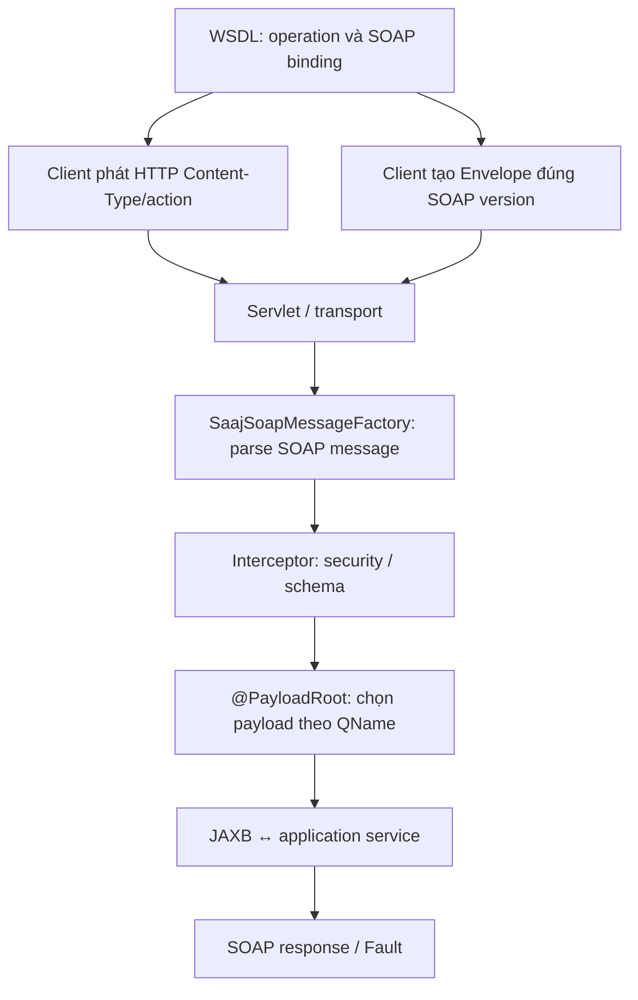
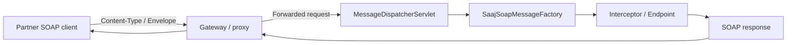

# Chọn phiên bản SOAP của message factory và kiểm tra Content-Type tương ứng

## 1. Tình huống thực tế: XML đúng nhưng đối tác vẫn từ chối request

Một nhóm xây dựng dịch vụ tra cứu đơn hàng với **Spring Web Services (Spring-WS)** theo hướng **contract-first**. XSD khai báo `GetOrderRequest` và `GetOrderResponse`, JAXB sinh đúng lớp Java, còn endpoint đã có `@PayloadRoot`. Request từ một SOAP client nội bộ chạy thành công, nhưng đối tác ERP báo lỗi khi tích hợp:

```text
HTTP/1.1 415 Unsupported Media Type
Content-Type: text/plain

Unsupported SOAP media type
```

Ở một lần thử khác, server trả SOAP Fault cho biết phiên bản Envelope không được hỗ trợ. Điều đáng chú ý là dữ liệu nghiệp vụ `orderId` và namespace của `GetOrderRequest` đều đúng. Vấn đề nằm ở **phiên bản giao thức SOAP và các HTTP header truyền tải**, những yếu tố được xác định bởi SOAP binding và cấu hình message factory.

Với cùng một operation, hai kiểu request sau có thể mang cùng payload nhưng thuộc hai phiên bản SOAP khác nhau:

- **SOAP 1.1**: Envelope có namespace `http://schemas.xmlsoap.org/soap/envelope/`, HTTP `Content-Type` thường là `text/xml` và theo SOAP 1.1 HTTP binding có header `SOAPAction`.
- **SOAP 1.2**: Envelope có namespace `http://www.w3.org/2003/05/soap-envelope`, HTTP `Content-Type` thường là `application/soap+xml`; action có thể xuất hiện dưới dạng tham số `action` của media type theo binding.

Trong module **SPRING_WEB_SERVICES**, bài học thuộc chương **Cấu hình máy chủ**: chọn chính xác phiên bản SOAP của `SaajSoapMessageFactory`, đối chiếu HTTP `Content-Type` với Envelope và WSDL, cấu hình endpoint/client và kiểm thử trên đường truyền thực tế. Đây là cơ sở để xử lý chính xác SOAP Fault, interceptor, JAXB, XML security, WS-Security, chứng chỉ và khả năng tương thích với hệ thống doanh nghiệp.

**Sau bài học, bạn có thể:**

1. Nhận diện SOAP 1.1 và SOAP 1.2 qua namespace, media type, action và Fault.
2. Cấu hình `SaajSoapMessageFactory` trong Spring-WS cho phiên bản đã thỏa thuận.
3. Giải thích vì sao `@Endpoint`/JAXB không tự quyết định SOAP version.
4. Kiểm tra trực tiếp HTTP request/response, bao gồm `Content-Type` có tham số và trường hợp MTOM.
5. Chẩn đoán mismatch giữa SOAP Envelope, factory, WSDL binding, gateway và SOAP client.

## 2. Bốn lớp phải khớp nhau

Để một request SOAP được xử lý ổn định, cần kiểm tra **bốn góc nhìn**:

| Lớp | Thông tin cần đối chiếu | Ví dụ |
|---|---|---|
| **Hợp đồng** | WSDL binding công bố SOAP 1.1 hay 1.2, operation và action ra sao? | `soap:binding` hoặc `soap12:binding` |
| **Thông điệp** | Namespace của `Envelope` và dạng `Fault` có đúng version không? | `http://www.w3.org/2003/05/soap-envelope` |
| **HTTP transport** | `Content-Type`, tham số `charset`/`action` và SOAPAction có tương thích binding không? | `application/soap+xml; charset=utf-8` |
| **Spring-WS runtime** | Message factory, dispatcher và client template thực sự đang dùng cấu hình nào? | `SaajSoapMessageFactory#setSoapVersion(SoapVersion.SOAP_12)` |



Với thông điệp SOAP hợp lệ, `MessageDispatcherServlet` nhận request HTTP rồi sử dụng infrastructure Spring-WS để tạo/đọc message, dispatch tới endpoint và ghi response. Nếu media type hoặc Envelope không tương thích với parser, lỗi có thể xuất hiện **trước khi `@PayloadRoot` được gọi**.

**Điều cần phân biệt:** `SaajSoapMessageFactory` lựa chọn representation và phiên bản SOAP cho thông điệp; nó **không thay thế việc công bố WSDL, validate XSD, ánh xạ JAXB hay quyết định quyền nghiệp vụ**. Những trách nhiệm này có các thành phần riêng.

## 3. SOAP 1.1 và SOAP 1.2 khác nhau ở những điểm nào?

### 3.1. Bảng đối chiếu trọng tâm

| Tiêu chí | SOAP 1.1 | SOAP 1.2 |
|---|---|---|
| Namespace của Envelope | `http://schemas.xmlsoap.org/soap/envelope/` | `http://www.w3.org/2003/05/soap-envelope` |
| HTTP media type thông thường | `text/xml` | `application/soap+xml` |
| HTTP `SOAPAction` | Được định nghĩa trong SOAP 1.1 HTTP binding | Không phải cơ chế action chuẩn tương đương trong SOAP 1.2 HTTP binding |
| Action ở HTTP layer | `SOAPAction: "urn:example:orders:GetOrder"` | Thường qua `action="urn:example:orders:GetOrder"` trong `Content-Type` |
| SOAP Fault cơ bản | `Client`, `Server`, `faultstring`, `detail` | `Sender`, `Receiver`, `Reason`, `Detail` |
| WSDL 1.1 SOAP extension phổ biến | `http://schemas.xmlsoap.org/wsdl/soap/` | `http://schemas.xmlsoap.org/wsdl/soap12/` |
| Chuyển đổi giữa hai phiên bản | Không tương thích trực tiếp chỉ bằng đổi một HTTP header | Cần thống nhất Envelope, binding, message factory và hành vi Fault |

Các giá trị trong bảng mô tả **SOAP qua HTTP không sử dụng đóng gói MIME phức tạp**. Khi dùng MTOM/XOP hoặc SOAP attachments, HTTP `Content-Type` ở lớp ngoài có thể là `multipart/related`; phải kiểm tra media type của root MIME part và các tham số liên quan.

### 3.2. Envelope SOAP 1.1

```xml
<soap11:Envelope
    xmlns:soap11="http://schemas.xmlsoap.org/soap/envelope/"
    xmlns:ord="urn:example:orders:v1">
  <soap11:Header/>
  <soap11:Body>
    <ord:GetOrderRequest>
      <ord:orderId>ORD-1001</ord:orderId>
    </ord:GetOrderRequest>
  </soap11:Body>
</soap11:Envelope>
```

Một HTTP request đơn giản:

```http
POST /ws HTTP/1.1
Host: orders.example.org
Content-Type: text/xml; charset=utf-8
SOAPAction: "urn:example:orders:GetOrder"

<soap11:Envelope xmlns:soap11="http://schemas.xmlsoap.org/soap/envelope/"
                 xmlns:ord="urn:example:orders:v1">
  <soap11:Body>
    <ord:GetOrderRequest>
      <ord:orderId>ORD-1001</ord:orderId>
    </ord:GetOrderRequest>
  </soap11:Body>
</soap11:Envelope>
```

`SOAPAction` ở đây là giá trị **ví dụ**, phải khớp binding và quy ước của đối tác. SOAP 1.1 HTTP binding định nghĩa header này; giá trị có thể là URI, chuỗi rỗng hoặc cách sử dụng cụ thể theo WSDL. Không được tự gán một URI bất kỳ rồi cho rằng mọi client sẽ xử lý giống nhau.

### 3.3. Envelope SOAP 1.2

```xml
<env:Envelope
    xmlns:env="http://www.w3.org/2003/05/soap-envelope"
    xmlns:ord="urn:example:orders:v1">
  <env:Header/>
  <env:Body>
    <ord:GetOrderRequest>
      <ord:orderId>ORD-1001</ord:orderId>
    </ord:GetOrderRequest>
  </env:Body>
</env:Envelope>
```

HTTP request cùng payload theo SOAP 1.2:

```http
POST /ws HTTP/1.1
Host: orders.example.org
Content-Type: application/soap+xml; charset=utf-8; action="urn:example:orders:GetOrder"

<env:Envelope xmlns:env="http://www.w3.org/2003/05/soap-envelope"
              xmlns:ord="urn:example:orders:v1">
  <env:Body>
    <ord:GetOrderRequest>
      <ord:orderId>ORD-1001</ord:orderId>
    </ord:GetOrderRequest>
  </env:Body>
</env:Envelope>
```

Trong SOAP 1.2, `action` là một **tham số của media type** khi sử dụng theo binding tương ứng; không nên lấy HTTP `SOAPAction` của SOAP 1.1 rồi áp dụng nguyên xi. Một số hệ thống cũ có yêu cầu ngoài chuẩn về header action, nhưng khi đó cần ghi nhận đây là **quy ước liên thông của đối tác**, có kiểm thử riêng.

**Quan trọng:** phần tử nghiệp vụ `{urn:example:orders:v1}GetOrderRequest` có thể giống hệt nhau giữa hai message. SOAP version được xác định ở **Envelope và binding**, không phải ở tên operation hay kiểu Java của request.

### 3.4. Media type không phải phép so sánh chuỗi tuyệt đối

Hai dạng sau đều có media type SOAP 1.2:

```text
application/soap+xml
application/soap+xml; charset=UTF-8; action="urn:example:orders:GetOrder"
```

Vì thế, việc viết rule proxy `Content-Type == "application/soap+xml"` theo so sánh cả chuỗi có thể từ chối request hợp lệ mang thêm `charset` hoặc `action`. Cần phân tích **media type và parameters** đúng quy tắc HTTP; tên type/subtype và parameter names không nên bị xem như phân biệt hoa/thường một cách tùy tiện.

Tương tự, `text/xml; charset=utf-8` vẫn là media type `text/xml`. Tuy nhiên **`text/xml` và `application/soap+xml` không đồng nghĩa**, kể cả payload nghiệp vụ giống nhau.

## 4. `SaajSoapMessageFactory` chọn SOAP version thế nào?

SAAJ (SOAP with Attachments API for Java) cung cấp các đối tượng `SOAPMessage`, `SOAPPart`, `SOAPEnvelope`, `SOAPHeader`, `SOAPBody`. Spring-WS dùng `SaajSoapMessageFactory` làm cầu nối với API SAAJ; factory tạo và parse message dựa trên SAAJ provider tương thích.

Các thành phần cần nhớ:

| Thành phần | Vai trò |
|---|---|
| `SoapVersion.SOAP_11` / `SoapVersion.SOAP_12` | Hằng xác định phiên bản SOAP mong muốn trong Spring-WS |
| `SaajSoapMessageFactory` | Implementation message factory của Spring-WS dựa trên SAAJ |
| `jakarta.xml.soap.MessageFactory` | Factory cấp Jakarta SAAJ mà Spring-WS sử dụng bên dưới |
| `SaajSoapMessage` | Wrapper Spring-WS cho `SOAPMessage` |
| `MessageDispatcherServlet` | Điểm tiếp nhận SOAP over HTTP ở phía server |
| `WebServiceTemplate` | Điều phối request/response SOAP ở phía client |

Trong Spring-WS hiện đại sử dụng Jakarta, SAAJ API thuộc `jakarta.xml.soap.*`. Không dùng lẫn các class `javax.xml.soap.*` từ stack cũ với các dependency Jakarta mới. Việc build thành công không bảo đảm provider runtime đã nhất quán; nên kiểm tra dependency tree khi chuyển phiên bản Spring Boot/Spring-WS.

### 4.1. Cấu hình factory SOAP 1.1

Ví dụ Spring Boot / Spring-WS trong stack Jakarta:

```java
import org.springframework.context.annotation.Bean;
import org.springframework.context.annotation.Configuration;
import org.springframework.ws.soap.SoapVersion;
import org.springframework.ws.soap.saaj.SaajSoapMessageFactory;

@Configuration
public class SoapServerMessageConfiguration {

    @Bean(name = "messageFactory")
    public SaajSoapMessageFactory messageFactory() {
        SaajSoapMessageFactory factory = new SaajSoapMessageFactory();
        factory.setSoapVersion(SoapVersion.SOAP_11);
        return factory;
    }
}
```

Spring quản lý vòng đời bean, bao gồm việc khởi tạo factory theo cơ chế framework. Nếu tự tạo factory bên ngoài Spring container, cần bảo đảm gọi bước khởi tạo tương ứng (chẳng hạn `afterPropertiesSet()`) trước khi sử dụng theo contract của implementation.

### 4.2. Cấu hình factory SOAP 1.2

Nếu đối tác và WSDL đã thống nhất SOAP 1.2, thay lựa chọn version trong cấu hình:

```java
@Bean(name = "messageFactory")
public SaajSoapMessageFactory messageFactory() {
    SaajSoapMessageFactory factory = new SaajSoapMessageFactory();
    factory.setSoapVersion(SoapVersion.SOAP_12);
    return factory;
}
```

Đây là **cấu hình phiên bản thông điệp**, không phải nút tự chuyển toàn bộ contract:

- WSDL binding cần công bố SOAP 1.2.
- Client phải tạo Envelope namespace SOAP 1.2 và gửi media type phù hợp.
- Fault và các interceptor dùng API phù hợp phiên bản.
- Gateway/proxy cần cho phép `application/soap+xml` và các tham số cần thiết.
- SOAP client của đối tác phải thực sự hỗ trợ SOAP 1.2.

**Không coi cấu hình này là cơ chế negotiation SOAP 1.1/1.2 tự động.** Một instance `SaajSoapMessageFactory` được đặt SOAP 1.2 thường dùng để làm việc với message SOAP 1.2; nếu muốn đồng thời hỗ trợ hai phiên bản, cần thiết kế rõ ràng ở lớp binding/endpoint/dispatch hoặc dùng kiến trúc được framework hỗ trợ, rồi kiểm thử thật. Không dựa vào hành vi không công bố của provider.

### 4.3. Chỉ định đúng bean mà servlet đang dùng

Với Spring-WS, `MessageDispatcherServlet` cần dùng đúng message factory từ Spring application context. Tên bean `messageFactory` là quy ước phổ biến mà servlet tìm kiếm ở context tương ứng. Tuy nhiên đường đi chính xác còn phụ thuộc cấu hình servlet, context và phiên bản Spring Boot.

Ví dụ nếu dự án chọn cách đăng ký servlet thủ công:

```java
import org.springframework.boot.web.servlet.ServletRegistrationBean;
import org.springframework.context.ApplicationContext;
import org.springframework.context.annotation.Bean;
import org.springframework.context.annotation.Configuration;
import org.springframework.ws.transport.http.MessageDispatcherServlet;

@Configuration
public class SoapServletConfiguration {

    @Bean
    public ServletRegistrationBean<MessageDispatcherServlet> soapServlet(
            ApplicationContext context) {
        MessageDispatcherServlet servlet = new MessageDispatcherServlet();
        servlet.setApplicationContext(context);
        servlet.setTransformWsdlLocations(true);
        return new ServletRegistrationBean<>(servlet, "/ws/*");
    }
}
```

Trước khi dùng, cần kiểm tra **Spring Boot auto-configuration** của phiên bản đang chạy có tự đăng ký servlet và message factory hay không. Nếu đã có cấu hình tự động phù hợp, không nên tạo servlet trùng mapping `/ws/*`. Đổi tên bean hoặc khai báo nhiều factory mà không kết nối đúng vào servlet có thể khiến server vẫn sử dụng phiên bản khác với dự kiến.

## 5. Cấu hình WSDL binding phải đồng bộ với factory

Trong contract-first, `SaajSoapMessageFactory` **không sinh ra WSDL**. XSD định nghĩa payload; WSDL xác định operation, message, SOAP binding và địa chỉ truy cập. Có hai cách phổ biến:

1. **WSDL tĩnh:** quản lý một file WSDL đã phê duyệt và công bố qua `SimpleWsdl11Definition`; giữ nguyên binding và action mà đối tác đã ký kết.
2. **WSDL sinh từ XSD:** dùng `DefaultWsdl11Definition`, cấu hình các quy tắc cần thiết rồi kiểm tra WSDL thực tế sinh ra. Tên phần tử theo convention như `GetOrderRequest`/`GetOrderResponse` có thể tạo operation `GetOrder`.

### 5.1. WSDL 1.1 extension cho SOAP 1.1

Đoạn minh họa **phần binding** (không phải WSDL đầy đủ):

```xml
<wsdl:binding name="OrdersSoap11Binding" type="tns:OrdersPort">
  <soap:binding style="document"
                transport="http://schemas.xmlsoap.org/soap/http"/>
  <wsdl:operation name="GetOrder">
    <soap:operation soapAction="urn:example:orders:GetOrder"/>
    <wsdl:input>
      <soap:body use="literal"/>
    </wsdl:input>
    <wsdl:output>
      <soap:body use="literal"/>
    </wsdl:output>
  </wsdl:operation>
</wsdl:binding>
```

Đoạn này giả định `xmlns:wsdl="http://schemas.xmlsoap.org/wsdl/"`, `xmlns:soap="http://schemas.xmlsoap.org/wsdl/soap/"` và `tns` là namespace của WSDL đang công bố. `style="document"` và `use="literal"` là cách binding thường gặp khi thiết kế Spring-WS contract-first.

### 5.2. WSDL 1.1 extension cho SOAP 1.2

Tương tự, với namespace extension của SOAP 1.2:

```xml
<wsdl:binding name="OrdersSoap12Binding" type="tns:OrdersPort">
  <soap12:binding style="document"
                  transport="http://schemas.xmlsoap.org/soap/http"/>
  <wsdl:operation name="GetOrder">
    <soap12:operation soapAction="urn:example:orders:GetOrder"/>
    <wsdl:input>
      <soap12:body use="literal"/>
    </wsdl:input>
    <wsdl:output>
      <soap12:body use="literal"/>
    </wsdl:output>
  </wsdl:operation>
</wsdl:binding>
```

Namespace `soap12` ở đây là `http://schemas.xmlsoap.org/wsdl/soap12/`, không phải namespace SOAP 1.2 của Envelope. WSDL có thể mô tả binding SOAP 1.2 bằng extension này; HTTP media type tương ứng vẫn là `application/soap+xml` trong trường hợp SOAP XML thông thường.

**Sai lầm dễ gặp:** server chuyển sang SOAP 1.2 nhưng WSDL vẫn công bố SOAP 1.1; client sinh stub theo WSDL sẽ tạo Envelope và HTTP headers theo binding cũ. Runtime có thể trả version mismatch dù `@Endpoint` và JAXB đều đúng.

### 5.3. Kiểm tra WSDL cuối cùng thay vì chỉ kiểm tra code cấu hình

Trong môi trường có proxy hoặc API gateway, nên tải WSDL từ chính địa chỉ mà đối tác sử dụng và kiểm tra:

- `wsdl:binding` dùng đúng SOAP extension và document/literal policy.
- `wsdl:operation` có action đúng với thỏa thuận.
- `wsdl:service/wsdl:port` tham chiếu đúng binding.
- `soap:address`/`soap12:address` công bố HTTPS host và đường dẫn public đúng.
- Các `xsd:import`/`xsd:include` có thể truy cập từ phía consumer được phép.
- Metadata bảo mật và fault contract được trình bày đầy đủ nếu hệ thống yêu cầu.

`setTransformWsdlLocations(true)` có thể giúp điều chỉnh địa chỉ trong WSDL theo request, nhưng cần kiểm tra forwarded headers và cấu hình reverse proxy. Nó không tự bảo đảm mọi môi trường có cùng URL hợp lệ.

## 6. `Content-Type` và `SOAPAction` ở HTTP layer

### 6.1. Content-Type của request và response

Phía client phải gửi HTTP request có content type phù hợp binding và payload đã serialize. Phía server cần trả HTTP response có content type và Envelope nhất quán. Ví dụ:

```text
SOAP 1.1 request:  Content-Type: text/xml; charset=utf-8
SOAP 1.1 response: Content-Type: text/xml; charset=utf-8

SOAP 1.2 request:  Content-Type: application/soap+xml; charset=utf-8
SOAP 1.2 response: Content-Type: application/soap+xml; charset=utf-8
```

Đây là dạng **tham khảo phổ biến**, không phải tuyên bố rằng mọi implementation luôn in đúng thứ tự tham số hoặc cùng dạng chữ hoa/chữ thường. Khi kiểm tra, ưu tiên parse media type và xác nhận phiên bản SOAP; charset thực tế phải khớp cách mã hóa XML.

**Vì sao kiểm tra cả response?** Server có thể nhận SOAP 1.2 nhưng một proxy hoặc adapter phía sau vẫn tạo response `text/xml`. Client SOAP 1.2 có thể coi đó là sai media type hoặc gặp lỗi parse. Kiểm thử một chiều request chưa đủ cho tích hợp.

### 6.2. Action không phải tên Java method

Ví dụ WSDL operation `GetOrder` được ánh xạ tới `@PayloadRoot(namespace = "...", localPart = "GetOrderRequest")`. Trong Spring-WS, endpoint mapping theo QName payload có thể hoạt động độc lập với giá trị HTTP SOAPAction nếu không cấu hình mapping theo action. Tuy vậy, **hợp đồng WSDL và client vẫn có thể yêu cầu action chính xác**.

Các điểm cần phân biệt:

- **WSDL operation name:** `GetOrder`.
- **QName payload:** `{urn:example:orders:v1}GetOrderRequest`.
- **SOAPAction 1.1 hoặc SOAP 1.2 action parameter:** URI được thỏa thuận trong binding.
- **Java method:** tên triển khai, có thể là `getOrder` hoặc tên khác.

Không tự suy ra một trong các giá trị này bằng cách ghép chuỗi rồi cho rằng mọi hệ thống đều đồng ý. Với một số đối tác, action rỗng là hợp lệ; với đối tác khác, thiếu/khác action sẽ bị từ chối.

### 6.3. Content-Type khác Accept

`Content-Type` mô tả **dữ liệu đang được gửi trong HTTP entity body**. `Accept` mô tả dạng nội dung client mong muốn nhận. Một HTTP request có `Accept: application/soap+xml` nhưng body thực sự là SOAP 1.1 với `Content-Type: text/xml` vẫn phải được đánh giá theo nội dung và binding gửi vào; `Accept` không tự chuyển request thành SOAP 1.2.

Không dùng `Accept` thay thế `Content-Type` khi debug sai phiên bản giao thức.

## 7. SOAP endpoint vẫn được thiết kế theo payload

Giả sử hợp đồng XSD có hai phần tử toàn cục:

```xml
<xs:schema xmlns:xs="http://www.w3.org/2001/XMLSchema"
           xmlns:tns="urn:example:orders:v1"
           targetNamespace="urn:example:orders:v1"
           elementFormDefault="qualified">
  <xs:element name="GetOrderRequest">
    <xs:complexType>
      <xs:sequence>
        <xs:element name="orderId" type="xs:string"/>
      </xs:sequence>
    </xs:complexType>
  </xs:element>
  <xs:element name="GetOrderResponse">
    <xs:complexType>
      <xs:sequence>
        <xs:element name="orderId" type="xs:string"/>
        <xs:element name="status" type="xs:string"/>
      </xs:sequence>
    </xs:complexType>
  </xs:element>
</xs:schema>
```

Một endpoint được viết như sau:

```java
import org.springframework.ws.server.endpoint.annotation.Endpoint;
import org.springframework.ws.server.endpoint.annotation.PayloadRoot;
import org.springframework.ws.server.endpoint.annotation.RequestPayload;
import org.springframework.ws.server.endpoint.annotation.ResponsePayload;

@Endpoint
public class OrderEndpoint {
    private static final String NS = "urn:example:orders:v1";
    private final OrderQueryService queryService;
    private final OrderContractMapper mapper;

    public OrderEndpoint(
            OrderQueryService queryService,
            OrderContractMapper mapper) {
        this.queryService = queryService;
        this.mapper = mapper;
    }

    @PayloadRoot(namespace = NS, localPart = "GetOrderRequest")
    @ResponsePayload
    public GetOrderResponse getOrder(
            @RequestPayload GetOrderRequest request) {
        var order = queryService.findById(request.getOrderId());
        return mapper.toResponse(order);
    }
}
```

`GetOrderRequest`, `GetOrderResponse` là lớp JAXB sinh từ schema; `OrderQueryService` và `OrderContractMapper` là lớp ứng dụng tự triển khai. Đây là khung minh họa, cần bổ sung các thành phần tương ứng để compile.

Đổi `SaajSoapMessageFactory` từ SOAP 1.1 sang SOAP 1.2 **không làm thay đổi `@PayloadRoot` của payload nghiệp vụ** nếu XSD và namespace nghiệp vụ giữ nguyên. Nó làm thay đổi định dạng **SOAP Envelope, transport media type và Fault**. Do đó bài toán version mismatch phải được xử lý ở message factory/WSDL/HTTP, không sửa tùy tiện QName nghiệp vụ.

### 7.1. JAXB và schema validation là lớp riêng

`Jaxb2Marshaller` ánh xạ payload thành Java object và ngược lại. `PayloadValidatingInterceptor` có thể validate payload theo XSD. Một body đúng SOAP 1.2 nhưng sai thứ tự element theo `xs:sequence` vẫn có thể bị schema validation từ chối.

Ngược lại, một `GetOrderRequest` đúng XSD nhưng được bọc trong SOAP Envelope sai version vẫn có thể thất bại tại message parser trước khi đến JAXB. Đây là hai lỗi độc lập cần test riêng.

## 8. Cấu hình SOAP client đúng version

Một ứng dụng Spring-WS có thể vừa phục vụ SOAP 1.1 inbound, vừa gọi partner SOAP 1.2 outbound. Không nên áp đặt cùng một message factory cho mọi client khi binding khác nhau.

Ví dụ client SOAP 1.2:

```java
import org.springframework.context.annotation.Bean;
import org.springframework.context.annotation.Configuration;
import org.springframework.oxm.jaxb.Jaxb2Marshaller;
import org.springframework.ws.client.core.WebServiceTemplate;
import org.springframework.ws.soap.SoapVersion;
import org.springframework.ws.soap.saaj.SaajSoapMessageFactory;

@Configuration
public class PartnerSoapClientConfiguration {

    @Bean
    public SaajSoapMessageFactory partnerSoap12Factory() {
        SaajSoapMessageFactory factory = new SaajSoapMessageFactory();
        factory.setSoapVersion(SoapVersion.SOAP_12);
        return factory;
    }

    @Bean
    public WebServiceTemplate partnerWebServiceTemplate(
            SaajSoapMessageFactory partnerSoap12Factory,
            Jaxb2Marshaller partnerMarshaller) {
        WebServiceTemplate template =
                new WebServiceTemplate(partnerSoap12Factory);
        template.setMarshaller(partnerMarshaller);
        template.setUnmarshaller(partnerMarshaller);
        template.setDefaultUri("https://partner.example.org/soap");
        return template;
    }
}
```

`partnerMarshaller` là bean JAXB do dự án cấu hình để trỏ đến schema/classes của đối tác. Địa chỉ `partner.example.org` là ví dụ; production phải đưa URI, timeout, TLS/truststore, xác thực và WS-Security ra cấu hình môi trường.

Khi nhiều bean `SaajSoapMessageFactory` cùng tồn tại, cần chỉ rõ factory nào thuộc server và client bằng tên bean hoặc qualifier. Trong dự án thật, nên dùng `@Qualifier` khi có nguy cơ injection mơ hồ. Đối với factory tạo ngoài Spring container, phải bảo đảm lifecycle khởi tạo đúng như quy định của API trước khi sử dụng.

### 8.1. Thiết lập SOAP action phía client

Spring-WS cung cấp `SoapActionCallback` khi cần đặt action trong quá trình gửi request:

```java
import org.springframework.ws.soap.client.core.SoapActionCallback;

var callback =
        new SoapActionCallback("urn:example:orders:GetOrder");

Object response = partnerWebServiceTemplate.marshalSendAndReceive(
        request, callback);
```

`request` là JAXB request object do client tạo, và template đã được cấu hình. Spring-WS/SAAJ sẽ biểu diễn action theo khả năng và SOAP version đang sử dụng; cần kiểm chứng **HTTP header/media type thực tế** của stack và WSDL đối tác. Không mặc định callback này giải quyết mọi trường hợp SOAP 1.2 action parameter trong mọi provider.

Nếu đối tác yêu cầu WS-Addressing `wsa:Action` trong SOAP Header, đó còn là một cơ chế khác. `SOAPAction`/media-type `action` và `wsa:Action` có thể cần khớp theo policy, nhưng không phải cùng một vị trí trên thông điệp.

## 9. SOAP Fault, HTTP status và Content-Type khi xảy ra lỗi

Khi server gặp request sai version, có thể sinh SOAP Fault liên quan đến `VersionMismatch` theo khả năng parser/runtime; cũng có thể trả lỗi HTTP trực tiếp nếu không parse được thông điệp. **Không có bảo đảm mọi request sai đều được trả về một SOAP Fault đẹp**.

### 9.1. SOAP 1.1 Fault minh họa

```xml
<soap11:Envelope
    xmlns:soap11="http://schemas.xmlsoap.org/soap/envelope/">
  <soap11:Body>
    <soap11:Fault>
      <faultcode>soap11:Client</faultcode>
      <faultstring>Invalid order request</faultstring>
    </soap11:Fault>
  </soap11:Body>
</soap11:Envelope>
```

### 9.2. SOAP 1.2 Fault minh họa

```xml
<env:Envelope xmlns:env="http://www.w3.org/2003/05/soap-envelope">
  <env:Body>
    <env:Fault>
      <env:Code>
        <env:Value>env:Sender</env:Value>
      </env:Code>
      <env:Reason>
        <env:Text xml:lang="vi">Yêu cầu đơn hàng không hợp lệ</env:Text>
      </env:Reason>
    </env:Fault>
  </env:Body>
</env:Envelope>
```

SOAP 1.1 có `faultcode`/`faultstring`, còn SOAP 1.2 có `Code`/`Reason`; một client chỉ hiểu cấu trúc Fault của phiên bản kia có thể thất bại khi đọc lỗi.

Trong thực tế:

| Kết quả HTTP | Cách diễn giải phù hợp |
|---|---|
| `200 OK` với SOAP response | Thường là xử lý thành công ở lớp SOAP; vẫn cần kiểm tra outcome nghiệp vụ |
| `500 Internal Server Error` với SOAP Fault | Có thể là lỗi được biểu diễn bằng SOAP; phải parse Fault theo version |
| `400 Bad Request` hoặc `415 Unsupported Media Type` | Có thể lỗi transport/media type/Envelope; body có thể là SOAP Fault hoặc văn bản/HTML |
| Timeout hoặc ngắt kết nối | Không xác định chắc server đã xử lý command hay chưa |

Không dùng duy nhất HTTP status để phân loại mọi Fault. HTTP mapping cụ thể phụ thuộc SOAP binding, trường hợp lỗi và stack server/client. Client phải xử lý được cả lỗi HTTP không có SOAP Envelope, đặc biệt khi lỗi xuất hiện tại gateway hoặc servlet.

### 9.3. Fault và schema validation không thay thế nhau

`SaajSoapMessageFactory` không biết bản ghi `orderId` có tồn tại trong database. Message factory chịu trách nhiệm tạo/đọc SOAP; `PayloadValidatingInterceptor` kiểm tra XSD; application service quyết định nghiệp vụ; exception resolver như `SoapFaultMappingExceptionResolver` ánh xạ lỗi thành SOAP Fault phù hợp.

Một endpoint SOAP 1.2 với XSD hợp lệ vẫn có thể trả Fault `Sender` khi caller không có quyền. Ngược lại, lỗi không hỗ trợ media type có thể chặn request trước khi application xử lý.

## 10. Trường hợp ngoại lệ: MTOM, XOP và MIME multipart

Với payload SOAP không có attachments, bảng media type `text/xml` vs `application/soap+xml` là điểm kiểm tra quan trọng. Nhưng một số hệ thống SOAP truyền file nhị phân bằng **MTOM/XOP** hoặc MIME attachments.

Ví dụ dạng HTTP header của một request MTOM:

```http
POST /ws HTTP/1.1
Host: documents.example.org
Content-Type: multipart/related; type="application/xop+xml"; start="<root@example.org>"; start-info="application/soap+xml"; boundary="MIME_boundary_01"
MIME-Version: 1.0

--MIME_boundary_01
Content-Type: application/xop+xml; charset=UTF-8; type="application/soap+xml"
Content-ID: <root@example.org>

... SOAP Envelope và xop:Include ...
--MIME_boundary_01--
```

Đây là **định dạng minh họa**; cấu trúc MIME thực tế phải có đủ phần theo MTOM/XOP, references và binary attachment, không thể dùng nguyên đoạn này làm request hoàn chỉnh.

Khi đó HTTP `Content-Type` lớp ngoài là `multipart/related`, không đơn giản là `application/soap+xml`. Muốn kiểm tra đúng phiên bản SOAP phải xét **root MIME part**, `start-info` hoặc các tham số tương ứng cùng với namespace Envelope và binding.

Một bộ lọc mạng từ chối mọi request có outer `Content-Type != application/soap+xml` có thể chặn MTOM hợp lệ. Ngược lại, cho phép mọi multipart mà không kiểm tra cấu trúc và giới hạn dung lượng cũng không an toàn.

**Phân biệt:**

- **Inline base64:** binary nằm trong text của SOAP Body.
- **SOAP with Attachments:** có các phần MIME bên ngoài SOAP part.
- **MTOM/XOP:** cơ chế tối ưu hóa binary được quy định theo contract và hỗ trợ của stack; không tự động bật chỉ vì dùng SAAJ `AttachmentPart`.

Với tài liệu rất lớn, cần kiểm thử heap, streaming thực tế, limit attachment, SOAP signature và khả năng tương thích client. Message factory SAAJ dựa trên cây có thể tiêu thụ nhiều bộ nhớ cho SOAP XML; không nên suy ra việc có attachment đồng nghĩa hoàn toàn không buffer binary.

## 11. Gateway và reverse proxy: những điểm dễ làm thay đổi Content-Type

Nhiều dịch vụ SOAP doanh nghiệp được triển khai sau API gateway, load balancer, reverse proxy hoặc Web Application Firewall. Chúng có thể:

- Từ chối media type không nằm trong allowlist.
- Làm mất hoặc viết lại `SOAPAction`/`Content-Type`.
- Không cho tham số `action` trong `application/soap+xml`.
- Giới hạn payload/attachment và timeout, khiến lỗi xảy ra trước server.
- Công bố WSDL với URL HTTP nội bộ thay vì HTTPS public.

Khi debug, cần xác định **request ở mỗi chặng** thay vì chỉ xem log endpoint:



Nếu gateway trả 415, `@Endpoint` sẽ không chạy, nên chỉnh annotation Java có thể không giải quyết gì. Nếu servlet nhận HTTP request nhưng factory báo version mismatch, cần kiểm tra namespace Envelope, factory được wiring và binding. Nếu message đã tới application service, lúc đó mới xem business fault.

Logging chỉ nên ghi những trường cần chẩn đoán như method, path, media type đã parse, SOAP version, operation QName, correlation ID, status và thời gian xử lý. **Không** ghi nguyên SOAP Header chứa token, chữ ký, mật khẩu hoặc thông tin cá nhân.

## 12. Bảo mật khi thay đổi SOAP version hoặc media type

Việc dùng đúng `Content-Type` **không chứng minh request an toàn**. Các lớp bảo vệ cần được xác định độc lập:

| Lớp | Quy tắc cần giữ |
|---|---|
| **TLS/mTLS** | Xác minh chứng chỉ, hostname, truststore/keystore và danh tính client |
| **XML parser security** | Chặn DTD/external entities không cần thiết, giới hạn entity expansion, kích thước và độ sâu |
| **WS-Security** | Xác minh chữ ký, timestamp, token, encryption theo policy của đối tác |
| **Authorization** | Đối tác chỉ truy cập đơn hàng hoặc dữ liệu mình có quyền |
| **XSD validation** | Payload tuân namespace, loại dữ liệu, thứ tự và ràng buộc đã công bố |
| **Availability** | Giới hạn payload, timeout, attachment count/size và concurrency |

`SaajSoapMessageFactory` sử dụng SAAJ provider ở tầng XML; cấu hình an toàn parser phụ thuộc provider và runtime. Không có một thay đổi `setSoapVersion` nào tự bật mọi biện pháp chống XXE hoặc DoS. Cần kiểm thử XML có DTD/external entity bị từ chối và bảo đảm không tải nguồn ngoài trái policy.

Khi SOAP message có `wsse:Security`, `wsu:Timestamp` hoặc XML Signature, việc chuyển SOAP version có thể ảnh hưởng tới Envelope namespace, canonicalization context, security policy và khả năng client ký/xác minh. Phải thử với certificate/key và policy test thực tế; đừng chỉnh trực tiếp Body/Header sau khi ký.

**SOAP version và TLS version là hai khái niệm độc lập.** SOAP 1.2 không tự có TLS mạnh hơn SOAP 1.1; cả hai có thể được vận chuyển trên HTTPS theo cấu hình transport.

## 13. Kiểm thử xác nhận phiên bản và Content-Type

Một bài unit test khởi tạo `SaajSoapMessageFactory` có thể chứng minh factory tạo Envelope đúng version, nhưng **không chứng minh HTTP response có đúng media type**. Để hoàn thành bài toán, nên kiểm tra cả:

1. **Factory-level test:** factory tạo SOAP message với namespace Envelope mong muốn.
2. **Spring-WS endpoint integration:** `MockWebServiceClient` kiểm tra payload, dispatch, validation và Fault trong Spring context.
3. **SOAP client unit/integration:** `MockWebServiceServer` kiểm tra request XML và SOAP client xử lý response.
4. **Live HTTP test:** gọi endpoint qua HTTP hoặc HTTPS thực, quan sát raw `Content-Type`, `SOAPAction` và Envelope.
5. **Interoperability test:** client của đối tác hoặc tool độc lập lấy WSDL và trao đổi request/response/Fault.

### 13.1. Factory-level test với JUnit

```java
import static org.junit.jupiter.api.Assertions.assertEquals;
import org.junit.jupiter.api.Test;
import org.springframework.ws.soap.SoapMessage;
import org.springframework.ws.soap.SoapVersion;
import org.springframework.ws.soap.saaj.SaajSoapMessageFactory;

class SaajSoapVersionTest {

    @Test
    void newMessageUsesSoap12Envelope() throws Exception {
        SaajSoapMessageFactory factory = new SaajSoapMessageFactory();
        factory.setSoapVersion(SoapVersion.SOAP_12);
        factory.afterPropertiesSet();

        SoapMessage message =
                (SoapMessage) factory.createWebServiceMessage();

        assertEquals(
                SoapVersion.SOAP_12.getEnvelopeNamespaceUri(),
                message.getEnvelope().getName().getNamespaceURI());
    }
}
```

Kiểm tra này minh họa cách xác nhận SOAP 1.2 ở cấp message. Nếu đang dùng provider/phiên bản khác, cần xác minh API truy cập QName của `SoapEnvelope` tương ứng. Nó cũng giả định dependencies SAAJ/JUnit đã được cấu hình. Quan trọng hơn, test không đưa HTTP transport vào cuộc: để kiểm tra `Content-Type`, phải dùng test qua HTTP.

### 13.2. Tạo file XML cho live test

Lưu hai message test độc lập (trong dự án test thật, giữ tại `src/test/resources/soap/`):

**`get-order-soap11.xml`**

```xml
<soap:Envelope xmlns:soap="http://schemas.xmlsoap.org/soap/envelope/"
               xmlns:ord="urn:example:orders:v1">
  <soap:Body>
    <ord:GetOrderRequest>
      <ord:orderId>ORD-1001</ord:orderId>
    </ord:GetOrderRequest>
  </soap:Body>
</soap:Envelope>
```

**`get-order-soap12.xml`**

```xml
<env:Envelope xmlns:env="http://www.w3.org/2003/05/soap-envelope"
              xmlns:ord="urn:example:orders:v1">
  <env:Body>
    <ord:GetOrderRequest>
      <ord:orderId>ORD-1001</ord:orderId>
    </ord:GetOrderRequest>
  </env:Body>
</env:Envelope>
```

### 13.3. Dùng curl để xem HTTP response headers

Đối với môi trường test chấp nhận SOAP 1.1:

```bash
curl -i --request POST "http://localhost:8080/ws" \
  --header 'Content-Type: text/xml; charset=utf-8' \
  --header 'SOAPAction: "urn:example:orders:GetOrder"' \
  --data-binary @get-order-soap11.xml
```

Đối với môi trường test đã cấu hình SOAP 1.2:

```bash
curl -i --request POST "http://localhost:8080/ws" \
  --header 'Content-Type: application/soap+xml; charset=utf-8; action="urn:example:orders:GetOrder"' \
  --data-binary @get-order-soap12.xml
```

`curl -i` hiển thị response headers và body để kiểm tra:

- HTTP status.
- `Content-Type` response (`text/xml` hay `application/soap+xml`, có thể mang tham số).
- Namespace SOAP Envelope ở response.
- SOAP Fault và cấu trúc của Fault khi có lỗi.
- Thời điểm thực sự dispatch tới endpoint.

Các lệnh dùng HTTP localhost trong môi trường phát triển. Trong production cần HTTPS, chứng chỉ và policy phù hợp. Trên Windows PowerShell, nên gọi đúng chương trình `curl.exe` để tránh nhầm với alias `curl` của PowerShell đời cũ; cách xuống dòng của shell Windows cũng khác Bash.

### 13.4. Ma trận negative tests

| Case | `Content-Type` request | Envelope thực tế | Kỳ vọng kiểm tra |
|---|---|---|---|
| A | `text/xml` | SOAP 1.1 | Chấp nhận nếu binding/server hỗ trợ SOAP 1.1 |
| B | `application/soap+xml` | SOAP 1.2 | Chấp nhận nếu binding/server hỗ trợ SOAP 1.2 |
| C | `text/xml` | SOAP 1.2 | Nhận diện media type và Envelope không nhất quán; không dispatch như một request hợp lệ |
| D | `application/soap+xml` | SOAP 1.1 | Nhận diện mismatch; phản hồi có thể là HTTP error hoặc SOAP Fault theo stack |
| E | `application/json` | SOAP XML | Từ chối theo transport/media-type policy |
| F | `application/soap+xml; charset=UTF-8; action="..."` | SOAP 1.2 | Không bị từ chối chỉ vì có các tham số hợp lệ |
| G | `text/xml` | XML không có SOAP Envelope | Parse/transport error, không gọi business endpoint |
| H | `multipart/related; ...` | SOAP MTOM | Đánh giá MIME root part và binding, không so với media type đơn giản |
| I | `application/soap+xml` | SOAP 1.2 có QName payload sai | Parse Envelope được nhưng endpoint mapping/validation phải từ chối |

**Kỳ vọng thực tế cần xác nhận bằng test:** mã HTTP cụ thể và SOAP Fault có/không có body thay đổi theo SAAJ provider, servlet container, proxy và error handler. Đừng viết contract test luôn kỳ vọng 415 cho mọi mismatch nếu chưa có cam kết đó trong hệ thống.

### 13.5. Test qua proxy và client độc lập

Sau khi test localhost pass, gọi lại qua endpoint HTTPS công bố cho đối tác. Kiểm tra proxy không làm mất action hay thay media type; WSDL `soap:address` đúng hostname công khai; client .NET/Java khác có thể sinh stub và gọi theo binding công bố.

Với hệ thống đòi WS-Security, bổ sung test chữ ký, timestamp, certificate trust và replay; việc media type đúng không đủ để bỏ qua những kiểm tra này.

## 14. Chẩn đoán sự cố theo dấu hiệu

| Dấu hiệu | Nguồn lỗi thường gặp | Kiểm tra đầu tiên |
|---|---|---|
| HTTP 415 trước khi tới endpoint | Gateway/servlet không chấp nhận media type | `Content-Type` thực tế sau proxy, allowlist và multipart case |
| SOAP VersionMismatch | Namespace Envelope khác version factory hoặc binding | Namespace `Envelope` và `setSoapVersion` |
| Server nhận SOAP 1.1 dù đã sửa code SOAP 1.2 | Bean message factory khác đang được sử dụng | Bean name `messageFactory`, servlet context và Boot auto-configuration |
| SOAP 1.2 body đúng nhưng client từ chối | Response vẫn `text/xml` hoặc Fault SOAP 1.1 | Response `Content-Type`/Envelope/Fault trên dây |
| JAXB báo sai namespace | QName payload/schema sai | `@PayloadRoot`, generated JAXB bindings và XSD |
| Request sai action nhưng vẫn chạy endpoint | Dispatch dựa trên payload QName | So action với WSDL/client policy, không chỉ dựa vào endpoint chạy |
| Client cũ lỗi khi server chuyển SOAP 1.1 sang 1.2 | WSDL hoặc client stub chưa được nâng phiên bản | WSDL `binding`, generated client và media type |
| Proxy trả HTML error nhưng client cố parse SOAP Fault | Lỗi xảy ra trước Spring-WS | Xem raw HTTP response body và status trước unmarshalling |
| Request MTOM bị báo sai Content-Type | Rule chỉ nhận `text/xml`/`application/soap+xml` ở outer header | Kiểm tra `multipart/related`, MIME root part, `start-info` |
| Chữ ký XML lỗi sau thay version | Policy, header hoặc canonicalization không phù hợp | Trace thứ tự marshal/sign và WS-Security configuration |
| Client gọi SOAP 1.2 nhưng WSDL lại là SOAP 1.1 | Chỉ đổi factory, chưa đổi WSDL binding | Đọc WSDL thực tế từ URL đối tác |

## 15. Quy trình quyết định và triển khai có thể áp dụng

Khi khởi tạo hoặc nâng cấp một SOAP service:

1. **Nhận hợp đồng:** xác định SOAP version, WSDL binding, QName operation, SOAPAction/action, lỗi và security policy của đối tác.
2. **Đối chiếu XSD/WSDL:** xác nhận payload schema và SOAP binding là hai phần riêng nhưng nhất quán.
3. **Chọn SAAJ provider và Spring-WS stack phù hợp:** đồng bộ JDK, Spring Boot, Spring-WS, Jakarta SAAJ và JAXB dependencies.
4. **Cấu hình `SaajSoapMessageFactory`:** chọn `SOAP_11` hoặc `SOAP_12` theo hợp đồng, bảo đảm servlet/client sử dụng đúng bean.
5. **Công bố WSDL đúng binding:** dùng WSDL tĩnh được review hoặc cấu hình WSDL generation cho phiên bản phù hợp; kiểm tra URL public.
6. **Cấu hình client riêng nếu cần:** mỗi đối tác có thể yêu cầu SOAP version khác; thiết lập `WebServiceTemplate` và JAXB marshaller tương ứng.
7. **Kiểm thử HTTP trên dây:** đối chiếu raw `Content-Type`, action, Envelope request và response, SOAP Fault, charset và trường hợp multipart.
8. **Kiểm thử security và validation:** TLS/mTLS, XML parser limits, XSD, WS-Security signature/timestamp và authorization.
9. **Kiểm thử liên thông:** dùng client độc lập và môi trường giống production; thử cả lỗi phiên bản và lỗi nghiệp vụ.
10. **Theo dõi sau triển khai:** log các metadata đủ chẩn đoán nhưng tránh lộ payload nhạy cảm, theo dõi tỉ lệ 400/415/500 và Fault theo operation.

### Checklist rà soát trước khi cho đối tác tích hợp

- [ ] WSDL công bố đúng SOAP 1.1/1.2 binding, operation và action.
- [ ] `SaajSoapMessageFactory` đã được cấu hình `SoapVersion` đúng và servlet thực sự dùng bean đó.
- [ ] SOAP client outbound có factory riêng nếu đối tác yêu cầu version khác.
- [ ] SOAP Envelope namespace request/response đúng phiên bản.
- [ ] HTTP `Content-Type` request/response đúng media type, kể cả parameters `charset`/`action`.
- [ ] SOAP 1.1 `SOAPAction` hoặc SOAP 1.2 action được xử lý theo binding, không đoán từ Java method.
- [ ] Gateway chấp nhận đúng media type; trường hợp MTOM được kiểm tra theo MIME root part.
- [ ] XSD/JAXB mapping, schema validation và Fault handling được kiểm tra độc lập với SOAP version.
- [ ] XML security, TLS/mTLS, WS-Security và quyền nghiệp vụ hoạt động theo policy.
- [ ] Có live HTTP test và client liên thông, không chỉ `MockWebServiceClient`.

## 16. Bài tập thực hành

### Bài tập 1 — Nhận diện phiên bản từ raw request

Cho ba HTTP request:

```text
A. Content-Type: text/xml; charset=UTF-8
   SOAPAction: "urn:example:orders:GetOrder"
   Envelope xmlns="http://schemas.xmlsoap.org/soap/envelope/"

B. Content-Type: application/soap+xml; charset=utf-8; action="urn:example:orders:GetOrder"
   Envelope xmlns="http://www.w3.org/2003/05/soap-envelope"

C. Content-Type: application/soap+xml
   Envelope xmlns="http://schemas.xmlsoap.org/soap/envelope/"
```

Hãy xác định request nào theo SOAP 1.1, SOAP 1.2 và request nào có mismatch. Giải thích vì sao chỉ đọc `orderId` trong SOAP Body là không đủ để xác định version.

### Bài tập 2 — Cấu hình Spring-WS server

Tạo một Spring Boot project với `spring-boot-starter-web-services`, khai báo `GetOrderRequest`/`GetOrderResponse` trong XSD, sinh JAXB và triển khai `@Endpoint`. Cấu hình factory SOAP 1.2, đảm bảo WSDL binding cũng là SOAP 1.2.

Viết test xác minh:

- Factory tạo Envelope namespace SOAP 1.2.
- HTTP response thành công có media type `application/soap+xml` tương ứng.
- Client gửi SOAP 1.1 bị xử lý theo chính sách mismatch.
- Request SOAP 1.2 đúng Envelope nhưng sai XSD bị validation từ chối.

### Bài tập 3 — Tách cấu hình inbound và outbound

Giả sử server công bố SOAP 1.1 cho một đối tác cũ, nhưng ứng dụng phải gọi SOAP 1.2 của một nhà cung cấp mới. Thiết kế hai message factory độc lập, bean names/qualifiers rõ ràng, `WebServiceTemplate` cho outbound và hai bộ test HTTP. Giải thích vì sao không thể đổi toàn bộ application sang `SOAP_12` chỉ vì một đối tác yêu cầu.

### Bài tập 4 — Chẩn đoán qua gateway

Gateway trả 415 với request SOAP 1.2 chứa `Content-Type: application/soap+xml; charset=utf-8; action="..."`, nhưng request gửi trực tiếp tới backend thành công. Hãy kiểm tra:

1. Gateway phân tích media type hay so sánh nguyên chuỗi?
2. Tham số `action`/`charset` có bị whitelist sai không?
3. Có biến đổi hoặc xóa SOAP headers không?
4. WSDL public endpoint có đang trỏ đúng đường dẫn qua gateway không?
5. Có thể ghi metadata gì để chẩn đoán mà không log token/chữ ký hoặc dữ liệu khách hàng?

### Bài tập 5 — SOAP Fault và MTOM

Tạo một response Fault hợp lệ theo SOAP 1.2, so sánh với Fault SOAP 1.1. Sau đó mô phỏng HTTP request MTOM và giải thích vì sao outer `Content-Type: multipart/related` chưa đủ để kết luận sai phiên bản; cần xác minh thông tin MIME root part và Envelope.

---

**Ghi nhớ:** Chọn SOAP 1.1 hay SOAP 1.2 trong Spring Web Services là một **quyết định hợp đồng và vận chuyển**: `SaajSoapMessageFactory`, namespace `Envelope`, HTTP `Content-Type`/action, WSDL binding, response/Fault và SOAP client phải nhất quán. **XSD/JAXB và `@PayloadRoot` xác định payload nghiệp vụ**, trong khi message factory xử lý lớp SOAP. Cần kiểm tra request/response thực sự đi qua HTTP, proxy và security stack để đảm bảo tích hợp doanh nghiệp hoạt động ổn định.
