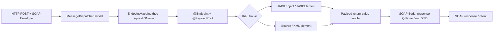

# Trả đối tượng JAXB, Source hoặc phần tử XML được hỗ trợ

Trong một dịch vụ SOAP **contract-first** với Spring Web Services (Spring-WS), endpoint không trả JSON hoặc một `ResponseEntity` theo cách thường gặp ở Spring MVC. Kết quả nghiệp vụ phải được chuyển thành **payload XML** đặt trong `SOAP Body`, đúng phần tử và cấu trúc đã công bố trong XSD/WSDL. Spring-WS có thể thực hiện việc này từ **đối tượng JAXB**, một `JAXBElement<T>`, một đối tượng `Source` hoặc, với bộ xử lý tương ứng, phần tử XML của những thư viện DOM/XML được hỗ trợ.

Bài thuộc chương **Xây dựng endpoint**, tập trung vào việc chọn kiểu trả về, khai báo `@ResponsePayload`, bảo đảm QName chính xác, phân biệt nhiệm vụ của endpoint adapter và marshaller, kiểm tra lỗi khi chuyển Java thành XML, và thử hợp đồng với SOAP client. Đây là kiến thức nền để tích hợp JAXB/XJC, SOAP Fault, interceptor kiểm tra XSD, XML security và WS-Security trong các ứng dụng doanh nghiệp.

## 1. Endpoint thực sự trả về điều gì?

Một phương thức endpoint có thể tạo object Java, nhưng **trên đường truyền** SOAP client nhận được một thông điệp dạng:

```xml
<soap:Envelope
    xmlns:soap="http://schemas.xmlsoap.org/soap/envelope/"
    xmlns:ord="https://example.com/orders/v1">
    <soap:Body>
        <ord:GetOrderResponse>
            <ord:orderId>42</ord:orderId>
            <ord:status>PAID</ord:status>
            <ord:total>125.50</ord:total>
        </ord:GetOrderResponse>
    </soap:Body>
</soap:Envelope>
```

Trong ví dụ này, **payload** là phần tử `ord:GetOrderResponse`. Spring-WS chịu trách nhiệm phối hợp message factory, endpoint adapter và các cơ chế chuyển đổi để đặt payload đó vào SOAP Body; phương thức nghiệp vụ thường chỉ tạo **nội dung của Body**, không tự lắp ghép toàn bộ SOAP Envelope.



**Ba tầng không được nhầm lẫn:**

1. **HTTP endpoint URL**, ví dụ `/ws`, xác định nơi gửi SOAP request.
2. **Request QName**, ví dụ `{https://example.com/orders/v1}GetOrderRequest`, giúp Spring-WS tìm phương thức xử lý, thường qua `@PayloadRoot`.
3. **Response QName**, ví dụ `{https://example.com/orders/v1}GetOrderResponse`, là tên XML mà WSDL/XSD quy định client phải nhận. Nó **không được suy ra đơn thuần từ tên class Java**.

## 2. Hợp đồng XSD làm chuẩn cho mọi kiểu trả về

Ta sử dụng cùng một hợp đồng cho ba cách tạo response trong bài. Đây là ví dụ minh họa có `targetNamespace` cố định và kiểu dữ liệu đơn giản:

```xml
<?xml version="1.0" encoding="UTF-8"?>
<xs:schema xmlns:xs="http://www.w3.org/2001/XMLSchema"
           xmlns:tns="https://example.com/orders/v1"
           targetNamespace="https://example.com/orders/v1"
           elementFormDefault="qualified">

    <xs:simpleType name="OrderStatus">
        <xs:restriction base="xs:string">
            <xs:enumeration value="NEW"/>
            <xs:enumeration value="PAID"/>
            <xs:enumeration value="CANCELLED"/>
        </xs:restriction>
    </xs:simpleType>

    <xs:element name="GetOrderRequest">
        <xs:complexType>
            <xs:sequence>
                <xs:element name="orderId" type="xs:positiveInteger"/>
            </xs:sequence>
        </xs:complexType>
    </xs:element>

    <xs:element name="GetOrderResponse">
        <xs:complexType>
            <xs:sequence>
                <xs:element name="orderId" type="xs:positiveInteger"/>
                <xs:element name="status" type="tns:OrderStatus"/>
                <xs:element name="total" type="xs:decimal"/>
            </xs:sequence>
        </xs:complexType>
    </xs:element>
</xs:schema>
```

Đối với WSDL 1.1 theo kiểu **document/literal**, message output có thể khai báo:

```xml
<wsdl:message name="GetOrderOutput"
              xmlns:wsdl="http://schemas.xmlsoap.org/wsdl/"
              xmlns:ord="https://example.com/orders/v1">
    <wsdl:part name="parameters" element="ord:GetOrderResponse"/>
</wsdl:message>
```

Đoạn WSDL này chỉ minh họa phần `message`; WSDL hoàn chỉnh còn cần `definitions`, `types`, `portType`, `binding` và `service`. Điều quan trọng là phần output tham chiếu **phần tử toàn cục** `GetOrderResponse`, không tham chiếu đến tên class Java, `Source` hoặc `Element`.

Vì thế, cả ba cách trả về đều phải tạo payload:

```text
Root QName: {https://example.com/orders/v1}GetOrderResponse
Children:   orderId -> status -> total (theo xs:sequence)
Values:     orderId > 0, status thuộc enum, total là xs:decimal
```

Một response chỉ có XML well-formed vẫn có thể không hợp lệ theo XSD nếu thiếu `status`, dùng `<ord:total>abc</ord:total>` hoặc đặt phần tử con sai thứ tự.

## 3. `@ResponsePayload` hoạt động cùng endpoint adapter như thế nào?

Một handler dựa trên annotation có hình dạng:

```java
@PayloadRoot(
    namespace = "https://example.com/orders/v1",
    localPart = "GetOrderRequest"
)
@ResponsePayload
public GetOrderResponse getOrder(
        @RequestPayload GetOrderRequest request) {
    // Tạo response dựa trên request.
}
```

Trong phương thức này:

- `@PayloadRoot` chỉ ra **QName của request payload** cần được xử lý.
- `@RequestPayload` yêu cầu bộ xử lý tham số thích hợp chuyển SOAP Body request thành giá trị Java.
- `@ResponsePayload` đánh dấu kết quả trả về là **SOAP response payload**.
- **Kiểu Java của tham số và kết quả** phải được các argument resolver/return-value handler của endpoint adapter đang sử dụng hỗ trợ.

Các bộ xử lý thường được cung cấp hoặc cấu hình khi bật hỗ trợ annotation của Spring-WS, ví dụ qua `@EnableWs`. Tập kiểu được hỗ trợ cụ thể phụ thuộc **phiên bản Spring-WS, thư viện XML/JAXB có trên classpath và cấu hình adapter**. Không phải bất kỳ object Java nào cũng có thể được marshal tự động chỉ vì phương thức có `@ResponsePayload`.

**`@ResponsePayload` không đồng nghĩa `@ResponseBody` của Spring MVC.** `@RestController`, `ResponseEntity`, `HttpMessageConverter` hay bộ chuyển JSON của MVC không phải cơ chế mặc định để trả SOAP Body trong `@Endpoint`. Nếu muốn tác động đến SOAP Header, attachment, HTTP status hoặc SOAP Fault, cần dùng API và extension point phù hợp của Spring-WS.

## 4. Lựa chọn kiểu trả về: JAXB, `JAXBElement`, `Source`, DOM

| Dạng trả về | Thích hợp khi | Điều kiện/kỷ luật quan trọng |
| --- | --- | --- |
| Đối tượng JAXB có root mapping | Hợp đồng XSD ổn định, nhiều trường, cần kiểm tra kiểu ở Java | Lớp tương thích JAXB và có QName root được xác định, chẳng hạn `@XmlRootElement` |
| `JAXBElement<T>` | Global element tham chiếu named complex type; cần giữ rõ QName và trạng thái nil | Tạo wrapper từ `ObjectFactory`/`@XmlElementDecl` phù hợp |
| `javax.xml.transform.Source` | XML có sẵn, xử lý transform/XSLT, tích hợp payload động | Source phải biểu diễn **một payload element**, không phải cả SOAP Envelope |
| `org.w3c.dom.Element` hoặc DOM tương đương | Cần thao tác từng node của XML và namespace một cách tường minh | Chỉ dùng trực tiếp nếu return-value handler cho DOM có trong cấu hình; có thể bọc trong `DOMSource` |
| Element của JDOM/dom4j hoặc dạng XML khác | Hệ thống đã dùng thư viện đó, adapter có processor thích hợp | Không mặc định được hỗ trợ ở mọi bản Spring-WS; phải thử thực tế |
| `String`, `Map`, DTO bất kỳ | **Không phải lựa chọn mặc nhiên** cho SOAP XML | Cần binding/adapter riêng hoặc đổi sang kiểu được hỗ trợ |

Trong các ví dụ tiếp theo, **JAXB object, `JAXBElement` và `Source` là những phương án thay thế** cho *cùng request QName*. Không đăng ký đồng thời ba endpoint cùng xử lý `GetOrderRequest` với cùng `@PayloadRoot` rồi kỳ vọng Spring-WS tự chọn dựa vào kiểu trả về. Mỗi cấu hình chạy thật chỉ nên có **một handler được chọn rõ ràng** cho một request QName.

## 5. Cách A — Trả đối tượng JAXB có `@XmlRootElement`

Khi XSD khai báo global element `GetOrderResponse` với **anonymous complex type** như phần 2, JAXB/XJC thường sinh lớp `GetOrderResponse` có root element mapping. Ví dụ code được sinh có thể chứa annotation tương đương:

```java
@jakarta.xml.bind.annotation.XmlRootElement(name = "GetOrderResponse")
public class GetOrderResponse {
    // Thuộc tính orderId, status, total và accessor do XJC sinh.
}
```

Đây là **dạng cấu trúc minh họa**, không phải toàn bộ mã generated có thể biên dịch độc lập. Namespace có thể được khai báo thông qua `@XmlSchema` trong `package-info.java` thay vì ghi trực tiếp ở từng annotation. Cần kiểm tra lớp JAXB **thực tế do XJC sinh**.

Endpoint:

```java
import java.math.BigDecimal;
import org.springframework.ws.server.endpoint.annotation.Endpoint;
import org.springframework.ws.server.endpoint.annotation.PayloadRoot;
import org.springframework.ws.server.endpoint.annotation.RequestPayload;
import org.springframework.ws.server.endpoint.annotation.ResponsePayload;

@Endpoint
public class OrdersJaxbEndpoint {
    private static final String NS =
            "https://example.com/orders/v1";

    @PayloadRoot(namespace = NS, localPart = "GetOrderRequest")
    @ResponsePayload
    public GetOrderResponse getOrder(
            @RequestPayload GetOrderRequest request) {
        GetOrderResponse result = new GetOrderResponse();
        result.setOrderId(request.getOrderId());
        result.setStatus(OrderStatus.PAID);
        result.setTotal(new BigDecimal("125.50"));
        return result;
    }
}
```

Ví dụ giả định có các lớp `GetOrderRequest`, `GetOrderResponse`, `OrderStatus` từ XJC và endpoint adapter có hỗ trợ JAXB của nhánh `jakarta.xml.bind` tương ứng. Với `xs:positiveInteger`, công cụ có thể sinh `BigInteger`; ở đây đặt `orderId` từ request sang response nên không cần tự suy ra kiểu số. Trong sản phẩm thật, trạng thái và tổng tiền phải đến từ application service; các giá trị cố định được dùng để tập trung vào **kiểu trả về**.

Spring-WS dùng return-value handler phù hợp để marshal đối tượng JAXB thành payload. Nếu mọi annotation/QName khớp hợp đồng, client thấy phần tử `ord:GetOrderResponse` ở đầu SOAP Body, **không thấy tên package Java** hoặc serialization của Java object.

### Khi cách A thất bại

Lỗi điển hình là:

```text
unable to marshal type ... as an element
because it is missing an @XmlRootElement annotation
```

Đây chỉ là **mẫu thông báo thường gặp**, không phải thông báo cố định. Nó xảy ra khi class biểu diễn một **XML type** nhưng chưa xác định được **XML root element QName**. Không nên thêm tùy tiện `@XmlRootElement` vào mã generated hoặc đổi XSD đang công bố chỉ để làm lỗi biến mất. Hãy kiểm tra xem XJC có sinh `ObjectFactory` cung cấp `JAXBElement<T>` cho global element hay không.

## 6. Cách B — Trả `JAXBElement<T>` khi global element dùng named type

Đổi cách mô tả output trong XSD (đây là **biến thể minh họa**, không áp dụng đồng thời với XSD phần 2):

```xml
<xs:complexType name="OrderResultType">
    <xs:sequence>
        <xs:element name="orderId" type="xs:positiveInteger"/>
        <xs:element name="status" type="tns:OrderStatus"/>
        <xs:element name="total" type="xs:decimal"/>
    </xs:sequence>
</xs:complexType>

<xs:element name="GetOrderResponse" type="tns:OrderResultType"/>
```

`tns` ở đây được khai báo là `https://example.com/orders/v1` trên `xs:schema` của ví dụ. XJC có thể sinh `OrderResultType` như một Java class biểu diễn **named complex type** và tạo `ObjectFactory` có phương thức khai báo global element `GetOrderResponse`.

Ví dụ endpoint thay thế:

```java
import java.math.BigDecimal;
import jakarta.xml.bind.JAXBElement;
import org.springframework.ws.server.endpoint.annotation.Endpoint;
import org.springframework.ws.server.endpoint.annotation.PayloadRoot;
import org.springframework.ws.server.endpoint.annotation.RequestPayload;
import org.springframework.ws.server.endpoint.annotation.ResponsePayload;

@Endpoint
public class OrdersJaxbElementEndpoint {
    private static final String NS =
            "https://example.com/orders/v1";
    private final ObjectFactory objectFactory = new ObjectFactory();

    @PayloadRoot(namespace = NS, localPart = "GetOrderRequest")
    @ResponsePayload
    public JAXBElement<OrderResultType> getOrder(
            @RequestPayload GetOrderRequest request) {
        OrderResultType value = new OrderResultType();
        value.setOrderId(request.getOrderId());
        value.setStatus(OrderStatus.PAID);
        value.setTotal(new BigDecimal("125.50"));

        return objectFactory.createGetOrderResponse(value);
    }
}
```

Mã giả định XJC đã sinh `ObjectFactory#createGetOrderResponse(OrderResultType)` và return-value handler tương thích với `JAXBElement`. Chữ ký thực tế phải được kiểm tra ở **generated sources**; trường hợp binding tùy chỉnh có thể cho tên Java khác. Đây là **một endpoint thay thế**, không được chạy cùng `OrdersJaxbEndpoint` phần 5 vì cả hai xử lý cùng request QName.

`JAXBElement<T>` mang thông tin:

- **QName của element**, tức `{https://example.com/orders/v1}GetOrderResponse`.
- **Kiểu được khai báo** (*declared type*) và giá trị Java `OrderResultType`.
- Một số trạng thái XML liên quan, ví dụ `nil` khi schema và binding cho phép.

Nhờ vậy, cùng một Java type có thể xuất hiện dưới những global element khác nhau mà không tự buộc tên class thành tên thẻ XML. Trong mô hình contract-first, đây là khả năng quan trọng: **element và type là hai thành phần XSD khác nhau**.

### Có thể tự tạo `JAXBElement` bằng QName không?

Về kỹ thuật JAXB cho phép tạo wrapper bằng constructor:

```java
new JAXBElement<>(
    new javax.xml.namespace.QName(
        "https://example.com/orders/v1", "GetOrderResponse"),
    OrderResultType.class,
    value
);
```

Ở đây `value` là đối tượng `OrderResultType` đã chuẩn bị. Tuy nhiên, trong dự án XJC sinh từ XSD, **ưu tiên `ObjectFactory`** vì phương thức đó gắn với declaration đã sinh từ hợp đồng. Tự hard-code QName dễ sai namespace khi nâng version hoặc nhầm tên element.

## 7. Cách C — Trả `Source` với `DOMSource`

`javax.xml.transform.Source` là abstraction cho một nguồn XML trong JAXP. Nó thuộc Java SE và có các implementation phổ biến:

| Implementation | Cách biểu diễn | Điểm chú ý |
| --- | --- | --- |
| `DOMSource` | Cây DOM `Node` hoặc `Element` | Dễ kiểm soát QName, element con; cần cấp phát DOM |
| `StreamSource` | `InputStream`, `Reader`, system ID | Nguồn phải còn đọc được đến lúc Spring-WS xử lý; cần quản lý tài nguyên |
| `SAXSource` | Parser SAX và `InputSource` | Phù hợp pipeline XML SAX; cấu hình XML reader an toàn |
| `StAXSource` | StAX stream/event reader | Phụ thuộc khả năng hỗ trợ của XML processor/adapter; quản lý lifecycle reader |

Đây là các dạng **`Source` của JAXP**, không phải kiểu response HTTP. Với endpoint Spring-WS có return-value handler hỗ trợ `Source`, phương thức có thể trả một `Source` biểu diễn **đúng phần tử payload response**.

Ví dụ tạo XML bằng DOM an toàn hơn nối chuỗi:

```java
import javax.xml.parsers.DocumentBuilderFactory;
import javax.xml.transform.Source;
import javax.xml.transform.dom.DOMSource;
import org.w3c.dom.Document;
import org.w3c.dom.Element;
import org.springframework.ws.server.endpoint.annotation.Endpoint;
import org.springframework.ws.server.endpoint.annotation.PayloadRoot;
import org.springframework.ws.server.endpoint.annotation.RequestPayload;
import org.springframework.ws.server.endpoint.annotation.ResponsePayload;

@Endpoint
public class OrdersSourceEndpoint {
    private static final String NS =
            "https://example.com/orders/v1";

    @PayloadRoot(namespace = NS, localPart = "GetOrderRequest")
    @ResponsePayload
    public Source getOrder(
            @RequestPayload GetOrderRequest request) throws Exception {
        Document document = DocumentBuilderFactory
                .newInstance()
                .newDocumentBuilder()
                .newDocument();

        Element root = document.createElementNS(NS, "ord:GetOrderResponse");
        document.appendChild(root);

        appendText(document, root, "orderId",
                request.getOrderId().toString());
        appendText(document, root, "status", "PAID");
        appendText(document, root, "total", "125.50");

        return new DOMSource(root);
    }

    private static void appendText(
            Document document, Element parent,
            String localName, String value) {
        Element child = document.createElementNS(NS, "ord:" + localName);
        child.setTextContent(value);
        parent.appendChild(child);
    }
}
```

Đoạn code tạo một **Document mới**, không parse XML từ nguồn bên ngoài; vì thế không có bước nạp external entity ở đây. `setTextContent` xử lý ký tự văn bản theo DOM, tránh lỗi khi dữ liệu chứa `&` hoặc `<` như trong cách nối chuỗi XML thủ công. Trong một dự án sản xuất, nên tái sử dụng factory/hàm xây dựng XML được cấu hình, dùng service nghiệp vụ thật và xử lý exception theo chính sách.

Các chi tiết quan trọng:

1. `createElementNS(NS, "ord:GetOrderResponse")` tạo phần tử có namespace nghiệp vụ. Tiền tố `ord` chỉ là lựa chọn serializer; **URI namespace mới quyết định QName**.
2. `appendText(...)` tạo các phần tử con cùng namespace theo `elementFormDefault="qualified"`.
3. Thứ tự `orderId`, `status`, `total` phải đúng `xs:sequence`.
4. `new DOMSource(root)` chuyển **payload root** cho Spring-WS, không chuyển một `soap:Envelope` lồng vào Body.
5. Dùng `@ResponsePayload` để return-value handler phù hợp ghi `Source` vào SOAP Body.

**Không trả toàn bộ SOAP Envelope qua `@ResponsePayload Source`.** Nếu `Source` chứa `soap:Envelope`, Spring-WS có thể đặt nó bên trong Body như một element nghiệp vụ, tạo một SOAP message sai cấu trúc. Khi cần thao tác với cả SOAP Header, attachment hoặc transport, hãy dùng API xử lý message phù hợp, không lợi dụng payload return value.

### Vì sao không nên tạo XML bằng `String.format`?

Ví dụ nguy hiểm:

```java
String xml = "<ord:status>" + statusFromUser + "</ord:status>";
```

Nếu giá trị chứa `&` hoặc dấu `<`, XML sẽ bị hỏng hoặc dữ liệu được diễn giải thành markup ngoài ý muốn. Dù có escape đúng, vẫn phải quan tâm namespace, encoding và thứ tự schema. DOM, JAXB và XML serializer chuyên dụng thường dễ bảo đảm đúng hợp đồng hơn.

Nếu buộc phải dùng `StreamSource(new StringReader(xml))`, chuỗi phải là XML đã được tạo đúng cách, nguồn Reader phải còn khả dụng đến khi handler sử dụng, và XML parser/transformer liên quan cần được cấu hình chống XXE theo mức độ tin cậy của đầu vào.

## 8. Trả trực tiếp phần tử XML (DOM/JDOM/dom4j): hiểu giới hạn adapter

Một số cấu hình Spring-WS hỗ trợ trực tiếp kiểu **`org.w3c.dom.Element`** hoặc các kiểu XML tree khác thông qua những method processor tương ứng. Ví dụ có thể gặp handler:

```java
@ResponsePayload
public org.w3c.dom.Element getOrder(
        @RequestPayload GetOrderRequest request) throws Exception {
    // Tạo Document và root Element có đúng namespace.
    return buildGetOrderResponseElement(request);
}
```

`buildGetOrderResponseElement` trong đoạn trên là helper minh họa do ứng dụng tự định nghĩa, không phải method của Spring-WS. Nó phải trả **chính phần tử `GetOrderResponse`**, không phải nút Document chứa một SOAP Envelope.

Tuy nhiên, **đừng coi mọi XML element class đều được hỗ trợ trong mọi bản Spring-WS**. Annotation endpoint adapter chỉ xử lý những kiểu mà các `MethodReturnValueHandler` đang được đăng ký nhận diện. DOM `Element`, DOM `Document`, JDOM2 `Element`, dom4j `Element` hoặc các kiểu StAX không nên được xem là hoán đổi hoàn toàn cho nhau. Sự hỗ trợ và yêu cầu classpath có thể thay đổi theo phiên bản và cấu hình Spring-WS.

Nếu chưa xác nhận processor tương ứng, cách ổn định là **bọc DOM Element thành `DOMSource`** và khai báo return type `Source`, như ví dụ phần 7. Đây cũng là cách giúp giao diện method ít phụ thuộc thư viện tree cụ thể hơn.

### Chọn JAXB hay `Source`?

**Ưu tiên JAXB** khi contract đã rõ, các kiểu dữ liệu nhiều, cần tránh lỗi thứ tự element/namespace và thuận tiện cho service Java. **Ưu tiên `Source`** khi đã có XML payload cần chuyển tiếp, dùng XSLT hoặc có lý do hợp lý để thao tác ở tầng XML. Nhưng nếu response dùng `Source`, application phải tự chịu trách nhiệm xây **đúng QName, field bắt buộc, thứ tự, type và schema validation**.

Trong tích hợp doanh nghiệp, việc dùng `Source` không nên trở thành cách né sinh JAXB cho những phần tử XSD vốn đã được thiết kế rõ ràng. Nó làm tăng lượng logic XML thủ công và rủi ro gửi response không tương thích đối tác.

## 9. Kết hợp argument/return type khác nhau có được không?

Một endpoint có thể nhận một dạng payload và trả về dạng khác **nếu** cấu hình endpoint adapter hỗ trợ cả hai. Ví dụ phần 7 nhận `GetOrderRequest` từ JAXB nhưng trả `DOMSource`: đây là kỹ thuật hợp lệ khi cả argument resolver cho JAXB và return-value handler cho Source được đăng ký.

Không nên suy ra rằng cứ khai báo bean `Jaxb2Marshaller` là tất cả endpoint `@Endpoint` tự động sử dụng bean đó. Một số annotation method processor có thể dùng **JAXB annotations/runtime trực tiếp**, trong khi một số cấu hình khác sử dụng OXM marshaller/unmarshaller được truyền vào adapter cụ thể. Cần kiểm tra đúng đường xử lý Spring-WS và phiên bản đang dùng.

Ví dụ khi chỉ cần nhận XML mà không dùng lớp JAXB:

```java
@PayloadRoot(
    namespace = "https://example.com/orders/v1",
    localPart = "GetOrderRequest"
)
@ResponsePayload
public Source getOrder(@RequestPayload Source requestPayload) {
    // Xử lý requestPayload bằng XML parser/transformer an toàn,
    // rồi trả Source chứa GetOrderResponse hợp lệ.
    throw new UnsupportedOperationException("Example only");
}
```

Đoạn này minh họa **chữ ký phương thức**; nó không phải endpoint nghiệp vụ chạy được vì thân method cố ý chưa được triển khai. Nếu đọc `Source` đầu vào, cần sử dụng XML parser an toàn và kiểm soát thời gian sống của stream. Không được giả định `Source` có thể đọc đi đọc lại nhiều lần.

### Kiểu trả về `void` hoặc `null` thì sao?

Không trả payload (ví dụ method `void`) có thể phù hợp với operation **one-way** hoặc quy ước response cụ thể khi adapter hỗ trợ. Nhưng nếu WSDL mô tả **request-response** có `GetOrderResponse` bắt buộc, trả `null` hay `void` có thể dẫn đến Body rỗng hoặc lỗi tích hợp và **không phải cách báo “không tìm thấy đơn hàng”**.

Khi nghiệp vụ không tìm thấy dữ liệu, hãy thiết kế response hoặc SOAP Fault theo hợp đồng; không trả `null` một cách mơ hồ. Tương tự, trả `Optional<GetOrderResponse>` không mặc nhiên là kiểu XML payload được Spring-WS marshal.

## 10. XML QName: điều gì khiến response “đúng hình dạng nhưng sai hợp đồng”?

Xét XML sai:

```xml
<GetOrderResponse>
    <orderId>42</orderId>
    <status>PAID</status>
    <total>125.50</total>
</GetOrderResponse>
```

Đoạn trên **không có namespace**. Theo XSD ở phần 2, phần tử global phải là `{https://example.com/orders/v1}GetOrderResponse` và các phần tử con cũng nằm trong namespace đó. Client kiểm tra schema có thể từ chối thông điệp dù local name trông giống hệt.

XML cũng có thể sai do đặt tên root theo tên class:

```xml
<ord:OrderResultType xmlns:ord="https://example.com/orders/v1">
    ...
</ord:OrderResultType>
```

Nếu WSDL output quy định **element `GetOrderResponse`**, thì `OrderResultType` không phải element hợp đồng chỉ vì nó là tên type hoặc class Java. Đây chính là lý do cần phân biệt `@XmlRootElement` và `JAXBElement`.

| Thành phần | Được quyết định bởi | Không nên nhầm với |
| --- | --- | --- |
| Payload root QName | Global element trong XSD/WSDL | Class name, Java package |
| Element con QName | XSD declaration + `elementFormDefault`/`form` | Prefix cố định `ord` |
| Kiểu dữ liệu và enum | XSD type, restrictions | Kiểu Java sau khi serialize tùy ý |
| Thứ tự phần tử | `xs:sequence`, `choice` hoặc content model | Thứ tự property ngẫu nhiên của object |
| SOAP Envelope namespace | SOAP 1.1/1.2 | Namespace nghiệp vụ trong Body |

Một cơ chế kiểm tra đáng tin cậy cần so sánh theo **namespace URI + local name**, không yêu cầu mọi hệ thống cùng dùng một tiền tố XML.

## 11. Tại sao marshal thành công vẫn chưa chắc response hợp lệ?

JAXB đảm nhiệm chuyển object thành XML, nhưng **schema validation không được giả định luôn bật**. Ví dụ XSD yêu cầu `status` là enum và `total` là `xs:decimal`. Nếu response được tạo từ dữ liệu Java chưa qua kiểm tra hoặc dùng `Source` dựng thủ công, có thể sinh ra XML:

```xml
<ord:GetOrderResponse xmlns:ord="https://example.com/orders/v1">
    <ord:orderId>42</ord:orderId>
    <ord:status>UNKNOWN</ord:status>
    <ord:total>125.50</ord:total>
</ord:GetOrderResponse>
```

XML trên **well-formed** nhưng không hợp lệ vì `UNKNOWN` không nằm trong `OrderStatus`. Nếu XJC sinh Java enum, việc dùng `OrderStatus.PAID` giúp ngăn giá trị ngoài enum ở phần code này, nhưng không đủ thay cho kiểm tra schema của toàn bộ output khi có binding tùy biến, `Source`, nullable field, adapter khác hoặc hệ thống nâng version.

Spring-WS có `PayloadValidatingInterceptor` để kiểm tra SOAP payload theo XSD, kể cả chiều **response** nếu cấu hình:

```java
@Bean
public PayloadValidatingInterceptor responseValidator(XsdSchema schema) {
    PayloadValidatingInterceptor interceptor =
            new PayloadValidatingInterceptor();
    interceptor.setXsdSchema(schema);
    interceptor.setValidateRequest(true);
    interceptor.setValidateResponse(true);
    return interceptor;
}
```

Đoạn là **cấu hình bean minh họa**; để interceptor chạy cần đăng ký vào danh sách interceptor của Spring-WS, ví dụ qua `WsConfigurer#addInterceptors`. Đồng thời phải bảo đảm XSD được nạp đầy đủ cùng các `xs:include`/`xs:import`.

Khi output sai XSD, đó là **lỗi phía server**, không phải lý do trả Client/Sender Fault chỉ vì việc viết XML xảy ra trong một SOAP operation của client. Cần xử lý sao cho đối tác không nhận một success response sai hợp đồng; chi tiết behavior và fault/transport status phụ thuộc interceptor, exception resolver, message factory và môi trường.

## 12. Lỗi thường gặp khi trả JAXB hoặc Source

| Triệu chứng | Nơi phát sinh | Cách kiểm tra/khắc phục |
| --- | --- | --- |
| Không có handler thích hợp cho return type | Endpoint adapter | Kiểm tra `@ResponsePayload`, method processor, classpath và cấu hình `@EnableWs` |
| JAXB báo thiếu `@XmlRootElement` | JAXB marshalling | Kiểm tra global element; dùng `ObjectFactory`/`JAXBElement` nếu cần |
| Response root là type name thay vì element name | XML/JAXB binding | So QName với WSDL output; dùng root declaration đúng |
| XML DOM không có namespace | DOM creation | Dùng `createElementNS`, không chỉ `createElement` |
| Response đã có cả `soap:Envelope` lồng trong Body | `Source` response | Trả duy nhất payload root, để Spring-WS lo Envelope |
| StreamSource bị đọc hết hoặc Reader đã đóng | Lifecycle của `Source` | Bảo đảm Source còn dùng được đến khi response xử lý xong |
| SOAP Body không có response element | Method trả `null`/`void`, mapping sai | Đối chiếu WSDL one-way hay request-response, dùng Fault nếu nghiệp vụ lỗi |
| XSD response báo thiếu field bắt buộc | JAXB object hoặc DOM thiếu dữ liệu | Sửa dữ liệu server, bật response validation |
| `No endpoint mapping found` | Routing request | Kiểm tra QName `GetOrderRequest`, không phải return type |
| `No adapter for endpoint` | Endpoint adapter | Kiểm tra kiểu tham số và kết quả có handler tương ứng |
| `JAXBException` do `javax`/`jakarta` không tương thích | JAXB runtime/dependency | Đồng bộ Spring-WS, JAXB runtime và mã sinh từ XJC |
| Có hai phương thức cùng `@PayloadRoot` | Endpoint mapping | Chỉ giữ một handler được định nghĩa rõ cho mỗi QName |
| SOAP Fault bảo mật dù XML đúng | WS-Security interceptor | Kiểm tra chữ ký, timestamp, chứng chỉ, truststore và policy |
| Client .NET từ chối response | Tương thích XSD/WSDL | Validate response và thử client sinh từ WSDL công bố |

Đặc biệt, lỗi **“không tìm thấy endpoint”** xảy ra ở **request routing**, còn lỗi **“không marshal được response”** xảy ra sau khi đã chọn handler. Điều tra sai tầng sẽ dẫn đến sửa URL hoặc `@PayloadRoot` không cần thiết trong khi nguyên nhân thật là root QName của response.

### Phân biệt lỗi request với lỗi response

- **Request vi phạm XSD:** có thể từ chối trước endpoint và trả SOAP Fault phù hợp phía client/sender nếu thông điệp SOAP đủ hợp lệ để phản hồi.
- **Request đúng XSD nhưng sai nghiệp vụ:** application service trả lỗi miền nghiệp vụ được thiết kế rõ, không biến thành lỗi JAXB giả.
- **Response không marshal được:** kiểm tra server model, annotation, ObjectFactory, return-value handler và XSD; đây là lỗi server.
- **Response XML hợp lệ nhưng sai policy WS-Security:** cần kiểm tra bước ký/mã hóa và nội dung được bảo vệ, không chỉ marshalling.
- **Transport đứt trước response:** có thể không có SOAP Fault; client cần xử lý trạng thái không chắc chắn của yêu cầu.

Không gửi stack trace, đường dẫn file, thông tin chứng chỉ/keystore hay nội dung nhạy cảm qua `faultstring` hoặc SOAP Fault detail.

## 13. Bảo mật khi tạo response XML thủ công

Nếu endpoint sử dụng JAXB từ model đã sinh theo hợp đồng, framework quản lý phần lớn bước tạo XML. Khi dùng `Source` hoặc DOM tự xây, cần quan tâm nhiều hơn đến:

1. **Namespace và output encoding:** không dùng XML fragment thiếu namespace, xử lý ký tự bằng serializer thay vì tự escape thủ công.
2. **XML parser an toàn:** nếu đọc request hoặc XML ngoài hệ thống để tạo `Source`, chặn XXE/external DTD/entity và giới hạn tài nguyên; `DocumentBuilderFactory.newDocumentBuilder().newDocument()` chỉ tạo cây mới thì không có bước parse tài liệu không tin cậy.
3. **Schema validation:** kiểm tra response sau chuyển đổi để chặn payload sai XSD, bất kể xuất phát từ JAXB hay DOM.
4. **Dữ liệu nhạy cảm:** chỉ đặt các trường được hợp đồng cho phép trong Body; không log toàn bộ object/XML khi chứa dữ liệu khách hàng.
5. **WS-Security:** ký hoặc mã hóa phần thông điệp đúng policy sau khi payload được tạo, theo trật tự xử lý của framework. Không tự sửa node đã được ký mà không kiểm soát ảnh hưởng tới chữ ký.
6. **XML Signature wrapping:** xác minh cấu trúc SOAP đã xác thực và payload ứng dụng đọc đúng cùng phần tử, không nhầm với một node khác được thêm vào.

Một response tạo từ `Source` hợp lệ theo XSD vẫn có thể vi phạm yêu cầu bảo mật nếu thiếu chữ ký WS-Security, sai chứng chỉ hoặc timestamp. Bảo mật và validation là hai lớp khác nhau.

## 14. Kiểm thử ba kiểu trả về với Spring-WS

Mục tiêu của bài test không chỉ là “method trả object khác null”, mà là chứng minh **SOAP Body có payload QName và nội dung đúng WSDL/XSD**.

### 14.1. Kiểm thử endpoint bằng `MockWebServiceClient`

Trong Spring-WS Test, `MockWebServiceClient` có thể gửi request payload tới endpoint mà không cần mở cổng HTTP. Ví dụ ở mức khái niệm:

```java
import static org.springframework.ws.test.server.RequestCreators.withPayload;
import static org.springframework.ws.test.server.ResponseMatchers.noFault;
import static org.springframework.ws.test.server.ResponseMatchers.payload;

import org.springframework.xml.transform.StringSource;
import org.springframework.ws.test.server.MockWebServiceClient;

String request = """
    <ord:GetOrderRequest xmlns:ord="https://example.com/orders/v1">
        <ord:orderId>42</ord:orderId>
    </ord:GetOrderRequest>
    """;

String response = """
    <ord:GetOrderResponse xmlns:ord="https://example.com/orders/v1">
        <ord:orderId>42</ord:orderId>
        <ord:status>PAID</ord:status>
        <ord:total>125.50</ord:total>
    </ord:GetOrderResponse>
    """;

MockWebServiceClient client =
        MockWebServiceClient.createClient(applicationContext);
client.sendRequest(withPayload(new StringSource(request)))
      .andExpect(noFault())
      .andExpect(payload(new StringSource(response)));
```

Đoạn code giả định `applicationContext` là context kiểm thử chứa endpoint/adapter tương ứng, các import cần thiết và Java hỗ trợ text block. Khi áp dụng vào test thật, hãy chỉ bật **một trong các endpoint** của phần 5, 6 hoặc 7 cho cùng request QName. Nếu cần kiểm chứng schema ngoài so sánh payload, hãy thêm bước validate response theo XSD.

### 14.2. Kiểm tra với SOAP client và WSDL công bố

Sau khi chạy trong Servlet container, dùng client SOAP gửi:

```bash
curl -i -X POST "http://localhost:8080/ws" \
  -H "Content-Type: text/xml; charset=utf-8" \
  -H 'SOAPAction: ""' \
  --data-binary @request.xml
```

Đây là ví dụ SOAP 1.1 với `request.xml` chứa **SOAP Envelope đầy đủ**; URL, SOAPAction và message factory phải tuân theo WSDL thực tế. GET WSDL từ URL công bố và thử sinh một client mới giúp xác định response trên wire phù hợp với hợp đồng mà đối tác nhìn thấy.

Nếu thử SOAP 1.2, cần dùng đúng namespace Envelope và media type `application/soap+xml`, không chỉ đổi HTTP header. Kiểm thử WS-Security có thể yêu cầu chữ ký, chứng chỉ/truststore, timestamp hoặc mã hóa theo policy.

### 14.3. Ma trận kiểm thử bắt buộc

| Ca | Kiểu trả về / lỗi tạo ra | Kết quả mong đợi |
| --- | --- | --- |
| R01 | JAXB object có root mapping hợp lệ | SOAP Body chứa `GetOrderResponse` đúng namespace |
| R02 | `JAXBElement<OrderResultType>` từ `ObjectFactory` | Root QName theo global element, không theo type name |
| R03 | `DOMSource` chứa một Element hợp lệ | SOAP Body chỉ có một payload root hợp lệ |
| R04 | DOM Element tạo bằng `createElement` không namespace | XSD response validation từ chối |
| R05 | Trả `Source` chứa cả `soap:Envelope` | Kiểm thử phát hiện Envelope lồng sai trong Body |
| R06 | Response thiếu `status` | XSD validation thất bại |
| R07 | Response có `status=UNKNOWN` | XSD validation thất bại theo enumeration |
| R08 | Response có `total=abc` | XSD validation thất bại theo decimal |
| R09 | Đảo thứ tự `status` và `total` | XSD validation thất bại theo sequence |
| R10 | Đổi namespace root sang `orders/v2` | Không còn khớp output contract v1 |
| R11 | JAXB type thiếu `@XmlRootElement` và không có wrapper | Marshalling lỗi; không gửi success sai hợp đồng |
| R12 | Trả `JAXBElement` với QName thủ công sai | Contract test phát hiện QName sai |
| R13 | `@ResponsePayload` bị bỏ hoặc return handler thiếu | Kiểm thử phát hiện không tạo được payload mong đợi |
| R14 | Hai endpoint cùng `@PayloadRoot` request QName | Cấu hình/định tuyến có xung đột cần được loại bỏ |
| R15 | Method trả `null` nhưng WSDL yêu cầu response | Kiểm thử phát hiện Body không đáp ứng hợp đồng |
| R16 | Request sai schema | Request validation/Fault phía client theo chính sách |
| R17 | Dữ liệu XML đúng XSD nhưng đơn hàng không tồn tại | Business Fault được quy định, không phải lỗi JAXB |
| R18 | SOAP response đúng XML nhưng thiếu WS-Security bắt buộc | Security/interoperability test từ chối |
| R19 | Client sinh từ WSDL công bố đọc response | Deserialize thành công theo contract |
| R20 | Marshal JAXB rồi unmarshal lại | Giữ đúng dữ liệu, enum và QName |

Đối với R01–R03, nên dùng **cùng dữ liệu nghiệp vụ**, cùng XSD và cùng test expectation để so sánh hành vi giữa các kiểu trả về; chỉ thay đổi **một implementation đang active** tại mỗi lần chạy. Dùng schema-aware comparison thay vì chỉ so tiền tố XML hoặc khoảng trắng trong bản serialize.

## 15. Bài tập: chuyển endpoint trả `Source` sang JAXB

Một đội tích hợp đang dùng endpoint tạo XML bằng `StringBuilder`:

```java
@PayloadRoot(
    namespace = "https://example.com/orders/v1",
    localPart = "GetOrderRequest"
)
@ResponsePayload
public Source getOrder(@RequestPayload GetOrderRequest request) {
    // Tạo chuỗi XML bằng cách nối các trường status và total.
    // Trả StreamSource từ chuỗi XML đó.
    throw new UnsupportedOperationException("Exercise skeleton");
}
```

Họ muốn chuyển sang JAXB để giảm lỗi escape và sai namespace. Yêu cầu:

1. Giữ nguyên WSDL/XSD với output element `GetOrderResponse`.
2. Sinh JAXB classes từ XSD; xem `GetOrderResponse` có `@XmlRootElement` hay chỉ có named type và global element declaration.
3. Nếu có root mapping, chuyển return type thành `GetOrderResponse`, tạo giá trị kiểu Java tương ứng và `return result`.
4. Nếu là named type không có root mapping, tạo `JAXBElement<OrderResultType>` bằng phương thức của `ObjectFactory`.
5. Giữ `@PayloadRoot` request QName như cũ; **không thay URL SOAP, SOAPAction hoặc WSDL chỉ vì đổi cách tạo output Java**.
6. Chạy lại R01/R02, kiểm tra root QName `{https://example.com/orders/v1}GetOrderResponse`, validate XSD và thử client tích hợp.

**Điểm đánh giá:** nếu Java class được đổi tên thành `OrderPayload` nhờ external JAXB binding nhưng root XML vẫn `GetOrderResponse`, hợp đồng vẫn được giữ đúng. Nếu client nhận `<ord:OrderPayload>`, triển khai đã để tên Java rò rỉ vào XML contract và phải sửa.

## 16. Checklist lựa chọn kiểu return của SOAP endpoint

1. **Bắt đầu từ output element trong XSD/WSDL**, xác định namespace URI, local name, cấu trúc và thứ tự các phần tử.
2. **Ưu tiên JAXB object** nếu có root mapping đúng và dữ liệu được biểu diễn rõ bằng Java.
3. **Dùng `JAXBElement<T>` khi cần gắn global element QName cho named type**, ưu tiên `ObjectFactory` do XJC sinh.
4. **Dùng `Source` khi thực sự cần thao tác XML**, bảo đảm chỉ gửi payload root và quản lý lifetime của Reader/Stream.
5. **Chỉ trả trực tiếp DOM/JDOM/dom4j Element khi adapter hỗ trợ**, không suy ra từ mọi kiểu tree object.
6. **Có `@ResponsePayload` và return-value handler đúng**, không dùng cách trả REST/JSON của Spring MVC cho SOAP endpoint.
7. **Không đăng ký nhiều handler cùng request QName**, trừ khi có quy tắc mapping phân biệt rõ và đã kiểm thử.
8. **Kiểm tra JAXB/Jakarta version, root annotation và schema binding**, đặc biệt khi generated model thay đổi.
9. **Bật và thử response XSD validation** ở điểm phù hợp để phát hiện lỗi do server tạo payload.
10. **Phân biệt SOAP Fault với response thông thường**, tránh trả `null` khi WSDL đòi output bắt buộc.
11. **Giữ đúng các lớp bảo mật**: XML parser an toàn, WS-Security và chứng chỉ/TLS theo chính sách.
12. **Kiểm thử thật qua WSDL công bố** với SOAP client của nền tảng khác, không chỉ gọi trực tiếp method Java.

**Kết luận:** Endpoint Spring-WS có thể trả JAXB object, `JAXBElement<T>`, `Source` hoặc một dạng phần tử XML được adapter hỗ trợ, nhưng tất cả đều phải tạo ra **cùng payload XML hợp lệ theo output contract**. Lựa chọn tốt nhất là lựa chọn giữ rõ QName, giảm thao tác XML thủ công, thuận tiện cho schema validation và có thể kiểm chứng độc lập bằng SOAP client. Trong contract-first, **kiểu Java chỉ là cơ chế triển khai; XSD/WSDL và nội dung SOAP Body mới là hợp đồng với đối tác**.
