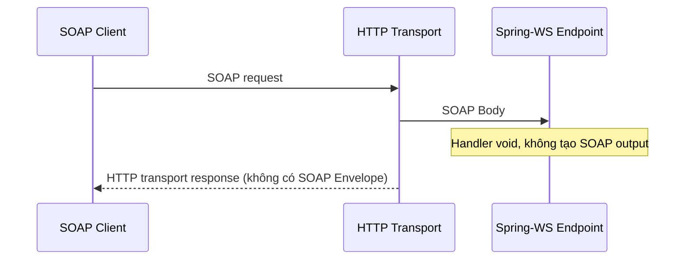
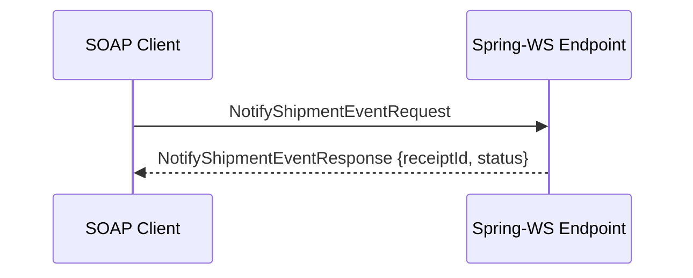
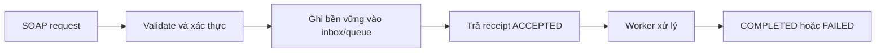
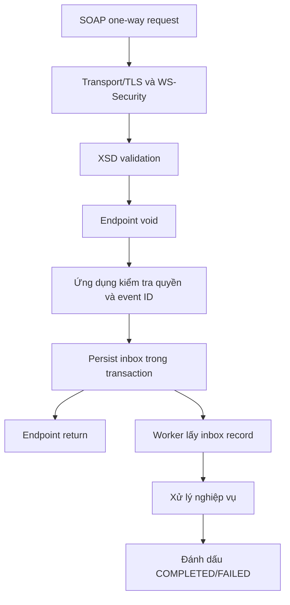
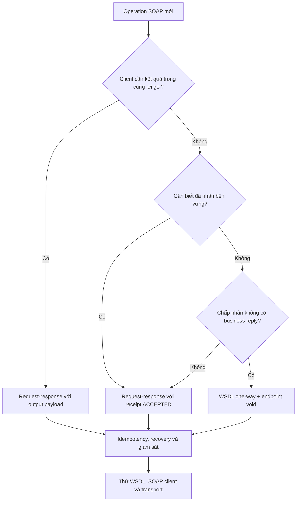

# Phương thức không có payload phản hồi và ý nghĩa của kiểu trả về void

## 1. Vấn đề cần giải quyết

Trong **Spring Web Services (Spring-WS)**, nhiều endpoint SOAP trả về một object JAXB làm payload của SOAP response. Nhưng cũng có những thao tác chỉ cần tiếp nhận một thông điệp: ghi nhận một sự kiện, gửi thông báo trạng thái, nạp bản ghi kiểm toán hoặc nhận yêu cầu xử lý theo lô. Với những thao tác này, bên gửi có thể **không yêu cầu dữ liệu nghiệp vụ phản hồi**.

Spring-WS cho phép handler method của `@Endpoint` khai báo kiểu trả về `void`. Điều này có một ý nghĩa cụ thể ở ranh giới endpoint: **phương thức không cung cấp giá trị để Spring-WS xây dựng SOAP response message**. Nó không tự có nghĩa “bất đồng bộ”, “server đã lưu thành công”, “không có giao tiếp HTTP trả về”, “không thể xảy ra lỗi” hoặc “không cần hợp đồng WSDL”.

Trong kiến trúc **contract-first**, quyết định có trả payload hay không phải xuất phát từ **hợp đồng XSD/WSDL và yêu cầu nghiệp vụ**, sau đó mới được phản ánh bằng kiểu trả về Java. Không nên chọn `void` chỉ để bỏ qua việc thiết kế response.

Bài thuộc chương **Xây dựng endpoint** của module **SPRING_WEB_SERVICES**, nối tiếp tư duy thiết kế XSD/WSDL, JAXB, marshalling/unmarshalling, endpoint, SOAP client, SOAP Fault, interceptor, XML security, WS-Security, chứng chỉ và kiểm thử tương thích giữa các hệ thống doanh nghiệp.

Sau khi học, bạn có thể:

1. Giải thích chính xác `void` trong một Spring-WS endpoint và vai trò của `@ResponsePayload`.
2. Phân biệt **không có Java return value**, **không có SOAP response**, **SOAP Body rỗng**, **WSDL one-way** và **HTTP acknowledgement**.
3. Thiết kế một operation one-way với XSD và WSDL 1.1 document/literal.
4. Quyết định khi nào cần response có cấu trúc để xác nhận tiếp nhận hoặc kết quả nghiệp vụ.
5. Xử lý lỗi, timeout, idempotency, retry và processing bất đồng bộ mà không suy đoán từ `void`.
6. Kiểm thử cả phía endpoint và SOAP client theo đúng message-exchange pattern được công bố.

## 2. Các khái niệm dễ bị nhầm

| Khái niệm | Ý nghĩa chính xác | Điều không thể suy ra |
| --- | --- | --- |
| `void` trong Java | Method hoàn tất mà không trả object. | Không chứng minh nghiệp vụ thành công hoặc chạy nền. |
| Không có `@ResponsePayload` | Không có return value được chỉ định làm SOAP response payload. | Không thay đổi tự động WSDL đã xuất bản. |
| Không có SOAP response message | Server không tạo SOAP message trả về cho operation. | Không đồng nghĩa kết nối HTTP không có response/status. |
| SOAP response với `<soap:Body/>` | Có SOAP Envelope trả về nhưng Body không chứa phần tử nghiệp vụ. | Khác với trường hợp không có SOAP Envelope. |
| Response có phần tử rỗng `<ack/>` | Có một payload XML và một QName công khai. | Phần tử rỗng vẫn là output theo contract, không phải “không có response”. |
| WSDL one-way | Operation trong WSDL 1.1 chỉ có input message, không có output message. | Không bảo đảm xử lý bất đồng bộ, exactly-once hay giao hàng thành công. |
| HTTP 2xx | Phản hồi HTTP thuộc tầng transport. | Không đủ chứng minh thông điệp đã được validate, commit hoặc xử lý. |
| Fire-and-forget | Cách gọi thường dùng để nói người gửi không đợi kết quả nghiệp vụ. | Không mặc nhiên là một cơ chế giao hàng tin cậy. |

Đây là các khía cạnh **ở những tầng khác nhau**. Trong thiết kế hợp đồng, câu hỏi quan trọng không phải chỉ là “method có return không?” mà là “**bên gọi cần biết điều gì sau khi gửi thông điệp, và điều đó được thể hiện ở đâu?**”.

## 3. `void` được Spring-WS hiểu như thế nào?

Spring-WS dùng `@Endpoint` để nhận diện endpoint bean, `@PayloadRoot` để định tuyến theo QName của phần tử gốc trong SOAP Body, và `@RequestPayload` để ràng buộc payload đầu vào vào tham số handler.

Một endpoint không có response có thể viết như sau:

```java
import org.springframework.ws.server.endpoint.annotation.Endpoint;
import org.springframework.ws.server.endpoint.annotation.PayloadRoot;
import org.springframework.ws.server.endpoint.annotation.RequestPayload;

@Endpoint
public class ShipmentEventEndpoint {
    private static final String NS = "urn:example:shipment-events:v1";

    private final ShipmentEventUseCase useCase;
    private final ShipmentEventMapper mapper;

    public ShipmentEventEndpoint(
            ShipmentEventUseCase useCase,
            ShipmentEventMapper mapper) {
        this.useCase = useCase;
        this.mapper = mapper;
    }

    @PayloadRoot(
        namespace = NS,
        localPart = "NotifyShipmentEventRequest")
    public void notify(
            @RequestPayload NotifyShipmentEventRequest request) {

        ShipmentEventCommand command = mapper.toCommand(request);
        useCase.accept(command);
    }
}
```

Các lớp `NotifyShipmentEventRequest`, `ShipmentEventMapper` và `ShipmentEventUseCase` là thành phần của ví dụ; lớp request được hiểu là JAXB model sinh từ XSD ở mục sau. Chữ ký thực tế phụ thuộc cấu trúc XSD, phiên bản JAXB và endpoint argument resolver của project; một số schema có thể yêu cầu `JAXBElement<T>`.

Ở đây:

- `@PayloadRoot` quyết định operation theo QName `{urn:example:shipment-events:v1}NotifyShipmentEventRequest`.
- `@RequestPayload` yêu cầu Spring-WS ánh xạ phần tử Body sang tham số handler bằng một cơ chế được hỗ trợ.
- `void` cho biết handler **không trả object làm SOAP response message**.
- Không dùng `@ResponsePayload` vì không có giá trị trả về để gắn vào Body.
- `useCase.accept(...)` được gọi trong **cùng luồng xử lý method** trừ khi ứng dụng chủ động thiết kế cơ chế bàn giao bất đồng bộ.

Tài liệu Spring-WS về endpoint method return types liệt kê `void` cho trường hợp **không cần response message**, được hỗ trợ mặc định; với method trả về payload, `@ResponsePayload` được dùng để yêu cầu ánh xạ return value vào response Body.

### 3.1. Một handler `void` vẫn có thể thất bại

Nếu `mapper.toCommand(...)` hoặc `useCase.accept(...)` ném exception, quy trình endpoint không hoàn tất bình thường. Spring-WS có cơ chế exception resolver và có thể tạo SOAP Fault tùy chính sách, cấu hình và message-exchange pattern; tuy nhiên client **không nên dựa vào khả năng nhận typed SOAP Fault** khi hợp đồng là WSDL one-way.

Điều cần bảo đảm là exception được phân loại, ghi log an toàn và đưa vào đường xử lý lỗi thích hợp của hệ thống. Với tác vụ one-way, những lỗi phát sinh sau khi server chấp nhận thông điệp cần có cơ chế theo dõi/phục hồi **ngoài response cùng lời gọi**.

### 3.2. Method `void` không đồng nghĩa `@Async`

```java
@PayloadRoot(namespace = NS,
             localPart = "NotifyShipmentEventRequest")
public void notify(@RequestPayload NotifyShipmentEventRequest request) {
    useCase.accept(mapper.toCommand(request));
}
```

Nếu `accept` mất 400 ms để xác minh và ghi database, handler vẫn thực thi công việc đó trước khi return. Thêm `void` không đưa công việc vào queue, không tách transaction, không giảm thời gian xử lý và không biến operation thành worker nền.

Tương tự, việc thêm `@Async` tùy tiện vào endpoint không tự tạo bảo đảm giao hàng, transaction hoặc xử lý lỗi ổn định. Nếu cần bàn giao bất đồng bộ, nên thiết kế **durable acceptance**, queue/inbox/outbox và vòng đời xử lý rõ ràng như trình bày ở mục 11.

## 4. Bốn kiểu message exchange cần phân biệt

### 4.1. WSDL one-way: chỉ có input message



WSDL 1.1 one-way biểu diễn operation nhận một input message, không có output message và không công bố typed fault trong phần `portType` của operation đó.

### 4.2. Request-response: có output payload



Trong mô hình này, handler nên trả JAXB response với `@ResponsePayload`; việc trả `void` sẽ không thực hiện output mà WSDL đã hứa.

### 4.3. Có SOAP Envelope nhưng Body rỗng

Một response dạng:

```xml
<soapenv:Envelope
    xmlns:soapenv="http://schemas.xmlsoap.org/soap/envelope/">
  <soapenv:Body/>
</soapenv:Envelope>
```

là **một SOAP response message hiện hữu**. Nó khác với HTTP response không có entity-body. Không nên coi đây là cách thay thế phổ quát cho WSDL one-way. Theo **WS-I Basic Profile 1.1**, một HTTP response cho operation one-way **không được chứa SOAP Envelope**.

Nếu một hệ thống cũ dùng request-response với Body rỗng, hãy kiểm tra WSDL, profile và công cụ client thực tế; không được tùy ý đổi thành one-way chỉ vì cả hai trường hợp đều “không có dữ liệu hữu ích”.

### 4.4. Có output nhưng nội dung tối giản

```xml
<sh:NotifyShipmentEventResponse
    xmlns:sh="urn:example:shipment-events:v1">
  <sh:eventId>EVT-1042</sh:eventId>
  <sh:receiptId>RCT-1042</sh:receiptId>
  <sh:state>ACCEPTED</sh:state>
</sh:NotifyShipmentEventResponse>
```

Payload này đưa ra một **cam kết công khai**: server đã tiếp nhận theo điều kiện `ACCEPTED` do contract định nghĩa. Nó là một lựa chọn tốt khi caller cần receipt ID để tra cứu trạng thái hoặc cần biết thông điệp đã được lưu bền vững.

Chú ý: `ACCEPTED` thường chỉ nên có nghĩa “đã tiếp nhận theo định nghĩa contract”; **không tự đồng nghĩa công việc hậu kỳ đã hoàn tất**.

## 5. Thiết kế XSD cho một operation one-way

Ví dụ hệ thống quản lý vận chuyển nhận sự kiện thay đổi trạng thái vận đơn từ đối tác. Hợp đồng cho phép đối tác gửi `NotifyShipmentEventRequest` nhưng không yêu cầu payload phản hồi trong cùng exchange.

Đặt file ví dụ `shipment-event-v1.xsd`:

```xml
<?xml version="1.0" encoding="UTF-8"?>
<xs:schema
    xmlns:xs="http://www.w3.org/2001/XMLSchema"
    xmlns:evt="urn:example:shipment-events:v1"
    targetNamespace="urn:example:shipment-events:v1"
    elementFormDefault="qualified">

  <xs:simpleType name="NonBlankIdType">
    <xs:restriction base="xs:token">
      <xs:minLength value="1"/>
      <xs:maxLength value="64"/>
    </xs:restriction>
  </xs:simpleType>

  <xs:element name="NotifyShipmentEventRequest">
    <xs:complexType>
      <xs:sequence>
        <xs:element name="eventId" type="evt:NonBlankIdType"/>
        <xs:element name="shipmentId" type="evt:NonBlankIdType"/>
        <xs:element name="newState" type="xs:string"/>
        <xs:element name="occurredAt" type="xs:dateTime"/>
      </xs:sequence>
    </xs:complexType>
  </xs:element>
</xs:schema>
```

Những điểm quan trọng:

1. **Global element** `NotifyShipmentEventRequest` giúp WSDL document/literal tham chiếu trực tiếp đến QName ổn định.
2. `elementFormDefault="qualified"` yêu cầu các phần tử con thuộc namespace `urn:example:shipment-events:v1`.
3. `NonBlankIdType` dùng `xs:token` để chuẩn hóa whitespace, kết hợp `minLength`/`maxLength`; các ràng buộc khác về ID vẫn cần quy tắc nghiệp vụ.
4. `occurredAt` dùng `xs:dateTime`. Nên quy định giá trị phải có timezone/offset, ví dụ `2026-11-27T02:00:00Z`; XSD 1.0 không tự buộc một `xs:dateTime` luôn có offset.
5. `newState` là string vì ví dụ giả định danh mục trạng thái có thể được bổ sung; nếu dùng `xs:enumeration`, client cũ có thể không chấp nhận mã trạng thái mới.
6. Không khai báo response element vì mẫu hợp đồng này **cố ý lựa chọn one-way**. Nếu cần acknowledgement, đó là một contract khác phải thiết kế rõ.

### 5.1. SOAP request mẫu

```http
POST /ws/events HTTP/1.1
Content-Type: text/xml; charset=utf-8
SOAPAction: "urn:example:shipment-events:v1/NotifyShipmentEvent"
```

```xml
<soapenv:Envelope
    xmlns:soapenv="http://schemas.xmlsoap.org/soap/envelope/"
    xmlns:evt="urn:example:shipment-events:v1">
  <soapenv:Header/>
  <soapenv:Body>
    <evt:NotifyShipmentEventRequest>
      <evt:eventId>EVT-1042</evt:eventId>
      <evt:shipmentId>SHP-51042</evt:shipmentId>
      <evt:newState>IN_TRANSIT</evt:newState>
      <evt:occurredAt>2026-11-27T02:00:00Z</evt:occurredAt>
    </evt:NotifyShipmentEventRequest>
  </soapenv:Body>
</soapenv:Envelope>
```

Giá trị SOAPAction và endpoint URI chỉ dùng cho ví dụ; hai bên phải dùng đúng WSDL/binding thực tế. Đây là SOAP 1.1, với namespace Envelope và `Content-Type: text/xml`. SOAP 1.2 dùng namespace và media type khác.

## 6. Công bố WSDL 1.1 one-way đúng nghĩa

XSD mô tả phần tử dữ liệu; WSDL xác định **kiểu trao đổi thông điệp**. Dưới đây là WSDL 1.1 mẫu theo document/literal cho operation chỉ có input:

```xml
<?xml version="1.0" encoding="UTF-8"?>
<wsdl:definitions
    xmlns:wsdl="http://schemas.xmlsoap.org/wsdl/"
    xmlns:soap="http://schemas.xmlsoap.org/wsdl/soap/"
    xmlns:xs="http://www.w3.org/2001/XMLSchema"
    xmlns:tns="urn:example:shipment-events:v1"
    targetNamespace="urn:example:shipment-events:v1"
    name="ShipmentEventService">

  <wsdl:types>
    <xs:schema>
      <xs:import
          namespace="urn:example:shipment-events:v1"
          schemaLocation="shipment-event-v1.xsd"/>
    </xs:schema>
  </wsdl:types>

  <wsdl:message name="NotifyShipmentEventInput">
    <wsdl:part
        name="parameters"
        element="tns:NotifyShipmentEventRequest"/>
  </wsdl:message>

  <wsdl:portType name="ShipmentEventPortType">
    <wsdl:operation name="NotifyShipmentEvent">
      <wsdl:input message="tns:NotifyShipmentEventInput"/>
    </wsdl:operation>
  </wsdl:portType>

  <wsdl:binding
      name="ShipmentEventSoap11Binding"
      type="tns:ShipmentEventPortType">

    <soap:binding
        style="document"
        transport="http://schemas.xmlsoap.org/soap/http"/>

    <wsdl:operation name="NotifyShipmentEvent">
      <soap:operation
          soapAction="urn:example:shipment-events:v1/NotifyShipmentEvent"/>
      <wsdl:input>
        <soap:body use="literal"/>
      </wsdl:input>
    </wsdl:operation>
  </wsdl:binding>

  <wsdl:service name="ShipmentEventService">
    <wsdl:port
        name="ShipmentEventSoap11Port"
        binding="tns:ShipmentEventSoap11Binding">
      <soap:address
          location="https://soap.example.invalid/ws/events"/>
    </wsdl:port>
  </wsdl:service>
</wsdl:definitions>
```

Điểm phân biệt chính nằm ở `wsdl:portType/wsdl:operation`:

```xml
<wsdl:operation name="NotifyShipmentEvent">
  <wsdl:input message="tns:NotifyShipmentEventInput"/>
</wsdl:operation>
```

**Không có `wsdl:output`**, cũng không khai báo `wsdl:fault` cho one-way operation trong WSDL 1.1. Các typed faults là một phần của dạng request-response operation, nếu hợp đồng có định nghĩa chúng.

WSDL này minh họa một operation one-way với SOAP 1.1 document/literal. Khi phát hành, cần đóng gói `shipment-event-v1.xsd` đi kèm và bảo đảm các import resolve được trong toolchain của đối tác. Việc tên method Java trả `void` không tự cập nhật WSDL đã xuất bản hoặc sửa cấu trúc một WSDL sinh động.

### 6.1. WSDL one-way và Java `void` phải khớp nhau

| Hợp đồng WSDL | Handler phù hợp | Điều client kỳ vọng |
| --- | --- | --- |
| Chỉ `wsdl:input` | `public void notify(...)` | Không có SOAP output message. |
| Có `wsdl:input` và `wsdl:output` chứa global response element | Method trả JAXB object với `@ResponsePayload` | Có output payload theo WSDL. |
| Có request-response và typed `wsdl:fault` | Handler trả response hoặc resolver tạo typed Fault | Client có thể dựa vào nhánh output/Fault theo hợp đồng. |

**Không để WSDL có `NotifyShipmentEventResponse` bắt buộc trong khi endpoint trả `void`.** Lúc đó server và client đang vận hành theo hai hợp đồng khác nhau; một client được sinh từ WSDL có thể chờ body output và báo lỗi dù HTTP status thành công.

### 6.2. Đừng gộp khái niệm với khả năng sinh WSDL tự động

Spring-WS có thể cung cấp WSDL động từ XSD, ví dụ với `DefaultWsdl11Definition`, và một số quy ước Request/Response suffix. Nhưng khi cần operation one-way, hãy **xem WSDL xuất ra thực tế**: operation có đúng một input không, SOAP binding có đúng phiên bản không, có phát sinh output ngoài ý muốn không?

Nếu hợp đồng phải đúng tuyệt đối hoặc có chính sách đặc thù, có thể công bố WSDL tĩnh đã được kiểm thử. Thiết kế one-way nằm ở **hợp đồng công khai**, không thể chỉ “đổi return type sang void” rồi tin rằng mọi client sẽ tự hiểu.

## 7. HTTP transport vẫn có phản hồi dù SOAP không có output

Đây là phân biệt quan trọng nhất với operation one-way qua HTTP: **không có SOAP response** không có nghĩa là **không có HTTP response/status line**.

Một HTTP exchange minh họa:

```http
HTTP/1.1 202 Accepted
Content-Length: 0
```

Đây là **ví dụ về một transport acknowledgement có body rỗng**, không phải lời hứa rằng Spring-WS luôn trả chính xác HTTP 202. Mã và header thực tế phụ thuộc servlet container, framework, transport configuration và chính sách đối tác; cần xác minh trong integration test.

Theo **WS-I Basic Profile 1.1**, đối với one-way operation:

- Phần entity-body của HTTP response **không được chứa SOAP Envelope**.
- Client phải bỏ qua SOAP Envelope nếu một hệ thống gửi kèm trái với profile.
- HTTP response 2xx **không bảo đảm** rằng message hợp lệ hoặc receiver sẽ xử lý message.

Như vậy, transport có thể báo rằng việc trao đổi qua HTTP được chấp nhận ở mức nào đó, nhưng **không tạo ra business receipt hoặc trạng thái xử lý**.

### 7.1. Ba trường hợp client cần phân biệt

| Quan sát | Client biết được gì? | Client không thể khẳng định |
| --- | --- | --- |
| Nhận HTTP 2xx, body rỗng | Có phản hồi transport thuộc nhóm 2xx. | Nghiệp vụ đã commit, xử lý xong hoặc event đã được lưu bền vững. |
| Nhận HTTP lỗi hoặc kết nối/TLS thất bại | Có lỗi ở một chặng truyền tải hoặc xử lý trước/đến endpoint. | Event chắc chắn chưa được xử lý ở server. |
| Timeout sau khi gửi SOAP request | Không nhận được kết quả cuối trong thời gian quy định. | Request đã thất bại hay chưa; server đã xử lý chưa. |

Đối với SOAP 1.1 request-response, HTTP 500 có thể mang SOAP Fault theo binding. Tuy nhiên, **không dùng quy tắc này để yêu cầu một one-way operation theo WS-I Basic Profile phải trả SOAP Fault Envelope**. Nếu muốn client nhận lỗi nghiệp vụ có cấu trúc trong cùng lời gọi, nên thiết kế request-response.

### 7.2. Tại sao không nên trả `<soap:Body/>` cho one-way?

Vì response có SOAP Envelope là **một SOAP message**, dù không có phần tử con. Điều đó làm người nhận phải quyết định liệu đây là output thuộc WSDL hay một phản hồi không hợp lệ.

Với một one-way contract phải tương thích WS-I Basic Profile, response HTTP có thể cần body rỗng. Nếu cần body chứa `<ack/>` hoặc một SOAP Fault có `detail`, hãy chọn hợp đồng request-response và test với đối tác.

## 8. Khi nào nên chọn `void`?

Các use case phù hợp gồm:

### 8.1. Gửi sự kiện hoặc thông báo không cần phản hồi nghiệp vụ

Ví dụ bên A định kỳ gửi `NotifyShipmentEventRequest` cho bên B; B chỉ cần tiếp nhận, lưu dấu và xử lý sau. Hai bên đã có cơ chế quan sát/truy vấn riêng, nên response payload ngay lập tức không mang thêm giá trị.

**Điều kiện cần:** có giao thức xử lý trùng, lỗi, mất thông điệp và kiểm tra trạng thái ngoài lời gọi nếu nghiệp vụ cần. Không dùng `void` để che mất yêu cầu giao hàng tin cậy.

### 8.2. Nạp dữ liệu hoặc telemetry mà bên gửi không cần acknowledgement ứng dụng

Ví dụ dữ liệu giám sát có thể được gửi theo lô đến cổng tiếp nhận, trong đó bên gửi chấp nhận xử lý lặp hoặc bổ sung sau. Nếu mất một phần dữ liệu là không thể chấp nhận, vẫn cần bổ sung chiến lược kiểm tra số lượng và bù dữ liệu.

### 8.3. Tác vụ đồng bộ nhưng không có thông tin cần trả

Có trường hợp server xử lý trọn vẹn ngay trong endpoint mà kết quả trả về không cần thiết. `void` vẫn có thể phù hợp về mặt Java và contract one-way, nhưng đối tác **không thể xác minh kết quả nghiệp vụ chỉ qua output cùng lời gọi**. Nếu họ cần biết thao tác đã thực sự hoàn tất, nên dùng request-response với trạng thái cụ thể.

## 9. Khi nào không nên dùng `void`?

| Yêu cầu nghiệp vụ | Vì sao `void` chưa phù hợp | Thiết kế nên cân nhắc |
| --- | --- | --- |
| Client cần biết record đã được tạo | Không có ID/result trả về. | Response chứa resource ID và trạng thái. |
| Cần mã từ chối như `LIMIT_EXCEEDED` | One-way không cung cấp typed business fault output cùng exchange. | Response nhánh `accepted/rejected` hoặc typed SOAP Fault qua request-response. |
| Client cần receipt để đối soát | HTTP 2xx không phải business receipt. | Response `receiptId` sau khi tiếp nhận bền vững. |
| Thao tác thanh toán có rủi ro nhân đôi | Timeout không cho biết kết quả. | Request ID, idempotency và operation tra cứu; thường có response. |
| Giao thức đối tác yêu cầu WSDL output | Trả `void` sẽ không đáp ứng hợp đồng. | Method có `@ResponsePayload` với JAXB response. |
| Cần phân biệt `QUEUED`, `COMPLETED` và `REJECTED` | Không có nơi biểu diễn trạng thái trong cùng response. | Structured response hoặc cơ chế trạng thái/callback chính thức. |

Không có luật “tác vụ ghi dữ liệu phải trả void” hoặc “tác vụ bất đồng bộ không thể có response”. Một command có thể **được tiếp nhận bất đồng bộ và vẫn trả response ngay** với `receiptId` và `ACCEPTED`. Đây thường là phương án dễ vận hành hơn nếu client cần theo dõi.

## 10. Phương án thay thế: trả acknowledgement có cấu trúc

Nếu thiết kế yêu cầu một mã tiếp nhận nghiệp vụ, hãy thêm một global XSD response element:

```xml
<xs:element name="NotifyShipmentEventResponse">
  <xs:complexType>
    <xs:sequence>
      <xs:element name="eventId" type="evt:NonBlankIdType"/>
      <xs:element name="receiptId" type="evt:NonBlankIdType"/>
      <xs:element name="acceptanceState" type="xs:string"/>
    </xs:sequence>
  </xs:complexType>
</xs:element>
```

Đoạn này được thêm vào XSD có namespace `urn:example:shipment-events:v1` từ mục 5 khi **chuyển sang một hợp đồng request-response**. WSDL phải có output message và binding output tương ứng:

```xml
<wsdl:message name="NotifyShipmentEventOutput">
  <wsdl:part
      name="parameters"
      element="tns:NotifyShipmentEventResponse"/>
</wsdl:message>

<wsdl:portType name="ShipmentEventPortType">
  <wsdl:operation name="NotifyShipmentEvent">
    <wsdl:input message="tns:NotifyShipmentEventInput"/>
    <wsdl:output message="tns:NotifyShipmentEventOutput"/>
  </wsdl:operation>
</wsdl:portType>
```

Đây là trích đoạn thay thế, **không chèn đồng thời** vào cùng WSDL one-way ở mục 6 khi chưa sửa binding tương ứng.

Endpoint trả object:

```java
@PayloadRoot(
    namespace = NS,
    localPart = "NotifyShipmentEventRequest")
@ResponsePayload
public NotifyShipmentEventResponse notify(
        @RequestPayload NotifyShipmentEventRequest request) {

    EventReceipt receipt = useCase.accept(mapper.toCommand(request));
    return mapper.toResponse(receipt);
}
```

Chữ ký cần sửa `useCase.accept(...)` để trả `EventReceipt`. Lớp mapper chịu trách nhiệm xây dựng JAXB response theo XSD. Nếu trạng thái `ACCEPTED` được trả ra, hợp đồng phải định nghĩa **thời điểm được coi là accepted**: trước hay sau khi ghi nhận bền vững, có transaction/queue nào bảo đảm, và cách khách hàng tra cứu receipt.

### 10.1. Phân biệt acknowledged và completed



Response `ACCEPTED` chỉ nên phát ra sau **bước lưu bền vững mà contract cam kết**. Trạng thái `COMPLETED` chỉ có khi nghiệp vụ thực sự kết thúc. Nếu client cần thông báo cuối cùng, có thể sử dụng operation `GetEventStatus` hoặc một callback/event response riêng đã thỏa thuận.

## 11. One-way không tự cung cấp xử lý bất đồng bộ

Một thiết kế thực tế có thể dùng **durable inbox**:



Nếu `@Endpoint` trả `void` sau khi đã lưu inbox bền vững, phần công việc sau đó có thể thực hiện ngoài request thread. Nhưng **bảo đảm lưu bền vững là do application/infra thực thi**, không do `void`.

### 11.1. Ví dụ ranh giới nghiệp vụ

```java
public record ShipmentEventCommand(
        String eventId,
        String shipmentId,
        String newState,
        String occurredAt) {}

public interface ShipmentEventUseCase {
    void accept(ShipmentEventCommand command);
}
```

Một cách triển khai mang tính thiết kế:

```java
@Service
public class ShipmentEventApplicationService
        implements ShipmentEventUseCase {

    private final InboxRepository inbox;
    private final ShipmentAuthorization authorization;

    public ShipmentEventApplicationService(
            InboxRepository inbox,
            ShipmentAuthorization authorization) {
        this.inbox = inbox;
        this.authorization = authorization;
    }

    @Override
    @Transactional
    public void accept(ShipmentEventCommand command) {
        authorization.requirePermissionToPublish(
                command.shipmentId());

        inbox.insertIfAbsentOrValidateSameContent(command);
        // Worker xử lý sau khi transaction commit.
    }
}
```

`InboxRepository` và `ShipmentAuthorization` là interface ứng dụng giả định; cần triển khai ràng buộc uniqueness, transactional persistence và chính sách trùng/lệch payload một cách đúng đắn. Trong thực tế, danh tính người gửi phải được lấy từ security context đã xác thực; không tự tin chuỗi event ID hoặc sender do client khai báo.

**Giới hạn của ví dụ:** Nếu application yêu cầu callback/receipt chắc chắn, one-way chưa đáp ứng nhu cầu đó; phải bổ sung cơ chế query/callback hoặc dùng request-response.

### 11.2. Tránh “fire-and-forget” bằng executor không bền vững

```java
public void notify(NotifyShipmentEventRequest request) {
    executor.execute(() -> process(request));
}
```

Đoạn này có thể làm method trả nhanh, nhưng nếu JVM chết sau khi trả về và trước khi worker chạy, dữ liệu có thể mất. Một queue/inbox được lưu bền vững cùng chính sách retry và dead-letter/recovery thường thích hợp hơn khi cần cam kết xử lý trong doanh nghiệp.

Không nên gọi executor là cơ chế reliable messaging chỉ vì handler `void`.

## 12. Idempotency và retry khi không có payload phản hồi

Với one-way, client rất dễ gặp **trạng thái không biết kết quả**: yêu cầu đã đến server, server đã lưu hoặc xử lý, nhưng kết nối đứt trước khi bên gửi nhận được tín hiệu transport.

### 12.1. Khóa idempotency cho một event

`eventId` có thể là khóa idempotency, nhưng cần quy định phạm vi, ví dụ `(authenticatedProducerId, eventId)`. Server lưu một fingerprint của payload hoặc các trường quan trọng.

| Tình huống | Hành vi an toàn |
| --- | --- |
| Event ID mới | Validate, kiểm quyền, ghi vào inbox và chờ xử lý. |
| Event ID lặp, cùng nội dung | Trả kết quả tương đương về phía nghiệp vụ, không xử lý tác dụng phụ hai lần. |
| Event ID lặp, nội dung khác | Ghi nhận conflict, xử lý theo policy; cần kênh báo lỗi nếu one-way không có response nghiệp vụ. |
| Timeout, không rõ server đã lưu | Retry cùng `eventId` và cùng payload theo quy tắc được thỏa thuận; hoặc tra cứu trạng thái. |
| Worker lỗi tạm thời | Retry có giới hạn/backoff và lưu trạng thái; tránh xử lý lặp không kiểm soát. |

Nếu event được đưa vào một queue có kiểu giao hàng at-least-once, worker phải tự an toàn với event lặp. Không suy ra exactly-once từ SOAP, HTTP, WSDL hay một inbox row nếu downstream side effect không được kiểm soát.

### 12.2. Tại sao chỉ HTTP retry là chưa đủ?

Một HTTP client có thể nhận timeout sau khi server đã commit; retry tạo event mới có ID mới sẽ làm mất khả năng nhận biết trùng. Nên giữ nguyên idempotency key và đánh giá rằng một lệnh ghi dữ liệu có thể đã thực hiện xong dù caller không nhận response.

**Nguyên tắc:** retry là hành vi ứng dụng được công bố theo từng operation, không phải thuộc tính tự phát của kiểu trả về `void`.

## 13. Lỗi và SOAP Fault với WSDL one-way

Đây là phần quan trọng với các hệ thống doanh nghiệp.

### 13.1. Request-response có Fault, one-way có giới hạn

Trong WSDL 1.1, request-response operation có thể khai báo `wsdl:fault`, ví dụ:

```xml
<wsdl:operation name="CreateShipment">
  <wsdl:input message="tns:CreateShipmentInput"/>
  <wsdl:output message="tns:CreateShipmentOutput"/>
  <wsdl:fault
      name="ShipmentValidationFault"
      message="tns:ShipmentValidationFaultMessage"/>
</wsdl:operation>
```

Ngược lại, WSDL 1.1 one-way chỉ có `wsdl:input` và **không công bố typed fault output trong cùng operation**. WS-I Basic Profile 1.1 quy định HTTP entity-body trả về cho one-way không chứa SOAP Envelope; do đó không thể dựa vào SOAP Fault của một one-way exchange để báo lỗi nghiệp vụ cho client một cách tương thích profile.

Spring-WS vẫn có thể ghi nhận exception, chạy exception resolver hoặc thực hiện hành vi cấu hình riêng khi xử lý lỗi. Nhưng đối với contract one-way, hệ thống cần thiết kế **kênh xử lý lỗi và quan sát ngoài SOAP reply cùng lời gọi**.

### 13.2. Phân loại lỗi và nơi xử lý

| Lỗi | Ví dụ | Cách xử lý ưu tiên |
| --- | --- | --- |
| Transport | DNS, TLS, timeout, HTTP proxy rejection | Logging/metrics transport; client phục hồi theo policy. |
| SOAP protocol | Envelope sai version, mustUnderstand header không được hỗ trợ | Chặn tại SOAP stack; không vào nghiệp vụ. |
| XSD/contract | QName sai, thiếu `eventId`, sai thứ tự phần tử | Validate trước khi sử dụng; ghi nhận lỗi theo policy. |
| Security | Chữ ký sai, certificate hết hạn, token không hợp lệ | Từ chối tại security boundary, không thực thi nghiệp vụ. |
| Business validation | Event không được phép cho vận đơn hoặc trạng thái không hợp lệ | Lưu trạng thái rejected/failure và cung cấp cơ chế tra cứu/callback khi cần. |
| Lỗi xử lý nền | Downstream tạm thời không sẵn sàng | Retry từ inbox/worker, backoff, dead-letter, cảnh báo. |

**Không dùng kiểu trả về `void` để “nuốt” exception** hoặc cố khiến test qua mà không xử lý lỗi. Hệ thống cần log, metrics, trạng thái sự kiện, audit, dead-letter và phương án giải quyết lỗi có chủ đích.

### 13.3. Khi client cần mã lỗi ngay, hãy đổi hợp đồng

Nếu yêu cầu là “bên gửi phải biết `ACCOUNT_BLOCKED` hay `INVALID_STATE` ngay trong lần gọi”, hãy thiết kế request-response với:

- Response có nhánh `accepted/rejected` và mã lỗi nghiệp vụ có cấu trúc; hoặc
- SOAP Fault có `detail` được định nghĩa trong XSD và `wsdl:fault` nếu quy tắc lỗi thuộc dạng Fault.

Sau đó endpoint trả model có `@ResponsePayload` hoặc sử dụng Fault resolver tương thích. Không thể giải quyết yêu cầu này chỉ bằng cách ghi log server khi method `void`.

## 14. `void` và các kiểu trả về khác trong Spring-WS

| Chữ ký endpoint | Ý nghĩa thường gặp | Lưu ý |
| --- | --- | --- |
| `public void handle(@RequestPayload Request req)` | Không có Java return và không tạo response message từ method. | Không cần `@ResponsePayload`. |
| `@ResponsePayload public Response handle(...)` | Trả JAXB/OXM object làm SOAP Body payload. | WSDL cần công bố output tương ứng. |
| `@ResponsePayload public Source handle(...)` | Trả XML `Source` làm payload. | Phải tạo đúng QName/XSD; không áp dụng cho `void`. |
| `@ResponsePayload public Element handle(...)` | Trả DOM element làm payload. | Cần xử lý parser an toàn và hợp đồng. |
| `public Response handle(...)` nhưng không `@ResponsePayload` | Không rõ framework có bind vào payload hay không theo adapter cụ thể. | Đừng dùng để ngầm “bỏ qua” output; cấu hình/coding phải rõ. |
| `public Response handle(...) { return null; }` | Trả `null` từ method khai báo response type. | Không nên coi tương đương `void`; hành vi adapter tùy cấu hình. |

Khi không có reply, hãy biểu diễn rõ bằng `void` và hợp đồng one-way. Khi muốn trả payload, công bố output và ánh xạ bằng `@ResponsePayload`. Không chuyển từ response object sang `void` chỉ để tránh lỗi JAXB marshalling: cần sửa kiểu root, `JAXBElement`, JAXB context, QName hoặc WSDL.

### 14.1. Void không loại bỏ các tham số kỹ thuật

Một endpoint `void` vẫn có thể nhận thông tin SOAP header hoặc các kiểu tham số được adapter hỗ trợ:

```java
@PayloadRoot(
    namespace = NS,
    localPart = "NotifyShipmentEventRequest")
public void notify(
        @RequestPayload NotifyShipmentEventRequest request,
        SoapHeader soapHeader) {

    // Đọc metadata theo contract/policy khi thực sự cần.
    useCase.accept(mapper.toCommand(request));
}
```

`SoapHeader` ở đây thuộc Spring-WS; mẫu này chỉ minh họa khả năng nhận header được hỗ trợ. **Không tự tin** một header tùy ý làm danh tính hoặc quyền truy cập. Với WS-Security, security stack phải kiểm tra token/chữ ký/timestamp và đưa thông tin đáng tin vào security context trước khi nghiệp vụ sử dụng.

## 15. SOAP client gọi operation không có response

Một SOAP client phải được cấu hình theo message-exchange pattern của WSDL. Nếu client dùng API luôn kỳ vọng JAXB response, nó có thể báo lỗi hoặc nhận `null` khi peer đúng hợp đồng one-way.

### 15.1. Minh họa bằng `WebServiceTemplate`

Trong Spring-WS, `WebServiceTemplate` có các overload `sendAndReceive(...)` hỗ trợ callback để chuẩn bị request và (nếu có) xử lý SOAP response. Với một message one-way, một ví dụ là:

```java
import org.springframework.oxm.Marshaller;
import org.springframework.ws.client.core.WebServiceTemplate;
import org.springframework.ws.soap.SoapMessage;

public final class ShipmentEventSoapGateway {
    private final WebServiceTemplate template;
    private final Marshaller marshaller;
    private final String endpointUri;

    public ShipmentEventSoapGateway(
            WebServiceTemplate template,
            Marshaller marshaller,
            String endpointUri) {
        this.template = template;
        this.marshaller = marshaller;
        this.endpointUri = endpointUri;
    }

    public void publish(NotifyShipmentEventRequest request) {
        boolean soapResponseReceived = template.sendAndReceive(
            endpointUri,
            message -> {
                marshaller.marshal(
                    request, message.getPayloadResult());

                if (message instanceof SoapMessage soap) {
                    soap.setSoapAction(
                        "urn:example:shipment-events:v1/NotifyShipmentEvent");
                }
            },
            message -> {
                // Theo one-way contract không mong đợi SOAP response.
                throw new IllegalStateException(
                    "Unexpected SOAP response to one-way operation");
            }
        );

        if (soapResponseReceived) {
            throw new IllegalStateException(
                "One-way operation returned a SOAP response");
        }
    }
}
```

Ví dụ minh họa ranh giới client, giả định XJC tạo `NotifyShipmentEventRequest` có root JAXB phù hợp. Nếu root yêu cầu `JAXBElement<T>`, adapter phải chuẩn bị wrapper đúng QName. `Marshaller` ở đây là Spring OXM `org.springframework.oxm.Marshaller`; `WebServiceTemplate` cần message factory, transport, timeout, TLS/mTLS, interceptor và policy tương thích.

**Không diễn giải `soapResponseReceived == false` thành “event đã được xử lý thành công”.** Giá trị này chỉ cho biết không nhận được SOAP response message ở cấp framework. Các lỗi kết nối/protocol có thể được ném thành exception trước khi code nhận giá trị.

Phần kiểm tra response bất ngờ là một lựa chọn minh họa để phát hiện sai hợp đồng; trong dự án thật có thể dùng callback kiểm tra và metrics thay vì exception, theo chính sách tương thích. Với WS-I one-way, server không nên trả SOAP Envelope trong HTTP response.

### 15.2. Vì sao không dùng `marshalSendAndReceive` một cách máy móc?

`marshalSendAndReceive` là API tiện dụng khi caller muốn marshal request và nhận object được unmarshal từ SOAP response. Khi contract **không có output**, không được viết logic phụ thuộc vào việc API này sẽ tạo một object response. Tùy overload/stack, không có SOAP response có thể cho kết quả `null`, nhưng việc nhận `null` **không phải business acknowledgement**.

Chọn API theo pattern và test thực tế với SOAP 1.1/1.2, transport, HTTP status và Fault policy của đối tác. Nếu hợp đồng có response, dùng `marshalSendAndReceive` và kiểm tra kiểu JAXB tương ứng là hợp lý.

### 15.3. Không dùng kiểu trả về client để giả định retry an toàn

Một method Java client `void publish(...)` có thể che mất trạng thái không rõ kết quả sau timeout. Thiết kế client adapter phải chuyển lỗi transport thành một tình huống phục hồi có thể quan sát, giữ nguyên `eventId` cho retry và không phát lại dữ liệu mới một cách tùy tiện.

## 16. Schema validation, interceptor và WS-Security

Với endpoint `void`, toàn bộ request vẫn phải đi qua các điểm kiểm soát cần thiết; không có response payload **không làm nhẹ bớt nghĩa vụ xác thực, phân quyền và bảo vệ XML**.

| Kiểm soát | Ở đâu | Vì sao vẫn cần |
| --- | --- | --- |
| TLS/mTLS | HTTP transport/server | Bảo vệ kênh, xác minh peer theo policy. |
| SOAP version và mustUnderstand | SOAP message stack | Từ chối thông điệp/header không đáp ứng binding. |
| XML parsing an toàn | Parser/message factory/validation | Giảm XXE, entity expansion, payload quá lớn. |
| XSD validation | Interceptor/OXM/contract boundary | Chặn QName, kiểu dữ liệu, thứ tự và required fields sai. |
| WS-Security | SOAP security interceptor | Kiểm tra chữ ký, timestamp, token, encryption theo profile. |
| Authorization | Application/security service | Quyền gửi event cho vận đơn/tài khoản cụ thể. |
| Replay/idempotency | Application/inbox | Tránh tác dụng phụ lặp lại do gửi trùng. |
| Observability | Metrics/log/audit | Phát hiện event lỗi dù không có reply nghiệp vụ. |

Spring-WS hỗ trợ các interceptor như `PayloadValidatingInterceptor` và tích hợp WSS4J tương ứng để xử lý WS-Security trong những cấu hình phù hợp. **Cần khai báo và kiểm thử**; việc dùng `@Endpoint` hoặc kiểu `void` không tự bật các cơ chế này.

### 16.1. Header cần được hiểu hoặc từ chối theo quy tắc SOAP

Nếu message có SOAP header `mustUnderstand`, node xử lý phải thực thi quy tắc của phiên bản SOAP được dùng. Endpoint `void` không phải lý do để bỏ qua header bắt buộc. Khi có WS-Security, không tự sửa message sau khi xác minh chữ ký theo cách làm sai nội dung đã được ký.

### 16.2. Đảm bảo quyền và tránh lộ dữ liệu

Không lấy `producerId` hay `accountId` từ SOAP payload làm nguồn xác thực duy nhất. Danh tính đáng tin cần đến từ transport/security boundary đã được kiểm chứng; application service kiểm tra quyền trên `shipmentId`. Đối với one-way, lỗi permission cần được ghi nhận và báo qua cơ chế quản trị hoặc kênh lỗi mà hợp đồng cung cấp.

## 17. Kiểm thử endpoint `void` đúng mức

Một test đủ tốt phải kiểm tra **hành vi không có response** và **tác dụng nghiệp vụ**. Không chỉ assert method trả về bình thường.

### 17.1. Unit test method endpoint

```java
@Test
void dispatchesValidEventWithoutCreatingResponseObject() {
    NotifyShipmentEventRequest request =
            new NotifyShipmentEventRequest();
    request.setEventId("EVT-1042");
    request.setShipmentId("SHP-51042");
    request.setNewState("IN_TRANSIT");

    ShipmentEventCommand command =
            new ShipmentEventCommand(
                "EVT-1042", "SHP-51042",
                "IN_TRANSIT", "2026-11-27T02:00:00Z");

    when(mapper.toCommand(request)).thenReturn(command);

    endpoint.notify(request);

    verify(useCase).accept(command);
}
```

Đây là khung test dùng JUnit và Mockito, giả định endpoint, mapper, use case đã được dựng bằng mock và JAXB generated request có setters tương ứng. Nó xác minh **endpoint chỉ dispatch và không tạo response object**; để kiểm tra không có SOAP Envelope, cần test integration tại boundary. Với schema có `occurredAt` bắt buộc, test thuần endpoint giả lập có thể bỏ qua JAXB validation; XML contract test ở mục 17.2 phải gửi timestamp đúng.

### 17.2. Test SOAP integration và HTTP response

Cần khởi tạo Spring-WS runtime như production và gửi SOAP request thực qua HTTP/SOAP stack. Kiểm tra:

- Request có đúng QName `NotifyShipmentEventRequest` được định tuyến vào handler.
- Payload XML sai schema bị chặn trước use case theo cấu hình.
- Một request hợp lệ **không tạo SOAP output message**.
- Với one-way tuân WS-I, HTTP response entity-body **không có SOAP Envelope**.
- HTTP status thực tế được ghi nhận theo server/transport configuration; không cố hardcode `202` nếu hệ thống khác.
- Không có `NotifyShipmentEventResponse` hoặc SOAP Fault body bị phát sinh ngẫu nhiên.
- Chữ ký WS-Security sai, chứng chỉ không đáng tin và quyền tài khoản không hợp lệ bị xử lý theo security policy mà không phát sinh tác dụng phụ.

Có thể dùng Spring-WS test utilities như `MockWebServiceClient` để kiểm tra mapping/interceptor ở mức application context; tuy nhiên kiểm tra **HTTP status và absence of HTTP entity-body** đòi hỏi test transport tích hợp hoặc một client quan sát byte/message thực. Một mock payload matcher thông thường chưa chắc xác minh được hành vi này.

### 17.3. Test WSDL và client codegen

| Tình huống | Kỳ vọng |
| --- | --- |
| WSDL 1.1 parse/validate | `NotifyShipmentEvent` chỉ có `wsdl:input` và binding input. |
| Client Java sinh từ WSDL | Nhận diện one-way operation, không đòi JAXB response. |
| Client .NET/khác nền tảng | Không chờ typed business output, xử lý transport rõ. |
| SOAP 1.1 và SOAPAction | Namespace, HTTP content type, action và request element khớp binding. |
| No SOAP Envelope response | Tuân one-way profile đã thống nhất. |
| Request trùng `eventId` | Không tạo tác dụng phụ thứ hai. |
| Timeout sau khi inbox đã lưu | Retry cùng ID hoặc tra cứu trạng thái theo hợp đồng. |
| Worker xử lý sau khi endpoint return | Có metrics trạng thái và recovery/dead-letter. |
| Lỗi nghiệp vụ sau acceptance | Có kênh quan sát/callback/truy vấn; không bị mất trong log không quản lý. |

Không phải mọi SOAP client library đều diễn giải one-way giống nhau. Nếu service tích hợp hệ thống doanh nghiệp, hãy test bằng **client thực và WSDL đã công bố**, đặc biệt với .NET, Java/JAXB, ESB và các toolchain của đối tác.

## 18. Những sai lầm thường gặp

### 18.1. “Method trả `void` nên HTTP không có response”

Sai về tầng. Transport HTTP có trạng thái phản hồi; việc không có SOAP output không loại bỏ HTTP exchange. Hãy đo response của stack đang dùng, đồng thời không nhầm nó với xác nhận nghiệp vụ.

### 18.2. “HTTP 2xx nghĩa là event đã xử lý xong”

Không đúng cho WSDL one-way, đặc biệt theo WS-I Basic Profile. Nếu cần biết event đã hoàn tất, phải có receipt/status query/callback hoặc một response có cấu trúc trong contract request-response.

### 18.3. “`void` nghĩa là asynchronous”

Một method `void` vẫn xử lý đồng bộ cho đến khi return. Muốn async bền vững phải có chặng bàn giao, queue/inbox và worker riêng với quy tắc phục hồi.

### 18.4. “Có exception thì client one-way chắc chắn nhận SOAP Fault”

WSDL 1.1 one-way không định nghĩa typed fault output; WS-I one-way không có SOAP Envelope trả về. Hãy ghi nhận lỗi nội bộ và thiết kế kênh thông báo lỗi riêng nếu cần.

### 18.5. “WSDL có output nhưng endpoint `void` cũng được”

Đây là mismatch hợp đồng. Client sinh từ WSDL có thể chờ phần tử output mà server không tạo. Sửa endpoint trả `@ResponsePayload` tương ứng, hoặc sửa hợp đồng theo quy trình versioning và phối hợp đối tác.

### 18.6. “Không nhận response nên cứ tạo event ID mới và gửi lại”

Rất dễ sinh event trùng; timeout không chứng minh server chưa nhận request. Dùng khóa idempotency ổn định và quy trình tra cứu/retry rõ.

### 18.7. “Bỏ `@ResponsePayload` để tránh lỗi marshal”

Nếu output cần có, lỗi nằm ở JAXB model/root QName, marshaller, WSDL hoặc adapter. Không dùng `void` để che lỗi contract.

### 18.8. “One-way không cần kiểm thử WS-Security và XML validation”

Thông điệp one-way vẫn có thể là đầu vào độc hại hoặc không được phép. XSD validation, WS-Security, parser hardening và authorization vẫn phải được kiểm thử.

## 19. Khung quyết định thiết kế endpoint



Trước khi chốt, trả lời những câu hỏi:

1. Client cần biết server **đã nhận**, **đã lưu bền vững**, hay **đã xử lý xong**?
2. Operation có thay đổi trạng thái không? Nếu có, idempotency key là gì?
3. Khi timeout, client tra cứu trạng thái bằng cách nào?
4. Có cần báo lỗi nghiệp vụ có cấu trúc ngay lập tức không?
5. Đối tác có hỗ trợ WSDL one-way và profile tương ứng không?
6. Hệ thống xử lý lỗi nền, dead-letter và replay ra sao?
7. Có yêu cầu WS-Security, mTLS, certificate rotation, signed headers hay SOAPAction cụ thể không?
8. Kiểm thử đã xác minh cả **contract XML** và **HTTP/SOAP exchange thực tế** chưa?

Nếu các câu trả lời đòi trả dữ liệu nghiệp vụ hay fault trong cùng exchange, phương án request-response có output thường phù hợp hơn.

## 20. Checklist triển khai

- [ ] XSD có request element rõ QName, namespace, required fields và version.
- [ ] WSDL one-way chỉ khai báo input, không có output/fault theo portType one-way WSDL 1.1.
- [ ] Method Spring-WS `@Endpoint` trả `void` và không có `@ResponsePayload`.
- [ ] JAXB/`@RequestPayload` nhận đúng global element hoặc `JAXBElement` khi cần.
- [ ] Endpoint chuyển request thành command; logic domain và persistence nằm ngoài endpoint.
- [ ] HTTP transport response được kiểm tra; one-way theo WS-I không trả SOAP Envelope.
- [ ] Không dùng HTTP 2xx làm bằng chứng hoàn tất nghiệp vụ.
- [ ] Nếu cần receipt/error ngay, đã chuyển sang request-response có JAXB output/Fault thích hợp.
- [ ] Có khóa idempotency, timeout/retry policy và cơ chế trạng thái đối với thao tác ghi.
- [ ] Nếu xử lý nền, message được bàn giao bền vững và có worker/recovery/dead-letter.
- [ ] XSD validation, XML parser security, WS-Security và certificate policy được cấu hình và kiểm thử.
- [ ] Thử tích hợp với client Java/.NET/ESB thực theo WSDL đã phát hành.
- [ ] Có metrics số event tiếp nhận, trùng, từ chối, lỗi, pending và completed.
- [ ] Không ghi dữ liệu nhạy cảm hoặc exception nội bộ ra reply/log công khai.
- [ ] Thay đổi từ one-way sang request-response (hoặc ngược lại) được coi là thay đổi hợp đồng cần phối hợp nâng version.

## 21. Bài tập thực hành

### Bài tập 1: Đọc ý nghĩa của `void`

Viết một `@Endpoint` nhận `NotifyShipmentEventRequest` bằng JAXB. So sánh khi method trả `void` và khi trả `NotifyShipmentEventResponse` với `@ResponsePayload`. Ghi rõ thay đổi cần thực hiện trong WSDL và cách SOAP client xử lý.

### Bài tập 2: Kiểm tra HTTP thực

Gửi một SOAP 1.1 request hợp lệ vào one-way endpoint qua HTTPS. Ghi lại HTTP status, header, content length và entity-body. Xác định có SOAP Envelope hay không và giải thích vì sao chỉ HTTP 2xx không chứng minh event đã hoàn tất.

### Bài tập 3: Thiết kế durable inbox

Thiết kế bảng inbox gồm producer ID, event ID, payload hash, trạng thái, thời điểm nhận và thời điểm xử lý. Giả lập gửi trùng event ID cùng payload, gửi trùng ID khác payload và timeout sau commit; đề xuất cơ chế phục hồi.

### Bài tập 4: So sánh WSDL one-way và request-response

Từ WSDL ở mục 6, tạo thêm phiên bản request-response trả `receiptId` và `ACCEPTED`. Sinh client bằng hai công cụ khác nhau và so sánh method signature, cách đợi response, Fault handling và khả năng tương thích.

### Bài tập 5: Thử security và lỗi

Tạo XML request có sai namespace, thiếu `eventId`, chữ ký WS-Security không hợp lệ hoặc caller không có quyền. Kiểm tra mỗi trường hợp bị xử lý tại đúng boundary, không ghi tác dụng phụ và có thông tin quan sát phù hợp mà không phụ thuộc SOAP Fault trả về.

## 22. Tài liệu đối chiếu

- [Spring Web Services — Reference, Endpoint handling methods](https://docs.spring.io/spring-ws/docs/4.1.4/reference/html/): mô tả `void` là kiểu trả về cho method không cần response và vai trò của `@ResponsePayload`.
- [Spring Web Services — WebServiceTemplate API](https://docs.spring.io/spring-ws/docs/4.0.x/api/org/springframework/ws/client/core/WebServiceTemplate.html): các overload gửi/nhận message và cách xử lý khi không có SOAP response.
- [W3C — WSDL 1.1, Port Types](https://www.w3.org/TR/wsdl.html): phân biệt one-way với request-response và các thành phần input/output/fault.
- [WS-I Basic Profile 1.1 — One-Way Operations](https://ws-i.org/Profiles/BasicProfile-1.1.html): ràng buộc về SOAP Envelope trong HTTP response và ý nghĩa giới hạn của status 2xx.

Khi áp dụng vào dự án, đối chiếu phiên bản Spring-WS, JAXB, SOAP, WSDL và WS-I profile mà cả hai phía thực tế hỗ trợ. Những đường dẫn trên là tài liệu tham khảo; WSDL/XSD đã ký kết với đối tác vẫn là hợp đồng tích hợp cần kiểm thử.

## 23. Tổng kết

**`void` trong một Spring-WS endpoint có nghĩa là handler không tạo return value và không cung cấp SOAP response message.** Với hợp đồng WSDL one-way, service nhận input mà không công bố output. Khi chạy qua HTTP, phía client vẫn có thể nhận trạng thái transport, nhưng trạng thái đó không phải xác nhận rằng sự kiện đã được xử lý thành công.

Nếu client cần receipt, kết quả hay mã lỗi có cấu trúc trong cùng lời gọi, hãy thiết kế **request-response** với XSD/WSDL output và endpoint có `@ResponsePayload`. Nếu chọn one-way, hãy đầu tư vào **idempotency, durable acceptance, phục hồi khi timeout, quan sát trạng thái và kiểm thử tương thích**. Phân biệt rõ Java method, SOAP message pattern, HTTP transport và nghiệp vụ là nền tảng để xây dựng dịch vụ Spring Web Services contract-first an toàn, dễ vận hành và phù hợp tích hợp doanh nghiệp.
