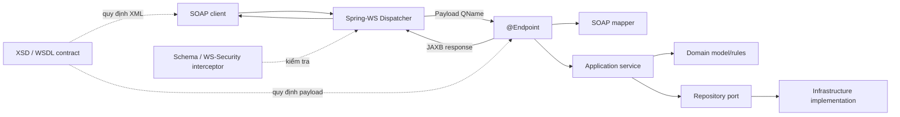

# Tiêm dịch vụ nghiệp vụ và giữ endpoint gọn, dễ kiểm thử

## Mục tiêu học tập

Trong chương **Xây dựng endpoint** thuộc module **SPRING_WEB_SERVICES**, chúng ta thiết kế SOAP endpoint theo hướng **contract-first**: hợp đồng XML được xác định bằng XSD/WSDL, các kiểu dữ liệu được ánh xạ qua JAXB, còn Spring Web Services (Spring-WS) xử lý SOAP Envelope, chọn endpoint, áp dụng interceptor và tạo SOAP response hoặc SOAP Fault.

Sau bài này, bạn có thể:

1. Giải thích vì sao **SOAP endpoint là lớp biên giao tiếp**, không phải nơi chứa mọi quy tắc nghiệp vụ, truy vấn database và logic bảo mật.
2. Dùng **constructor injection** để tiêm application/business service và các mapper cần thiết vào lớp `@Endpoint`; phân biệt tiêm dependency với tự khởi tạo dependency bằng `new`.
3. Tách đúng trách nhiệm của **XSD/JAXB model**, **SOAP adapter**, **application service**, **domain model** và **repository/infrastructure**.
4. Thiết kế service interface có ý nghĩa nghiệp vụ; đặt validation, phân quyền, transaction, idempotency và xử lý exception đúng tầng.
5. Viết một ví dụ `@PayloadRoot`/`@RequestPayload`/`@ResponsePayload` dễ hiểu, cho ra XML phù hợp hợp đồng.
6. Kiểm thử endpoint bằng **JUnit + Mockito** mà không cần khởi động Spring, kiểm thử nghiệp vụ độc lập và kiểm thử SOAP mapping bằng **`MockWebServiceClient`**.
7. Phân biệt **unit test của phương thức Java** với **contract test qua MessageDispatcher** và **integration test qua HTTP/TLS/WS-Security thực tế**.
8. Nhận diện anti-pattern: endpoint ôm nhiều logic, dùng field injection, giữ trạng thái request ở singleton, lộ JAXB vào domain, nuốt exception hoặc trả SOAP Fault không đúng hợp đồng.

## 1. Endpoint là “cổng vào SOAP”, không phải toàn bộ ứng dụng

SOAP endpoint nhận thông điệp từ **Spring-WS `MessageDispatcher`**, trích payload theo hợp đồng, gọi nghiệp vụ rồi tạo response. Trong kiến trúc này, các thành phần liên quan có vai trò:

| Thành phần | Trách nhiệm nên có | Không nên kiêm nhiệm |
| --- | --- | --- |
| **XSD/WSDL** | Mô tả phần tử, kiểu XML, operation, binding và fault được công bố. | Chứa thuật toán tính giá, SQL hoặc cấu hình private key. |
| **JAXB generated model** | Ánh xạ dữ liệu XML request/response sang Java và ngược lại. | Trở thành domain entity hoặc nơi chứa toàn bộ business rule. |
| **`@Endpoint`** | Chọn request payload, chuyển đổi rất mỏng, gọi application service, trả response. | Trực tiếp query database, gọi nhiều downstream service, mở transaction dài, xử lý chữ ký thủ công. |
| **Mapper/assembler** | Chuyển JAXB request/response ↔ command/result/domain DTO khi cần. | Tự đọc repository hoặc quyết định ai được xem đơn hàng. |
| **Application service** | Điều phối use case nghiệp vụ, giao dịch, phân quyền theo actor đã được xác thực, quy tắc idempotency. | Biết chi tiết SOAP Envelope hay HTTP header nếu không cần thiết. |
| **Domain model/domain service** | Biểu diễn nghiệp vụ và quy tắc bất biến của đơn hàng. | Phụ thuộc annotation Spring-WS hoặc cấu trúc WSDL. |
| **Repository/adapter hạ tầng** | Đọc/ghi dữ liệu, gọi cơ sở dữ liệu hoặc hệ thống khác. | Thao tác trực tiếp với `SoapMessage` nếu không phải adapter SOAP client chuyên biệt. |
| **SOAP interceptor/security stack** | Kiểm tra schema, WS-Security, audit/correlation, chính sách chung. | Thay application service ra quyết định nghiệp vụ phức tạp. |
| **Exception resolver** | Chuyển exception thích hợp sang SOAP Fault. | Trả stack trace/SQL/token ra cho đối tác. |

### 1.1. Luồng phụ thuộc mong muốn



**Hướng phụ thuộc** đáng chú ý:

- Endpoint **biết** application service qua một interface phù hợp, không nhất thiết biết database hay SOAP client của downstream.
- Application/domain **không cần biết** `org.springframework.ws.*`, `SoapMessage`, `wsdl:operation` hoặc lớp JAXB generated.
- Mapper là cầu nối giữa **contract model** và **kiểu nghiệp vụ**.
- Những quy tắc giao thức như SOAP version, `mustUnderstand`, WS-Security và HTTP/TLS được giải quyết ở **lớp biên** tương ứng, không tự suy ra từ việc một Java method nhận được object.

**Endpoint gọn** không có nghĩa endpoint tuyệt đối không được có một dòng kiểm tra null hay gán trường response. Nó có nghĩa endpoint không giữ **quy tắc có thể tái sử dụng** hoặc **trạng thái nghiệp vụ phức tạp**, để những quy tắc đó có thể kiểm thử độc lập.

## 2. Ví dụ xuyên suốt: dịch vụ SOAP tra cứu đơn hàng

Xét một hệ thống doanh nghiệp công bố thao tác **GetOrder**. Client gửi mã đơn hàng, server tìm đơn hàng và trả tình trạng cùng tổng tiền.

### 2.1. XSD hợp đồng

Schema mẫu này dùng namespace `urn:example:orders:v1`, các element request/response ở cấp global, và pattern mã đơn hàng `ORD-` theo sau sáu chữ số:

```xml
<?xml version="1.0" encoding="UTF-8"?>
<xs:schema
    xmlns:xs="http://www.w3.org/2001/XMLSchema"
    xmlns:tns="urn:example:orders:v1"
    targetNamespace="urn:example:orders:v1"
    elementFormDefault="qualified">

    <xs:simpleType name="OrderIdType">
        <xs:restriction base="xs:string">
            <xs:pattern value="ORD-[0-9]{6}"/>
        </xs:restriction>
    </xs:simpleType>

    <xs:element name="GetOrderRequest">
        <xs:complexType>
            <xs:sequence>
                <xs:element name="orderId" type="tns:OrderIdType"/>
            </xs:sequence>
        </xs:complexType>
    </xs:element>

    <xs:element name="GetOrderResponse">
        <xs:complexType>
            <xs:sequence>
                <xs:element name="orderId" type="tns:OrderIdType"/>
                <xs:element name="status" type="xs:string"/>
                <xs:element name="total" type="xs:decimal"/>
            </xs:sequence>
        </xs:complexType>
    </xs:element>

</xs:schema>
```

Đây là một **XSD minh họa đầy đủ** cho payload đơn giản. Trong hệ thống thật có thể bổ sung enumeration cho `status`, giới hạn số chữ số tiền, mã tiền tệ, mã lỗi hoặc phần tử fault detail. Các phần tử toàn cục được JAXB/XJC ánh xạ thành lớp Java hoặc factory tương ứng.

WSDL 1.1 công bố operation `GetOrder` với input part tham chiếu `tns:GetOrderRequest`, output part tham chiếu `tns:GetOrderResponse` theo namespace dữ liệu đã khai báo; SOAP binding và service port được định nghĩa riêng trong WSDL. **WSDL contract và Java endpoint phải khớp QName**, nhưng Spring-WS không dùng tên method Java để tự suy ra toàn bộ hợp đồng đã được phê duyệt.

### 2.2. SOAP request

```xml
<?xml version="1.0" encoding="UTF-8"?>
<soap:Envelope
    xmlns:soap="http://schemas.xmlsoap.org/soap/envelope/"
    xmlns:ord="urn:example:orders:v1">
    <soap:Header/>
    <soap:Body>
        <ord:GetOrderRequest>
            <ord:orderId>ORD-000042</ord:orderId>
        </ord:GetOrderRequest>
    </soap:Body>
</soap:Envelope>
```

### 2.3. SOAP response mong đợi

```xml
<?xml version="1.0" encoding="UTF-8"?>
<soap:Envelope
    xmlns:soap="http://schemas.xmlsoap.org/soap/envelope/"
    xmlns:ord="urn:example:orders:v1">
    <soap:Body>
        <ord:GetOrderResponse>
            <ord:orderId>ORD-000042</ord:orderId>
            <ord:status>CONFIRMED</ord:status>
            <ord:total>125.50</ord:total>
        </ord:GetOrderResponse>
    </soap:Body>
</soap:Envelope>
```

Phần Header trong ví dụ đang rỗng. Một dịch vụ production có thể yêu cầu WS-Security, correlation ID hoặc WS-Addressing theo hợp đồng và chính sách đã thỏa thuận. **Không dùng ví dụ Header rỗng để bỏ qua yêu cầu bảo mật thật**.

## 3. Tổ chức mã nguồn theo ranh giới

Một cấu trúc hợp lý cho Spring Boot + Spring-WS, có thể điều chỉnh tùy quy mô:

```text
src/
├── main/
│   ├── resources/
│   │   ├── xsd/orders-v1.xsd
│   │   └── wsdl/orders.wsdl              # nếu công bố WSDL tĩnh
│   └── java/com/example/orders/
│       ├── OrdersApplication.java
│       ├── soap/
│       │   ├── endpoint/OrderEndpoint.java
│       │   ├── mapper/OrderSoapMapper.java
│       │   ├── fault/SoapFaultConfiguration.java
│       │   └── config/WebServiceConfiguration.java
│       ├── contract/generated/
│       │   ├── GetOrderRequest.java       # XJC sinh (đường dẫn thực tùy package)
│       │   └── GetOrderResponse.java
│       ├── application/
│       │   ├── OrderLookupService.java
│       │   └── DefaultOrderLookupService.java
│       ├── domain/
│       │   ├── OrderSummary.java
│       │   └── OrderNotFoundException.java
│       └── persistence/
│           ├── OrderRepository.java
│           └── ...                        # implementation JPA/JDBC
└── test/
    └── java/com/example/orders/
        ├── soap/endpoint/OrderEndpointTest.java
        ├── soap/endpoint/OrderSoapDispatchTest.java
        └── application/DefaultOrderLookupServiceTest.java
```

Trong build XJC thông thường, mã sinh nằm ở `target/generated-sources/jaxb` hoặc `build/generated/...` thay vì được viết thủ công vào `src/main/java`. Cấu trúc trên minh họa **ranh giới package**, không yêu cầu commit các file Java generated. Điều quan trọng là **không trộn** code generator với nghiệp vụ.

Trong các code block Java bên dưới, chúng ta lần lượt định nghĩa các kiểu ở các package tương ứng. Đoạn mã dùng Java 17+ (có `record`) và kiểu JAXB thuộc thế hệ `jakarta.xml.bind` phù hợp với các nhánh Spring-WS hiện đại. Các kiểu request/response do XJC sinh ra được **giả định** có method setter/getter như schema và binding tương ứng; cần kiểm tra nguồn sinh thực tế trước khi copy vào dự án.

## 4. Bước 1 — Định nghĩa hợp đồng application service

Điều đầu tiên endpoint cần là **use case** rõ ràng: “trả thông tin đơn hàng theo mã”.

### 4.1. Kiểu trả về thuộc domain/application

```java
package com.example.orders.domain;

import java.math.BigDecimal;

public record OrderSummary(
        String orderId,
        String status,
        BigDecimal total) {
}
```

`OrderSummary` không import `jakarta.xml.bind.*` hay `org.springframework.ws.*`. Nó có thể được dùng bởi use case khác (REST adapter, batch job, message consumer) mà không buộc các use case đó hiểu SOAP.

Với dự án lớn, domain model có thể có value object `OrderId`, enum `OrderStatus` và các bất biến rõ ràng. Bản mẫu dùng `String`/`BigDecimal` để tập trung vào **ranh giới dependency**.

### 4.2. Application service interface

```java
package com.example.orders.application;

import com.example.orders.domain.OrderSummary;

public interface OrderLookupService {
    OrderSummary findById(String orderId);
}
```

Interface này diễn đạt **khả năng nghiệp vụ**, không diễn đạt hạ tầng:

- Tên `findById` mô tả ý định truy vấn đơn hàng.
- Đầu vào là `String orderId`, không phải `GetOrderRequest` từ JAXB.
- Đầu ra là `OrderSummary`, không phải `GetOrderResponse`.
- Không có `SoapHeader`, `MessageContext` hay `SoapFault`.

Một interface không phải lúc nào cũng bắt buộc trong mọi ứng dụng nhỏ. Nhưng khi application service là ranh giới do nhiều adapter cùng dùng, interface giúp thay implementation và **tiêm test double** dễ dàng. Điều cần tránh là tạo interface chỉ để có interface rồi không đạt lợi ích nào.

### 4.3. Exception nghiệp vụ độc lập giao thức

```java
package com.example.orders.domain;

public class OrderNotFoundException extends RuntimeException {
    private final String orderId;

    public OrderNotFoundException(String orderId) {
        super("Order not found");
        this.orderId = orderId;
    }

    public String getOrderId() {
        return orderId;
    }
}
```

Không gắn `@SoapFault` trực tiếp vào exception domain trong ví dụ này. Lý do: **business exception** nên biểu diễn tình huống nghiệp vụ; lớp SOAP adapter mới quyết định tình huống đó tương ứng Fault code, reason và detail nào theo WSDL. Nếu adapter khác dùng HTTP/REST hoặc batch job, nó có thể biểu diễn cùng exception theo cách khác.

Mã đơn hàng được giữ để phục vụ quan sát nội bộ và test, nhưng phản hồi công khai không nên tùy tiện đưa chi tiết định danh/nhật ký có thể nhạy cảm vào SOAP Fault.

## 5. Bước 2 — Triển khai application service và tiêm repository

### 5.1. Repository port

```java
package com.example.orders.persistence;

import java.util.Optional;
import com.example.orders.domain.OrderSummary;

public interface OrderRepository {
    Optional<OrderSummary> findById(String orderId);
}
```

Đây là interface mức ứng dụng minh họa. Trong dự án thực, implementation có thể dùng Spring Data JPA, JDBC, một API bên ngoài hoặc cache. **Không yêu cầu SOAP endpoint biết lựa chọn này**.

### 5.2. Service implementation

```java
package com.example.orders.application;

import java.util.Objects;

import org.springframework.stereotype.Service;
import org.springframework.transaction.annotation.Transactional;

import com.example.orders.domain.OrderNotFoundException;
import com.example.orders.domain.OrderSummary;
import com.example.orders.persistence.OrderRepository;

@Service
public class DefaultOrderLookupService implements OrderLookupService {

    private final OrderRepository repository;

    public DefaultOrderLookupService(OrderRepository repository) {
        this.repository = Objects.requireNonNull(repository);
    }

    @Override
    @Transactional(readOnly = true)
    public OrderSummary findById(String orderId) {
        return repository.findById(orderId)
                .orElseThrow(() -> new OrderNotFoundException(orderId));
    }
}
```

Trong thiết kế này:

1. `OrderRepository` được **tiêm qua constructor**; service không tự viết `new JdbcTemplate(...)` hoặc khởi tạo kết nối DB.
2. Mọi quyết định “đơn hàng không tồn tại” nằm ở application service, thay vì endpoint tự kiểm tra `Optional`.
3. `@Transactional(readOnly = true)` biểu thị ý định một use case chỉ đọc; việc quản lý transaction thực sự cần **transaction manager và cơ sở hạ tầng Spring phù hợp**. Nó không tự tạo transaction nếu project chưa có hạ tầng giao dịch.
4. Endpoint chỉ biết `OrderLookupService`. Thay repository JPA bằng implementation khác không đòi sửa SOAP endpoint.
5. Unit test của service có thể cấp repository giả/mock mà không cần SOAP Envelope.

**Một lưu ý về transaction:** `@Transactional` thường áp dụng thông qua Spring proxy; nếu bạn gọi một method `@Transactional` từ method khác của cùng object bằng `this.method()`, proxy có thể không được đi qua. Transaction nên đặt ở **ranh giới use case** và kiểm thử integration khi tính nguyên tử/rollback thực sự quan trọng.

Nếu chưa có database trong bài tập, có thể triển khai một `OrderRepository` in-memory để học hoặc dùng stub ở test. Không thêm cả JPA + database chỉ để chứng minh constructor injection.

## 6. Bước 3 — Mapper từ domain model sang JAXB response

Một SOAP adapter cần tạo response đúng XSD. Nếu chỉ có hai trường, có thể đặt phép gán đơn giản ngay trong endpoint; nhưng khi mapping nhiều kiểu, nhiều phiên bản XSD hoặc chuyển đổi ngày/tiền tệ, hãy tách một **mapper không chứa nghiệp vụ**.

```java
package com.example.orders.soap.mapper;

import org.springframework.stereotype.Component;

import com.example.orders.contract.generated.GetOrderResponse;
import com.example.orders.domain.OrderSummary;

@Component
public class OrderSoapMapper {

    public GetOrderResponse toResponse(OrderSummary source) {
        GetOrderResponse target = new GetOrderResponse();
        target.setOrderId(source.orderId());
        target.setStatus(source.status());
        target.setTotal(source.total());
        return target;
    }
}
```

Ý nghĩa:

- Mapper phụ thuộc vào **JAXB contract model** và **domain DTO**, nhưng application service không phụ thuộc JAXB.
- Mapper không query DB, không gọi API khác, không quyết định quyền truy cập.
- Mapper có thể được unit test bằng dữ liệu thuần.
- Nếu XSD/WSDL đổi từ v1 sang v2, có thể tạo adapter/mapper phiên bản mới, giữ logic nghiệp vụ ổn định.
- Nếu kiểu JAXB sinh từ schema không có `@XmlRootElement` mà yêu cầu `JAXBElement<T>` từ `ObjectFactory`, endpoint/mapper phải dùng loại wrapper phù hợp với generator và adapter thực tế.

**Không sửa tay lớp JAXB generated** để đưa logic nghiệp vụ vào getter hoặc setter. Đầu vào XSD/XJB và code generator mới là nguồn của model XML.

### 6.1. Mapper nên kiểm tra gì?

Mapper nên chịu trách nhiệm **chuyển đổi biểu diễn**, chẳng hạn:

- Đổi enum domain thành mã chuỗi XML đã thỏa thuận.
- Chuyển value object `OrderId` thành `String` đúng format.
- Giữ tiền dưới dạng `BigDecimal` thay vì `double`.
- Chuyển dữ liệu ngày/giờ sang kiểu JAXB XML phù hợp và thống nhất timezone.
- Tạo `JAXBElement<T>` khi contract cần global element wrapper.
- Xác định cách biểu diễn field tùy chọn, `minOccurs=0` và `xsi:nil`.

Nếu cần kiểm tra “khách hàng có được xem đơn này không?” hoặc “số tiền có hợp lệ theo chính sách kinh doanh?”, đó là **nghiệp vụ/phân quyền**, không phải logic mapping đơn thuần.

## 7. Bước 4 — Endpoint chỉ điều phối use case

### 7.1. Endpoint gọn bằng constructor injection

```java
package com.example.orders.soap.endpoint;

import java.util.Objects;

import org.springframework.ws.server.endpoint.annotation.Endpoint;
import org.springframework.ws.server.endpoint.annotation.PayloadRoot;
import org.springframework.ws.server.endpoint.annotation.RequestPayload;
import org.springframework.ws.server.endpoint.annotation.ResponsePayload;

import com.example.orders.application.OrderLookupService;
import com.example.orders.contract.generated.GetOrderRequest;
import com.example.orders.contract.generated.GetOrderResponse;
import com.example.orders.domain.OrderSummary;
import com.example.orders.soap.mapper.OrderSoapMapper;

@Endpoint
public class OrderEndpoint {

    private static final String NAMESPACE = "urn:example:orders:v1";

    private final OrderLookupService orderLookupService;
    private final OrderSoapMapper mapper;

    public OrderEndpoint(
            OrderLookupService orderLookupService,
            OrderSoapMapper mapper) {
        this.orderLookupService = Objects.requireNonNull(orderLookupService);
        this.mapper = Objects.requireNonNull(mapper);
    }

    @PayloadRoot(
        namespace = NAMESPACE,
        localPart = "GetOrderRequest")
    @ResponsePayload
    public GetOrderResponse getOrder(
            @RequestPayload GetOrderRequest request) {

        OrderSummary result =
                orderLookupService.findById(request.getOrderId());

        return mapper.toResponse(result);
    }
}
```

Chỉ hai hành động: **gọi use case** rồi **tạo XML response**. Endpoint không biết bảng SQL, connection pool, retry downstream, transaction hoặc chi tiết kỹ thuật WS-Security.

Trong Spring hiện đại, khi bean có **một constructor**, thường **không cần** gắn `@Autowired` lên constructor đó. Spring sẽ resolve `OrderLookupService` và `OrderSoapMapper` từ ApplicationContext. `@Endpoint` giúp Spring nhận diện class là endpoint component nếu nằm trong phạm vi component scan; mapping `@PayloadRoot` giúp `MessageDispatcher` chọn method theo QName.

Nếu có **nhiều implementation của `OrderLookupService`** trong context, Spring cần cơ chế chọn bean rõ ràng (ví dụ `@Primary`, `@Qualifier` hoặc cấu hình riêng); nếu không, ứng dụng có thể gặp lỗi ambiguity ngay lúc khởi động — tốt hơn là âm thầm chọn sai service.

### 7.2. Vì sao code này dễ kiểm thử?

Do dependency được truyền vào constructor, test có thể **tự tạo endpoint** mà không dùng Spring:

```java
OrderLookupService fake = id ->
        new OrderSummary(id, "CONFIRMED",
                new java.math.BigDecimal("125.50"));

OrderEndpoint endpoint =
        new OrderEndpoint(fake, new OrderSoapMapper());
```

Test quyết định service trả gì, endpoint không tự truy cập database. Lúc chạy production, Spring cung cấp `DefaultOrderLookupService` và `OrderSoapMapper` như bean thật.

### 7.3. “Gọn” không đồng nghĩa dồn mọi việc vào service khổng lồ

Nếu chuyển toàn bộ parsing XML, HTTP, authorization, transaction, DB, mapping và third-party calls vào một class `OrderService` 3.000 dòng, chỉ là **di chuyển monolith** từ endpoint sang service. Hãy tiếp tục tách:

- **Use case/application service**: điều phối một hành động nghiệp vụ.
- **Domain services/value objects**: quy tắc nghiệp vụ có thể tái sử dụng.
- **Repository/gateway ports**: trừu tượng hóa truy xuất DB và hệ thống ngoài.
- **Infrastructure adapters**: thực thi truy cập DB, SOAP client, queue.
- **SOAP mapper**: chuyển dữ liệu domain và JAXB.
- **Cross-cutting policies**: interceptor, authentication, tracing và transaction ở lớp phù hợp.

Tên lớp và số lượng interface phụ thuộc độ phức tạp, nhưng **mỗi phần có lý do thay đổi tương đối độc lập**.

## 8. Những anti-pattern khiến endpoint khó bảo trì

### 8.1. Anti-pattern: endpoint trực tiếp đọc database

**Ví dụ cố ý thiết kế xấu (chỉ minh họa, không phải class hoàn chỉnh):**

```java
@PayloadRoot(namespace = NS, localPart = "GetOrderRequest")
@ResponsePayload
public GetOrderResponse getOrder(@RequestPayload GetOrderRequest request) {
    Connection connection = dataSource.getConnection();
    // SQL trong endpoint, tự quản lý connection, mapping trực tiếp ResultSet.
    // Thêm kiểm tra quyền, retry, log XML và tạo SOAP Fault tại đây...
    return response;
}
```

Nhược điểm:

- Test endpoint phải có database hoặc phải mock quá nhiều chi tiết JDBC.
- Thay schema DB kéo theo thay lớp SOAP; khó tái sử dụng use case.
- Trộn transaction, security và fault mapping làm code khó đọc, dễ rò rỉ connection.
- Một lỗi thay đổi XSD có thể ảnh hưởng tới toàn bộ logic truy xuất dữ liệu.

Hướng sửa: đưa truy xuất qua `OrderRepository`, quy tắc use case qua `OrderLookupService`, endpoint chỉ điều phối.

### 8.2. Anti-pattern: tự `new` dependency ở endpoint

```java
@Endpoint
public class BadOrderEndpoint {
    private final OrderLookupService service =
            new SomeConcreteOrderLookupService();
}
```

Đoạn này là minh họa phụ thuộc cứng, với `SomeConcreteOrderLookupService` giả định. Việc tự khởi tạo tạo ra **coupling** với implementation, có thể bỏ qua các proxy Spring như `@Transactional`/security, và làm khó thay service bằng fake/mock.

Hướng sửa là **constructor injection** của interface/use case phù hợp. Không có nghĩa tuyệt đối không bao giờ dùng `new` — tạo đối tượng dữ liệu nhỏ, thuần như `new GetOrderResponse()` trong mapper là hoàn toàn hợp lý.

### 8.3. Anti-pattern: field injection

```java
@Endpoint
public class BadOrderEndpoint {

    @Autowired
    private OrderLookupService service;
}
```

Field injection có thể chạy nhưng khiến dependency không rõ ngay trong constructor, khó tạo đối tượng ở unit test thuần Java, khó bảo đảm bất biến `final` và có thể tạo trạng thái chưa được khởi tạo nếu dùng sai.

Constructor injection làm dependency **hiện rõ, bắt buộc và có thể thay thế** trong test; nên ưu tiên cho thành phần production mới.

### 8.4. Anti-pattern: giữ trạng thái request trong field

```java
@Endpoint
public class UnsafeOrderEndpoint {

    private String currentOrderId; // Trạng thái mutable dùng chung!

    @PayloadRoot(namespace = NS, localPart = "GetOrderRequest")
    @ResponsePayload
    public GetOrderResponse getOrder(
            @RequestPayload GetOrderRequest request) {

        currentOrderId = request.getOrderId();
        // Hai request đồng thời có thể ghi đè lẫn nhau.
        return null; // Chỉ minh họa lỗi thiết kế.
    }
}
```

Bean `@Endpoint` thường có **singleton scope**. Nhiều request có thể xử lý đồng thời trên cùng một instance; field mutable như `currentOrderId` gây race condition và rò dữ liệu giữa các request.

Giữ dữ liệu request trong **biến cục bộ**, truyền nó cho service qua tham số, hoặc qua request-scoped/context đã được cấu hình phù hợp khi thật sự cần. Không giữ `MessageContext`, token hay đối tượng JAXB của request trong field singleton.

### 8.5. Anti-pattern: nuốt exception và trả thành công giả

```java
try {
    return mapper.toResponse(service.findById(id));
} catch (Exception ex) {
    return new GetOrderResponse(); // Có vẻ thành công nhưng thiếu dữ liệu!
}
```

Điều này khiến client nhận payload không hợp lệ hoặc phản hồi sai ý nghĩa, làm mất tín hiệu lỗi nghiệp vụ. Không catch `Exception` chỉ để trả một response rỗng.

Hướng sửa: để exception domain đi đến `EndpointExceptionResolver` có mapping rõ ràng; với lỗi hệ thống không mong muốn, dùng fallback an toàn và logging/metrics nội bộ.

## 9. Quy tắc đặt validation, phân quyền và transaction đúng chỗ

Một request SOAP thường cần nhiều loại kiểm tra. Chúng **không nên** được viết chồng chéo trong một method endpoint.

| Quy tắc | Tầng nên chịu trách nhiệm chính | Ví dụ |
| --- | --- | --- |
| XML well-formed và SOAP version | SOAP message factory / transport | Envelope có namespace SOAP 1.1 hay 1.2 phù hợp? |
| XSD validation | SOAP schema-validation interceptor | `orderId` khớp `ORD-[0-9]{6}`? |
| WS-Security Header và chữ ký | Security interceptor/WSS4J | Token, timestamp, signature, certificate hợp lệ? |
| TLS/mTLS | Transport/gateway | Hai đầu kết nối có chứng chỉ phù hợp? |
| Quyền truy cập đơn hàng | Application/domain service | Người gọi đã xác thực có quyền xem đơn thuộc tenant đó? |
| Quy tắc nghiệp vụ | Domain/application | Order đã bị khóa? Có thể hủy hay không? |
| Transaction/consistency | Application service | Đọc dữ liệu nhất quán; cập nhật nhiều bảng nguyên tử khi cần. |
| XML response mapping | SOAP mapper | Đúng kiểu JAXB, namespace và field order? |
| SOAP Fault | EndpointExceptionResolver/security stack | Lỗi không tìm thấy, lỗi xác thực, lỗi schema phản hồi đúng nghĩa. |

### 9.1. XSD validation không thay nghiệp vụ

XSD ở ví dụ giới hạn `orderId` theo pattern. Nhưng:

- JAXB có thể tạo Java `String` dù schema có pattern.
- Nếu runtime chưa bật schema validation, việc unmarshalling thành object không chắc thực thi mọi XSD facet.
- “Đơn hàng có tồn tại?” là câu hỏi nghiệp vụ, **không thể suy ra từ XSD**.
- “Ai có quyền xem đơn?” phải dựa trên **danh tính đã xác thực và chính sách phân quyền**, không tin ngay giá trị người gửi tự khai báo.

Có thể dùng `PayloadValidatingInterceptor` với schema đã được phê duyệt. **Không** chuyển toàn bộ ứng dụng thành “endpoint tự chạy SAX parser và tự kiểm tra regex cho mọi field”.

### 9.2. Security và identity không phải tham số không đáng tin

Giả sử request XML chứa:

```xml
<ord:requesterId>admin</ord:requesterId>
```

Không dùng chuỗi này làm bằng chứng người gọi là admin. `requesterId` là **dữ liệu do client gửi**, có thể bị giả mạo. Service cần nhận **authenticated actor context** từ security layer được tin cậy (thông qua API/context được thiết kế rõ ràng), hoặc application service tự lấy actor từ thành phần xác thực của ứng dụng.

Một thiết kế dùng actor tường minh có thể là:

```java
public interface OrderLookupService {
    OrderSummary findById(String orderId, AuthenticatedActor actor);
}
```

Trong đó `AuthenticatedActor` là kiểu application do hệ thống tạo **sau khi xác thực**, không tạo trực tiếp từ một field trong SOAP Body. SOAP endpoint chỉ làm cầu nối lấy identity đã xác minh và chuyển cho use case.

### 9.3. Transaction thuộc ranh giới use case

Với một thao tác **ghi dữ liệu** như `SubmitOrder`, application service thường là nơi phối hợp kiểm tra và cập nhật:

```java
@Service
public class SubmitOrderService {

    private final OrderRepository repository;

    public SubmitOrderService(OrderRepository repository) {
        this.repository = repository;
    }

    @Transactional
    public SubmitOrderResult submit(SubmitOrderCommand command) {
        // Kiểm tra quyền/điều kiện nghiệp vụ theo thiết kế.
        // Ghi dữ liệu và bảo đảm tính nhất quán của một use case.
        // Không chứa các thao tác SOAP/JAXB ở đây.
        return doSubmit(command);
    }
}
```

Đây là **khung minh họa**, không biên dịch độc lập vì `SubmitOrderResult`, `SubmitOrderCommand`, `doSubmit` và repo implementation chưa được định nghĩa.

Với service thực tế, transaction chỉ bao quanh các thay đổi cần tính nhất quán, không kéo dài vô hạn qua SOAP/network call. Nếu use case có gọi đối tác qua SOAP, cân nhắc timeout, retry, outbox/saga, idempotency và ranh giới giao dịch phù hợp. **Không có distributed transaction tự động** chỉ vì một endpoint được gắn `@Transactional`.

### 9.4. Idempotency khi client SOAP retry

Một client có thể gửi lại request do mất kết nối trước khi nhận response. Với thao tác ghi, nếu endpoint tự thêm record mỗi lần mà không có idempotency, có thể phát sinh đơn hàng trùng.

Khuyến nghị:

- Hợp đồng có request ID/idempotency key phù hợp.
- Use case kiểm tra key theo principal/tenant và phạm vi nghiệp vụ; dữ liệu được lưu có ràng buộc duy nhất khi cần.
- Retry policy chỉ kích hoạt trong trường hợp đủ an toàn.
- Không tin rằng SOAPAction, `mustUnderstand` hoặc chỉ một header correlation là cơ chế chống lặp hoàn chỉnh.
- Đặt logic idempotency vào application service hoặc thành phần domain/infrastructure chuyên trách, **không sao chép** trong mọi endpoint.

## 10. SOAP Fault nên được tạo ở lớp biên

Khi service ném `OrderNotFoundException`, endpoint nên để lỗi đi tiếp qua cơ chế xử lý lỗi đã cấu hình, thay vì tự tạo XML `<soap:Fault>` bằng cách nối chuỗi.

### 10.1. Exception nghiệp vụ không cần phụ thuộc SOAP

Ở phần 4, `OrderNotFoundException` là exception Java thuần. Lớp SOAP adapter có thể ánh xạ nó sang Fault.

Ví dụ `SoapFaultMappingExceptionResolver`:

```java
package com.example.orders.soap.fault;

import java.util.Properties;

import org.springframework.context.annotation.Bean;
import org.springframework.context.annotation.Configuration;
import org.springframework.core.Ordered;
import org.springframework.ws.soap.server.endpoint.SoapFaultMappingExceptionResolver;

import com.example.orders.domain.OrderNotFoundException;

@Configuration
public class SoapFaultConfiguration {

    @Bean
    public SoapFaultMappingExceptionResolver domainFaultResolver() {
        Properties mappings = new Properties();

        mappings.setProperty(
                OrderNotFoundException.class.getName(),
                "CLIENT,Order not found,en");

        SoapFaultMappingExceptionResolver resolver =
                new SoapFaultMappingExceptionResolver();
        resolver.setExceptionMappings(mappings);
        resolver.setOrder(Ordered.HIGHEST_PRECEDENCE);
        return resolver;
    }
}
```

Ví dụ chọn mã **SOAP 1.1 Client** cho tình huống đơn hàng không tồn tại như một **quy ước tích hợp cụ thể**; với SOAP 1.2, tên mã tương ứng là **Sender**. Việc chọn lỗi nghiệp vụ là Client/Sender hay theo profile khác phải thống nhất với các bên trong hợp đồng, không phải một quy luật tuyệt đối cho mọi `NotFound`.

**Cẩn thận với thứ tự resolver:** resolver chuyên biệt chỉ nên xử lý những exception nó nhận diện; fallback trả lỗi Server/Receiver phải được xếp phù hợp để không nuốt lỗi nghiệp vụ.

### 10.2. Khi WSDL khai báo fault detail

Nếu WSDL định nghĩa một typed fault `OrderNotFoundFault` chứa `code` và `message`, mapping đơn giản ở trên **không tự sinh** phần tử detail XML theo XSD. Cần bổ sung logic fault detail ở resolver chuyên biệt hoặc cơ chế khác phù hợp, rồi test trên wire.

Ví dụ SOAP 1.1 Fault với detail:

```xml
<soap:Envelope
    xmlns:soap="http://schemas.xmlsoap.org/soap/envelope/"
    xmlns:ord="urn:example:orders:v1">
    <soap:Body>
        <soap:Fault>
            <faultcode>soap:Client</faultcode>
            <faultstring>Order not found</faultstring>
            <detail>
                <ord:OrderNotFoundFault>
                    <ord:code>ORDER_NOT_FOUND</ord:code>
                    <ord:message>No matching order</ord:message>
                </ord:OrderNotFoundFault>
            </detail>
        </soap:Fault>
    </soap:Body>
</soap:Envelope>
```

Bản tin trên là **minh họa định dạng**, không phải output đã được tạo bởi cấu hình resolver trước đó. Muốn bảo đảm typed fault, phải có XSD/WSDL cho `OrderNotFoundFault` và code thực sự ghi detail.

**Không để exception message tự do** (đặc biệt `SQLException`, stack trace, SQL query, token hoặc thông tin hệ thống) chảy thẳng ra `faultstring`. Ghi log nguyên nhân chi tiết ở kênh nội bộ có kiểm soát, còn client nhận lỗi đủ ổn định để xử lý.

## 11. Unit test endpoint bằng JUnit và Mockito — không cần Spring Context

Một endpoint phụ thuộc qua constructor có thể được tạo bằng `new` trong unit test. Đây là cấp độ test **nhanh** và rất hữu ích khi phát triển.

### 11.1. Unit test thành công

Giả sử dự án đã có JUnit Jupiter, Mockito Jupiter và các generated JAXB classes.

```java
package com.example.orders.soap.endpoint;

import static org.junit.jupiter.api.Assertions.assertEquals;
import static org.mockito.Mockito.verify;
import static org.mockito.Mockito.when;

import java.math.BigDecimal;

import org.junit.jupiter.api.BeforeEach;
import org.junit.jupiter.api.Test;
import org.junit.jupiter.api.extension.ExtendWith;
import org.mockito.Mock;
import org.mockito.junit.jupiter.MockitoExtension;

import com.example.orders.application.OrderLookupService;
import com.example.orders.contract.generated.GetOrderRequest;
import com.example.orders.contract.generated.GetOrderResponse;
import com.example.orders.domain.OrderSummary;
import com.example.orders.soap.mapper.OrderSoapMapper;

@ExtendWith(MockitoExtension.class)
class OrderEndpointTest {

    @Mock
    private OrderLookupService orderLookupService;

    private OrderEndpoint endpoint;

    @BeforeEach
    void setUp() {
        endpoint = new OrderEndpoint(
                orderLookupService,
                new OrderSoapMapper());
    }

    @Test
    void delegatesToServiceAndBuildsSoapResponse() {
        when(orderLookupService.findById("ORD-000042"))
                .thenReturn(new OrderSummary(
                        "ORD-000042",
                        "CONFIRMED",
                        new BigDecimal("125.50")));

        GetOrderRequest request = new GetOrderRequest();
        request.setOrderId("ORD-000042");

        GetOrderResponse response = endpoint.getOrder(request);

        assertEquals("ORD-000042", response.getOrderId());
        assertEquals("CONFIRMED", response.getStatus());
        assertEquals(new BigDecimal("125.50"), response.getTotal());

        verify(orderLookupService).findById("ORD-000042");
    }
}
```

Kiểm thử này xác minh:

- Endpoint **ủy quyền** cho service đã tiêm, không tự truy cập repository.
- Request JAXB được chuyển thành tham số use case đúng.
- Response được mapper tạo với nội dung dự kiến.
- Không có yêu cầu tạo Spring ApplicationContext hoặc dựng HTTP server.

**Giới hạn:** test này **không** xác minh `@PayloadRoot` có match SOAP Body, JAXB marshalled XML đúng QName, schema validation, WS-Security hoặc xử lý SOAP Fault thực. Cần test ở tầng tiếp theo.

### 11.2. Unit test lỗi nghiệp vụ

```java
import static org.junit.jupiter.api.Assertions.assertThrows;
import static org.mockito.Mockito.when;

// Thêm trong OrderEndpointTest ở trên:
@Test
void propagatesDomainExceptionToSoapFaultBoundary() {
    when(orderLookupService.findById("ORD-999999"))
            .thenThrow(new OrderNotFoundException("ORD-999999"));

    GetOrderRequest request = new GetOrderRequest();
    request.setOrderId("ORD-999999");

    assertThrows(
            OrderNotFoundException.class,
            () -> endpoint.getOrder(request));
}
```

Đây là test **phương thức endpoint**: lỗi domain được chuyển tiếp để tầng resolver có thể xử lý. Không nên ép endpoint bắt exception và trả response thành công giả.

**Lưu ý:** mã `OrderNotFoundException` cần import vào class test đầy đủ. Đoạn thêm này là phần rút gọn, không đứng độc lập với test class ở mục trước.

### 11.3. Có thể dùng fake thay Mockito

Nếu muốn giảm dependency test:

```java
OrderLookupService fakeService = orderId ->
        new OrderSummary(
                orderId,
                "CONFIRMED",
                new BigDecimal("125.50"));

OrderEndpoint endpoint = new OrderEndpoint(
        fakeService,
        new OrderSoapMapper());
```

Đây là **fake đơn giản bằng lambda** vì `OrderLookupService` có đúng một abstract method. Nó hữu ích khi chỉ cần xác nhận kết quả; Mockito phù hợp hơn khi cần kiểm tra tương tác cụ thể như số lần gọi hoặc argument.

## 12. Unit test business service độc lập SOAP

Đừng chỉ test endpoint. Vì business logic nằm ở `DefaultOrderLookupService`, cần kiểm thử **use case** trực tiếp với repository test double.

Ví dụ:

```java
package com.example.orders.application;

import static org.junit.jupiter.api.Assertions.assertEquals;
import static org.junit.jupiter.api.Assertions.assertThrows;
import static org.mockito.Mockito.when;

import java.math.BigDecimal;
import java.util.Optional;

import org.junit.jupiter.api.Test;
import org.junit.jupiter.api.extension.ExtendWith;
import org.mockito.Mock;
import org.mockito.junit.jupiter.MockitoExtension;

import com.example.orders.domain.OrderNotFoundException;
import com.example.orders.domain.OrderSummary;
import com.example.orders.persistence.OrderRepository;

@ExtendWith(MockitoExtension.class)
class DefaultOrderLookupServiceTest {

    @Mock
    private OrderRepository repository;

    @Test
    void returnsOrderFromRepository() {
        OrderSummary snapshot = new OrderSummary(
                "ORD-000042",
                "CONFIRMED",
                new BigDecimal("125.50"));

        when(repository.findById("ORD-000042"))
                .thenReturn(Optional.of(snapshot));

        OrderLookupService service =
                new DefaultOrderLookupService(repository);

        assertEquals(snapshot, service.findById("ORD-000042"));
    }

    @Test
    void throwsWhenOrderDoesNotExist() {
        when(repository.findById("ORD-999999"))
                .thenReturn(Optional.empty());

        OrderLookupService service =
                new DefaultOrderLookupService(repository);

        assertThrows(
                OrderNotFoundException.class,
                () -> service.findById("ORD-999999"));
    }
}
```

Với cấu trúc này, test service không có SOAP/JAXB dependency trong logic kiểm thử; việc dùng XSD/WSDL hoặc WS-Security **không làm thay đổi** test của use case đơn giản.

Mặt khác, test tạo service trực tiếp bằng `new` **không kiểm chứng proxy `@Transactional`, rollback, isolation hoặc security method interceptor**. Những thuộc tính đó cần test với Spring context và hạ tầng transaction phù hợp.

### 12.1. Test mapper riêng khi mapping phức tạp

```java
@Test
void mapsDomainOrderToJaxbResponse() {
    OrderSummary source = new OrderSummary(
            "ORD-000042", "CONFIRMED",
            new BigDecimal("125.50"));

    GetOrderResponse response =
            new OrderSoapMapper().toResponse(source);

    assertEquals("ORD-000042", response.getOrderId());
    assertEquals("CONFIRMED", response.getStatus());
    assertEquals(new BigDecimal("125.50"), response.getTotal());
}
```

Đây là đoạn test method cần imports JUnit/JAXB/domain. Nếu mapping có timestamp/timezone, enum, `xsi:nil` hoặc kiểu XML không trực tiếp tương ứng Java, test cả trường hợp biên.

## 13. Contract test qua `MockWebServiceClient`

Unit test endpoint chưa đi qua `MessageDispatcher`. Để xác nhận **SOAP payload root → endpoint mapping → adapter → response XML**, dùng **Spring-WS Test** với `MockWebServiceClient`. Công cụ này có thể tạo request và xác minh response trong ApplicationContext mà **không mở HTTP socket**.

### 13.1. Ví dụ test cấu hình endpoint và stub service

Dưới đây là một ví dụ dùng Spring Test, JUnit 5, Spring-WS Test và các class đã định nghĩa ở trên. Để dễ đọc, một số import không liên quan trực tiếp đến trọng tâm được trình bày đầy đủ trong phần code.

```java
package com.example.orders.soap.endpoint;

import static org.springframework.ws.test.server.RequestCreators.withPayload;
import static org.springframework.ws.test.server.ResponseMatchers.noFault;
import static org.springframework.ws.test.server.ResponseMatchers.payload;

import java.math.BigDecimal;

import org.junit.jupiter.api.Test;
import org.springframework.beans.factory.annotation.Autowired;
import org.springframework.context.ApplicationContext;
import org.springframework.context.annotation.Bean;
import org.springframework.context.annotation.Configuration;
import org.springframework.context.annotation.Import;
import org.springframework.test.context.junit.jupiter.SpringJUnitConfig;
import org.springframework.ws.config.annotation.EnableWs;
import org.springframework.ws.test.server.MockWebServiceClient;
import org.springframework.xml.transform.StringSource;

import com.example.orders.application.OrderLookupService;
import com.example.orders.domain.OrderSummary;
import com.example.orders.soap.mapper.OrderSoapMapper;

@SpringJUnitConfig(classes = OrderSoapDispatchTest.Config.class)
class OrderSoapDispatchTest {

    @Autowired
    private ApplicationContext context;

    @Configuration
    @EnableWs
    @Import({OrderEndpoint.class, OrderSoapMapper.class})
    static class Config {

        @Bean
        OrderLookupService orderLookupService() {
            return orderId -> new OrderSummary(
                    orderId,
                    "CONFIRMED",
                    new BigDecimal("125.50"));
        }
    }

    @Test
    void dispatchesByPayloadQNameAndReturnsSoapXml() {
        String requestXml = """
            <ord:GetOrderRequest xmlns:ord="urn:example:orders:v1">
                <ord:orderId>ORD-000042</ord:orderId>
            </ord:GetOrderRequest>
            """;

        String expectedResponseXml = """
            <ord:GetOrderResponse xmlns:ord="urn:example:orders:v1">
                <ord:orderId>ORD-000042</ord:orderId>
                <ord:status>CONFIRMED</ord:status>
                <ord:total>125.50</ord:total>
            </ord:GetOrderResponse>
            """;

        MockWebServiceClient client =
                MockWebServiceClient.createClient(context);

        client.sendRequest(
                withPayload(new StringSource(requestXml)))
              .andExpect(noFault())
              .andExpect(payload(
                      new StringSource(expectedResponseXml)));
    }
}
```

**Điều kiện để test chạy trong project thật:**

- Dự án có `spring-ws-test`, Spring Test/JUnit, JAXB API + runtime phù hợp và `@EnableWs`/`MessageDispatcher` được cấu hình.
- `GetOrderRequest`/`GetOrderResponse` đã được XJC sinh đúng schema và JAXB argument/return handlers của adapter hỗ trợ chúng.
- `OrderEndpoint` và `OrderSoapMapper` được import vào test context; trong ứng dụng chạy thật có thể dùng component scanning.
- Test stub trả một đơn hàng hợp lệ; bài test **không** khởi động DB hay gọi đối tác.
- Với các nhánh Spring Boot/Spring-WS khác nhau, phải kiểm tra dependency/runtime Jakarta và API test theo phiên bản được chọn.

Nếu test thất bại, hãy phân biệt **không map được QName**, **adapter không xử lý kiểu JAXB**, **output XML sai XSD** hoặc **service nghiệp vụ thất bại**. Không sửa WSDL tùy tiện khi nguyên nhân là thiếu JAXB provider.

### 13.2. Kiểm thử Fault do business service

Có thể thay stub `orderLookupService()` ở test configuration để ném `OrderNotFoundException` cho `ORD-999999`, đồng thời import `SoapFaultConfiguration`. Khi đó:

```java
import static org.springframework.ws.test.server.ResponseMatchers.clientOrSenderFault;

// Giả sử client/context đã có, resolver được đăng ký
String notFoundXml = """
    <ord:GetOrderRequest xmlns:ord="urn:example:orders:v1">
        <ord:orderId>ORD-999999</ord:orderId>
    </ord:GetOrderRequest>
    """;

client.sendRequest(withPayload(new StringSource(notFoundXml)))
      .andExpect(clientOrSenderFault("Order not found"));
```

Đây là **khung bổ sung**, không phải một test đứng độc lập. Test này chỉ đúng khi stub thực sự ném exception và resolver đã được đưa vào ApplicationContext; nếu không nó sẽ nhận response bình thường. Để xác nhận typed Fault theo WSDL, thêm matcher kiểm tra **SOAP Fault detail** đúng namespace và phần tử hợp đồng.

### 13.3. Đừng nhầm với test qua HTTP thật

`MockWebServiceClient` kiểm tra MessageDispatcher và các endpoint/resolver/interceptor đã đăng ký trong Spring context. Nó **không chứng minh**:

- Servlet mapping/url hoặc reverse proxy đúng.
- TLS/mTLS/chứng chỉ và cipher suite đúng.
- HTTP Content-Type, SOAPAction và chunked/streaming thực được gateway chấp nhận.
- Hệ thống bên ngoài dùng thư viện SOAP khác vẫn interoperable.
- Kích thước message ở tầng proxy/HTTP hay network timeout được thực thi.
- Toàn bộ WS-Security policy đã được cấu hình nếu test context không đưa security interceptor vào.

Vì vậy, pipeline cần **unit test nhanh**, **SOAP dispatch test**, và **integration/conformance test qua HTTP/TLS thực** ở môi trường phù hợp.

## 14. Cấu hình endpoint và validation trong Spring-WS

Cơ chế Spring-WS có thể có `MessageDispatcherServlet` để nhận SOAP/HTTP, `@EnableWs` để bật annotation-driven endpoint mapping/adapter, XSD validation và security interceptors.

Ví dụ cấu hình rút gọn đăng ký schema validator:

```java
import java.util.List;

import org.springframework.context.annotation.Configuration;
import org.springframework.core.io.ClassPathResource;
import org.springframework.ws.config.annotation.EnableWs;
import org.springframework.ws.config.annotation.WsConfigurer;
import org.springframework.ws.server.EndpointInterceptor;
import org.springframework.ws.soap.server.endpoint.interceptor.PayloadValidatingInterceptor;

@Configuration
@EnableWs
public class SoapEndpointConfiguration implements WsConfigurer {

    @Override
    public void addInterceptors(
            List<EndpointInterceptor> interceptors) {

        PayloadValidatingInterceptor validator =
                new PayloadValidatingInterceptor();

        validator.setSchema(
                new ClassPathResource("xsd/orders-v1.xsd"));
        validator.setValidateRequest(true);
        validator.setValidateResponse(true);

        interceptors.add(validator);
    }
}
```

**Chú ý khi đưa vào code thực:** `setSchema(Resource)` nhận `ClassPathResource`, còn `setXsdSchema(...)` nhận đối tượng kiểu `XsdSchema`. Không nhầm hai API. Cấu hình Servlet, WSDL/XSD publication và JAXB phải được bổ sung phù hợp ứng dụng thực tế.

Ở ứng dụng Spring Boot hoàn chỉnh, có thể cần config Servlet, WSDL/XSD publication và các bean liên quan. Chỉ thêm interceptor vào một config không đồng nghĩa runtime bảo mật hoặc SOAP endpoint đã được triển khai đầy đủ.

### 14.1. Validation ở schema và ở use case khác nhau

- `PayloadValidatingInterceptor` kiểm tra shape, thứ tự, kiểu XML, facet XSD và tạo lỗi thích hợp khi invalid.
- Service có thể kiểm tra điều kiện dữ liệu vượt quá khả năng XSD hoặc không phụ thuộc SOAP, ví dụ tồn tại order, trạng thái chuyển đổi, quyền theo tenant.
- Với response, schema validation giúp phát hiện mapper hoặc domain output không còn khớp WSDL.
- XML parser và gateway vẫn phải giới hạn kích thước, entity expansion, DTD/external entities; XSD validation một mình không ngăn mọi XML resource exhaustion.

## 15. Tránh rò rỉ các dependency SOAP vào use case

### 15.1. Hai thiết kế để so sánh

**Phụ thuộc sai chiều:**

```text
DefaultOrderLookupService
   ├── GetOrderRequest (JAXB)
   ├── SoapMessage
   ├── WebServiceMessage
   └── ServletRequest
```

Nếu service nhận thẳng `GetOrderRequest` và trả `GetOrderResponse`, nó bị gắn vào version của hợp đồng SOAP. Mỗi lần XSD đổi package/field, nghiệp vụ lại phải biên dịch lại và unit tests phụ thuộc vào generator.

**Ranh giới đề xuất:**

```text
OrderEndpoint (SOAP adapter)
   ├── GetOrderRequest (JAXB)
   ├── OrderSoapMapper
   └── OrderLookupService (interface)
          └── OrderSummary (domain DTO)
```

Điểm mạnh: khi có REST endpoint hoặc batch use case, có thể tái sử dụng `OrderLookupService` mà không phát sinh SOAP dependency. Khi WSDL v2 khác v1, tạo `OrderV2Endpoint` và mapper khác nhưng giữ service nếu nghiệp vụ không đổi.

### 15.2. Khi nào dùng thẳng JAXB ở service có thể chấp nhận?

Trong một demo cực nhỏ hoặc ứng dụng đơn mục đích, truyền JAXB object thẳng vào service có thể giảm boilerplate. Nhưng đây là **trade-off có chủ đích**:

- Đơn giản ban đầu, ít mapper.
- Sau này khó thay XSD hoặc sử dụng nghiệp vụ ở giao diện khác.
- Unit test business phải phụ thuộc generated classes.
- JAXB có thể chứa trạng thái `null`, `JAXBElement`, `XMLGregorianCalendar` và cấu trúc chỉ có ý nghĩa trên wire.

Với tích hợp doanh nghiệp nhiều đối tác/phiên bản, ưu tiên **tách contract model khỏi domain model**; độ phức tạp về sau thường giảm.

### 15.3. Tách mapping không tạo “quyền” thay đổi hợp đồng

Mapper là một thành phần trong ứng dụng. Nó không được phép tự đổi XML namespace, SOAP binding, kiểu ngày, định dạng tiền hoặc yêu cầu WS-Security so với hợp đồng đang công bố.

Khi sửa XSD/WSDL, cần tái sinh JAXB có thể lặp lại, review diff, chạy contract tests và đánh giá tương thích client cũ. Endpoint gọn giúp việc này **rõ ranh giới** hơn, nhưng không thay thế quy trình versioning.

## 16. Xử lý trường hợp thực tế có nhiều dependency

Một use case `SubmitOrder` có thể cần:

- `InventoryPort` kiểm tra tồn kho.
- `PricingService` tính giá theo chính sách.
- `OrderRepository` lưu đơn.
- `EventPublisher` tạo event sau commit.
- `AuthorizationService` quyết định quyền thao tác của actor đã xác thực.

Không nên tiêm cả năm dependency trực tiếp vào SOAP endpoint:

```text
SubmitOrderEndpoint
   └── SubmitOrderUseCase
          ├── InventoryPort
          ├── PricingService
          ├── OrderRepository
          ├── EventPublisher
          └── AuthorizationService
```

Endpoint chỉ biết một **use case interface**:

```java
public interface SubmitOrderUseCase {
    SubmitOrderResult submit(
            SubmitOrderCommand command,
            AuthenticatedActor actor);
}
```

SOAP mapper biến `SubmitOrderRequest` JAXB thành `SubmitOrderCommand` và tạo `SubmitOrderResponse` từ `SubmitOrderResult`. Service triển khai use case quyết định trình tự kiểm tra/cập nhật. Điều này cũng tránh việc endpoint v1 và v2 vô tình thực hiện nghiệp vụ theo hai thuật toán khác nhau.

**Chú ý bảo mật:** actor phải được xây dựng từ identity đã qua xác thực, không đơn giản lấy chuỗi `userId` trong request. Việc ký XML/WS-Security phải được xác minh trước hiệu ứng nghiệp vụ theo chính sách.

## 17. Observability khi endpoint mỏng

Endpoint gọn không có nghĩa thiếu tracing hoặc metric. Tốt nhất là xử lý chính sách chung ở lớp thích hợp:

- **Correlation ID**: đọc hoặc sinh theo chính sách, kiểm tra input không đáng tin; không để client tự chọn ID gây log injection.
- **Latency**: đo thời gian xử lý SOAP, thời gian service và các downstream calls.
- **Error metrics**: phân biệt schema invalid, SOAP Fault nghiệp vụ, WS-Security failure, timeout, DB failure.
- **Audit**: ghi hành động quan trọng với actor đã xác minh và metadata tối thiểu cần thiết.
- **Security logging**: không log nguyên token, private key, credentials hoặc toàn bộ SOAP body nếu chứa dữ liệu nhạy cảm.

Không để mỗi endpoint viết lại hàng chục dòng `try/catch + Stopwatch + log XML`. Có thể dùng interceptor/tracing layer cho phần chung và metric ở service/domain khi cần đo use case.

### 17.1. Timeouts và retry

Với endpoint gọi một SOAP client downstream:

- Cấu hình timeout ở **SOAP client transport**, không chờ HTTP thread vô hạn.
- Retry theo tính idempotent của thao tác, không lặp bừa các lệnh ghi.
- Tránh giữ database transaction mở trong lúc chờ nhiều downstream calls, trừ khi có lý do thiết kế và kiểm soát nhất quán rõ ràng.
- Tách lỗi giao tiếp khỏi lỗi domain; resolver trả Fault theo contract và không lộ thông tin nhạy cảm.

Mục tiêu là endpoint không biết mọi chi tiết vận hành, nhưng ứng dụng vẫn có **chính sách xử lý thất bại nhất quán**.

## 18. Chẩn đoán lỗi theo ranh giới phụ thuộc

| Triệu chứng | Vùng cần điều tra | Cách kiểm tra |
| --- | --- | --- |
| `No qualifying bean of type OrderLookupService` | Dependency injection / bean registration | `@Service`/`@Bean`, component scan, package cấu hình, profile. |
| `NoUniqueBeanDefinitionException` | Nhiều implementation service | `@Qualifier`/`@Primary` hoặc cấu hình một bean đúng. |
| Null dependency khi gọi unit test | Endpoint dùng field injection hoặc test không khởi tạo dependency | Dùng constructor injection và fake/mock tường minh. |
| Endpoint mapping không chạy | `@PayloadRoot` và WSDL QName | XML namespace/local name, `@Endpoint` bean và `@EnableWs`. |
| JAXB error/unexpected element | SOAP adapter / generated model | Namespace/schema, `@XmlRootElement`/`ObjectFactory`, JAXB runtime/provider. |
| `No adapter for endpoint` | Spring-WS EndpointAdapter | Method signature, argument resolver, JAXB support, bean config. |
| Response XML sai thứ tự/kiểu | Mapper hoặc XSD/JAXB generation | Test marshalling/response schema validation. |
| Domain test phải khởi động database và SOAP servlet | Service bị phụ thuộc hạ tầng | Tách repository interface và domain DTO; dùng mock/fake. |
| `@Transactional` không có tác dụng | Proxy/transaction manager | Kiểm tra bean qua Spring context, self-invocation, transaction manager. |
| SOAP Fault không có typed detail | Fault resolver/WSDL | Thêm logic ghi `SoapFaultDetail` và test XML. |
| XML hợp lệ nhưng caller không có quyền | Application authorization | Xác thực actor, tenant/resource permissions. |
| WS-Security fault chỉ xuất hiện trên môi trường thật | Security interceptor/TLS/chứng chỉ | Test signed messages, truststore, timestamp, role/header. |
| Một số request có dữ liệu của request khác | Mutable singleton endpoint | Bỏ field lưu request, giữ biến cục bộ. |
| Client retry tạo bản ghi trùng | Use case idempotency | Request key, ràng buộc duy nhất, transaction, replay policy. |
| Đổi XSD làm service phải sửa khắp nơi | Coupling JAXB/domain | Đưa chuyển đổi vào SOAP mapper/adapter. |

**Quy trình điều tra đề xuất:**

```text
SOAP Envelope / HTTP
  → XSD/WSDL QName và binding
  → Spring-WS EndpointMapping
  → EndpointAdapter + JAXB
  → Endpoint constructor dependencies
  → Application service / domain
  → Repository / downstream
  → Response mapper / SOAP Fault resolver
```

Tìm nơi đầu tiên **không đúng trách nhiệm** trước khi thêm annotation hoặc dependency ngẫu nhiên.

## 19. Checklist code review cho một SOAP endpoint mới

- [ ] XSD/WSDL là nguồn contract; payload QName trong `@PayloadRoot` khớp phần tử XSD toàn cục.
- [ ] Class có `@Endpoint` và constructor injection; các dependency chính là `final`.
- [ ] Endpoint chỉ làm nhiệm vụ biên giao tiếp: nhận request, gọi use case, trả JAXB response.
- [ ] Endpoint không trực tiếp query DB, quản lý connection, giữ transaction dài hoặc gọi nhiều downstream API.
- [ ] Không có mutable request state trong field singleton.
- [ ] JAXB generated model không trở thành domain entity mặc định; có mapper riêng khi mapping đủ phức tạp.
- [ ] Application service mô tả đúng use case, domain exception không phụ thuộc SOAP nếu không có lý do rõ ràng.
- [ ] Business authorization dùng **actor đã xác thực**, không tin vào userId tự khai báo.
- [ ] XSD validation và WS-Security được thực thi ở tầng phù hợp, không suy ra từ việc unmarshalling.
- [ ] Transaction, idempotency, timeout và retry được thiết kế ở use case/infrastructure.
- [ ] Exception resolver tạo SOAP Fault an toàn, đúng SOAP version; typed fault detail tuân thủ WSDL nếu có.
- [ ] Unit test endpoint dùng fake/mock business service mà không cần Spring context.
- [ ] Unit test application service dùng fake/mock repository; test business rule và lỗi.
- [ ] `MockWebServiceClient` kiểm thử payload QName, JAXB serialization, resolver, interceptor khi có.
- [ ] Kiểm thử HTTP/TLS/WS-Security và đối tác độc lập được thực hiện ngoài unit test.
- [ ] Log/metrics đủ để điều tra nhưng không lộ token, chữ ký, mật khẩu hoặc XML nhạy cảm.
- [ ] Khi sửa XSD/WSDL, có bài test tương thích request/response/Fault và kế hoạch versioning.

## 20. Bài tập thực hành và đáp án

### Bài 1 — Tìm vi phạm Single Responsibility

Một `@Endpoint` có method 250 dòng gồm `JdbcTemplate`, tính giảm giá, kiểm tra role người dùng từ `request.getUserId()`, parse SOAP Header và tự tạo `<soap:Fault>`. Những trách nhiệm nào nên chuyển ra ngoài?

**Đáp án gợi ý:** Truy xuất DB → repository; giảm giá → domain/application service; quyền → service dùng identity đã xác thực; SOAP Header/WS-Security → SOAP adapter/interceptor hoặc security stack phù hợp; tạo SOAP Fault → exception resolver; biến đổi request/response → mapper nếu phức tạp. Endpoint chỉ điều phối use case.

### Bài 2 — Constructor injection

Vì sao đoạn sau khó unit test?

```java
@Endpoint
class OrderEndpoint {
    @Autowired
    private OrderLookupService service;
}
```

**Đáp án:** Dependency không xuất hiện trong constructor, field không dễ thiết lập qua `new OrderEndpoint()` và có thể null nếu không tạo bean qua Spring. Dùng constructor injection giúp tạo endpoint bằng service fake/mock trong test mà không cần context.

### Bài 3 — Giữ tính tương thích XSD

Trong WSDL v2, response thêm trường `currency` tùy chọn. Nếu endpoint đang return một `GetOrderResponse` generated từ XSD v1, điều gì phải làm?

**Đáp án:** Xem diff XSD/WSDL, tái sinh JAXB v2 nếu cần, cập nhật SOAP mapper (không sửa tay generated class), kiểm thử XML response theo XSD mới, xem client cũ có chấp nhận phần tử mới không. Business service có thể giữ nguyên nếu domain DTO đã có currency hoặc bổ sung nó theo nhu cầu nghiệp vụ.

### Bài 4 — Đơn hàng không tồn tại

Service ném `OrderNotFoundException`; endpoint không catch. Test unit endpoint kỳ vọng điều gì và test SOAP kỳ vọng điều gì?

**Đáp án:** Unit test direct call nên xác minh exception được chuyển tiếp. Contract test qua `MockWebServiceClient` với resolver đã đăng ký phải thấy SOAP Fault đúng code/reason (và detail theo WSDL nếu được triển khai). Hai test kiểm chứng hai ranh giới khác nhau.

### Bài 5 — XSD validation và logic domain

XSD yêu cầu `orderId` theo `ORD-[0-9]{6}`. Request `ORD-42` gửi tới endpoint, schema validator đã bật. Có cần domain service bắt buộc được gọi để báo “không tìm thấy” không?

**Đáp án:** Không. Request có thể bị interceptor schema validation từ chối **trước endpoint** vì sai pattern. “Sai cấu trúc” khác “mã hợp lệ nhưng không tồn tại”; kiểm thử hai trường hợp riêng.

### Bài 6 — Singleton state

Vì sao không nên có `private GetOrderRequest currentRequest;` trong `@Endpoint`?

**Đáp án:** Endpoint thường là singleton; hai thread xử lý đồng thời có thể ghi đè trạng thái, gây race condition và rò dữ liệu. Dùng biến cục bộ/parameter hoặc context có scope thích hợp.

### Bài 7 — Mocking và phạm vi test

Một test `new OrderEndpoint(fake, new OrderSoapMapper())` pass. Có thể kết luận rằng SOAPAction, WS-Security và `@PayloadRoot` đã hoạt động không?

**Đáp án:** Không. Đây chỉ là unit test Java method. Phải thêm `MockWebServiceClient` để xác minh MessageDispatcher, mapping và serialization; thêm kiểm thử qua HTTP/TLS thật cho gateway, SOAPAction/Content-Type và security integration.

### Bài 8 — Phân quyền ở đâu?

Client gửi `requesterId="admin"` trong SOAP Body. Endpoint có nên truyền chuỗi này thành actor đã xác thực cho `OrderLookupService` không?

**Đáp án:** Không. Đó là trường do client tự khai báo. Actor phải được xác minh qua security layer (TLS/mTLS, WS-Security hoặc cơ chế thống nhất); service dùng danh tính đã được xác thực và kiểm tra quyền với resource/tenant cụ thể.

### Bài 9 — Transaction khi gọi SOAP client

Use case mở transaction DB rồi gọi ba SOAP service bên ngoài, mỗi cuộc gọi có thể mất hàng chục giây. Vì sao đây là thiết kế rủi ro?

**Đáp án:** Transaction DB bị giữ lâu, có thể tăng lock contention, timeout và cạn connection; SOAP calls không tự tham gia cùng một distributed transaction. Cần thiết kế ranh giới nhỏ, timeout, retry/idempotency, outbox hoặc saga theo yêu cầu consistency; endpoint không nên tự ôm điều phối này.

### Bài 10 — Thay đổi mapping mà business không đổi

Đối tác yêu cầu đổi `GetOrderRequest` thành `LookupOrderRequest` và namespace v2. Có nhất thiết sửa `DefaultOrderLookupService` không?

**Đáp án:** Không nhất thiết. Contract adapter v2 phải cập nhật mapping QName và JAXB mapper; use case `findById` có thể giữ nguyên nếu ý nghĩa nghiệp vụ không đổi. Tuy nhiên, cần quản lý phiên bản XSD/WSDL và kiểm thử cả client cũ/mới.

## 21. Tài liệu tham khảo

Đối chiếu API theo **đúng nhánh Spring-WS/Spring Boot trong dự án**; dưới đây là các tài liệu chính thức về endpoint, unit/integration testing và exception handling:

1. [Spring Web Services Reference — Implementing endpoints](https://docs.spring.io/spring-ws/docs/4.1.4/reference/html/) — `@Endpoint`, `@PayloadRoot`, `@RequestPayload`, `@ResponsePayload`, mapping và XML handling.
2. [Spring-WS API — Endpoint annotations](https://docs.spring.io/spring-ws/docs/4.1.4/api/org/springframework/ws/server/endpoint/annotation/package-summary.html) — annotation và cách dùng ở server.
3. [Spring-WS API — MockWebServiceClient](https://docs.spring.io/spring-ws/docs/4.1.x/api/org/springframework/ws/test/server/MockWebServiceClient.html) — kiểm thử MessageDispatcher không cần HTTP socket.
4. [Spring-WS API — RequestCreators](https://docs.spring.io/spring-ws/docs/4.1.x/api/org/springframework/ws/test/server/RequestCreators.html) — tạo request theo XML payload/Envelope.
5. [Spring-WS API — PayloadValidatingInterceptor](https://docs.spring.io/spring-ws/docs/4.1.4/api/org/springframework/ws/server/endpoint/interceptor/AbstractValidatingInterceptor.html) — `setSchema(Resource)` và cách kiểm tra payload XSD.
6. [Spring-WS API — SoapFaultMappingExceptionResolver](https://docs.spring.io/spring-ws/docs/4.1.4/api/org/springframework/ws/soap/server/endpoint/SoapFaultMappingExceptionResolver.html) — ánh xạ exception thành SOAP Fault.
7. [Spring Framework — Dependency Injection](https://docs.spring.io/spring-framework/reference/core/beans/dependencies/factory-collaborators.html) — dependency injection, constructor arguments và wiring.
8. [Spring Framework — Declarative Transaction Management](https://docs.spring.io/spring-framework/reference/data-access/transaction/declarative.html) — transaction boundaries, proxy và `@Transactional`.
9. [Spring Boot Reference — Web Services](https://docs.spring.io/spring-boot/reference/io/webservices.html) — starter, auto-configuration, WSDL/XSD exposure và `WebServiceTemplate`.

**Ghi chú áp dụng:** Ví dụ tập trung vào kiến trúc, giả định mã JAXB đã được sinh đúng từ XSD và dependency cần thiết đã có. Các đoạn code rút gọn/anti-pattern được đánh dấu rõ, không phải toàn bộ project có thể chạy ngay. Trước khi dùng trong production, kiểm tra API, package Jakarta và cơ chế test theo phiên bản đã chốt, đồng thời bật validation/security theo hợp đồng doanh nghiệp.

## Tổng kết

Một SOAP endpoint dễ bảo trì nên trả lời **“Tôi nhận payload nào, gọi use case nào và trả response nào?”** thay vì tự giải quyết mọi câu hỏi về cơ sở dữ liệu, giao dịch, phân quyền và kết nối hệ thống ngoài. **Constructor injection** làm dependency rõ ràng và cho phép thay service thật bằng fake/mock trong unit test; **mapper** tách JAXB contract model khỏi domain; **application service** tập trung business rule và ranh giới transaction.

Trong Spring Web Services theo hướng **contract-first**, cần kết hợp ba lớp kiểm chứng: **unit test endpoint/service**, **SOAP dispatch test bằng `MockWebServiceClient`**, và **integration/conformance test qua HTTP/TLS/WS-Security thực**. Endpoint gọn là điều kiện giúp tổ chức kiểm thử như vậy thuận lợi, nhưng hợp đồng XSD/WSDL, SOAP Fault, XML security và authorization vẫn phải được thực thi đầy đủ tại những tầng chịu trách nhiệm.

