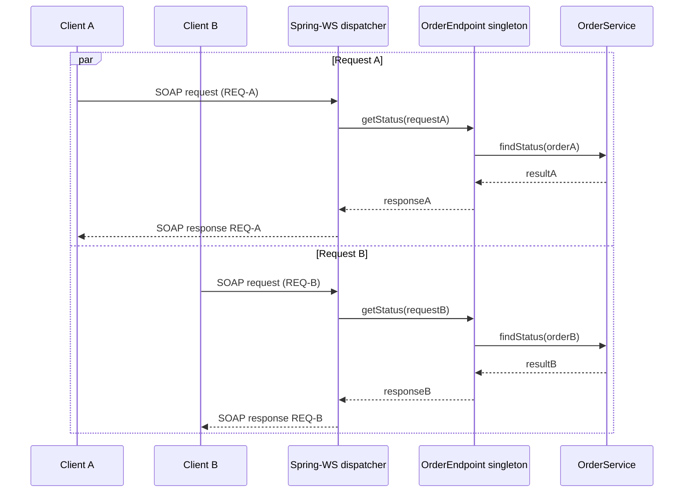
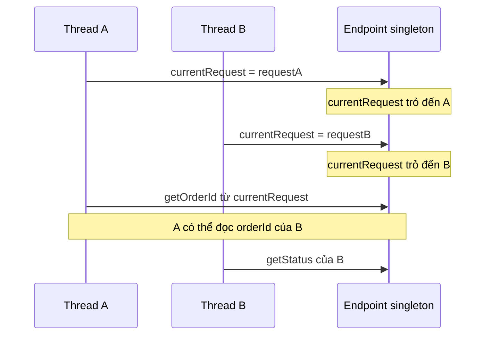
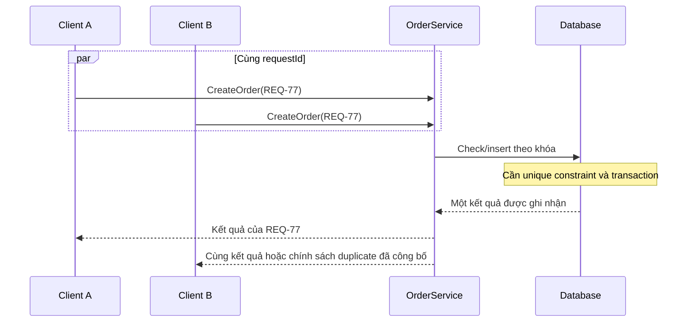
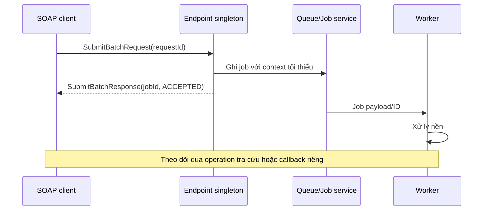

# Endpoint singleton, dữ liệu theo yêu cầu và an toàn luồng

Trong **Spring Web Services (Spring-WS)**, một SOAP endpoint thường là **Spring bean singleton**: chỉ một instance của lớp `@Endpoint` được dùng để phục vụ nhiều yêu cầu trong suốt thời gian ứng dụng chạy. Khi hai hệ thống đối tác gửi SOAP request đồng thời, các lời gọi có thể vào **cùng một object Java** nhưng phải được xử lý với **dữ liệu riêng cho từng yêu cầu**. Nếu endpoint lưu request hiện tại, SOAP Header, token hay response đang xây dựng trong field có thể thay đổi, dữ liệu của khách hàng A có nguy cơ bị trả cho khách hàng B.

Bài học thuộc chương **Xây dựng endpoint** của module **SPRING_WEB_SERVICES**, trong bối cảnh phát triển dịch vụ SOAP **contract-first**: XSD/WSDL xác định QName và cấu trúc thông điệp; JAXB/OXM chuyển XML thành object; endpoint thực hiện nghiệp vụ; interceptor xử lý validation, SOAP Fault, XML security và WS-Security; client dùng hợp đồng để kiểm thử tương thích. Trọng tâm ở đây không phải “làm mọi thứ thành singleton”, mà là **tách vòng đời bean dùng chung khỏi trạng thái thuộc mỗi lần gọi**.

> Nguyên tắc thiết kế: endpoint singleton nên giữ **các dependency đã cấu hình và an toàn đồng thời**, còn request, response, correlation ID, SOAP message, token và bộ đệm xử lý phải thuộc **phạm vi một lời gọi** hoặc một cơ chế scope được quản lý rõ ràng.

## 1. Mục tiêu học tập

Sau bài này, bạn có thể:

- Giải thích sự khác nhau giữa **singleton bean**, **thread**, **HTTP request**, **SOAP message** và **business transaction**.
- Xây dựng `@Endpoint` stateless, dùng `@PayloadRoot` và `@RequestPayload` mà không lưu dữ liệu của request trong instance field.
- Phát hiện race condition và data leakage khi endpoint hoặc service phụ thuộc giữ trạng thái mutable.
- Phân biệt dữ liệu **request-local**, dữ liệu **immutable dùng chung** và tài nguyên **dùng chung có đồng bộ**.
- Sử dụng dependency injection, service/repository, transaction và idempotency phù hợp với nhiều yêu cầu đồng thời.
- Nhận diện các nguy cơ từ JAXB/OXM, SOAP interceptor, WS-Security callback, ThreadLocal và xử lý bất đồng bộ.
- Viết kiểm thử nhiều luồng và kiểm thử SOAP/XSD/WSDL để xác nhận không lẫn dữ liệu giữa request.
- Thiết lập checklist trước khi công bố endpoint cho hệ thống doanh nghiệp.

## 2. Hiểu đúng vòng đời một `@Endpoint` singleton

Spring mặc định tạo bean `@Endpoint` với **singleton scope** nếu không có định nghĩa scope khác. Nghĩa là một instance được quản lý trong một Spring application context, **không có nghĩa** toàn bộ hệ thống chỉ có một bản sao khi ứng dụng chạy nhiều instance/pod hoặc có nhiều application context.



Hai lời gọi có thể xen kẽ trên cùng endpoint instance. Tuy nhiên, tham số Java `requestA` và `requestB` là **hai đối tượng khác nhau** nếu runtime tạo/unmarshal riêng cho mỗi thông điệp. Mỗi phương thức có các biến cục bộ và stack frame riêng; những biến đó không tự chia sẻ chỉ vì hai phương thức chạy trên cùng object.

### Bốn phạm vi cần phân biệt

| Phạm vi | Thường tồn tại bao lâu? | Ví dụ | Nguyên tắc |
|---|---|---|---|
| **Bean singleton** | Vòng đời Spring application context | `OrderEndpoint`, service stateless, marshaller cấu hình | Không giữ trạng thái request mutable trong field. |
| **Thread thực thi** | Theo thread pool; có thể tái sử dụng qua nhiều request | Servlet worker thread | Không coi một thread tương đương với một request mãi mãi. |
| **Một SOAP request** | Từ lúc nhận message đến khi kết thúc xử lý yêu cầu đó | JAXB request DTO, SOAP header, correlation ID, writer | Dữ liệu phải được cô lập khỏi request khác. |
| **Business transaction** | Theo ranh giới transaction được quản lý | Đọc/ghi order, idempotency key | Duy trì atomicity/isolation tại data store, không nhờ field singleton. |

**Singleton khác với thread-safe.** Singleton chỉ là cách quản lý số instance. Một singleton **stateless** thường dễ dùng đồng thời; một singleton có field mutable vẫn có thể tạo race condition. Ngược lại, một dependency dùng chung như connection pool có thể an toàn nhờ cơ chế đồng bộ nội bộ được thiết kế phù hợp.

## 3. Bắt đầu từ XSD/WSDL để thiết kế dữ liệu đúng phạm vi

Trong cách làm **contract-first**, XSD quyết định chính xác hình dạng XML request/response, còn WSDL mô tả operation và liên hệ đến các phần tử toàn cục đó. Không để tên bean hoặc trạng thái trong endpoint tự định nghĩa ngầm API.

Ví dụ tệp `orders-v1.xsd` rút gọn:

```xml
<?xml version="1.0" encoding="UTF-8"?>
<xs:schema
    xmlns:xs="http://www.w3.org/2001/XMLSchema"
    xmlns:ord="https://example.org/contracts/order/v1"
    targetNamespace="https://example.org/contracts/order/v1"
    elementFormDefault="qualified">

    <xs:simpleType name="NonEmptyToken">
        <xs:restriction base="xs:token">
            <xs:minLength value="1"/>
        </xs:restriction>
    </xs:simpleType>

    <xs:element name="GetOrderStatusRequest">
        <xs:complexType>
            <xs:sequence>
                <xs:element name="requestId"
                            type="ord:NonEmptyToken"/>
                <xs:element name="orderId"
                            type="ord:NonEmptyToken"/>
            </xs:sequence>
        </xs:complexType>
    </xs:element>

    <xs:element name="GetOrderStatusResponse">
        <xs:complexType>
            <xs:sequence>
                <xs:element name="requestId"
                            type="ord:NonEmptyToken"/>
                <xs:element name="orderId"
                            type="ord:NonEmptyToken"/>
                <xs:element name="status" type="xs:string"/>
            </xs:sequence>
        </xs:complexType>
    </xs:element>

    <xs:element name="OrderNotFoundFault">
        <xs:complexType>
            <xs:sequence>
                <xs:element name="code" type="ord:NonEmptyToken"/>
                <xs:element name="orderId" type="ord:NonEmptyToken"/>
            </xs:sequence>
        </xs:complexType>
    </xs:element>
</xs:schema>
```

Trong WSDL 1.1, `GetOrderStatus` thường là operation request–response, với `input` tham chiếu WSDL message chứa `wsdl:part element="ord:GetOrderStatusRequest"`, `output` tham chiếu `ord:GetOrderStatusResponse`. Fault nghiệp vụ, nếu được khai báo, liên kết qua `wsdl:fault` đến message có detail element `ord:OrderNotFoundFault`.

```text
WSDL operation: GetOrderStatus
  input:  {https://example.org/contracts/order/v1}GetOrderStatusRequest
  output: {https://example.org/contracts/order/v1}GetOrderStatusResponse
  fault detail (theo contract):
          {https://example.org/contracts/order/v1}OrderNotFoundFault
```

**Đừng nhầm** tên operation `GetOrderStatus` với local name của payload `GetOrderStatusRequest`. Spring-WS thường dùng `@PayloadRoot` để định tuyến theo QName của phần tử trong SOAP Body, không dựa trên instance field, tên phương thức Java hoặc prefix `ord`.

Request SOAP 1.1 minh họa:

```xml
<soap:Envelope
    xmlns:soap="http://schemas.xmlsoap.org/soap/envelope/"
    xmlns:ord="https://example.org/contracts/order/v1">
    <soap:Body>
        <ord:GetOrderStatusRequest>
            <ord:requestId>REQ-A-001</ord:requestId>
            <ord:orderId>ORD-100</ord:orderId>
        </ord:GetOrderStatusRequest>
    </soap:Body>
</soap:Envelope>
```

Trong mỗi lượt xử lý, `requestId` và `orderId` của request này phải đi cùng nhau đến response/Fault, kể cả khi có một request khác đang xử lý.

## 4. Endpoint đúng: dependency dùng chung, dữ liệu request cục bộ

Giả sử các lớp `GetOrderStatusRequest` và `GetOrderStatusResponse` được sinh từ XSD bằng công cụ JAXB tương thích và có mapping root element phù hợp. Endpoint có thể viết:

```java
import org.springframework.ws.server.endpoint.annotation.Endpoint;
import org.springframework.ws.server.endpoint.annotation.PayloadRoot;
import org.springframework.ws.server.endpoint.annotation.RequestPayload;
import org.springframework.ws.server.endpoint.annotation.ResponsePayload;

@Endpoint
public class OrderEndpoint {

    private static final String NS =
        "https://example.org/contracts/order/v1";

    private final OrderQueryService orderQueryService;

    public OrderEndpoint(OrderQueryService orderQueryService) {
        this.orderQueryService = orderQueryService;
    }

    @PayloadRoot(
        namespace = NS,
        localPart = "GetOrderStatusRequest"
    )
    @ResponsePayload
    public GetOrderStatusResponse getStatus(
            @RequestPayload GetOrderStatusRequest request) {

        String orderId = request.getOrderId();
        String requestId = request.getRequestId();

        String status = orderQueryService.getStatus(orderId);

        GetOrderStatusResponse response =
            new GetOrderStatusResponse();

        response.setRequestId(requestId);
        response.setOrderId(orderId);
        response.setStatus(status);

        return response;
    }
}
```

`OrderQueryService` là interface hoặc service nghiệp vụ của dự án với phương thức `getStatus(String orderId)`. Đoạn mã này minh họa chữ ký endpoint; import các lớp JAXB và logic truy cập dữ liệu được lược bớt. Trong một dự án mà XJC sinh `JAXBElement<T>` thay vì lớp có `@XmlRootElement`, signature và cách trả result cần phù hợp `ObjectFactory`/marshaller thực tế.

### Vì sao an toàn hơn?

- `NS` là hằng bất biến, an toàn để dùng chung.
- `orderQueryService` là tham chiếu `final`, được inject một lần; nó không bị gán lại giữa các request.
- `request` do Spring-WS đưa vào phương thức cho lượt SOAP hiện tại; không được lưu vào field của endpoint.
- `orderId`, `requestId`, `status` là biến cục bộ, gắn với invocation hiện tại.
- `response` được tạo mới bên trong method và chỉ trả cho lời gọi đang thực hiện.
- Endpoint không có field `currentRequest`, `lastResponse` hay `currentCustomer` dùng chung.

**Điều kiện quan trọng:** tham chiếu `final` không tự chứng minh rằng bản thân `OrderQueryService` là thread-safe. Nếu service giữ mutable state hoặc sử dụng tài nguyên không an toàn đồng thời, endpoint vẫn có thể hỏng. Phải kiểm tra **toàn bộ chuỗi phụ thuộc**, không chỉ lớp endpoint.

### Phân biệt request-local với immutable

`GetOrderStatusRequest` do JAXB sinh thường là **mutable** vì có getter/setter. Nó vẫn có thể an toàn nếu mỗi lần gọi sở hữu một instance riêng và không cho thread khác sửa trong quá trình xử lý. Không cần ép mọi DTO thành immutable để đạt cô lập request, nhưng **không được đưa DTO mutable vào một cache dùng chung rồi sửa nó đồng thời**.

Một giá trị immutable như `String requestId` có thể được truyền qua nhiều method trong cùng lượt gọi mà không cần khóa. Mối nguy nằm ở việc sử dụng một nơi chứa mutable chung, không phải ở bản thân việc truyền tham số.

## 5. Phản mẫu: field `lastRequest` gây rò dữ liệu chéo

Xem endpoint sau:

```java
@Endpoint
public class UnsafeOrderEndpoint {

    private GetOrderStatusRequest currentRequest;

    @PayloadRoot(
        namespace = "https://example.org/contracts/order/v1",
        localPart = "GetOrderStatusRequest"
    )
    @ResponsePayload
    public GetOrderStatusResponse getStatus(
            @RequestPayload GetOrderStatusRequest request) {

        currentRequest = request;

        String status = orderQueryService.getStatus(
            currentRequest.getOrderId()
        );

        GetOrderStatusResponse response =
            new GetOrderStatusResponse();

        response.setRequestId(currentRequest.getRequestId());
        response.setOrderId(currentRequest.getOrderId());
        response.setStatus(status);

        return response;
    }
}
```

Ví dụ cố tình lược bỏ import/khai báo `orderQueryService` vì mục đích chỉ ra lỗi. Đây là mã **không an toàn khi có hai request đồng thời**:



Ngay cả khi A đã lấy được `status` từ đơn A, nó vẫn có thể lấy `requestId` và `orderId` của B khi xây response. Điều này tạo **data race**, dữ liệu sai hợp đồng và có thể trở thành sự cố bảo mật nếu hai request thuộc hai tổ chức/khách hàng khác nhau.

### `volatile`, `synchronized` hoặc `AtomicReference` có giải quyết đúng không?

Thông thường **không phải giải pháp thiết kế phù hợp**:

- `volatile currentRequest` chỉ giúp quản lý tính nhìn thấy của tham chiếu; thread A vẫn có thể thấy request B.
- `AtomicReference<GetOrderStatusRequest>` làm thao tác ghi/đọc tham chiếu có tính atomic, nhưng vẫn là **một ô lưu duy nhất cho nhiều request**; không cô lập dữ liệu.
- `synchronized` toàn bộ method có thể ngăn xen kẽ trong phạm vi một instance, nhưng tuần tự hóa mọi request, gây nút thắt cổ chai và không bảo đảm độc lập giữa nhiều instance/pod.
- Các khóa thủ công không thay thế giao dịch dữ liệu hoặc cơ chế idempotency.

**Cách sửa đúng ở đây là bỏ field `currentRequest` và dùng tham số + biến cục bộ.** Nếu một tài nguyên thật sự phải dùng chung, hãy thiết kế cơ chế đồng bộ tại **tài nguyên đó**, không khóa toàn bộ SOAP endpoint để bù cho mô hình dữ liệu sai.

## 6. Race condition có thể đến từ service phụ thuộc

Một endpoint stateless vẫn có thể gọi vào service có trạng thái:

```java
@Service
public class UnsafeOrderQueryService
        implements OrderQueryService {

    private String lastOrderId;

    @Override
    public String getStatus(String orderId) {
        lastOrderId = orderId;
        return repository.findStatus(lastOrderId);
    }
}
```

Giữa thao tác gán `lastOrderId` và đọc field, thread khác có thể ghi đè. Dù `OrderEndpoint` không lưu request, việc chia sẻ singleton service này vẫn tạo race condition.

Sửa bằng cách dùng tham số trực tiếp:

```java
@Service
public class OrderQueryServiceImpl
        implements OrderQueryService {

    private final OrderRepository repository;

    public OrderQueryServiceImpl(OrderRepository repository) {
        this.repository = repository;
    }

    @Override
    public String getStatus(String orderId) {
        return repository.findStatus(orderId)
            .orElseThrow(() -> new OrderNotFoundException(orderId));
    }
}
```

Ví dụ giả định `OrderRepository.findStatus` trả `Optional<String>` và `OrderNotFoundException` do ứng dụng định nghĩa. Các phụ thuộc `repository`, `service` được inject một lần; dữ liệu `orderId` chỉ đi qua tham số. `@Service`, `@Transactional` hoặc Spring Data không tự làm an toàn cho mọi mutable field do lập trình viên tự thêm.

### Những field nào có thể hợp lệ trong singleton?

| Loại field | Ví dụ | Đánh giá |
|---|---|---|
| Hằng bất biến | `private static final String NS = "...";` | Phù hợp. |
| Dependency được inject một lần | `private final OrderQueryService service;` | Phù hợp nếu dependency dùng chung an toàn. |
| Cấu hình immutable | `private final Set<String> allowedStatuses;` tạo bản sao bất biến | Phù hợp khi không có mutable object lồng trong. |
| Metric thread-safe | Counter của thư viện metrics | Có thể phù hợp; kiểm tra API và không gắn dữ liệu nhạy cảm. |
| Cache dùng chung | `ConcurrentHashMap<Key, Value>` | Có thể phù hợp nếu khóa, giá trị, eviction, nhất quán và quyền truy cập đúng. |
| Request hiện tại | `private GetOrderStatusRequest request;` | Không phù hợp. |
| Response đang xây | `private StringBuilder responseBuffer;` | Không phù hợp. |
| Token/người dùng hiện tại | `private String currentToken;` | Rủi ro lộ thông tin chéo, không phù hợp. |
| JDBC `Connection`/JPA `EntityManager` thao tác trực tiếp | Instance dùng chung không qua quản lý transaction | Không nên giữ như trạng thái request trong singleton. |

Một collection dùng chung không mặc nhiên sai; câu hỏi là collection dùng cho **dữ liệu chia sẻ đúng nghĩa** hay để chứa **dữ liệu của request hiện tại**. Dùng `ConcurrentHashMap` không biến logic check-then-act thành giao dịch nguyên tử và cũng không ngăn cache key thiếu tenant gây rò dữ liệu.

## 7. Dependency injection, bean scope và request-scoped data

### Constructor injection cho dependency lâu dài

Ưu tiên constructor injection với field `final`:

```java
@Endpoint
public class OrderEndpoint {
    private final OrderQueryService service;
    private final AuditPublisher auditPublisher;

    public OrderEndpoint(
            OrderQueryService service,
            AuditPublisher auditPublisher) {
        this.service = service;
        this.auditPublisher = auditPublisher;
    }
}
```

Hai bean này có thể là singleton nếu thread-safe. Tránh tạo service hoặc SOAP client mới trong mỗi request chỉ để “tránh chia sẻ”, vì cấu hình và connection pool có thể tốn kém. Thay vào đó, chia sẻ dependency phù hợp và cô lập trạng thái của mỗi invocation.

### Khi nào dùng `@RequestScope`?

Trong ứng dụng Spring Web chạy trên servlet HTTP, có thể khai báo một bean request-scoped nếu thực sự cần chia sẻ metadata trong **cùng HTTP request** giữa nhiều thành phần:

```java
import org.springframework.stereotype.Component;
import org.springframework.web.context.annotation.RequestScope;

@Component
@RequestScope
public class RequestAuditContext {

    private String correlationId;

    public String getCorrelationId() {
        return correlationId;
    }

    public void setCorrelationId(String value) {
        this.correlationId = value;
    }
}
```

Nếu singleton cần dùng bean request-scoped, Spring phải giải quyết đúng scope thông qua scoped proxy hoặc `ObjectProvider<RequestAuditContext>` thay vì giữ trực tiếp một instance cụ thể được tạo ngoài request. Mặc định `@RequestScope` có cơ chế proxy theo cấu hình annotation trong môi trường web phù hợp, nhưng hãy kiểm tra behavior thực tế.

**Giới hạn:** `@RequestScope` là scope theo **web request context**; nó không tự tồn tại trên mọi transport SOAP như JMS, và không tự lan sang thread xử lý bất đồng bộ. Không mặc định “SOAP request” luôn là HTTP request hay luôn được xử lý bởi một thread duy nhất.

Trong đa số endpoint đơn giản, **truyền dữ liệu qua tham số** rõ ràng hơn việc tạo một request-scope bean mới. Dùng request scope khi có lợi ích thực tế và đã xác định rõ phạm vi transport.

### ThreadLocal là công cụ, không phải request scope mặc định

Một `ThreadLocal<String>` tách dữ liệu theo thread, nhưng server dùng thread pool và thread có thể được tái sử dụng cho nhiều request liên tiếp. Nếu lưu correlation ID vào ThreadLocal mà không xóa, request sau có thể nhìn thấy giá trị cũ.

```java
try {
    correlationIdHolder.set(correlationId);
    handleMessage();
} finally {
    correlationIdHolder.remove();
}
```

Ví dụ khái niệm này giả định `correlationIdHolder` là `ThreadLocal<String>` thuộc code ứng dụng. Trong xử lý bất đồng bộ, dữ liệu không tự động chuyển sang thread khác; với virtual threads hoặc reactive transport, càng không nên coi thread identity là định danh nghiệp vụ.

Hãy ưu tiên dữ liệu được truyền rõ ràng hoặc context API do framework quản lý, có cleanup chắc chắn kể cả khi phát sinh SOAP Fault.

## 8. SOAP headers, interceptor và WS-Security cũng phải cô lập request

Spring-WS hỗ trợ các `EndpointInterceptor` nhận `MessageContext` và phối hợp tiền xử lý/hậu xử lý SOAP message. Interceptor thường là bean dùng chung, vì vậy cũng không nên giữ header, exception, token hoặc message hiện tại trong field mutable.

**Không an toàn:**

```java
public class UnsafeCorrelationInterceptor
        implements EndpointInterceptor {

    private String lastCorrelationId;

    @Override
    public boolean handleRequest(
            MessageContext messageContext, Object endpoint) {
        lastCorrelationId = readCorrelationId(messageContext);
        return true;
    }

    // Các method interface còn lại bị lược bỏ.
}
```

Không nên coi mã trên là implementation hoàn chỉnh; `EndpointInterceptor` còn có các callback khác theo API. Vấn đề nằm ở field `lastCorrelationId` dùng chung. Nếu một callback khác dùng nó để ghi response header, request đồng thời có thể khiến response của A chứa ID của B.

**Thiết kế phù hợp:** đọc/ghi qua `MessageContext` **của chính lượt gọi**, sử dụng dữ liệu local hoặc context được gắn với message theo API, không ghi vào field interceptor. Với logging, dùng correlation ID trong từng sự kiện thay vì một “last request ID” toàn cục.

### WS-Security và dữ liệu nhạy cảm

WS-Security có thể yêu cầu xác minh `UsernameToken`, `Timestamp`, XML Signature hoặc Encryption. Khi cấu hình `Wss4jSecurityInterceptor` và các callback/crypto liên quan:

- Các **policy**, certificate/keystore configuration và metadata không thay đổi có thể được quản lý chung theo bean scope thích hợp.
- SOAP signature, nonce, token, timestamp và identity của **từng message** không được lưu tạm trong field singleton để request khác tái sử dụng.
- Không lưu plaintext password hoặc token vào log; chỉ ghi mã lỗi/correlation ID đã qua lọc.
- Cần xử lý replay protection và timestamp theo policy; singleton endpoint stateless không tự bảo đảm ngăn replay.
- Chữ ký XML được xác thực trên message theo contract trước khi tin dữ liệu; XSD hợp lệ không đồng nghĩa caller được phép gọi operation.

Bảo mật transport cũng là lớp riêng: TLS/mTLS và chứng chỉ được xác minh trước hoặc tại cổng HTTP/gateway. Một request bị chặn tại TLS/HTTP security có thể chưa hề được đưa vào `@PayloadRoot` hoặc bất kỳ SOAP endpoint nào.

## 9. JAXB/OXM, marshaller và object mutability

Khi dùng JAXB được sinh từ XSD, server/client có thể sử dụng `Jaxb2Marshaller` của Spring OXM hoặc endpoint adapter hỗ trợ JAXB để chuyển SOAP payload qua lại với object Java.

Phân biệt những vòng đời quan trọng:

| Thành phần | Cách dùng phù hợp |
|---|---|
| `JAXBContext` | Metadata JAXB; thường được khởi tạo/cache và chia sẻ. |
| JAXB `Marshaller` | Tạo instance riêng cho từng thao tác marshal; không chia sẻ cùng instance giữa nhiều thread. |
| JAXB `Unmarshaller` | Tạo riêng cho từng thao tác unmarshal; không chia sẻ cùng instance giữa nhiều thread. |
| `Jaxb2Marshaller` | Bean cấu hình lâu dài, thường singleton; không thay context path/schema/properties giữa các request. |
| JAXB request/response DTO | Instance theo từng message, không chỉnh sửa đồng thời khi marshal. |
| `XmlAdapter`/listener có mutable state | Cần stateless hoặc quản lý instance riêng từng lời gọi. |
| XML `Source`/`Result`, reader/writer | Thuộc từng lượt thao tác, đóng tài nguyên theo ownership. |

Ví dụ cấu hình Spring OXM:

```java
import org.springframework.context.annotation.Bean;
import org.springframework.context.annotation.Configuration;
import org.springframework.oxm.jaxb.Jaxb2Marshaller;

@Configuration
public class JaxbConfiguration {

    @Bean
    public Jaxb2Marshaller orderMarshaller() {
        Jaxb2Marshaller marshaller = new Jaxb2Marshaller();
        marshaller.setContextPath("org.example.contract.order");
        return marshaller;
    }
}
```

Package ở đây là ví dụ; nó phải chứa metadata JAXB phù hợp như `ObjectFactory`/`jaxb.index` hoặc sử dụng `setClassesToBeBound(...)`. Không cho endpoint singleton đổi `contextPath` theo tenant trong lúc chạy để dùng chung một mapper cho nhiều namespace: điều này tạo state mutation và race condition.

Trong ứng dụng Spring Boot 3/Spring-WS 4, JAXB thường dùng `jakarta.xml.bind.*`; ở stack cũ có thể là `javax.xml.bind.*`. Riêng `javax.xml.namespace.QName` và `javax.xml.validation.SchemaFactory` thuộc JDK vẫn dùng `javax.xml`.

### Cẩn thận với việc đặt object JAXB vào cache

Ví dụ nguy hiểm:

```java
private final Map<String, GetOrderStatusResponse> cachedResponses =
    new ConcurrentHashMap<>();

// Một thread lấy object response rồi setRequestId(request của nó),
// trong khi thread khác cũng đang trả cùng object này.
```

`ConcurrentHashMap` chỉ làm an toàn hơn cho thao tác cấu trúc map; nó **không tự biến object value mutable thành immutable**. Nếu cache dữ liệu trạng thái chung, hãy cache snapshot immutable và **tạo response JAXB mới cho mỗi request**.

## 10. Transaction, isolation và idempotency khi ghi dữ liệu

Một endpoint stateless **không tự bảo đảm** đúng đắn khi hai request cùng thay đổi một bản ghi. Race condition cũng có thể xảy ra ở **cơ sở dữ liệu**.

Giả sử operation `CreateOrder` nhận `requestId` làm idempotency key. Hai SOAP request trùng ID được gửi gần như đồng thời:



Nếu service làm `if (!exists(requestId)) insert(...)` mà không có constraint/giao dịch phù hợp, cả hai request có thể cùng thấy “chưa tồn tại” rồi tạo hai đơn. Không thể giải quyết lỗi này chỉ bằng cách đặt `synchronized` trên endpoint: có thể có nhiều instance ứng dụng.

Thiết kế thường gồm:

1. **Idempotency key** ổn định được gửi trong contract.
2. **Unique constraint** hoặc cách ghi nguyên tử tại database theo khóa nghiệp vụ phù hợp, có tính đến tenant.
3. **Transaction boundary** trong service/repository, ví dụ `@Transactional` khi phù hợp.
4. Quy tắc trả kết quả cho request trùng, xử lý khác payload cùng ID và cơ chế đối soát khi timeout.
5. Test hai lời gọi đồng thời, kể cả khi chạy nhiều replica ứng dụng.

Ví dụ mức ý tưởng:

```sql
CREATE TABLE order_request (
    tenant_id VARCHAR(64) NOT NULL,
    request_id VARCHAR(64) NOT NULL,
    order_id VARCHAR(64) NOT NULL,
    PRIMARY KEY (tenant_id, request_id)
);
```

Mã SQL là minh họa một bảng lưu định danh đã xử lý; hệ thống thực cần ràng buộc phù hợp loại database, transaction, retention, fingerprint payload và các quan hệ dữ liệu. **Unique key bảo vệ insert trùng**, nhưng chưa tự định nghĩa toàn bộ ngữ nghĩa idempotency, nhất là khi nhiều bước nghiệp vụ hoặc gửi sự kiện ra hệ thống khác.

### Không lưu trạng thái giao dịch trong field endpoint

Không làm:

```java
private OrderEntity currentOrder;
private EntityManager currentEntityManager;
```

rồi thay các field này theo request. Nếu dùng Spring Data/JPA, hãy inject repository hoặc một abstraction được framework quản lý đúng và để transaction/persistence context tuân thủ vòng đời do framework thiết lập. Một `EntityManager` thực có trạng thái không nên được dùng trực tiếp như một đối tượng request mutable trong singleton.

## 11. SOAP Fault: lỗi hiện tại phải được ánh xạ cho đúng request

Nếu đơn hàng không tồn tại, service có thể ném `OrderNotFoundException`. Hệ thống cần quy định điều đó được biểu diễn bằng **SOAP Fault** hay một business response hợp lệ theo WSDL.

Ví dụ một SOAP 1.1 Fault nếu contract có khai báo `OrderNotFoundFault`:

```xml
<soap:Envelope
    xmlns:soap="http://schemas.xmlsoap.org/soap/envelope/"
    xmlns:ord="https://example.org/contracts/order/v1">
    <soap:Body>
        <soap:Fault>
            <faultcode>soap:Client</faultcode>
            <faultstring>Order does not exist</faultstring>
            <detail>
                <ord:OrderNotFoundFault>
                    <ord:code>ORDER_NOT_FOUND</ord:code>
                    <ord:orderId>ORD-404</ord:orderId>
                </ord:OrderNotFoundFault>
            </detail>
        </soap:Fault>
    </soap:Body>
</soap:Envelope>
```

`soap:Fault` là phần tử cấp SOAP protocol. Phần tử `ord:OrderNotFoundFault` trong `detail` có thể được định nghĩa bằng XSD và liên kết từ `wsdl:fault`. Khai báo WSDL **không tự làm** Spring-WS sinh đúng Fault detail; cần `EndpointExceptionResolver` hoặc cơ chế xử lý ngoại lệ tương ứng và test output.

**Quy tắc an toàn đồng thời cho Fault resolver:**

- Không lưu `lastException`, `lastOrderId`, `lastFaultDetail` hay `currentRequestId` trong field mutable.
- Tạo Fault detail mới từ exception và context **của lượt xử lý hiện tại**.
- Không để nội dung Fault của một khách hàng lẫn sang khách hàng khác.
- Không trả stack trace, token, mật khẩu, private key hoặc SQL detail trong SOAP Fault công khai.
- Nếu SOAP 1.2, phải sử dụng cấu trúc Fault tương ứng (`Code`, `Reason`, `Detail`), không dùng nguyên mẫu SOAP 1.1.

HTTP 500 không đủ để xác định SOAP Fault đúng contract. Test phải kiểm tra SOAP Body, QName, fault code và detail thực tế.

## 12. XSD validation, XML security và thứ tự xử lý

Trong một server SOAP tích hợp doanh nghiệp, luồng chức năng có thể gồm:

```text
HTTP/TLS request
  -> SOAP parser / message factory
  -> Endpoint mapping + interceptor theo cấu hình
  -> Kiểm tra WS-Security / SOAP header policy
  -> XSD payload validation
  -> JAXB unmarshalling
  -> @Endpoint + business service/transaction
  -> JAXB marshalling
  -> SOAP response hoặc Fault
```

Đây là **sơ đồ trách nhiệm**, không phải thứ tự cố định của mọi triển khai Spring-WS: một lỗi parser/TLS có thể chặn request trước khi endpoint mapping; interceptor chỉ chạy theo chuỗi framework và cấu hình cụ thể.

### `PayloadValidatingInterceptor` trong Spring-WS

Ví dụ ý tưởng cấu hình validation với schema đã tồn tại:

```java
import java.util.List;

import org.springframework.context.annotation.Configuration;
import org.springframework.ws.config.annotation.WsConfigurer;
import org.springframework.ws.server.EndpointInterceptor;
import org.springframework.ws.soap.server.endpoint.interceptor.PayloadValidatingInterceptor;
import org.springframework.xml.xsd.XsdSchema;

@Configuration
public class SoapValidationConfiguration implements WsConfigurer {

    private final XsdSchema schema;

    public SoapValidationConfiguration(XsdSchema schema) {
        this.schema = schema;
    }

    @Override
    public void addInterceptors(List<EndpointInterceptor> interceptors) {
        PayloadValidatingInterceptor validator =
            new PayloadValidatingInterceptor();
        validator.setXsdSchema(schema);
        validator.setValidateRequest(true);
        validator.setValidateResponse(true);
        interceptors.add(validator);
    }
}
```

`XsdSchema` phải được khai báo bằng bean tải XSD đã phê duyệt từ classpath hoặc nguồn tin cậy. Validation giúp từ chối XML sai kiểu, thiếu phần tử, sai `xs:sequence` hoặc khác QName theo cách áp dụng của interceptor; nhưng **không thể thay thế** kiểm tra quyền truy cập, tồn tại order hoặc transaction.

Một lưu ý về endpoint mapping: nếu QName payload sai khiến Spring-WS **không tìm được endpoint**, chuỗi interceptor được gắn với endpoint có thể chưa có cơ hội chạy. Vì vậy test sai namespace cần xác nhận behavior thực tế, không giả định mọi tình huống đều cho cùng một Fault validation.

### XML parser safety

Một payload hợp lệ theo XSD vẫn có thể chứa rủi ro trong quá trình parse nếu các parser được cấu hình không an toàn. Cần:

- Kiểm soát DTD, external entities và quyền đọc tài nguyên ngoài khi triển khai DOM/SAX/StAX/SAAJ/JAXP.
- Giới hạn kích thước SOAP Body, số phần tử, độ sâu XML, attachments/MTOM tùy môi trường.
- Dùng XSD từ cấu hình tin cậy; không tải schema theo URL do client tùy ý cung cấp.
- Kiểm tra hiệu lực của WS-Security signature/timestamp/token theo policy.
- Kiểm soát logging để không lộ XML chứa dữ liệu cá nhân, token hay chữ ký nhạy cảm.

Đây là các lớp bảo vệ bổ sung; singleton endpoint không tạo ra tính an toàn XML một cách tự động.

## 13. Xử lý bất đồng bộ và công việc kéo dài

Một request SOAP có thể chỉ khởi tạo một công việc rồi trả `ACCEPTED` và một `jobId`. Khi đó lượt SOAP ban đầu vẫn là **request–response** nếu WSDL khai báo output; nhưng công việc thực tế được xử lý ở thread/worker khác.



Để không lẫn dữ liệu request:

- Truyền **job ID, tenant ID, correlation ID và dữ liệu nghiệp vụ cần thiết** một cách tường minh vào job/payload.
- Không chuyển reference đến mutable SOAP message, servlet request, JAXB object đang bị sửa hoặc ThreadLocal có vòng đời chỉ gắn với HTTP request.
- Không trông đợi `@RequestScope` hoặc HTTP security context tự động có mặt ở worker thread.
- Nếu cần security context ở worker, dùng cơ chế propagation được framework hỗ trợ và chỉ truyền thông tin tối thiểu, đúng quyền.
- Xác định transaction boundary và cách xử lý lỗi/retry ở job riêng, không giữ transaction HTTP mở trong suốt xử lý nền.
- Với one-way operation không có business output, hãy thiết kế acknowledgement, retry và cơ chế tra cứu/callback riêng nếu cần xác nhận kết quả.

Một lỗi thường gặp là lambda bất đồng bộ capture một object request mutable rồi endpoint sửa hoặc giải phóng tài nguyên liên quan trước khi worker đọc nó. Tốt hơn, trích xuất các giá trị cần thiết thành command/snapshot riêng và lưu bền vững khi nghiệp vụ yêu cầu.

## 14. Kiểm thử endpoint: từ unit đến nhiều SOAP request đồng thời

Kiểm thử phải bảo đảm hai yêu cầu khác nhau **không làm nhiễm** nhau ở cả data, response, Fault và security.

### 14.1. Unit test trực tiếp một instance endpoint

Giả sử `OrderQueryService` là functional interface với phương thức `String getStatus(String orderId)`. Có thể kiểm tra endpoint stateless với **cùng một instance được gọi đồng thời**:

```java
import static org.junit.jupiter.api.Assertions.assertEquals;

import java.util.ArrayList;
import java.util.List;
import java.util.concurrent.Callable;
import java.util.concurrent.CountDownLatch;
import java.util.concurrent.ExecutorService;
import java.util.concurrent.Executors;
import java.util.concurrent.Future;
import java.util.concurrent.TimeUnit;
import org.junit.jupiter.api.Test;

class OrderEndpointConcurrencyTest {

    @Test
    void parallelRequestsKeepTheirOwnData() throws Exception {
        OrderQueryService service =
            orderId -> "STATUS_FOR_" + orderId;

        OrderEndpoint endpoint = new OrderEndpoint(service);

        ExecutorService pool = Executors.newFixedThreadPool(8);
        CountDownLatch start = new CountDownLatch(1);
        List<Future<GetOrderStatusResponse>> results =
            new ArrayList<>();

        try {
            for (int i = 0; i < 48; i++) {
                final String requestId = "REQ-" + i;
                final String orderId = "ORD-" + i;

                Callable<GetOrderStatusResponse> task = () -> {
                    start.await();

                    GetOrderStatusRequest request =
                        new GetOrderStatusRequest();
                    request.setRequestId(requestId);
                    request.setOrderId(orderId);

                    return endpoint.getStatus(request);
                };

                results.add(pool.submit(task));
            }

            start.countDown();

            for (int i = 0; i < results.size(); i++) {
                GetOrderStatusResponse response =
                    results.get(i).get(10, TimeUnit.SECONDS);

                assertEquals("REQ-" + i, response.getRequestId());
                assertEquals("ORD-" + i, response.getOrderId());
                assertEquals(
                    "STATUS_FOR_ORD-" + i, response.getStatus()
                );
            }
        } finally {
            pool.shutdownNow();
        }
    }
}
```

Đây là **mẫu unit test minh họa**: các lớp JAXB và `OrderQueryService` phải có trong dự án. Nó kiểm tra endpoint Java chạy đồng thời **không chia sẻ response/request field**. Nó **không** kiểm tra SOAP dispatch, XSD, marshalling, HTTP security hoặc database transaction. Race condition vốn không tất định nên một lần chạy pass cũng không chứng minh tuyệt đối; cần kết hợp review và test lặp/tải phù hợp.

### 14.2. Kiểm thử SOAP endpoint qua dispatcher

Dùng **`MockWebServiceClient`** gửi SOAP payload vào cấu hình Spring-WS của ứng dụng. Với request hợp lệ, cần assert:

1. Phần tử đầu tiên của SOAP Body có QName `{https://example.org/contracts/order/v1}GetOrderStatusRequest`.
2. Response có QName `GetOrderStatusResponse` và chứa đúng `requestId`, `orderId` của request.
3. Response hợp lệ với XSD và không chứa dữ liệu của request trước.
4. Nếu request thiếu phần tử bắt buộc, validation từ chối và service không bị gọi theo cấu hình yêu cầu.
5. Nếu service trả lỗi nghiệp vụ, Fault detail đúng QName và chứa orderId của **request lỗi đó**, không phải từ request khác.

Với SOAP client gọi ra ngoài, **`MockWebServiceServer`** kiểm tra payload gửi qua `WebServiceTemplate`, phản hồi/Fault được đọc đúng và callback không dùng chung dữ liệu.

**Cẩn trọng:** không mặc định đối tượng mock test là thread-safe hoặc kiểm thử đồng thời nhiều request bằng một mock context mà framework không bảo đảm. Kiểm thử sự đồng thời của end-to-end SOAP nên ưu tiên các **HTTP client request độc lập** gửi tới server đang chạy thực tế hoặc test harness hỗ trợ concurrency rõ ràng.

### 14.3. Kiểm thử tích hợp đồng thời qua HTTP

Khởi động ứng dụng với servlet mapping thật, dùng nhiều worker gửi các request SOAP có `requestId` và `orderId` khác nhau; sau đó đọc SOAP response bằng XML parser namespace-aware và đối chiếu:

| Điều cần kiểm | Kỳ vọng |
|---|---|
| QName response | Luôn đúng `GetOrderStatusResponse` theo XSD/WSDL. |
| Correlation | `requestId` trả về khớp với request đã gửi. |
| Data isolation | Không có `orderId` hoặc thông tin khách hàng khác. |
| Fault isolation | Fault của request lỗi không xuất hiện ở response thành công của request khác. |
| Security | Token/chữ ký/tenant của A không được tái sử dụng cho B. |
| Không gây tác động phụ | Request validation/security thất bại không ghi dữ liệu. |
| Throughput | Không có khóa toàn endpoint gây tuần tự hóa không cần thiết. |
| Timeout/retry | Idempotency key không bị đổi giữa các lần retry của cùng yêu cầu. |

Nếu có load balancer và nhiều replica, kiểm tra thêm việc lưu state trong bộ nhớ của một instance: request tiếp theo có thể đến replica khác. Những giá trị phải tồn tại lâu dài hoặc được chia sẻ giữa các replica cần dùng data store/queue thích hợp, không dựa vào field của endpoint.

## 15. Các lỗi thực tế và hướng khắc phục

| Triệu chứng | Nguyên nhân khả dĩ | Cách xử lý |
|---|---|---|
| Response A chứa requestId của B | Endpoint giữ `currentRequest`/`lastResponse` trong singleton. | Chỉ dùng method parameters và response object mới. |
| SOAP Fault chứa orderId sai | Resolver/interceptor giữ `lastException` hoặc `lastOrderId`. | Tạo Fault detail riêng từ exception hiện tại. |
| Khi có tải cao, XML thỉnh thoảng hỏng | Chia sẻ JAXB `Marshaller` hoặc `StringWriter` mutable. | Dùng chung `JAXBContext`/mapper được cấu hình, tạo đối tượng xử lý theo lời gọi. |
| Request có thể truy cập dữ liệu tenant khác | Cache key không gồm tenant, context của request trước còn sót. | Phân quyền tại service/data access, khóa cache đầy đủ, xóa context. |
| Retry sau timeout tạo hai đơn | Check-then-insert không atomic, không có idempotency key. | Dùng unique constraint, transaction và chính sách retry/đối soát. |
| Service stateless nhưng transaction chồng lấn | Chia sẻ persistence context/connection mutable không đúng. | Sử dụng repository và transaction manager đúng vòng đời. |
| Interceptor trả token của lượt trước | Field `currentToken` được dùng chung. | Lấy dữ liệu từ MessageContext/credential context riêng mỗi lượt. |
| Xử lý nền mất correlationId | Dựa vào request ThreadLocal/@RequestScope trong worker. | Truyền snapshot/correlation ID rõ ràng vào job. |
| Thread pool tăng memory | ThreadLocal không được cleanup hoặc cache giữ XML/DTO. | `remove()` trong `finally`, giới hạn cache, quản lý resource. |
| Kiểm thử tuần tự pass, production lỗi ngẫu nhiên | Race condition chưa được mô phỏng. | Thêm test đồng thời và rà soát toàn bộ shared state. |
| Prefix thay đổi làm endpoint không match | So prefix như chuỗi, không dùng QName. | So namespace URI + local name theo XML chuẩn. |
| HTTP 401 trước khi vào endpoint | TLS/HTTP authentication policy chặn request. | Kiểm tra security filter/gateway/certificate trước endpoint mapping. |

### Quy trình debug khi nghi lẫn dữ liệu

1. Ghi `requestId` hoặc correlation ID duy nhất (đã qua lọc) tại đầu và cuối mỗi lượt, kèm QName của SOAP payload.
2. Đối chiếu cặp `requestId`–`orderId` ở input, service invocation, DB transaction và output/Fault.
3. Tìm field mutable trong `@Endpoint`, service singleton, interceptor, event handler, listener, adapter và callback.
4. Kiểm tra cache key có bao gồm tenant/version và object value có bị sửa sau khi lấy ra không.
5. Kiểm tra ThreadLocal/scoped context cleanup, đặc biệt nhánh throw exception hoặc SOAP Fault.
6. Chạy lại với request đồng thời có giá trị phân biệt mạnh; kiểm tra sự độc lập của response, Fault và log.
7. Sau khi sửa race condition, chạy kiểm thử XSD/WSDL, authentication/authorization và hiệu năng để tránh phát sinh tác động phụ.

## 16. Tình huống thực hành: endpoint tiếp nhận nhiều tenant

Một hệ thống SOAP xử lý tra cứu đơn hàng của ba công ty đối tác. Endpoint dùng chung trong một ứng dụng, SOAP Header mang định danh/credential đã được xác thực, payload chứa `requestId` và `orderId`. Hệ thống chạy nhiều thread và nhiều replica.

### Thiết kế cần lựa chọn

- **Endpoint**: singleton và stateless; chỉ nhận payload/context tương ứng từng lượt.
- **Service**: stateless hoặc có shared state được đồng bộ đúng; kiểm tra tenant khi truy vấn repository.
- **Payload**: JAXB DTO mới cho request/response; không lưu response đã set requestId trong cache dùng chung.
- **Thông tin xác thực**: do security layer xác minh theo policy; đưa tenant identity đáng tin vào service qua context có phạm vi phù hợp, không tin trường tenant tùy ý trong XML nếu hợp đồng không cho phép.
- **Cache**: khóa phải bao gồm tenant và các thông số tạo nên quyền truy cập; giá trị trả về không được là mutable DTO dùng chung.
- **Audit**: ghi requestId, tenant ID và trạng thái đã qua che dữ liệu; không log token/password hoặc toàn bộ SOAP Header nhạy cảm.
- **Lỗi**: SOAP Fault có correlation ID/chi tiết hợp đồng phù hợp; không rò đơn hàng của tenant khác.
- **Kiểm thử**: chạy các request có cùng orderId nhưng khác tenant để xác minh không lẫn dữ liệu hoặc bỏ qua authorization.

### Câu hỏi tự kiểm tra

1. Vì sao một `@Endpoint` singleton có thể nhận hai request cùng lúc?
2. `final OrderQueryService service` có chứng minh service thread-safe không?
3. Tại sao `volatile currentRequest` không ngăn request A đọc request B?
4. Khi nào một `ConcurrentHashMap` trong service vẫn gây rò dữ liệu?
5. Có nên lưu `GetOrderStatusResponse` mutable vào cache rồi sửa `requestId` theo từng request không?
6. Khác biệt giữa `@RequestScope` và `ThreadLocal` là gì?
7. Tại sao `synchronized getStatus()` không giải quyết trùng đơn trong hệ thống có ba replica?
8. Nếu XSD validation pass nhưng WS-Security signature fail, endpoint có nên thực hiện nghiệp vụ không?
9. Kiểm thử nào giúp xác định SOAP Fault detail không lẫn `orderId` của hai request?
10. Với tác vụ xử lý nền, nên chuyển dữ liệu gì sang worker?

**Gợi ý trả lời:** (1) Spring web/server có thể thực thi nhiều lời gọi trên các worker threads cùng một bean; (2) không, phụ thuộc cũng phải an toàn; (3) tham chiếu vẫn bị ghi đè; (4) thiếu tenant trong cache key hoặc mutable values; (5) không, tạo response mới; (6) request scope do web context quản lý, ThreadLocal theo thread và cần cleanup; (7) khóa chỉ có hiệu lực trong một instance và không thay thế DB atomicity; (8) không, phải tuân theo security policy; (9) test hai lỗi đồng thời và so QName, orderId/correlation; (10) snapshot/correlation/tenant/job ID cần thiết cùng quyền truy cập hợp lệ, không mang servlet request mutable.

## 17. Tổng kết

**Endpoint singleton không đồng nghĩa với endpoint dùng chung dữ liệu yêu cầu.** Một bean `@Endpoint` có thể phục vụ nhiều SOAP request đồng thời nếu nó **stateless** và các dependency dùng chung đều an toàn. Request/response JAXB, correlation ID, SOAP Header, Fault detail và buffer thuộc từng lượt gọi nên được giữ trong **tham số, biến cục bộ hoặc context có vòng đời rõ ràng**, không nằm trong instance field mutable.

Trong Spring Web Services **contract-first**, thread safety phải được bảo đảm từ QName/XSD/WSDL qua marshalling, endpoint, service, transaction, interceptor và WS-Security đến SOAP response/Fault. Kết hợp nguyên tắc cô lập dữ liệu với idempotency ở data store, kiểm thử đồng thời và kiểm thử hợp đồng thực tế sẽ giúp dịch vụ tích hợp doanh nghiệp vừa chính xác, vừa an toàn, vừa có khả năng mở rộng.
