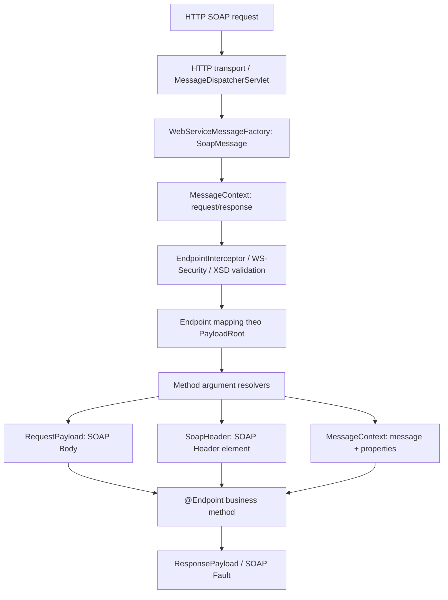

# Nhận tham số bổ sung từ header hoặc MessageContext

Trong một SOAP service, tham số nghiệp vụ chính thường nằm trong **SOAP Body**: mã đơn hàng, danh sách sản phẩm, số lượng hoặc yêu cầu tra cứu. Nhưng một endpoint đôi khi còn cần **thông tin bổ sung** như mã tương quan để truy vết (`correlationId`), mã hệ thống gọi (`clientId`), ngôn ngữ ưu tiên, metadata về người gửi hoặc dữ liệu phục vụ kiểm tra bảo mật. Không phải thông tin nào cũng nên thêm vào XSD của SOAP Body. Spring Web Services (Spring-WS) cho phép đọc **SOAP Header**, nhận **`MessageContext`** trực tiếp trong phương thức endpoint và, khi thực sự cần, truy cập metadata thuộc tầng HTTP transport.

Bài thuộc chương **Xây dựng endpoint** của module **SPRING_WEB_SERVICES**. Mục tiêu là xây dựng dịch vụ SOAP *contract-first* với XSD/WSDL, JAXB, endpoint và SOAP client tương thích, đồng thời xử lý đúng SOAP Fault, interceptor, XML security, WS-Security, chứng chỉ và các điều kiện tích hợp doanh nghiệp. Trọng tâm của bài là **chọn đúng nguồn metadata và không trộn lẫn trách nhiệm giữa Body, SOAP Header, HTTP Header và MessageContext**.

Ví dụ sử dụng Spring-WS với hệ Jakarta (thích hợp cho dòng Spring Framework 6/Spring-WS 4), SOAP 1.1, document/literal. Các QName, URI và giá trị trong ví dụ chỉ minh họa; trong ứng dụng thật phải lấy từ hợp đồng WSDL/XSD và thỏa thuận tích hợp.

## 1. Bốn nơi có thể chứa thông tin liên quan tới một request

Một HTTP request chứa SOAP message có thể đồng thời mang:

```text
HTTP POST /ws
├── HTTP headers
│   ├── Content-Type: text/xml; charset=utf-8
│   ├── SOAPAction: "urn:example:orders:GetOrder"
│   └── X-Correlation-ID: 2dd0-req-10  (nếu hệ thống quy định)
└── HTTP body = SOAP Envelope
    ├── SOAP Header
    │   └── m:RequestContext
    │       ├── m:correlationId
    │       └── m:clientId
    └── SOAP Body
        └── o:GetOrderRequest
            └── o:orderId

Spring-WS runtime
└── MessageContext
    ├── request: WebServiceMessage
    ├── response: WebServiceMessage (nếu đã có)
    └── properties dùng trong phạm vi xử lý message
```

| Nguồn | Bản chất | Khi nào nên sử dụng |
| --- | --- | --- |
| **SOAP Body** | Payload XML nghiệp vụ, được mô tả bởi XSD/WSDL | Dữ liệu chính của operation, ví dụ `orderId` |
| **SOAP Header** | Phần tử XML nằm trong `Envelope/Header`, có QName và có thể có `mustUnderstand` | Metadata ở mức SOAP message, dùng xuyên transport khi hợp đồng quy định |
| **HTTP Header** | Header của HTTP request/response, **không nằm trong SOAP Envelope** | Thông tin transport/gateway như tracing HTTP, media type, action |
| **`MessageContext`** | Đối tượng ngữ cảnh xử lý của Spring-WS trên server/client | Truy cập request/response message, chia sẻ property nội bộ giữa các thành phần xử lý |

**Một property trong `MessageContext` không tự động trở thành SOAP Header hay HTTP Header.** Ngược lại, header do client gửi không trở thành dữ liệu đáng tin cậy chỉ vì nó có tên `clientId` hoặc `userId`. Để lấy một giá trị từ SOAP Header và sử dụng ở tầng nghiệp vụ, ứng dụng phải **đọc, kiểm tra và ánh xạ** giá trị đó.

### 1.1. SOAP Header không phải HTTP Header

Ví dụ SOAP 1.1:

```xml
<s:Envelope xmlns:s="http://schemas.xmlsoap.org/soap/envelope/"
            xmlns:o="https://example.org/orders/v1"
            xmlns:m="https://example.org/orders/meta/v1">
    <s:Header>
        <m:RequestContext>
            <m:correlationId>req-2026-1001</m:correlationId>
            <m:clientId>warehouse-app</m:clientId>
        </m:RequestContext>
    </s:Header>
    <s:Body>
        <o:GetOrderRequest>
            <o:orderId>ORD-1001</o:orderId>
        </o:GetOrderRequest>
    </s:Body>
</s:Envelope>
```

Trong ví dụ, `m:RequestContext` là **phần tử SOAP Header**; `o:GetOrderRequest` là **payload SOAP Body**. Các prefix `m` và `o` chỉ là bí danh; hợp đồng dựa trên cặp **namespace URI + local name**, ví dụ `{https://example.org/orders/meta/v1}RequestContext`.

Một HTTP header như `X-Correlation-ID: req-2026-1001` không xuất hiện trong XML trên. Nếu server muốn chấp nhận cả hai nguồn, cần xác định **nguồn ưu tiên, quyền tin cậy và hành vi khi hai giá trị mâu thuẫn**. Không nên âm thầm trộn chúng.

## 2. Luồng tiếp nhận header và MessageContext trong Spring-WS



Sơ đồ là mô hình khái niệm, không áp đặt thứ tự nội bộ của tất cả interceptor và argument resolver. Những bước như xác minh chữ ký WS-Security, schema validation và giải quyết exception phụ thuộc cấu hình thực tế. Quan trọng là **SOAP message đã được đọc** trước khi endpoint có thể trích xuất header hoặc payload.

Các API liên quan:

| API | Package Spring-WS | Vai trò |
| --- | --- | --- |
| `@Endpoint` | `org.springframework.ws.server.endpoint.annotation` | Đánh dấu bean xử lý SOAP |
| `@PayloadRoot` | `org.springframework.ws.server.endpoint.annotation` | Chọn method theo QName của **Body payload root** |
| `@RequestPayload` | `org.springframework.ws.server.endpoint.annotation` | Ánh xạ XML payload sang tham số method |
| `@ResponsePayload` | `org.springframework.ws.server.endpoint.annotation` | Ánh xạ giá trị trả về thành XML response payload |
| `@SoapHeader` | `org.springframework.ws.soap.server.endpoint.annotation` | Yêu cầu Spring-WS lấy SOAP Header theo QName |
| `SoapHeaderElement` | `org.springframework.ws.soap` | Đối tượng đại diện một phần tử header SOAP |
| `MessageContext` | `org.springframework.ws.context` | Đọc request/response và lưu thuộc tính xử lý |
| `SoapMessage` | `org.springframework.ws.soap` | Biểu diễn SOAP message, truy cập Header/Body/Action |

Đừng nhầm `@SoapHeader` của Spring-WS với `@RequestHeader` trong Spring MVC. `@RequestHeader` thường đọc **HTTP header** trong controller MVC; nó không phải cách đọc XML `<s:Header>` của một phương thức Spring-WS `@Endpoint`.

## 3. Thiết kế metadata theo contract-first: XSD và WSDL

Khi một thông tin bổ sung là một phần **hợp đồng SOAP giữa các đối tác**, nên mô tả rõ QName và cấu trúc header bằng XSD, rồi chỉ ra cách header được gắn với operation trong WSDL nếu hợp đồng sử dụng WSDL 1.1.

### 3.1. XSD của SOAP Body

Ví dụ `orders.xsd`:

```xml
<?xml version="1.0" encoding="UTF-8"?>
<xs:schema xmlns:xs="http://www.w3.org/2001/XMLSchema"
           targetNamespace="https://example.org/orders/v1"
           elementFormDefault="qualified">
    <xs:element name="GetOrderRequest">
        <xs:complexType>
            <xs:sequence>
                <xs:element name="orderId" type="xs:string"/>
            </xs:sequence>
        </xs:complexType>
    </xs:element>

    <xs:element name="GetOrderResponse">
        <xs:complexType>
            <xs:sequence>
                <xs:element name="orderId" type="xs:string"/>
                <xs:element name="status" type="xs:string"/>
            </xs:sequence>
        </xs:complexType>
    </xs:element>
</xs:schema>
```

### 3.2. XSD của SOAP Header

Ví dụ `order-meta.xsd` có **namespace riêng**:

```xml
<?xml version="1.0" encoding="UTF-8"?>
<xs:schema xmlns:xs="http://www.w3.org/2001/XMLSchema"
           targetNamespace="https://example.org/orders/meta/v1"
           elementFormDefault="qualified">
    <xs:element name="RequestContext">
        <xs:complexType>
            <xs:sequence>
                <xs:element name="correlationId" type="xs:string"/>
                <xs:element name="clientId" type="xs:string"
                            minOccurs="0"/>
            </xs:sequence>
        </xs:complexType>
    </xs:element>
</xs:schema>
```

Tách namespace không bắt buộc, nhưng giúp biểu diễn metadata độc lập với phiên bản payload nghiệp vụ. Cần version hóa có kiểm soát nếu hai phía đã ký kết QName header và các trường của nó.

### 3.3. Khai báo `soap:header` trong WSDL 1.1

Các mảnh WSDL minh họa (nằm trong một tài liệu WSDL với những khai báo namespace và phần tử còn lại hợp lệ):

```xml
<!-- xmlns:tns="https://example.org/orders/wsdl/v1"
     xmlns:o="https://example.org/orders/v1"
     xmlns:m="https://example.org/orders/meta/v1"
     xmlns:soap="http://schemas.xmlsoap.org/wsdl/soap/" -->

<wsdl:message name="GetOrderInput">
    <wsdl:part name="parameters" element="o:GetOrderRequest"/>
</wsdl:message>
<wsdl:message name="GetOrderOutput">
    <wsdl:part name="parameters" element="o:GetOrderResponse"/>
</wsdl:message>
<wsdl:message name="RequestContextHeaderMessage">
    <wsdl:part name="context" element="m:RequestContext"/>
</wsdl:message>

<wsdl:binding name="OrdersSoap11Binding" type="tns:OrdersPortType">
    <soap:binding style="document"
                  transport="http://schemas.xmlsoap.org/soap/http"/>
    <wsdl:operation name="GetOrder">
        <soap:operation soapAction="urn:example:orders:GetOrder"/>
        <wsdl:input>
            <soap:body use="literal"/>
            <soap:header
                message="tns:RequestContextHeaderMessage"
                part="context"
                use="literal"/>
        </wsdl:input>
        <wsdl:output>
            <soap:body use="literal"/>
        </wsdl:output>
    </wsdl:operation>
</wsdl:binding>
```

Ví dụ này giả định `OrdersPortType` có operation `GetOrder` và các XSD được nhúng/nhập trong `wsdl:types`. Đây là **fragment giải thích binding**, chưa phải WSDL độc lập. Ý nghĩa:

- `wsdl:message` mô tả **Body input/output** và một **header message** riêng.
- `soap:header` ở `wsdl:input` gắn header message part `context` với lời gọi SOAP.
- `soap:body use="literal"` vẫn mô tả Body theo XSD, không biến `RequestContext` thành trường của `GetOrderRequest`.
- `soap:operation soapAction` là metadata giao thức (đối với SOAP 1.1 qua HTTP), **không phải SOAP Header element**.
- Bản thân `soap:header` không tự xác minh `clientId` hay chữ ký số. Quy tắc header bắt buộc, định dạng và bảo mật cần được mô tả/kiểm thử theo toàn bộ hợp đồng và policy.

Một WSDL chỉ sinh từ XSD bằng quy ước thông thường **không nhất thiết tự sinh** các `soap:header` tùy chỉnh như trên. Với hợp đồng chứa header cụ thể, hãy kiểm tra WSDL công bố thật hoặc chọn WSDL viết sẵn nếu cần kiểm soát binding chính xác.

## 4. Đọc SOAP Header bằng `@SoapHeader`

Spring-WS có annotation `@SoapHeader` để ràng buộc một tham số phương thức endpoint với **phần tử SOAP Header có QName xác định**.

### 4.1. Ví dụ endpoint đọc đúng một header

Giả sử các lớp `GetOrderRequest` và `GetOrderResponse` đã được sinh từ `orders.xsd`. Để tập trung vào header, trước hết đọc element dưới dạng `SoapHeaderElement`:

```java
import org.springframework.ws.server.endpoint.annotation.Endpoint;
import org.springframework.ws.server.endpoint.annotation.PayloadRoot;
import org.springframework.ws.server.endpoint.annotation.RequestPayload;
import org.springframework.ws.server.endpoint.annotation.ResponsePayload;
import org.springframework.ws.soap.SoapHeaderElement;
import org.springframework.ws.soap.server.endpoint.annotation.SoapHeader;

@Endpoint
public class OrdersEndpoint {
    private static final String ORDERS_NS =
            "https://example.org/orders/v1";

    @PayloadRoot(namespace = ORDERS_NS, localPart = "GetOrderRequest")
    @ResponsePayload
    public GetOrderResponse getOrder(
            @RequestPayload GetOrderRequest body,
            @SoapHeader(
                "{https://example.org/orders/meta/v1}RequestContext")
            SoapHeaderElement headerElement) {

        // Header được cung cấp theo QName, không phải HTTP header.
        javax.xml.transform.Source headerXml = headerElement.getSource();

        // Ví dụ thực tế: unmarshal headerXml hoặc xác thực bằng XSD,
        // rồi kết hợp metadata hợp lệ với body.getOrderId().
        return loadOrder(body.getOrderId());
    }

    private GetOrderResponse loadOrder(String id) {
        // Lược giản: gọi service nghiệp vụ và tạo response JAXB.
        return new GetOrderResponse();
    }
}
```

`@SoapHeader` dùng cú pháp QName dạng `{namespaceURI}localPart`. Spring-WS tìm header theo **QName**, nên hai prefix XML khác nhau vẫn cùng header nếu URI và local name giống nhau. Dữ liệu header có thể đọc qua `getSource()` để xử lý XML hoặc unmarshalling bằng JAXB.

Ví dụ `loadOrder` chỉ là placeholder cho nghiệp vụ; lớp response cần được điền các trường hợp đồng trước khi trả về thật. Một hệ thống chạy production cần kiểm tra header có đúng kiểu, độ dài, định dạng và quyền tin cậy hay không.

**Header bị thiếu:** đừng tự giả định rằng resolver luôn truyền `null` rồi cho phép xử lý bình thường. Hành vi xử lý tham số được gắn `@SoapHeader` tùy cơ chế argument resolver và cấu hình. Nếu header **optional**, hoặc muốn trả SOAP Fault riêng khi header thiếu, phương án đọc qua `MessageContext` ở mục 6 cho phép kiểm soát trạng thái rõ ràng hơn.

### 4.2. Ánh xạ header XML thành đối tượng JAXB

Để làm việc với metadata có kiểu, có thể định nghĩa/sinh class JAXB theo `order-meta.xsd`:

```java
import jakarta.xml.bind.annotation.XmlAccessType;
import jakarta.xml.bind.annotation.XmlAccessorType;
import jakarta.xml.bind.annotation.XmlElement;
import jakarta.xml.bind.annotation.XmlRootElement;
import jakarta.xml.bind.annotation.XmlType;

@XmlRootElement(
    name = "RequestContext",
    namespace = "https://example.org/orders/meta/v1")
@XmlAccessorType(XmlAccessType.FIELD)
@XmlType(propOrder = {"correlationId", "clientId"})
public class RequestContext {

    @XmlElement(
        namespace = "https://example.org/orders/meta/v1",
        required = true)
    private String correlationId;

    @XmlElement(namespace = "https://example.org/orders/meta/v1")
    private String clientId;

    public RequestContext() { }

    public RequestContext(String correlationId, String clientId) {
        this.correlationId = correlationId;
        this.clientId = clientId;
    }

    public String getCorrelationId() { return correlationId; }
    public String getClientId() { return clientId; }
}
```

Ví dụ bean JAXB/Spring OXM cho header:

```java
import org.springframework.context.annotation.Bean;
import org.springframework.context.annotation.Configuration;
import org.springframework.core.io.ClassPathResource;
import org.springframework.oxm.jaxb.Jaxb2Marshaller;

@Configuration
public class HeaderXmlConfiguration {

    @Bean
    public Jaxb2Marshaller requestContextMarshaller() {
        Jaxb2Marshaller jaxb = new Jaxb2Marshaller();
        jaxb.setClassesToBeBound(RequestContext.class);
        jaxb.setSchema(new ClassPathResource("xsd/order-meta.xsd"));
        jaxb.setSupportDtd(false);
        jaxb.setProcessExternalEntities(false);
        return jaxb;
    }
}
```

Nhận và unmarshal:

```java
private RequestContext parseRequestContext(
        SoapHeaderElement element,
        Jaxb2Marshaller marshaller) {
    Object value = marshaller.unmarshal(element.getSource());
    if (value instanceof RequestContext context) {
        return context;
    }
    throw new InvalidHeaderException("Unexpected SOAP header root");
}
```

`InvalidHeaderException` là exception nghiệp vụ minh họa cần định nghĩa và ánh xạ lỗi thích hợp. Nếu JAXB generated code không có `@XmlRootElement`, unmarshal có thể trả `JAXBElement<RequestContext>`; xử lý theo `ObjectFactory`/JAXB binding thực tế thay vì ép kiểu cố định. Nếu Spring OXM được cấu hình với schema, nó có thể tham gia validation header tại bước unmarshal; vẫn cần kiểm tra quy tắc nghiệp vụ và chính sách bảo mật riêng.

**Quan trọng:** không dùng JAXB như bộ xác minh chữ ký WS-Security. Chữ ký cần được kiểm tra tại thành phần chuyên trách trước khi coi metadata bảo mật là đáng tin cậy.

## 5. Nhận trực tiếp `MessageContext` trong phương thức endpoint

`MessageContext` là ngữ cảnh xử lý của Spring-WS. Một phương thức endpoint có thể nhận tham số kiểu này cùng với payload:

```java
import org.springframework.ws.context.MessageContext;
import org.springframework.ws.server.endpoint.annotation.Endpoint;
import org.springframework.ws.server.endpoint.annotation.PayloadRoot;
import org.springframework.ws.server.endpoint.annotation.RequestPayload;
import org.springframework.ws.server.endpoint.annotation.ResponsePayload;
import org.springframework.ws.WebServiceMessage;

@Endpoint
public class ContextAwareOrdersEndpoint {
    private static final String NS = "https://example.org/orders/v1";

    @PayloadRoot(namespace = NS, localPart = "GetOrderRequest")
    @ResponsePayload
    public GetOrderResponse get(
            @RequestPayload GetOrderRequest payload,
            MessageContext messageContext) {

        WebServiceMessage inbound = messageContext.getRequest();
        Object tracking = messageContext.getProperty("tracking.correlationId");

        // Trường hợp header thông thường chưa được interceptor xử lý:
        // có thể duyệt SOAP Header qua inbound như mục tiếp theo.
        return loadOrder(payload.getOrderId(), tracking);
    }

    private GetOrderResponse loadOrder(String id, Object tracking) {
        // Service thực tế: kiểm tra quyền, tra cứu, ánh xạ response.
        return new GetOrderResponse();
    }
}
```

`MessageContext#getRequest()` trả một `WebServiceMessage`. Có thể kiểm tra/cast sang `SoapMessage` khi cần API SOAP Header. `getProperty(...)` trả metadata đã được code trong cùng pipeline đặt trước đó (chẳng hạn interceptor), **không tự tìm trường cùng tên trong SOAP Header hoặc HTTP Header**.

Các khái niệm dễ nhầm:

| Thành phần | Ý nghĩa |
| --- | --- |
| `messageContext.getRequest()` | Thông điệp yêu cầu hiện tại, thường là `SoapMessage` với service SOAP |
| `messageContext.getResponse()` | Thông điệp phản hồi trong ngữ cảnh khi được tạo/quản lý |
| `messageContext.hasResponse()` | Cho biết ngữ cảnh đã có response hay chưa |
| `messageContext.setProperty(key, value)` | Đặt dữ liệu phục vụ các bước xử lý cùng message |
| `messageContext.getProperty(key)` | Đọc property nội bộ đã được đặt |

Đừng nhầm `MessageContext` của Spring-WS với `MessageContext` của một framework khác hoặc với đối tượng `jakarta.xml.soap.SOAPMessage`. Ngữ cảnh này **không phải kho lưu trữ bền vững**: không dùng nó để lưu session khách hàng qua nhiều request, làm cache toàn hệ thống hoặc thay thế authentication context đã được xác minh.

### 5.1. Khi nào `MessageContext` tốt hơn `@SoapHeader`?

Sử dụng `@SoapHeader` khi một method cần **một header QName biết trước**. Sử dụng `MessageContext` khi:

- Cần đọc **header tùy chọn** và tự quyết định default/Fault nếu thiếu.
- Cần kiểm tra **nhiều header khác nhau**, hoặc phối hợp giữa header và metadata do interceptor thiết lập.
- Cần truy cập **cả request và response** trong một luồng xử lý đặc biệt.
- Cần đọc một property được tạo bởi interceptor (correlation ID đã chuẩn hóa, thông tin tenant sau xác minh, kết quả kiểm tra policy).
- Muốn tách phân tích header khỏi phương thức nghiệp vụ: interceptor xử lý trước, endpoint chỉ đọc property đã kiểm tra.

Thực hành tốt là endpoint nhận **ít tham số hạ tầng nhất có thể**. Metadata dùng lặp lại ở nhiều endpoint nên được xử lý tập trung, thay vì mỗi method tự parse XML và tự xác thực.

## 6. Duyệt SOAP Header từ `MessageContext`

Khi header optional hoặc yêu cầu chính sách riêng, endpoint hay interceptor có thể đọc `SoapMessage` rồi duyệt các `SoapHeaderElement`.

```java
import java.util.Iterator;
import java.util.Optional;
import javax.xml.namespace.QName;
import org.springframework.ws.WebServiceMessage;
import org.springframework.ws.context.MessageContext;
import org.springframework.ws.soap.SoapHeader;
import org.springframework.ws.soap.SoapHeaderElement;
import org.springframework.ws.soap.SoapMessage;

public final class SoapHeaderLookup {
    private static final QName REQUEST_CONTEXT =
            new QName("https://example.org/orders/meta/v1",
                      "RequestContext");

    private SoapHeaderLookup() { }

    public static Optional<SoapHeaderElement> findRequestContext(
            MessageContext messageContext) {
        WebServiceMessage request = messageContext.getRequest();
        if (!(request instanceof SoapMessage soap)) {
            return Optional.empty();
        }

        SoapHeader header = soap.getSoapHeader();
        Iterator<SoapHeaderElement> items =
                header.examineAllHeaderElements();
        while (items.hasNext()) {
            SoapHeaderElement item = items.next();
            if (REQUEST_CONTEXT.equals(item.getName())) {
                return Optional.of(item);
            }
        }
        return Optional.empty();
    }
}
```

Đoạn mã duyệt các phần tử header để tìm **QName chính xác**. Ứng dụng có thể dùng kết quả:

```java
SoapHeaderElement element = SoapHeaderLookup
        .findRequestContext(messageContext)
        .orElseThrow(() -> new InvalidHeaderException(
                "Missing RequestContext SOAP header"));

RequestContext metadata =
        parseRequestContext(element, requestContextMarshaller);
```

Những dòng trên là phần của một method đã có các biến và helper thích hợp; không phải file Java độc lập. Ví dụ chỉ xử lý **một header cụ thể**. Nếu hợp đồng cho phép nhiều header cùng QName hoặc định nghĩa ordering/role riêng, phải quyết định chính sách nhận trùng, không im lặng lấy phần tử đầu tiên rồi bỏ qua phần còn lại.

Khi header cần được xử lý theo `actor`/`role` của SOAP node, việc chỉ duyệt `examineAllHeaderElements()` cũng chưa đủ để khẳng định mọi phần tử đều **nhắm tới node hiện tại**. SOAP processing và chính sách `mustUnderstand` cần được tôn trọng; nếu thư viện có phương thức lọc theo actor/role thì dùng đúng ngữ nghĩa tương ứng.

### 6.1. Kiểm tra và chuẩn hóa giá trị

Một `correlationId` do client gửi có thể không tin cậy. Quy tắc minh họa:

```java
public final class CorrelationIds {
    private CorrelationIds() { }

    public static String normalize(String value) {
        if (value == null || value.isBlank()) {
            throw new InvalidHeaderException("correlationId is required");
        }
        String id = value.trim();
        if (id.length() > 64 ||
                !id.matches("[A-Za-z0-9._:-]+")) {
            throw new InvalidHeaderException("Invalid correlationId");
        }
        return id;
    }
}
```

Quy tắc ký tự/độ dài này **chỉ là ví dụ**; phải dựa vào hợp đồng của hệ thống. Giới hạn độ dài tránh header quá lớn gây ảnh hưởng logging hoặc tracing. Mã tương quan hữu ích cho quan sát, **không nên được dùng như bằng chứng xác thực người gửi**.

## 7. Interceptor đưa metadata đã kiểm tra vào `MessageContext`

Khi nhiều endpoint cần cùng `correlationId`, có thể viết `EndpointInterceptor` để đọc/kiểm tra một lần, sau đó gắn property cho endpoint sử dụng:

```java
import org.springframework.oxm.jaxb.Jaxb2Marshaller;
import org.springframework.ws.context.MessageContext;
import org.springframework.ws.server.EndpointInterceptor;
import org.springframework.ws.soap.SoapHeaderElement;

public class RequestContextInterceptor implements EndpointInterceptor {
    public static final String CORRELATION_ID_KEY =
            "tracking.correlationId";

    private final Jaxb2Marshaller headerMarshaller;

    public RequestContextInterceptor(Jaxb2Marshaller headerMarshaller) {
        this.headerMarshaller = headerMarshaller;
    }

    @Override
    public boolean handleRequest(MessageContext context, Object endpoint) {
        SoapHeaderElement header = SoapHeaderLookup
                .findRequestContext(context)
                .orElseThrow(() -> new InvalidHeaderException(
                        "Missing RequestContext"));

        Object value = headerMarshaller.unmarshal(header.getSource());
        if (!(value instanceof RequestContext requestContext)) {
            throw new InvalidHeaderException("Invalid header format");
        }

        String id = CorrelationIds.normalize(
                requestContext.getCorrelationId());
        context.setProperty(CORRELATION_ID_KEY, id);
        return true;
    }

    @Override
    public boolean handleResponse(MessageContext context, Object endpoint) {
        return true;
    }

    @Override
    public boolean handleFault(MessageContext context, Object endpoint) {
        return true;
    }

    @Override
    public void afterCompletion(
            MessageContext context, Object endpoint, Exception ex) {
        // Dọn dẹp tài nguyên bên ngoài nếu có; không giữ state giữa request.
    }
}
```

Đoạn mã dùng các helper minh họa ở mục 6, đồng thời giả định `InvalidHeaderException` đã được định nghĩa và exception resolver/handling phù hợp đã cấu hình. Thực tế cần xét tình huống header chưa tồn tại, `JAXBElement<?>`, lỗi schema, header trùng, client không gửi trường bắt buộc và policy về SOAP Fault. Không nên triển khai một interceptor mới để xác minh riêng WS-Security signature khi Spring-WS/WSS4J đã có component chuyên trách.

**Đăng ký interceptor** trong cấu hình Spring-WS:

```java
import java.util.List;
import org.springframework.context.annotation.Configuration;
import org.springframework.ws.config.annotation.EnableWs;
import org.springframework.ws.config.annotation.WsConfigurer;
import org.springframework.ws.server.EndpointInterceptor;

@Configuration
@EnableWs
public class EndpointInterceptorsConfig implements WsConfigurer {

    private final RequestContextInterceptor contextInterceptor;

    public EndpointInterceptorsConfig(
            RequestContextInterceptor contextInterceptor) {
        this.contextInterceptor = contextInterceptor;
    }

    @Override
    public void addInterceptors(List<EndpointInterceptor> interceptors) {
        interceptors.add(contextInterceptor);
    }
}
```

Cần đăng ký `RequestContextInterceptor` thành bean ở một `@Configuration` khác hoặc trong cùng cấu hình, nhận đúng `Jaxb2Marshaller` cho header. Phương thức `addInterceptors` chỉ cho thấy cách thêm interceptor; trong ứng dụng thật, **thứ tự** của interceptor xác thực chữ ký, kiểm tra XSD, kiểm tra quyền và trích xuất metadata phải được thiết kế, thử nghiệm rõ ràng.

### 7.1. Endpoint chỉ lấy property đã chuẩn hóa

```java
@PayloadRoot(
        namespace = "https://example.org/orders/v1",
        localPart = "GetOrderRequest")
@ResponsePayload
public GetOrderResponse handle(
        @RequestPayload GetOrderRequest request,
        MessageContext context) {
    String correlationId = (String)
            context.getProperty(
                    RequestContextInterceptor.CORRELATION_ID_KEY);

    if (correlationId == null) {
        throw new IllegalStateException(
                "Request metadata interceptor was not applied");
    }
    // Gọi service nghiệp vụ và truyền correlationId cho logging/tracing.
    return orderService.getOrder(request.getOrderId(), correlationId);
}
```

Đây là phần phương thức endpoint, cần class `@Endpoint`, `orderService` và cấu hình mapping tương ứng. Lợi ích chính là **giảm coupling**: endpoint không phải biết SOAP Header được parse như thế nào, chỉ nhận giá trị đã qua kiểm tra.

**Không dùng property name phổ biến như `"user"` hoặc `"id"` nếu nhiều interceptor có thể ghi đè nhau.** Dùng key có namespace logic hoặc constant, xác định rõ thành phần nào được quyền tạo và sửa giá trị đó.

## 8. Đọc HTTP Header khi thực sự là metadata vận chuyển

Một số hệ thống truyền mã truy vết bằng HTTP Header `X-Correlation-ID`, `traceparent` hoặc header do API Gateway cấp. Đây là metadata của **HTTP transport**, không phải SOAP Header.

Trong môi trường servlet, Spring-WS có thể truy cập transport context:

```java
import jakarta.servlet.http.HttpServletRequest;
import org.springframework.ws.transport.TransportContext;
import org.springframework.ws.transport.context.TransportContextHolder;
import org.springframework.ws.transport.http.HttpServletConnection;

public final class HttpRequestMetadata {

    private HttpRequestMetadata() { }

    public static String correlationIdFromHttp() {
        TransportContext transport =
                TransportContextHolder.getTransportContext();
        if (transport == null ||
                !(transport.getConnection()
                        instanceof HttpServletConnection connection)) {
            return null;
        }

        HttpServletRequest request =
                connection.getHttpServletRequest();
        return request.getHeader("X-Correlation-ID");
    }
}
```

Ví dụ giả định ứng dụng dùng **servlet-based HTTP transport**. Nếu SOAP request đi qua JMS hoặc transport khác, `HttpServletConnection` có thể không tồn tại; không nên phụ thuộc vào HTTP ở tất cả endpoint nếu hệ thống phải hỗ trợ nhiều transport. Các lớp Java servlet trong Spring Boot 3 thuộc `jakarta.servlet.*`; dự án cũ có thể dùng `javax.servlet.*`.

**Cảnh báo trust boundary:** một HTTP header do client trực tiếp cung cấp có thể bị giả mạo. Nếu gateway được giao nhiệm vụ phát hành ID, gateway cần loại bỏ hoặc ghi đè giá trị do bên ngoài gửi và ứng dụng phải tin đúng nguồn proxy. Với danh tính người dùng, hãy sử dụng kết quả xác thực/ủy quyền đã được xác minh thay vì coi `X-User-ID` hay `clientId` trong SOAP Header là danh tính đã đăng nhập.

### 8.1. Không lạm dụng `MessageContext` để đọc HTTP

`MessageContext` vốn biết `WebServiceMessage` và các property xử lý, không mặc nhiên cung cấp API `getHttpHeader("...")`. Nếu hệ thống cần HTTP metadata, truy cập tầng transport qua API phù hợp hoặc thiết lập một interceptor/filter chuyển **dữ liệu đã được tin cậy** vào property. Việc giữ endpoint độc lập với HTTP giúp tái sử dụng ở transport khác và dễ unit test.

### 8.2. Cần chọn nguồn `correlationId` một cách nhất quán

Một chính sách minh họa:

| Tình huống | Hành vi nên định nghĩa |
| --- | --- |
| SOAP Header hợp lệ, HTTP header trống | Sử dụng SOAP correlation ID nếu hợp đồng cho phép |
| Cả hai có mặt và giống nhau | Ghi nhận một giá trị đã chuẩn hóa |
| Cả hai có mặt nhưng khác nhau | Áp dụng nguồn ưu tiên đã thỏa thuận hoặc từ chối, không tự chọn ngẫu nhiên |
| Cả hai vắng mặt | Nếu tracing cho phép, server tạo ID mới; nếu hợp đồng bắt buộc, trả lỗi thích hợp |
| Header vượt giới hạn / chứa ký tự không hợp lệ | Từ chối hoặc chuẩn hóa theo chính sách trước khi log |
| Header mang danh tính/tenant | Yêu cầu xác thực và kiểm tra quyền riêng, không tin giá trị thô |

Trên thực tế có thể dùng các tiêu chuẩn distributed tracing của hệ thống thay vì một header riêng, nhưng cần giữ nguyên ngữ nghĩa và ranh giới tin cậy giữa client, gateway và SOAP server.

## 9. Trả SOAP Header bổ sung trong response

Nếu hợp đồng yêu cầu server trả `correlationId` để client tra cứu log, không nhất thiết thêm trường đó vào Body. Có thể ghi một phần tử SOAP Header của **response**:

```xml
<s:Envelope xmlns:s="http://schemas.xmlsoap.org/soap/envelope/"
            xmlns:o="https://example.org/orders/v1"
            xmlns:m="https://example.org/orders/meta/v1">
    <s:Header>
        <m:ResponseContext>
            <m:correlationId>req-2026-1001</m:correlationId>
        </m:ResponseContext>
    </s:Header>
    <s:Body>
        <o:GetOrderResponse>
            <o:orderId>ORD-1001</o:orderId>
            <o:status>CONFIRMED</o:status>
        </o:GetOrderResponse>
    </s:Body>
</s:Envelope>
```

Để làm vậy, `ResponseContext` phải được định nghĩa trong XSD/binding/policy nếu nó thuộc hợp đồng chính thức. Server không nên tùy tiện thêm header khiến client có chính sách `mustUnderstand` hoặc parser nghiêm ngặt từ chối.

### 9.1. Truy cập response qua `MessageContext`

Trong interceptor chạy khi response đang được xây dựng, có thể dùng:

```java
import org.springframework.ws.WebServiceMessage;
import org.springframework.ws.context.MessageContext;
import org.springframework.ws.soap.SoapHeader;
import org.springframework.ws.soap.SoapMessage;

public void addResponseHeader(
        MessageContext context,
        javax.xml.transform.Source responseContextSource)
        throws javax.xml.transform.TransformerException {

    if (!context.hasResponse()) {
        return; // Không tự giả định mọi message đều cần một response.
    }
    WebServiceMessage outbound = context.getResponse();
    if (!(outbound instanceof SoapMessage soap)) {
        return;
    }

    SoapHeader header = soap.getSoapHeader();
    javax.xml.transform.Transformer transformer =
            javax.xml.transform.TransformerFactory
                    .newInstance().newTransformer();
    transformer.transform(responseContextSource, header.getResult());
}
```

`responseContextSource` ở ví dụ phải là **XML header fragment đáng tin cậy**, đúng QName và đúng schema. Với dữ liệu động, ưu tiên JAXB marshalling từ một class header đã kiểm tra, thay vì ghép chuỗi XML. Nếu dùng `TransformerFactory` với nguồn XML không tin cậy, phải cấu hình an toàn để ngăn external entity/tài nguyên ngoài.

Tùy vị trí interceptor và vòng đời response, thông điệp có thể đã có hoặc chưa; phải kiểm tra khả năng truy cập và không giả định mọi xử lý một chiều hay lỗi transport đều có một SOAP response.

## 10. Client gửi SOAP Header bổ sung

Để đối tác nhận `RequestContext`, client Spring-WS có thể thêm header trong `WebServiceMessageCallback` khi `WebServiceTemplate` đang tạo outbound SOAP message.

### 10.1. Client dùng JAXB cho Body và Header

Giả định:

- `bodyMarshaller` đã được cấu hình cho `GetOrderRequest`/`GetOrderResponse` trong `WebServiceTemplate`.
- `headerMarshaller` là `Jaxb2Marshaller` của `RequestContext` như mục 4.
- Endpoint SOAP 1.1 và SOAPAction khớp WSDL.

```java
import org.springframework.oxm.jaxb.Jaxb2Marshaller;
import org.springframework.ws.client.core.WebServiceTemplate;
import org.springframework.ws.soap.SoapMessage;

public class OrdersSoapClient {

    private final WebServiceTemplate template;
    private final Jaxb2Marshaller headerMarshaller;
    private final String endpointUri;

    public OrdersSoapClient(WebServiceTemplate template,
                            Jaxb2Marshaller headerMarshaller,
                            String endpointUri) {
        this.template = template;
        this.headerMarshaller = headerMarshaller;
        this.endpointUri = endpointUri;
    }

    public GetOrderResponse getOrder(
            String orderId, String correlationId) {
        GetOrderRequest body = new GetOrderRequest();
        body.setOrderId(orderId);

        RequestContext metadata =
                new RequestContext(correlationId, "warehouse-app");

        Object result = template.marshalSendAndReceive(
                endpointUri,
                body,
                message -> {
                    SoapMessage soap = (SoapMessage) message;
                    soap.setSoapAction("urn:example:orders:GetOrder");
                    headerMarshaller.marshal(
                            metadata,
                            soap.getSoapHeader().getResult());
                });

        return (GetOrderResponse) result;
    }
}
```

`getResult()` của SOAP Header cho phép ghi XML header; JAXB ở đây marshal **phần tử gốc `RequestContext`** vào Header. Không tạo một `SoapHeaderElement RequestContext` trước rồi lại marshal toàn bộ `RequestContext` vào bên trong nó, nếu cách đó làm xuất hiện hai lớp wrapper không đúng schema.

`marshalSendAndReceive` điều phối tạo SOAP Envelope, marshal Body, chạy callback và gửi message qua transport. Callback có thể bị lỗi nếu factory không tạo `SoapMessage` hoặc header marshaller sai QName; cần test chính xác XML được phát ra. Nếu yêu cầu WS-Security, cấu hình interceptor bảo mật riêng và xem thứ tự tạo/biến đổi header để chữ ký bảo vệ đúng phần tử cần thiết.

### 10.2. SOAPAction khác SOAP Header

Trong ví dụ trên, `soap.setSoapAction("urn:example:orders:GetOrder")` đặt **SOAPAction thuộc giao thức SOAP 1.1 qua HTTP**. Nó không chèn thẻ `<SOAPAction>` vào `<s:Header>`. Với SOAP 1.2, action có cách biểu diễn khác ở tầng HTTP/media type; phải tuân thủ binding và phiên bản message factory.

### 10.3. Client đọc response header

Nếu response trả metadata, có thể dùng callback/extractor phù hợp để đọc từ `SoapMessage#getSoapHeader()` rồi unmarshal QName tương ứng. Một `WebServiceTemplate.marshalSendAndReceive(...)` đơn thuần chủ yếu trả về **đối tượng Body payload**; không nên mặc định nó cũng trả mọi SOAP Header dưới dạng field của `GetOrderResponse`.

Nếu ứng dụng cần cả Body và Header, thiết kế một kiểu kết quả nội bộ như `OrderResultWithMetadata` và một callback/extractor giải mã riêng theo API `WebServiceTemplate` phù hợp. Không sửa XSD Body chỉ để “nhét” metadata vốn đã được quy định ở SOAP Header.

## 11. `mustUnderstand`, actor/role và header bắt buộc

SOAP Header có các quy tắc xử lý giao thức quan trọng, không chỉ là XML tùy ý.

Ví dụ SOAP 1.1:

```xml
<s:Header xmlns:s="http://schemas.xmlsoap.org/soap/envelope/"
          xmlns:m="https://example.org/orders/meta/v1">
    <m:RequestContext s:mustUnderstand="1">
        <m:correlationId>req-2026-1001</m:correlationId>
    </m:RequestContext>
</s:Header>
```

Với SOAP 1.1, `mustUnderstand="1"` biểu thị yêu cầu xử lý bắt buộc khi header được nhắm tới SOAP node hiện tại theo các quy tắc SOAP. Nếu node nhận một header bắt buộc mà nó **không hiểu hoặc không thể xử lý theo ngữ nghĩa**, phải thực hiện xử lý lỗi SOAP phù hợp, thường là SOAP Fault `MustUnderstand`.

**Không đồng nhất ba khái niệm:**

1. **Header có mặt hay không:** contract/policy quy định thông điệp cần phần tử nào.
2. **`mustUnderstand`:** yêu cầu xử lý header bởi node được nhắm tới theo SOAP protocol.
3. **Header có hợp lệ và đáng tin hay không:** được quyết định bởi XSD, logic kiểm tra và cơ chế security phù hợp.

Ví dụ một header có thể **có mặt**, được parser hiểu và không yêu cầu `mustUnderstand` nhưng vẫn bị từ chối vì `correlationId` sai định dạng. Ngược lại, `mustUnderstand="1"` không làm một `clientId` tự trở thành người gọi đã xác thực.

### 11.1. SOAP 1.1 `actor` và SOAP 1.2 `role`

SOAP 1.1 sử dụng thuộc tính `actor` để chỉ định node mục tiêu của header; SOAP 1.2 sử dụng `role` và bổ sung các quy tắc như `relay`. Một header dành cho intermediary không nhất thiết được final endpoint xử lý giống header dành cho ultimate receiver.

Đối với hệ thống qua ESB/API Gateway, cần xác định:

- Node nào chịu trách nhiệm xử lý header?
- Node nào phải hiểu header có `mustUnderstand`?
- Header có được chuyển tiếp hay bị gateway xử lý/loại bỏ?
- Phần nào của Header/Body được ký, và việc chuyển tiếp có giữ nguyên chữ ký không?

Đừng chỉ lấy phần tử đầu tiên trong Header rồi bỏ qua `actor/role` hoặc giả định mọi SOAP Header luôn dành cho business endpoint.

## 12. Ranh giới bảo mật: metadata nào được tin?

SOAP Header rất tiện cho metadata nhưng cũng là **dữ liệu do phía gửi điều khiển**, trừ khi có một cơ chế xác minh đáng tin cậy.

| Thông tin | Có thể lấy trực tiếp từ header? | Điều kiện trước khi tin |
| --- | --- | --- |
| `correlationId` | Có, để log/tracing | Kiểm tra định dạng/kích thước; không dùng làm bằng chứng danh tính |
| `locale` | Có thể | Chỉ chấp nhận giá trị trong danh sách hỗ trợ, có fallback |
| `clientId` | Có thể đọc | Phải ánh xạ/đối chiếu với danh tính được xác minh nếu dùng để phân quyền |
| `tenantId` | Có thể đọc | Kiểm tra tenant thuộc quyền truy cập của principal được xác thực |
| Token trong WS-Security Header | Không tự parse rồi tin là hợp lệ | Dùng WS-Security interceptor xác minh token/chữ ký/timestamp |
| Chữ ký XML | Không dựa vào JAXB unmarshalling | Xác minh bằng WSS4J/chính sách ký và truststore phù hợp |
| `X-User-ID` HTTP do gateway gửi | Có thể đọc ở transport | Chỉ tin khi proxy được xác thực, loại bỏ header giả từ client |

Trong Spring-WS, **Wss4jSecurityInterceptor** và các thành phần bảo mật tương thích có thể giúp xác thực/chèn WS-Security theo chính sách. Tầng security cần xử lý signature, token, timestamp và chứng chỉ trước khi thông tin danh tính được coi là hợp lệ. Vai trò của endpoint là sử dụng **identity/claims đã xác minh**, kiểm tra quyền nghiệp vụ, không tự triển khai xác minh chữ ký bằng cách so sánh một trường XML thô.

Đối với SOAP Header có chữ ký, đặc biệt thận trọng với:

- **XML Signature wrapping:** không lấy một phần tử giả mạo chỉ vì QName giống phần tử được ký; phải dựa vào kết quả xác minh và tham chiếu chính xác.
- **XML External Entity (XXE):** giới hạn DTD/external entity khi parse header không tin cậy, kể cả khi đã dùng JAXB.
- **Replay:** nếu policy yêu cầu, xác minh timestamp, nonce, message ID và trạng thái chống phát lại.
- **Truy vết:** không ghi password, security token, private key, SOAP body chứa PII hay toàn bộ chữ ký vào log.
- **TLS và chứng chỉ:** bảo vệ kênh kết nối, hostname/trust chain là lớp khác WS-Security. Một chữ ký hợp lệ không thay thế mọi yêu cầu TLS.

**Thứ tự xử lý cần được thiết kế rõ:** không đưa một `tenantId` do client tự khai báo vào quyền truy cập dữ liệu trước khi kiểm tra principal đã xác minh có quyền với tenant đó.

## 13. Thiết kế SOAP Fault cho header lỗi

Khi header bắt buộc thiếu, sai schema hoặc vi phạm policy, endpoint có thể cần từ chối trước khi chạy nghiệp vụ. Nguồn lỗi khác nhau dẫn đến cách xử lý khác nhau:

| Lỗi | Tầng phát hiện điển hình | Cách phản hồi cần cân nhắc |
| --- | --- | --- |
| Không có SOAP Header theo hợp đồng | Argument resolver/interceptor/endpoint | Fault request theo hợp đồng, không xử lý nghiệp vụ |
| `RequestContext` sai QName | Header resolver/validator | Từ chối hoặc áp dụng default nếu header optional |
| `correlationId` sai độ dài/ký tự | Validation nghiệp vụ của metadata | SOAP Fault có thông tin đủ cho đối tác sửa request |
| Header `mustUnderstand` không được hiểu | SOAP processing | SOAP Fault `MustUnderstand` phù hợp SOAP version |
| Chữ ký WS-Security sai | Security interceptor | Security Fault/từ chối theo policy, không tiết lộ bí mật |
| Header của client thiếu quyền tenant | Authorization layer | Từ chối truy cập, tránh lộ dữ liệu tenant |
| JAXB header unmarshal thất bại | JAXB/OXM | Lỗi ánh xạ hoặc request sai định dạng |
| Lỗi tải XSD/schema hoặc cấu hình server | Infrastructure | Server-side fault/log thích hợp, không đổ lỗi sai cho client |

Trong Spring-WS, có thể cấu hình `SoapFaultMappingExceptionResolver` hoặc cơ chế `@SoapFault`/exception resolver phù hợp để ánh xạ một số exception thành Fault. Với SOAP 1.1, phân biệt Fault code `Client` và `Server`; SOAP 1.2 dùng `Sender` và `Receiver`. Đừng hard-code một Fault code cho mọi lỗi trước khi xác định SOAP version, contract và trình tự xử lý.

**Không gửi nguyên stack trace, token, DN chứng chỉ, đường dẫn filesystem hoặc nội dung chữ ký vào Fault detail**. Consumer cần một mã lỗi ổn định và mô tả hữu ích, còn thông tin nội bộ nên đi vào log đã kiểm soát.

## 14. Kiểm thử header và MessageContext

Một bài test tốt phải xác minh **header trên wire** và **cách endpoint sử dụng metadata**. Nếu chỉ unit-test `getOrder()` với object Java tự tạo thì chưa chứng minh SOAP Header được resolver hoặc interceptor xử lý đúng.

### 14.1. Kiểm thử SOAP request có header

Với `MockWebServiceClient`, có thể tạo request từ XML SOAP payload và thêm header bằng callback theo hỗ trợ của Spring-WS Test:

```java
import static org.springframework.ws.test.server.RequestCreators.*;
import static org.springframework.ws.test.server.ResponseMatchers.*;
import org.springframework.xml.transform.StringSource;
import org.springframework.ws.test.server.MockWebServiceClient;

// Giả định 'client' đã được tạo từ ApplicationContext Spring-WS
// có endpoint, marshaller và các interceptor đã đăng ký.
StringSource requestPayload = new StringSource(
    "<o:GetOrderRequest xmlns:o='https://example.org/orders/v1'>" +
    "<o:orderId>ORD-1001</o:orderId>" +
    "</o:GetOrderRequest>");

client.sendRequest(withPayload(requestPayload))
      .andExpect(noFault());
```

Test trên **chỉ kiểm tra Body happy path**, chưa chứng minh header được truyền. Phải bổ sung callback tạo `SoapMessage`/SOAP Header hoặc chọn cách gửi yêu cầu phù hợp với API Spring-WS Test của phiên bản đang dùng, rồi assert kết quả từ interceptor/endpoint.

Một callback minh họa, tái sử dụng khi tạo message request từ test hoặc client:

```java
import org.springframework.ws.WebServiceMessage;
import org.springframework.ws.client.core.WebServiceMessageCallback;
import org.springframework.ws.soap.SoapMessage;

WebServiceMessageCallback writeHeader = (WebServiceMessage message) -> {
    SoapMessage soap = (SoapMessage) message;
    headerMarshaller.marshal(
            new RequestContext("req-test-1001", "test-client"),
            soap.getSoapHeader().getResult());
};
```

Trong ứng dụng test, `headerMarshaller` phải được khởi tạo, và callback phải được **gắn vào đúng phương thức tạo request/message**; định nghĩa một biến callback không tự làm `client.sendRequest(withPayload(...))` sử dụng nó. Điểm cần kiểm tra là QName, namespace và nội dung XML header thực tế, không chỉ một object `RequestContext` trong code.

### 14.2. Ma trận test cần có

| Ca kiểm thử | Kỳ vọng |
| --- | --- |
| SOAP Body hợp lệ, SOAP Header `RequestContext` hợp lệ | Endpoint nhận đúng request và metadata |
| Cùng QName nhưng dùng prefix XML khác | Header vẫn được nhận |
| Header có cùng local name nhưng **sai namespace URI** | Không khớp QName, bị xử lý theo policy |
| Header bắt buộc không có | Từ chối hoặc phản hồi theo quy ước đã định |
| Header optional không có | Dùng default hoặc server-generated value theo policy |
| `correlationId` sai độ dài/định dạng | Không ghi log thô, từ chối/chuẩn hóa phù hợp |
| Có hai `RequestContext` trùng QName | Xử lý trùng lặp theo quy tắc rõ, không lấy tùy tiện |
| HTTP và SOAP correlation ID mâu thuẫn | Áp dụng precedence hoặc báo lỗi đã định |
| Interceptor đặt property trong MessageContext | Endpoint đọc được property đúng trong request đó |
| Hai request đồng thời có ID khác nhau | Không rò state/metadata giữa request |
| SOAP 1.1 `mustUnderstand="1"` không được xử lý | SOAP Fault `MustUnderstand` theo node/policy |
| Header nhắm tới actor/role khác | Chỉ xử lý/relay theo vai trò SOAP node |
| SOAP Header sai XSD `xs:sequence` | Schema validation của header phát hiện khi được cấu hình |
| Token/chữ ký WS-Security sai | Security interceptor từ chối; endpoint không tin metadata |
| Client thêm SOAP Header bằng JAXB | Trên wire đúng root QName và không có wrapper thừa |
| Server trả SOAP response header | Client đọc được metadata theo binding |
| WSDL công bố có `soap:header` | Codegen/client đối tác có thể hiểu hợp đồng header |

### 14.3. Phân biệt mức độ kiểm thử

- **Unit test JAXB header:** marshal/unmarshal `RequestContext` và validate `order-meta.xsd`.
- **Endpoint test:** kiểm tra `@SoapHeader` và `MessageContext` khi endpoint được dispatch.
- **Interceptor test:** kiểm tra thiếu header, header lỗi, property và thứ tự xử lý.
- **Client test:** dùng `MockWebServiceServer` hoặc capture SOAP message để xác minh outbound Header/Body.
- **Integration test HTTP:** quan sát cả SOAP XML, HTTP `SOAPAction`/`Content-Type`, proxy headers, TLS và response/Fault.
- **Security integration test:** chữ ký/chứng chỉ đúng và sai, truststore, signed parts, timestamp và quyền truy cập tenant.

Các mock không thay thế việc kiểm thử kết nối HTTP/TLS thực tế hoặc xác minh chữ ký với cấu hình WS-Security production.

## 15. Chẩn đoán sự cố thường gặp

| Triệu chứng | Nguyên nhân có thể | Hướng kiểm tra |
| --- | --- | --- |
| `@SoapHeader` không nhận được phần tử | Sai QName, namespace URI, header không nằm trong SOAP Header | Đọc SOAP Envelope thật; kiểm tra QName, không chỉ prefix |
| Body được unmarshal nhưng header thiếu | Client chỉ marshal Body, callback chưa ghi Header | Inspect SOAP Envelope gửi ra |
| Header được đọc nhưng JAXB cast lỗi | Generated class trả `JAXBElement` hoặc root khác | Kiểm tra `@XmlRootElement`, `ObjectFactory`, loại kết quả |
| `MessageContext#getProperty(...)` trả `null` | Interceptor chưa chạy, key sai hoặc không đặt property | Kiểm tra đăng ký/order/return value của interceptor |
| `correlationId` giữa hai request bị lẫn | Lưu state vào singleton field/ThreadLocal không được dọn | Dùng property per-message, tránh mutable shared state |
| `HttpServletConnection` không tồn tại | Không dùng servlet HTTP transport | Không ép mọi endpoint phụ thuộc vào HTTP API |
| `X-Correlation-ID` HTTP không khớp SOAP Header | Gateway rewrite/tracing convention khác | Xác định nguồn ưu tiên và chính sách mâu thuẫn |
| SOAP Fault `MustUnderstand` | Node không xử lý một mandatory header dành cho mình | Kiểm tra role/actor, interceptor và binding |
| XML parse thành công nhưng header không hợp lệ | XSD validation chưa bật hoặc chỉ validate Body | Bổ sung validation riêng cho Header |
| Header `clientId` đúng nhưng authorization vẫn thất bại | Danh tính chưa được xác thực hoặc tenant không thuộc quyền | Kiểm tra WS-Security principal/authorization |
| Chữ ký WS-Security sai sau khi thêm header | Thay đổi XML sau khi ký hoặc signed parts không khớp | Kiểm tra thứ tự callback/interceptor, policy và canonicalization |
| SOAP Action đúng nhưng endpoint không chạy | `@PayloadRoot` khớp Body QName, không chỉ HTTP SOAPAction | Kiểm tra mapping, SOAP version và endpoint adapter |

**Quy trình chẩn đoán:** (1) capture SOAP Envelope thực tế; (2) xác nhận header ở đúng `<s:Header>` và đúng QName; (3) kiểm tra interceptor/resolver; (4) xác minh XSD, policy và các exception mapping; (5) mới xem xét nghiệp vụ. Nếu request chưa được parse thành SOAP message do sai Envelope/SOAP version, lỗi nằm trước bước endpoint đọc header.

## 16. Bài tập tự kiểm tra

**Câu 1.** Một client gửi `X-Correlation-ID` trên HTTP nhưng không có `m:RequestContext` trong SOAP Header. Method dùng `@SoapHeader` có tự đọc được HTTP header đó không?

**Đáp án:** Không. `@SoapHeader` ràng buộc một SOAP Header element theo QName, không đọc HTTP header. Muốn đọc HTTP metadata cần API transport hoặc một bộ chuyển đổi được cấu hình rõ.

**Câu 2.** SOAP Header ghi `<x:RequestContext xmlns:x="https://example.org/orders/meta/v1">`, còn annotation dùng QName `{https://example.org/orders/meta/v1}RequestContext`. Có khớp không?

**Đáp án:** Có. Prefix `x` không quyết định QName; namespace URI và local name mới quan trọng.

**Câu 3.** Vì sao nên đặt `correlationId` đã chuẩn hóa vào `MessageContext` thay vì mỗi endpoint tự unmarshal SOAP Header?

**Đáp án:** Tái sử dụng logic kiểm tra, giảm lỗi không nhất quán, giúp endpoint tập trung vào nghiệp vụ và giữ metadata theo từng message. Vẫn cần quy định interceptor nào tạo property và thứ tự chạy.

**Câu 4.** `MessageContext#setProperty("clientId", ...)` có tạo thẻ `<clientId>` trong SOAP response không?

**Đáp án:** Không. Property chỉ tồn tại trong ngữ cảnh Spring-WS; muốn gửi thông tin tới client phải ghi vào SOAP Header hoặc Body theo hợp đồng.

**Câu 5.** Header có `mustUnderstand="1"` nghĩa là `clientId` được xác thực?

**Đáp án:** Không. `mustUnderstand` là quy tắc SOAP về việc node mục tiêu phải hiểu và xử lý header, không phải cơ chế chứng minh danh tính hay xác minh chữ ký.

**Câu 6.** Một XML Header đã được JAXB unmarshal thành công có thể được dùng ngay để phân quyền tenant không?

**Đáp án:** Không nên. Cần xác minh người gọi, chữ ký/token khi có policy, rồi đối chiếu tenant với quyền của identity đã xác thực. JAXB chỉ ánh xạ XML sang object.

**Câu 7.** Khi dùng `WebServiceTemplate.marshalSendAndReceive(...)`, response JAXB object có tự chứa SOAP Header không?

**Đáp án:** Không mặc định. API thường trả object được unmarshal từ Body. Muốn đọc response header cần callback/extractor hoặc logic truy cập `SoapMessage` tương ứng.

**Câu 8.** Vì sao không nên thêm `RequestContext` vào Body XSD chỉ vì endpoint muốn lấy thêm `correlationId`?

**Đáp án:** Điều đó làm thay đổi hợp đồng payload nghiệp vụ và có thể phá vỡ client cũ. Nếu metadata thuộc mức message và đã được quy định bằng SOAP Header, nên sử dụng header đúng contract; nếu thật sự là dữ liệu nghiệp vụ, mới xem xét Body.

**Câu 9.** Một SOAP Header có tên đúng nhưng nằm dưới SOAP Body. `@SoapHeader` có nhận nó như Header không?

**Đáp án:** Không. Vị trí trong Envelope là một phần ngữ nghĩa SOAP. Phần tử dưới Body là payload/body content, không phải SOAP Header block.

**Câu 10.** Có nên giữ `correlationId` của request gần nhất trong field của một `@Endpoint` singleton để endpoint khác dùng không?

**Đáp án:** Không. Singleton có thể xử lý nhiều request đồng thời; dữ liệu sẽ rò/race giữa request. Dùng `MessageContext` của request hoặc context tracing được quản lý đúng vòng đời.

## Ghi nhớ

- **SOAP Body là dữ liệu nghiệp vụ; SOAP Header là metadata XML ở tầng SOAP; HTTP Header là metadata transport; `MessageContext` là ngữ cảnh nội bộ Spring-WS.** Không đồng nhất bốn nguồn này.
- **`@SoapHeader("{namespace}localPart")`** thuận tiện cho một header biết trước; **`MessageContext`** phù hợp khi cần duyệt header, kiểm tra tính tùy chọn hoặc đọc property do interceptor cung cấp.
- **`SoapHeaderElement#getSource()`** cho phép JAXB/OXM đọc header XML, nhưng unmarshalling không tự xác thực danh tính, chữ ký hoặc mọi quy tắc hợp đồng.
- **Interceptor giúp chuẩn hóa metadata một lần** trước khi endpoint dùng; property trong `MessageContext` không tự được truyền tới client.
- **`mustUnderstand` và `actor/role` có ý nghĩa giao thức SOAP riêng.** Chúng không thay thế schema validation, quyền truy cập hoặc WS-Security.
- **Kiểm thử cả request và response trên wire**: QName, Header/Body, WSDL `soap:header`, HTTP action, SOAP Fault, chứng chỉ và chữ ký để tránh lỗi tích hợp giữa các hệ thống.
