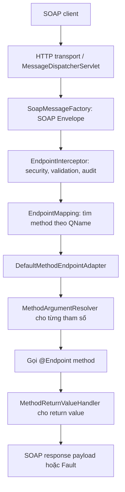
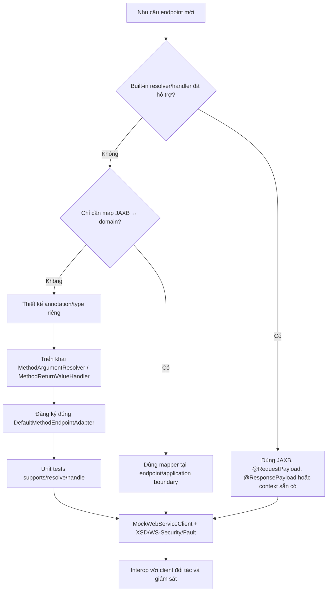

# MethodArgumentResolver và MethodReturnValueHandler tùy chỉnh

## 1. Khi nào một SOAP endpoint cần mở rộng cách nhận tham số và xử lý kết quả?

Với Spring Web Services (Spring-WS), một endpoint theo hướng **contract-first** thường có chữ ký rất đơn giản:

```java
@PayloadRoot(namespace = NS, localPart = "GetOrderRequest")
@ResponsePayload
public GetOrderResponse getOrder(
        @RequestPayload GetOrderRequest request) {
    // Xử lý nghiệp vụ và tạo JAXB response.
}
```

`GetOrderRequest` và `GetOrderResponse` là lớp JAXB sinh từ XSD. Spring-WS biết cách tìm phần tử XML trong SOAP Body, unmarshal thành request object và marshal response object. Nhưng những hệ thống doanh nghiệp thường có nhu cầu vượt ra ngoài chữ ký cơ bản:

- Endpoint muốn nhận một `PartnerIdentity` **đã xác thực** như tham số, không muốn từng method tự đọc chứng chỉ hoặc WS-Security Header.
- Nhiều operation cần một object chứa thông tin correlation, tenant hoặc ngữ cảnh xử lý request.
- Endpoint muốn trả một kiểu kết quả ứng dụng như `OrderOutcome`, còn lớp SOAP boundary chịu trách nhiệm dựng JAXB response.
- Một loại response đặc biệt cần quy tắc ghi payload hoặc metadata riêng, nhất quán giữa nhiều endpoint.

Trong các trường hợp đó, Spring-WS có hai điểm mở rộng ở **tầng gọi method endpoint**:

1. **`MethodArgumentResolver`:** quyết định có hỗ trợ tham số Java của method không và tạo giá trị cho tham số đó từ `MessageContext`.
2. **`MethodReturnValueHandler`:** quyết định có hỗ trợ kiểu trả về của method không và xử lý giá trị được trả để tạo nội dung response.

Chúng **không thay thế XSD/WSDL**, không tự thay SOAP version, không xác minh chữ ký XML và không nên gánh nghiệp vụ. Trong module **SPRING_WEB_SERVICES**, đây là một phần của chương **Xây dựng endpoint**: dùng các cơ chế mở rộng của Spring-WS mà vẫn giữ kiến trúc contract-first, tương thích JAXB, SOAP Fault, interceptor, XML security, WS-Security và kiểm thử liên thông.

**Mục tiêu sau bài học:** phân biệt resolver/handler với endpoint mapper và interceptor; viết được extension có điều kiện hỗ trợ chặt chẽ; hiểu cách đăng ký vào `DefaultMethodEndpointAdapter`; xử lý lỗi an toàn; và kiểm thử từ unit đến request SOAP thực.

## 2. Resolver và handler nằm ở vị trí nào?



Ví dụ method:

```java
public OrderOutcome getOrder(
        @CurrentPartner PartnerIdentity partner,
        @RequestPayload GetOrderRequest request)
```

Ở mức ý tưởng:

1. Endpoint mapping chọn method từ QName `GetOrderRequest` trong SOAP Body.
2. Argument resolver tùy chỉnh tạo `PartnerIdentity` cho tham số gắn `@CurrentPartner`.
3. Argument resolver tích hợp sẵn xử lý `@RequestPayload GetOrderRequest` bằng cơ chế phù hợp, chẳng hạn JAXB.
4. Spring-WS gọi method, nhận `OrderOutcome`.
5. Return-value handler tùy chỉnh chuyển `OrderOutcome` thành `GetOrderResponse` đúng XSD và ghi vào SOAP Body.

Một extension sai có thể ảnh hưởng toàn bộ bước invoke: method mapping đã tìm thấy nhưng `DefaultMethodEndpointAdapter` không hỗ trợ kiểu tham số hoặc return type, dẫn đến lỗi adapter, không phải lỗi `@PayloadRoot`.

### 2.1. So sánh với những thành phần gần giống

| Thành phần | Quyết định gì? | Không nên làm gì? |
|---|---|---|
| `EndpointMapping` / `@PayloadRoot` | Method nào xử lý QName của request | Không tự parse chứng chỉ hay dựng domain DTO |
| `MethodArgumentResolver` | Giá trị cho một tham số của method endpoint | Không tạo SOAP response, không thay schema |
| `MethodReturnValueHandler` | Cách xử lý object method trả về | Không điều phối transaction hay gọi service nhiều lần |
| `EndpointInterceptor` | Cross-cutting logic trước/sau endpoint: validation, security, logging | Không nhồi nghiệp vụ từng operation |
| JAXB/`Jaxb2Marshaller` | XML ↔ Java theo hợp đồng | Không tự xác thực/ủy quyền user |
| Domain mapper | Generated DTO ↔ application/domain model | Không thay Envelope hay HTTP headers |
| `SoapFaultMappingExceptionResolver` | Ánh xạ lỗi thành SOAP Fault | Không thay authorization hoặc XML parser security |

**Điểm dễ nhầm:** `MethodArgumentResolver` của **Spring-WS** không phải `HandlerMethodArgumentResolver` của **Spring MVC**. Spring MVC thao tác HTTP/controller qua `NativeWebRequest` và `ModelAndViewContainer`; Spring-WS thao tác `MessageContext` và SOAP endpoint. Không copy interface hoặc cấu hình MVC rồi kỳ vọng có hiệu lực với `@Endpoint`.

## 3. Hai interface Spring-WS cần nắm

Ở các phiên bản Spring-WS hiện đại, điểm mở rộng method endpoint có dạng:

```java
import org.springframework.core.MethodParameter;
import org.springframework.ws.context.MessageContext;
import org.springframework.ws.server.endpoint.adapter.method.MethodArgumentResolver;
import org.springframework.ws.server.endpoint.adapter.method.MethodReturnValueHandler;

// Chữ ký API, chỉ nhằm minh họa; không khai báo lại các interface này.
interface ArgumentResolverShape {
    boolean supportsParameter(MethodParameter parameter);
    Object resolveArgument(MessageContext context,
                           MethodParameter parameter) throws Exception;
}

interface ReturnHandlerShape {
    boolean supportsReturnType(MethodParameter returnType);
    void handleReturnValue(MessageContext context,
                           MethodParameter returnType,
                           Object value) throws Exception;
}
```

Khi triển khai thực tế, **implement interface có sẵn của Spring-WS**, không tạo hai interface minh họa trong project. API chính xác và các điểm cấu hình cần được đối chiếu với phiên bản Spring-WS đã khóa trong build.

### 3.1. `MethodParameter` là gì?

`MethodParameter` của Spring Core mô tả metadata về tham số hoặc return type của method Java:

- Kiểu tham số/kiểu trả về: `getParameterType()`.
- Annotation của tham số: `hasParameterAnnotation(...)`, `getParameterAnnotation(...)`.
- Thông tin method và vị trí tham số.

Vì thế, resolver có thể chọn rất cụ thể: chỉ nhận tham số **kiểu `PartnerIdentity` có annotation `@CurrentPartner`**, không can thiệp mọi tham số `String` hoặc mọi tham số JAXB.

### 3.2. Vì sao `supports...` phải hẹp?

Giả sử resolver khai báo:

```java
// ANTI-PATTERN: nhận tất cả tham số String.
return String.class.equals(parameter.getParameterType());
```

Nó có thể nhận nhầm một `String` mà endpoint muốn trích xuất từ payload, SOAP Header hoặc XPath. Chỉ một extension “quá tham” có thể làm thay đổi hành vi của nhiều operation.

Thiết kế tốt:

- Có annotation riêng hoặc một kiểu wrapper riêng.
- So kiểu Java và annotation cùng lúc.
- Chỉ áp dụng trên đúng method endpoint được thiết kế.
- Khi không hỗ trợ, trả `false` để resolver khác có thể xử lý.
- Không âm thầm tạo giá trị mặc định khi thiếu thông tin bảo mật bắt buộc.

Tương tự, return handler chỉ nên nhận chính xác một loại kết quả do ứng dụng định nghĩa, không khai báo hỗ trợ `Object` hoặc mọi lớp có `@ResponsePayload`.

## 4. Ví dụ contract-first: truy vấn đơn hàng của đối tác

Để viết extension không làm hỏng giao thức, trước hết xác định hợp đồng XML. Giả sử `GetOrder` là một operation SOAP 1.1 hoặc 1.2 được công bố qua WSDL và có XSD:

```xml
<?xml version="1.0" encoding="UTF-8"?>
<xs:schema xmlns:xs="http://www.w3.org/2001/XMLSchema"
           xmlns:tns="urn:example:orders:v1"
           targetNamespace="urn:example:orders:v1"
           elementFormDefault="qualified">

  <xs:element name="GetOrderRequest">
    <xs:complexType>
      <xs:sequence>
        <xs:element name="orderId" type="xs:string"/>
      </xs:sequence>
    </xs:complexType>
  </xs:element>

  <xs:element name="GetOrderResponse">
    <xs:complexType>
      <xs:sequence>
        <xs:element name="orderId" type="xs:string"/>
        <xs:element name="state" type="xs:string"/>
        <xs:element name="updatedAt" type="xs:dateTime"/>
      </xs:sequence>
    </xs:complexType>
  </xs:element>
</xs:schema>
```

Request SOAP 1.1:

```xml
<soap:Envelope xmlns:soap="http://schemas.xmlsoap.org/soap/envelope/"
               xmlns:o="urn:example:orders:v1">
  <soap:Body>
    <o:GetOrderRequest>
      <o:orderId>ORD-1001</o:orderId>
    </o:GetOrderRequest>
  </soap:Body>
</soap:Envelope>
```

Kết quả theo hợp đồng:

```xml
<soap:Envelope xmlns:soap="http://schemas.xmlsoap.org/soap/envelope/"
               xmlns:o="urn:example:orders:v1">
  <soap:Body>
    <o:GetOrderResponse>
      <o:orderId>ORD-1001</o:orderId>
      <o:state>CONFIRMED</o:state>
      <o:updatedAt>2026-11-27T09:30:00+07:00</o:updatedAt>
    </o:GetOrderResponse>
  </soap:Body>
</soap:Envelope>
```

Tham số `PartnerIdentity` **không có trong SOAP Body**: nó phải đến từ thông tin xác thực đã được server chấp nhận, ví dụ cơ chế mTLS hoặc WS-Security tích hợp với hệ thống identity. Return type `OrderOutcome` cũng là **kiểu nội bộ**, không xuất hiện trong WSDL.

Trong pipeline hoàn chỉnh, `SaajSoapMessageFactory`/message factory đọc SOAP, interceptor kiểm tra header và bảo mật, resolver cung cấp tham số, endpoint gọi application service rồi handler ghi XML đúng XSD. XSD/WSDL vẫn là nguồn sự thật của client.

## 5. Tự xây dựng annotation `@CurrentPartner`

Một annotation hẹp giúp thể hiện ý định rõ ở chữ ký endpoint:

```java
package com.example.orders.soap.argument;

import java.lang.annotation.ElementType;
import java.lang.annotation.Retention;
import java.lang.annotation.RetentionPolicy;
import java.lang.annotation.Target;

@Target(ElementType.PARAMETER)
@Retention(RetentionPolicy.RUNTIME)
public @interface CurrentPartner {
}
```

Kiểu dữ liệu được truyền vào endpoint:

```java
package com.example.orders.application.identity;

public record PartnerIdentity(String partnerId) {
    public PartnerIdentity {
        if (partnerId == null || partnerId.isBlank()) {
            throw new IllegalArgumentException("partnerId is required");
        }
    }
}
```

Lợi ích:

- Method nhìn rõ `@CurrentPartner PartnerIdentity` là đối tượng người gọi đã được server xác định.
- Các operation có thể tái sử dụng resolver mà không copy code đọc SOAP Header.
- Nguy cơ “đối tác tự khai `partnerId` trong XML rồi được tin tưởng” được giảm nếu nguồn identity được thiết kế đúng.

**Annotation không có tác dụng xác thực.** Chỉ khi resolver lấy `PartnerIdentity` từ một nguồn đã xác minh thì ý nghĩa của nó mới đúng. Không được biến annotation thành cơ chế tin tưởng một giá trị do client tùy ý gửi.

## 6. Viết `MethodArgumentResolver` tùy chỉnh

Để tránh ghép logic phụ thuộc nhà cung cấp certificate hoặc WS-Security trực tiếp vào resolver, ta định nghĩa một cổng lấy thông tin đối tác đã xác minh.

### 6.1. Nguồn identity được tin cậy

```java
package com.example.orders.soap.security;

import com.example.orders.application.identity.PartnerIdentity;
import org.springframework.ws.context.MessageContext;

public interface VerifiedPartnerSource {
    /**
     * Trả về identity sau khi TLS/mTLS hoặc WS-Security đã
     * được xác minh và ánh xạ theo chính sách ứng dụng.
     * Nếu không có identity đáng tin cậy, phải từ chối.
     */
    PartnerIdentity requireVerifiedPartner(MessageContext messageContext);
}
```

Đây là **port bảo mật**, không phải một implementation xác thực. Một implementation production phải gắn với security context hoặc thông tin identity được thành phần bảo mật đã kiểm chứng cung cấp. Không được triển khai `requireVerifiedPartner` bằng cách đọc thẳng `<partnerId>` trong Body, SOAP Header chưa xác minh hoặc HTTP header do client tự điền.

### 6.2. Resolver với điều kiện hỗ trợ chặt chẽ

```java
package com.example.orders.soap.argument;

import com.example.orders.application.identity.PartnerIdentity;
import com.example.orders.soap.security.VerifiedPartnerSource;
import org.springframework.core.MethodParameter;
import org.springframework.ws.context.MessageContext;
import org.springframework.ws.server.endpoint.adapter.method.MethodArgumentResolver;

public final class CurrentPartnerArgumentResolver
        implements MethodArgumentResolver {

    private final VerifiedPartnerSource verifiedPartnerSource;

    public CurrentPartnerArgumentResolver(
            VerifiedPartnerSource verifiedPartnerSource) {
        this.verifiedPartnerSource = verifiedPartnerSource;
    }

    @Override
    public boolean supportsParameter(MethodParameter parameter) {
        return parameter.hasParameterAnnotation(CurrentPartner.class)
                && PartnerIdentity.class.equals(parameter.getParameterType());
    }

    @Override
    public Object resolveArgument(
            MessageContext messageContext,
            MethodParameter parameter) {

        if (!supportsParameter(parameter)) {
            throw new IllegalArgumentException(
                    "Unsupported @CurrentPartner parameter");
        }

        // Không lấy identity từ XML chưa được xác thực.
        return verifiedPartnerSource.requireVerifiedPartner(messageContext);
    }
}
```

Nhận xét:

1. `supportsParameter(...)` chỉ trả `true` khi vừa có annotation `@CurrentPartner`, vừa đúng kiểu `PartnerIdentity`.
2. `resolveArgument(...)` không tự parse SOAP Body. Nó gọi một nguồn identity được kiểm soát để lấy giá trị.
3. Nếu không thể xác thực đối tác, phải **fail closed** bằng exception được ánh xạ thành lỗi bảo mật thích hợp; không trả `PartnerIdentity("anonymous")` rồi để application đọc dữ liệu.
4. Khi tích hợp thật, đảm bảo cơ chế xác thực chạy **trước khi endpoint được invoke** và không để identity của request trước rò sang request sau.

Ví dụ endpoint:

```java
@PayloadRoot(namespace = NS, localPart = "GetOrderRequest")
@ResponsePayload
public GetOrderResponse getOrder(
        @CurrentPartner PartnerIdentity partner,
        @RequestPayload GetOrderRequest request) {

    OrderSnapshot order = queryService.findForPartner(
            partner.partnerId(), request.getOrderId());
    return mapper.toResponse(order);
}
```

`OrderSnapshot`, `queryService` và `mapper` là các thành phần ứng dụng do dự án định nghĩa. `findForPartner` nên kiểm tra quyền truy cập dữ liệu của `partner`, không chỉ dựa vào việc xác thực thành công ở transport.

### 6.3. Khi nào nên sử dụng một resolver khác?

Không phải mọi tham số ngoài JAXB đều cần custom resolver:

- `MessageContext` hoặc các kiểu context được adapter hỗ trợ sẵn: dùng khả năng tích hợp trước.
- XPath parameter hoặc SOAP header parameter đã có resolver tích hợp phù hợp: ưu tiên built-in, kết hợp schema validation.
- Chuyển generated JAXB DTO thành domain command: thường thích hợp làm trong **mapper/application boundary**, không buộc tạo resolver mới.
- Một giá trị có tính xuyên suốt, được lấy từ nguồn tin cậy và có kiểu chuyên biệt như `PartnerIdentity`: custom resolver có thể mang lại lợi ích đáng kể.

Tránh định nghĩa resolver cho từng field `orderId`, `status`, `amount` của payload JAXB. Nó làm logic parse và cấu trúc XSD phân tán trong nhiều extension, khiến contract-first khó kiểm soát.

## 7. Return handler tùy chỉnh dùng trong trường hợp nào?

Giả sử endpoint muốn trả một kiểu ứng dụng:

```java
package com.example.orders.application;

import java.time.OffsetDateTime;

public record OrderOutcome(
        String orderId,
        String state,
        OffsetDateTime updatedAt) {
}
```

Hợp đồng SOAP vẫn đòi phần tử `GetOrderResponse` trong Body, do JAXB sinh ra từ XSD. Return handler có thể chuyển `OrderOutcome` thành generated response và marshal vào payload.

### 7.1. Vì sao cần handler khi đã có mapper?

**Không phải lúc nào cũng cần.** Chữ ký truyền thống:

```java
@ResponsePayload
public GetOrderResponse getOrder(
        @RequestPayload GetOrderRequest request) {
    OrderOutcome outcome = service.load(request.getOrderId());
    return mapper.toResponse(outcome);
}
```

thường là đủ, dễ hiểu và ít cấu hình. Return handler tùy chỉnh phù hợp khi **nhiều endpoint đều trả cùng một họ kết quả**, có quy tắc serialization thống nhất mà nhóm muốn tập trung lại, hoặc framework nội bộ áp đặt kiểu trả về application-level.

Không nên tạo custom return handler chỉ để tránh một dòng gọi mapper. Nó khiến code endpoint phụ thuộc vào hạ tầng adapter khó quan sát hơn và tăng nhu cầu kiểm thử.

### 7.2. Phân biệt return handler với SOAP Fault

Return handler xử lý **giá trị method trả về bình thường**. Nếu application ném exception, pipeline exception resolver của Spring-WS chịu trách nhiệm xây dựng SOAP Fault. Không nên “nhét lỗi” vào `OrderOutcome` chỉ để handler tự dựng `soap:Fault` bằng chuỗi XML.

Với SOAP 1.1/1.2, Fault có cấu trúc khác nhau; Spring-WS cung cấp abstraction và exception resolver thích hợp để ánh xạ lỗi theo version của message. Thiết kế typed fault detail cần XSD/WSDL riêng nếu consumer yêu cầu.

## 8. Viết `MethodReturnValueHandler` cho `OrderOutcome`

Ví dụ sau minh họa một return handler dùng **Spring OXM marshaller** để xuất generated JAXB response. Nó không tự sửa SOAP Envelope, không quyết định HTTP Content-Type và không gọi lại business service.

### 8.1. Mapper theo hợp đồng

Giả sử mapper xử lý ba trường nghiệp vụ, bao gồm `xs:dateTime`:

```java
package com.example.orders.soap.mapper;

import com.example.orders.application.OrderOutcome;
import com.example.orders.soap.generated.v1.GetOrderResponse;
import javax.xml.datatype.DatatypeConfigurationException;
import javax.xml.datatype.DatatypeFactory;

public final class OrderOutcomeMapper {

    public GetOrderResponse toSoapPayload(OrderOutcome outcome) {
        GetOrderResponse response = new GetOrderResponse();
        response.setOrderId(outcome.orderId());
        response.setState(outcome.state());
        try {
            response.setUpdatedAt(
                    DatatypeFactory.newInstance().newXMLGregorianCalendar(
                            outcome.updatedAt().toString()));
        } catch (DatatypeConfigurationException ex) {
            throw new IllegalStateException(
                    "Cannot create XML date-time", ex);
        }
        return response;
    }
}
```

Ví dụ giả định `GetOrderResponse` là lớp generated có các setter tương ứng và root element JAXB phù hợp. `XMLGregorianCalendar` thuộc `javax.xml.datatype` ngay cả trong stack JAXB Jakarta; cần giữ library JAXB/Spring-WS đồng bộ với JDK đang sử dụng.

`OffsetDateTime` giữ offset nhưng không tự mang IANA zone ID. Nếu domain chỉ cần so thời điểm tuyệt đối, `Instant` có thể phù hợp hơn. Chính sách precision và timezone phải được thống nhất trong hợp đồng XSD/WSDL.

### 8.2. Handler chỉ nhận đúng return type

```java
package com.example.orders.soap.returnvalue;

import com.example.orders.application.OrderOutcome;
import com.example.orders.soap.mapper.OrderOutcomeMapper;
import org.springframework.core.MethodParameter;
import org.springframework.oxm.Marshaller;
import org.springframework.ws.context.MessageContext;
import org.springframework.ws.server.endpoint.adapter.method.MethodReturnValueHandler;

public final class OrderOutcomeReturnValueHandler
        implements MethodReturnValueHandler {

    private final OrderOutcomeMapper mapper;
    private final Marshaller marshaller;

    public OrderOutcomeReturnValueHandler(
            OrderOutcomeMapper mapper, Marshaller marshaller) {
        this.mapper = mapper;
        this.marshaller = marshaller;
    }

    @Override
    public boolean supportsReturnType(MethodParameter returnType) {
        return OrderOutcome.class.equals(returnType.getParameterType());
    }

    @Override
    public void handleReturnValue(
            MessageContext messageContext,
            MethodParameter returnType,
            Object returnValue) throws Exception {

        if (!(returnValue instanceof OrderOutcome outcome)) {
            throw new IllegalStateException(
                    "Expected non-null OrderOutcome");
        }

        var soapPayload = mapper.toSoapPayload(outcome);
        marshaller.marshal(
                soapPayload,
                messageContext.getResponse().getPayloadResult());
    }
}
```

Điểm quan trọng:

- `supportsReturnType` hỗ trợ **đúng `OrderOutcome`**; không can thiệp `String`, `Source`, JAXB class hoặc các return type khác.
- `handleReturnValue` không trả một Java object mới: nó **ghi XML payload** vào response được quản lý trong `MessageContext`.
- `Marshaller` có thể là `Jaxb2Marshaller` được cấu hình theo generated package của XSD v1.
- Nếu generated class không có `@XmlRootElement`, mapper hoặc handler cần dùng `ObjectFactory#createGetOrderResponse(...)` để bọc thành `JAXBElement` có QName đúng trước khi marshal.
- Khi method trả `null` mà hợp đồng không cho phép, ví dụ từ chối với lỗi rõ ràng. Không âm thầm tạo Body rỗng cho operation request-response.

**Đây là điểm mở rộng của Spring-WS, không phải raw HTTP response writer.** Không thêm `<soap:Envelope>` bằng cách marshal cả một chuỗi chứa XML; `getPayloadResult()` đại diện cho vùng payload Body, còn message factory quản lý Envelope và transport.

### 8.3. Endpoint dùng return handler

```java
package com.example.orders.soap.endpoint;

import com.example.orders.application.OrderOutcome;
import com.example.orders.application.OrderQueryService;
import com.example.orders.application.identity.PartnerIdentity;
import com.example.orders.soap.argument.CurrentPartner;
import com.example.orders.soap.generated.v1.GetOrderRequest;
import org.springframework.ws.server.endpoint.annotation.Endpoint;
import org.springframework.ws.server.endpoint.annotation.PayloadRoot;
import org.springframework.ws.server.endpoint.annotation.RequestPayload;

@Endpoint
public class OrderEndpoint {
    private static final String NS = "urn:example:orders:v1";

    private final OrderQueryService queryService;

    public OrderEndpoint(OrderQueryService queryService) {
        this.queryService = queryService;
    }

    @PayloadRoot(namespace = NS, localPart = "GetOrderRequest")
    public OrderOutcome getOrder(
            @CurrentPartner PartnerIdentity partner,
            @RequestPayload GetOrderRequest request) {

        return queryService.findForPartner(
                partner.partnerId(), request.getOrderId());
    }
}
```

Code giả định application service `findForPartner` trả `OrderOutcome` đúng kiểu và đã kiểm tra quyền. Method **không cần phải trả JAXB response trực tiếp** vì custom handler được đăng ký để ghi payload. Nếu custom handler chưa được Spring-WS chọn, method có thể không được adapter hỗ trợ; vì vậy bước đăng ký và integration test là bắt buộc.

## 9. Đăng ký custom resolver và return handler vào Spring-WS

Spring-WS sử dụng `DefaultMethodEndpointAdapter` để gọi các method endpoint phù hợp. Adapter này có danh sách resolver và return handler tích hợp sẵn; một số phiên bản cung cấp các điểm đăng ký **custom method argument resolvers** và **custom method return value handlers**.

### 9.1. Ý tưởng cấu hình

Khi cấu hình chính instance `DefaultMethodEndpointAdapter` mà dispatcher sử dụng, gắn các extension:

```java
// Đoạn cấu hình minh họa, thực hiện khi khởi tạo adapter:
// "adapter" là DefaultMethodEndpointAdapter THẬT của Spring-WS.
// "partnerResolver" và "outcomeHandler" là các bean tùy chỉnh.

adapter.setCustomMethodArgumentResolvers(
        java.util.List.of(partnerResolver));
adapter.setCustomMethodReturnValueHandlers(
        java.util.List.of(outcomeHandler));
```

Tùy phiên bản Spring-WS và cách bật `@EnableWs`/Spring Boot auto-configuration, adapter có thể đã được framework tạo sẵn. Cần dùng **điểm tùy biến được phiên bản hỗ trợ** hoặc cấu hình một adapter đúng và duy nhất trong application context. **Không đơn giản thêm một `new DefaultMethodEndpointAdapter()` sau khi hệ thống đã chạy rồi cho rằng dispatcher sẽ tự sử dụng nó**.

Một cấu hình dạng factory do ứng dụng sở hữu có thể có hình thức:

```java
// Minh họa ý tưởng trong configuration nơi bạn chịu trách nhiệm
// tạo DefaultMethodEndpointAdapter; chưa bao gồm cấu hình servlet/WSDL.
@Bean
public DefaultMethodEndpointAdapter soapMethodEndpointAdapter(
        CurrentPartnerArgumentResolver partnerResolver,
        OrderOutcomeReturnValueHandler outcomeHandler) {

    DefaultMethodEndpointAdapter adapter =
            new DefaultMethodEndpointAdapter();
    adapter.setCustomMethodArgumentResolvers(
            java.util.List.of(partnerResolver));
    adapter.setCustomMethodReturnValueHandlers(
            java.util.List.of(outcomeHandler));
    return adapter;
}
```

Để sử dụng đoạn này phải import `org.springframework.ws.server.endpoint.adapter.DefaultMethodEndpointAdapter` và bảo đảm **không tạo bean adapter trùng với bean đã được `@EnableWs` khai báo**. Nếu Spring-WS auto-configuration trong dự án đã cung cấp adapter, cần **tùy biến bean hiện hữu qua hook cấu hình thích hợp**; không mù quáng copy thêm một adapter vào context. Đặc biệt, các phiên bản framework có thể dùng tên bean hoặc thứ tự adapter khác nhau, vì vậy cần xác nhận bằng integration test rằng extension thật sự được sử dụng.

### 9.2. Đừng ghi đè toàn bộ resolver mặc định

`DefaultMethodEndpointAdapter` có resolver/handler có sẵn để xử lý `@RequestPayload`, `@ResponsePayload`, JAXB, `Source` và nhiều kiểu context. Nếu bạn thay **toàn bộ danh sách mặc định** bằng hai extension tùy chỉnh, endpoint dùng JAXB thông thường có thể ngừng hoạt động.

Khi framework có setter dành riêng cho **custom** resolvers/handlers, hãy ưu tiên cơ chế bổ sung này thay vì thay thế danh sách tích hợp. Kiểm tra chính sách thứ tự:

- Một custom resolver không nên nhận nhầm tham số JAXB hoặc context mặc định.
- Một custom return handler không nên “cướp” mọi `@ResponsePayload`.
- Nếu hai extension đều hỗ trợ cùng một kiểu, hành vi phụ thuộc thứ tự chọn; nên làm `supports...` không giao nhau hoặc đặt quy tắc ưu tiên rõ ràng.
- Nên cấu hình tất cả extension khi khởi tạo bean, không mutate cấu trúc adapter tùy tiện trong lúc đang xử lý request đồng thời.

### 9.3. Cấu hình các bean phụ trợ

Các class ví dụ cần những dependency được ứng dụng cung cấp:

| Bean/thành phần | Nguồn | Chú ý |
|---|---|---|
| `VerifiedPartnerSource` | Adapter bảo mật do dự án triển khai | Chỉ trả identity sau xác thực đáng tin cậy |
| `CurrentPartnerArgumentResolver` | Bean ứng dụng | Nhận `VerifiedPartnerSource` |
| `OrderOutcomeMapper` | Bean mapper ứng dụng | Không lộ domain model vào schema |
| `Jaxb2Marshaller` | Spring OXM | `contextPath` hoặc `classesToBeBound` theo generated JAXB v1 |
| `OrderOutcomeReturnValueHandler` | Bean ứng dụng | Nhận mapper và marshaller |
| `DefaultMethodEndpointAdapter` | Spring-WS infrastructure | Phải là adapter đang được dispatcher sử dụng |

Một kiểu tổ chức thư mục phù hợp:

```text
src/main/java/com/example/orders/
  soap/
    endpoint/OrderEndpoint.java
    argument/CurrentPartner.java
    argument/CurrentPartnerArgumentResolver.java
    returnvalue/OrderOutcomeReturnValueHandler.java
    mapper/OrderOutcomeMapper.java
    security/VerifiedPartnerSource.java
    config/SoapEndpointAdapterConfiguration.java
  application/
    OrderQueryService.java
    OrderOutcome.java
    identity/PartnerIdentity.java
  domain/
    ...
src/main/resources/contracts/orders/v1/orders.xsd
target/generated-sources/jaxb/
  .../GetOrderRequest.java
  .../GetOrderResponse.java
```

Không sửa generated JAXB classes để gắn thêm annotation xử lý argument hoặc return value. Adapter là cầu nối giữa SOAP contract và application model; XSD vẫn được quản lý phiên bản trong `resources/contracts`.

## 10. Cơ chế lựa chọn và lỗi khi adapter không hỗ trợ method

Spring-WS phải tìm được cách xử lý **từng tham số** và **kiểu trả về** của method endpoint. Một method được `@PayloadRoot` mapping chọn vẫn có thể bị từ chối nếu adapter không có resolver hoặc handler phù hợp.

### 10.1. Những tình huống dễ lỗi

| Triệu chứng | Khả năng cao | Cách xác minh |
|---|---|---|
| Có `@PayloadRoot` nhưng không gọi được method | Không có adapter hỗ trợ đủ tham số/return type | Kiểm tra `supportsParameter` và `supportsReturnType` qua unit test |
| `@CurrentPartner` luôn không được inject | Custom resolver không được đăng ký hoặc không thuộc adapter đang chạy | Kiểm tra bean wiring và endpoint integration test |
| JAXB request không unmarshal được sau khi thêm extension | Đã ghi đè resolver tích hợp hoặc cấu hình JAXB hỏng | Bảo toàn resolver mặc định và kiểm tra schema/binding |
| Return handler không chạy dù endpoint trả `OrderOutcome` | Handler không registered hoặc kiểu trả về không khớp | Kiểm tra exact type, thứ tự và log adapter ở test |
| Response SOAP Body rỗng | Handler không ghi payload hoặc method trả null | Kiểm tra `handleReturnValue` và `messageContext.getResponse()` |
| SOAP Body có XML lồng `Envelope` | Handler tự ghi nguyên một SOAP Envelope vào `PayloadResult` | Chỉ marshal global response element vào payload |
| Client báo sai namespace hoặc schema | Mapper/marshaller tạo sai QName, sai thứ tự | Validate response bằng XSD và test golden XML |
| Một endpoint dùng được, endpoint khác lỗi | `supports...` quá rộng hoặc bị thứ tự resolver chi phối | Giới hạn điều kiện theo annotation/type |
| Lỗi bảo mật bị trả thành response thành công | Resolver bịa identity hoặc che exception | Fail closed, map lỗi thành Fault/transport phù hợp |

### 10.2. Return handler nên nhận giá trị bất biến

`OrderOutcome` là record bất biến, dễ kiểm thử và an toàn khi đi qua nhiều tầng. Tránh tạo return handler chung nhận một `Map<String, Object>` tuỳ ý rồi xuất XML dựa vào keys không có trong XSD; điều này phá hợp đồng và làm dữ liệu khó validate.

Nếu muốn nhiều response type có chung cấu trúc, cân nhắc một sealed interface hoặc những marker type phù hợp, nhưng `supportsReturnType` cần xác định được kiểu thực tế và mapping ra đúng global element theo operation. Đừng để tên Java tự quyết định local name SOAP.

## 11. Lỗi, SOAP Fault và ranh giới bảo mật

Một custom resolver/handler chạy ở **tầng adapter** nên được thiết kế với nguyên tắc an toàn:

1. Không đọc và tin thông tin người gọi từ SOAP payload chưa xác minh.
2. Không trả `null` khi hợp đồng yêu cầu identity hoặc response bắt buộc.
3. Không tự nuốt exception và tạo kết quả “thành công” thay thế.
4. Không ghi stack trace, token, bí mật chứng chỉ hoặc nội dung SOAP nhạy cảm vào log.
5. Không tự gán Fault code bằng cách nối chuỗi XML; dùng cơ chế SOAP Fault của Spring-WS.

### 11.1. Phân loại lỗi

| Lỗi | Tầng phát hiện | Biểu diễn ra ngoài |
|---|---|---|
| SOAP Envelope sai version | Message factory/transport | SOAP VersionMismatch hoặc HTTP error theo stack |
| XML payload không đúng XSD | Schema validation | SOAP Fault cho request không hợp lệ theo contract |
| WS-Security signature/timestamp sai | Security interceptor | Từ chối trước khi gọi nghiệp vụ |
| Không có identity đã xác minh | `VerifiedPartnerSource` / resolver | Security fault hoặc transport error theo chính sách |
| Đối tác không được xem đơn | Application service | Fault không có quyền hoặc not-found theo privacy policy |
| `orderId` không tồn tại | Business layer | SOAP Fault nghiệp vụ `ORDER_NOT_FOUND` theo XSD/WSDL |
| Mapper không thể tạo XML hợp lệ | Return handler/Marshaller | Server fault, ghi log an toàn, không lộ class nội bộ |

`SoapFaultMappingExceptionResolver` có thể ánh xạ các loại exception được xác định trước; các fault detail chuyên biệt cần triển khai resolver phù hợp và công bố trong WSDL/XSD nếu cần cho SOAP client sinh mã.

**Không phải mọi lỗi xảy ra trong resolver đều có thể được chuyển thành typed SOAP Fault tự động.** Cần test đường đi exception của phiên bản Spring-WS thực tế, vì lỗi adapter có thể diễn ra ở bước khác với lỗi trong body của endpoint.

### 11.2. WS-Security không tự sinh `PartnerIdentity`

Thêm `Wss4jSecurityInterceptor` giúp áp dụng những quy tắc WS-Security đã cấu hình, nhưng không mặc định đồng nghĩa ứng dụng có `PartnerIdentity` đúng nghiệp vụ. Cần ánh xạ từ identity đã kiểm chứng sang đối tác/tenant và kiểm tra quyền trên `orderId`.

Nếu dùng TLS/mTLS để xác thực client, cấu hình chứng chỉ/truststore nằm ở transport. Nếu dùng XML Signature/X.509 trong WS-Security, xác minh chữ ký, thời hạn và nguồn certificate thuộc security layer. `MethodArgumentResolver` chỉ tiêu thụ **kết quả xác thực có thể tin cậy**.

## 12. Test `MethodArgumentResolver` bằng unit test

Kiểm tra cả điều kiện hỗ trợ và hành vi khi có/không có identity. Ví dụ với JUnit 5 và Mockito (các dependency test cần được cấu hình trong project):

```java
import static org.junit.jupiter.api.Assertions.*;
import static org.mockito.Mockito.*;
import com.example.orders.application.identity.PartnerIdentity;
import com.example.orders.soap.argument.CurrentPartner;
import com.example.orders.soap.argument.CurrentPartnerArgumentResolver;
import com.example.orders.soap.security.VerifiedPartnerSource;
import java.lang.reflect.Method;
import org.junit.jupiter.api.Test;
import org.springframework.core.MethodParameter;
import org.springframework.ws.context.MessageContext;

class CurrentPartnerResolverTest {

    static class SampleEndpoint {
        public void handle(
                @CurrentPartner PartnerIdentity partner,
                String unrelated) {
        }
    }

    private MethodParameter parameter(int index) throws Exception {
        Method method = SampleEndpoint.class.getMethod(
                "handle", PartnerIdentity.class, String.class);
        return new MethodParameter(method, index);
    }

    @Test
    void supportsOnlyAnnotatedPartnerIdentity() throws Exception {
        VerifiedPartnerSource source = mock(VerifiedPartnerSource.class);
        CurrentPartnerArgumentResolver resolver =
                new CurrentPartnerArgumentResolver(source);

        assertTrue(resolver.supportsParameter(parameter(0)));
        assertFalse(resolver.supportsParameter(parameter(1)));
    }

    @Test
    void injectsVerifiedPartner() throws Exception {
        MessageContext context = mock(MessageContext.class);
        VerifiedPartnerSource source = mock(VerifiedPartnerSource.class);
        PartnerIdentity expected = new PartnerIdentity("partner-42");
        when(source.requireVerifiedPartner(context)).thenReturn(expected);

        CurrentPartnerArgumentResolver resolver =
                new CurrentPartnerArgumentResolver(source);

        assertEquals(expected,
                resolver.resolveArgument(context, parameter(0)));
        verify(source).requireVerifiedPartner(context);
    }
}
```

Unit test này **chưa chứng minh bảo mật đã được triển khai**, vì `VerifiedPartnerSource` là mock. Cần thêm test tích hợp cho nguồn xác thực thật:

- Chứng chỉ/token hợp lệ → tạo identity tương ứng.
- Chứng chỉ/token không hợp lệ → request bị từ chối, application service không được gọi.
- Header `partnerId` bị giả mạo nhưng chữ ký/identity thuộc đối tác khác → không tin field không được xác minh.
- Request tiếp theo trên cùng thread không thừa hưởng identity từ request trước.

## 13. Test `MethodReturnValueHandler` bằng unit test

Không nên chỉ assert `supportsReturnType`. Cần chứng minh nó **marshal đúng payload XML**.

Một kế hoạch test:

1. Tạo `OrderOutcome("ORD-1001", "CONFIRMED", ...)`.
2. Tạo `OrderOutcomeMapper` và `Jaxb2Marshaller` theo generated package XSD v1.
3. Khởi tạo message context với message factory phù hợp; bảo đảm có response.
4. Gọi `handleReturnValue(...)` với `MethodParameter` của method trả `OrderOutcome`.
5. Serialize response và assert phần tử `{urn:example:orders:v1}GetOrderResponse`, giá trị `orderId`, `state`, `updatedAt`.
6. Validate payload bằng `orders.xsd` và thử một đối tượng có giá trị không hợp lệ.

Kiểm tra cả trường hợp method trả `null`: trong ví dụ handler chủ động từ chối vì contract yêu cầu response. Nếu operation là one-way hoặc response rỗng được WSDL cho phép, cần thiết kế handler khác đúng ngữ nghĩa.

Một test đơn giản cho điều kiện hỗ trợ kiểu trả về:

```java
import static org.junit.jupiter.api.Assertions.*;
import java.lang.reflect.Method;
import org.junit.jupiter.api.Test;
import org.springframework.core.MethodParameter;

class OrderOutcomeHandlerSupportTest {

    static class SampleEndpoint {
        public OrderOutcome order() { return null; }
        public String text() { return ""; }
    }

    @Test
    void matchesOnlyOrderOutcome() throws Exception {
        Method orderMethod = SampleEndpoint.class.getMethod("order");
        Method textMethod = SampleEndpoint.class.getMethod("text");
        MethodParameter orderType = new MethodParameter(orderMethod, -1);
        MethodParameter textType = new MethodParameter(textMethod, -1);

        // mapper và marshaller được tạo như các bean test.
        OrderOutcomeReturnValueHandler handler =
                new OrderOutcomeReturnValueHandler(mapper, marshaller);

        assertTrue(handler.supportsReturnType(orderType));
        assertFalse(handler.supportsReturnType(textType));
    }
}
```

Các biến `mapper`, `marshaller` trong ví dụ là fixture của test (chưa khai báo ở snippet); khi triển khai cần dùng implementation/bean thật. Bài test này kiểm tra **chọn kiểu**; phần marshal XML phải được kiểm chứng bằng test riêng như các bước phía trên.

## 14. Test tích hợp đúng pipeline Spring-WS

Vì extension cần được đăng ký vào **adapter thực sự được dispatcher dùng**, unit test resolver/handler chưa đủ. Dùng `spring-ws-test` với `MockWebServiceClient` để gửi payload vào endpoint Spring context.

### 14.1. Ma trận kiểm thử cần có

| Kịch bản | Điều kỳ vọng |
|---|---|
| Request `GetOrderRequest` hợp lệ, identity đã xác minh | Resolver inject đúng `PartnerIdentity`; handler tạo `GetOrderResponse` đúng XSD |
| Cùng payload, identity của đối tác khác | Application kiểm tra ownership; không trả dữ liệu trái quyền |
| Request không có identity đáng tin | Từ chối trước khi thực thi use case |
| `@CurrentPartner` đặt trên `String` | Custom resolver trả `false`; lỗi cấu hình cần được phát hiện |
| Method trả `OrderOutcome` | Handler custom được chọn |
| Method trả `GetOrderResponse` JAXB chuẩn | Built-in return handler vẫn hoạt động |
| XML thiếu `orderId` | Schema validation/interceptor từ chối |
| QName payload sai | Không dispatch nhầm method |
| `OrderOutcome` chứa timestamp ngoài miền contract | Mapper/validation báo lỗi, không trả XML sai âm thầm |
| Business exception `ORDER_NOT_FOUND` | SOAP Fault code/detail ổn định |
| SOAP 1.1 và 1.2 theo binding công bố | Envelope, media type và Fault tương ứng |
| WS-Security signature/timestamp sai | Không tạo side effect, không inject danh tính giả |

### 14.2. Vì sao test bằng gọi trực tiếp method chưa đủ?

Nếu unit test gọi:

```java
endpoint.getOrder(new PartnerIdentity("partner-42"), request);
```

thì test **đã tự truyền tham số** và bypass toàn bộ `MethodArgumentResolver`, interceptor, message factory và SOAP dispatch. Nó chỉ test business forwarding.

Integration test phải gửi XML qua Spring-WS dispatcher để kiểm chứng extension có được wiring thực hay không. Khi có outbound SOAP client, `MockWebServiceServer` phục vụ kiểm tra request/response của `WebServiceTemplate`; nó **không thay thế `MockWebServiceClient` cho inbound endpoint**.

### 14.3. Golden XML và kiểm thử liên thông

Giữ các mẫu XML:

```text
soap/get-order-request.xml
soap/get-order-response.xml
soap/get-order-invalid-schema.xml
soap/get-order-unauthorized-fault.xml
soap/get-order-not-found-fault.xml
```

Khi assert XML, so namespace URI, local name, thứ tự theo XSD và giá trị; prefix `o` hay `ns2` không làm thay đổi QName. Client Java/.NET khác công nghệ chỉ biết WSDL/XSD: các loại `PartnerIdentity` và `OrderOutcome` không được xuất hiện như dependency bắt buộc ở phía client.

## 15. Hiệu năng và vận hành

Resolver/handler custom thường có chi phí nhỏ nếu chỉ đọc một ngữ cảnh và chuyển một DTO, nhưng vẫn có những rủi ro:

| Rủi ro | Ví dụ | Phòng tránh |
|---|---|---|
| Công việc đắt đỏ trong resolver | Gọi HTTP tới IdP trên mỗi argument | Xác thực một lần theo pipeline, cache có policy và dùng identity đã kiểm chứng |
| Đọc lại SOAP Body nhiều lần | Custom resolver tự parse DOM rồi JAXB cũng unmarshal | Tận dụng built-in payload resolver; không lặp parse vô ích |
| Giữ state trong singleton | Resolver lưu `currentPartner` vào field của bean | Chỉ dùng dữ liệu theo request, không giữ mutable per-request state |
| Mở rộng `supports...` quá rộng | Nhận mọi `Object` hoặc `String` | Annotation/type chuyên biệt, test với endpoint khác |
| Return handler tự dựng XML chuỗi | Chèn dữ liệu không escape, sai namespace | Dùng JAXB/DOM/Source API đúng và validate XSD |
| SOAP response quá lớn | Handler tạo nhiều bản sao DTO/XML | Giới hạn payload, cân nhắc pagination và đo heap |
| Rò dữ liệu trong log | Ghi nguyên SOAP Header, certificate, token | Redaction và audit metadata an toàn |

Đối với payload SOAP lớn, `SaajSoapMessageFactory` có thể tạo cây XML trong bộ nhớ. Return handler không tự bảo đảm streaming toàn pipeline; nếu có schema validation, JAXB, WS-Security signature và logging, cần đo end-to-end.

### 15.1. Những chỉ số nên quan sát

- Tỷ lệ lỗi adapter không tìm được resolver/handler, theo operation và phiên bản deployment.
- Thời gian tạo argument, thực thi application service và marshal response (có phân tách khi đo).
- Tỷ lệ SOAP Fault security/validation/business/server.
- Peak heap, allocation và độ trễ p95/p99 khi nhiều request đồng thời.
- Sai lệch contract với client bên ngoài sau khi nâng version Spring-WS/JAXB.

Tránh log dữ liệu cá nhân và nội dung chứng chỉ riêng tư. Một correlation ID kiểm soát độ dài/nội dung có thể giúp truy vết mà không cần lưu toàn bộ SOAP Envelope.

## 16. Những sai lầm thiết kế phổ biến

| Sai lầm | Hậu quả | Cách cải thiện |
|---|---|---|
| Dùng `HandlerMethodArgumentResolver` của Spring MVC | Không tích hợp với `DefaultMethodEndpointAdapter` | Dùng interface Spring-WS đúng package |
| Resolver nhận tất cả `String` | Tranh chấp với resolver khác, thay đổi method không chủ ý | Dùng annotation + type chính xác |
| Lấy identity từ field XML chưa xác thực | Có thể đọc dữ liệu của đối tác khác | Lấy từ security context đã xác minh và kiểm tra authorization |
| Đưa toàn bộ business logic vào resolver | Khó test, khó đo và tái sử dụng | Resolver chỉ tạo argument; application chịu trách nhiệm nghiệp vụ |
| Return handler viết XML bằng nối chuỗi | Sai escape/namespace, dễ lộ dữ liệu | JAXB marshalling vào `PayloadResult` |
| Return handler trả một SOAP Envelope lồng Body | Response XML không đúng SOAP | Ghi global payload element, message factory quản lý Envelope |
| Đăng ký thêm adapter trùng với `@EnableWs` mà không kiểm tra | Extension có thể không được dùng hoặc wiring mơ hồ | Tùy biến đúng adapter hiện hữu, kiểm tra integration |
| Thay toàn bộ resolver mặc định | `@RequestPayload`/`@ResponsePayload` chuẩn bị hỏng | Chỉ bổ sung custom resolvers/handlers |
| Trả `null` khi thiếu identity | Lỗi bảo mật bị che giấu | Fail closed và map SOAP Fault |
| Unit test endpoint bằng gọi method trực tiếp rồi kết luận extension hoạt động | Bỏ qua dispatcher/argument resolution | Dùng `MockWebServiceClient` |
| Để domain dùng generated JAXB types | XSD version thay đổi kéo theo domain | Dùng mapper/return handler ở SOAP boundary |
| Nâng XSD nhưng giữ handler v1 cho v2 không kiểm chứng | XML response sai QName hoặc giá trị | Version hóa mapper/handler theo contract và test client cũ |

## 17. Quy trình triển khai custom extension trong dự án



Một quy trình thực dụng:

1. Xác định **vấn đề thật sự**: thiếu argument loại nào, hay muốn return type nào?
2. Kiểm tra các API tích hợp trước, tránh viết lại JAXB payload resolver.
3. Xây dựng annotation và type hẹp, xác định data source có tin cậy hay không.
4. Cài resolver/handler chỉ làm việc tại ranh giới SOAP; business semantics thuộc application service.
5. Đăng ký vào adapter đúng, bảo toàn built-in support và xem xung đột thứ tự.
6. Viết unit test `supports...`, kiểm tra conversion và negative cases.
7. Chạy integration test qua SOAP dispatcher; xác nhận XML response theo XSD/WSDL.
8. Kiểm tra security, Fault và khả năng tương thích với SOAP client đối tác.
9. Theo dõi hành vi sau deploy, đặc biệt khi nâng Spring-WS/JAXB hoặc thêm operation.

### Checklist trước khi merge

- [ ] XSD/WSDL công bố không bị thay đổi ngoài chủ đích.
- [ ] Custom resolver chỉ hỗ trợ annotation/type thật sự cần.
- [ ] Identity có nguồn tin cậy, không lấy từ dữ liệu client tự khai.
- [ ] Application service vẫn thực hiện authorization và business validation.
- [ ] Custom return handler chỉ nhận return type riêng, marshal payload đúng QName.
- [ ] Không ghi SOAP Envelope thủ công vào `getPayloadResult()`.
- [ ] Không ghi đè các built-in resolvers/handlers ngoài chủ đích.
- [ ] Extension đăng ký vào đúng `DefaultMethodEndpointAdapter` đang sử dụng.
- [ ] Exception được chuyển thành SOAP Fault an toàn, phù hợp SOAP 1.1/1.2 và contract.
- [ ] Có test qua `MockWebServiceClient`, golden XML, negative security cases và interoperability.

## 18. Bài tập thực hành

### Bài tập 1 — Viết `@CurrentPartner` resolver

Tạo annotation và resolver giống ví dụ, sau đó:

1. Viết hai method mẫu: method có `@CurrentPartner PartnerIdentity` và method có tham số `PartnerIdentity` nhưng không gắn annotation.
2. Kiểm tra `supportsParameter` chỉ trả `true` cho method thứ nhất.
3. Dùng `VerifiedPartnerSource` giả lập identity `partner-42` và xác nhận resolver truyền đúng object.
4. Giả lập nguồn identity bị thiếu hoặc không xác minh được; phải phát sinh lỗi, không trả identity giả.
5. Giải thích vì sao resolver không thể lấy identity chỉ từ `<partnerId>` bên trong SOAP Body.

### Bài tập 2 — Viết handler cho `OrderOutcome`

Tạo XSD `GetOrderResponse` như phần 4, generated JAXB class, mapper và return handler:

1. `supportsReturnType` chỉ nhận `OrderOutcome`.
2. `handleReturnValue` marshal thành `GetOrderResponse` trong SOAP Body.
3. Dùng XML mẫu để kiểm tra QName, `state` và timestamp.
4. Kiểm tra trường hợp output `null` hoặc mapper ném exception.
5. So với cách đơn giản trả `GetOrderResponse` bằng `@ResponsePayload`, nêu trường hợp nào custom handler thật sự có lợi.

### Bài tập 3 — Kiểm thử adapter thật của Spring-WS

Khởi tạo ứng dụng Spring Boot dùng `@EnableWs` và JAXB, thêm custom resolver/handler theo API phiên bản đã chọn. Dùng `MockWebServiceClient` kiểm tra:

- Một operation chuẩn chỉ dùng JAXB vẫn chạy.
- Operation có `@CurrentPartner` và trả `OrderOutcome` chạy đúng.
- Method không hỗ trợ argument/return type được phát hiện, không “rơi” vào resolver khác.
- Request sai namespace bị từ chối.
- Request không có identity xác minh không chạy application service.

### Bài tập 4 — Security và SOAP Fault

Thiết kế hai đối tác A/B có đơn hàng tách biệt. Một SOAP request hợp lệ XSD với `orderId` của B nhưng được xác thực là A phải bị từ chối. Cấu hình ứng dụng ánh xạ lỗi sang SOAP Fault ổn định; không tiết lộ chứng chỉ, token hoặc stack trace.

Thử đồng thời nhiều request với các identity khác nhau và giải thích vì sao resolver/handler là singleton không được lưu `currentPartner` ở field dùng chung.

### Bài tập 5 — Quyết định có nên mở rộng hay không

Với ba nhu cầu sau, chọn **built-in JAXB**, **mapper** hay **custom resolver/handler** và giải thích:

- Chuyển `BigDecimal` từ `GetInvoiceResponse` sang value object `Money` trong domain.
- Mọi endpoint cần tham số `PartnerIdentity` đã được xác minh từ mTLS.
- Một operation riêng trả `GetOrderResponse` từ domain result và chỉ có vài dòng mapping.

Mục tiêu không phải viết càng nhiều extension càng tốt, mà là **chọn đúng điểm mở rộng nhỏ nhất có thể kiểm thử và vận hành**.

---

**Ghi nhớ:** `MethodArgumentResolver` và `MethodReturnValueHandler` là cơ chế mở rộng **việc gọi method `@Endpoint`** trong Spring-WS, chứ không phải cách thay thế hợp đồng SOAP. Resolver tạo giá trị tham số từ ngữ cảnh đáng tin cậy; handler chuyển return value thành payload đúng XSD. Khi được giới hạn bằng annotation/type rõ ràng, đăng ký đúng `DefaultMethodEndpointAdapter` và kiểm tra cùng JAXB, SOAP Fault, interceptor, XML/WS-Security và client độc lập, chúng giúp endpoint gọn hơn mà vẫn duy trì kiến trúc contract-first ổn định.
