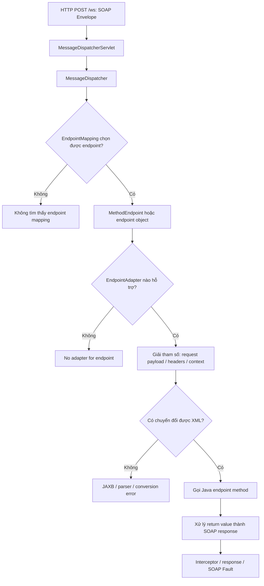

# Lỗi không tìm thấy bộ thích nghi cho chữ ký phương thức

## 1. Bối cảnh: endpoint được chọn nhưng không thể gọi

Khi xây dựng dịch vụ SOAP theo hướng **contract-first** với **Spring Web Services (Spring-WS)**, hợp đồng XSD/WSDL xác định cấu trúc thông điệp, còn lớp Java gắn `@Endpoint` thực hiện nghiệp vụ. Spring-WS phải thực hiện ít nhất hai việc **khác nhau**:

1. **Tìm endpoint** phù hợp với SOAP request, ví dụ dựa trên QName của phần tử đầu tiên trong SOAP Body.
2. **Tìm bộ thích nghi (*EndpointAdapter*)** có khả năng gọi endpoint vừa chọn, chuyển đổi các tham số và xử lý kiểu trả về của phương thức Java.

Thông báo lỗi thường thấy ở bước thứ hai có dạng:

```text
java.lang.IllegalStateException:
No adapter for endpoint [public ... OrdersEndpoint.getOrder(...) ]:
Is your endpoint annotated with @Endpoint,
or does it implement a supported interface like MessageHandler
or PayloadEndpoint?
```

Câu chữ chính xác của thông báo thay đổi theo phiên bản Spring-WS và loại endpoint. **Ý nghĩa quan trọng không phải một chuỗi log cố định** mà là: *framework đã có đối tượng được chọn làm endpoint, nhưng không tìm được adapter hỗ trợ đối tượng hoặc chữ ký phương thức đó.*

Ví dụ, WSDL yêu cầu `GetOrderRequest`, endpoint đã có `@PayloadRoot`, nhưng method lại nhận `org.springframework.http.HttpEntity<GetOrderRequest>` hoặc trả `ResponseEntity<GetOrderResponse>` theo cách viết của Spring MVC. Đây không phải chữ ký SOAP annotation-based endpoint thông thường. Spring-WS có thể không tìm được `MethodArgumentResolver` hoặc `MethodReturnValueHandler` phù hợp.

Trong hệ thống doanh nghiệp, cần phân biệt lỗi adapter với các lỗi khác liên quan đến JAXB, SOAP Fault, interceptor, XML validation, WS-Security hoặc chứng chỉ. Sửa nhầm tầng xử lý có thể khiến vấn đề khó tìm hơn.

### Mục tiêu học tập

Sau bài, bạn có thể:

- Diễn giải đúng chuỗi **SOAP request → EndpointMapping → EndpointAdapter → argument/return value processing → endpoint method**.
- Nhận biết chữ ký phương thức thường được `DefaultMethodEndpointAdapter` hỗ trợ và các chữ ký sai.
- Phân biệt `No endpoint mapping found` với `No adapter for endpoint`, lỗi marshalling và SOAP Fault nghiệp vụ.
- Chọn cách biểu diễn request/response theo XSD/JAXB, `JAXBElement`, DOM hoặc `Source` phù hợp.
- Cấu hình `@EnableWs`, `@Endpoint`, `@PayloadRoot` và Bean/ApplicationContext đúng phạm vi.
- Viết test tự động phát hiện lỗi adapter trước khi deploy; chỉ mở rộng resolver/adapter khi có nhu cầu thực sự.

Ví dụ xuyên suốt sử dụng SOAP operation `GetOrder`, namespace `https://example.org/orders/v1`, action `urn:example:orders:GetOrder`, endpoint minh họa `/ws`. Namespace và hostname chỉ là định danh/ví dụ, không phải URL dịch vụ thực.

## 2. Spring-WS định tuyến và gọi endpoint như thế nào?

Luồng xử lý khái niệm của một SOAP request:



Các bước có thể khác nhau theo pipeline, interceptor và version, nhưng sự tách biệt giữa **mapping** và **adapter** là cốt lõi.

| Thành phần | Quyết định | Trả lời câu hỏi |
|---|---|---|
| `MessageDispatcherServlet` | Nhận HTTP và chuẩn bị SOAP message | Request có đến đúng Spring-WS servlet không? |
| `EndpointMapping` | Chọn endpoint hoặc method | SOAP Body/QName/action khớp handler nào? |
| `EndpointAdapter` | Chọn cơ chế gọi endpoint | Method/object này có chữ ký mà framework hiểu không? |
| `MethodArgumentResolver` | Tạo giá trị tham số từ request | `@RequestPayload GetOrderRequest` có thể được giải mã không? |
| `MethodReturnValueHandler` | Đưa giá trị trả về thành SOAP response | `@ResponsePayload GetOrderResponse` có thể ghi ra XML không? |
| JAXB/OXM | Ánh xạ XML ↔ Java | Root QName, class, `JAXBElement`, kiểu dữ liệu có khớp không? |
| Interceptor / resolver | Validation, security, fault | Request/response có đạt XSD/chính sách không? |

**Không nên gộp các lỗi trong một nhóm**: một method được mapping chọn nhưng không có adapter hỗ trợ khác với một method được adapter gọi nhưng không unmarshal được XML.

### 2.1. `MethodEndpoint` là gì?

Với mô hình annotation-based, Spring-WS thường tạo đại diện `MethodEndpoint`: một bean endpoint và một Java method cụ thể. Ví dụ method `OrdersEndpoint#getOrder(GetOrderRequest)` được chọn bởi `@PayloadRoot`.

`DefaultMethodEndpointAdapter` có thể xử lý `MethodEndpoint` nếu **tất cả các tham số** và **kiểu trả về** đều có processor tương ứng (trong phạm vi phiên bản/configuration đang sử dụng). Một phương thức có thể được mapping chọn đúng nhưng adapter vẫn đánh giá *không hỗ trợ* vì một tham số hay kiểu trả về không tương thích.

### 2.2. Các loại endpoint không phải lúc nào cũng tương đương

Spring-WS từng hỗ trợ nhiều kiểu endpoint theo interface hoặc annotation. Bài này tập trung vào mô hình hiện đại:

```java
@Endpoint
public class OrdersEndpoint {

    @PayloadRoot(namespace = NS, localPart = "GetOrderRequest")
    @ResponsePayload
    public GetOrderResponse getOrder(
            @RequestPayload GetOrderRequest request) {
        // ...
    }
}
```

Đối với mô hình này, cần một endpoint adapter hỗ trợ annotation method, điển hình là `DefaultMethodEndpointAdapter`. Nếu dùng một interface endpoint cũ hoặc adapter tự viết, cách xử lý là một nhánh kiến trúc khác; không nên trộn hai mẫu thiết kế chỉ để che lỗi.

## 3. Chữ ký phương thức SOAP phải phù hợp với binding XML

### 3.1. Bốn annotation thường gặp

| Annotation | Vai trò | Vị trí |
|---|---|---|
| `@Endpoint` | Đăng ký class xử lý SOAP như Spring bean | Trên class |
| `@PayloadRoot` | Chọn method khi SOAP Body chứa root element đúng QName | Trên method |
| `@RequestPayload` | Báo tham số lấy dữ liệu từ SOAP Body | Trên tham số method |
| `@ResponsePayload` | Báo giá trị method trả về là SOAP Body response | Trên method |

Một ví dụ thường phù hợp:

```java
@Endpoint
public class OrdersEndpoint {
    private static final String NS = "https://example.org/orders/v1";

    @PayloadRoot(namespace = NS, localPart = "GetOrderRequest")
    @ResponsePayload
    public GetOrderResponse getOrder(
            @RequestPayload GetOrderRequest request) {
        // Biến đổi request, gọi nghiệp vụ, tạo response.
        return createResponse(request);
    }
}
```

**`@PayloadRoot` không chỉ định kiểu Java.** Nó chỉ xác định phần tử XML root cần có trong payload; `@RequestPayload` cùng với một resolver sẽ quyết định cách nhận giá trị request dưới dạng Java.

### 3.2. Chữ ký cần được resolver/handler hỗ trợ ở cả hai chiều

Trong cấu hình annotation-driven thông thường, Spring-WS có các processor cho những kiểu dữ liệu tiêu biểu:

- JAXB-bound classes có annotation phù hợp với phiên bản JAXB mà Spring-WS đang hỗ trợ.
- `JAXBElement<T>` nếu root element được biểu diễn qua JAXB element declaration và processor tương ứng có mặt.
- Một số dạng XML tree/stream như `org.w3c.dom.Element` và `javax.xml.transform.Source`.
- Một số tham số đặc biệt như SOAP header hoặc `MessageContext` theo các resolver được Spring-WS phiên bản đó đăng ký.

Không suy đoán rằng **mọi class Java** đều được serialize thành SOAP Body. Ví dụ `OrderDto` chỉ có `@Data` của Lombok hoặc một Java record không có metadata XML phù hợp chưa chắc được processor mặc định nhận biết. Cũng không suy đoán rằng chữ ký đã được adapter chấp nhận thì XML chắc chắn hợp lệ theo XSD.

### 3.3. Cách kiểm tra hai chiều

Một endpoint cần kiểm tra:

1. **Tham số đầu vào:** `DefaultMethodEndpointAdapter` có resolver hỗ trợ chính xác Java parameter type và annotation không?
2. **Kiểu trả về:** có return-value handler hỗ trợ type/annotation không?
3. **XML binding:** JAXB có biết class và global root element không?
4. **Hợp đồng:** XML request/response có đúng XSD và WSDL, kể cả namespace, nillable và thứ tự element không?
5. **Runtime:** thành phần xử lý của adapter có được cấu hình trong ApplicationContext SOAP servlet thực sự dùng không?

Đủ năm điều kiện mới có thể khẳng định endpoint xử lý request phù hợp.

## 4. XSD contract-first cho ví dụ `GetOrder`

Hãy bắt đầu từ một XSD đơn giản, thay vì thiết kế phương thức Java rồi cố suy ra XML.

```xml
<?xml version="1.0" encoding="UTF-8"?>
<xs:schema xmlns:xs="http://www.w3.org/2001/XMLSchema"
           targetNamespace="https://example.org/orders/v1"
           xmlns:tns="https://example.org/orders/v1"
           elementFormDefault="qualified">

  <xs:simpleType name="OrderIdType">
    <xs:restriction base="xs:string">
      <xs:pattern value="ORD-[0-9]{6}"/>
    </xs:restriction>
  </xs:simpleType>

  <xs:element name="GetOrderRequest">
    <xs:complexType>
      <xs:sequence>
        <xs:element name="orderId" type="tns:OrderIdType"/>
      </xs:sequence>
    </xs:complexType>
  </xs:element>

  <xs:element name="GetOrderResponse">
    <xs:complexType>
      <xs:sequence>
        <xs:element name="orderId" type="tns:OrderIdType"/>
        <xs:element name="status" type="xs:string"/>
      </xs:sequence>
    </xs:complexType>
  </xs:element>

</xs:schema>
```

Từ các global elements `GetOrderRequest` và `GetOrderResponse`, JAXB/XJC có thể sinh Java model với annotation `@XmlRootElement` khi kiểu được khai báo inline như ví dụ. **Đây là khả năng thường gặp, không phải bảo đảm cho mọi cấu trúc XSD và mọi binding customization**. Cần kiểm tra generated classes thực tế.

| XSD / WSDL | Chữ ký Java cần đạt |
|---|---|
| Global element `GetOrderRequest` | Java parameter tương ứng với root JAXB hợp lệ |
| Global element `GetOrderResponse` | Java return value tương ứng root JAXB hợp lệ |
| Namespace `https://example.org/orders/v1` | `@PayloadRoot(namespace=...)` khớp QName |
| `orderId` dạng `ORD-[0-9]{6}` | Validator XSD từ chối request vi phạm pattern |
| Operation SOAP `GetOrder` | WSDL/transport/action tương ứng, không suy ra từ tên Java method |

### 4.1. Request SOAP 1.1 mẫu

```xml
<soap:Envelope
    xmlns:soap="http://schemas.xmlsoap.org/soap/envelope/"
    xmlns:ord="https://example.org/orders/v1">
  <soap:Header/>
  <soap:Body>
    <ord:GetOrderRequest>
      <ord:orderId>ORD-000123</ord:orderId>
    </ord:GetOrderRequest>
  </soap:Body>
</soap:Envelope>
```

Endpoint mapping theo `@PayloadRoot` nhìn thấy QName **`{https://example.org/orders/v1}GetOrderRequest`**, không nhìn vào HTTP endpoint URL để suy ra tên method.

### 4.2. Response tương ứng

```xml
<soap:Envelope
    xmlns:soap="http://schemas.xmlsoap.org/soap/envelope/"
    xmlns:ord="https://example.org/orders/v1">
  <soap:Body>
    <ord:GetOrderResponse>
      <ord:orderId>ORD-000123</ord:orderId>
      <ord:status>CONFIRMED</ord:status>
    </ord:GetOrderResponse>
  </soap:Body>
</soap:Envelope>
```

Trong XSD ví dụ, `status` là `xs:string`, không phải enum. Nếu hợp đồng thật yêu cầu trạng thái giới hạn, cần định nghĩa `simpleType` enum và quản lý tương thích theo version WSDL/XSD.

## 5. Xây endpoint Java có chữ ký hợp lệ

Giả định dự án Spring Boot 3.x/Spring-WS 4.x đã sinh model JAXB phù hợp `jakarta.xml.bind` từ XSD, gồm hai class `GetOrderRequest` và `GetOrderResponse` có root element tương ứng.

### 5.1. Tách service nghiệp vụ khỏi endpoint

```java
public record Order(String id, String status) {}

@Service
public class OrdersService {
    public Order findById(String orderId) {
        // Stub phục vụ bài học; thực tế dùng repository/domain service.
        return new Order(orderId, "CONFIRMED");
    }
}
```

Trong mã thực, các lớp Java ở những file tương ứng và import `org.springframework.stereotype.Service`. Service không nhận biết SOAP Envelope, `JAXBElement` hoặc HTTP route. Điều này cho phép tái sử dụng logic nghiệp vụ ở nhiều adapter.

### 5.2. Endpoint thực thi hợp đồng XML

```java
import org.springframework.ws.server.endpoint.annotation.Endpoint;
import org.springframework.ws.server.endpoint.annotation.PayloadRoot;
import org.springframework.ws.server.endpoint.annotation.RequestPayload;
import org.springframework.ws.server.endpoint.annotation.ResponsePayload;

@Endpoint
public class OrdersEndpoint {
    private static final String NS = "https://example.org/orders/v1";

    private final OrdersService service;

    public OrdersEndpoint(OrdersService service) {
        this.service = service;
    }

    @PayloadRoot(namespace = NS, localPart = "GetOrderRequest")
    @ResponsePayload
    public GetOrderResponse getOrder(
            @RequestPayload GetOrderRequest request) {

        Order order = service.findById(request.getOrderId());

        GetOrderResponse response = new GetOrderResponse();
        response.setOrderId(order.id());
        response.setStatus(order.status());

        return response;
    }
}
```

Điểm chính:

- `@Endpoint` làm class trở thành bean được component scan.
- `@PayloadRoot` chọn method bằng request root QName.
- `@RequestPayload` yêu cầu framework chuyển đổi SOAP Body sang `GetOrderRequest`.
- `@ResponsePayload` yêu cầu framework tạo SOAP Body từ `GetOrderResponse`.
- JAXB metadata/binding của các class phải được Spring-WS processor phiên bản đang dùng hỗ trợ.

**Không phải mọi thông báo «No adapter» đều do sai annotation.** Nếu đủ annotation nhưng kiểu request/response không được processor hỗ trợ, hoặc annotation JAXB dùng sai package `javax`/`jakarta`, adapter vẫn có thể không chấp nhận method.

### 5.3. Tránh wrapper của Spring MVC

Đây là ví dụ **không nên dùng cho SOAP endpoint annotation-driven**:

```java
@Endpoint
public class BrokenOrdersEndpoint {

    @PayloadRoot(
        namespace = "https://example.org/orders/v1",
        localPart = "GetOrderRequest")
    public ResponseEntity<GetOrderResponse> getOrder(
            @RequestBody GetOrderRequest request) {

        return ResponseEntity.ok(new GetOrderResponse());
    }
}
```

`@RequestBody` và `ResponseEntity` ở ví dụ này đến từ Spring MVC/HTTP REST. `DefaultMethodEndpointAdapter` không mặc nhiên có resolver/return handler để xử lý chúng như SOAP payload. Nếu mapping đã chọn method nhưng chữ ký không được hỗ trợ, kết quả có thể là **No adapter for endpoint**.

Cách sửa theo Spring-WS: sử dụng `@RequestPayload`, `@ResponsePayload` và JAXB/XML type được hỗ trợ. Không thay bằng `@RestController`, `@PostMapping` hoặc `@ResponseBody` khi mục tiêu là SOAP server.

## 6. Khi XJC sinh `JAXBElement` thay cho `@XmlRootElement`

Trong XSD, một global element có thể tham chiếu một **named complexType**:

```xml
<xs:complexType name="GetOrderRequestType">
  <xs:sequence>
    <xs:element name="orderId" type="xs:string"/>
  </xs:sequence>
</xs:complexType>

<xs:element name="GetOrderRequest"
            type="tns:GetOrderRequestType"/>
```

Với một số cấu hình XJC, lớp `GetOrderRequestType` mô tả type, còn `ObjectFactory` tạo root element:

```java
GetOrderRequestType request = new GetOrderRequestType();
request.setOrderId("ORD-000123");

JAXBElement<GetOrderRequestType> root =
    new ObjectFactory().createGetOrderRequest(request);
```

Khi dùng Spring-WS, có thể sử dụng processor cho `JAXBElement<T>` nếu phiên bản Spring-WS hiện tại hỗ trợ chữ ký này và JAXB context có đủ khai báo root. Một dạng chữ ký tham khảo là:

```java
@PayloadRoot(
    namespace = "https://example.org/orders/v1",
    localPart = "GetOrderRequest")
@ResponsePayload
public JAXBElement<GetOrderResponseType> getOrder(
        @RequestPayload JAXBElement<GetOrderRequestType> request) {

    String orderId = request.getValue().getOrderId();
    GetOrderResponseType response = new GetOrderResponseType();
    response.setOrderId(orderId);
    response.setStatus("CONFIRMED");

    return new ObjectFactory().createGetOrderResponse(response);
}
```

Ví dụ giả định cùng `ObjectFactory` có cả hai phương thức `createGetOrderRequest` và `createGetOrderResponse`; nếu XJC sinh chúng trong package/factory khác, dùng đúng factory thực. Kiểm chứng chữ ký này bằng test trên **phiên bản Spring-WS/JAXB thực tế**, không suy đoán từ tên lớp sinh ra.

### Hai lỗi dễ lẫn

1. **Adapter không hỗ trợ phương thức**: thiếu resolver/handler cho kiểu Java hoặc annotation, lỗi xảy ra **trước khi** method được gọi.
2. **JAXB biết type nhưng không biết element**: adapter có thể hỗ trợ chữ ký nhưng marshal/unmarshal báo lỗi như `missing @XmlRootElement` hoặc `unexpected element` do root QName/`ObjectFactory`.

Nếu lỗi là JAXB root declaration, không nhất thiết phải đổi adapter. Cần xác định JAXB context được tạo từ package nào, có `ObjectFactory`/`jaxb.index` hay không, và có sử dụng `JAXBElement` đúng cách không.

## 7. Sử dụng `Source` hoặc DOM khi chưa cần JAXB object

Một số API SOAP endpoint xử lý XML trực tiếp, chẳng hạn `javax.xml.transform.Source` hoặc `org.w3c.dom.Element`. Đây là lựa chọn hữu ích khi xử lý XML đa dạng hoặc cần kiểm soát payload ở cấp XML, nhưng phải chọn kiểu mà Spring-WS version hiện tại hỗ trợ.

Ví dụ minh họa sử dụng `Source`:

```java
import javax.xml.transform.Source;
import org.springframework.xml.transform.StringSource;
import org.springframework.ws.server.endpoint.annotation.Endpoint;
import org.springframework.ws.server.endpoint.annotation.PayloadRoot;
import org.springframework.ws.server.endpoint.annotation.RequestPayload;
import org.springframework.ws.server.endpoint.annotation.ResponsePayload;

@Endpoint
public class RawXmlOrdersEndpoint {
    private static final String NS = "https://example.org/orders/v1";

    @PayloadRoot(namespace = NS, localPart = "GetOrderRequest")
    @ResponsePayload
    public Source getOrder(@RequestPayload Source request) {
        // Ví dụ tĩnh chỉ để minh họa hỗ trợ Source.
        // Không đọc raw XML từ nguồn không tin cậy mà bỏ validation.
        return new StringSource(
            "<ord:GetOrderResponse " +
            "xmlns:ord='https://example.org/orders/v1'>" +
              "<ord:orderId>ORD-000123</ord:orderId>" +
              "<ord:status>CONFIRMED</ord:status>" +
            "</ord:GetOrderResponse>");
    }
}
```

**Không đăng ký đồng thời** `RawXmlOrdersEndpoint` và `OrdersEndpoint` trong cùng context với `@PayloadRoot` trùng QName khi chưa định nghĩa rõ precedence/mapping: một thao tác nên có một handler rõ ràng. Ví dụ này là **phương án thay thế** endpoint JAXB ở mục 5.

`javax.xml.transform.Source` vẫn là Java XML Transformation API thuộc `javax.xml.transform`, ngay cả khi JAXB chuyển sang `jakarta.xml.bind`. Đừng thay nó thành `jakarta.xml.transform.Source` (không thuộc API Java chuẩn). Ngược lại, annotation JAXB trong Spring Boot 3 dùng `jakarta.xml.bind.annotation.*`, không phải `javax.xml.bind.annotation.*`.

Với dữ liệu thật, thao tác XML phải được schema validate và parser phải được bảo vệ trước DTD/external entities, XXE, payload quá lớn và XML có độ sâu bất thường. String XML xây thủ công dễ tạo nội dung không hợp lệ và không phải phương án ưu tiên cho hợp đồng ổn định.

## 8. Nhận biết các lỗi chữ ký phổ biến

| Sai lệch | Vì sao có thể gây lỗi adapter? | Hướng xử lý |
|---|---|---|
| Dùng `@RequestBody` của Spring MVC | Không phải annotation SOAP payload của Spring-WS | Dùng `@RequestPayload` với type phù hợp |
| Trả `ResponseEntity<T>` | Wrapper HTTP/MVC không phải SOAP Body return value mặc định | Trả JAXB root/`JAXBElement`/`Source` và dùng `@ResponsePayload` |
| Tham số `Map<String,Object>` tùy ý | Không có JAXB/XML processor mặc định phù hợp cho payload tùy ý | Tạo schema/JAXB DTO hoặc custom resolver rõ ràng |
| Trả domain entity không có XML binding | Không được return-value handler nhận biết hoặc XML sai hợp đồng | Map domain entity sang JAXB response DTO |
| `@ResponsePayload` bị thiếu | Processor SOAP response có thể không nhận method theo annotation cần thiết | Thêm annotation khi method phải tạo response body |
| Sử dụng `JAXBElement<T>` nhưng context thiếu `ObjectFactory` | Có thể lỗi JAXB dù adapter hỗ trợ type Java | Bổ sung root declaration đúng cách |
| Trộn `javax.xml.bind` và `jakarta.xml.bind` | Processor mới có thể không nhận metadata của model cũ | Sinh lại JAXB với generator/runtime tương thích |
| Có custom parameter type như `CurrentUser` | Không có resolver hỗ trợ loại tham số mới | Lấy identity qua security layer hoặc tạo custom resolver đã kiểm thử |
| Dùng return type bất đồng bộ như `Mono<T>` theo cách MVC | Annotation SOAP adapter không mặc nhiên hỗ trợ Reactive return wrappers | Chọn cơ chế SOAP phù hợp, xử lý đồng bộ hoặc viết adapter riêng |
| Nhiều kiểu `ResponseEntity`/`HttpServletRequest` trong chữ ký | Giả định Spring MVC argument resolvers hoạt động trong Spring-WS | Sử dụng API được SOAP adapter hỗ trợ; đặt logic HTTP tại transport layer |

Không phải mọi dòng trong bảng chắc chắn luôn dẫn tới cùng một exception: mapping có thể không chọn method, adapter có thể từ chối, hoặc JAXB có thể thất bại ở bước sau. Cần đọc log theo **thứ tự pipeline**.

### Ví dụ thiếu `@RequestPayload`

```java
@Endpoint
class SuspiciousEndpoint {

    @PayloadRoot(namespace = NS, localPart = "GetOrderRequest")
    @ResponsePayload
    public GetOrderResponse getOrder(GetOrderRequest request) {
        return new GetOrderResponse();
    }
}
```

Tùy resolver được đăng ký, kiểu tham số và phiên bản framework, thiếu annotation có thể làm method không được hỗ trợ hoặc được diễn giải khác dự định. Cách an toàn là khai báo **rõ `@RequestPayload`** để người đọc và test biết tham số lấy từ SOAP Body.

### Ví dụ method void

```java
@PayloadRoot(namespace = NS, localPart = "NotifyOrderRequest")
public void notifyOrder(@RequestPayload NotifyOrderRequest request) {
    service.acceptNotification(request.getOrderId());
}
```

Chữ ký `void` có thể phù hợp với thao tác **one-way** nếu WSDL/SOAP binding và adapter cho phép. Không dùng `void` chỉ để né lỗi return-value handler của operation **request/response** mà WSDL đã công bố `GetOrderResponse`. Hợp đồng quyết định có response nghiệp vụ hay không.

## 9. Cấu hình Spring-WS annotation infrastructure đúng cách

Spring-WS cần những strategy beans cho endpoint annotation-driven. Trong Spring Boot, mô hình thông dụng:

```java
import org.springframework.boot.web.servlet.ServletRegistrationBean;
import org.springframework.context.ApplicationContext;
import org.springframework.context.annotation.Bean;
import org.springframework.context.annotation.Configuration;
import org.springframework.ws.config.annotation.EnableWs;
import org.springframework.ws.transport.http.MessageDispatcherServlet;

@EnableWs
@Configuration
public class SoapServerConfig {

    @Bean
    public ServletRegistrationBean<MessageDispatcherServlet> soapServlet(
            ApplicationContext applicationContext) {

        MessageDispatcherServlet servlet = new MessageDispatcherServlet();
        servlet.setApplicationContext(applicationContext);
        servlet.setTransformWsdlLocations(false);

        return new ServletRegistrationBean<>(servlet, "/ws/*");
    }
}
```

- `@EnableWs` kích hoạt hạ tầng Spring-WS annotation-driven trong context phù hợp.
- `MessageDispatcherServlet` tiếp nhận HTTP tại mapping `/ws/*`.
- `@Endpoint` phải là Spring bean trong context mà servlet/pipeline xử lý.
- `DefaultMethodEndpointAdapter` hoặc adapter tương thích phải được tạo/đăng ký theo cấu hình Spring-WS.
- Không cần tự đăng ký một adapter tùy biến nếu chữ ký method tuân thủ các dạng mặc định.

**Không tự khai báo một bean `DefaultMethodEndpointAdapter` trống chỉ để chữa thông báo «No adapter».** Làm vậy có thể ghi đè/mâu thuẫn với adapter được framework cấu hình, thiếu argument resolvers hoặc return-value handlers. Trước tiên kiểm tra `@EnableWs`, dependencies, application context và chữ ký method.

### 9.1. Spring Boot auto-configuration và servlet đăng ký trùng

Các phiên bản Spring Boot starter có thể tự đăng ký `MessageDispatcherServlet`. Nếu đã sử dụng auto-configuration, không nhất thiết cần đăng ký servlet thủ công. Kiểm tra runtime servlet mappings trước khi thêm một `ServletRegistrationBean` khác với đường dẫn giao nhau.

Nếu servlet dùng **child WebApplicationContext** trong WAR truyền thống, cần đặt `@EnableWs`/annotation-driven infrastructure và endpoint trong đúng vùng cấu hình. Một bean `@Endpoint` ở sibling MVC context không tự xuất hiện trong SOAP child context. Tuy nhiên lỗi context thiếu endpoint thường thuộc loại **no endpoint mapping**, không phải adapter method unsupported; hãy kiểm tra triệu chứng thực.

### 9.2. WSDL static/sinh từ XSD không quyết định method adapter

WSDL có thể công bố bằng `SimpleWsdl11Definition` hoặc sinh từ schema với `DefaultWsdl11Definition`. Cả hai liên quan metadata publication, **không tự sửa Java method signature**.

Ví dụ bean WSDL tĩnh:

```java
@Bean(name = "orders")
public SimpleWsdl11Definition ordersWsdl() {
    SimpleWsdl11Definition wsdl = new SimpleWsdl11Definition();
    wsdl.setWsdl(new ClassPathResource("wsdl/orders.wsdl"));
    return wsdl;
}
```

Bean WSDL được công bố ở `GET /ws/orders.wsdl` khi servlet mapping phù hợp; HTTP SOAP request vẫn được gửi đến địa chỉ được cấu hình trong `soap:address`. Không đồng nhất URL tải WSDL với URL SOAP POST.

## 10. JAXB/OXM không thay thế EndpointAdapter

Có ba tầng thường bị trộn:

1. **EndpointAdapter** chấp nhận chữ ký Java method.
2. **JAXB/OXM binding** chuyển payload XML thành giá trị Java, hoặc ngược lại.
3. **XSD validation** kiểm tra dữ liệu XML có tuân thủ hợp đồng không.

Một method có chữ ký được hỗ trợ không đảm bảo JAXB context biết mọi type/root. Ngược lại, `Jaxb2Marshaller` bean hoạt động tốt trong SOAP client chưa chắc là marshaller được endpoint adapter dùng.

### 10.1. Kiểm tra generated JAXB model

Với Spring Boot 3/Spring-WS 4, sử dụng JAXB annotations thuộc `jakarta.xml.bind.annotation`. Trong stack cũ, `javax.xml.bind.annotation` được dùng thay thế. Khi upgrade, cần sinh lại model tương thích thay vì trộn hai nhóm annotation.

Đối với root:
 
- Class có `@XmlRootElement` thường có thể marshal/unmarshal trực tiếp.
- Named complex type có root được định nghĩa qua `@XmlElementDecl` trong `ObjectFactory` có thể cần `JAXBElement<T>`.
- Package `contextPath` dùng bootstrap JAXB package thích hợp (ví dụ `ObjectFactory`/`jaxb.index`).
- `classesToBeBound` hoặc `packagesToScan` phải bao phủ root declarations và các type cần thiết, không chỉ class dùng trong happy path.

### 10.2. Test riêng OXM trước khi gửi SOAP

```java
Jaxb2Marshaller marshaller = new Jaxb2Marshaller();
marshaller.setContextPath("org.example.orders.contract.v1");
marshaller.afterPropertiesSet();

GetOrderRequest request = new GetOrderRequest();
request.setOrderId("ORD-000123");

StringResult result = new StringResult();
marshaller.marshal(request, result);
System.out.println(result);
```

Ví dụ giả định package được XJC sinh có cơ chế JAXB bootstrap thích hợp và `GetOrderRequest` có `@XmlRootElement`. Nếu root dùng `JAXBElement`, cần bọc request theo `ObjectFactory`.

**Kết luận chẩn đoán:** nếu OXM marshal độc lập lỗi, sửa JAXB metadata/context trước; nếu OXM chạy tốt nhưng SOAP adapter không chấp nhận method, quay lại kiểm tra chữ ký/resolvers/return handlers.

### 10.3. XSD validation là phép kiểm tra khác

Spring-WS có `PayloadValidatingInterceptor` cho request và response; đây là bước kiểm tra schema, không phải cơ chế chọn adapter. Nếu `GetOrderRequest.orderId` không khớp pattern `ORD-[0-9]{6}`, trường hợp bình thường là **validation failure** (và SOAP Fault tùy cấu hình), không phải mặc định "No adapter for endpoint".

## 11. Khi endpoint có thêm SOAP headers, `MessageContext` hoặc security principal

Với ứng dụng doanh nghiệp, SOAP Header có thể chứa WS-Addressing, correlation ID hoặc WS-Security. Không nên thêm một Java parameter tùy ý vào endpoint rồi giả định Spring-WS biết lấy giá trị đó.

Ví dụ đáng ngờ:

```java
@PayloadRoot(namespace = NS, localPart = "GetOrderRequest")
@ResponsePayload
public GetOrderResponse getOrder(
        @RequestPayload GetOrderRequest request,
        CurrentUser currentUser,
        CorrelationContext correlation) {
    // ...
}
```

Nếu `CurrentUser` và `CorrelationContext` không được hỗ trợ bởi argument resolvers, adapter có thể từ chối **toàn bộ method** dù tham số đầu tiên là JAXB hợp lệ.

Các lựa chọn tốt hơn:

- Đối với dữ liệu XML trong SOAP Header, dùng annotation/processor SOAP Header được Spring-WS hỗ trợ; parse/validate đúng namespace.
- Đối với thông điệp SOAP hoặc context vận chuyển, dùng loại tham số/API mà adapter phiên bản hiện tại hỗ trợ (ví dụ `MessageContext` trong trường hợp thích hợp) thay vì Spring MVC HTTP abstractions.
- Đối với identity, đặt xác thực/ủy quyền ở security interceptor hoặc security context của hệ thống, rồi chuyển identity đã xác minh tới service qua cấu trúc rõ ràng.
- Nếu thực sự cần một loại tham số đặc thù, viết custom `MethodArgumentResolver` và đăng ký vào annotation adapter theo cơ chế Spring-WS được hỗ trợ.

**Không dùng SOAPAction, tên endpoint hay một HTTP header tự khai là bằng chứng xác thực.** Khi contract yêu cầu mTLS, WS-Security, chữ ký X.509 hoặc timestamp, cần cấu hình cơ chế kiểm chứng riêng.

## 12. Cách đọc log để phân biệt các lỗi gần giống nhau

Khi một request thất bại, thu **log đã được che dữ liệu nhạy cảm** và làm rõ thứ tự xử lý.

| Triệu chứng | Bước nghi ngờ | Cách kiểm tra |
|---|---|---|
| HTTP 404 trước khi vào Spring-WS | Servlet mapping / reverse proxy | HTTP path, context path, routing |
| HTTP 415, `VersionMismatch` | SOAP version/media type | `Content-Type`, Envelope namespace, WSDL binding |
| `No endpoint mapping found` | Không chọn được endpoint | `@PayloadRoot`, QName XML, bean scan, SOAPAction mapping |
| `No adapter for endpoint` | Endpoint được chọn nhưng không có adapter phù hợp | Method signature, annotations, processors, `@EnableWs` |
| `class ... is not known to this context` | JAXB context thiếu class | context path, factory, classes bound |
| `unexpected element ... Expected elements are ...` | JAXB root QName/declaration | Namespace, local name, `ObjectFactory` |
| SOAP Fault schema validation | XSD ràng buộc bị vi phạm | XML fixture, `minOccurs`, pattern, enum |
| SOAP Fault xác thực/chữ ký | WS-Security policy | Token/signature, timestamp, cert và interceptor |
| Endpoint chạy nhưng response không marshal được | Return-value handling hoặc JAXB output | `@ResponsePayload`, return type, root element |
| Client khác stack bị lỗi | Lệch hợp đồng/interoperability | WSDL/XSD, SOAPAction, fault, namespace |

### 12.1. Không tin vào HTTP status đơn lẻ

Không có một mã HTTP duy nhất bắt buộc cho mọi lỗi adapter. Tùy servlet container, fault resolver, framework version và gateway, có thể thấy HTTP 500, SOAP Fault hoặc phản hồi lỗi khác. **Một HTTP 500 không chứng minh chữ ký method sai**, và một SOAP Fault không chứng minh adapter đã gọi được method.

### 12.2. Mẫu thông tin cần ghi lại

```text
operation: GetOrder
soapVersion: SOAP 1.1
payloadQName: {https://example.org/orders/v1}GetOrderRequest
mappedMethod: OrdersEndpoint#getOrder(...)
springWsConfig: annotation-driven enabled?
adapterSupport: supported / unsupported / unknown
requestStatus: failed at mapping / adapter / JAXB / service / response
correlationId: sanitized-id
```

Không log toàn bộ payload/WS-Security Header ở production nếu chứa dữ liệu nhạy cảm, chữ ký, token hay thông tin cá nhân. Giá trị action và QName có thể hữu ích cho điều tra nhưng vẫn phải theo chính sách logging của doanh nghiệp.

## 13. Quy trình chẩn đoán theo từng bước

### Bước 1 — Xác nhận request tới đúng SOAP servlet

Xác nhận HTTP POST, endpoint URL, servlet mapping `/ws/*`, context path và cấu hình proxy. SOAP 1.1 thường gửi `text/xml` và header `SOAPAction`; SOAP 1.2 sử dụng `application/soap+xml` và tham số `action` nếu binding yêu cầu.

Nếu request không vào `MessageDispatcherServlet`, đừng sửa method adapter.

### Bước 2 — Xác nhận endpoint mapping đã chọn method

Đối chiếu `@PayloadRoot(namespace, localPart)` với SOAP Body root QName và xác nhận `@Endpoint` là bean trong đúng ApplicationContext.

- **Không chọn được endpoint:** sửa URL/servlet context, scanning hoặc mapping/QName.
- **Chọn được endpoint nhưng không có adapter:** tiếp tục bước 3.

### Bước 3 — Đọc nguyên chữ ký Java

Kiểm tra **từng parameter**, annotation của nó và **return type**. Tìm những kiểu REST/MVC như `ResponseEntity`, `@RequestBody`, `@RequestParam`, `@PathVariable`, `Principal` được dùng ngoài các resolver thực có. Đặc biệt chú ý các tham số phụ trợ thêm sau khi method từng chạy tốt.

Dùng một method tối thiểu:

```java
@PayloadRoot(namespace = NS, localPart = "GetOrderRequest")
@ResponsePayload
public GetOrderResponse getOrder(
        @RequestPayload GetOrderRequest request) {
    return createResponse(request);
}
```

Nếu bản tối thiểu chạy còn bản mới thêm tham số không chạy, xác định chính xác resolver bị thiếu. Không xóa validation/security để chữa lỗi.

### Bước 4 — Xác nhận annotation-driven adapter được đăng ký

Kiểm tra `@EnableWs` hoặc `<sws:annotation-driven/>`, dependencies, version Spring-WS và context của servlet. Không tự tạo adapter trống để thử.

Nếu ứng dụng Boot có auto-configured servlet và một servlet thủ công khác, request có thể đi qua context không có annotation infrastructure như dự định.

### Bước 5 — Kiểm tra JAXB ở lớp độc lập

Marshal và unmarshal XML fixture theo XSD/WSDL. Kiểm tra `@XmlRootElement`, `JAXBElement`, `ObjectFactory`, package, `javax`/`jakarta`, enum, type adapters. Nếu Java model/Root QName sai, sửa contract binding.

### Bước 6 — Kiểm tra schema validation và SOAP Fault

Gửi request sai XSD và xác nhận bị từ chối trước khi chạy nghiệp vụ. Gửi request hợp lệ nhưng gây lỗi domain và xem SOAP Fault có đúng hợp đồng không. Xác định rõ lỗi nào phát sinh **trước** method, **trong** method và **sau** method (marshalling response).

### Bước 7 — Kiểm thử liên thông và đưa vào CI

Test trên HTTP thật qua servlet/gateway, rồi dùng client khác nền tảng. Gắn test hồi quy vào endpoint method signature, XSD và SOAP binding để tránh lặp lại lỗi sau refactor.

## 14. MockWebServiceClient: test adapter trong pipeline Spring-WS

Spring-WS cung cấp `MockWebServiceClient` để gửi SOAP payload tới pipeline mà không cần khởi động container HTTP đầy đủ. Test kiểu này giúp phát hiện cả lỗi mapping lẫn lỗi adapter.

Giả định `@SpringBootTest` nạp cấu hình `@EnableWs` và endpoint, có thể viết:

```java
import org.junit.jupiter.api.Test;
import org.springframework.beans.factory.annotation.Autowired;
import org.springframework.boot.test.context.SpringBootTest;
import org.springframework.context.ApplicationContext;
import org.springframework.ws.test.server.MockWebServiceClient;
import org.springframework.xml.transform.StringSource;

import static org.springframework.ws.test.server.RequestCreators.withPayload;
import static org.springframework.ws.test.server.ResponseMatchers.payload;

@SpringBootTest
class OrdersEndpointTest {

    @Autowired
    ApplicationContext applicationContext;

    @Test
    void getOrderUsesSupportedMethodSignature() {
        MockWebServiceClient client =
            MockWebServiceClient.createClient(applicationContext);

        String request = """
            <ord:GetOrderRequest xmlns:ord="https://example.org/orders/v1">
              <ord:orderId>ORD-000123</ord:orderId>
            </ord:GetOrderRequest>
            """;

        String expectedResponse = """
            <ord:GetOrderResponse xmlns:ord="https://example.org/orders/v1">
              <ord:orderId>ORD-000123</ord:orderId>
              <ord:status>CONFIRMED</ord:status>
            </ord:GetOrderResponse>
            """;

        client.sendRequest(withPayload(new StringSource(request)))
            .andExpect(payload(new StringSource(expectedResponse)));
    }
}
```

Ví dụ giả định service test trả trạng thái `CONFIRMED`, JAXB classes được sinh từ XSD và adapter đã cấu hình đúng. Test dùng Java 17+ text blocks và dependency `spring-ws-test`. XML response matcher có thể quan tâm cấu trúc/giá trị XML; nếu fixture khác cách serialize thực tế, cần điều chỉnh assertion đúng QName/nội dung, không kiểm tra prefix tùy tiện.

**Quan trọng:** test với `MockWebServiceClient` khởi tạo từ **đúng ApplicationContext của SOAP endpoint**. Nếu production dùng child servlet context riêng mà test chỉ nạp root context, test có thể không phản ánh cấu hình thật.

### 14.1. Negative test cho method không hỗ trợ

Không cần để một method sai tồn tại trong production code. Có thể tạo configuration/fixture chỉ dùng trong test, khai báo một `@Endpoint` với return type không được hỗ trợ. Gửi request tới nó và xác nhận lỗi được phát hiện trong test environment, từ đó chứng minh pipeline chọn mapping nhưng thất bại tại adapter.

Cần tách test fixture này khỏi cấu hình production, tránh làm một request hợp lệ bị phân phối ngẫu nhiên giữa hai endpoint có cùng `@PayloadRoot`.

### 14.2. Test trực tiếp JAXB

Ngay cả khi mock SOAP test thành công, nên có test độc lập marshal/unmarshal:
 
```java
GetOrderRequest request = new GetOrderRequest();
request.setOrderId("ORD-000123");

StringResult output = new StringResult();
ordersMarshaller.marshal(request, output);

assertTrue(output.toString().contains("GetOrderRequest"));
```

Đây chỉ là ví dụ smoke test; để đạt chuẩn contract-first, cần parse XML theo namespace và validate bằng XSD. Không assert prefix XML cố định. Nếu XJC sinh `JAXBElement`, hãy dùng `ObjectFactory`.

## 15. Kiểm thử HTTP thật với SOAP client

Tạo file `get-order-soap11.xml` chứa Envelope ở mục 4, rồi gửi:

```bash
curl -i -X POST "http://localhost:8080/ws" \
  -H 'Content-Type: text/xml; charset=utf-8' \
  -H 'SOAPAction: "urn:example:orders:GetOrder"' \
  --data-binary @get-order-soap11.xml
```

Lệnh minh họa shell kiểu POSIX. Với PowerShell, cần điều chỉnh quoting và có thể dùng `curl.exe` để tránh khác biệt alias. Hệ thống phải được chạy với đúng route và dữ liệu test.

Kiểm tra:

1. Request thực vào `MessageDispatcherServlet` chứ không phải MVC servlet.
2. SOAP Envelope namespace phù hợp WSDL binding (ví dụ SOAP 1.1).
3. SOAP Body root QName khớp `@PayloadRoot`.
4. Endpoint method thực sự được gọi (dựa vào trace/log đã che dữ liệu).
5. Response được marshal đúng schema; fault xử lý đúng nếu có lỗi.
6. Validation và WS-Security chạy theo chính sách, không bị vô tình bỏ qua.
7. Reverse proxy, TLS/mTLS, timeout và WSDL `soap:address` tương thích với client bên ngoài.

`MockWebServiceClient` **không thay thế** test HTTP qua servlet/proxy. Nó không kiểm tra hết servlet mapping, media type, network TLS hoặc endpoint URL. Ngược lại, chỉ thấy HTTP 200 cũng không chứng minh SOAP response đúng XSD.

## 16. Khi nào cần custom `MethodArgumentResolver` hay `EndpointAdapter`?

Khi một endpoint thật sự cần nhận một đối tượng đặc thù, ví dụ `ValidatedTenant` đã được rút ra từ security context, có hai hướng:

- **Hướng đơn giản và ít rủi ro:** đọc thông tin ở tầng interceptor/security/service phù hợp và gọi domain service bằng object tường minh, giữ method SOAP signature theo các kiểu chuẩn.
- **Hướng mở rộng framework:** tạo `MethodArgumentResolver` hoặc `MethodReturnValueHandler` riêng cho kiểu mới, hoặc adapter khác nếu cần cơ chế endpoint hoàn toàn khác.

Spring-WS có extension points cho annotation-method adapter, thường được cấu hình qua `WsConfigurer`/`WsConfigurerAdapter` theo version đang dùng:

```java
@EnableWs
@Configuration
public class SoapMethodCustomization extends WsConfigurerAdapter {

    @Override
    public void addArgumentResolvers(
            List<MethodArgumentResolver> resolvers) {
        resolvers.add(new ValidatedTenantArgumentResolver());
    }
}
```

Đây là **mẫu kiến trúc**, không phải đoạn độc lập có thể compile: `ValidatedTenantArgumentResolver` cần triển khai interface `MethodArgumentResolver` của Spring-WS phiên bản dự án, xử lý phương thức `supportsParameter(...)` và `resolveArgument(...)`, kiểm tra identity đã xác thực và không tin dữ liệu do client tự khai. Cần import `java.util.List` và các class Spring-WS chính xác. Phần thêm resolver phải thực sự kết nối với `DefaultMethodEndpointAdapter` dùng tại runtime.

Nếu vấn đề nằm ở return type, có extension tương ứng để thêm `MethodReturnValueHandler`. Một adapter hoàn toàn tùy biến là lựa chọn nâng cao, phải xử lý cả serialization, fault mapping, validation và security.

**Trước khi viết resolver tùy biến**, hãy xem có thể dùng `@RequestPayload` JAXB class, `JAXBElement`, `Source` hoặc `MessageContext` được hỗ trợ sẵn hay không. Thêm một extension chỉ để giải mã kiểu có thể thay thế bằng JAXB DTO chuẩn sẽ tăng chi phí duy trì và rủi ro tương thích.

## 17. Lỗi adapter trong các dự án lớn: những yếu tố ngoài chữ ký method

### 17.1. Nhiều `@Endpoint` trùng mapping

Nếu hai method cùng `@PayloadRoot(namespace, localPart)` trong cùng pipeline, mapping có thể gây ambiguous endpoint hoặc hành vi phụ thuộc cấu hình. Đừng thêm một method «tạm» cùng QName để bypass lỗi adapter; hãy sửa chữ ký method đã chọn hoặc dùng một mapping strategy rõ ràng.

### 17.2. Component scan và parent/child context

Trong WAR có root context và SOAP child, `@Endpoint` có thể nằm sai child hoặc chỉ trong MVC sibling. Điều đó thường làm không tìm thấy mapping, nhưng một hệ thống có bean endpoint mapping và adapter nằm khác context cũng có thể tạo tình trạng mapping chọn được method nhưng không có adapter thích hợp.

Cần xác nhận **context mà servlet thực sự sử dụng**, không chỉ xem một `@SpringBootTest` root có bean hay không.

### 17.3. Nhiều phiên bản hợp đồng JAXB

Nếu v1/v2 được sinh ở các package khác nhau nhưng được trộn vào một JAXB context, XML binding và adapter có thể thấy các loại không mong muốn. Với hợp đồng thay đổi namespace hoặc root QName, nên tách generated model/`Jaxb2Marshaller` hoặc pipeline theo version khi cần.

Tránh giải quyết lỗi adapter bằng việc scan toàn bộ package của application vào JAXB context: scan quá rộng có thể gây xung đột XML type/element và làm vấn đề mới xuất hiện.

### 17.4. Nâng cấp `javax` sang `jakarta`

Sau nâng cấp Spring Boot 2 → 3 hoặc Spring-WS 3 → 4, JAXB generated classes vẫn dùng `javax.xml.bind.annotation` có thể không được processor mới xem là JAXB-bound types. Kết quả có thể là method không được adapter hỗ trợ, hoặc JAXB context không khởi tạo, tùy chỗ lỗi xuất hiện.

Giải pháp: đồng bộ Spring BOM, JAXB API/runtime/XJC và generated classes, rồi chạy integration tests. Không trộn cùng lúc hai hệ JAXB annotations và hy vọng một processor tự hiểu cả hai.

### 17.5. An toàn thông điệp và exception handling

Lỗi adapter là vấn đề **cấu hình/contract của server**, không phải lỗi nghiệp vụ người dùng gây ra. Không nên chuyển mọi exception thành fault nghiệp vụ «không tìm thấy đơn hàng». Cần phân loại lỗi internal, tạo fault phù hợp mà không rò stack trace, và theo dõi số lần xảy ra trong observability.

TLS/WS-Security không sửa được chữ ký method, nhưng vẫn phải kiểm chứng request sai chữ ký/timestamp bị từ chối trước khi vào nghiệp vụ. Sau khi sửa lỗi adapter, đừng vô tình vô hiệu hóa các interceptor bảo vệ.

## 18. Ma trận kiểm thử khả năng tương thích chữ ký

| # | Tình huống | Kỳ vọng |
|---|---|---|
| 1 | `@RequestPayload GetOrderRequest` và `@ResponsePayload GetOrderResponse` | Adapter xử lý, request/response đúng XSD |
| 2 | Request root QName khác `@PayloadRoot` | Không mapping hoặc lỗi QName phù hợp, **không** chẩn đoán nhầm adapter |
| 3 | Parameter chuyển sang `@RequestBody` MVC | Test bắt được method không hỗ trợ hoặc xử lý sai |
| 4 | Return type chuyển sang `ResponseEntity<GetOrderResponse>` | Test phát hiện không có SOAP return handler phù hợp |
| 5 | Thêm một parameter `CurrentUser` chưa có resolver | Test phát hiện thiếu argument resolver |
| 6 | SOAP root dùng `JAXBElement<T>` và `ObjectFactory` phù hợp | Adapter và JAXB xử lý được trên phiên bản framework đã chọn |
| 7 | Thiếu `ObjectFactory` trong JAXB context | Test OXM phát hiện lỗi root/element declaration |
| 8 | Class JAXB dùng `javax` nhưng runtime là `jakarta` | Startup/integration test phát hiện mismatch |
| 9 | SOAP 1.1 request gửi vào SOAP 1.2 binding | Phát hiện sai version/media type, không sửa nhầm endpoint signature |
| 10 | Response JAXB sai schema | Response validation phát hiện, không xuất dữ liệu sai ra client |
| 11 | Request sai chữ ký WS-Security | Interceptor từ chối trước nghiệp vụ |
| 12 | Endpoint ở sibling context | Context/HTTP test phát hiện mapping không thấy endpoint |
| 13 | Có custom resolver cho parameter mở rộng | Test parameter được giải đúng và không bypass security |
| 14 | WSDL từ client khác stack | Interoperability test đạt cả response/fault |
| 15 | Thay signature sau refactor | Regression test bắt được trước deploy |

### Bài tập thực hành

Giả sử hợp đồng `GetOrder` đã ổn định. Thực hiện:

1. Sinh JAXB request/response từ XSD và viết một endpoint chuẩn ở mục 5.
2. Gửi SOAP request hợp lệ bằng `MockWebServiceClient`; xác minh XML response.
3. Thay `@RequestPayload` bằng `@RequestBody` trong **test fixture** và ghi lại lỗi.
4. Trả `ResponseEntity<GetOrderResponse>` trong **test fixture** và phân biệt lỗi adapter với lỗi JAXB.
5. Quay về chữ ký chuẩn; nếu XJC tạo `JAXBElement`, sửa endpoint theo generated model rồi kiểm thử.
6. Thêm một parameter tùy biến `CurrentUser`, xác định adapter thiếu resolver ở bước nào.
7. Cân nhắc loại bỏ parameter này hoặc thêm resolver với kiểm tra security và unit tests.
8. Gửi payload sai namespace, payload thiếu orderId, XML sai pattern; ghi nhận từng loại lỗi.
9. Gửi request qua HTTP thật và một client ngoài Spring-WS.
10. Đưa các case về chữ ký method và XML fixture vào CI.

**Câu hỏi tự kiểm tra:** Endpoint mapping và endpoint adapter khác gì nhau? Vì sao một method đã có `@PayloadRoot` vẫn có thể bị từ chối? `ResponseEntity` có thích hợp cho SOAP response mặc định không? Khi nào sử dụng `JAXBElement`? Vì sao một bean `Jaxb2Marshaller` chạy được không chứng minh SOAP endpoint adapter cũng hỗ trợ method?

## 19. Checklist trước khi phát hành endpoint

- [ ] Có WSDL/XSD contract-first với global request, response và fault elements đúng.
- [ ] SOAP servlet và application context đăng ký `@Endpoint` cùng annotation infrastructure phù hợp.
- [ ] `@PayloadRoot` khớp QName của SOAP Body root; không có duplicate mapping ngoài ý muốn.
- [ ] Mọi parameter trong endpoint method đều có argument resolver hỗ trợ.
- [ ] Return type và `@ResponsePayload` có return-value handler hỗ trợ.
- [ ] JAXB generated model và root declaration (`@XmlRootElement` / `ObjectFactory`) phù hợp với phiên bản runtime.
- [ ] Các namespace, `javax`/`jakarta`, XSD facets và `JAXBElement` đã được kiểm thử.
- [ ] Request/response validation, SOAP Fault và các interceptor bảo mật được chạy qua đường request thực.
- [ ] `MockWebServiceClient` test đủ happy path, signature errors, invalid XML và fault handling.
- [ ] HTTP integration test kiểm tra SOAP version, media type, SOAPAction, TLS và servlet routing.
- [ ] Có consumer/interoperability test với ít nhất một client khác stack.
- [ ] Logging bảo mật, không rò dữ liệu người dùng hay thông tin chứng chỉ/WS-Security.

**Ghi nhớ:** «No adapter for endpoint» thường không có nghĩa Spring-WS không biết **endpoint ở đâu**. Nó thường có nghĩa framework đã tìm được **endpoint** nhưng không biết **gọi phương thức Java đó với những tham số và giá trị trả về hiện có bằng cách nào**. Hãy xác định lỗi ở bước mapping, adapter, XML binding hay validation trước khi sửa code; giữ XSD/WSDL đã phê duyệt là nguồn chuẩn.

## 20. Tài liệu tham khảo

- [Spring Web Services — Reference Documentation](https://docs.spring.io/spring-ws/docs/current/reference/html/): annotation endpoint, `@PayloadRoot`, `@RequestPayload`, `@ResponsePayload`, adapters, tests và SOAP Fault.
- [Spring-WS — DefaultMethodEndpointAdapter API](https://docs.spring.io/spring-ws/docs/current/api/org/springframework/ws/server/endpoint/adapter/DefaultMethodEndpointAdapter.html): logic hỗ trợ endpoint method, argument resolver và return-value handler.
- [Spring-WS — @Endpoint API](https://docs.spring.io/spring-ws/docs/current/api/org/springframework/ws/server/endpoint/annotation/Endpoint.html): annotation nhận diện endpoint bean.
- [Spring-WS — MockWebServiceClient](https://docs.spring.io/spring-ws/docs/current/api/org/springframework/ws/test/server/MockWebServiceClient.html): kiểm thử SOAP endpoint trong Spring context.
- [Spring Framework — JAXB OXM](https://docs.spring.io/spring-framework/reference/data-access/oxm.html): Java/XML binding và `Jaxb2Marshaller`.
- [Jakarta XML Binding Specification](https://jakarta.ee/specifications/xml-binding/): JAXB root elements, `JAXBElement`, metadata type và marshalling.
- [W3C — XML Schema 1.0 Structures](https://www.w3.org/TR/xmlschema-1/) và [Datatypes](https://www.w3.org/TR/xmlschema-2/): schema của SOAP payload và validation.
- [W3C — WSDL 1.1](https://www.w3.org/TR/wsdl.html): message, operation, binding, SOAPAction và ràng buộc hợp đồng.
