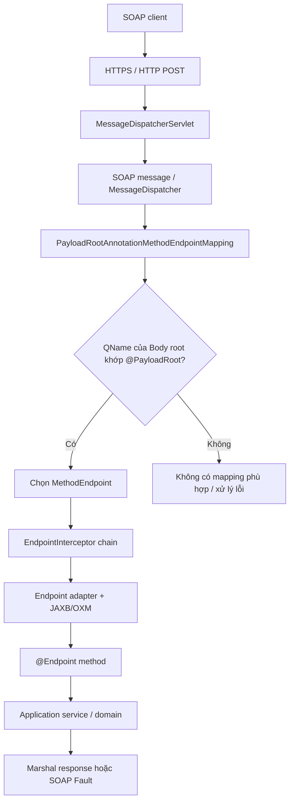
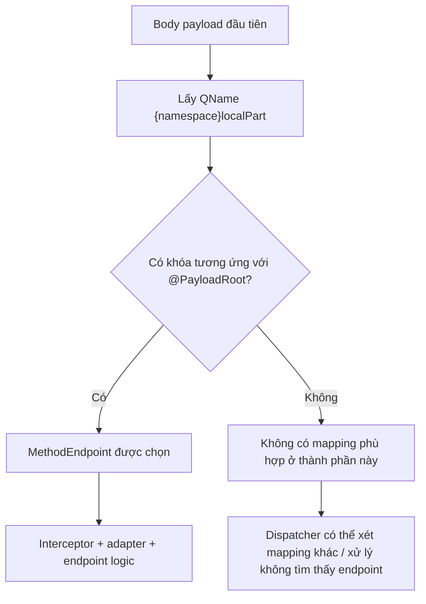
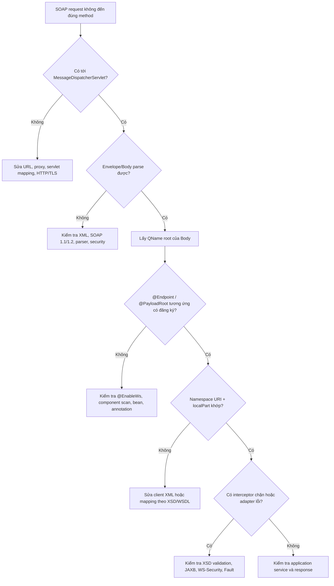

# PayloadRootAnnotationMethodEndpointMapping và điều kiện khớp

## 1. Tại sao SOAP server phải định tuyến theo nội dung thông điệp?

Khi nhiều nghiệp vụ cùng được công bố tại một địa chỉ SOAP, chẳng hạn `https://api.example.com/ws`, máy chủ cần biết request đang yêu cầu **tra cứu đơn hàng**, **tạo đơn hàng** hay **hủy đơn hàng**. Không thể chỉ dựa vào URL HTTP vì cả ba thao tác có thể đi qua cùng một `MessageDispatcherServlet` và cùng đường dẫn. Spring Web Services (Spring-WS) giải quyết bài toán này thông qua **endpoint mapping**: đọc đặc điểm của SOAP message rồi chọn phương thức `@Endpoint` phù hợp.

Trong lập trình **contract-first**, các phần tử XML của SOAP Body được công bố bằng **XSD**, còn **WSDL** liên kết chúng với operation, binding và địa chỉ dịch vụ. Một lựa chọn định tuyến rất thường gặp là **`PayloadRootAnnotationMethodEndpointMapping`**, thành phần dùng **QName của phần tử gốc trong SOAP Body** để tìm phương thức Java được đánh dấu `@PayloadRoot`.

Ví dụ, hai thông điệp cùng gửi đến `POST /ws`:

```xml
<ord:GetOrderRequest xmlns:ord="https://example.com/orders/v1">
    <ord:orderId>ORD-2026-001</ord:orderId>
</ord:GetOrderRequest>
```

và:

```xml
<ord:CancelOrderRequest xmlns:ord="https://example.com/orders/v1">
    <ord:orderId>ORD-2026-001</ord:orderId>
</ord:CancelOrderRequest>
```

Vì phần tử gốc khác nhau, Spring-WS có thể chọn hai phương thức endpoint riêng mà không cần thêm URL REST-style hoặc đọc tham số nghiệp vụ bằng tay.

**Mục tiêu bài học** thuộc chương **Định tuyến thông điệp** của module `SPRING_WEB_SERVICES`:

1. Giải thích nhiệm vụ của `PayloadRootAnnotationMethodEndpointMapping`, `@Endpoint` và `@PayloadRoot`.
2. Xác định chính xác những điều kiện để một SOAP request khớp một endpoint: bean, QName, namespace URI, local part, payload root và hạ tầng mapping.
3. Phân biệt routing theo **SOAP Body QName** với `SOAPAction`, HTTP path, SOAP Header và WS-Addressing `Action`.
4. Thiết kế ví dụ contract-first với XSD/WSDL, JAXB, endpoint và Java configuration.
5. Chẩn đoán trường hợp không tìm thấy endpoint, trùng mapping hoặc client/server khác namespace.
6. Kiểm thử việc định tuyến, schema validation, SOAP Fault và bảo mật tích hợp bằng XML thật.

> **Ý chính:** `@PayloadRoot` ánh xạ một **QName XML** tới một phương thức. Nó **không** xác minh toàn bộ cấu trúc request theo XSD, không tự unmarshalling JAXB, không cấp quyền cho người gọi và không thay thế chính sách xử lý SOAP Header.

## 2. Bức tranh kiến trúc: endpoint mapping nằm ở đâu?

Một SOAP request đi qua nhiều lớp trước khi application service thực thi:



Trong sơ đồ:

- **`MessageDispatcherServlet`** là cửa nhận SOAP qua servlet transport; việc request có tới servlet phụ thuộc URL mapping và cấu hình container.
- **`MessageDispatcher`** tìm `EndpointMapping` có khả năng xử lý request.
- **`PayloadRootAnnotationMethodEndpointMapping`** trích QName từ payload root, so với metadata `@PayloadRoot` của những phương thức được đăng ký.
- **Endpoint adapter** gọi phương thức được chọn, áp dụng cơ chế đọc `@RequestPayload` và ghi `@ResponsePayload`; JAXB/OXM có thể chuyển XML sang object Java và ngược lại.
- **Interceptor** có thể thực hiện kiểm tra security, schema validation, tracing, xử lý Fault trước/sau endpoint theo chain được cấu hình.

Sơ đồ là mô hình khái niệm; một số lỗi như XML sai cú pháp, SOAP version sai hoặc HTTP/TLS thất bại có thể xảy ra **trước khi đến mapping/interceptor**. Một request không có endpoint khớp cũng có thể không đi qua `EndpointInterceptor` gắn với mapping.

### 2.1. EndpointMapping không phải EndpointAdapter

Hai tên dễ nhầm:

| Thành phần | Câu hỏi nó trả lời | Ví dụ |
| --- | --- | --- |
| **EndpointMapping** | “SOAP message này thuộc về endpoint nào?” | `PayloadRootAnnotationMethodEndpointMapping` so sánh QName với `@PayloadRoot`. |
| **EndpointAdapter** | “Phương thức endpoint đã chọn được gọi với tham số/giá trị trả về như thế nào?” | `DefaultMethodEndpointAdapter` hỗ trợ các kiểu tham số và return value của Spring-WS. |
| **Marshaller/Unmarshaller** | “XML payload biến đổi sang Java object và ngược lại ra sao?” | JAXB, `Jaxb2Marshaller`, các bộ xử lý JAXB thích hợp. |
| **EndpointInterceptor** | “Cần kiểm tra/thực thi quy tắc chung nào trước hoặc sau endpoint?” | Validate XSD, xác minh chữ ký, kiểm soát logging. |

Nếu mapping đã tìm đúng endpoint nhưng JAXB báo lỗi unexpected element, đó **không nhất thiết** là lỗi `PayloadRootAnnotationMethodEndpointMapping`. Tương tự, SOAP Body có QName đúng chưa chứng minh dữ liệu đã qua validation hay người gửi được phép gọi.

## 3. QName: điều kiện khớp quyết định

**QName (qualified name)** của một XML element là cặp:

```text
QName = {namespace URI}localName
```

Ví dụ:

```xml
<ord:GetOrderRequest xmlns:ord="https://example.com/orders/v1">
    <ord:orderId>ORD-2026-001</ord:orderId>
</ord:GetOrderRequest>
```

QName của phần tử gốc là:

```text
{https://example.com/orders/v1}GetOrderRequest
```

Trong code Java, metadata tương ứng:

```java
@PayloadRoot(
    namespace = "https://example.com/orders/v1",
    localPart = "GetOrderRequest"
)
```

**Hai giá trị phải khớp chính xác** với QName mà dispatcher đọc từ payload:

1. **`namespace`**: chuỗi namespace URI đầy đủ.
2. **`localPart`**: tên phần tử không kèm prefix, phân biệt chữ hoa/chữ thường.

### 3.1. Prefix không tham gia điều kiện định tuyến

Hai phần tử sau **cùng QName**:

```xml
<ord:GetOrderRequest
    xmlns:ord="https://example.com/orders/v1"/>
```

```xml
<o:GetOrderRequest
    xmlns:o="https://example.com/orders/v1"/>
```

Tiền tố `ord` và `o` chỉ là cách viết XML. Nếu URI namespace và local name bằng nhau, hai payload có thể được chuyển đến cùng endpoint. Khi debug, **không so sánh chuỗi prefix**.

### 3.2. Default namespace cũng tạo QName tương tự

```xml
<GetOrderRequest xmlns="https://example.com/orders/v1">
    <orderId>ORD-2026-001</orderId>
</GetOrderRequest>
```

Phần tử gốc trên vẫn có QName `{https://example.com/orders/v1}GetOrderRequest`. Không có prefix **không có nghĩa không có namespace** khi default namespace đã được khai báo.

Ngược lại:

```xml
<GetOrderRequest>
    <orderId>ORD-2026-001</orderId>
</GetOrderRequest>
```

không khai báo namespace. Với SOAP Body root như vậy, QName là `{}GetOrderRequest`, **không khớp** mapping yêu cầu `https://example.com/orders/v1`.

### 3.3. Tên gần giống không đủ

| Payload root thực tế | Mapping `{https://example.com/orders/v1}GetOrderRequest` | Lý do |
| --- | --- | --- |
| `{https://example.com/orders/v1}GetOrderRequest` | **Khớp** | Đúng cả URI và local name. |
| Cùng QName nhưng prefix `p` thay `ord` | **Khớp** | Prefix không thuộc QName. |
| `{https://example.com/orders/v1/}GetOrderRequest` | **Không** | URI có dấu `/` cuối khác. |
| `{http://example.com/orders/v1}GetOrderRequest` | **Không** | `http` và `https` là hai URI khác nhau. |
| `{https://example.com/orders/v2}GetOrderRequest` | **Không** | Namespace khác phiên bản. |
| `{https://example.com/orders/v1}getOrderRequest` | **Không** | Local name phân biệt chữ hoa/chữ thường. |
| `{}GetOrderRequest` | **Không** | Không có namespace. |
| `{https://example.com/orders/v1}GetOrderResponse` | **Không** | Phần tử phản hồi không phải root request đã đăng ký. |

Namespace URI là **định danh**, không phải địa chỉ buộc Spring-WS phải tải về. Server không gọi HTTP tới URI đó để đối chiếu mapping.

### 3.4. Điều kiện khớp là root của payload, không phải một phần tử con

Ví dụ sai kỳ vọng:

```xml
<ord:ProcessMessage xmlns:ord="https://example.com/orders/v1">
    <ord:GetOrderRequest>
        <ord:orderId>ORD-2026-001</ord:orderId>
    </ord:GetOrderRequest>
</ord:ProcessMessage>
```

Phần tử root của payload là `ProcessMessage`, còn `GetOrderRequest` chỉ là phần tử **bên trong**. Mapping dành cho `GetOrderRequest` không được chọn chỉ vì XML chứa một node cùng tên ở sâu hơn.

Đối với SOAP thông thường theo document/literal wrapped, root của payload hay là một wrapper có tên theo thao tác. Tuy nhiên, chính **XSD/WSDL thực tế** mới quyết định root, không phải suy luận từ tên operation.

## 4. Những điều kiện cần để @PayloadRoot thực sự được đăng ký

Đúng QName là điều kiện trọng tâm ở **thời điểm nhận request**, nhưng để có mapping thì ứng dụng phải đăng ký endpoint trước:

| Điều kiện | Ý nghĩa | Nếu thiếu |
| --- | --- | --- |
| Bean endpoint được Spring tạo | Lớp chứa phương thức phải thuộc Spring application context phù hợp. | Không có phương thức nào được mapping tìm thấy. |
| Lớp được đánh dấu `@Endpoint` | Hạ tầng annotation method mapping nhận diện bean là SOAP endpoint. | Một `@Component` thông thường chưa thay thế được metadata `@Endpoint` trong cơ chế chuẩn. |
| Phương thức có `@PayloadRoot` | Khai báo QName request được phương thức xử lý. | Mapping không có khóa QName cho phương thức đó. |
| `@EnableWs` hoặc cấu hình tương đương | Kích hoạt những thành phần SOAP server, gồm annotation endpoint mapping. | Mapping có thể không được thiết lập theo cấu hình mong đợi. |
| SOAP request đến `MessageDispatcherServlet` | URL, HTTP method, servlet mapping và transport đúng. | Không đến bước xử lý endpoint mapping. |
| SOAP Body có payload root có QName phù hợp | Mapping so sánh namespace và local part của element gốc. | Không tìm thấy phương thức cho khóa QName đó. |
| Không có xung đột mapping không được giải quyết | Một QName request nên có một chủ thể xử lý được định nghĩa rõ. | Khởi tạo mapping có thể báo trùng hoặc hành vi không được chấp nhận. |

Trong mô hình chuẩn, `PayloadRootAnnotationMethodEndpointMapping` tìm **những phương thức phù hợp trong bean `@Endpoint`**, không tự quét mọi method Java trong classpath. Hãy bảo đảm component scanning, package của endpoint và application context đều chính xác.

### 4.1. @Endpoint không phải @Controller

Ví dụ đúng với Spring-WS:

```java
import org.springframework.ws.server.endpoint.annotation.Endpoint;
import org.springframework.ws.server.endpoint.annotation.PayloadRoot;
import org.springframework.ws.server.endpoint.annotation.RequestPayload;
import org.springframework.ws.server.endpoint.annotation.ResponsePayload;

@Endpoint
public class OrderEndpoint {
    private static final String NS = "https://example.com/orders/v1";

    private final OrderQueryService orderQueryService;

    public OrderEndpoint(OrderQueryService orderQueryService) {
        this.orderQueryService = orderQueryService;
    }

    @PayloadRoot(namespace = NS, localPart = "GetOrderRequest")
    @ResponsePayload
    public GetOrderResponse getOrder(
            @RequestPayload GetOrderRequest request) {
        return orderQueryService.findOrder(request.getOrderId());
    }
}
```

`GetOrderRequest` và `GetOrderResponse` giả định là **JAXB contract classes** sinh từ XSD. `OrderQueryService` là thành phần nghiệp vụ do dự án xây dựng. Cần cấu hình endpoint adapter/JAXB binding tương thích, schema validation, bảo mật và exception resolver để hệ thống triển khai đầy đủ.

Các annotation ở đây có **vai trò khác nhau**:

- `@Endpoint`: đánh dấu bean là nơi xử lý SOAP của Spring-WS.
- `@PayloadRoot`: công bố khóa QName dùng để **chọn phương thức**.
- `@RequestPayload`: cho biết tham số nhận dữ liệu payload, phụ thuộc endpoint adapter/binding.
- `@ResponsePayload`: cho biết giá trị trả về phải chuyển thành payload phản hồi.

`@PayloadRoot` **không đọc dữ liệu request thành object Java**; phần này được thực hiện sau khi phương thức được chọn, bởi adapter và message converter/JAXB tương ứng.

### 4.2. Một class có nhiều phương thức cùng định tuyến được

```java
@Endpoint
public class OrderEndpoint {
    private static final String NS = "https://example.com/orders/v1";

    @PayloadRoot(namespace = NS, localPart = "GetOrderRequest")
    @ResponsePayload
    public GetOrderResponse get(
            @RequestPayload GetOrderRequest request) {
        // Gọi service và tạo JAXB response.
        throw new UnsupportedOperationException("Minh họa chữ ký");
    }

    @PayloadRoot(namespace = NS, localPart = "CancelOrderRequest")
    @ResponsePayload
    public CancelOrderResponse cancel(
            @RequestPayload CancelOrderRequest request) {
        // Gọi use case hủy đơn với authorization.
        throw new UnsupportedOperationException("Minh họa chữ ký");
    }
}
```

Đoạn trên **chỉ minh họa mapping**, không phải endpoint production: các phương thức cố tình không có implementation nghiệp vụ, `CancelOrderRequest`/`CancelOrderResponse` cần được khai báo trong XSD và sinh mã. Dù hai phương thức cùng một Java class và cùng một HTTP URL, `GetOrderRequest` và `CancelOrderRequest` có QName khác nên được định tuyến khác nhau.

Không nhất thiết đặt một operation trong một class endpoint; cách tổ chức class nên phục vụ khả năng bảo trì, nhưng **không làm đổi hợp đồng XML công khai**.

## 5. Ví dụ contract-first: XSD, WSDL và endpoint mapping

### 5.1. Một XSD tối thiểu có hai phần tử request/response

Ví dụ `src/main/resources/xsd/orders-v1.xsd`:

```xml
<?xml version="1.0" encoding="UTF-8"?>
<xs:schema xmlns:xs="http://www.w3.org/2001/XMLSchema"
           xmlns:ord="https://example.com/orders/v1"
           targetNamespace="https://example.com/orders/v1"
           elementFormDefault="qualified">

    <xs:simpleType name="OrderIdType">
        <xs:restriction base="xs:string">
            <xs:minLength value="1"/>
            <xs:maxLength value="40"/>
        </xs:restriction>
    </xs:simpleType>

    <xs:element name="GetOrderRequest">
        <xs:complexType>
            <xs:sequence>
                <xs:element name="orderId" type="ord:OrderIdType"/>
            </xs:sequence>
        </xs:complexType>
    </xs:element>

    <xs:element name="GetOrderResponse">
        <xs:complexType>
            <xs:sequence>
                <xs:element name="orderId" type="ord:OrderIdType"/>
                <xs:element name="status" type="xs:string"/>
            </xs:sequence>
        </xs:complexType>
    </xs:element>
</xs:schema>
```

Hai phần tử toàn cục có các QName:

```text
Request:  {https://example.com/orders/v1}GetOrderRequest
Response: {https://example.com/orders/v1}GetOrderResponse
```

Phương thức Java phải mapping **request root**, không phải response root. Nếu đổi `GetOrderRequest` thành `FetchOrderRequest` trong XSD, đây là thay đổi wire contract: phải cập nhật mapping và đánh giá ảnh hưởng tới client đã phát hành.

### 5.2. Bật hạ tầng Spring-WS và công bố WSDL

Ví dụ dành cho dự án Spring Boot/Jakarta Servlet tương thích Spring-WS hiện đại:

```java
import org.springframework.boot.web.servlet.ServletRegistrationBean;
import org.springframework.context.ApplicationContext;
import org.springframework.context.annotation.Bean;
import org.springframework.context.annotation.Configuration;
import org.springframework.core.io.ClassPathResource;
import org.springframework.ws.config.annotation.EnableWs;
import org.springframework.ws.transport.http.MessageDispatcherServlet;
import org.springframework.ws.wsdl.wsdl11.DefaultWsdl11Definition;
import org.springframework.xml.xsd.SimpleXsdSchema;
import org.springframework.xml.xsd.XsdSchema;

@Configuration
@EnableWs
public class SoapServerConfiguration {
    @Bean
    public ServletRegistrationBean<MessageDispatcherServlet>
            soapServlet(ApplicationContext applicationContext) {
        MessageDispatcherServlet servlet = new MessageDispatcherServlet();
        servlet.setApplicationContext(applicationContext);
        servlet.setTransformWsdlLocations(true);
        return new ServletRegistrationBean<>(servlet, "/ws/*");
    }

    @Bean
    public XsdSchema ordersSchema() {
        return new SimpleXsdSchema(
            new ClassPathResource("xsd/orders-v1.xsd"));
    }

    @Bean(name = "orders")
    public DefaultWsdl11Definition ordersWsdl(XsdSchema ordersSchema) {
        DefaultWsdl11Definition wsdl = new DefaultWsdl11Definition();
        wsdl.setPortTypeName("OrdersPort");
        wsdl.setTargetNamespace("https://example.com/orders/v1");
        wsdl.setLocationUri("/ws");
        wsdl.setSchema(ordersSchema);
        return wsdl;
    }
}
```

Trong mô hình này, `MessageDispatcherServlet` nhận request tại `/ws/*` và bean `orders` có thể công bố WSDL ở `/ws/orders.wsdl`. `@EnableWs` kích hoạt hạ tầng SOAP endpoint, gồm annotation-based mappings phù hợp. `DefaultWsdl11Definition` hỗ trợ sinh WSDL 1.1 từ XSD, thường dựa trên quy ước tên hậu tố `Request` và `Response`.

**Không nhầm ba việc riêng:**

1. `MessageDispatcherServlet` nhận HTTP/SOAP request ở **đường dẫn** được đăng ký.
2. `DefaultWsdl11Definition` công bố mô tả **hợp đồng**.
3. `PayloadRootAnnotationMethodEndpointMapping` chọn **phương thức endpoint** theo QName của request payload.

Hệ thống production cần cấu hình thêm JAXB runtime, business services, XSD/WSDL được phê duyệt, xử lý lỗi, TLS/chứng chỉ, SOAP security và HTTP proxy nếu có. Khi dùng reverse proxy, cần xác minh WSDL công bố `soap:address` đúng public URL, không chỉ dựa trên `setTransformWsdlLocations(true)`.

### 5.3. SOAP request hoàn chỉnh

```xml
<?xml version="1.0" encoding="UTF-8"?>
<soap:Envelope
    xmlns:soap="http://schemas.xmlsoap.org/soap/envelope/"
    xmlns:ord="https://example.com/orders/v1">
    <soap:Header/>
    <soap:Body>
        <ord:GetOrderRequest>
            <ord:orderId>ORD-2026-001</ord:orderId>
        </ord:GetOrderRequest>
    </soap:Body>
</soap:Envelope>
```

Đối với mapping, khóa được lấy từ **phần tử gốc payload trong Body**: `{https://example.com/orders/v1}GetOrderRequest`. `soap:Envelope` và `soap:Body` có namespace của giao thức SOAP, nhưng chúng **không** là QName được so với `@PayloadRoot`. `soap:Header` không phải nguồn điều kiện của mapping này.

Nếu payload hợp đồng là `GetOrderRequest`, các trường con như `orderId` phải được kiểm tra bằng schema/logic nghiệp vụ sau đó; `PayloadRootAnnotationMethodEndpointMapping` không nhìn giá trị `ORD-2026-001` để chọn phương thức.

### 5.4. Response, QName và lớp JAXB

Một response hợp lệ có thể như sau:

```xml
<soap:Envelope
    xmlns:soap="http://schemas.xmlsoap.org/soap/envelope/"
    xmlns:ord="https://example.com/orders/v1">
    <soap:Body>
        <ord:GetOrderResponse>
            <ord:orderId>ORD-2026-001</ord:orderId>
            <ord:status>CONFIRMED</ord:status>
        </ord:GetOrderResponse>
    </soap:Body>
</soap:Envelope>
```

Việc marshal `GetOrderResponse` là trách nhiệm của **endpoint adapter/JAXB binding** sau khi service xử lý thành công. Mapping request **không kiểm tra QName response** để chọn phương thức. Nhưng response vẫn phải tuân thủ XSD/WSDL và được client unmarshalling đúng.

Trong Spring-WS hiện đại, các annotation JAXB thường ở `jakarta.xml.bind.annotation.*`, trong khi mã JAXB 2.x cũ có thể dùng `javax.xml.bind.annotation.*`. Chọn XJC, JAXB API và runtime phù hợp với Spring Framework/Spring-WS đang dùng; **sai thế hệ JAXB gây lỗi binding chứ không phải điều kiện khớp `@PayloadRoot`**.

## 6. PayloadRootAnnotationMethodEndpointMapping thực hiện khớp ra sao?

Hãy nhìn lại request:

```xml
<soap:Body xmlns:soap="http://schemas.xmlsoap.org/soap/envelope/">
    <m:GetOrderRequest xmlns:m="https://example.com/orders/v1">
        <m:orderId>ORD-2026-001</m:orderId>
    </m:GetOrderRequest>
</soap:Body>
```

Quá trình khớp có thể hình dung bằng **hai giai đoạn** khác nhau.

### 6.1. Giai đoạn khởi tạo: xây dựng bảng ánh xạ

1. Hạ tầng Spring-WS tìm bean được đánh dấu `@Endpoint` trong application context.
2. Mapping kiểm tra các phương thức được đánh dấu `@PayloadRoot` phù hợp.
3. Với mỗi phương thức, mapping xây khóa QName từ thuộc tính `namespace` và `localPart`.
4. Bảng ánh xạ nội bộ liên kết QName với endpoint method tương ứng.
5. Nếu có hai phương thức tranh cùng một khóa QName trong cùng phạm vi mapping, cần giải quyết thiết kế trùng lặp; không dựa vào “method nào xuất hiện trước” để chọn ngẫu nhiên.

Ví dụ khái niệm của bảng ánh xạ:

| Khóa QName đăng ký | Phương thức Java |
| --- | --- |
| `{https://example.com/orders/v1}GetOrderRequest` | `OrderEndpoint#getOrder(...)` |
| `{https://example.com/orders/v1}CancelOrderRequest` | `OrderEndpoint#cancelOrder(...)` |
| `{https://example.com/customers/v1}FindCustomerRequest` | `CustomerEndpoint#findCustomer(...)` |

Tính nhất quán của khóa QName quan trọng hơn tên Java class. Đổi `getOrder` thành `fetchOrder` có thể là một refactor nội bộ vô hại nếu `@PayloadRoot` và wire contract giữ nguyên.

### 6.2. Giai đoạn runtime: tìm endpoint theo payload root

1. Servlet chuyển SOAP message đã nhận vào hạ tầng dispatcher.
2. Mapping đọc QName của **element payload gốc trong SOAP Body**.
3. Mapping tra khóa QName tương ứng trong những phương thức đã đăng ký.
4. Nếu có mapping, kết quả là một endpoint method để adapter gọi.
5. Các interceptor/adapter xử lý những bước tiếp theo, bao gồm validation và unmarshalling theo cấu hình.



**Lưu ý:** Nếu không tìm thấy endpoint qua mapping này, dispatcher có thể còn những `EndpointMapping` khác được cấu hình. Kết quả HTTP/SOAP cuối cùng khi hoàn toàn không có mapping phụ thuộc vào stack và cách xử lý lỗi, không nên khẳng định mọi trường hợp đều trả đúng một HTTP status hoặc SOAP Fault duy nhất.

### 6.3. Mapping không xét dữ liệu con hay kiểu Java để quyết định

Hai request:

```xml
<ord:GetOrderRequest xmlns:ord="https://example.com/orders/v1">
    <ord:orderId>ORD-001</ord:orderId>
</ord:GetOrderRequest>
```

và:

```xml
<ord:GetOrderRequest xmlns:ord="https://example.com/orders/v1">
    <ord:orderId>UNKNOWN-ID</ord:orderId>
</ord:GetOrderRequest>
```

đều đi vào **cùng endpoint method** nếu các điều kiện chung đúng. Giá trị `orderId` không ảnh hưởng tới khóa routing; service có thể trả dữ liệu hoặc lỗi nghiệp vụ sau khi mapping kết thúc.

Tương tự, request:

```xml
<ord:GetOrderRequest xmlns:ord="https://example.com/orders/v1">
    <ord:unexpected>value</ord:unexpected>
</ord:GetOrderRequest>
```

có **root QName đúng**, vì vậy vẫn có thể được định tuyến tới `getOrder`. Nhưng payload bên trong sai XSD, nếu bật schema validation hoặc unmarshalling nghiêm ngặt thì có thể bị từ chối **sau khi chọn endpoint**. **Khớp mapping không đồng nghĩa XML hợp lệ theo hợp đồng.**

### 6.4. Request không có payload root

Một SOAP Body rỗng:

```xml
<soap:Envelope
    xmlns:soap="http://schemas.xmlsoap.org/soap/envelope/">
    <soap:Body/>
</soap:Envelope>
```

không chứa phần tử nghiệp vụ gốc để khớp `@PayloadRoot`. Một thông điệp SOAP có nhiều phần tử con trực tiếp trong Body cũng cần đánh giá theo binding/hợp đồng: cơ chế này lấy payload root theo cách hạ tầng định nghĩa, **không định tuyến bằng cách tìm một phần tử bất kỳ ở vị trí tùy ý**. Với document/literal wrapped phổ biến, thiết kế nhất quán là một wrapper root cho mỗi message body.

## 7. Định tuyến bằng payload root khác gì SOAPAction?

Một điểm gây nhầm lẫn thường gặp là cùng một SOAP request có cả:

- Phần tử `<ord:GetOrderRequest>` trong **SOAP Body**.
- HTTP header `SOAPAction` (phổ biến trong SOAP 1.1).
- Có thể có header `wsa:Action` thuộc **WS-Addressing**.

Chúng **không phải một giá trị duy nhất**.

### 7.1. So sánh bốn cơ chế

| Dữ liệu/cơ chế | Vị trí | Ai sử dụng khi định tuyến? | Ghi chú |
| --- | --- | --- | --- |
| **Payload root QName** | Phần tử gốc trong SOAP Body | **`PayloadRootAnnotationMethodEndpointMapping`** | Khóa là `{namespace URI}localPart`. |
| **HTTP SOAPAction** | HTTP header của SOAP 1.1 | Có thể được `SoapActionAnnotationMethodEndpointMapping` dùng với `@SoapAction`. | Không phải tiêu chí của `@PayloadRoot`. |
| **WS-Addressing Action** | SOAP Header `wsa:Action` | Một cơ chế/policy endpoint mapping hoặc xử lý WS-Addressing riêng nếu được cấu hình. | Không tự trùng với HTTP SOAPAction. |
| **Servlet URL path** | URL/HTTP routing | Servlet container chọn `MessageDispatcherServlet`. | Thường nhiều SOAP operations dùng chung đường dẫn. |

Đối với SOAP 1.2, action trong HTTP binding thường nằm dưới dạng parameter của `Content-Type: application/soap+xml`, khác cách SOAP 1.1 dùng header `SOAPAction`. Điều này **không đổi quy tắc so QName Body của `PayloadRootAnnotationMethodEndpointMapping`**.

### 7.2. Ví dụ SOAP 1.1 có SOAPAction

```http
POST /ws HTTP/1.1
Host: api.example.com
Content-Type: text/xml; charset=utf-8
SOAPAction: "https://example.com/orders/GetOrder"
```

Phần Body của request:

```xml
<soap:Body xmlns:soap="http://schemas.xmlsoap.org/soap/envelope/"
           xmlns:ord="https://example.com/orders/v1">
    <ord:GetOrderRequest>
        <ord:orderId>ORD-2026-001</ord:orderId>
    </ord:GetOrderRequest>
</soap:Body>
```

Với **payload-root mapping**, SOAPAction ở HTTP không phải khóa so khớp; khóa là `{https://example.com/orders/v1}GetOrderRequest`.

Nếu SOAPAction gửi sai nhưng Body root vẫn đúng, mapping theo payload root **vẫn có thể tìm ra endpoint**. Điều đó **không chứng minh toàn bộ yêu cầu hợp lệ**: hạ tầng SOAP, intermediary, policy bảo mật hoặc một mapping khác có thể yêu cầu SOAPAction đúng WSDL/binding.

### 7.3. SoapActionAnnotationMethodEndpointMapping là cơ chế khác

Spring-WS cũng có thể hỗ trợ mapping theo SOAPAction qua annotation phù hợp:

```java
import org.springframework.ws.soap.server.endpoint.annotation.SoapAction;

@SoapAction("https://example.com/orders/GetOrder")
@ResponsePayload
public GetOrderResponse getOrder(
        @RequestPayload GetOrderRequest request) {
    // Mã nghiệp vụ và mapping hợp đồng.
    throw new UnsupportedOperationException("Ví dụ định tuyến");
}
```

Đây là **ví dụ cú pháp `@SoapAction`**, không phải một phương thức production hoàn chỉnh. Một server có thể có nhiều cơ chế `EndpointMapping`, nên cần xem **thứ tự ưu tiên/configuration** của chúng nếu cùng một SOAP message có thể khớp nhiều mapping.

Không nên cho rằng:

- Đổi `SOAPAction` sẽ tự thay `@PayloadRoot`.
- `@PayloadRoot` bắt buộc phải có một SOAPAction trùng tên.
- Hai mapping khác loại được kết hợp như điều kiện logic **AND** chỉ vì chúng đều tồn tại.

Trong mô hình `MessageDispatcher`, các endpoint mapping là những chiến lược tìm endpoint; chiến lược được chọn và thứ tự phụ thuộc cấu hình, không tự tạo “AND” giữa Body QName và SOAPAction. Nếu giao thức yêu cầu **cả hai thông tin phải thống nhất**, cần kiểm tra chính sách/hợp đồng hoặc xử lý riêng ngoài việc chỉ đăng ký hai mapping.

### 7.4. Khi hai operation dùng cùng payload root

Giả sử WSDL có hai operation, cùng dùng global element `ord:OrderCommand` nhưng phân biệt SOAPAction:

```text
Operation A: SOAPAction = /approve
Operation B: SOAPAction = /reject
Body root cả hai = {https://example.com/orders/v1}OrderCommand
```

**`PayloadRootAnnotationMethodEndpointMapping` không đủ thông tin** để phân biệt A/B, vì cả hai có cùng khóa QName. Có thể:

1. Thiết kế **hai request root khác nhau** theo hướng document/literal wrapped, ví dụ `ApproveOrderRequest` và `RejectOrderRequest`; đây là cách rõ ràng khi kiểm soát được XSD.
2. Dùng mapping **theo SOAPAction** hoặc cơ chế phù hợp khác, đồng thời kiểm tra tính tương thích WSDL và message binding.
3. Tạo một endpoint cho root chung rồi phân nhánh nghiệp vụ dựa trên trường command được định nghĩa và validate rõ ràng, nếu đó là hợp đồng có chủ đích.

Không gán hai phương thức `@PayloadRoot` có **cùng QName** rồi chờ dispatcher tự phân biệt bằng giá trị `commandType` bên trong Body.

## 8. Trùng QName, nhiều endpoint và thứ tự mapping

### 8.1. Trùng @PayloadRoot giữa hai phương thức

Ví dụ phản diện:

```java
@Endpoint
public class FirstOrderEndpoint {
    @PayloadRoot(
        namespace = "https://example.com/orders/v1",
        localPart = "GetOrderRequest")
    public GetOrderResponse find(@RequestPayload GetOrderRequest request) {
        // ...
        return null;
    }
}

@Endpoint
public class SecondOrderEndpoint {
    @PayloadRoot(
        namespace = "https://example.com/orders/v1",
        localPart = "GetOrderRequest")
    public GetOrderResponse get(@RequestPayload GetOrderRequest request) {
        // ...
        return null;
    }
}
```

Hai phương thức cùng nhận một **QName** trong cùng mapping domain. Đây là **xung đột cấu hình** chứ không phải cơ chế load balancing. Tùy implementation/phiên bản, quá trình đăng ký có thể phát hiện và báo lỗi mapping trùng. Thiết kế đúng là có **một chủ thể chịu trách nhiệm rõ ràng cho mỗi QName** trong một chiến lược mapping, sau đó gọi các service khác bên trong nếu cần.

Nếu ứng dụng có v1 và v2, dùng **namespace khác nhau**, không chỉ đổi tên class:

```java
@PayloadRoot(
    namespace = "https://example.com/orders/v1",
    localPart = "GetOrderRequest")
public GetOrderResponseV1 getV1(
        @RequestPayload GetOrderRequestV1 request) {
    // ...
    return null;
}

@PayloadRoot(
    namespace = "https://example.com/orders/v2",
    localPart = "GetOrderRequest")
public GetOrderResponseV2 getV2(
        @RequestPayload GetOrderRequestV2 request) {
    // ...
    return null;
}
```

Hai khóa khác namespace nên có thể cùng tồn tại. Các method trả `null` ở ví dụ chỉ để minh họa chữ ký; sản phẩm thực tế phải trả payload hợp lệ hoặc Fault theo hợp đồng.

### 8.2. Nhiều EndpointMapping cùng được đăng ký

Một ứng dụng có thể sử dụng:

- `PayloadRootAnnotationMethodEndpointMapping` cho các phương thức `@PayloadRoot`.
- `SoapActionAnnotationMethodEndpointMapping` cho các phương thức `@SoapAction`.
- Những mapping tùy chỉnh hoặc dựa trên XPath/QName theo yêu cầu tích hợp.

Khi một message có thể được nhiều mapping xử lý, **thứ tự mapping trong dispatcher có ý nghĩa**. Spring-WS có cơ chế order/prioritization cho các `EndpointMapping`, nhưng không nên ghi nhớ một con số mặc định từ một phiên bản rồi xem đó là cam kết bất biến của mọi project.

Một cấu hình cần kiểm soát:

1. Những mapping bean **nào thực sự được tạo** khi ứng dụng khởi động?
2. Mỗi mapping nhận dạng request dựa trên **thông tin nào**?
3. Thứ tự ưu tiên được thiết lập như thế nào?
4. Nếu hai mapping cùng cho ra endpoint, **chiến lược nào thực sự thắng**?
5. Các interceptor đã gắn vào **mapping được sử dụng** chưa?

Với Spring-WS, `@EnableWs` đã kích hoạt các annotation mappings mặc định; không tự tạo thêm một `PayloadRootAnnotationMethodEndpointMapping` khác chỉ để “bật” `@PayloadRoot`. Khi cấu hình sâu, cần đánh giá khả năng tạo mapping trùng hoặc chain interceptor khác nhau ngoài ý muốn.

### 8.3. Một phương thức nhận nhiều QName

Trong các phiên bản Spring-WS hỗ trợ khai báo nhiều `@PayloadRoot` cho một method (ví dụ thông qua annotation container `@PayloadRoots`), có thể dùng để xử lý các payload gốc khác nhau khi **thực sự có cùng ngữ nghĩa và kiểu đầu vào được adapter hỗ trợ**.

Tuy nhiên:

- Không giả định một method nhận `GetOrderRequestV1` sẽ tự nhận `GetOrderRequestV2` chỉ vì cả hai được gắn mapping.
- Kiểu JAXB, namespace và schema của mỗi phiên bản phải được xử lý rõ ràng.
- Khi hai contract khác nhau đáng kể, **hai phương thức endpoint riêng** thường dễ kiểm thử, bảo trì và quản trị phiên bản hơn.
- Cần kiểm tra hỗ trợ annotation tương ứng trong phiên bản Spring-WS dự án đang sử dụng.

Việc gắn thêm mapping chỉ mở thêm **khóa routing**, không tự viết mapper chuyển JAXB v1 sang JAXB v2.

## 9. Vai trò của WSDL/XSD trong định tuyến contract-first

**XSD** mô tả những QName hợp lệ của payload; **WSDL** mô tả cách các message mang QName đó tham gia một operation. Nhưng `PayloadRootAnnotationMethodEndpointMapping` không đọc WSDL mỗi lần có SOAP request để quyết định method.

```text
Design/build-time:
XSD → global element QNames → JAXB/XJC
    → WSDL operation messages/binding
    → @PayloadRoot được viết theo QName request đã công bố

Runtime:
SOAP Body root QName → PayloadRootAnnotationMethodEndpointMapping
                     → endpoint method → adapter/JAXB → application service
```

### 9.1. Tên WSDL operation không nhất thiết là tên root

Ví dụ WSDL operation tên `getOrder`, trong khi body message phần tử gốc `ord:GetOrderRequest`. `@PayloadRoot` phải dùng **`GetOrderRequest`**, không dùng `getOrder`, trừ khi XSD thật sự đặt root là `getOrder`.

Không suy luận root từ:

- Tên phương thức Java.
- Tên port type trong WSDL.
- Tên bean Spring.
- URL servlet.
- Giá trị SOAPAction.

Đặc biệt, trong **document/literal bare**, tên global element có thể không giống operation. Hãy lấy QName từ **XSD/WSDL đã ký duyệt** và từ SOAP payload thực tế.

### 9.2. XSD validation không phải routing

`PayloadValidatingInterceptor` có thể kiểm tra body sau khi endpoint được tìm thấy:

```java
import java.util.List;
import org.springframework.context.annotation.Bean;
import org.springframework.context.annotation.Configuration;
import org.springframework.ws.config.annotation.WsConfigurer;
import org.springframework.ws.server.EndpointInterceptor;
import org.springframework.ws.server.endpoint.adapter.method.MethodArgumentResolver;
import org.springframework.ws.server.endpoint.adapter.method.MethodReturnValueHandler;
import org.springframework.ws.soap.server.endpoint.interceptor.PayloadValidatingInterceptor;
import org.springframework.xml.xsd.XsdSchema;

@Configuration
public class SoapValidationConfiguration implements WsConfigurer {
    private final PayloadValidatingInterceptor validator;

    public SoapValidationConfiguration(
            PayloadValidatingInterceptor validator) {
        this.validator = validator;
    }

    @Bean
    public static PayloadValidatingInterceptor payloadValidator(
            XsdSchema ordersSchema) {
        PayloadValidatingInterceptor interceptor =
            new PayloadValidatingInterceptor();
        interceptor.setXsdSchema(ordersSchema);
        interceptor.setValidateRequest(true);
        interceptor.setValidateResponse(false);
        return interceptor;
    }

    @Override
    public void addInterceptors(List<EndpointInterceptor> interceptors) {
        interceptors.add(validator);
    }

    @Override
    public void addArgumentResolvers(
            List<MethodArgumentResolver> resolvers) {
        // Không thêm argument resolver trong ví dụ này.
    }

    @Override
    public void addReturnValueHandlers(
            List<MethodReturnValueHandler> handlers) {
        // Không thêm return value handler trong ví dụ này.
    }
}
```

**Lưu ý phiên bản và vòng đời:** ví dụ tái sử dụng bean `XsdSchema ordersSchema` đã khai báo ở mục 5, đăng ký validator bằng `setXsdSchema(...)` và để Spring quản lý khởi tạo bean. Phương thức factory `@Bean` được khai báo `static` để tránh phụ thuộc khởi tạo vòng khi `@Configuration` tự inject interceptor do chính nó khai báo. Hai callback không dùng được triển khai rỗng để tương thích Spring-WS 4.0.x; từ 4.1+ `WsConfigurer` có default methods và có thể bỏ chúng. Đây là một cách đăng ký validator, không tự bật kiểm tra SOAP Header hoặc xác thực danh tính.

**Thứ tự trách nhiệm** cần nhớ:

1. Mapping tìm endpoint bằng QName.
2. Interceptor đã đăng ký có thể kiểm tra XSD, security, tracing trước endpoint.
3. Adapter/binding chuyển XML thành kiểu tham số và gọi phương thức.
4. Business service kiểm tra quyền và nghiệp vụ.

Nếu **root QName không khớp endpoint nào**, interceptor gắn với endpoint mapping có thể **không được gọi**, vì chưa chọn được endpoint. Cần tách kiểm tra XML quá sớm, bảo vệ transport và giám sát thông điệp không có mapping ra khỏi giả định “mọi request đều đi qua validation interceptor”.

### 9.3. WSDL và các client đã sinh mã

Khi công bố namespace mới, không chỉ sửa `@PayloadRoot`. Client đã sinh JAXB/WSDL cũ vẫn gửi QName phiên bản cũ. Để chuyển đổi an toàn:

- Giữ endpoint v1 trong khoảng thời gian hỗ trợ đã công bố.
- Công bố v2 bằng namespace/QName mới nếu thay đổi không tương thích.
- Tạo mapper v1/v2 giữa wire model và application/domain model riêng.
- Giữ fixture XML cũ để phát hiện thay đổi namespace và thứ tự.
- Kiểm thử client .NET, JAXB và những bên dùng WSDL cũ trước khi ngừng v1.

**Định tuyến ổn định không đồng nghĩa hợp đồng ổn định:** nếu endpoint vẫn khớp root nhưng server đổi enum hoặc bỏ trường bắt buộc, client cũ vẫn có thể lỗi khi unmarshalling response.

## 10. Routing, SOAP Fault, XML security và quyền truy cập

Khi mở SOAP service cho các đối tác, một request có QName đúng vẫn có thể là **request không được phép**, chứa XML không an toàn hoặc vi phạm hợp đồng. Các nhiệm vụ này nằm ở những lớp **khác** việc chọn endpoint.

### 10.1. Định tuyến không phải xác thực và phân quyền

Xét request:

```xml
<ord:GetOrderRequest xmlns:ord="https://example.com/orders/v1">
    <ord:orderId>ORD-PRIVATE-001</ord:orderId>
</ord:GetOrderRequest>
```

Nó có cùng root QName với một yêu cầu hợp lệ. Mapping có thể đưa nó vào `getOrder`, nhưng ứng dụng vẫn phải kiểm tra:

- Người gọi là ai, dựa vào danh tính **đã được xác thực**?
- Người gọi được xem đơn hàng `ORD-PRIVATE-001` không?
- Order ID có hợp lệ theo XSD và quy tắc nghiệp vụ không?
- Request có tuân thủ policy chữ ký, timestamp và bảo mật SOAP Header không?
- Có giới hạn rate, size và độ sâu XML để tránh từ chối dịch vụ không?

Đừng chỉ nhìn một header `clientId` hoặc một trường `ownerAccountId` trong Body rồi coi là bằng chứng quyền truy cập. `@PayloadRoot` không có tác dụng bảo vệ dữ liệu giữa các tenant.

### 10.2. Phân chia trách nhiệm bảo vệ

| Kiểm soát | Tầng phù hợp | Quan hệ với payload-root mapping |
| --- | --- | --- |
| TLS, chứng chỉ server, mTLS | HTTP container/gateway/proxy | Bảo vệ kết nối trước khi mapping diễn ra. |
| Giới hạn payload và XML parser | Transport và parsing XML | Có thể từ chối yêu cầu trước khi trích QName. |
| WS-Security token, signature, timestamp | Security processing/interceptor phù hợp | Xác minh chính sách SOAP Header; mapping không đọc/tin các giá trị này. |
| XSD validation | Schema validator/`PayloadValidatingInterceptor` | Root được định tuyến trước; ràng buộc field được kiểm tra ở bước khác. |
| Authorization tài nguyên | Application service/repository có kiểm soát danh tính | Sau khi endpoint đã được chọn; không suy ra quyền từ QName. |
| SOAP Fault công khai | Exception/fault resolver và policy bảo mật | Phân biệt lỗi mapping, lỗi request, lỗi bảo mật và lỗi server. |
| Auditing, tracing, log | Interceptor, application service, gateway | Chỉ log dữ liệu cần thiết, tránh lộ token hoặc PII. |

WS-Security thường được tích hợp bằng interceptor hỗ trợ WSS4J và cấu hình certificate/token/trust phù hợp. **Đăng ký interceptor không tự chứng minh security đã hoạt động**; phải kiểm tra thực sự khả năng từ chối chữ ký sai, timestamp hết hạn và danh tính thiếu quyền.

### 10.3. SOAP Fault khác “không có endpoint mapping”

Những tình huống sau có hậu quả khác nhau:

| Lỗi | Mapping có thể khớp không? | Kỳ vọng xử lý |
| --- | --- | --- |
| Sai namespace của root | **Không** với `@PayloadRoot` hiện tại. | Dispatcher có thể thử mapping khác; nếu không có, báo không tìm thấy endpoint theo cấu hình. |
| Root đúng, thiếu `orderId` | **Có**. | Validation/binding hoặc nghiệp vụ xử lý lỗi; có thể trả SOAP Fault theo chính sách. |
| Root đúng, nhưng đơn không tồn tại | **Có**. | Application service quyết định Fault hoặc response nghiệp vụ đã được công bố. |
| Root đúng, chữ ký WS-Security không hợp lệ | Có thể chọn endpoint nhưng bị security chặn. | Từ chối theo policy, không cho nghiệp vụ chạy; không tiết lộ thông tin bí mật. |
| SOAP Header bắt buộc không được hiểu | Có thể thất bại ở tầng SOAP trước/sau routing tùy policy. | SOAP Fault `MustUnderstand` theo giao thức phù hợp. |
| SOAP Envelope sai version | Có thể chưa vào bước lấy payload root. | SOAP Fault `VersionMismatch` hoặc lỗi giao thức phù hợp. |
| XML không well-formed | Có thể thất bại trước endpoint mapping. | Parser/protocol error, không coi là “không tìm thấy `@PayloadRoot`”. |

Không khẳng định **một** HTTP status hoặc SOAP Fault được sinh cho **mọi** request không khớp. Hành vi cụ thể phụ thuộc phiên bản Spring-WS, message factory, resolver, transport và các mapping khác. Test integration cần ghi nhận giao diện lỗi mà client thực sự quan sát.

### 10.4. Interceptor chỉ chạy trong phạm vi được gắn

Một `EndpointInterceptor` được thêm vào `PayloadRootAnnotationMethodEndpointMapping` xử lý các message được hạ tầng mapping chuyển qua chain tương ứng. Nếu request chưa khớp QName, bạn không nên dựa vào interceptor đó để bảo đảm logging, quota hoặc xác thực cho **mọi HTTP request**.

Các kiểm soát cần áp dụng trước routing (TLS, giới hạn kích thước, parser hardening, đôi khi HTTP authentication) phải được đặt ở **tầng phù hợp**. Security dựa trên SOAP message cần được xác minh ở những điểm nhận dữ liệu được bảo vệ; không sử dụng một QName hợp lệ làm tín hiệu rằng request đã được tin cậy.

## 11. Kiểm thử PayloadRootAnnotationMethodEndpointMapping

Một endpoint có thể hoạt động trong unit test Java nhưng không khớp request XML thực tế. Vì vậy, cần kiểm thử **QName của SOAP Body** chứ không chỉ gọi thẳng `orderEndpoint.getOrder(request)`.

### 11.1. Ma trận test cho điều kiện khớp

Giả sử endpoint khai báo:

```java
@PayloadRoot(
    namespace = "https://example.com/orders/v1",
    localPart = "GetOrderRequest")
```

Kiểm thử:

| Ca | Request Body root | Kết quả mong đợi |
| --- | --- | --- |
| A | `<ord:GetOrderRequest>` với namespace đúng | Chọn `getOrder`. |
| B | `<x:GetOrderRequest>` với prefix khác, namespace đúng | Vẫn chọn `getOrder`. |
| C | `<GetOrderRequest xmlns="https://example.com/orders/v1">` | Vẫn chọn `getOrder`. |
| D | `<GetOrderRequest>` không khai báo namespace | Không khớp mapping v1. |
| E | `<ord:getOrderRequest>` sai chữ hoa/thường | Không khớp mapping. |
| F | `<ord:GetOrderRequest>` với URI `.../v1/` thay vì `.../v1` | Không khớp mapping. |
| G | Root `ProcessMessage`, bên trong có `GetOrderRequest` | Không khớp `GetOrderRequest`. |
| H | `GetOrderRequest` đúng root nhưng thiếu `orderId` | Routing có thể khớp; validation phải báo lỗi nếu bật. |
| I | `CancelOrderRequest` đúng namespace | Chọn method cancel nếu đã đăng ký. |
| J | Body không có payload element | Không có QName để khớp. |
| K | SOAPAction thay đổi nhưng Body root không đổi | Payload-root mapping vẫn dựa vào Body QName; policy khác có thể từ chối. |
| L | `GetOrderRequest` ở namespace v2 | Chỉ khớp nếu có mapping riêng cho v2. |

Nên test cả **một request chứa nhiều namespace trong các phần tử con**: namespace của con không tự thay namespace root. Ví dụ `orderId` có prefix riêng vẫn có thể được routing vì root đúng, nhưng schema validation của Body có thể từ chối.

### 11.2. MockWebServiceClient thử mapping và phản hồi

Spring-WS cung cấp `MockWebServiceClient` để gửi payload trực tiếp qua hạ tầng dispatcher trong Spring test context. Giả sử context đã có `@EnableWs`, bean `@Endpoint`, adapter JAXB và một `OrderQueryService` giả lập:

```java
import org.springframework.context.ApplicationContext;
import org.springframework.xml.transform.StringSource;
import org.springframework.ws.test.server.MockWebServiceClient;
import static org.springframework.ws.test.server.RequestCreators.withPayload;
import static org.springframework.ws.test.server.ResponseMatchers.noFault;
import static org.springframework.ws.test.server.ResponseMatchers.payload;

// Ví dụ thân một integration test, không phải class JUnit đầy đủ.
MockWebServiceClient client =
    MockWebServiceClient.createClient(applicationContext);

StringSource request = new StringSource("""
    <ord:GetOrderRequest xmlns:ord="https://example.com/orders/v1">
      <ord:orderId>ORD-2026-001</ord:orderId>
    </ord:GetOrderRequest>
    """);

StringSource expected = new StringSource("""
    <ord:GetOrderResponse xmlns:ord="https://example.com/orders/v1">
      <ord:orderId>ORD-2026-001</ord:orderId>
      <ord:status>CONFIRMED</ord:status>
    </ord:GetOrderResponse>
    """);

client.sendRequest(withPayload(request))
    .andExpect(noFault())
    .andExpect(payload(expected));
```

Đây là **mã minh họa** cho nội dung test, cần được đặt trong class JUnit với `ApplicationContext`/service mock, dữ liệu trả về và bean binding được khởi tạo đúng. Test trên không yêu cầu chạy HTTP server thật, nên kiểm tra được các khía cạnh như mapping, interceptor và adapter trong context, nhưng không chứng minh servlet URL/TLS/proxy hoạt động.

### 11.3. Test payload đúng QName nhưng sai nội dung

Đưa request:

```xml
<ord:GetOrderRequest xmlns:ord="https://example.com/orders/v1"/>
```

Trường `orderId` là bắt buộc trong XSD ở mục 5. Nếu đã bật và đăng ký `PayloadValidatingInterceptor` đúng, request phải bị **từ chối vì sai schema**, trước khi service tra cứu chạy.

Điều cần xác nhận riêng:

1. Root QName **vẫn khớp** `@PayloadRoot`.
2. Validation được thực thi, không chỉ có XSD file trong project.
3. Application service **không được gọi** khi schema/security chặn request.
4. SOAP Fault hoặc kết quả lỗi được client nhìn thấy đúng policy và không chứa thông tin nội bộ.

Nếu test chỉ trả lời “có tìm thấy endpoint không” mà không kiểm tra XSD, nó chưa chứng minh hợp đồng được thực thi.

### 11.4. Test request sai namespace

Thử:

```xml
<ord:GetOrderRequest xmlns:ord="https://example.com/orders/v2">
    <ord:orderId>ORD-2026-001</ord:orderId>
</ord:GetOrderRequest>
```

Giả sử server chỉ có mapping v1. Kiểm thử cần xác nhận **không gọi `getOrder` v1**, và xác minh cách server báo lỗi khi không có mapping thích hợp. Không cần và không nên sửa XSD v1 để chấp nhận namespace v2 như một biến thể ngầm.

### 11.5. Test giữa nhiều mapping và SOAPAction

Khi ứng dụng cùng đăng ký `@SoapAction` và `@PayloadRoot`, thử bốn tổ hợp:

| Body QName | SOAPAction | Mục tiêu |
| --- | --- | --- |
| Đúng | Đúng | Xác nhận endpoint dự kiến và phản hồi. |
| Đúng | Sai | Xác định thứ tự mapping/policy có từ chối hay không. |
| Sai | Đúng | Xác định `SoapActionAnnotationMethodEndpointMapping` có chọn endpoint khác hay không. |
| Sai | Sai | Xác nhận không đi vào nghiệp vụ ngoài ý muốn. |

Nếu cả Body QName và SOAPAction đều được sử dụng cho **quy tắc an toàn hoặc nghiệp vụ bắt buộc**, hãy có cơ chế kiểm tra tính nhất quán thay vì mặc định Spring-WS kết hợp hai annotation như một điều kiện AND.

### 11.6. HTTP và WSDL tests ngoài MockWebServiceClient

Một bộ kiểm thử production cần thêm các bước chạy qua đường HTTP thực:

- `GET /ws/orders.wsdl` trả WSDL có namespace, element/message và service location đúng chưa?
- `POST /ws` đến đúng `MessageDispatcherServlet` với request SOAP 1.1/1.2 theo hợp đồng chưa?
- HTTP Content-Type, SOAPAction và SOAP Envelope có tương thích với WSDL/binding không?
- TLS/mTLS, reverse proxy, truststore, hostname verification và forwarded headers có đúng không?
- Client sinh từ WSDL cũ có gửi QName giống server hiện nhận không?
- Schema validation, WS-Security và SOAP Fault có hoạt động trên những request thật không?

Đặc biệt, nên giữ **XML fixture** của những phiên bản đã phát hành để phát hiện việc refactor Java hoặc nâng JAXB/Spring-WS làm thay đổi namespace của payload.

## 12. Chẩn đoán lỗi “No endpoint mapping found”

Đây là nhóm lỗi thường gặp nhất khi học `PayloadRootAnnotationMethodEndpointMapping`. Cần tách các nguyên nhân **HTTP transport**, **SOAP parsing**, **annotation registration**, **QName matching** và **JAXB binding**.

### 12.1. Bảng sự cố

| Biểu hiện | Nguyên nhân có thể | Cách kiểm tra |
| --- | --- | --- |
| HTTP 404 ngay tại `/ws` | Servlet mapping sai hoặc proxy gửi nhầm URL. | Kiểm tra `MessageDispatcherServlet` và URL pattern trước khi xem `@PayloadRoot`. |
| WSDL mở được nhưng POST không đến endpoint | WSDL URL và SOAP servlet path/config khác nhau, SOAP version hoặc HTTP request sai. | Kiểm tra actual POST URL, HTTP method, content type và Envelope. |
| “No endpoint mapping found” | Root QName không khớp mapping nào hoặc endpoint chưa đăng ký. | Kiểm tra full QName của payload root và những bean `@Endpoint` có thật. |
| Request có `GetOrderRequest` nhưng không vào `getOrder` | Namespace URI khác, root có wrapper khác hoặc viết sai chữ hoa/thường. | Log an toàn QName theo `{URI}localName`. |
| Method có `@PayloadRoot` nhưng không được phát hiện | Class không có `@Endpoint`, nằm ngoài component scan, `@EnableWs` thiếu hoặc bean không được tạo. | Kiểm tra Spring context và khởi tạo hạ tầng SOAP. |
| Mở được endpoint nhưng lỗi JAXB | Mapping đúng, nhưng schema/JAXB context, `@XmlRootElement` hoặc `JAXBElement` sai. | Kiểm tra endpoint adapter và root JAXB classes. |
| Request đúng root nhưng sai kiểu field vẫn vào service | Schema validation chưa bật hoặc chưa được gắn vào chain. | Đăng ký `PayloadValidatingInterceptor` và test XML sai XSD. |
| Hai endpoint cùng nhận một QName | Trùng metadata `@PayloadRoot` hoặc cấu hình nhiều mappings. | Giữ một mapping rõ ràng cho mỗi QName; tránh dựa vào thứ tự ngẫu nhiên. |
| SOAPAction đúng nhưng endpoint không khớp | Đang dùng payload-root mapping, Body QName lại sai. | Phân biệt mapping theo SOAPAction và theo Body. |
| Chỉ xảy ra khi client đổi phiên bản | XSD/WSDL namespace v1/v2 lệch hoặc client sinh mã từ schema khác. | So sánh request wire XML và bản contract đã phát hành. |
| SOAP Fault xảy ra trước log endpoint | Parser, SOAP version, WS-Security hoặc middleware chặn trước business method. | Chẩn đoán đúng tầng, không đổi `@PayloadRoot` để chữa lỗi bảo mật. |
| HTTP request có SOAPAction đúng nhưng vẫn nhận 401/403 | TLS/HTTP auth/policy chưa thỏa điều kiện. | Kiểm tra gateway/container/security; mapping QName không quyết định quyền. |

### 12.2. Quy trình tìm nguyên nhân



### 12.3. Ghi log QName đúng cách

Khi debug, cần nhìn **namespace URI + localPart** của payload root, ví dụ:

```text
Expected: {https://example.com/orders/v1}GetOrderRequest
Actual:   {https://example.com/orders/v2}GetOrderRequest
```

Chỉ một dòng này có thể xác định nguyên nhân mà không cần ghi toàn bộ SOAP message. Logging đủ thông tin để chẩn đoán QName, endpoint mapping name, kết quả mapping, trace ID và mã lỗi công khai thường hữu ích hơn log hết XML chứa thông tin cá nhân hoặc WS-Security token.

Không cho phép người dùng tự đưa một chuỗi không giới hạn vào metric label/log field; cần kiểm soát kích thước và lọc ký tự của thông tin quan sát.

## 13. Tình huống tích hợp: hai client cùng gọi GetOrder nhưng một client báo lỗi

Một doanh nghiệp công bố SOAP operation `GetOrder` cho hai đối tác. Cả hai dùng chung endpoint `https://api.example.com/ws`.

Đối tác A gửi:

```xml
<soap:Envelope
    xmlns:soap="http://schemas.xmlsoap.org/soap/envelope/"
    xmlns:ord="https://example.com/orders/v1">
    <soap:Body>
        <ord:GetOrderRequest>
            <ord:orderId>ORD-001</ord:orderId>
        </ord:GetOrderRequest>
    </soap:Body>
</soap:Envelope>
```

Đối tác B gửi:

```xml
<soap:Envelope
    xmlns:soap="http://schemas.xmlsoap.org/soap/envelope/"
    xmlns:o="https://example.com/orders/v1/">
    <soap:Body>
        <o:GetOrderRequest>
            <o:orderId>ORD-001</o:orderId>
        </o:GetOrderRequest>
    </soap:Body>
</soap:Envelope>
```

Đối tác B khẳng định “chỉ đổi prefix từ `ord` sang `o`”, nhưng thực tế URI cũng đã đổi từ `.../v1` thành `.../v1/`. Hai chuỗi URI khác nhau, do đó hai QName khác nhau:

```text
Đối tác A: {https://example.com/orders/v1}GetOrderRequest
Đối tác B: {https://example.com/orders/v1/}GetOrderRequest
```

### 13.1. Phân tích nguyên nhân

`PayloadRootAnnotationMethodEndpointMapping` đăng ký method:

```java
@PayloadRoot(
    namespace = "https://example.com/orders/v1",
    localPart = "GetOrderRequest")
```

Nó khớp đối tác A, **không khớp đối tác B**. Thay đổi prefix `ord`/`o` không quan trọng, nhưng dấu gạch cuối namespace thì có.

### 13.2. Cách sửa đúng

Nếu XSD/WSDL đã công bố là namespace **không có dấu `/` cuối**, đối tác B phải sửa cách sinh/gửi XML theo hợp đồng đó. Nhóm server **không nên sửa `@PayloadRoot` thành URI sai** chỉ để chữa một client, vì sẽ khiến client A ngừng hoạt động.

Nếu doanh nghiệp muốn hỗ trợ cả hai namespace như một giai đoạn chuyển đổi, hãy đưa ra quyết định compatibility có chủ đích:

- Đánh giá ảnh hưởng đến XSD/WSDL công khai và các client khác.
- Nếu hỗ trợ hai QName thực sự, đăng ký hai mapping có trách nhiệm rõ ràng; lưu ý mapper/JAXB binding và schema validation của từng namespace.
- Nếu namespace mới biểu thị hợp đồng v2, định nghĩa operation/endpoint v2 riêng thay vì âm thầm coi hai namespace là một.
- Có test cho cả A và B, đặc biệt với những hệ thống cũ chưa nâng cấp.

**Không dùng SOAPAction để che lỗi namespace:** đối tác B có thể gửi HTTP `SOAPAction` đúng nhưng Body root vẫn sai theo contract; routing theo payload QName vẫn không thể khớp.

## 14. Những ngộ nhận phổ biến

| Ngộ nhận | Cách hiểu đúng |
| --- | --- |
| “`@PayloadRoot` kiểm tra tên phương thức Java.” | Nó ánh xạ theo QName phần tử gốc trong SOAP Body. |
| “Tên prefix XML phải giống prefix trong XSD.” | Prefix tùy ý; namespace URI + local name quyết định QName. |
| “Cùng local name là đủ khớp.” | Namespace cũng phải đúng, kể cả `http`/`https` và dấu `/` cuối. |
| “`SOAPAction` đúng thì chắc chắn gọi được method `@PayloadRoot`.” | SOAPAction là dữ liệu khác; mapping này dựa trên Body root. |
| “SOAP Header chứa mã thao tác nên `@PayloadRoot` chọn theo Header.” | Mapping này không sử dụng Header làm khóa. |
| “HTTP URL `/ws/getOrder` quyết định method.” | Với endpoint mapping này, servlet URL chỉ xác định đường vào; method được chọn theo QName. |
| “Request có phần tử `GetOrderRequest` ở bất kỳ chỗ nào thì khớp.” | Phải là phần tử gốc của payload trong Body, không chỉ một node con. |
| “`@Endpoint` có nghĩa mọi phương thức đều là SOAP operation.” | Phương thức phải có annotation/mapping phù hợp để được đăng ký. |
| “`@PayloadRoot` tự cấu hình JAXB và XSD validation.” | Đó là các trách nhiệm khác của adapter/binding/interceptor. |
| “Nếu request đến đúng method thì caller đã được xác thực.” | QName không phải bằng chứng danh tính hoặc quyền truy cập. |
| “Hai method cùng `@PayloadRoot` sẽ được chọn theo giá trị field bên trong.” | Cùng QName là xung đột; cần một chủ thể hoặc cơ chế định tuyến khác có chủ đích. |
| “Thay namespace v1 bằng v2 chỉ là đổi tên Java package.” | Đổi namespace có thể phá vỡ cả XML wire contract và client cũ. |
| “Đặt `PayloadValidatingInterceptor` vào cấu hình là validate mọi XML.” | Cần đăng ký đúng chain; lỗi parser và message không có mapping có thể xảy ra ngoài chain. |
| “No endpoint mapping found luôn là HTTP 404.” | Kết quả cuối phụ thuộc servlet/dispatcher/error handling; phải đo với cấu hình thực. |
| “Một endpoint chạy đúng trong Java unit test là đã routing đúng SOAP.” | Phải gửi XML thực bằng `MockWebServiceClient` và test qua HTTP khi triển khai. |

## 15. Checklist thiết kế và vận hành endpoint mapping

- [ ] SOAP service có XSD/WSDL **contract-first** và các global elements cho request được công bố nhất quán.
- [ ] `@Endpoint` là bean được Spring component scan trong context phù hợp.
- [ ] `@EnableWs` hoặc hạ tầng annotation endpoint mapping tương ứng được bật đúng một lần theo kiến trúc ứng dụng.
- [ ] `MessageDispatcherServlet` có URL pattern chính xác và client gửi đúng endpoint HTTP.
- [ ] Mỗi method `@PayloadRoot` có **namespace URI và localPart** khớp chính xác QName root của SOAP Body.
- [ ] Không so khớp request theo XML prefix, tên Java method, URL path hoặc giá trị `SOAPAction` khi đang dùng payload-root mapping.
- [ ] Không tạo hai method cùng một QName trong cùng mapping nếu không có cơ chế giải quyết rõ ràng.
- [ ] Có quy tắc khi ứng dụng sử dụng đồng thời nhiều `EndpointMapping`, gồm thứ tự ưu tiên và tình huống cùng khớp.
- [ ] XSD validation được cấu hình và test riêng; root QName đúng không che payload sai schema.
- [ ] JAXB/XJC, endpoint adapter và `@RequestPayload`/`@ResponsePayload` hỗ trợ đúng kiểu đã được sinh.
- [ ] SOAP Header/WS-Security, TLS/chứng chỉ và quyền truy cập được xử lý ở đúng tầng, không suy ra từ QName.
- [ ] SOAP Fault hoặc cơ chế báo lỗi khi không có mapping được xác minh với client thật.
- [ ] Có test namespace đúng/sai, đổi prefix, thiếu namespace, sai chữ hoa, Body root wrapper và SOAPAction khác nhau.
- [ ] Mỗi phiên bản hợp đồng v1/v2 có QName, mapping và policy tương thích rõ ràng.
- [ ] Các client cũ được kiểm tra khi WSDL/XSD hoặc cấu hình mapping thay đổi.
- [ ] Log phục vụ chẩn đoán ưu tiên QName và trace ID, không ghi tràn lan payload/token nhạy cảm.
- [ ] HTTP/TLS/proxy tests được chạy ngoài `MockWebServiceClient` trước khi phát hành.

## 16. Câu hỏi tự kiểm tra

1. `PayloadRootAnnotationMethodEndpointMapping` dùng thành phần nào của SOAP message để chọn `@Endpoint` method?
2. QName `{https://example.com/orders/v1}GetOrderRequest` khác với `{https://example.com/orders/v1/}GetOrderRequest` ở đâu?
3. Khi client đổi prefix `ord` thành `x` nhưng giữ nguyên URI namespace, method được chọn có đổi không? Vì sao?
4. Nếu một phần tử `GetOrderRequest` nằm bên trong root `ProcessMessage`, method mang `@PayloadRoot(localPart="GetOrderRequest")` có tự được gọi không?
5. Phân biệt `@Endpoint`, `@PayloadRoot`, `@RequestPayload` và `@ResponsePayload`.
6. Vì sao có thể định tuyến được request nhưng lại thất bại khi unmarshalling JAXB hoặc validate XSD?
7. Nếu SOAPAction chỉ `GetOrder` nhưng SOAP Body root là `CancelOrderRequest`, `PayloadRootAnnotationMethodEndpointMapping` dựa vào giá trị nào? Điều gì còn phải kiểm tra về policy?
8. Khi hai method có cùng `@PayloadRoot(namespace, localPart)`, vì sao không nên coi đó là hai overload mà dispatcher tự chọn theo chữ ký tham số?
9. `PayloadValidatingInterceptor` gắn với mapping có bảo đảm kiểm tra mọi request thiếu root QName hợp lệ không? Cần đặt những kiểm soát nào trước routing?
10. Khi server chuyển từ namespace `.../v1` sang `.../v2`, những tài sản nào của client/server phải được rà soát?
11. Vì sao SOAP Fault do XSD validation khác với lỗi “không tìm thấy endpoint mapping” và khác với một lỗi phân quyền nghiệp vụ?
12. Nếu `MockWebServiceClient` test thành công, cần thêm những phép thử nào để kết luận URL WSDL, HTTPS và chứng chỉ hoạt động ở môi trường thật?

## 17. Bài tập thực hành

Hãy thiết kế một dịch vụ tra cứu và hủy đơn gồm hai operation:

```text
{https://example.com/orders/v1}GetOrderRequest
{https://example.com/orders/v1}CancelOrderRequest
```

**Yêu cầu triển khai:**

1. Viết XSD có đủ bốn global elements `GetOrderRequest`, `GetOrderResponse`, `CancelOrderRequest` và `CancelOrderResponse`; dùng một kiểu ID công khai tái sử dụng.
2. Sinh JAXB classes bằng công cụ XJC có version cố định, tổ chức `OrderEndpoint` với hai phương thức `@PayloadRoot` riêng.
3. Cấu hình `@EnableWs`, servlet `/ws/*`, `DefaultWsdl11Definition` và bean XSD.
4. Tạo `PayloadValidatingInterceptor` và bổ sung vào hạ tầng qua `WsConfigurer`, không bỏ qua WS-Security nếu hợp đồng yêu cầu.
5. Viết test `MockWebServiceClient` cho cả hai QName và xác nhận đúng application service được gọi.
6. Test một request có prefix khác nhưng cùng namespace: vẫn định tuyến được.
7. Test root thiếu namespace và root ở namespace v2: không gọi nhầm endpoint v1.
8. Test request root đúng nhưng thiếu `orderId`: bị lỗi validation trước khi xử lý nghiệp vụ.
9. Thử HTTP SOAPAction không nhất quán với Body QName, ghi rõ mapping/policy nào xử lý tình huống.
10. Viết một bảng kết quả gồm actual QName, endpoint được chọn, kết quả Fault/response và tác động với client cũ.

**Tiêu chí đạt:** Một QName request tương ứng với một endpoint method rõ ràng; dữ liệu sai schema và quyền truy cập sai bị chặn ở đúng tầng; server trả SOAP response/Fault theo contract và không vô tình phá vỡ client đã dùng v1.

**Ghi nhớ:** `PayloadRootAnnotationMethodEndpointMapping` là cầu nối giữa **phần tử XML gốc của SOAP Body** và **phương thức Java `@Endpoint`** được đánh dấu `@PayloadRoot`. Điều kiện khớp quyết định là **QName = namespace URI + localPart**, không phải prefix, SOAPAction, Header, URL hay tên method. Muốn dịch vụ Spring Web Services vận hành ổn định, phải kết hợp routing với XSD/WSDL contract-first, JAXB binding, interceptor, SOAP Fault, XML security, WS-Security, chứng chỉ và kiểm thử tương thích bằng thông điệp XML thực tế.
