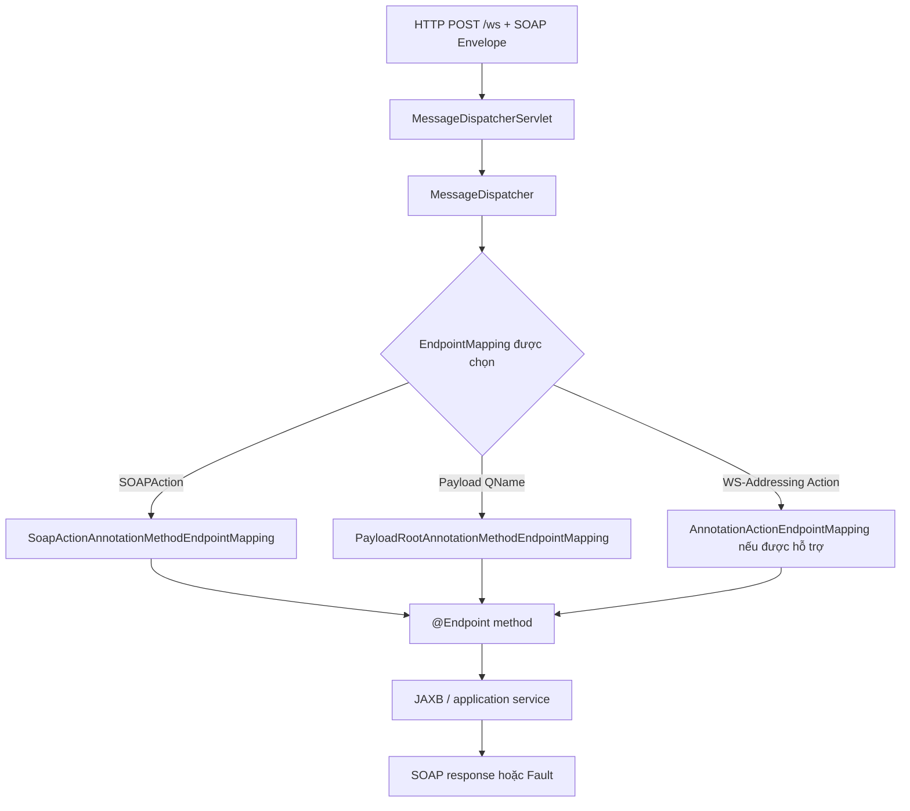

# @SoapAction và SoapActionAnnotationMethodEndpointMapping

Trong dịch vụ SOAP viết theo hướng **contract-first**, Spring Web Services (Spring-WS) phải xác định phương thức endpoint nào sẽ xử lý một thông điệp nhận được. Có nhiều tín hiệu định tuyến: QName của phần tử gốc trong SOAP Body, giá trị **SOAPAction** trên giao thức HTTP, hoặc `wsa:Action` của WS-Addressing. Chủ đề của bài là **`@SoapAction` và `SoapActionAnnotationMethodEndpointMapping`**: cách khai báo, cách chúng phối hợp, cách liên hệ với WSDL và những sai lệch thường gây lỗi tích hợp.

Bài thuộc chương **Định tuyến thông điệp** trong module `SPRING_WEB_SERVICES`. Ví dụ sử dụng một dịch vụ tra cứu/hủy đơn hàng, XSD và WSDL định nghĩa trước, lớp JAXB được sinh từ schema, endpoint Spring-WS xử lý SOAP Body, và SOAP client gửi action chính xác. Cuối bài sẽ xem cách phân biệt lỗi action với lỗi XML/XSD, SOAP Fault, interceptor, WS-Security và các ca kiểm thử tương thích với hệ thống doanh nghiệp.

## 1. Hai câu hỏi định tuyến hoàn toàn khác nhau

Khi client gửi:

```text
POST https://api.example.com/ws
SOAPAction: "urn:example:orders:v1:GetOrder"
```

và SOAP Body chứa `ord:GetOrderRequest`, quá trình tiếp nhận gồm hai lớp:

1. **Định tuyến HTTP/servlet:** cấu hình `MessageDispatcherServlet`, ví dụ mapping `/ws/*`, quyết định request HTTP có đi vào Spring-WS hay không.
2. **Định tuyến SOAP method:** `MessageDispatcher` dùng một `EndpointMapping` thích hợp để xác định **phương thức `@Endpoint`** được gọi.

`SoapActionAnnotationMethodEndpointMapping` thuộc lớp **thứ hai**. Nó không tạo HTTP URL mới và không thay đổi servlet mapping. Với cơ chế này, Spring-WS tìm phương thức gắn `@SoapAction` có giá trị khớp action của SOAP message.



Sơ đồ mô tả **các cơ chế có thể được đăng ký**, không khẳng định cả ba cùng chạy hoặc cùng có mức ưu tiên cố định trong mọi cấu hình Spring-WS. Ở một lần dispatch cụ thể, framework chọn mapping phù hợp theo thứ tự và cấu hình endpoint mappings đang hoạt động.

## 2. SOAPAction là gì và nằm ở đâu?

Với **SOAP 1.1 qua HTTP**, `SOAPAction` là HTTP request header được dùng để biểu thị ý định của SOAP request. Ví dụ:

```http
POST /ws HTTP/1.1
Host: api.example.com
Content-Type: text/xml; charset=utf-8
SOAPAction: "urn:example:orders:v1:GetOrder"
```

Giá trị action là một URI mang ý nghĩa do **hợp đồng dịch vụ** quy định. Nó không nhất thiết phải là URL có máy chủ thật hoặc là địa chỉ cần gọi HTTP GET. Có thể dùng một URI tuyệt đối như `https://example.com/actions/GetOrder` hoặc URI dạng `urn:example:orders:v1:GetOrder`, miễn hai phía thống nhất chính xác.

Trong **WSDL 1.1 với SOAP 1.1 binding**, action có thể được công bố tại thuộc tính `soapAction`:

```xml
<wsdl:operation name="GetOrder">
    <soap:operation soapAction="urn:example:orders:v1:GetOrder"/>
    <wsdl:input>
        <soap:body use="literal"/>
    </wsdl:input>
    <wsdl:output>
        <soap:body use="literal"/>
    </wsdl:output>
</wsdl:operation>
```

Đoạn này là **fragment** thuộc `wsdl:binding`, giả định `wsdl` là `http://schemas.xmlsoap.org/wsdl/` và `soap` là `http://schemas.xmlsoap.org/wsdl/soap/`. Nó chưa phải WSDL hoàn chỉnh.

### Phân biệt action với các tên khác

| Khái niệm | Ví dụ | Chức năng |
| --- | --- | --- |
| SOAP endpoint URL | `https://api.example.com/ws` | Địa chỉ HTTP nhận request |
| SOAPAction | `urn:example:orders:v1:GetOrder` | Chỉ dấu action của SOAP request, dùng cho action-based mapping |
| Payload QName | `{https://example.com/orders/v1}GetOrderRequest` | Định danh root element trong SOAP Body |
| WSDL operation | `GetOrder` | Tên operation được mô tả trong hợp đồng WSDL |
| Java method | `getOrder` | Cách triển khai operation ở server |
| WS-Addressing `wsa:Action` | Một URI action trong SOAP Header | Trường action của cơ chế WS-Addressing, **khác** HTTP SOAPAction |

Các tên này có thể được đặt tương đồng để dễ hiểu, nhưng **không được đồng nhất**. Ví dụ `@SoapAction` không tự suy ra từ tên Java method `getOrder`, và đường dẫn `/ws/GetOrder` không mặc nhiên chọn method đó.

### Header không có, rỗng và có giá trị

Trong SOAP 1.1 có thể gặp:

```http
SOAPAction: "urn:example:orders:v1:GetOrder"
SOAPAction: ""
```

Ngoài ra có request hoàn toàn không mang header. Đây là các tình huống **khác nhau tại tầng giao thức**. Một client gửi action rỗng hoặc thiếu action sẽ không tự khớp với `@SoapAction("urn:example:orders:v1:GetOrder")`. Nếu có mapping khác như `@PayloadRoot`, request có thể vẫn được xử lý; kết quả tùy cấu hình thứ tự mappings.

Giá trị SOAPAction trên wire thường được **bao trong dấu ngoặc kép theo SOAP 1.1**; thư viện SOAP thường thực hiện việc đóng gói/đọc header này. Khi kiểm thử, cần phân biệt **giá trị URI logic** với cú pháp HTTP header, tránh đưa cả ký tự trích dẫn vào annotation Java nếu framework đã xử lý dấu trích dẫn.

## 3. Xây dựng hợp đồng XSD/WSDL nhất quán trước khi viết annotation

Giả sử hệ thống đơn hàng có hai thao tác:

| Operation | Request payload QName | Response payload QName | SOAPAction |
| --- | --- | --- | --- |
| `GetOrder` | `{https://example.com/orders/v1}GetOrderRequest` | `{https://example.com/orders/v1}GetOrderResponse` | `urn:example:orders:v1:GetOrder` |
| `CancelOrder` | `{https://example.com/orders/v1}CancelOrderRequest` | `{https://example.com/orders/v1}CancelOrderResponse` | `urn:example:orders:v1:CancelOrder` |

Một XSD có thể định nghĩa các phần tử request/response theo cách sau:

```xml
<?xml version="1.0" encoding="UTF-8"?>
<xs:schema xmlns:xs="http://www.w3.org/2001/XMLSchema"
           xmlns:ord="https://example.com/orders/v1"
           targetNamespace="https://example.com/orders/v1"
           elementFormDefault="qualified">

    <xs:element name="GetOrderRequest">
        <xs:complexType>
            <xs:sequence>
                <xs:element name="orderId" type="xs:positiveInteger"/>
            </xs:sequence>
        </xs:complexType>
    </xs:element>

    <xs:element name="GetOrderResponse">
        <xs:complexType>
            <xs:sequence>
                <xs:element name="status" type="xs:string"/>
            </xs:sequence>
        </xs:complexType>
    </xs:element>

    <xs:element name="CancelOrderRequest">
        <xs:complexType>
            <xs:sequence>
                <xs:element name="orderId" type="xs:positiveInteger"/>
            </xs:sequence>
        </xs:complexType>
    </xs:element>

    <xs:element name="CancelOrderResponse">
        <xs:complexType>
            <xs:sequence>
                <xs:element name="accepted" type="xs:boolean"/>
            </xs:sequence>
        </xs:complexType>
    </xs:element>
</xs:schema>
```

Trong WSDL 1.1, mỗi `wsdl:message` dùng một global element tương ứng; `wsdl:portType` khai báo `GetOrder` và `CancelOrder`; phần SOAP 1.1 `wsdl:binding` công bố action:

```xml
<wsdl:binding name="OrdersSoapBinding" type="tns:OrdersPortType">
    <soap:binding style="document"
                  transport="http://schemas.xmlsoap.org/soap/http"/>
    <wsdl:operation name="GetOrder">
        <soap:operation soapAction="urn:example:orders:v1:GetOrder"/>
        <wsdl:input><soap:body use="literal"/></wsdl:input>
        <wsdl:output><soap:body use="literal"/></wsdl:output>
    </wsdl:operation>
    <wsdl:operation name="CancelOrder">
        <soap:operation soapAction="urn:example:orders:v1:CancelOrder"/>
        <wsdl:input><soap:body use="literal"/></wsdl:input>
        <wsdl:output><soap:body use="literal"/></wsdl:output>
    </wsdl:operation>
</wsdl:binding>
```

Đoạn trên là fragment, giả định `tns:OrdersPortType` đã được định nghĩa và các namespace WSDL/SOAP đã được khai báo. Hợp đồng hoàn chỉnh còn có `wsdl:definitions`, `wsdl:types`, `wsdl:message`, `wsdl:portType` và `wsdl:service` với `soap:address`.

**Điểm quyết định:** Giá trị `soap:operation/@soapAction` là cam kết bên ngoài mà `@SoapAction` trong server phải tuân theo. Việc thêm `@SoapAction` vào mã Java **không tự cập nhật WSDL tĩnh**. Nếu dùng `DefaultWsdl11Definition` sinh WSDL động, phải kiểm tra **WSDL thực tế được công bố** để biết action đã phản ánh hợp đồng chưa; không suy luận từ annotation trên endpoint.

## 4. Viết endpoint với `@SoapAction`

Annotation nằm trong package Spring-WS:

```java
import org.springframework.ws.soap.server.endpoint.annotation.SoapAction;
```

Một endpoint dùng action làm khóa định tuyến có thể triển khai như sau:

```java
import org.springframework.ws.server.endpoint.annotation.Endpoint;
import org.springframework.ws.server.endpoint.annotation.RequestPayload;
import org.springframework.ws.server.endpoint.annotation.ResponsePayload;
import org.springframework.ws.soap.server.endpoint.annotation.SoapAction;

@Endpoint
public class OrdersActionEndpoint {
    public static final String GET_ORDER_ACTION =
            "urn:example:orders:v1:GetOrder";
    public static final String CANCEL_ORDER_ACTION =
            "urn:example:orders:v1:CancelOrder";

    @SoapAction(GET_ORDER_ACTION)
    @ResponsePayload
    public GetOrderResponse getOrder(
            @RequestPayload GetOrderRequest request) {
        GetOrderResponse result = new GetOrderResponse();
        // Ví dụ minh họa: trong dự án thật, gọi application service.
        result.setStatus("PAID");
        return result;
    }

    @SoapAction(CANCEL_ORDER_ACTION)
    @ResponsePayload
    public CancelOrderResponse cancelOrder(
            @RequestPayload CancelOrderRequest request) {
        CancelOrderResponse result = new CancelOrderResponse();
        result.setAccepted(true);
        return result;
    }
}
```

Ví dụ giả định bốn lớp request/response được **JAXB/XJC sinh từ XSD có global element với anonymous complex type** như phần 3, và Spring-WS có argument resolver/return-value handler phù hợp cho JAXB. Với XSD sử dụng named complex type, có thể cần `JAXBElement` và `ObjectFactory` thay vì marshal trực tiếp. Các giá trị `PAID` và `true` chỉ minh họa routing, chưa thay cho logic nghiệp vụ.

Chú ý:

- `@Endpoint` khiến class được nhận diện là endpoint bean khi được Spring component-scan.
- `@SoapAction(GET_ORDER_ACTION)` khai báo action dẫn đến method `getOrder`.
- `@RequestPayload` yêu cầu chuyển payload XML đầu vào thành `GetOrderRequest`.
- `@ResponsePayload` dùng kết quả để tạo SOAP response payload.
- `GET_ORDER_ACTION` là hằng `static final String` được khởi tạo bằng literal; phù hợp làm giá trị annotation Java.

Để ý **`@SoapAction` không tự kiểm tra QName hay XSD của request**. Nếu client cố tình gửi `CancelOrderRequest` cùng action `GetOrder`, action mapping có thể chọn method `getOrder`; bước đọc JAXB hoặc validation có thể từ chối payload. Đừng biến action thành bằng chứng rằng message chắc chắn thuộc đúng operation hoặc đã được xác thực.

## 5. `SoapActionAnnotationMethodEndpointMapping` làm những gì?

Tên lớp diễn đạt cơ chế:

```text
SoapActionAnnotationMethodEndpointMapping
        ├── Tìm các endpoint method có @SoapAction
        ├── Đăng ký ánh xạ: action URI -> method endpoint
        └── Khi có SOAP message, lấy SOAPAction và tìm method khớp
```

Lớp này thuộc nhóm **`EndpointMapping`** và đảm nhiệm ánh xạ dựa trên action trong SOAP message. Nó không phải:

- Java method để gọi HTTP endpoint;
- bộ chuyển JAXB/XML;
- schema validator;
- SOAP Fault resolver;
- công cụ bảo mật hoặc xác thực action;
- thành phần sinh `soapAction` trong WSDL.

Trong cấu hình annotation-based thông dụng, `@EnableWs` kích hoạt hạ tầng endpoint cần thiết, bao gồm các mapping annotation của Spring-WS được hỗ trợ, trong đó có mapping cho `@SoapAction`. Khi dùng Spring Boot, việc starter hay bean tùy chỉnh cấu hình các mapping cụ thể còn tùy phiên bản và cách tích hợp. Không nên tạo một mapping thủ công trùng với mapping mà `@EnableWs` đã cung cấp chỉ vì tưởng annotation chưa hoạt động.

Ví dụ phần thiết lập servlet (rút gọn) trong ứng dụng Spring Boot có Spring-WS:

```java
import org.springframework.boot.web.servlet.ServletRegistrationBean;
import org.springframework.context.ApplicationContext;
import org.springframework.context.annotation.Bean;
import org.springframework.context.annotation.Configuration;
import org.springframework.ws.config.annotation.EnableWs;
import org.springframework.ws.transport.http.MessageDispatcherServlet;

@Configuration
@EnableWs
public class SoapServerConfiguration {
    @Bean
    public ServletRegistrationBean<MessageDispatcherServlet>
    messageDispatcherServlet(ApplicationContext context) {
        MessageDispatcherServlet servlet = new MessageDispatcherServlet();
        servlet.setApplicationContext(context);
        servlet.setTransformWsdlLocations(true);
        return new ServletRegistrationBean<>(servlet, "/ws/*");
    }
}
```

Đoạn này minh họa đăng ký servlet cùng `@EnableWs`; lớp `OrdersActionEndpoint` vẫn phải được component-scan và JAXB adapters cần sẵn sàng. Nếu Spring Boot starter đã auto-configure một servlet, phải chọn **một** cách đăng ký phù hợp để tránh mapping trùng. Các URL bên ngoài còn phụ thuộc port, context path và reverse proxy.

### Không tự đoán thứ tự ưu tiên giữa các mapping

Spring-WS có thể có nhiều endpoint mappings: dựa trên `@SoapAction`, `@PayloadRoot`, WS-Addressing hoặc mapping tùy chỉnh. Hạ tầng thường xét các mapping theo **thứ tự cấu hình**, và chọn mapping nhận diện được endpoint. Thứ tự này có thể chịu ảnh hưởng từ `Ordered`/`order`, cấu hình và phiên bản framework.

Vì vậy, không được mặc định rằng “`@SoapAction` luôn thắng `@PayloadRoot`” hoặc ngược lại trong mọi dự án. Nếu cùng một SOAP message có thể khớp **hai method khác nhau** theo hai mapping, cần xem đó là rủi ro thiết kế; kiểm thử thứ tự thực tế và tránh định tuyến không rõ ràng.

## 6. HTTP request thực tế và cách nhận diện action

Với SOAP 1.1, request tra cứu đơn hàng có thể là:

```http
POST /ws HTTP/1.1
Host: api.example.com
Content-Type: text/xml; charset=utf-8
SOAPAction: "urn:example:orders:v1:GetOrder"
```

Body:

```xml
<?xml version="1.0" encoding="UTF-8"?>
<soap:Envelope
    xmlns:soap="http://schemas.xmlsoap.org/soap/envelope/"
    xmlns:ord="https://example.com/orders/v1">
    <soap:Body>
        <ord:GetOrderRequest>
            <ord:orderId>42</ord:orderId>
        </ord:GetOrderRequest>
    </soap:Body>
</soap:Envelope>
```

Với server đăng ký `/ws/*`, SOAPAction khớp `GET_ORDER_ACTION` và JAXB binding phù hợp, phương thức `getOrder` có thể tạo kết quả:

```xml
<soap:Envelope
    xmlns:soap="http://schemas.xmlsoap.org/soap/envelope/"
    xmlns:ord="https://example.com/orders/v1">
    <soap:Body>
        <ord:GetOrderResponse>
            <ord:status>PAID</ord:status>
        </ord:GetOrderResponse>
    </soap:Body>
</soap:Envelope>
```

**Lưu ý:** response có thể dùng tiền tố `ns2` thay `ord`. QName mới là điều quan trọng; prefix XML không phải hợp đồng cố định.

### Gửi thử bằng curl

Giả sử đã lưu Envelope đầy đủ ở `get-order.xml`, ứng dụng local lắng nghe tại `http://localhost:8080/ws` và không có context path:

```bash
curl -i -X POST "http://localhost:8080/ws" \
  -H "Content-Type: text/xml; charset=utf-8" \
  -H 'SOAPAction: "urn:example:orders:v1:GetOrder"' \
  --data-binary @get-order.xml
```

Đây là **lệnh tham khảo**, không phải kết quả đã chạy. Trên Windows PowerShell, có thể gọi `curl.exe` để dùng binary curl thay vì alias của các phiên bản PowerShell cũ.

Đối với action khác, chỉ thay HTTP header **không đủ để tạo một request hợp lệ** nếu WSDL yêu cầu payload khác. Ví dụ `CancelOrder` cần cả:

```http
SOAPAction: "urn:example:orders:v1:CancelOrder"
```

và SOAP Body có root `ord:CancelOrderRequest`. Trong thiết kế contract-first, client nên tạo request từ đúng XSD/WSDL thay vì thay thủ công mỗi action.

## 7. Gửi SOAPAction từ Spring-WS client

Với `WebServiceTemplate`, Spring-WS có `SoapActionCallback` giúp đặt SOAPAction cho outgoing SOAP message:

```java
import org.springframework.ws.client.core.WebServiceTemplate;
import org.springframework.ws.soap.client.core.SoapActionCallback;

public final class OrdersSoapClient {
    private final WebServiceTemplate template;

    public OrdersSoapClient(WebServiceTemplate template) {
        this.template = template;
    }

    public Object getOrder(GetOrderRequest request) {
        return template.marshalSendAndReceive(
                "https://api.example.com/ws",
                request,
                new SoapActionCallback(
                        "urn:example:orders:v1:GetOrder"));
    }
}
```

Đoạn code giả định `WebServiceTemplate` đã có **marshaller/unmarshaller JAXB đúng contract**; `GetOrderRequest` có root element mapping thích hợp. Trường hợp XJC sinh `JAXBElement`, hãy truyền object wrapper đúng QName do `ObjectFactory` tạo. Giá trị trả về thực tế có thể là JAXB object hoặc `JAXBElement` và nên được kiểm tra/cast theo model được sinh, thay vì xử lý chung `Object` trong ứng dụng hoàn chỉnh.

Một `SoapActionCallback` chỉ cung cấp **action** cho message; nó không:

- sửa QName của JAXB request;
- tự sinh XML đúng XSD;
- đặt WS-Addressing `wsa:Action` trong SOAP Header;
- ký số SOAP Body hoặc cấu hình chứng chỉ WS-Security;
- chỉnh URL đích từ `soap:address` một cách tự động.

Với `WebServiceTemplate` gửi trực tiếp qua `sendSourceAndReceive...`, cũng có thể dùng callback phù hợp để đặt action, nhưng phải bảo đảm `Source` là payload hợp lệ và lifecycle của stream còn khả dụng.

## 8. `@SoapAction` và `@PayloadRoot`: chọn chiến lược nào?

Hai annotation điều khiển các **lookup key khác nhau**:

```java
// Định tuyến theo HTTP SOAPAction logic.
@SoapAction("urn:example:orders:v1:GetOrder")
@ResponsePayload
public GetOrderResponse byAction(
        @RequestPayload GetOrderRequest request) { /* ... */ }
```

```java
// Định tuyến theo QName của payload root.
@PayloadRoot(
    namespace = "https://example.com/orders/v1",
    localPart = "GetOrderRequest")
@ResponsePayload
public GetOrderResponse byPayload(
        @RequestPayload GetOrderRequest request) { /* ... */ }
```

Hai đoạn trên là **chữ ký minh họa riêng lẻ**: cần đặt bên trong `@Endpoint` và triển khai logic trả response. **Không đăng ký đồng thời hai method như trên trong cùng ứng dụng chỉ để so sánh**, vì một message có thể khớp cả action và payload root, gây phụ thuộc vào thứ tự mappings.

| Tiêu chí | Định tuyến bằng `@SoapAction` | Định tuyến bằng `@PayloadRoot` |
| --- | --- | --- |
| Khóa chọn method | Action URI của SOAP message | QName phần tử gốc trong SOAP Body |
| Liên hệ WSDL | `soap:operation/@soapAction` của SOAP binding | Global element của input message trong XSD |
| Khi thiếu action | Có thể không khớp; phụ thuộc mapping khác | Vẫn có thể khớp nếu payload root đúng |
| Khả năng phân biệt operation dùng chung payload QName | Có thể hữu ích nếu action khác nhau và contract cho phép | Không phân biệt nếu QName giống hệt |
| Rủi ro | Action khác WSDL, client gửi rỗng, proxy/client xử lý header sai | Namespace/localPart khác schema, cùng QName gắn nhiều handler |
| Bảo mật/validation | Không thay thế kiểm tra XSD và xác thực | Cũng không thay thế kiểm tra XSD và xác thực |

Trong nhiều dịch vụ document/literal, QName request là tín hiệu định tuyến tự nhiên vì gắn chặt với global element của XSD. Tuy nhiên, có những hợp đồng và tích hợp bắt buộc gửi SOAPAction; dùng `@SoapAction` giúp thực thi rõ quy ước này. Chọn chiến lược theo **WSDL và profile đối tác**, không theo sở thích của từng method.

### Trường hợp một method có cả hai annotation

Có thể thấy code đặt `@PayloadRoot` và `@SoapAction` trên cùng method. Điều đó không mặc nhiên buộc Spring-WS phải kiểm tra **đồng thời** cả hai điều kiện theo nghĩa logic AND. Chúng được xử lý bởi những mapping khác nhau. Nếu cần một chính sách “action phải khớp **và** payload QName phải khớp”, hãy thêm bước **kiểm tra tính nhất quán** bằng interceptor/validation hoặc thiết kế endpoint mapping tùy chỉnh, đồng thời kiểm thử hành vi thật.

Đừng dùng cách gắn cả hai annotation rồi kết luận request sai một trong hai sẽ luôn bị chặn: một mapping có thể đã chọn handler trước khi mapping kia được xét.

## 9. SOAP 1.2 và WS-Addressing: ba loại action dễ nhầm

### SOAP 1.1: HTTP SOAPAction

Phổ biến với WSDL 1.1 SOAP 1.1 binding:

```http
Content-Type: text/xml; charset=utf-8
SOAPAction: "urn:example:orders:v1:GetOrder"
```

### SOAP 1.2: tham số action của media type

SOAP 1.2 HTTP binding sử dụng media type `application/soap+xml`; action có thể xuất hiện dưới dạng parameter `action`:

```http
Content-Type: application/soap+xml; charset=utf-8; action="urn:example:orders:v1:GetOrder"
```

Đây **không phải** mô hình HTTP header SOAPAction của SOAP 1.1. Việc Spring-WS nhận/ánh xạ tham số action theo cơ chế nào phụ thuộc `WebServiceMessageFactory`, phiên bản SOAP và implementation; phải kiểm thử `@SoapAction` trên **SOAP 1.2** thực tế nếu profile tích hợp yêu cầu. Không giả định chỉ đổi namespace Envelope là đủ.

### WS-Addressing: `wsa:Action` trong SOAP Header

Khi dùng WS-Addressing, action nằm trong SOAP Header. Ví dụ mang tính minh họa:

```xml
<wsa:Action xmlns:wsa="http://www.w3.org/2005/08/addressing">
    urn:example:orders:v1:GetOrder
</wsa:Action>
```

WS-Addressing còn có những header/policy liên quan như `To`, `MessageID` và cơ chế reply. Spring-WS có nhóm endpoint mapping/annotation riêng dành cho WS-Addressing ở những cấu hình hỗ trợ, chẳng hạn `AnnotationActionEndpointMapping` và annotation `@Action`. Đừng nhầm `@Action` trong trường hợp này với `@SoapAction`.

| Action | Vị trí | Cơ chế cần tìm hiểu |
| --- | --- | --- |
| SOAP 1.1 `SOAPAction` | HTTP header | `@SoapAction`, `SoapActionAnnotationMethodEndpointMapping` |
| SOAP 1.2 media type `action` | `Content-Type` parameter | SOAP 1.2 HTTP binding/message factory tương ứng |
| WS-Addressing `wsa:Action` | SOAP Header | WS-Addressing endpoint mapping và policy |

Một số tiêu chuẩn/profile tích hợp yêu cầu action ở các nơi **nhất quán** với nhau. Tuy nhiên, sự thống nhất này là quy tắc của binding/profile đang áp dụng, không phải kết quả tự động của việc thêm `@SoapAction`.

## 10. Khi action đúng nhưng payload sai: routing khác validation

Giả sử client gửi header:

```http
SOAPAction: "urn:example:orders:v1:GetOrder"
```

nhưng Body lại chứa:

```xml
<ord:CancelOrderRequest xmlns:ord="https://example.com/orders/v1">
    <ord:orderId>42</ord:orderId>
</ord:CancelOrderRequest>
```

Action-based mapping có thể chọn `getOrder`, nhưng **XML payload không phải `GetOrderRequest`**. Một số kết quả có thể xảy ra tùy cấu hình:

- JAXB argument resolver không thể unmarshal payload thành kiểu được yêu cầu và báo lỗi.
- Schema validation có thể xác nhận `CancelOrderRequest` tự nó là một global element hợp lệ, nhưng **chưa chắc phát hiện mâu thuẫn giữa operation và action** nếu schema chung cho phép cả hai phần tử.
- Nếu adapter nhận dạng XML lỏng lẻo hoặc method sử dụng `Source`, code nghiệp vụ có thể nhận payload sai mà không có lỗi tự động.

Để bảo đảm **tính nhất quán operation/action/payload**, cần kiểm tra đủ ba thứ: giá trị action hợp đồng, QName payload dự kiến, và XSD của request. Với trường hợp cần kiểm soát nghiêm, interceptor hoặc tầng xử lý phù hợp nên từ chối tổ hợp không hợp lệ trước khi thực thi nghiệp vụ.

**Không dùng SOAPAction làm cơ chế xác thực/phân quyền.** Client có thể tự gửi bất kỳ action nào. SOAPAction có ý nghĩa định tuyến, không phải bằng chứng danh tính hay quyền truy cập. Cần dùng TLS, xác thực, phân quyền và WS-Security phù hợp nếu operation tác động dữ liệu nhạy cảm; ví dụ hủy đơn hàng phải kiểm tra quyền của người gửi, không chỉ header `CancelOrder`.

### Validator và interceptor có thể giúp gì?

- `PayloadValidatingInterceptor`: xác thực hình dạng payload theo XSD (request và/hoặc response).
- Interceptor kiểm tra policy nghiệp vụ: có thể đối chiếu action với QName dự kiến và log lỗi an toàn.
- WS-Security interceptor: xác thực token, chữ ký, timestamp/chứng chỉ theo chính sách; không thay thế kiểm tra action/QName hợp đồng.
- Exception resolver: chuyển lỗi hợp đồng/nghiệp vụ thích hợp thành SOAP Fault; không mặc định mọi lỗi routing sẽ có cùng fault code ở mọi phiên bản.

Khi sử dụng XML Signature, phải bảo đảm payload được xử lý là payload thực sự đã được xác minh. Thay đổi SOAP Body sau bước kiểm tra chữ ký có thể phá cơ chế bảo vệ và làm lệch dữ liệu được ủy quyền.

## 11. Dấu hiệu lỗi và phân loại SOAP Fault

| Triệu chứng | Nơi cần kiểm tra đầu tiên | Giải thích và hướng xử lý |
| --- | --- | --- |
| HTTP `404` trước khi SOAP xử lý | Servlet URL mapping/context path/gateway | Có thể request chưa tới Spring-WS, chưa liên quan `@SoapAction` |
| WSDL GET được nhưng POST không tới endpoint | URL trong `soap:address`/HTTP method/TLS | GET hợp đồng và POST nghiệp vụ là hai đường kiểm thử riêng |
| “No endpoint mapping found” | SOAPAction, QName, mapping registration/order | Không có mapping nhận message; cần xem action thực nhận |
| Header SOAPAction rỗng | Client callback, WSDL action, SOAP version | Action rỗng không khớp annotation URI không rỗng |
| Action đúng nhưng JAXB unmarshal thất bại | QName Body và lớp JAXB được sinh | Action đã chọn method nhưng payload có thể sai |
| Header và payload đều đúng nhưng response lỗi | Application service, JAXB response, XSD | Không nên tiếp tục sửa routing khi method đã chạy |
| Mỗi lần deploy method khác được gọi | Mapping order/custom mappings/trùng action | Có thể có handler mơ hồ hoặc cấu hình mapping khác |
| Client SOAP 1.2 không khớp action | SOAP 1.2 message factory/content-type | Không dùng quy tắc HTTP SOAPAction 1.1 để suy đoán |
| Có `wsa:Action` nhưng không có SOAPAction | WS-Addressing mapping/policy | Hai trường khác nhau; phải xác định profile đang dùng |
| Request bị từ chối trước endpoint dù action đúng | TLS/filter/WS-Security/schema interceptor | Định tuyến không thay cho bảo mật/validation |
| SOAP Fault `Client`/`Sender` | Request sai XML, hợp đồng hoặc action theo chính sách | Client cần sửa request; code chi tiết phụ thuộc framework |
| SOAP Fault `Server`/`Receiver` | Lỗi nội bộ/server response | Không quy hết thành lỗi client vì action hợp lệ |

Một request không tìm thấy endpoint có thể dẫn tới SOAP Fault, lỗi dispatch hoặc một HTTP status tương ứng tùy message factory, resolver, servlet và cấu hình. Không nên **hard-code một HTTP status/faultcode duy nhất** làm tiêu chí nhận biết action mismatch nếu hệ thống chưa chuẩn hóa quy tắc lỗi đó.

### Chiến lược chẩn đoán tuần tự

1. **Ghi nhận URL cuối** mà client POST tới; loại trừ lỗi context path/HTTP filter.
2. **Kiểm tra SOAP version và Content-Type**; không so SOAP 1.1 với SOAP 1.2 như nhau.
3. **Đọc action thực tế** ở transport/message layer đã qua xử lý; tránh log tùy tiện toàn bộ SOAP Header nhạy cảm.
4. **Đối chiếu action WSDL** (`soap:operation/@soapAction`) với `@SoapAction` trong server và giá trị do client gửi.
5. **Kiểm tra các EndpointMapping được đăng ký**, thứ tự, hành vi khi có `@PayloadRoot` hoặc WS-Addressing.
6. **Xác nhận QName SOAP Body** và schema được dùng có khớp operation dự kiến không.
7. **Kiểm tra JAXB/OXM, interceptor và Fault** sau khi biết method đã được chọn; sửa đúng tầng thay vì đổi action tùy tiện.

## 12. Kiểm thử client: bảo đảm SOAPAction được gửi thật

Một unit test chỉ gọi trực tiếp `OrdersActionEndpoint#getOrder(...)` **không kiểm thử SOAPAction mapping**. Cần gửi một SOAP message qua Spring-WS message dispatch hoặc qua HTTP transport.

Các tầng kiểm thử hữu ích:

| Tầng | Công cụ/cách làm | Điều xác minh |
| --- | --- | --- |
| JAXB/XSD | XJC, JAXP Validator, test marshal/unmarshal | Payload QName và kiểu dữ liệu đúng hợp đồng |
| Client template | `MockWebServiceServer` cùng `WebServiceTemplate` | Request client thực sự mang action đúng, payload đúng |
| Endpoint dispatch | `MockWebServiceClient`/integration test trong Spring-WS | Header/action và QName dẫn tới method phù hợp |
| HTTP integration | Curl hoặc SOAP client sinh từ WSDL thực | Header HTTP, proxy, SOAP version, URL, action, SOAP Fault |
| Liên thông | Client Java/.NET/đối tác được sinh từ WSDL | Action và payload không phụ thuộc vào công cụ của riêng server |

Đối với `MockWebServiceServer`, xây dựng expectation kiểm tra **SOAPAction** và **payload** của outgoing request, rồi trả một XML response mẫu. Khi kiểm thử endpoint, bảo đảm message creator của test **đã đặt action** trên SOAP message; chỉ cung cấp `withPayload(...)` có thể không đủ nếu endpoint được định tuyến thuần bằng action. Cách xây test request/callback cụ thể phải dựa vào API Spring-WS Test của phiên bản đang dùng.

Với HTTP integration, nên gửi lần lượt:

- Request `GetOrder` với action đúng và payload đúng.
- Cùng payload nhưng action bị thiếu.
- Cùng payload nhưng action rỗng.
- Cùng payload nhưng action được thay thành action của `CancelOrder`.
- Action đúng nhưng đổi payload root sang QName khác.

Kết quả cần khẳng định **method nào đã chạy**, không chỉ HTTP `200` hay SOAP Fault bất kỳ. Nếu môi trường có fallback `@PayloadRoot`, action thiếu vẫn có thể chọn đúng method, nhưng đó là hành vi **có chủ đích và đã kiểm thử** hoặc là một lỗ hổng quy ước cần sửa.

## 13. Ma trận kiểm thử chi tiết cho `@SoapAction`

| Mã ca | SOAPAction / SOAP Body | Kết quả cần xác minh |
| --- | --- | --- |
| A01 | `GetOrder` action đúng + `GetOrderRequest` | `getOrder` được gọi; response đúng XSD |
| A02 | `CancelOrder` action đúng + `CancelOrderRequest` | `cancelOrder` được gọi; response đúng XSD |
| A03 | Thiếu SOAPAction + `GetOrderRequest` | Có/không có fallback mapping đúng như cấu hình đã cam kết |
| A04 | `SOAPAction: ""` + `GetOrderRequest` | Không tự coi là action `GetOrder`; xác minh fallback nếu có |
| A05 | Action sai chữ hoa/thường | Không mặc định coi là cùng một action URI |
| A06 | Action `CancelOrder` + `GetOrderRequest` | Bị chặn do mismatch action/payload theo chính sách |
| A07 | Action `GetOrder` + `CancelOrderRequest` | Bị chặn trước nghiệp vụ sau kiểm tra nhất quán |
| A08 | Action đúng, root sai namespace | Không xử lý như request hợp lệ của operation |
| A09 | Action đúng, request thiếu `orderId` | XSD validation/JAXB từ chối |
| A10 | Hai endpoint method gắn cùng một action | Phát hiện cấu hình mơ hồ/xung đột |
| A11 | Thêm `@PayloadRoot` trên method khác có cùng payload QName | Xác minh ưu tiên mapping hoặc loại bỏ xung đột |
| A12 | WSDL action khác annotation | Contract test thất bại trước khi publish |
| A13 | Client dùng `SoapActionCallback` | Wire/request test thấy URI được đặt chính xác |
| A14 | SOAP 1.2 với `application/soap+xml; action=...` | Chỉ PASS khi message factory/mapping xử lý đúng theo profile |
| A15 | Chỉ có `wsa:Action`, không có SOAPAction 1.1 | Hành vi phụ thuộc WS-Addressing mapping được kiểm thử |
| A16 | SOAPAction đúng nhưng token/chữ ký sai | Bị từ chối bởi policy bảo mật, không chạy nghiệp vụ |
| A17 | SOAPAction đúng nhưng đơn hàng không tồn tại | Trả business fault, không nhầm lỗi định tuyến |
| A18 | URL sai servlet path | Lỗi HTTP routing trước SOAP mapping |
| A19 | Reverse proxy sửa/chặn header | Kiểm tra action đến server khác action client gửi |
| A20 | Client được sinh lại từ WSDL công bố | Gửi đúng action và payload cho từng operation |

Trong các ca A06/A07, việc **phát hiện mismatch trước nghiệp vụ** đòi hỏi policy/validator phù hợp nếu hệ thống dùng action-based mapping; không được giả định JAXB hoặc XSD tự so sánh SOAPAction với QName. Test cần chứng minh behavior đã được **cấu hình cụ thể**, không chỉ ghi “SOAP fault là đủ”.

Khi dùng SOAP 1.1 và proxy/API gateway, cần đo cả hai phía: action được client phát ra và action server thực sự nhận. Đừng chỉ kiểm tra request body trong test client rồi kết luận header cũng đúng.

## 14. Thiết kế versioning và chính sách action bền vững

SOAPAction là thành phần của hành vi tích hợp đối ngoại. Khi nâng cấp hợp đồng:

| Thay đổi | Rủi ro |
| --- | --- |
| Đổi SOAPAction URI nhưng giữ WSDL/XSD cũ | Client cũ tiếp tục gửi action cũ và có thể không được định tuyến |
| Đổi action trong annotation nhưng quên cập nhật WSDL | Client sinh từ WSDL vẫn gửi URI cũ |
| Đổi QName request nhưng giữ action | Action mapping có thể chọn handler, JAXB/schema lại từ chối request |
| Thêm operation dùng cùng action URI | Dễ tạo ánh xạ mơ hồ hoặc cần phân biệt bằng cơ chế khác |
| Chuyển SOAP 1.1 sang SOAP 1.2 | Header/media type và message factory thay đổi |
| Bật WS-Addressing trong profile mới | Cần quản lý quan hệ giữa `wsa:Action`, SOAPAction và policy |
| Đưa dịch vụ qua gateway mới | Có thể thay đổi cách HTTP header được chuyển tiếp hoặc rewrite |

Khuyến nghị thực hành:

1. **Công bố URI action trong WSDL và tài liệu hợp đồng** cùng với QName request/response.
2. **Định nghĩa hằng action** trong một vị trí có kiểm soát và dùng khi cấu hình server/client nội bộ; vẫn cần kiểm chứng với WSDL công bố.
3. **Không dùng action như versioning thay thế cho namespace**: version của XSD/WSDL và action phải được quản lý đồng bộ, không che giấu thay đổi phá vỡ tương thích.
4. **Không tự động fallback mù quáng** từ action không nhận diện sang một method “mặc định” có thể thực hiện thao tác nguy hiểm.
5. **Kiểm thử client cũ và client mới** trong cùng chiến lược tương thích. Nếu buộc đổi action, cần kế hoạch chuyển đổi hoặc endpoint/operation version hóa rõ ràng.
6. **Giữ logs an toàn**: ghi action URI, payload QName, operation đã chọn và correlation ID; không log token, chữ ký hay dữ liệu SOAP nhạy cảm.

Một action URI không nhất thiết phải thay mỗi khi thay phiên bản Java package. Nếu schema/operation trên wire không đổi, chỉnh tên class JAXB hoặc Spring service method **không phải lý do** đổi action đối tác.

## 15. Bài tập vận dụng: phát hiện lỗi khi client bỏ SOAPAction

**Tình huống:** Server có `@SoapAction("urn:example:orders:v1:CancelOrder")` trên method `cancelOrder`. Client được viết thủ công, gửi SOAP Envelope với root `CancelOrderRequest`, nhưng không gửi header `SOAPAction`. Một môi trường test trả lỗi không tìm thấy endpoint; môi trường khác vẫn hủy đơn hàng thành công.

**Câu hỏi:** vì sao hai môi trường có thể khác nhau và sửa thế nào?

**Phân tích:**

1. Môi trường thứ nhất có thể chỉ có action-based mapping cho method này. Thiếu action làm `SoapActionAnnotationMethodEndpointMapping` không có lookup key khớp.
2. Môi trường thứ hai có thể có `@PayloadRoot` hoặc custom mapping khác nhận `CancelOrderRequest`. Khi thiếu action, framework vẫn chọn method dựa trên QName.
3. Cần kiểm tra **WSDL `soap:operation/@soapAction`** và client. Nếu hợp đồng bắt buộc action, client nên dùng `SoapActionCallback` hoặc cấu hình công cụ sinh client để gửi đúng URI.
4. Nếu server dự kiến chỉ chấp nhận request có action đúng, phải thiết kế cơ chế **bắt buộc/đối chiếu action** rõ ràng; không chỉ tin vào thứ tự mặc định của các endpoint mappings.
5. Trước khi đưa lên production, chạy test action đúng, thiếu, rỗng và sai; xác minh cancel operation không được thực thi ngoài những trường hợp được phép.
6. Bất kể action đúng hay thiếu, thao tác hủy đơn vẫn phải có **authentication, authorization, schema validation và kiểm tra trạng thái nghiệp vụ**.

**Điểm cần rút ra:** một request có payload đúng không bảo đảm sẽ được định tuyến khi server chọn action-based mapping, và một request được định tuyến theo action đúng cũng không bảo đảm dữ liệu hoặc quyền xử lý đã hợp lệ.

## 16. Checklist khi dùng `@SoapAction` trong Spring-WS

1. **Đã xác nhận dịch vụ sử dụng SOAP 1.1/1.2 và binding WSDL nào?** Không trộn mặc định HTTP SOAPAction với SOAP 1.2 media type action.
2. **Action URI đã được công bố thống nhất** giữa `soap:operation/@soapAction`, `@SoapAction` và SOAP client chưa?
3. **`@Endpoint` được component-scan** và hạ tầng endpoint mapping từ `@EnableWs`/cấu hình tương ứng hoạt động chưa?
4. **`SoapActionAnnotationMethodEndpointMapping` được đăng ký đúng** và không bị custom mapping vô ý che khuất?
5. **Không có hai method trùng action**, hoặc logic phân biệt đã được thiết kế rõ và kiểm thử?
6. **Hành vi khi action thiếu/rỗng/sai** có được cam kết và kiểm tra thay vì dựa vào fallback ngẫu nhiên?
7. **`@SoapAction` và `@PayloadRoot` không gây xung đột**; nếu cần ràng buộc đồng thời, có kiểm tra riêng?
8. **Request QName/namespace khớp XSD**, và argument JAXB/Source được adapter hỗ trợ?
9. **`SoapActionCallback` hoặc client generator thực sự gửi đúng action** theo WSDL đã công bố?
10. **WS-Addressing `wsa:Action` được phân biệt** với SOAPAction và kiểm tra nhất quán nếu profile yêu cầu?
11. **Có XSD validation, SOAP Fault và WS-Security đúng chính sách**, không xem action là dữ liệu đáng tin cậy để phân quyền?
12. **Có kiểm thử cả HTTP transport, endpoint dispatch và liên thông từ đối tác**, gồm lỗi header do reverse proxy?
13. **Mọi đổi action được quản lý như đổi hợp đồng**, không chỉ sửa một hằng Java trong server?

**Kết luận:** `@SoapAction` giúp ánh xạ một action URI tới phương thức endpoint, còn `SoapActionAnnotationMethodEndpointMapping` là thành phần Spring-WS thực hiện tìm và chọn method theo action. Chúng không thay thế servlet URL mapping, QName trong XSD/WSDL, validation hay bảo mật. Một dịch vụ SOAP contract-first ổn định cần đồng bộ action trong **WSDL, client và server**, hiểu rõ quan hệ với `@PayloadRoot`/WS-Addressing, và kiểm thử các tình huống action đúng, thiếu, rỗng và sai trước khi tích hợp liên hệ thống.
