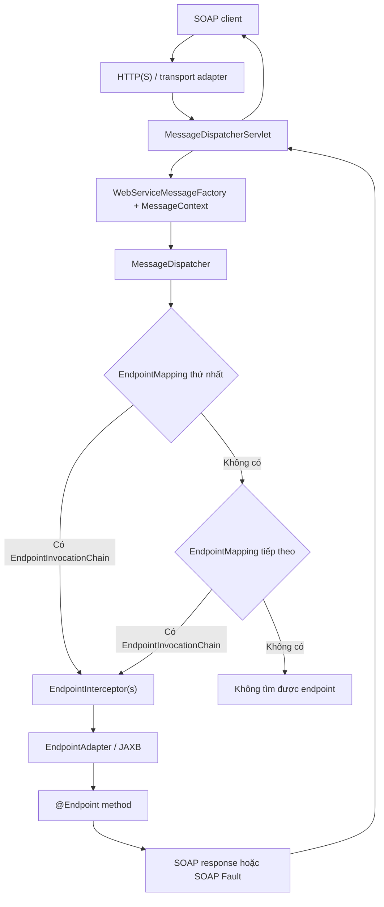

# Thứ tự EndpointMapping và cách xử lý nhiều cơ chế cùng tồn tại

## 1. Bài toán: cùng một SOAP request có thể khớp nhiều cơ chế định tuyến

Trong một dịch vụ SOAP theo hướng **contract-first** của **Spring Web Services (Spring-WS)**, client gửi thông điệp `GetOrderRequest` tới một URL SOAP. Ứng dụng có thể nhận diện thao tác qua:

- **QName của phần tử đầu tiên trong SOAP Body**, chẳng hạn `{urn:example:orders:v1}GetOrderRequest`;
- **SOAPAction** của binding SOAP/HTTP, chẳng hạn `urn:example:orders:v1:GetOrder`;
- **WS-Addressing Action** trong một SOAP Header, nếu ứng dụng thực sự sử dụng WS-Addressing;
- hoặc một cơ chế `EndpointMapping` tùy chỉnh dựa trên thông tin do hệ thống quy định.

Một request có thể đồng thời chứa cả payload QName, SOAPAction và WS-Addressing Action. Điều quan trọng là **Spring-WS không mặc định hợp nhất tất cả điều kiện này thành một phép kiểm tra logic AND**. `MessageDispatcher` tham vấn các `EndpointMapping` theo thứ tự; ánh xạ đầu tiên tìm được endpoint phù hợp thường quyết định đích xử lý.

Ví dụ hệ thống có hai endpoint:

```text
OrderQueryEndpoint:
  @PayloadRoot({urn:example:orders:v1}GetOrderRequest)

LegacyOrderEndpoint:
  @SoapAction("urn:example:orders:v1:GetOrder")
```

Client gửi payload của `GetOrderRequest` nhưng cũng gửi SOAPAction `urn:example:orders:v1:GetOrder`. **Endpoint nào được chọn?** Câu trả lời không thể suy ra chỉ từ hai annotation: phải kiểm tra các mapping được đăng ký, thứ tự ưu tiên và kết quả khớp ở mỗi mapping.

Trong module `SPRING_WEB_SERVICES`, đây là một mắt xích quan trọng giữa XSD/WSDL, JAXB, `@Endpoint`, interceptor, SOAP Fault và SOAP client. Khi hệ thống có nhiều đối tác hoặc đang chuyển từ tích hợp cũ sang contract-first, một sai khác nhỏ ở thứ tự mapping có thể khiến request đi nhầm nghiệp vụ dù XML vẫn hợp lệ.

### Mục tiêu học tập

Sau bài học, bạn có thể:

1. Giải thích nhiệm vụ của `EndpointMapping` và cách `MessageDispatcher` chọn endpoint.
2. Phân biệt mapping theo payload QName, SOAPAction và WS-Addressing Action.
3. Hiểu `Ordered`/`setOrder`, ý nghĩa “mapping đầu tiên khớp” và giới hạn của fallback.
4. Phân tích xung đột giữa nhiều `EndpointMapping` hoặc nhiều method cùng đăng ký một khóa.
5. Thiết kế quy tắc định tuyến rõ ràng khi nhiều cơ chế cùng tồn tại, không vô tình bỏ qua một điều kiện bảo mật/hợp đồng.
6. Kiểm thử cả request hợp lệ, request mâu thuẫn action/payload, và trường hợp không có endpoint.

## 2. EndpointMapping nằm ở đâu trong pipeline Spring-WS?



Đây là sơ đồ luồng logic rút gọn. Cần phân biệt:

| Thành phần | Nhiệm vụ | Không có trách nhiệm mặc định |
| --- | --- | --- |
| `MessageDispatcherServlet` | Nhận request HTTP theo servlet mapping và chuyển sang Spring-WS | Không chọn Java method theo `@PayloadRoot` |
| `WebServiceMessageFactory` | Tạo/đọc SOAP message và Envelope phù hợp version | Không quyết định operation nghiệp vụ |
| `MessageDispatcher` | Tìm mapping phù hợp, điều phối interceptor/adapter và lỗi | Không tự suy operation từ WSDL theo mỗi request |
| `EndpointMapping` | Xem request và tìm endpoint hoặc trả “không khớp” | Không thực thi nghiệp vụ |
| `EndpointInvocationChain` | Gắn endpoint đã tìm được với những interceptor áp dụng | Không bảo đảm client có quyền thực thi operation |
| `EndpointInterceptor` | Kiểm tra/can thiệp trước và sau invocation | Không tự mặc định là một EndpointMapping khác |
| `EndpointAdapter` | Chọn cách gọi endpoint, giải quyết tham số và kết quả | Không tìm lại mapping khác khi JAXB lỗi |
| `@Endpoint` | Thực hiện xử lý nghiệp vụ theo contract | Không tự định tuyến URL transport |

`EndpointMapping` hoạt động **sau bước transport nhận và parse request**, nhưng **trước khi gọi endpoint adapter và business method**. Một lỗi XML không hợp lệ ngay ở message factory có thể không chạm tới mapping nào. Một lỗi TLS/HTTP filter còn có thể xảy ra trước khi Spring-WS nhận được message.

### 2.1. EndpointInvocationChain là kết quả của một mapping

Khi một `EndpointMapping` tìm được đích, nó cung cấp thông tin endpoint cho dispatcher, thường dưới dạng `EndpointInvocationChain` gắn với các interceptor áp dụng tại mapping đó. Dispatcher dùng kết quả này để đi tiếp đến quá trình xử lý.

Điều này có hai hệ quả:

- **Thứ tự EndpointMapping ảnh hưởng cả endpoint và chuỗi interceptor đi kèm**, nếu những mapping có tập interceptor khác nhau.
- **Không tìm thấy endpoint** khác hẳn với **tìm thấy endpoint rồi bị interceptor từ chối**.

Đừng tưởng rằng dispatcher sẽ thử `EndpointMapping` tiếp theo sau khi `EndpointAdapter` ném exception hay interceptor trả `false`. Đó không còn là tình huống mapping “không khớp”, mà là một nhánh thực thi/lỗi của endpoint đã được chọn.

## 3. Ba tín hiệu định tuyến phải phân biệt

### 3.1. Payload root QName

Với SOAP 1.1:

```xml
<soap:Envelope
    xmlns:soap="http://schemas.xmlsoap.org/soap/envelope/"
    xmlns:ord="urn:example:orders:v1">
    <soap:Body>
        <ord:GetOrderRequest>
            <ord:orderId>ORD-100</ord:orderId>
        </ord:GetOrderRequest>
    </soap:Body>
</soap:Envelope>
```

Phần tử payload root có tên đầy đủ (*expanded QName*):

```text
{urn:example:orders:v1}GetOrderRequest
```

Một endpoint tương ứng:

```java
@PayloadRoot(
    namespace = "urn:example:orders:v1",
    localPart = "GetOrderRequest"
)
```

Spring-WS có `PayloadRootAnnotationMethodEndpointMapping` để tìm những method được gắn `@PayloadRoot` và đối chiếu payload root QName.

Prefix XML **không phải** phần định danh QName. Hai payload dưới đây có cùng QName root:

```xml
<GetOrderRequest xmlns="urn:example:orders:v1">
    <orderId>ORD-100</orderId>
</GetOrderRequest>
```

```xml
<ord:GetOrderRequest xmlns:ord="urn:example:orders:v1">
    <ord:orderId>ORD-100</ord:orderId>
</ord:GetOrderRequest>
```

Nhưng root `<GetOrderRequest>` **không có namespace** thì là `{}GetOrderRequest` và **không** khớp ánh xạ namespace trên, dù local name giống hệt.

### 3.2. SOAPAction

Một SOAP 1.1 HTTP request có thể mang:

```http
POST /ws HTTP/1.1
Host: localhost:8080
Content-Type: text/xml; charset=utf-8
SOAPAction: "urn:example:orders:v1:GetOrder"
```

`SOAPAction` ở ví dụ là **HTTP header**, không phải phần tử XML trong `soap:Header`. Trong Spring-WS, annotation `@SoapAction` và `SoapActionAnnotationMethodEndpointMapping` có thể dùng action để chọn endpoint khi được đăng ký và cấu hình phù hợp:

```java
@SoapAction("urn:example:orders:v1:GetOrder")
```

SOAPAction là metadata trong SOAP binding. **Không được suy SOAPAction một cách tùy tiện từ Java method name hoặc QName payload**. Đối tác phải đọc giá trị `soap:operation/@soapAction` của WSDL được công bố.

Với SOAP 1.1, header có thể có giá trị action cụ thể, giá trị rỗng hoặc không xuất hiện tùy binding/stack. Không nên giả định action rỗng tương đương với action không được gửi; phần parser/mapping cụ thể có thể có chính sách xử lý riêng.

Với SOAP 1.2 qua HTTP, action có thể được biểu diễn bằng tham số `action` của media type `application/soap+xml`. Không lấy nguyên quy tắc parsing HTTP SOAP 1.1 để áp cho SOAP 1.2 mà không kiểm tra binding và message factory.

### 3.3. WS-Addressing Action

Một SOAP message dùng WS-Addressing có thể chứa header:

```xml
<soap:Envelope
    xmlns:soap="http://schemas.xmlsoap.org/soap/envelope/"
    xmlns:wsa="http://www.w3.org/2005/08/addressing"
    xmlns:ord="urn:example:orders:v1">
    <soap:Header>
        <wsa:Action>urn:example:orders:v1:GetOrder</wsa:Action>
    </soap:Header>
    <soap:Body>
        <ord:GetOrderRequest>
            <ord:orderId>ORD-100</ord:orderId>
        </ord:GetOrderRequest>
    </soap:Body>
</soap:Envelope>
```

`wsa:Action` là **một SOAP Header element**, không phải HTTP `SOAPAction`. Nó thuộc giao thức WS-Addressing và chỉ có ý nghĩa định tuyến khi cả hai bên đã thỏa thuận, cấu hình hỗ trợ WS-Addressing và sử dụng mapping phù hợp.

Ba tín hiệu có thể có cùng chuỗi biểu diễn `urn:example:orders:v1:GetOrder`, nhưng chúng **không trở thành một trường dữ liệu duy nhất** chỉ vì giá trị giống nhau.

| Tín hiệu | Nằm ở đâu? | Định danh | Cơ chế Spring-WS có thể dùng |
| --- | --- | --- | --- |
| Payload root | Phần tử con nghiệp vụ của `soap:Body` | QName namespace + local name | `PayloadRootAnnotationMethodEndpointMapping` |
| SOAPAction (SOAP 1.1) | HTTP header | Action URI/string của SOAP binding | `SoapActionAnnotationMethodEndpointMapping` |
| SOAP 1.2 action | Tham số content type/binding | Action theo binding SOAP 1.2 | Mapping action nếu stack hỗ trợ tương ứng |
| WS-Addressing Action | `soap:Header/wsa:Action` | URI action trong WS-Addressing | Mapping WS-Addressing khi chủ động cấu hình |

**Lưu ý:** “Có nhiều cách để chọn endpoint” không đồng nghĩa “tất cả cách đều được bật sẵn trong mọi ứng dụng”. Phải xác minh các `EndpointMapping` bean thực tế của Spring context và phiên bản Spring-WS đang chạy.

## 4. MessageDispatcher chọn EndpointMapping theo thứ tự

### 4.1. Mô hình “mapping đầu tiên trả về endpoint”

Hãy hình dung dispatcher có danh sách mapping đã được sắp xếp:

```text
EndpointMappings (theo order)
  [0] PayloadRootMapping
  [1] SoapActionMapping
  [2] CustomLegacyMapping
```

Với mỗi request, dispatcher thử lần lượt:

```text
for mapping in mappings_in_order:
    chain = mapping.find_endpoint(request)
    if chain != null:
        use(chain.endpoint, chain.interceptors)
        stop_searching_mappings()
        invoke_via_endpoint_adapter()
        return_response_or_fault()

no_mapping_matched -> dispatch error / no endpoint
```

Đây là **pseudocode mô tả hành vi lựa chọn**, không phải source Java của Spring-WS.

| Mapping | Kết quả đối với request | Hành động |
| --- | --- | --- |
| Mapping ưu tiên 0 | Không tìm thấy endpoint | Dispatcher xét mapping kế tiếp |
| Mapping ưu tiên 1 | Tìm thấy endpoint | Dispatcher dừng tìm, chọn endpoint đó |
| Mapping ưu tiên 2 | Cũng có thể tìm thấy endpoint | Không còn được xét trong lượt dispatch này |

Điều kiện để xét mapping kế tiếp là **mapping hiện tại không trả được endpoint**. Nếu mapping hiện tại trả endpoint nhưng việc gọi nó thất bại, mặc định không có “fallback” quay lại tìm mapping thứ hai.

### 4.2. `Ordered`/`setOrder`: số nhỏ có ưu tiên cao hơn

Các mapping Spring-WS được xây dựng trên cơ chế thứ tự kiểu Spring `Ordered`; với những triển khai có `setOrder(...)`:

```java
payloadMapping.setOrder(0);
soapActionMapping.setOrder(10);
```

Giá trị số **nhỏ hơn** thường được xét **trước**. Giá trị âm có thể có ưu tiên cao hơn số không; `Ordered.HIGHEST_PRECEDENCE` và `Ordered.LOWEST_PRECEDENCE` là các mốc quy ước dùng khi cần.

**Không có ý nghĩa nghiệp vụ cố định cho “0 = PayloadRoot” hoặc “1 = SOAPAction”.** Đây chỉ là ví dụ thứ tự mà ứng dụng **tự cấu hình**. Các giá trị mặc định thực tế có thể phụ thuộc implementation, phiên bản Spring-WS và những bean đang hoạt động; hãy đọc trạng thái runtime hoặc kiểm tra API/cấu hình của phiên bản đang dùng.

### 4.3. Bằng order nhau không phải chính sách định tuyến

Nếu hai `EndpointMapping` khác loại có cùng thứ tự ưu tiên và cùng match một request, kết quả có thể phụ thuộc thứ tự bean được khám phá/đăng ký và chi tiết sắp xếp. **Không nên coi thứ tự phát sinh tình cờ đó là hợp đồng ổn định**.

Khi hai mapping có thể cùng khớp, hãy:

1. Xác định mapping nào được phép ưu tiên.
2. Đặt order rõ ràng tại điểm cấu hình kiểm soát được.
3. Đảm bảo mapping ưu tiên thấp chỉ thật sự là **fallback khi mapping cao hơn không có endpoint**.
4. Viết test request khớp cả hai, không chỉ test request khớp một mapping.

### 4.4. Phân biệt thứ tự EndpointMapping, interceptor và servlet mapping

| Loại thứ tự | Ai quyết định? | Mục tiêu |
| --- | --- | --- |
| Servlet mapping priority | Servlet container | Quyết định request HTTP vào `MessageDispatcherServlet` hay servlet khác |
| EndpointMapping order | Spring-WS dispatcher/mapping beans | Quyết định **cơ chế đầu tiên** tìm được SOAP endpoint |
| Interceptor chain order | Cấu hình interceptor của mapping/WS | Quyết định trình tự validation, security, logging quanh endpoint |
| Method adapter/argument resolver | Endpoint adapter cấu hình | Quyết định cách gọi method đã được chọn |
| HTTP filter order | Servlet filter/Spring Security configuration | Chặn/biến đổi request trước servlet |

Đổi `setOrder` trên `EndpointMapping` **không làm** Spring MVC `DispatcherServlet` ưu tiên SOAP, không đổi thứ tự Spring Security filters và cũng không buộc XSD validation chạy trước WS-Security nếu interceptor chain cấu hình ngược lại.

## 5. Tình huống xung đột: payload và action cùng khớp nhưng chỉ tới một endpoint

Giả sử ứng dụng có:

```text
PayloadRootMapping:
  {urn:example:orders:v1}GetOrderRequest -> OrderQueryEndpoint

SoapActionMapping:
  urn:example:orders:v1:GetOrder -> LegacyOrderEndpoint
```

Request:

```http
POST /ws HTTP/1.1
Content-Type: text/xml; charset=utf-8
SOAPAction: "urn:example:orders:v1:GetOrder"

<soap:Envelope xmlns:soap="http://schemas.xmlsoap.org/soap/envelope/"
               xmlns:ord="urn:example:orders:v1">
  <soap:Body>
    <ord:GetOrderRequest>
      <ord:orderId>ORD-100</ord:orderId>
    </ord:GetOrderRequest>
  </soap:Body>
</soap:Envelope>
```

### 5.1. Nếu PayloadRootMapping có ưu tiên cao hơn

`PayloadRootMapping` tìm được `OrderQueryEndpoint` và dispatcher dừng tìm kiếm. `SoapActionMapping` không được dùng để “phủ quyết” hay chọn `LegacyOrderEndpoint`.

### 5.2. Nếu SoapActionMapping có ưu tiên cao hơn

`SoapActionMapping` tìm được `LegacyOrderEndpoint` và dispatcher dừng tìm kiếm. Điều này có thể dẫn đến lỗi hoặc xử lý sai nếu legacy endpoint thực tế kỳ vọng một payload khác nhưng không tự validate ràng buộc đó.

### 5.3. Nếu action sai nhưng payload đúng

Giả sử HTTP `SOAPAction` là `urn:example:orders:v1:CancelOrder` nhưng Body vẫn có `GetOrderRequest`.

- Nếu mapping payload được xét trước và match, `GetOrder` vẫn **có thể** được chọn.
- Nếu mapping action được xét trước và có endpoint `CancelOrder`, endpoint **có thể** bị chọn thay vì `GetOrder`.
- Nếu server yêu cầu **action và payload bắt buộc nhất quán**, chỉ đặt cả `@PayloadRoot` và `@SoapAction` trên method **không tự tạo một phép AND**. Cần xác thực chính sách đó riêng.

Đây không chỉ là vấn đề thẩm mỹ. Nếu các action có quyền truy cập hoặc side effect khác nhau, routing không rõ ràng có thể tạo hành vi nguy hiểm. Không bao giờ dùng duy nhất một chuỗi SOAPAction do client gửi để bỏ qua authorization và validation của payload.

### 5.4. Bảng quyết định cần thiết khi nhiều tín hiệu cùng tồn tại

Giả sử chính sách hợp đồng yêu cầu:

```text
GetOrderRequest     <-> SOAPAction GetOrder
CancelOrderRequest  <-> SOAPAction CancelOrder
```

| Payload root | SOAPAction | Contract có nhất quán? | Chính sách khuyến nghị |
| --- | --- | --- | --- |
| `GetOrderRequest` | `GetOrder` | Có | Cho phép định tuyến và xử lý sau xác thực |
| `CancelOrderRequest` | `CancelOrder` | Có | Cho phép định tuyến và xử lý sau xác thực |
| `GetOrderRequest` | `CancelOrder` | **Không** | Từ chối request hoặc phát Fault có kiểm soát |
| `CancelOrderRequest` | `GetOrder` | **Không** | Từ chối request hoặc phát Fault có kiểm soát |
| `GetOrderRequest` | Thiếu/rỗng | Phụ thuộc WSDL/binding | Chấp nhận hoặc từ chối **theo contract công bố**, không suy tùy tiện |
| QName không biết | `GetOrder` | Không | Không được dùng action để tự suy rằng body hợp lệ |

**Cảnh báo:** bảng là **chính sách thiết kế của ví dụ**, không phải luật mặc định Spring-WS. Runtime cần triển khai và kiểm thử nếu tổ chức muốn thực thi bảng này.

## 6. XSD contract-first cho hai operation có thể cùng xuất hiện

Để minh họa bằng dữ liệu rõ ràng, ta công bố `GetOrder` và `CancelOrder`, mỗi operation có một cặp global elements. Giả sử XSD tại `src/main/resources/xsd/orders.xsd`:

```xml
<?xml version="1.0" encoding="UTF-8"?>
<xs:schema
    xmlns:xs="http://www.w3.org/2001/XMLSchema"
    xmlns:tns="urn:example:orders:v1"
    targetNamespace="urn:example:orders:v1"
    elementFormDefault="qualified">

    <xs:simpleType name="OrderIdType">
        <xs:restriction base="xs:string">
            <xs:pattern value="ORD-[0-9]{3,10}"/>
        </xs:restriction>
    </xs:simpleType>

    <xs:simpleType name="OrderStatusType">
        <xs:restriction base="xs:string">
            <xs:enumeration value="CREATED"/>
            <xs:enumeration value="SHIPPED"/>
            <xs:enumeration value="CANCELLED"/>
        </xs:restriction>
    </xs:simpleType>

    <xs:complexType name="GetOrderRequestType">
        <xs:sequence>
            <xs:element name="orderId" type="tns:OrderIdType"/>
        </xs:sequence>
    </xs:complexType>

    <xs:complexType name="GetOrderResponseType">
        <xs:sequence>
            <xs:element name="orderId" type="tns:OrderIdType"/>
            <xs:element name="status" type="tns:OrderStatusType"/>
        </xs:sequence>
    </xs:complexType>

    <xs:complexType name="CancelOrderRequestType">
        <xs:sequence>
            <xs:element name="orderId" type="tns:OrderIdType"/>
            <xs:element name="reason" type="xs:string" minOccurs="0"/>
        </xs:sequence>
    </xs:complexType>

    <xs:complexType name="CancelOrderResponseType">
        <xs:sequence>
            <xs:element name="orderId" type="tns:OrderIdType"/>
            <xs:element name="status" type="tns:OrderStatusType"/>
        </xs:sequence>
    </xs:complexType>

    <xs:element name="GetOrderRequest"
                type="tns:GetOrderRequestType"/>
    <xs:element name="GetOrderResponse"
                type="tns:GetOrderResponseType"/>
    <xs:element name="CancelOrderRequest"
                type="tns:CancelOrderRequestType"/>
    <xs:element name="CancelOrderResponse"
                type="tns:CancelOrderResponseType"/>
</xs:schema>
```

Với `elementFormDefault="qualified"`, các phần tử con `orderId`, `status` và `reason` cũng nằm trong namespace `urn:example:orders:v1`. Có thể viết XML bằng namespace mặc định hoặc prefix tương ứng; tên prefix không ảnh hưởng kết quả match QName.

### 6.1. Bốn phần tử toàn cục

| Vai trò | QName trên wire | Type XSD |
| --- | --- | --- |
| Input `GetOrder` | `{urn:example:orders:v1}GetOrderRequest` | `GetOrderRequestType` |
| Output `GetOrder` | `{urn:example:orders:v1}GetOrderResponse` | `GetOrderResponseType` |
| Input `CancelOrder` | `{urn:example:orders:v1}CancelOrderRequest` | `CancelOrderRequestType` |
| Output `CancelOrder` | `{urn:example:orders:v1}CancelOrderResponse` | `CancelOrderResponseType` |

**Type không phải element name.** `@PayloadRoot(localPart="GetOrderRequest")` khớp `GetOrderRequest`, chứ không khớp `GetOrderRequestType`. Đây là nguyên nhân phổ biến của “no endpoint found” khi client marshal Java class mà quên root `JAXBElement` hoặc `@XmlRootElement` phù hợp.

### 6.2. WSDL mô tả thêm operation và action

Đoạn WSDL 1.1 sau mô tả các message và binding quan trọng để liên hệ với routing. Nó **chưa phải WSDL hoàn chỉnh**, vì bỏ phần `definitions`, `types`, `service` và các namespace declarations bao quanh:

```xml
<wsdl:message name="GetOrderInput">
    <wsdl:part name="parameters" element="tns:GetOrderRequest"/>
</wsdl:message>
<wsdl:message name="GetOrderOutput">
    <wsdl:part name="parameters" element="tns:GetOrderResponse"/>
</wsdl:message>
<wsdl:message name="CancelOrderInput">
    <wsdl:part name="parameters" element="tns:CancelOrderRequest"/>
</wsdl:message>
<wsdl:message name="CancelOrderOutput">
    <wsdl:part name="parameters" element="tns:CancelOrderResponse"/>
</wsdl:message>

<wsdl:portType name="OrdersPortType">
    <wsdl:operation name="GetOrder">
        <wsdl:input message="tns:GetOrderInput"/>
        <wsdl:output message="tns:GetOrderOutput"/>
    </wsdl:operation>
    <wsdl:operation name="CancelOrder">
        <wsdl:input message="tns:CancelOrderInput"/>
        <wsdl:output message="tns:CancelOrderOutput"/>
    </wsdl:operation>
</wsdl:portType>

<wsdl:binding name="OrdersSoap11Binding"
              type="tns:OrdersPortType">
    <soap:binding
        style="document"
        transport="http://schemas.xmlsoap.org/soap/http"/>
    <wsdl:operation name="GetOrder">
        <soap:operation
            soapAction="urn:example:orders:v1:GetOrder"/>
        <wsdl:input><soap:body use="literal"/></wsdl:input>
        <wsdl:output><soap:body use="literal"/></wsdl:output>
    </wsdl:operation>
    <wsdl:operation name="CancelOrder">
        <soap:operation
            soapAction="urn:example:orders:v1:CancelOrder"/>
        <wsdl:input><soap:body use="literal"/></wsdl:input>
        <wsdl:output><soap:body use="literal"/></wsdl:output>
    </wsdl:operation>
</wsdl:binding>
```

Đoạn này giả định đã khai báo `xmlns:wsdl="http://schemas.xmlsoap.org/wsdl/"`, `xmlns:soap="http://schemas.xmlsoap.org/wsdl/soap/"` và `xmlns:tns="urn:example:orders:v1"` ở `wsdl:definitions`.

Ở một WSDL tĩnh, hai action được viết chủ động như trên. Nếu dùng `DefaultWsdl11Definition` tạo WSDL từ XSD, hãy **kiểm tra action thực sự được công bố**. Không được khẳng định WSDL tự sinh luôn có hai chuỗi `soapAction` này.

## 7. Annotation-based routing: `@PayloadRoot` và `@SoapAction` có thể nằm trên cùng method

Ví dụ Java dùng Jakarta JAXB binding sinh từ XSD; các generated classes và service nghiệp vụ được giả định có sẵn:

```java
import jakarta.xml.bind.JAXBElement;
import org.springframework.ws.server.endpoint.annotation.Endpoint;
import org.springframework.ws.server.endpoint.annotation.PayloadRoot;
import org.springframework.ws.server.endpoint.annotation.RequestPayload;
import org.springframework.ws.server.endpoint.annotation.ResponsePayload;
import org.springframework.ws.soap.server.endpoint.annotation.SoapAction;

@Endpoint
public class OrdersEndpoint {

    private static final String NS = "urn:example:orders:v1";

    private final OrderService orders;
    private final ObjectFactory factory = new ObjectFactory();

    public OrdersEndpoint(OrderService orders) {
        this.orders = orders;
    }

    @PayloadRoot(namespace = NS, localPart = "GetOrderRequest")
    @SoapAction("urn:example:orders:v1:GetOrder")
    @ResponsePayload
    public JAXBElement<GetOrderResponseType> getOrder(
            @RequestPayload JAXBElement<GetOrderRequestType> root) {

        GetOrderResponseType value =
            orders.find(root.getValue().getOrderId());
        return factory.createGetOrderResponse(value);
    }

    @PayloadRoot(namespace = NS, localPart = "CancelOrderRequest")
    @SoapAction("urn:example:orders:v1:CancelOrder")
    @ResponsePayload
    public JAXBElement<CancelOrderResponseType> cancelOrder(
            @RequestPayload JAXBElement<CancelOrderRequestType> root) {

        CancelOrderResponseType value =
            orders.cancel(
                root.getValue().getOrderId(),
                root.getValue().getReason()
            );
        return factory.createCancelOrderResponse(value);
    }
}
```

Mã trên minh họa Spring-WS server khi:

- `OrderService` là thành phần nghiệp vụ do dự án định nghĩa; các method `find`/`cancel` trả type JAXB tương ứng.
- XJC tạo `GetOrderRequestType`, `CancelOrderRequestType` và `ObjectFactory` với factory methods như trên.
- Endpoint adapter/JAXB runtime đã được cấu hình hỗ trợ `JAXBElement`; tùy generator cũng có thể dùng class `@XmlRootElement` trực tiếp.
- Những SOAPAction đã được công bố trong WSDL thực tế của service.

**Điểm quan trọng:** hai annotation trên một method cung cấp **hai con đường để tìm cùng method**, không mặc định đồng nghĩa “chỉ được gọi khi cả QName và action đều khớp”. Nếu mapping payload được ưu tiên, request có payload `GetOrderRequest` nhưng action `CancelOrder` vẫn có thể được route đến method `getOrder` trừ khi có một bước kiểm tra bổ sung.

### 7.1. Có nên đặt cả hai annotation?

Có thể hữu ích khi hai nhóm đối tác dùng những cách định tuyến khác nhau và cả hai cùng phải đi tới **một** operation. Tuy nhiên:

- Nếu cả hai annotation định tuyến về **cùng method**, rủi ro route nhầm **method khác** giảm, nhưng rủi ro action/payload không nhất quán vẫn còn.
- Nếu chúng định tuyến về **hai method khác nhau**, thứ tự mapping trở thành một quyết định nghiệp vụ rất đáng chú ý.
- Nếu hợp đồng quy định đồng thời cả action và payload, cần **validation/invariant** phù hợp; không coi dual annotation là một phép AND bảo mật.

### 7.2. Tránh đặt nhiều annotation cùng khóa trên các method khác nhau

Ví dụ sai về ownership:

```java
@PayloadRoot(namespace = NS, localPart = "GetOrderRequest")
public Object getOrderV1(/* ... */) { return null; }

@PayloadRoot(namespace = NS, localPart = "GetOrderRequest")
public Object getOrderV2(/* ... */) { return null; }
```

Cả hai cùng đăng ký một key `{urn:example:orders:v1}GetOrderRequest` trong **cùng kiểu mapping**. Đây là tình huống trùng/không rõ ràng; tùy implementation và thời điểm khởi tạo, ứng dụng có thể cảnh báo/lỗi cấu hình hoặc không thể xác định đúng đích. Không được dựa vào thứ tự khai báo method để chọn V1/V2.

Giải pháp:

1. Mỗi QName payload root có một endpoint owner rõ ràng **trong một mapping**.
2. Nếu cần version độc lập, thiết kế namespace hoặc global element QName mới theo contract, hoặc tách endpoint rõ ràng theo kiến trúc.
3. Nếu cần điều kiện ngoài QName, dùng một endpoint làm cửa vào rồi thực hiện validation/dispatch nghiệp vụ có kiểm soát; không cạnh tranh annotation một cách ngầm định.

## 8. Cấu hình thứ tự EndpointMapping mà không tạo mapping trùng

### 8.1. Ví dụ API `setOrder`

Nếu ứng dụng **tự sở hữu lifecycle của các EndpointMapping**, có thể dùng order để xác định ưu tiên:

```java
import org.springframework.ws.server.endpoint.mapping.PayloadRootAnnotationMethodEndpointMapping;
import org.springframework.ws.soap.server.endpoint.mapping.SoapActionAnnotationMethodEndpointMapping;

PayloadRootAnnotationMethodEndpointMapping payloadMapping =
    new PayloadRootAnnotationMethodEndpointMapping();
payloadMapping.setOrder(0);

SoapActionAnnotationMethodEndpointMapping actionMapping =
    new SoapActionAnnotationMethodEndpointMapping();
actionMapping.setOrder(10);
```

Đây là **đoạn minh họa API**, không phải một Java class hoàn chỉnh. Ví dụ này chưa đăng ký bean, chưa cấu hình endpoint adapter/interceptors hay servlet.

**Cảnh báo quan trọng:** `@EnableWs` và các configuration hỗ trợ của Spring-WS có thể **đăng ký sẵn** annotation-based EndpointMapping. Nếu vừa bật auto-configuration vừa tạo thêm bean mapping cùng loại mà không kiểm soát, có thể sinh mapping trùng và hành vi khó đoán. Không copy đoạn trên thành hai `@Bean` mới trong một ứng dụng đang có mapping mặc định mà chưa xác định ownership.

### 8.2. Cách làm an toàn khi cần đổi ưu tiên

1. Liệt kê các bean triển khai `EndpointMapping` **đang thực sự có trong Spring application context**. Ghi nhận bean name, implementation class, order và nguồn cấu hình.
2. Xác định mapping nào do `@EnableWs`/Spring-WS configuration tạo và mapping nào do ứng dụng tạo thủ công.
3. Lựa chọn **một** cấu hình làm chủ mỗi mapping; nếu cần thay đổi thứ tự, chỉnh đúng bean đang sử dụng qua điểm mở rộng được phiên bản framework hỗ trợ, hoặc thiết kế cấu hình tùy chỉnh có chủ đích.
4. Tránh giả định rằng `@Order` trên **endpoint method** sẽ quyết định ưu tiên giữa `PayloadRootAnnotationMethodEndpointMapping` và `SoapActionAnnotationMethodEndpointMapping`. Đây là hai cấp khác nhau.
5. Kiểm thử request khớp cả hai mapping, request chỉ khớp một mapping và request không khớp mapping nào.
6. Lưu lại quyết định routing và test tương thích khi nâng cấp Spring-WS/Spring Boot.

### 8.3. Có nên đảo thứ tự SOAPAction lên trước payload?

**Chỉ khi đó là chính sách có chủ đích**. Mapping action ưu tiên có thể tương thích với client legacy vốn dispatch theo SOAPAction; nhưng nếu action không nhất quán với XML Body, nó có thể chọn endpoint sai.

Ngược lại, payload QName ưu tiên thường phù hợp với contract-first document/literal vì global element QName đã là đầu vào của WSDL. Tuy nhiên, **payload ưu tiên cũng không tự xác thực SOAPAction**. Đừng đánh giá phương án này là bảo đảm an toàn tuyệt đối nếu hệ thống còn có yêu cầu action đồng bộ hoặc WS-Addressing.

### 8.4. Tại sao không trông đợi order mặc định?

Một ứng dụng có thể thay đổi tập mappings khi:

- Thêm module hoặc bean tùy chỉnh;
- Bật hỗ trợ WS-Addressing;
- Nâng cấp phiên bản Spring-WS hoặc thay cấu hình annotation;
- Thay child application context hoặc cấu trúc servlet;
- Thêm một mapping dành cho đối tác legacy.

Vì thế quyết định thứ tự nên được ghi rõ trong kiến trúc và được bảo vệ bằng test, thay vì chỉ dựa trên “tôi thấy chạy đúng trên máy local”.

## 9. Khi cần “payload AND action” phải xác thực như một invariant riêng

Một service quy định:

```text
GetOrderRequest    + GetOrder SOAPAction
CancelOrderRequest + CancelOrder SOAPAction
```

Không nên kỳ vọng đặt `@PayloadRoot` và `@SoapAction` cùng method là đủ. Cách tiếp cận hợp lý:

1. Chọn một cơ chế **định tuyến chính** dựa trên contract (ví dụ payload QName).
2. Xác định **action mong đợi** cho từng QName từ WSDL/bảng cấu hình đã review.
3. Ở điểm xử lý phù hợp (interceptor hoặc logic validation chuyên dụng), đối chiếu thông tin action thực tế với expected action.
4. Nếu không khớp, dừng xử lý nghiệp vụ và tạo **SOAP Fault có kiểm soát** theo chính sách của service.
5. Vẫn xác thực caller và phân quyền operation ở tầng security/business, không dùng SOAPAction làm bằng chứng được phép gọi.

### 9.1. Một bảng invariant giúp kiểm thử rõ ràng

```text
QName -> expected SOAPAction

{urn:example:orders:v1}GetOrderRequest
    -> urn:example:orders:v1:GetOrder

{urn:example:orders:v1}CancelOrderRequest
    -> urn:example:orders:v1:CancelOrder
```

Khi request có QName `GetOrderRequest` nhưng action của `CancelOrder`, chính sách có thể trả Fault client/sender vì metadata không khớp. Đừng gọi `CancelOrder` và cũng đừng tiếp tục `GetOrder` trong khi client có thể tưởng đã hủy đơn.

### 9.2. Interceptor có giới hạn phạm vi

Một `EndpointInterceptor` được gắn theo mapping chỉ chạy **sau khi mapping đã tìm được endpoint** và ở phạm vi chain đó. Nếu muốn kiểm tra action/payload cho **mọi** SOAP request, bao gồm trường hợp chưa tìm thấy endpoint, phải xác định điểm thực thi trước/bao trùm phù hợp và cách xử lý request không có endpoint.

Đừng coi một interceptor chỉ gắn với `PayloadRootMapping` là đủ để bảo vệ những request có thể được `SoapActionMapping` ưu tiên chọn. Khi có nhiều mapping, **kiểm tra cả coverage của interceptor chains**.

### 9.3. Ví dụ kiểm tra action bên trong interceptor

Đây là **khung cấu trúc** để giải thích cách lấy action. Bảng tra `expectedActionForEndpoint` và cơ chế tạo Fault cần được triển khai theo contract; ví dụ không cố biến một đoạn ngắn thành cơ chế security hoàn chỉnh:

```java
import org.springframework.ws.WebServiceMessage;
import org.springframework.ws.context.MessageContext;
import org.springframework.ws.server.EndpointInterceptor;
import org.springframework.ws.soap.SoapMessage;

public class ActionConsistencyInterceptor
        implements EndpointInterceptor {

    @Override
    public boolean handleRequest(
            MessageContext context, Object endpoint) {

        WebServiceMessage message = context.getRequest();
        if (!(message instanceof SoapMessage soapMessage)) {
            throw new IllegalStateException(
                "Expected SOAP message"
            );
        }

        String actualAction = soapMessage.getSoapAction();
        // TODO: kiểm tra actualAction và QName payload gốc
        // theo bảng contract được phê duyệt.
        // Nếu không khớp: tạo SOAP Fault theo chính sách,
        // hoặc ném exception đã có resolver phù hợp.
        // Không chỉ return false rồi mặc định có Fault.
        return true;
    }

    @Override
    public boolean handleResponse(
            MessageContext context, Object endpoint) {
        return true;
    }

    @Override
    public boolean handleFault(
            MessageContext context, Object endpoint) {
        return true;
    }

    @Override
    public void afterCompletion(
            MessageContext context,
            Object endpoint,
            Exception ex) {
        // Dọn tài nguyên theo phạm vi request nếu có.
    }
}
```

Đoạn này **chưa thực thi kiểm tra** (được đánh dấu TODO), chưa được đăng ký vào interceptor chain và yêu cầu Java hỗ trợ `instanceof` pattern matching. Trong triển khai thực tế:

- Dùng API đọc payload root QName phù hợp Spring-WS/version, tránh tự parse XML bằng cách không an toàn.
- Chuẩn hóa cách lấy SOAPAction theo **SOAP version và binding**; không tùy ý so chuỗi với dấu ngoặc kép HTTP ở tầng ứng dụng.
- Cấu hình lỗi đúng SOAP Fault (không log dữ liệu nhạy cảm); kiểm tra kết quả bằng integration tests.
- Nếu `wsa:Action` cũng bắt buộc, có thêm một invariant riêng và quy tắc so khớp theo WS-Addressing profile.

**Một interceptor chưa đăng ký hoặc chỉ nằm sau một mapping có ưu tiên thấp không bảo vệ được mọi con đường vào operation.**

## 10. Fallback thực sự: khi nào được thử mapping thứ hai?

Hai tình huống thường bị nhầm:

### 10.1. Mapping không tìm thấy endpoint

```text
Request payload = {urn:example:legacy:v1}LegacyRequest

PayloadRootMapping.findEndpoint -> null
SoapActionMapping.findEndpoint  -> LegacyEndpoint
=> Dispatcher có thể chọn LegacyEndpoint
```

Đây là **fallback trong bước tìm mapping**: mapping đầu không có kết quả, mapping sau được thử.

### 10.2. Mapping tìm được endpoint nhưng invocation thất bại

```text
PayloadRootMapping.findEndpoint -> OrdersEndpoint
EndpointInterceptor            -> validate XSD thất bại
hoặc EndpointAdapter           -> JAXB unmarshalling thất bại
hoặc OrdersEndpoint            -> ném exception
=> Phân nhánh lỗi/Fault, KHÔNG quay lại tìm SoapActionMapping
```

Nếu muốn retry, failover sang service khác hoặc định tuyến sang version khác khi business lỗi, đó là **quy tắc ứng dụng/transport riêng**, cần thiết kế an toàn về idempotency và side effect; nó không phải chức năng tự động của thứ tự `EndpointMapping`.

### 10.3. “Không match” khác “mapping ném exception”

Một mapping **trả null** có thể cho phép dispatcher tiếp tục tìm. Một mapping **ném exception** khi xử lý dữ liệu không hợp lệ có thể đi vào nhánh xử lý lỗi thay vì tiếp tục mapping tiếp theo. Hãy phân biệt hai kết quả này trong log và test.

### 10.4. Không có endpoint nào khớp

Nếu mọi mapping đều không trả endpoint:

- Dispatcher không có đích để gọi.
- Tùy cấu hình Spring-WS, exception resolvers, SOAP version và HTTP transport, client có thể thấy SOAP Fault hoặc lỗi server khác.
- **Không** mặc định có một REST fallback hay một JSON error handler của Spring MVC.

Vì vậy hệ thống phải có policy rõ ràng cho unknown QName/action và test HTTP/SOAP response thực tế.

## 11. Chẩn đoán bằng log: phân biệt “không tới mapping” và “mapping chọn sai endpoint”

Một request SOAP có thể thất bại ở:

```text
HTTP/TLS/proxy
  -> MessageDispatcherServlet
  -> SOAP message factory
  -> MessageDispatcher
       -> EndpointMapping thứ nhất
       -> EndpointMapping thứ hai (nếu thứ nhất không match)
       -> EndpointInvocationChain
  -> EndpointInterceptor
  -> EndpointAdapter / JAXB
  -> @Endpoint
  -> SOAP response hoặc Fault
```

### 11.1. Ma trận triệu chứng

| Triệu chứng | Tầng ưu tiên kiểm tra | Điều nên đo/ghi nhận |
| --- | --- | --- |
| Client không thể kết nối HTTPS | Network/TLS/certificate | DNS, truststore, hostname, mTLS |
| HTTP 404 body HTML | Proxy/servlet mapping | Public URL, context path, mapping `/ws/*` |
| HTTP 415 | Media type/SOAP version | `text/xml` vs `application/soap+xml`, Envelope namespace |
| XML parse error trước endpoint | `WebServiceMessageFactory` | Cấu trúc XML, DTD/security, prefix/namespace |
| Không có endpoint cho QName root | `PayloadRootAnnotationMethodEndpointMapping` hoặc toàn bộ chain | QName thực tế, bean registration, mapping order |
| Payload đúng nhưng vào method legacy | Mapping khác được ưu tiên | SOAPAction, WS-Addressing, bean orders |
| Có method được chọn nhưng không chạy | Interceptor/adapter | Validation, WS-Security, JAXB exception |
| JAXB báo unexpected element | JAXB/root binding | `JAXBElement`/`@XmlRootElement`, XSD namespace |
| Method chạy nhưng client nhận Fault | Endpoint/exception resolver/response interceptor | Exception, fault code/detail, response serialization |
| Không thấy SOAP interceptor log | Request có thể bị chặn trước mapping | Filter chain, HTTP auth, TLS, XML parse |
| GET WSDL thành công, POST không hoạt động | WSDL publishing không kiểm chứng dispatch | `soap:address`, action, payload QName, servlet |

### 11.2. Những trường quan sát nên ghi trong log

Ở môi trường test có thể ghi tối thiểu:

```text
correlationId=req-100
httpPath=/ws
soapVersion=1.1
payloadQName={urn:example:orders:v1}GetOrderRequest
soapAction=urn:example:orders:v1:GetOrder
wsAddressingAction=<absent>
matchedMapping=PayloadRootAnnotationMethodEndpointMapping
matchedEndpoint=OrdersEndpoint.getOrder
result=SOAP_RESPONSE
elapsedMs=52
```

Đây là **định dạng log minh họa**, không phải Spring-WS tự sinh sẵn tất cả trường này. Nhóm triển khai cần chủ động cấu hình logging/metrics/tracing và chỉ ghi những trường an toàn. Không log password, bearer token, `wsse:Security`, chữ ký hoặc SOAP payload chứa dữ liệu cá nhân.

Khi xem log, có thể phân biệt:

- **Không có `payloadQName`:** request chưa parse được, hoặc instrument ở sai tầng.
- **Có QName nhưng không có `matchedMapping`:** endpoint discovery có vấn đề.
- **Có mapping/endpoint nhưng không có business log:** khả năng bị chặn ở interceptor hoặc adapter.
- **Có business log, client vẫn báo lỗi:** kiểm tra response serialization, Fault, gateway, SOAP client unmarshalling.

### 11.3. Cần kiểm tra tập bean mapping thật trong runtime

Khi có nhiều module cấu hình, hãy kiểm tra **các bean `EndpointMapping` thực sự tồn tại**, thay vì chỉ đọc một class `@Configuration`:

```java
import java.util.Map;
import org.springframework.context.ApplicationContext;
import org.springframework.core.Ordered;
import org.springframework.ws.server.EndpointMapping;

public class EndpointMappingInspector {

    private final ApplicationContext context;

    public EndpointMappingInspector(ApplicationContext context) {
        this.context = context;
    }

    public void printMappings() {
        Map<String, EndpointMapping> mappings =
            context.getBeansOfType(EndpointMapping.class);

        mappings.forEach((name, mapping) -> {
            String order = (mapping instanceof Ordered ordered)
                ? Integer.toString(ordered.getOrder())
                : "<not-Ordered>";

            System.out.printf(
                "name=%s type=%s order=%s%n",
                name,
                mapping.getClass().getName(),
                order
            );
        });
    }
}
```

Đoạn này là **công cụ chẩn đoán ví dụ**, không tự thực thi khi khởi động. Có thể tích hợp có kiểm soát trong test hoặc startup diagnostics; không nên tùy tiện phát tán thông tin bean nội bộ ra public API.

Quan trọng:

- Kết quả `getBeansOfType` được dùng để **liệt kê**, không phải bảo đảm thứ tự dispatcher bằng thứ tự map trả về.
- Muốn biết mapping nào thắng khi hai mapping cùng match, cần kết hợp **order + integration test**.
- Nếu hệ thống dùng nhiều application context (root/child), phải kiểm tra context mà `MessageDispatcherServlet`/`MessageDispatcher` thực sự sử dụng; chỉ nhìn root context có thể thiếu bean.
- Với Spring AOP proxy hoặc wrapper, `mapping.getClass()` có thể không phải implementation class nguyên thủy. Khi cần, tìm target type theo API thích hợp.

### 11.4. Đừng dựa vào log của controller REST để debug SOAP

`MessageDispatcherServlet` (Spring-WS) khác `DispatcherServlet` (Spring MVC). Một `@RestController` với `@PostMapping("/ws")` không mặc định nhận request đã được servlet container phân cho Spring-WS. Tương tự, lỗi Spring MVC `@ControllerAdvice` không tự xử lý toàn bộ SOAP Fault của `@Endpoint`.

Nếu SOAP request không xuất hiện trong Spring-WS mapping log, hãy xác nhận servlet URL owner trước khi thử đổi thứ tự `EndpointMapping`. Thứ tự mappings bên trong Spring-WS **không khắc phục được HTTP path bị map sang servlet sai**.

## 12. Kiểm thử routing bằng SOAP request thật

### 12.1. Dùng một URL SOAP và thay độc lập các tín hiệu

Trong ví dụ này, giả sử ứng dụng chạy local tại:

```text
POST http://localhost:8080/ws
```

và đã triển khai các endpoint/binding theo XSD/WSDL mục 6. Trước khi thử, cần xác định cụ thể ứng dụng đang ưu tiên PayloadRootMapping hay SoapActionMapping.

Tạo file `get-order.xml`:

```xml
<?xml version="1.0" encoding="UTF-8"?>
<soap:Envelope
    xmlns:soap="http://schemas.xmlsoap.org/soap/envelope/"
    xmlns:ord="urn:example:orders:v1">
    <soap:Body>
        <ord:GetOrderRequest>
            <ord:orderId>ORD-100</ord:orderId>
        </ord:GetOrderRequest>
    </soap:Body>
</soap:Envelope>
```

Gửi request theo action nhất quán:

```bash
curl -i -X POST "http://localhost:8080/ws" \
  -H "Content-Type: text/xml; charset=utf-8" \
  -H 'SOAPAction: "urn:example:orders:v1:GetOrder"' \
  --data-binary @get-order.xml
```

Gửi cùng payload, đổi action thành một operation khác:

```bash
curl -i -X POST "http://localhost:8080/ws" \
  -H "Content-Type: text/xml; charset=utf-8" \
  -H 'SOAPAction: "urn:example:orders:v1:CancelOrder"' \
  --data-binary @get-order.xml
```

**Trước khi nhìn response, phải xác định expected behavior theo chính sách.** Nếu hệ thống yêu cầu action và payload cùng mô tả một operation, ca thứ hai cần bị từ chối **trước khi nghiệp vụ hủy đơn chạy**. Nếu service chỉ định tuyến theo QName và không bắt buộc action, hãy ghi rõ sự khác biệt với WSDL/binding để tránh gây hiểu nhầm cho đối tác.

Đừng dùng dữ liệu production hay mã đơn thật khi thử request cố ý mâu thuẫn. Operation có side effect như `CancelOrder` nên được thử trên dữ liệu giả lập/sandbox và có assertion ngăn thay đổi dữ liệu ngoài mong muốn.

### 12.2. Gửi request không có SOAPAction

```bash
curl -i -X POST "http://localhost:8080/ws" \
  -H "Content-Type: text/xml; charset=utf-8" \
  --data-binary @get-order.xml
```

Kết quả phụ thuộc WSDL/binding, SOAP version và chính sách server. Một mapping dựa trên payload có thể vẫn tìm được endpoint; mapping chỉ dựa SOAPAction có thể không có khóa match.

Phải phân biệt:

- Không gửi header SOAPAction;
- Gửi `SOAPAction: ""`;
- Gửi action cụ thể nhưng không khớp;
- SOAP 1.2 với action ở Content-Type.

Các trường hợp này có thể dẫn tới hành vi khác nhau và đều cần test nếu hệ thống hỗ trợ các client đa dạng.

### 12.3. Thử QName sai nhưng SOAPAction đúng

Lưu payload `unknown-order.xml`:

```xml
<soap:Envelope
    xmlns:soap="http://schemas.xmlsoap.org/soap/envelope/"
    xmlns:ord="urn:example:orders:v1">
    <soap:Body>
        <ord:UnknownRequest>
            <ord:orderId>ORD-100</ord:orderId>
        </ord:UnknownRequest>
    </soap:Body>
</soap:Envelope>
```

Gửi:

```bash
curl -i -X POST "http://localhost:8080/ws" \
  -H "Content-Type: text/xml; charset=utf-8" \
  -H 'SOAPAction: "urn:example:orders:v1:GetOrder"' \
  --data-binary @unknown-order.xml
```

Nếu `SoapActionMapping` có endpoint cho `GetOrder`, nó có thể chọn method, nhưng JAXB/validation có thể từ chối payload `UnknownRequest`. Nếu hệ thống triển khai chế độ strict theo cả hai tín hiệu, nên từ chối trước khi có side effect.

Không được khẳng định một HTTP status hoặc SOAP Fault code cố định cho mọi server. Hành vi chính xác phụ thuộc cấu hình mapper, interceptor, adapter, validator và fault resolver; test phải xác minh điều đó.

### 12.4. Đối chiếu HTTP response với SOAP Fault

Khi lỗi dispatch, phản hồi có thể là:

- SOAP Fault đúng phiên bản, có code/reason/detail;
- HTTP error không có SOAP Envelope (ví dụ từ proxy/servlet);
- lỗi transport khiến client không nhận được response hoàn chỉnh.

Đặc biệt, `HTTP 500` không đủ để kết luận đã có SOAP Fault. Cần đọc `Content-Type` và body; với SOAP 1.1 thường có `soap:Fault` bên trong `soap:Body`.

## 13. Kiểm thử mapping nội bộ bằng Spring-WS test support

`MockWebServiceClient` hữu ích để kiểm thử SOAP dispatch ở mức Spring-WS, không cần chạy một HTTP socket thật. Ví dụ giả sử `GetOrderRequest` được route theo QName tới `OrdersEndpoint` và `OrderService` trả kết quả cố định:

```java
import org.junit.jupiter.api.Test;
import org.springframework.beans.factory.annotation.Autowired;
import org.springframework.boot.test.context.SpringBootTest;
import org.springframework.context.ApplicationContext;
import org.springframework.xml.transform.StringSource;
import org.springframework.ws.test.server.MockWebServiceClient;

import static org.springframework.ws.test.server.RequestCreators.withPayload;
import static org.springframework.ws.test.server.ResponseMatchers.payload;

@SpringBootTest
class PayloadRoutingTest {

    @Autowired
    ApplicationContext context;

    @Test
    void routeGetOrderByPayloadQName() {
        MockWebServiceClient client =
            MockWebServiceClient.createClient(context);

        StringSource request = new StringSource("""
            <GetOrderRequest xmlns="urn:example:orders:v1">
                <orderId>ORD-100</orderId>
            </GetOrderRequest>
            """);

        StringSource expected = new StringSource("""
            <GetOrderResponse xmlns="urn:example:orders:v1">
                <orderId>ORD-100</orderId>
                <status>CREATED</status>
            </GetOrderResponse>
            """);

        client.sendRequest(withPayload(request))
              .andExpect(payload(expected));
    }
}
```

**Điều kiện của ví dụ:** phải có `spring-ws-test` và JUnit/Jakarta JAXB stack phù hợp, bean endpoint, mapping/adapter và service nghiệp vụ test data cố định. Java text block yêu cầu Java hỗ trợ cú pháp đó. Khi dùng security interceptor hoặc action mapping bắt buộc action, cần bổ sung SOAP header/action trong request creator phù hợp.

**Phạm vi kiểm thử:** test trên kiểm chứng message-level mapping và response XML, nhưng **không đủ** để chứng minh `MessageDispatcherServlet`, servlet mapping, HTTPS hay reverse proxy đã cấu hình đúng. Cần thêm test HTTP end-to-end.

### 13.1. Kiểm thử xung đột phải quan sát method được gọi

Khi có hai mapping có thể trả hai endpoint khác nhau, chỉ assertion response XML đôi khi chưa đủ, vì hai endpoint có thể vô tình trả output giống nhau.

Nên thêm assertion trên service/handler:

```text
Given:
  payload QName = GetOrderRequest
  SOAPAction = CancelOrder

Expect:
  invariant check từ chối request
  OrderService.cancel(...) KHÔNG được gọi
  response là Fault theo policy
```

Với code test, có thể dùng mock service và xác minh **zero invocation** của operation có side effect. Đây là cách phát hiện nguy cơ routing nhầm có tác động nghiệp vụ.

### 13.2. Test thay đổi order

Nếu ứng dụng tuyên bố:

```text
PayloadRootMapping order = 0
SoapActionMapping order = 10
```

hãy kiểm tra:

1. Mapping beans đang active thật có đúng giá trị `order`?
2. Request chỉ có payload hợp lệ được route đúng?
3. Request chỉ có action được chấp nhận hay bị chặn theo contract?
4. Request khớp cả hai cùng một endpoint được xử lý một lần?
5. Request khớp hai endpoint khác nhau bị xử lý theo chính sách, **không vô tình đi nhầm**?
6. Khi mapping đầu trả null, fallback có thực sự được sử dụng?
7. Khi interceptor/adapter/endpoint thất bại, có **không** gọi mapping sau hay endpoint khác?

Với tích hợp đối tác, nên giữ một bộ **contract/routing regression tests** mỗi khi sửa annotations, order, interceptor registration, WSDL hoặc nâng cấp framework.

## 14. Tương thích phiên bản và hợp đồng khi chuyển đổi cơ chế routing

### 14.1. Chuyển từ SOAPAction sang payload QName

Một service legacy có thể định tuyến chủ yếu bằng SOAPAction, trong khi contract-first mới muốn ưu tiên global element QName. Đổi thứ tự đột ngột có thể gây thay đổi hành vi đối với client cũ:

| Loại client | Trước khi chuyển | Sau khi ưu tiên payload QName |
| --- | --- | --- |
| Client đúng WSDL, action và payload nhất quán | Chạy đúng | Nên tiếp tục chạy đúng |
| Client gửi action đúng nhưng payload sai | Có thể được route theo action rồi lỗi muộn | Mapping theo payload có thể không match hoặc rơi sang fallback |
| Client không gửi action nhưng payload đúng | Có thể không được route | Có thể được route nếu chính sách cho phép |
| Client gửi action của operation khác | Có thể route sai method | Có thể route theo payload; vẫn cần kiểm tra invariant |
| Client dùng namespace phiên bản cũ | Tùy action mapping | Mapping QName mới thường không match nếu namespace đổi |

Đối với những client cũ cố tình vi phạm WSDL mà server trước đây vẫn chấp nhận, việc thay order có thể là breaking behavioral change. Phải quyết định **có cần duy trì hành vi đó không**, thay vì gọi mọi thay đổi là “refactor nội bộ”.

### 14.2. Versioning theo namespace

Ví dụ:

```text
{urn:example:orders:v1}GetOrderRequest
{urn:example:orders:v2}GetOrderRequest
```

Hai QName khác nhau dù local name giống nhau. Nếu cần hỗ trợ song song:

- Định nghĩa schema/WSDL rõ ràng cho mỗi version.
- Đăng ký method endpoint riêng theo QName version, hoặc có adapter chuyển đổi có kiểm soát.
- Kiểm tra action của từng version, tránh một action “chung chung” vô tình điều hướng cả v1 và v2 sang một endpoint legacy.
- Đặt validation và authorization nhất quán trên mọi đường routing được hỗ trợ.

**Không** tạo nhiều methods cùng `@PayloadRoot` QName rồi hy vọng Spring-WS tự chọn phiên bản mới nhất.

### 14.3. Công bố WSDL không tự chọn mapping

WSDL `wsdl:operation` và `soap:operation/@soapAction` mô tả contract cho client. Spring-WS runtime lựa chọn endpoint dựa trên các `EndpointMapping` đã đăng ký.

Do đó:

- Thêm operation trong WSDL **không** tự thêm `@Endpoint` method.
- Đổi WSDL SOAPAction nhưng quên cập nhật `@SoapAction` và client có thể làm routing không tương thích.
- Đổi global element QName trong XSD mà quên `@PayloadRoot` có thể khiến “no endpoint found”.
- Có đúng annotation trong Java nhưng WSDL công bố sai vẫn khiến client sinh mã/gửi message không đúng.

Khi chuyển đổi cơ chế routing, luôn đối chiếu **WSDL/XSD được đối tác tải thực tế** và **tập mapping đang chạy**, không chỉ xem source code.

### 14.4. WS-Addressing cần một chính sách nhất quán riêng

Nếu hệ thống dùng WS-Addressing:

- `wsa:Action` là tín hiệu trên **SOAP Header**, không phải bản sao bắt buộc của HTTP SOAPAction.
- Một số profile/binding quy định mối quan hệ giữa action của các tầng; phải áp dụng đúng profile đó.
- WS-Addressing còn có `To`, `ReplyTo`, `MessageID` hoặc correlation theo nhu cầu; chúng không tự được kiểm tra bởi mapping payload.
- Bảo mật chữ ký SOAP Header, chống replay và xác thực người gửi phải được thiết kế riêng.

Trong hệ thống có nhiều mapping, nếu mapping theo WS-Addressing được bật, cần bao gồm nó trong chính sách order/invariant/test, không chỉ kiểm tra payload và SOAPAction.

## 15. Security và xử lý lỗi khi có nhiều EndpointMapping

### 15.1. Mapping không phải xác thực và phân quyền

`EndpointMapping` trả lời câu hỏi **“method nào sẽ xử lý message này?”**, không phải **“caller này có được phép thực hiện hành động đó không?”**.

Một request có thể:

1. Mang SOAPAction đúng tên operation cần thực hiện;
2. Mang payload có QName hợp lệ;
3. Nhưng caller vẫn **không có quyền** hủy đơn hoặc đọc thông tin của khách hàng khác.

Vì vậy authorization phải được thực hiện theo danh tính người gọi và hành động/tài nguyên nghiệp vụ, không dựa vào SOAPAction hoặc QName tự khai báo.

| Lớp bảo vệ | Câu hỏi xử lý | Ví dụ |
| --- | --- | --- |
| TLS/mTLS | Kết nối/tổ chức gửi có được xác thực ở tầng transport? | Client certificate hợp lệ |
| HTTP auth/filter | Request có qua chính sách HTTP entrypoint? | Token, header auth, CSRF theo mô hình |
| WS-Security interceptor | SOAP Header/token/chữ ký có hợp lệ không? | `wsse:Security`, XML Signature |
| Action/payload invariant | Các tín hiệu protocol có cùng chỉ một operation? | `GetOrderRequest` không đi kèm action `CancelOrder` |
| XSD validation | XML có đúng cấu trúc contract? | `orderId` đúng pattern |
| Business authorization | Caller có quyền thao tác trên đơn hàng cụ thể? | Chỉ chủ sở hữu/nhân viên được quyền hủy |

Một thứ tự mapping sai có thể làm những lớp này được áp dụng **không nhất quán**, đặc biệt nếu từng mapping được gắn interceptor chain khác nhau.

### 15.2. Interceptor chỉ gắn một mapping có thể tạo “lỗ hổng đường phụ”

Giả sử:

```text
PayloadRootMapping (order=0):
  - PayloadValidatingInterceptor
  - Wss4jSecurityInterceptor

SoapActionMapping (order=10):
  - LegacyLoggingInterceptor
```

Nếu payload không khớp mapping thứ nhất nhưng SOAPAction khớp mapping thứ hai, request có thể tới legacy endpoint qua chain **không chứa validation/security giống chain đầu**. Đây là tình huống kiến trúc cần chủ động ngăn ngừa.

Giải pháp không chỉ là “đổi order để security chạy trước”. Cần xác định **mọi con đường tới operation đều được bảo vệ bởi các invariant/security bắt buộc**, dùng registration/chính sách bao trùm phù hợp hoặc loại bỏ mapping fallback không cần thiết.

### 15.3. Chữ ký XML không được thay thế bằng routing metadata

WS-Security chữ ký có thể bảo vệ những phần SOAP được ký theo cấu hình. Điều đó không tự đảm bảo mọi HTTP header hoặc mỗi WS-Addressing field đều đã được ký. Nếu quyết định operation dựa vào một thông tin bên ngoài phạm vi được bảo vệ, phải đánh giá nguy cơ giả mạo/không nhất quán.

Ví dụ, nếu SOAP Body đã được ký nhưng HTTP SOAPAction có thể bị thay đổi trong một đoạn hệ thống, ưu tiên dispatch theo action mà không kiểm tra body và quyền có thể làm sai ý định đã ký. Ngược lại, mapping theo Body nhưng bỏ qua một WS-Addressing Action bắt buộc cũng có thể vi phạm profile tích hợp.

Hãy để thư viện WS-Security chuyên dụng xác minh chữ ký/canonicalization, certificate chain và phần nội dung được bảo vệ. **Không tự parse/sửa chữ ký XML bằng xử lý chuỗi**, và đừng dùng thành công của `@PayloadRoot` để suy ra tính hợp lệ của bảo mật.

### 15.4. SOAP Fault khi action/payload không nhất quán

Nếu contract yêu cầu action và payload phải đồng bộ, server nên xử lý lỗi có chủ đích, tránh gọi endpoint có side effect.

Ví dụ Fault SOAP 1.1 minh họa:

```xml
<soap:Envelope
    xmlns:soap="http://schemas.xmlsoap.org/soap/envelope/"
    xmlns:err="urn:example:orders:fault:v1">
    <soap:Body>
        <soap:Fault>
            <faultcode>soap:Client</faultcode>
            <faultstring>SOAPAction không phù hợp payload</faultstring>
            <detail>
                <err:ContractError>
                    <err:code>ACTION_PAYLOAD_MISMATCH</err:code>
                </err:ContractError>
            </detail>
        </soap:Fault>
    </soap:Body>
</soap:Envelope>
```

Đây là **mẫu thông điệp**, không phải Fault mà Spring-WS mặc định tạo ra. Muốn công bố và trả đúng `ContractError`, cần XSD/WSDL fault detail contract và một resolver/interceptor phù hợp. Response Fault SOAP 1.1 thường gắn với HTTP `500` theo SOAP/HTTP binding, nhưng hạ tầng, phiên bản SOAP và cấu hình lỗi có thể tạo hành vi khác: kiểm tra thực tế thay vì ấn định.

### 15.5. Client vẫn phải xử lý lỗi transport

`WebServiceTemplate` ở phía client có thể:

- Không kết nối được vì timeout/TLS;
- Nhận HTTP error từ reverse proxy mà không có SOAP Envelope;
- Nhận SOAP Fault do server tạo;
- Nhận SOAP response bình thường nhưng JAXB không unmarshal được vì QName/enum sai.

Đổi order trên server **không xử lý** những lỗi transport hay JAXB ở client. Khi có lỗi, phân loại theo tầng trước khi quyết định retry. Với operation có side effect như `CancelOrder`, một timeout không chứng minh server chưa hủy đơn; cần idempotency/transaction correlation và khả năng tra cứu kết quả.

## 16. Các lỗi thiết kế dễ gặp và phương án sửa

| Thiết kế/triệu chứng | Vì sao nguy hiểm hoặc sai? | Hướng xử lý |
| --- | --- | --- |
| Nhiều mapping có cùng order, cùng match request | Thứ tự chọn có thể phụ thuộc đăng ký runtime | Đặt precedence rõ ràng, test trường hợp giao nhau |
| Hai methods cùng `@PayloadRoot` QName | Một key được nhiều method sở hữu | Tách QName/version hoặc dùng một owner có chủ đích |
| Đặt `@PayloadRoot` và `@SoapAction` rồi tin rằng cả hai luôn phải khớp | Hai mapping là hai con đường tìm method | Kiểm tra invariant action/payload riêng |
| SOAPAction mapping ưu tiên với action không khớp Body | Có thể route vào sai operation | Thực thi consistency validation và authorization |
| Mapping ưu tiên thiếu security interceptor, mapping fallback có security | Request qua đường ưu tiên có thể bỏ qua kiểm tra | Đảm bảo bảo vệ cho mọi đường routing |
| Mapping fallback không có XSD validation | Client gửi payload sai vẫn có thể vào adapter/service | Dùng validation nhất quán theo contract |
| Đảo order rồi hy vọng sửa lỗi JAXB | Adapter chỉ chạy sau khi endpoint đã được chọn | Kiểm tra root binding, `JAXBElement`, XSD |
| Sửa `@Order` trên endpoint method để đổi mapping precedence | Không tác động trực tiếp order của bean EndpointMapping | Cấu hình đúng mapping beans |
| Tạo thêm mapping bean dưới `@EnableWs` mà không kiểm tra default beans | Có thể có nhiều mapping cùng loại/trùng đăng ký | Xác định ownership và mappings runtime |
| Chuyển sang WS-Addressing nhưng bỏ kiểm tra `wsa:Action` | Action của các tầng có thể không nhất quán | Xác minh profile, policy và regression tests |
| Đổi SOAPAction trong WSDL nhưng không sửa annotation/client | Contract và runtime bị lệch | Diff WSDL/Java, test request qua URL public |
| Đổi global element namespace v1→v2 nhưng giữ `@PayloadRoot` v1 | QName không còn match | Version contract và cập nhật mapping phù hợp |
| Dựa vào HTTP 200 GET WSDL để kết luận routing hoạt động | WSDL publishing là đường khác SOAP POST | Test SOAP request thật và endpoint invocation |
| Nhầm HTTP 500 HTML với SOAP Fault | Lỗi có thể đến từ proxy/server | Kiểm tra Content-Type, SOAP Envelope, logs |
| Log toàn bộ SOAP Header để debug action | Có thể lộ WS-Security token và dữ liệu nhạy cảm | Chỉ log metadata an toàn và masking |

### 16.1. Cách hỏi đúng khi gặp “request chạy sai endpoint”

1. Request thực sự vào **Spring-WS servlet** nào, qua URL/context path nào?
2. SOAP version và Envelope namespace có đúng không?
3. Payload root QName thực tế là gì?
4. SOAPAction thực tế được Spring-WS parse thành chuỗi gì?
5. Có WS-Addressing Action hay không?
6. Những `EndpointMapping` bean nào đang active, order bao nhiêu?
7. Mapping nào tìm được endpoint trước?
8. Mapping đó có interceptor chain nào, có validation/security không?
9. Method đã chọn có tương thích JAXB/contract không?
10. Có assertion bảo đảm không gọi nhầm method gây side effect?

Trả lời tuần tự những câu này giúp phân biệt lỗi **routing** với lỗi **adapter**, **validation**, **security**, **business** hoặc **transport**.

## 17. Bài thực hành có đáp án

### Bài 1. Thứ tự mapping

Giả sử Spring-WS dispatcher đang có:

```text
PayloadRootMapping: order=0
SoapActionMapping:  order=20
```

Request có payload `GetOrderRequest` và SOAPAction `GetOrder`. Cả hai mapping đều tìm được endpoint nhưng trỏ tới hai method khác nhau.

**Câu hỏi:** Method nào được chọn?

**Đáp án:** Nếu mapping và thứ tự đúng như giả định, `PayloadRootMapping` được thử trước, tìm được endpoint và kết thúc bước lựa chọn; `SoapActionMapping` không được dùng để đổi method. Đây là **hành vi lựa chọn**, chưa phải bằng chứng request hợp đồng an toàn; cần chính sách đồng bộ action/payload.

### Bài 2. Đảo order

Thay đổi:

```text
PayloadRootMapping: order=20
SoapActionMapping:  order=0
```

Request như bài 1.

**Đáp án:** Mapping action sẽ được thử trước và có thể chọn method của nó. Điều này cho thấy đổi `order` có thể là thay đổi **hành vi nghiệp vụ**, không chỉ tối ưu hiệu năng.

### Bài 3. Một method có hai annotation

```java
@PayloadRoot(
    namespace = "urn:example:orders:v1",
    localPart = "GetOrderRequest"
)
@SoapAction("urn:example:orders:v1:GetOrder")
public Object getOrder(/* ... */) { return null; }
```

**Câu hỏi:** Nếu client gửi action `CancelOrder` nhưng Body là `GetOrderRequest`, có mặc nhiên bị từ chối vì cả hai annotation không cùng match không?

**Đáp án:** Không. Hai annotation có thể được **hai EndpointMapping khác nhau** dùng độc lập. Nếu mapping theo payload được ưu tiên và match, method vẫn có thể được chọn. Muốn từ chối, phải thực thi invariant action/payload và kiểm thử.

### Bài 4. Fallback hợp lệ

`PayloadRootMapping` không tìm được endpoint và trả “không khớp”. `SoapActionMapping` tìm được một legacy endpoint.

**Câu hỏi:** Dispatcher có thể dùng mapping thứ hai không?

**Đáp án:** Có, đây là tình huống fallback đúng nghĩa **trong quá trình tìm endpoint**. Nhưng endpoint legacy vẫn phải validate payload và thực hiện authorization/security thích hợp; việc mapping tìm được không bảo đảm XML hợp lệ.

### Bài 5. Fallback không diễn ra sau JAXB exception

`PayloadRootMapping` đã chọn `OrdersEndpoint`, sau đó `EndpointAdapter` không unmarshal được `GetOrderRequest` vì JAXB không nhận diện root.

**Câu hỏi:** Dispatcher có tự thử `SoapActionMapping` để “cứu” request không?

**Đáp án:** Không. Bước tìm endpoint đã hoàn tất. Lỗi đi vào xử lý exception/Fault của invocation, không có fallback tìm mapping tiếp theo. Cần sửa JAXB root mapping như `ObjectFactory`/`JAXBElement` hoặc XSD/adapter tương ứng.

### Bài 6. Hai method trùng QName

```java
@PayloadRoot(namespace = NS, localPart = "GetOrderRequest")
public Object getV1(/*...*/) { return null; }

@PayloadRoot(namespace = NS, localPart = "GetOrderRequest")
public Object getV2(/*...*/) { return null; }
```

**Câu hỏi:** Có thể dựa vào thứ tự method trong file Java để chọn v2 không?

**Đáp án:** Không. Hai method tranh cùng một mapping key, tạo ambiguity/conflict. Cần một owner hoặc QName/version riêng. Thứ tự method Java không phải cơ chế versioning SOAP.

### Bài 7. Thiếu namespace của payload

Client gửi:

```xml
<GetOrderRequest>
    <orderId>ORD-100</orderId>
</GetOrderRequest>
```

Endpoint yêu cầu `{urn:example:orders:v1}GetOrderRequest`.

**Đáp án:** Payload root không có namespace, tức `{}GetOrderRequest`, nên mapping `@PayloadRoot` theo namespace v1 không match. Cần tạo XML root đúng QName, thường thông qua JAXB-generated root binding.

### Bài 8. HTTP SOAPAction và WS-Addressing Action

Client gửi HTTP `SOAPAction: "urn:example:orders:v1:GetOrder"` nhưng SOAP Header có:

```xml
<wsa:Action xmlns:wsa="http://www.w3.org/2005/08/addressing">
    urn:example:orders:v1:CancelOrder
</wsa:Action>
```

**Câu hỏi:** Hai giá trị có tự được framework coi như một tín hiệu thống nhất không?

**Đáp án:** Không được giả định vậy. Chúng thuộc **hai vị trí/protocol** khác nhau. Nếu dùng WS-Addressing, cần policy/action relationship theo profile cụ thể, mapping tương ứng và test mismatch để không route nhầm.

### Bài 9. Interceptor và đường fallback

Mapping payload có validation/security interceptor, mapping legacy theo action không có interceptor đó. Payload không match nhưng action match endpoint legacy.

**Câu hỏi:** Vì sao nguy hiểm?

**Đáp án:** Request có thể đi qua legacy mapping với interceptor chain không có bảo vệ tương ứng. Cần bảo đảm mọi entry path tới operation đều áp dụng các kiểm tra bắt buộc hoặc loại bỏ fallback thiếu kiểm soát. Chỉ đổi order không tự sửa coverage security.

### Bài 10. SOAP Fault hay HTTP error?

Trường hợp A: HTTP `500` trả SOAP 1.1 Envelope có `Fault`. Trường hợp B: HTTP `500` trả HTML “Gateway error”.

**Đáp án:** A là SOAP Fault; B là lỗi HTTP/proxy/server chưa chắc có SOAP message. Đọc `Content-Type`, body, logs và correlation ID trước khi quy lỗi cho `EndpointMapping`.

### Bài 11. Nâng cấp framework làm đổi hành vi routing

Sau khi nâng Spring-WS, ứng dụng vẫn có đủ endpoints nhưng một nhóm request legacy chạy vào method khác.

**Câu hỏi:** Cần kiểm tra những gì?

**Đáp án:** Danh sách `EndpointMapping` bean runtime, giá trị `order` và nguồn đăng ký, overlap giữa payload/action/WS-Addressing, khác biệt annotation scanning, interceptor chains và WSDL/XSD công bố. Chạy lại regression tests cho request match nhiều mapping và test tác động nghiệp vụ, không chỉ test happy path.

### Bài 12. Client đổi action nhưng body không đổi

Một client gửi `GetOrderRequest` và SOAPAction `CancelOrder`. Server có operation hủy đơn có side effect.

**Câu hỏi:** Test nào cần bảo vệ?

**Đáp án:** Ngoài assertion Fault do invariant mismatch, test phải xác minh **`OrderService.cancel(...)` không được gọi** và đơn hàng không đổi trạng thái. Đây là biện pháp bắt sai định tuyến có tác động nghiệp vụ.

## 18. Checklist thiết kế EndpointMapping khi nhiều cơ chế tồn tại

| Hạng mục | Yêu cầu kiểm tra |
| --- | --- |
| Contract | WSDL/XSD nêu rõ input/output QName, SOAPAction và SOAP version |
| Endpoint ownership | Mỗi QName/action key có owner rõ, không trùng không chủ đích |
| Mapping beans | Biết mapping nào thực sự được đăng ký và thuộc context nào |
| Order | Giá trị ưu tiên có chủ đích, tránh tie khi nhiều mapping cùng match |
| Fallback | Chỉ fallback khi mapping không match; không kỳ vọng fallback sau invocation failure |
| Action/payload | Xác định có bắt buộc nhất quán không và kiểm tra tại đâu |
| WS-Addressing | Nếu dùng, xác định vai trò của `wsa:Action` và các header liên quan |
| Interceptors | Validation, WS-Security và logging có coverage cho mọi đường route |
| Authorization | Mọi endpoint kiểm soát quyền theo danh tính/tài nguyên, không tin action do client tự gửi |
| JAXB/adapter | Root element, `JAXBElement`/`@XmlRootElement` và XSD đúng contract |
| SOAP Fault | Error policy rõ, không lộ stack trace/token, Fault tương thích SOAP version |
| Observability | Có correlation ID và metadata an toàn về mapping/endpoint đã chọn |
| Regression | Test consistent, inconsistent, missing action, unknown QName, duplicate mapping |
| Compatibility | Diff WSDL/XSD, test client legacy và behavior khi nâng framework |

## 19. Tổng kết

- Spring-WS có nhiều cách tìm SOAP endpoint; mỗi cách được triển khai qua `EndpointMapping` phù hợp và chỉ hoạt động nếu mapping đó được đăng ký.
- `MessageDispatcher` xét các mapping theo **thứ tự ưu tiên** và thường dừng ở **mapping đầu tiên tìm được endpoint**.
- Trong cơ chế `Ordered`, **số order nhỏ hơn thường được xét trước**. Nhưng không nên mặc định mọi mapping có order số cụ thể ở mọi phiên bản.
- `@PayloadRoot` định tuyến theo QName của payload trong SOAP Body; `@SoapAction` theo SOAP binding action; `wsa:Action` là tín hiệu WS-Addressing ở SOAP Header.
- **Đặt cả `@PayloadRoot` và `@SoapAction` không tự tạo phép AND**. Nếu contract yêu cầu cả hai nhất quán, phải thực thi invariant và có kiểm thử.
- Fallback chỉ xảy ra khi **mapping trước không tìm được endpoint**, không tự xảy ra sau lỗi validation, interceptor, adapter hoặc business method.
- Nhiều mapping đồng nghĩa cần kiểm soát **cả thứ tự và interceptor/security coverage**, tránh đường legacy bỏ qua kiểm tra.
- Cần nhìn **WSDL/XSD công bố thực tế**, runtime mapping beans và kết quả SOAP request thật để chẩn đoán đúng.

Mô hình tư duy nên ghi nhớ:

```text
Transport
   -> SOAP message
   -> EndpointMappings (ordered; first successful match)
   -> EndpointInvocationChain (endpoint + interceptors)
   -> EndpointAdapter / JAXB
   -> Business method
   -> SOAP response hoặc SOAP Fault
   -> Transport
```

Trong tích hợp doanh nghiệp, **routing đúng không chỉ là gọi được một method**, mà là chọn **đúng operation theo contract**, áp dụng **đầy đủ validation/security** trên mọi con đường và bảo đảm không có side effect bất ngờ khi các tín hiệu action/payload mâu thuẫn.

### Tài liệu tham khảo

- [Spring Web Services — Reference Documentation](https://docs.spring.io/spring-ws/docs/current/reference/html/).
- [Spring Web Services — API Documentation](https://docs.spring.io/spring-ws/docs/current/api/).
- [Spring Framework — Ordering](https://docs.spring.io/spring-framework/docs/current/javadoc-api/org/springframework/core/Ordered.html).
- [W3C — SOAP 1.1](https://www.w3.org/TR/2000/NOTE-SOAP-20000508/).
- [W3C — SOAP 1.2 Part 1: Messaging Framework](https://www.w3.org/TR/soap12-part1/).
- [W3C — SOAP 1.2 Part 2: Adjuncts](https://www.w3.org/TR/soap12-part2/).
- [W3C — Web Services Addressing 1.0 Core](https://www.w3.org/TR/ws-addr-core/).
- [W3C — Web Services Description Language (WSDL) 1.1](https://www.w3.org/TR/2001/NOTE-wsdl-20010315).
- [W3C — XML Schema Part 1: Structures](https://www.w3.org/TR/xmlschema-1/).
