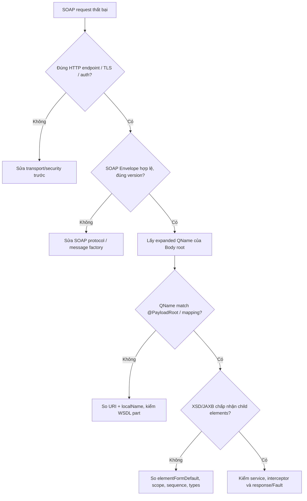

# Prefix khác nhau nhưng cùng QName và những lỗi namespace thường gặp

Trong tích hợp SOAP, hai thông điệp XML có thể nhìn **khác hẳn về prefix** nhưng vẫn mang cùng một phần tử nghiệp vụ. Ngược lại, hai thông điệp có cùng tên thẻ `GetOrderStatusRequest` vẫn có thể **khác QName** và được Spring Web Services (Spring-WS) định tuyến tới hai endpoint khác nhau — hoặc không có endpoint nào.

Ví dụ: `<a:GetOrderStatusRequest xmlns:a="urn:example:order:v1">` và `<b:GetOrderStatusRequest xmlns:b="urn:example:order:v1">` là **cùng QName**, vì hai prefix cùng trỏ tới một namespace URI. Nhưng `<a:GetOrderStatusRequest xmlns:a="urn:example:order:v2">` không còn cùng QName với phần tử `v1` dù tên thẻ và prefix `a` không đổi.

Bài học nằm trong chương **Định tuyến thông điệp** của module **SPRING_WEB_SERVICES**. Trong phương pháp **contract-first**, XSD/WSDL quy định các phần tử XML và namespace; JAXB/OXM chuyển đổi object/XML; `@PayloadRoot` định tuyến request vào endpoint; SOAP client, interceptor, SOAP Fault, XML security và WS-Security phải xử lý thống nhất các QName đó. Việc hiểu đúng prefix và QName giúp tránh các lỗi “No endpoint mapping found”, “unexpected element” và validation failure khi kết nối các hệ thống doanh nghiệp.

## 1. Mục tiêu học tập

Sau bài này, bạn có thể:

- Định nghĩa và phân biệt **namespace URI**, **prefix**, **local name**, **QName** và **expanded name**.
- Chứng minh hai phần tử có prefix khác nhau nhưng cùng URI/local name là cùng QName.
- Giải thích default namespace áp dụng cho phần tử không prefix nhưng **không áp dụng cho thuộc tính không prefix**.
- Đọc `targetNamespace`, `elementFormDefault`, `form` và các khai báo XSD để xác định QName thực tế của payload.
- Hiểu cách Spring-WS dùng `@PayloadRoot` để chọn endpoint và tại sao SOAPAction/WS-Addressing không thay thế QName một cách mặc định.
- Chẩn đoán các lỗi namespace: sai URI, đổi chữ hoa/thường, thừa dấu `/`, namespace kế thừa, thiếu khai báo prefix, con không qualified và nhầm SOAP version.
- Kiểm thử routing, unmarshalling JAXB, XSD validation và SOAP Fault bằng các biến thể prefix/default namespace.
- Nhận biết tác động của prefix/canonicalization trong XML Signature/WS-Security để không sửa XML tùy tiện.

## 2. QName là gì và vì sao prefix không phải danh tính?

XML Namespace cho phép những tên giống nhau như `Request` cùng xuất hiện trong các hệ thống khác nhau mà không bị hiểu nhầm. Mỗi tên phần tử có hai thành phần cơ bản:

1. **Namespace URI**: một chuỗi định danh namespace.
2. **Local name**: phần tên sau dấu hai chấm hoặc toàn bộ tên nếu thẻ không có prefix.

Khi hiển thị, QName có thể viết thành `prefix:localName`, nhưng **prefix chỉ là bí danh tại nơi nó được khai báo**. Khi so sánh XML theo namespace, người đọc thường chuyển nó thành **expanded name**:

```text
{namespaceURI}localName
```

Ví dụ:

```xml
<a:GetOrderStatusRequest xmlns:a="https://example.org/contracts/order/v1"/>
<b:GetOrderStatusRequest xmlns:b="https://example.org/contracts/order/v1"/>
```

Cả hai phần tử đều có expanded name:

```text
{https://example.org/contracts/order/v1}GetOrderStatusRequest
```

Prefix `a` và `b` **không tạo ra hai loại phần tử**. Vì vậy một endpoint match theo QName phải coi chúng là cùng phần tử nghiệp vụ.

So sánh các ví dụ sau:

| Phần tử XML | Namespace URI | Local name | So với ví dụ đầu |
|---|---|---|---|
| `<a:Request xmlns:a="urn:order:v1"/>` | `urn:order:v1` | `Request` | Mốc tham chiếu |
| `<x:Request xmlns:x="urn:order:v1"/>` | `urn:order:v1` | `Request` | **Cùng QName** |
| `<Request xmlns="urn:order:v1"/>` | `urn:order:v1` | `Request` | **Cùng QName** |
| `<a:Request xmlns:a="urn:order:v2"/>` | `urn:order:v2` | `Request` | **Khác QName** |
| `<a:request xmlns:a="urn:order:v1"/>` | `urn:order:v1` | `request` | **Khác QName** |
| `<Request/>` | Không có namespace | `Request` | **Khác QName** |

XML phân biệt chữ hoa/chữ thường ở cả local name và namespace URI. Không dùng `equalsIgnoreCase` để so QName.

### URI namespace không nhất thiết là URL truy cập được

Giá trị `https://example.org/contracts/order/v1` có dạng URL, nhưng khi dùng làm namespace nó đóng vai trò **định danh**; XML parser không cần gọi HTTP tới địa chỉ đó để biết QName. Việc truy cập XSD/WSDL là cơ chế khác: `xsi:schemaLocation`, `xs:import/@schemaLocation`, `wsdl:import` hoặc URL công bố hợp đồng.

Không thay URI thành một hostname “đang chạy” theo môi trường staging/production nếu hợp đồng không quy định. Namespace là một phần của contract, không phải endpoint transport URI.

## 3. Quy tắc phạm vi khai báo prefix và default namespace

Namespace được khai báo bằng `xmlns:prefix="URI"` hoặc `xmlns="URI"` trên một phần tử. Khai báo đó có hiệu lực đối với phần tử chứa khai báo và các phần tử con, trừ nơi bị ghi đè trong phạm vi lồng nhau.

### 3.1. Prefix có thể đổi tên và tái sử dụng

```xml
<ord:GetOrderStatusRequest
    xmlns:ord="https://example.org/contracts/order/v1">
    <ord:orderId>ORD-001</ord:orderId>
</ord:GetOrderStatusRequest>
```

Cùng nội dung, dùng prefix `p`:

```xml
<p:GetOrderStatusRequest
    xmlns:p="https://example.org/contracts/order/v1">
    <p:orderId>ORD-001</p:orderId>
</p:GetOrderStatusRequest>
```

Cả root lẫn child đều có cùng QName giữa hai ví dụ. Việc chọn `ord`, `p` hay `ns2` là quyết định ở phần biểu diễn XML, không phải sự thay đổi hợp đồng.

### 3.2. Default namespace áp dụng cho phần tử không prefix

```xml
<GetOrderStatusRequest
    xmlns="https://example.org/contracts/order/v1">
    <orderId>ORD-001</orderId>
</GetOrderStatusRequest>
```

Ở đây:

- Root không có prefix nhưng thuộc namespace `https://example.org/contracts/order/v1`.
- Child `orderId` cũng không có prefix, **kế thừa default namespace**.
- Vì thế XML này có cùng các expanded name với hai ví dụ dùng `ord`/`p`.

Một lỗi thường gặp là tưởng rằng **không có dấu `:` nghĩa là không có namespace**. Điều đó sai khi default namespace đang được khai báo.

### 3.3. Default namespace không tự áp dụng cho attribute không prefix

```xml
<GetOrderStatusRequest
    xmlns="https://example.org/contracts/order/v1"
    source="portal"
    ord:channel="web"
    xmlns:ord="https://example.org/contracts/order/v1">
    <orderId>ORD-001</orderId>
</GetOrderStatusRequest>
```

Trong XML trên:

| Nút | Expanded name |
|---|---|
| Root `GetOrderStatusRequest` | `{https://example.org/contracts/order/v1}GetOrderStatusRequest` |
| Child `orderId` | `{https://example.org/contracts/order/v1}orderId` |
| Attribute `source` | `{}source` (không namespace) |
| Attribute `ord:channel` | `{https://example.org/contracts/order/v1}channel` |

`xmlns` và `xmlns:ord` là **khai báo namespace**, không phải các attribute nghiệp vụ thông thường để đem so với `xs:attribute`.

Điều này quan trọng khi XSD có `attributeFormDefault="unqualified"` hoặc khi JAXB dùng `@XmlAttribute`. Nếu client tự thêm prefix vào một attribute vốn được khai báo không namespace, validator có thể từ chối dù chuỗi giá trị không thay đổi.

### 3.4. Khai báo lồng nhau có thể làm thay đổi QName

```xml
<ord:GetOrderStatusRequest
    xmlns:ord="https://example.org/contracts/order/v1">
    <ord:orderId>ORD-001</ord:orderId>
    <wrapper xmlns="urn:example:diagnostic">
        <orderId>ORD-002</orderId>
    </wrapper>
</ord:GetOrderStatusRequest>
```

`ord:orderId` thuộc namespace nghiệp vụ; `orderId` nằm trong `wrapper` thuộc `urn:example:diagnostic` vì default namespace được đặt lại. Hai phần tử có cùng local name nhưng không cùng QName.

Trong một vùng XML, prefix cũng có thể được **gắn lại** với URI khác:

```xml
<root xmlns:a="urn:one">
    <a:item/>
    <nested xmlns:a="urn:two">
        <a:item/>
    </nested>
</root>
```

Hai `a:item` không cùng QName: prefix giống nhau, nhưng URI tại vị trí sử dụng khác nhau. Debug bằng cách so **chuỗi tiền tố** sẽ cho kết luận sai.

## 4. Hợp đồng XSD xuyên suốt: xác định đúng QName từ schema

Giả sử một SOAP service nhận yêu cầu tra cứu đơn hàng. Schema `orders-v1.xsd` có nội dung:

```xml
<?xml version="1.0" encoding="UTF-8"?>
<xs:schema
    xmlns:xs="http://www.w3.org/2001/XMLSchema"
    xmlns:ord="https://example.org/contracts/order/v1"
    targetNamespace="https://example.org/contracts/order/v1"
    elementFormDefault="qualified"
    attributeFormDefault="unqualified">

    <xs:simpleType name="NonBlankId">
        <xs:restriction base="xs:token">
            <xs:minLength value="1"/>
            <xs:maxLength value="64"/>
        </xs:restriction>
    </xs:simpleType>

    <xs:element name="GetOrderStatusRequest">
        <xs:complexType>
            <xs:sequence>
                <xs:element name="requestId" type="ord:NonBlankId"/>
                <xs:element name="orderId" type="ord:NonBlankId"/>
            </xs:sequence>
            <xs:attribute name="source"
                          type="xs:string"
                          use="optional"/>
        </xs:complexType>
    </xs:element>

    <xs:element name="GetOrderStatusResponse">
        <xs:complexType>
            <xs:sequence>
                <xs:element name="requestId" type="ord:NonBlankId"/>
                <xs:element name="orderId" type="ord:NonBlankId"/>
                <xs:element name="status" type="xs:string"/>
            </xs:sequence>
        </xs:complexType>
    </xs:element>
</xs:schema>
```

Các ràng buộc về namespace quan trọng:

- `targetNamespace`: hai **global elements** `GetOrderStatusRequest` và `GetOrderStatusResponse` thuộc namespace `https://example.org/contracts/order/v1`.
- `elementFormDefault="qualified"`: local elements `requestId`, `orderId` và `status` cũng phải nằm trong namespace nghiệp vụ (trừ khi có `form` override).
- `attributeFormDefault="unqualified"`: attribute cục bộ `source` là **không namespace** khi xuất hiện không prefix.
- `ord:NonBlankId` là QName của một **XSD type**, không phải QName của một XML element.
- `xs:sequence`: request phải có `requestId` trước `orderId`. Namespace đúng chưa đủ để payload hợp lệ.

XSD không tự đặt tên operation, chọn SOAP version hay định nghĩa HTTP URL. WSDL làm nhiệm vụ gắn global element vào input/output, binding và service address.

### 4.1. Ba payload cùng hợp lệ theo namespace

**Biến thể A — prefix `ord`:**

```xml
<ord:GetOrderStatusRequest
    xmlns:ord="https://example.org/contracts/order/v1"
    source="portal">
    <ord:requestId>REQ-001</ord:requestId>
    <ord:orderId>ORD-100</ord:orderId>
</ord:GetOrderStatusRequest>
```

**Biến thể B — prefix `x`:**

```xml
<x:GetOrderStatusRequest
    xmlns:x="https://example.org/contracts/order/v1"
    source="portal">
    <x:requestId>REQ-001</x:requestId>
    <x:orderId>ORD-100</x:orderId>
</x:GetOrderStatusRequest>
```

**Biến thể C — default namespace:**

```xml
<GetOrderStatusRequest
    xmlns="https://example.org/contracts/order/v1"
    source="portal">
    <requestId>REQ-001</requestId>
    <orderId>ORD-100</orderId>
</GetOrderStatusRequest>
```

Cả ba mô tả **cùng cây QName**: root và hai child có cùng namespace URI, cùng local name, cùng thứ tự; `source` đều là attribute không namespace. Chúng nên được xử lý như cùng một contract input. Serializer JAXB có thể sinh ra một cách biểu diễn khác nhưng tương đương về QName.

### 4.2. Cùng root nhưng child sai namespace

Ví dụ thường gây nhầm:

```xml
<ord:GetOrderStatusRequest
    xmlns:ord="https://example.org/contracts/order/v1">
    <requestId>REQ-001</requestId>
    <orderId>ORD-100</orderId>
</ord:GetOrderStatusRequest>
```

Root đúng QName, nhưng hai child **không namespace** vì tài liệu chưa có default namespace. Trong schema có `elementFormDefault="qualified"`, chúng phải là `ord:requestId` và `ord:orderId` (hoặc biểu diễn không prefix trong default namespace đúng). Vì vậy:

- Spring-WS `@PayloadRoot` có thể **định tuyến đúng endpoint**, do nó nhìn root.
- XSD validation sẽ **từ chối payload**, do các child sai QName.
- Nếu không bật validation, JAXB có thể không bind đúng field, để null hoặc báo lỗi theo binding/implementation.
- Hệ thống không được xem “tìm thấy endpoint” như bằng chứng request hợp lệ.

Đây là lý do cần kiểm tra **QName ở mọi cấp**, không chỉ phần tử đầu SOAP Body.

## 5. WSDL nối QName XSD với input, output và operation

Một WSDL 1.1 theo phong cách document/literal có thể liên kết như sau (trích đoạn):

```xml
<wsdl:definitions
    xmlns:wsdl="http://schemas.xmlsoap.org/wsdl/"
    xmlns:tns="https://example.org/wsdl/order-service/v1"
    xmlns:ord="https://example.org/contracts/order/v1"
    targetNamespace="https://example.org/wsdl/order-service/v1">

    <wsdl:message name="GetOrderStatusInput">
        <wsdl:part name="parameters"
                   element="ord:GetOrderStatusRequest"/>
    </wsdl:message>

    <wsdl:message name="GetOrderStatusOutput">
        <wsdl:part name="parameters"
                   element="ord:GetOrderStatusResponse"/>
    </wsdl:message>

    <wsdl:portType name="OrderPortType">
        <wsdl:operation name="GetOrderStatus">
            <wsdl:input message="tns:GetOrderStatusInput"/>
            <wsdl:output message="tns:GetOrderStatusOutput"/>
        </wsdl:operation>
    </wsdl:portType>
</wsdl:definitions>
```

Đây là **đoạn trích**, chưa phải WSDL hoàn chỉnh: cần khai báo/import schema tại `wsdl:types` và định nghĩa `wsdl:binding`, `wsdl:service` để client biết SOAP binding/địa chỉ.

Phân biệt hai namespace:

```text
WSDL targetNamespace:
  https://example.org/wsdl/order-service/v1

XSD targetNamespace:
  https://example.org/contracts/order/v1

WSDL message QName:
  {https://example.org/wsdl/order-service/v1}GetOrderStatusInput

XML payload root QName:
  {https://example.org/contracts/order/v1}GetOrderStatusRequest
```

Tên `GetOrderStatusInput` là một **WSDL message**, không xuất hiện tự động trong SOAP Body. Khi dùng document/literal với một `part element="ord:GetOrderStatusRequest"`, SOAP Body chứa **phần tử XSD** `GetOrderStatusRequest`. Tên operation `GetOrderStatus` cũng không thay thế QName root.

### Khi gặp prefix khác trong WSDL

Một file WSDL có thể dùng `ord:GetOrderStatusRequest`, file khác dùng `data:GetOrderStatusRequest`. Nếu `xmlns:ord` và `xmlns:data` trỏ tới **cùng namespace URI**, thì giá trị QName của `wsdl:part/@element` **không đổi**.

Ngược lại, thay `xmlns:ord` trong WSDL thành URI `/v2` trong khi schema vẫn chỉ khai báo `/v1` làm tham chiếu sai hợp đồng. Một thay đổi prefix **không đáng kể** có thể đi kèm thay đổi URI **phá vỡ tương thích**; cần kiểm tra cặp URI/local name thay vì chỉ diff text.

## 6. SOAP Envelope, Body và namespace của payload

SOAP có namespace protocol riêng và namespace nghiệp vụ riêng:

| Thành phần | Namespace ví dụ |
|---|---|
| SOAP 1.1 Envelope/Body | `http://schemas.xmlsoap.org/soap/envelope/` |
| SOAP 1.2 Envelope/Body | `http://www.w3.org/2003/05/soap-envelope` |
| Payload GetOrderStatusRequest | `https://example.org/contracts/order/v1` |
| XML Schema instance attributes | `http://www.w3.org/2001/XMLSchema-instance` |
| WS-Security headers | Theo các namespace WS-Security cụ thể của chuẩn/policy |

Request SOAP 1.1 hợp lệ về QName:

```xml
<soap:Envelope
    xmlns:soap="http://schemas.xmlsoap.org/soap/envelope/"
    xmlns:ord="https://example.org/contracts/order/v1">
    <soap:Header/>
    <soap:Body>
        <ord:GetOrderStatusRequest source="portal">
            <ord:requestId>REQ-001</ord:requestId>
            <ord:orderId>ORD-100</ord:orderId>
        </ord:GetOrderStatusRequest>
    </soap:Body>
</soap:Envelope>
```

Biến thể đổi prefix SOAP và payload:

```xml
<s:Envelope
    xmlns:s="http://schemas.xmlsoap.org/soap/envelope/"
    xmlns:p="https://example.org/contracts/order/v1">
    <s:Body>
        <p:GetOrderStatusRequest source="portal">
            <p:requestId>REQ-001</p:requestId>
            <p:orderId>ORD-100</p:orderId>
        </p:GetOrderStatusRequest>
    </s:Body>
</s:Envelope>
```

Ở mức QName của các phần tử, hai thông điệp đều dùng SOAP 1.1 Envelope và cùng payload nghiệp vụ. Việc thiếu `Header` rỗng ở biến thể thứ hai không làm đổi tên payload; `Header` là thành phần tùy chọn của SOAP Envelope.

**Không suy luận SOAP version từ prefix**. `soap:Envelope` có thể là SOAP 1.1 hoặc 1.2 tùy URI mà prefix `soap` trỏ tới. Khi URI đổi từ SOAP 1.1 sang SOAP 1.2, đó là **đổi protocol version**, không phải chỉ đổi tên prefix.

### Đừng để payload vô tình thuộc SOAP namespace

Sai:

```xml
<Envelope xmlns="http://schemas.xmlsoap.org/soap/envelope/">
    <Body>
        <GetOrderStatusRequest>
            <requestId>REQ-001</requestId>
            <orderId>ORD-100</orderId>
        </GetOrderStatusRequest>
    </Body>
</Envelope>
```

Default namespace của `Envelope` kế thừa xuống `GetOrderStatusRequest` và `requestId`, nên chúng nằm trong **SOAP Envelope namespace**, không phải namespace nghiệp vụ. Parser có thể hiểu đúng Envelope/Body, nhưng endpoint `@PayloadRoot` yêu cầu `https://example.org/contracts/order/v1` sẽ không match payload này.

Cách sửa là đặt lại default namespace tại payload hoặc thêm prefix nghiệp vụ:

```xml
<Envelope xmlns="http://schemas.xmlsoap.org/soap/envelope/">
    <Body>
        <GetOrderStatusRequest
            xmlns="https://example.org/contracts/order/v1">
            <requestId>REQ-001</requestId>
            <orderId>ORD-100</orderId>
        </GetOrderStatusRequest>
    </Body>
</Envelope>
```

Ở ví dụ sửa, `Envelope`/`Body` vẫn thuộc namespace SOAP nhờ scope phía ngoài; payload và child kế thừa default namespace mới từ chính payload.

## 7. Spring-WS định tuyến `@PayloadRoot` theo expanded QName

Spring Web Services hỗ trợ endpoint annotation và mapping theo nội dung XML. Với hạ tầng `@EnableWs` thích hợp, `@PayloadRoot` có thể dùng để chọn phương thức theo **namespace URI và local name của phần tử payload**.

Ví dụ:

```java
import org.springframework.ws.server.endpoint.annotation.Endpoint;
import org.springframework.ws.server.endpoint.annotation.PayloadRoot;
import org.springframework.ws.server.endpoint.annotation.RequestPayload;
import org.springframework.ws.server.endpoint.annotation.ResponsePayload;

@Endpoint
public class OrderEndpoint {

    private static final String ORDER_NS =
        "https://example.org/contracts/order/v1";

    private final OrderQueryService service;

    public OrderEndpoint(OrderQueryService service) {
        this.service = service;
    }

    @PayloadRoot(
        namespace = ORDER_NS,
        localPart = "GetOrderStatusRequest"
    )
    @ResponsePayload
    public GetOrderStatusResponse getOrderStatus(
            @RequestPayload GetOrderStatusRequest request) {

        GetOrderStatusResponse response =
            new GetOrderStatusResponse();

        response.setRequestId(request.getRequestId());
        response.setOrderId(request.getOrderId());
        response.setStatus(
            service.findStatus(request.getOrderId())
        );

        return response;
    }
}
```

Các lớp `OrderQueryService`, `GetOrderStatusRequest` và `GetOrderStatusResponse` là thành phần của ứng dụng; ví dụ giả định các lớp JAXB được sinh từ XSD và mapper/endpoint adapter đã hỗ trợ chúng. Khi XJC sinh `JAXBElement<T>` thay vì class có `@XmlRootElement`, chữ ký endpoint hoặc wrapper response cần điều chỉnh đúng theo mã sinh.

Spring-WS không quan tâm prefix `ord`, `p` hay default namespace khi **`@PayloadRoot` mapping** đã được cấu hình theo QName. Nó so nội dung tương ứng với:

```text
{https://example.org/contracts/order/v1}GetOrderStatusRequest
```

Tức là **không** chỉ so local name, **không** yêu cầu prefix cố định và **không** tự coi URI `/v2` như `/v1`.

### 7.1. Kiểu mapping nào có thể dựa vào thông tin khác?

Spring-WS có nhiều chiến lược `EndpointMapping`. Với annotation mapping theo payload root, `@PayloadRoot` quyết định từ QName. Ngoài ra, trong những cấu hình phù hợp có thể ánh xạ theo **SOAPAction** hoặc thông tin khác, ví dụ cơ chế `@SoapAction`/`SoapActionAnnotationMethodEndpointMapping`.

Không nên phát biểu rằng “Spring-WS luôn luôn chỉ dùng QName”. Câu đúng hơn là:

> **Đối với phương thức được định tuyến bằng `@PayloadRoot`, tên phần tử XML trong SOAP Body được phân giải thành QName và dùng để chọn endpoint.**

Nếu một ứng dụng có nhiều mapping strategy, thứ tự ưu tiên và cấu hình thực tế có thể quyết định request vào endpoint nào. Cần test theo cấu hình đang chạy, nhất là khi đối tác dùng SOAPAction cũ nhưng chuyển sang QName mới.

### 7.2. Hai operation có cùng local name nhưng namespace khác

Có thể khai báo hai phiên bản:

```java
@PayloadRoot(
    namespace = "https://example.org/contracts/order/v1",
    localPart = "GetOrderStatusRequest"
)
public Object handleV1(@RequestPayload Object request) {
    // ...
    return null;
}

@PayloadRoot(
    namespace = "https://example.org/contracts/order/v2",
    localPart = "GetOrderStatusRequest"
)
public Object handleV2(@RequestPayload Object request) {
    // ...
    return null;
}
```

Đây là **mã giả định để minh họa định tuyến**, không phải endpoint hoàn chỉnh có contract JAXB/result. Hai method không xung đột ở mức QName vì namespace URI khác nhau. Tuy nhiên, phải xây dựng model `v1`/`v2`, validation và WSDL riêng rõ ràng; đừng dựa vào kiểu `Object` hoặc `return null` trong code production.

Nếu hai method trong cùng chiến lược `@PayloadRoot` khai báo **trùng chính xác namespace/localPart**, framework có thể gặp xung đột mapping khi khởi tạo hoặc không có định tuyến duy nhất. Mỗi QName của operation cần gắn với một handler rõ ràng theo kiến trúc.

## 8. Bảng lỗi namespace thường gặp và cách nhận diện

| Mã | Hiện tượng | Nguyên nhân ở QName | Tầng thường thấy lỗi |
|---|---|---|---|
| N01 | `ord` đổi thành `x` và URI giữ nguyên | **Không có lỗi QName** | Test đúng phải chấp nhận. |
| N02 | URI `/v1` bị đổi thành `/v2` | Root QName thay đổi | Endpoint mapping hoặc XSD. |
| N03 | URI có thêm dấu `/` cuối chuỗi | URI khác chính xác từng ký tự | Endpoint mapping/XSD. |
| N04 | URI đổi chữ hoa/thường | URI khác vì so sánh chuỗi phân biệt hoa thường | Endpoint mapping/XSD. |
| N05 | Root có prefix đúng nhưng child không prefix, không default namespace | Child QName sai dù root đúng | XSD validation/JAXB. |
| N06 | Payload không prefix kế thừa default namespace SOAP | Root thuộc SOAP URI, không phải contract URI | Endpoint mapping. |
| N07 | Prefix dùng mà không khai báo `xmlns` | XML không namespace-well-formed | XML parser, trước endpoint. |
| N08 | Prefix được khai báo lại ở scope con | Một số child đột ngột thuộc URI khác | XSD/JAXB. |
| N09 | Attribute không prefix được hiểu là thuộc default namespace | Suy luận sai: attribute thực tế không namespace | XSD/JAXB attribute mapping. |
| N10 | WSDL part tham chiếu prefix tới namespace cũ | QName element WSDL tham chiếu không còn tồn tại | WSDL/XSD import, client generation. |
| N11 | SOAP 1.1 Envelope URI đổi thành SOAP 1.2 | Protocol QName đổi | SOAP message factory/binding. |
| N12 | Prefix đúng nhưng local name viết khác chữ hoa | Local name đổi | Mapping/XSD. |
| N13 | Namespace payload đúng, tên WSDL operation sai | Không nhất thiết là vấn đề QName payload | WSDL/client binding, tùy strategy mapping. |
| N14 | XML dùng `xsi:type` với prefix chưa khai báo | Không phân giải được QName type | Parser/XSD/JAXB. |

**Cách xử lý nhanh:** lấy phần tử root **trực tiếp trong SOAP Body**, in **namespace URI** và **local name** bằng XML parser namespace-aware, rồi so với `@PayloadRoot` và `wsdl:part/@element`. Nếu root đúng, kiểm tiếp từng child theo XSD.

### 8.1. Thừa dấu `/` và khác scheme

```text
https://example.org/contracts/order/v1
https://example.org/contracts/order/v1/
http://example.org/contracts/order/v1
```

Ba URI là **ba chuỗi khác nhau**. XML namespace không tự chuẩn hóa dấu gạch cuối, `http` thành `https`, hay domain theo ý muốn của ứng dụng.

Đừng sửa namespace theo URL nơi server đang triển khai. Hợp đồng có thể dùng URI `https` dù endpoint gọi được qua một hostname nội bộ khác. Việc đổi `targetNamespace` là một thay đổi contract có thể khiến JAXB/WSDL/client cũ không tương thích.

### 8.2. Prefix chưa khai báo

```xml
<ord:GetOrderStatusRequest>
    <ord:orderId>ORD-100</ord:orderId>
</ord:GetOrderStatusRequest>
```

Nếu không có `xmlns:ord` trên phần tử hoặc tổ tiên, XML **không hợp lệ theo XML Namespaces**. Parser namespace-aware thường từ chối trước khi bất kỳ `@PayloadRoot` nào được tìm.

Không được xử lý trường hợp này bằng cách đoán prefix `ord` “chắc là namespace order”; phải sửa tài liệu XML của client.

### 8.3. Xóa default namespace giữa tài liệu

```xml
<GetOrderStatusRequest
    xmlns="https://example.org/contracts/order/v1">
    <requestId>REQ-001</requestId>
    <section xmlns="">
        <orderId>ORD-100</orderId>
    </section>
</GetOrderStatusRequest>
```

`xmlns=""` đặt lại default namespace về **không namespace** cho các phần tử không prefix trong scope đó. Khi schema mong `ord:orderId` trực tiếp dưới root, ví dụ này vừa sai cấu trúc (`section` không được khai báo) vừa khiến `orderId` bên trong không namespace.

Khi debug, chú ý những khai báo `xmlns=""` vô tình được serializer thêm hoặc những đoạn XML được ghép từ nhiều nguồn.

### 8.4. `xsi:type` cũng chứa QName

Namespace không chỉ có trong tên element. Một số giá trị attribute được XML Schema định nghĩa là **QName-valued**, chẳng hạn `xsi:type`:

```xml
<ord:item
    xmlns:ord="https://example.org/contracts/order/v1"
    xmlns:xsi="http://www.w3.org/2001/XMLSchema-instance"
    xsi:type="ord:SpecialOrderItemType"/>
```

Giá trị `ord:SpecialOrderItemType` cần prefix `ord` được khai báo đúng. Nếu đổi prefix thành `p` và sửa `xsi:type="p:SpecialOrderItemType"` với `xmlns:p` cùng URI, QName type không đổi. Nhưng nếu chỉ thay tên prefix ở thẻ mà quên giá trị `xsi:type`, parser/schema/JAXB có thể không phân giải đúng kiểu.

Đừng tự đổi text value có dạng `prefix:name` nếu chưa biết nó được định nghĩa là QName-valued hay chỉ là chuỗi văn bản nghiệp vụ. Một attribute thông thường như `orderId="ord:123"` không mặc nhiên có ý nghĩa QName.

## 9. JAXB và Spring OXM: root QName đúng chưa đủ

Trong contract-first, XSD thường được dùng để sinh lớp JAXB với annotation như `@XmlRootElement`, `@XmlType`, `@XmlElement`, `@XmlSchema` và `@XmlElementDecl`.

Ví dụ package-level namespace:

```java
@jakarta.xml.bind.annotation.XmlSchema(
    namespace = "https://example.org/contracts/order/v1",
    elementFormDefault =
        jakarta.xml.bind.annotation.XmlNsForm.QUALIFIED
)
package org.example.order.contract;
```

Và lớp request minh họa:

```java
import jakarta.xml.bind.annotation.XmlAccessType;
import jakarta.xml.bind.annotation.XmlAccessorType;
import jakarta.xml.bind.annotation.XmlElement;
import jakarta.xml.bind.annotation.XmlRootElement;
import jakarta.xml.bind.annotation.XmlType;

@XmlAccessorType(XmlAccessType.FIELD)
@XmlType(name = "", propOrder = {"requestId", "orderId"})
@XmlRootElement(name = "GetOrderStatusRequest")
public class GetOrderStatusRequest {

    @XmlElement(required = true)
    protected String requestId;

    @XmlElement(required = true)
    protected String orderId;

    // Getter/setter được lược bớt.
}
```

Kết hợp `@XmlSchema` (cùng Java package), JAXB sẽ biết root `GetOrderStatusRequest` và child `requestId`/`orderId` thuộc namespace contract. Khi marshal, prefix cụ thể có thể khác với XML trong tài liệu nhưng expanded name phải đúng.

**Những rủi ro thường gặp:**

- `@XmlRootElement(name=...)` đúng local name nhưng package thiếu namespace: XML có thể được marshal với root **không namespace**.
- `@XmlSchema` đặt sai package: lớp JAXB dùng namespace không mong đợi.
- `@XmlElement(namespace=...)` sai: root đúng nhưng child bị đặt vào namespace khác.
- `@XmlType(propOrder=...)` không trùng `xs:sequence`: XML well-formed nhưng bị XSD từ chối.
- Một global element tham chiếu **named complex type** có thể được XJC ánh xạ bằng `ObjectFactory` và `JAXBElement<T>` thay vì có `@XmlRootElement` trực tiếp. QName root khi đó nằm ở `@XmlElementDecl`/`JAXBElement`.

Trong Spring-WS, `Jaxb2Marshaller` có thể dùng làm bean OXM:

```java
import org.springframework.context.annotation.Bean;
import org.springframework.context.annotation.Configuration;
import org.springframework.oxm.jaxb.Jaxb2Marshaller;

@Configuration
public class OrderJaxbConfiguration {

    @Bean
    public Jaxb2Marshaller orderMarshaller() {
        Jaxb2Marshaller marshaller = new Jaxb2Marshaller();
        marshaller.setContextPath("org.example.order.contract");
        return marshaller;
    }
}
```

`setContextPath` yêu cầu package có metadata JAXB phù hợp (chẳng hạn `ObjectFactory` hoặc `jaxb.index`); có thể dùng `setClassesToBeBound(...)` theo cấu trúc generated code. Trong Spring Boot 3/Spring-WS 4, các annotation JAXB thường thuộc `jakarta.xml.bind.*`, trong khi `javax.xml.namespace.QName` vẫn nằm trong JDK.

Một lỗi `unexpected element (uri:"...", local:"...")` nên được đọc **đúng URI và local name** mà JAXB báo. Đừng chỉ tìm xem lỗi có nhắc prefix `ns2` hay không. Prefix là biểu diễn; URI và local name mới giúp xác định mismatch của binding.

## 10. Kiểm tra QName bằng Java thay vì so chuỗi XML

Một cách kiểm tra đáng tin là dùng XML parser namespace-aware để in QName của phần tử. Với DOM/JAXP:

```java
import java.io.StringReader;
import javax.xml.parsers.DocumentBuilderFactory;
import org.w3c.dom.Document;
import org.w3c.dom.Element;
import org.xml.sax.InputSource;

String xml = """
    <p:GetOrderStatusRequest
        xmlns:p="https://example.org/contracts/order/v1">
        <p:requestId>REQ-001</p:requestId>
        <p:orderId>ORD-100</p:orderId>
    </p:GetOrderStatusRequest>
    """;

DocumentBuilderFactory factory =
    DocumentBuilderFactory.newInstance();
factory.setNamespaceAware(true);

// Ví dụ input cố định đã biết để giải thích QName.
// Với XML không tin cậy, phải bổ sung giới hạn DTD/entity
// và hardening parser thích hợp trước khi parse.

Document document = factory.newDocumentBuilder()
    .parse(new InputSource(new StringReader(xml)));

Element root = document.getDocumentElement();

System.out.println(root.getNamespaceURI());
System.out.println(root.getLocalName());
System.out.println(root.getPrefix());
```

Kết quả tương ứng:

```text
https://example.org/contracts/order/v1
GetOrderStatusRequest
p
```

Nếu đổi `p` thành `ord` và khai báo cùng URI, hai dòng đầu **không đổi**; dòng prefix mới thay đổi. Trong code định tuyến, so hai dòng đầu, hoặc tạo `QName` đúng cách:

```java
import javax.xml.namespace.QName;

QName expected = new QName(
    "https://example.org/contracts/order/v1",
    "GetOrderStatusRequest"
);

QName actual = new QName(
    root.getNamespaceURI() == null ? "" : root.getNamespaceURI(),
    root.getLocalName()
);

boolean sameName = expected.equals(actual);
```

`QName.equals` so namespace URI và local part; prefix không tham gia so sánh. Lưu ý `getLocalName()` có thể null nếu parser không namespace-aware; phải bật `setNamespaceAware(true)`.

### Không dùng XPath thiếu namespace context

Với XPath, biểu thức `/GetOrderStatusRequest/requestId` **không tự match** các element có namespace chỉ vì XML sử dụng default namespace. Trong XPath 1.0 chuẩn, unprefixed element name trong biểu thức thường được hiểu là **không namespace**.

Một cách viết XPath có namespace context là:

```text
/o:GetOrderStatusRequest/o:requestId/text()
```

Trong đó prefix `o` của XPath được ứng dụng ánh xạ đến URI `https://example.org/contracts/order/v1`. Prefix trong XPath không cần trùng prefix trong XML nguồn; nó chỉ cần trỏ tới URI đúng.

Khi viết assertion XML trong SOAP test, dùng QName-aware XML comparison hoặc XPath có `NamespaceContext`; tránh so nguyên chuỗi rồi kết luận test fail chỉ vì JAXB đổi `ord` thành `ns2`.

## 11. Spring-WS test: prefix thay đổi nhưng endpoint phải như cũ

`MockWebServiceClient` có thể kiểm thử endpoint bằng cách gửi payload trực tiếp vào Spring-WS application context. Ví dụ hình thức test cho phương thức `getOrderStatus`:

```java
import static org.springframework.ws.test.server.RequestCreators.withPayload;
import static org.springframework.ws.test.server.ResponseMatchers.noFault;
import static org.springframework.ws.test.server.ResponseMatchers.validPayload;

import org.junit.jupiter.api.Test;
import org.springframework.beans.factory.annotation.Autowired;
import org.springframework.context.ApplicationContext;
import org.springframework.core.io.ClassPathResource;
import org.springframework.xml.transform.StringSource;
import org.springframework.ws.test.server.MockWebServiceClient;

class OrderEndpointRoutingTest {

    @Autowired
    private ApplicationContext applicationContext;

    @Test
    void acceptsDifferentPrefixWithSameQName() {
        MockWebServiceClient client =
            MockWebServiceClient.createClient(applicationContext);

        StringSource request = new StringSource("""
            <x:GetOrderStatusRequest
                xmlns:x="https://example.org/contracts/order/v1">
                <x:requestId>REQ-001</x:requestId>
                <x:orderId>ORD-100</x:orderId>
            </x:GetOrderStatusRequest>
            """);

        client.sendRequest(withPayload(request))
              .andExpect(noFault())
              .andExpect(validPayload(
                  new ClassPathResource("xsd/orders-v1.xsd")
              ));
    }
}
```

Ví dụ giả định Spring test context đã được khởi tạo (ví dụ bằng `@SpringBootTest` hoặc cấu hình test phù hợp), endpoint/JAXB/`OrderQueryService` đã có bean và trả dữ liệu hợp lệ. Nó minh họa test prefix, **chưa phải test class standalone**: không nên chỉ copy rồi coi là đã kiểm toàn bộ SOAP server.

`noFault()` chứng minh phía xử lý không trả SOAP Fault; `validPayload(...)` kiểm tra response payload theo XSD. Khi áp dụng thật, cần assert `requestId`/`orderId` và `status` cụ thể để phát hiện endpoint trả nhầm dữ liệu dù response vẫn hợp lệ theo schema.

### Ma trận test routing/XSD

| ID | Thay đổi request | Kỳ vọng |
|---|---|---|
| P01 | Prefix `ord` với URI `/v1` | Định tuyến đúng, response hợp lệ. |
| P02 | Đổi `ord` thành `x`, giữ URI `/v1` | **Cùng QName**, vẫn định tuyến đúng. |
| P03 | Chuyển sang default namespace `/v1` cho root/child | **Cùng QName**, vẫn định tuyến đúng. |
| P04 | Đổi prefix SOAP `soap` thành `s`, giữ SOAP 1.1 URI | SOAP version không đổi, payload routing không đổi. |
| N01 | Root URI `/v1` thành `/v2` | Không định tuyến như endpoint `v1`. |
| N02 | Root local name thành `getOrderStatusRequest` | Không định tuyến như root cũ. |
| N03 | Root đúng, child không prefix và không default namespace | Mapping có thể đúng; **XSD phải từ chối**. |
| N04 | `requestId`/`orderId` đảo thứ tự | XSD từ chối theo `xs:sequence`. |
| N05 | Prefix `ord` chưa khai báo | XML parser từ chối trước dispatch. |
| N06 | Payload kế thừa default namespace SOAP 1.1 | Root payload QName sai, không match `@PayloadRoot`. |
| N07 | URI có thêm dấu `/` cuối | Khác QName, không match. |
| N08 | Attribute `source` vô tình thêm prefix `ord` | Root vẫn đúng; schema có thể từ chối attribute sai namespace. |
| N09 | SOAP 1.2 URI gửi đến endpoint chỉ hỗ trợ SOAP 1.1 | Lỗi protocol/binding; không quy lỗi về prefix. |
| N10 | `xsi:type` tham chiếu prefix không được khai báo | XML namespace/type resolution thất bại. |

Cần phân biệt **lớp bị lỗi đầu tiên**: N05 có thể bị parser chặn, N01 có thể không tìm thấy endpoint, N03 có thể đến endpoint mapping nhưng bị validator/JAXB chặn. Do đó, không assert tất cả trường hợp đều trả một SOAP Fault giống nhau nếu chính sách hệ thống chưa quy định.

### Kiểm thử SOAP client

Với client `WebServiceTemplate`, dùng `MockWebServiceServer` để giả lập đối tác, assert QName của XML request mà JAXB gửi ra và unmarshal một response dùng prefix khác nhưng URI giống nhau. Một client đúng không được phụ thuộc vào prefix serializer bên đối tác chọn.

Bổ sung kiểm thử HTTP/TLS thật để kiểm tra SOAP version, HTTP headers, SOAPAction, chứng chỉ và WSDL/XSD đã công bố. Mock test không chứng minh endpoint URI hoặc proxy/transport đúng.

## 12. Khi định tuyến thất bại: SOAP Fault, HTTP và logging

Một request không match `@PayloadRoot` có thể làm Spring-WS báo không tìm được endpoint, hoặc được xử lý bởi mapping strategy khác nếu hệ thống cấu hình thêm. Kết quả phản hồi cụ thể phụ thuộc phiên bản, message factory, exception resolver, interceptor và container HTTP. Vì vậy **không mặc định** mọi lỗi namespace đều trả HTTP 500 hoặc một Fault code duy nhất.

Khi dịch vụ chủ động chuẩn hóa lỗi, một SOAP 1.1 Fault có thể có dạng:

```xml
<soap:Envelope
    xmlns:soap="http://schemas.xmlsoap.org/soap/envelope/"
    xmlns:ord="https://example.org/contracts/order/v1">
    <soap:Body>
        <soap:Fault>
            <faultcode>soap:Client</faultcode>
            <faultstring>Request payload is not supported</faultstring>
            <detail>
                <ord:RoutingFault>
                    <ord:code>UNSUPPORTED_PAYLOAD</ord:code>
                    <ord:message>Unsupported operation payload</ord:message>
                </ord:RoutingFault>
            </detail>
        </soap:Fault>
    </soap:Body>
</soap:Envelope>
```

Đây là **Fault minh họa theo chính sách tùy biến**. XSD ở mục 4 chưa khai báo `RoutingFault`; nếu muốn công bố mẫu lỗi này như một contract thật, phải thêm global element trong XSD, khai báo `wsdl:fault`/binding phù hợp khi cần, triển khai exception/Fault mapping và kiểm thử SOAP response. `@PayloadRoot` hoặc `@EnableWs` không tự sinh `RoutingFault`.

### Log các giá trị hữu ích thay vì log XML nhạy cảm

Đối với lỗi routing, một log có ích thường gồm:

```text
correlationId=REQ-001
soapVersion=1.1
payloadNamespace=https://example.org/contracts/order/v2
payloadLocalName=GetOrderStatusRequest
mappingExpectedNamespace=https://example.org/contracts/order/v1
result=NO_MATCH
```

Log các trường trên chỉ là ví dụ, không phải output mặc định của Spring-WS. Mã correlation ID phải qua xác thực/giới hạn đầu vào nếu đến từ client. Không log toàn bộ SOAP Header có UsernameToken, chữ ký, token hoặc thông tin khách hàng nhạy cảm chỉ để xem một namespace URI.

SOAP Fault cũng có version-specific structure: SOAP 1.1 dùng `faultcode`/`faultstring`/`detail`, SOAP 1.2 dùng `Code`/`Reason`/`Detail`. Đừng đổ lỗi sai namespace nghiệp vụ nếu SOAP Envelope thuộc sai version.

## 13. XML Signature và WS-Security: cùng QName chưa chắc cùng chữ ký

Về định tuyến SOAP payload, hai cách viết prefix khác nhau nhưng URI/local name giống nhau có thể là cùng QName. Tuy nhiên **điều đó không có nghĩa mọi biến đổi prefix đều an toàn khi thông điệp đã được ký số**.

Trong WS-Security, chữ ký XML liên quan đến canonicalization, namespace declarations, phần tử được tham chiếu và chính sách ký. Thay đổi prefix, scope của namespace, whitespace hoặc thứ tự một số nội dung có thể làm **đổi octet được canonicalize** và làm chữ ký không còn hợp lệ, tùy thuật toán/cách ký cụ thể.

Do đó:

- **Trước khi ký**: serializer có thể chọn prefix khác miễn dữ liệu đúng QName/contract; hai phía thống nhất cách canonicalization và WS-Security policy.
- **Sau khi ký**: không tự viết lại prefix hoặc “làm đẹp XML” qua trung gian mà không xác minh tác động tới chữ ký.
- **Khi xác minh**: dùng thư viện XML Signature/WS-Security chuyên dụng và chính sách bảo mật đúng, không tự tạo signature bằng cách hash raw XML tùy tiện.
- **Khi định tuyến**: đừng coi “đúng QName” là bằng chứng thông điệp đã được xác thực, còn hạn timestamp hay được cấp quyền.
- **Khi chuyển tiếp qua gateway**: nếu gateway biến đổi SOAP Body/namespace sau khi bên gửi ký, cần kiểm tra phương án xác minh/biến đổi/ký lại được phép và ranh giới tin cậy.

Kèm theo đó, XML parsing phải được cấu hình an toàn: kiểm soát DTD/external entities, giới hạn kích thước/depth, không tải schema do client cung cấp một cách không kiểm soát. TLS/chứng chỉ bảo vệ tầng transport; chúng không tự sửa QName sai trong SOAP Body.

## 14. Chiến lược versioning khi namespace khác

Trong nhiều hợp đồng SOAP doanh nghiệp, phiên bản `v1` và `v2` sử dụng namespace URI khác nhau để thể hiện thay đổi giao diện.

Ví dụ:

```text
v1 root QName:
{https://example.org/contracts/order/v1}GetOrderStatusRequest

v2 root QName:
{https://example.org/contracts/order/v2}GetOrderStatusRequest
```

Hai QName khác nhau dù local name giống nhau. Đây là cách tách contract có chủ đích, không phải lỗi prefix.

Một số nguyên tắc thiết kế:

1. **Phân định contract rõ**: XSD/WSDL/JAXB model cho từng version phải dùng URI nhất quán.
2. **Không tự map `v2` vào `v1`** vì thấy local name giống nhau; cấu trúc có thể khác về trường bắt buộc, kiểu dữ liệu hoặc Fault.
3. **Chọn endpoint mapping rõ ràng**: hai phương thức `@PayloadRoot` với URI `/v1`, `/v2` khác nhau hoặc tách ứng dụng/service theo version.
4. **Kiểm tra client cũ** bằng bộ golden SOAP messages `v1`; không sửa prefix rồi lầm tưởng đã chuyển version.
5. **Nội bộ dùng converter có kiểm soát** nếu phải chuyển `v1` sang model `v2`; converter phải giải thích các trường bị đổi và xử lý validation.
6. **Công bố WSDL/XSD đầy đủ**; endpoint URL có thể thay đổi mà namespace giữ nguyên, hoặc namespace thay đổi dù endpoint URL không đổi.
7. **Kiểm tra Fault detail** cho từng version vì declared fault QName cũng có thể đổi.
8. **Duy trì security policy** cho từng version; không vì hỗ trợ URI cũ mà chấp nhận SOAP Header/chữ ký yếu hơn.

**Nhớ rằng namespace URI là một phần của hợp đồng**, còn prefix là biểu diễn tại chỗ. Chỉ đổi prefix **không tạo ra version mới**; đổi URI có thể làm client/server không tương thích ngay cả khi XML trông gần như giống nhau.

## 15. Quy trình chẩn đoán khi đối tác báo “không tìm thấy endpoint”

Hãy xử lý theo thứ tự từ ngoài vào trong:



Trong thực hành:

1. **Transport**: xác minh HTTP path, hostname, TLS/mTLS, authentication. Nếu HTTP 401 hoặc handshake fail, có thể chưa vào SOAP dispatcher.
2. **SOAP protocol**: xác minh Envelope namespace, SOAP version, Content-Type và message factory.
3. **Payload QName**: lấy `namespaceURI` và `localName` của phần tử nghiệp vụ đầu SOAP Body; nếu `{.../v2}GetOrderStatusRequest` mà server cần `/v1`, đã tìm được nguyên nhân chính.
4. **WSDL**: truy `wsdl:operation` → `wsdl:input` → `wsdl:message` → `wsdl:part/@element` → global XSD element để biết QName mà client phải gửi.
5. **Child QName**: root đúng chưa đủ; xác minh `elementFormDefault` và các child đang ở namespace nào.
6. **JAXB/OXM**: so `@XmlRootElement`, `@XmlSchema`, `@XmlElementDecl`, `Jaxb2Marshaller` với XSD đã công bố.
7. **Interceptor**: xem schema validation hoặc WS-Security có chặn payload không; tránh đồng nhất tất cả lỗi với “no endpoint”.
8. **Response**: sau khi route đúng, assert QName output/Fault detail và HTTP behavior phù hợp binding.

Không nên thử sửa mọi khai báo `xmlns` theo cảm tính. Hãy ghi rõ **expanded QName thực tế** và **expected QName**, rồi thay đổi đúng phần sai.

## 16. Bài thực hành: phân loại mười hai thông điệp

Giả sử server có:

```java
@PayloadRoot(
    namespace = "urn:acme:shipment:v1",
    localPart = "TrackShipmentRequest"
)
```

XSD còn quy định child `trackingId` thuộc cùng namespace bằng `elementFormDefault="qualified"`. Hãy phân loại các payload sau theo ba mức: **(A) định tuyến đúng và cấu trúc namespace đúng**, **(B) root định tuyến đúng nhưng child có vấn đề**, **(C) root không match hoặc XML parser từ chối**.

**1. Prefix `s` đúng URI:**

```xml
<s:TrackShipmentRequest xmlns:s="urn:acme:shipment:v1">
    <s:trackingId>T-100</s:trackingId>
</s:TrackShipmentRequest>
```

**2. Prefix `x` đúng URI:**

```xml
<x:TrackShipmentRequest xmlns:x="urn:acme:shipment:v1">
    <x:trackingId>T-100</x:trackingId>
</x:TrackShipmentRequest>
```

**3. Default namespace đúng URI:**

```xml
<TrackShipmentRequest xmlns="urn:acme:shipment:v1">
    <trackingId>T-100</trackingId>
</TrackShipmentRequest>
```

**4. Root đúng URI, child không prefix/không default namespace:**

```xml
<s:TrackShipmentRequest xmlns:s="urn:acme:shipment:v1">
    <trackingId>T-100</trackingId>
</s:TrackShipmentRequest>
```

**5. URI khác phiên bản:**

```xml
<s:TrackShipmentRequest xmlns:s="urn:acme:shipment:v2">
    <s:trackingId>T-100</s:trackingId>
</s:TrackShipmentRequest>
```

**6. Prefix chưa khai báo:**

```xml
<s:TrackShipmentRequest>
    <s:trackingId>T-100</s:trackingId>
</s:TrackShipmentRequest>
```

**7. Không namespace:**

```xml
<TrackShipmentRequest>
    <trackingId>T-100</trackingId>
</TrackShipmentRequest>
```

**8. Root viết sai chữ hoa:**

```xml
<s:trackShipmentRequest xmlns:s="urn:acme:shipment:v1">
    <s:trackingId>T-100</s:trackingId>
</s:trackShipmentRequest>
```

**9. Namespace có dấu `/` cuối:**

```xml
<s:TrackShipmentRequest xmlns:s="urn:acme:shipment:v1/">
    <s:trackingId>T-100</s:trackingId>
</s:TrackShipmentRequest>
```

**10. Root đúng, child nằm trong namespace khác:**

```xml
<s:TrackShipmentRequest
    xmlns:s="urn:acme:shipment:v1"
    xmlns:x="urn:another">
    <x:trackingId>T-100</x:trackingId>
</s:TrackShipmentRequest>
```

**11. Root đúng, child dùng default namespace tương ứng:**

```xml
<s:TrackShipmentRequest
    xmlns:s="urn:acme:shipment:v1"
    xmlns="urn:acme:shipment:v1">
    <trackingId>T-100</trackingId>
</s:TrackShipmentRequest>
```

**12. Root đúng nhưng local name child khác:**

```xml
<s:TrackShipmentRequest xmlns:s="urn:acme:shipment:v1">
    <s:TrackingId>T-100</s:TrackingId>
</s:TrackShipmentRequest>
```

### Đáp án và giải thích

| Mẫu | Phân loại | Lý do |
|---|---|---|
| 1 | **A** | `s` trỏ đúng URI, root/child đúng QName. |
| 2 | **A** | Đổi prefix `s` → `x` không đổi QName. |
| 3 | **A** | Default namespace đúng cho root và child. |
| 4 | **B** | Root đúng, child không namespace. |
| 5 | **C** | URI `v2` khác `v1`. |
| 6 | **C** | Prefix `s` không khai báo; XML parser namespace-aware từ chối. |
| 7 | **C** | Root không namespace. |
| 8 | **C** | Local name phân biệt hoa/thường. |
| 9 | **C** | URI `v1/` khác `v1`. |
| 10 | **B** | Child thuộc `urn:another`. |
| 11 | **A** | Root dùng prefix `s`, child kế thừa default namespace đúng. |
| 12 | **B** | Child local name `TrackingId` khác `trackingId`. |

Phân loại A chỉ nói **đúng QName và cấu trúc namespace trong bài tập**. Một request thực còn phải tuân thủ kiểu dữ liệu, min/max, sequence, SOAP version, authentication/WS-Security và quy tắc nghiệp vụ. Nếu XSD có ràng buộc khác chưa trình bày, vẫn phải kiểm riêng.

### Thử nghiệm thêm

Dùng `MockWebServiceClient` với hai XML mẫu 1 và 2, assert cả hai được định tuyến vào cùng handler. Dùng mẫu 4 và 10 để chứng minh `@PayloadRoot` có thể match root nhưng XSD validation không chấp nhận child. Dùng mẫu 5, 7 và 9 để xác minh server **không** tự coi URI khác như cùng operation.

Tiếp theo, thử đổi tên prefix SOAP Envelope từ `soap` thành `env` nhưng giữ nguyên SOAP 1.1 namespace. Kết quả routing payload không nên thay đổi. Cuối cùng, thử đổi **namespace URI** Envelope sang SOAP 1.2 để quan sát lỗi **protocol version** khác với lỗi namespace nghiệp vụ.

## 17. Tổng kết

**QName không được định danh bằng prefix.** Trong XML namespace, định danh thực của một phần tử là cặp **namespace URI + local name**. Vì vậy `ord:GetOrderStatusRequest`, `x:GetOrderStatusRequest` và `GetOrderStatusRequest` trong default namespace tương ứng có thể hoàn toàn tương đương về QName; nhưng cùng prefix `ord` trỏ tới URI khác hoặc cùng local name ở **không namespace** là các phần tử khác.

Trong Spring Web Services theo hướng **contract-first**, `@PayloadRoot` định tuyến bằng QName của payload, còn XSD/JAXB cần xác minh namespace của cả các child và attribute. SOAP Envelope có namespace protocol riêng; WSDL kết nối operation với global XSD element; SOAPAction, WS-Security, TLS và SOAP Fault thuộc các tầng xử lý riêng. Hãy kiểm tra expanded QName thật của từng thông điệp, dùng test namespace-aware và giữ nhất quán hợp đồng XSD/WSDL để tránh lỗi định tuyến khó chẩn đoán khi tích hợp giữa các hệ thống doanh nghiệp.
