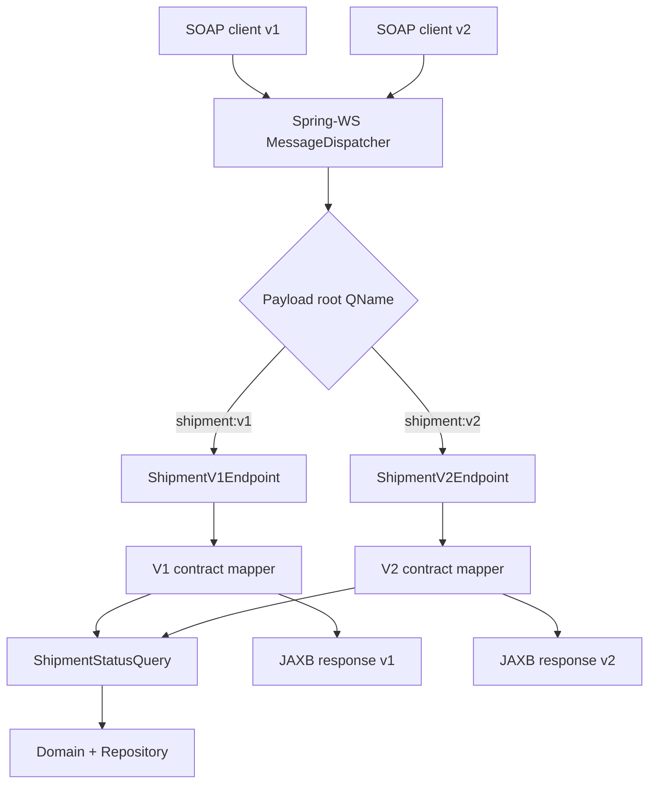
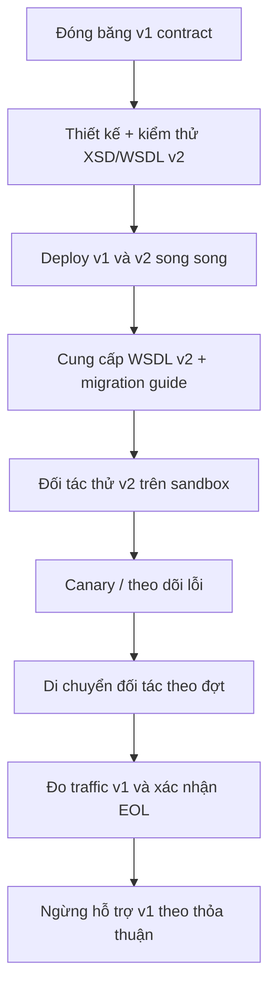

# Định tuyến nhiều phiên bản hợp đồng trong cùng ứng dụng

## 1. Vấn đề: một ứng dụng phải phục vụ nhiều thế hệ SOAP client

Một doanh nghiệp có dịch vụ SOAP tra cứu trạng thái vận đơn. Các đối tác lâu năm vẫn gọi hợp đồng **v1**; đối tác mới yêu cầu thêm thông tin checkpoint và bộ lọc lịch sử ở **v2**. Không thể buộc mọi đối tác nâng cấp cùng thời điểm, nhưng nhóm vận hành cũng không muốn sao chép toàn bộ hệ thống chỉ để duy trì hai định dạng XML.

Với **Spring Web Services (Spring-WS)**, một ứng dụng có thể nhận nhiều hợp đồng bằng cách công bố các XSD/WSDL tương ứng và định tuyến SOAP request đến endpoint handler phù hợp. Điểm quan trọng là phải hiểu **tiêu chí định tuyến**: không phải chỉ dựa vào tên operation Java, URL hay phiên bản thư viện, mà thường dựa vào **QName của phần tử gốc trong SOAP Body**.

Bài học nằm trong chương **Định tuyến thông điệp** của module **SPRING_WEB_SERVICES**, trong bối cảnh phát triển SOAP theo hướng **contract-first**: thiết kế XSD/WSDL, sinh/ánh xạ JAXB, xây dựng endpoint và SOAP client, xử lý Fault, interceptor, XML security, WS-Security, chứng chỉ và kiểm thử tương thích doanh nghiệp.

Sau bài học, bạn có thể:

1. Giải thích vì sao cùng một Spring-WS application có thể công bố nhiều WSDL và nhiều endpoint cho các phiên bản hợp đồng.
2. Dùng `@PayloadRoot` để định tuyến v1/v2 dựa trên **namespace URI và localPart**, không phụ thuộc prefix XML.
3. Thiết kế XSD/WSDL, JAXB package và mapper riêng cho từng version nhưng dùng chung application service.
4. Phát hiện trường hợp **trùng QName** khiến routing không phân biệt được phiên bản.
5. So sánh các chiến lược routing theo QName, SOAPAction, URI và custom header; nhận diện giới hạn/cấu hình cần bổ sung.
6. Tổ chức Fault, schema validation, security, observability, migration và kiểm thử hợp đồng theo version.
7. Triển khai quy trình ngừng hỗ trợ phiên bản cũ mà không tạo thay đổi ngầm cho SOAP client.

## 2. Trước hết, “phiên bản” nằm ở tầng nào?

Không phải mọi version trong hệ thống SOAP đều giống nhau.

| Loại phiên bản | Ví dụ | Ý nghĩa |
| --- | --- | --- |
| **Business contract** | `shipment:v1` và `shipment:v2` | Hình dạng XML, mã trạng thái/lỗi và ngữ nghĩa operation đã công bố. |
| **WSDL contract** | `shipment-v1.wsdl`, `shipment-v2.wsdl` | Input/output, Fault, binding, service và các phần tử XML theo phiên bản. |
| **XSD/schema** | `shipment-v1.xsd`, `shipment-v2.xsd` | Namespace, kiểu dữ liệu, cardinality và thứ tự các phần tử. |
| **SOAP protocol** | SOAP 1.1 hoặc SOAP 1.2 | Envelope, Fault format, HTTP media type và SOAP binding; độc lập với version nghiệp vụ. |
| **Java/JAXB implementation** | Package `contract.v1`, `contract.v2` | Cách Java biểu diễn XML; không phải contract công khai. |
| **Application release** | Build 3.4.0 | Phiên bản deploy phần mềm, có thể hỗ trợ đồng thời v1 và v2. |
| **Endpoint transport URL** | `/ws`, `/ws/v1` | Đường đi HTTP; không tự xác định schema nếu Spring-WS đang route theo QName. |

Ví dụ, cùng một bản triển khai ứng dụng có thể nhận:

- SOAP 1.1 + contract v1.
- SOAP 1.1 + contract v2.
- Nếu được cấu hình thêm, một SOAP 1.2 binding cho một hoặc cả hai contract.

Việc thêm v2 **không nhất thiết** yêu cầu nâng SOAP 1.1 lên SOAP 1.2, và việc đổi URL **không tự thay QName** trong payload.

### 2.1. Khi nào cần một phiên bản hợp đồng mới?

Một thay đổi có thể phá client cũ khi:

- Đổi `targetNamespace` hoặc tên global element khiến QName thay đổi.
- Bổ sung trường bắt buộc trong `xs:sequence`.
- Đổi thứ tự phần tử, kiểu dữ liệu hoặc ý nghĩa một field.
- Đổi mã enum thành giá trị mà JAXB/C# client cũ không hiểu.
- Thay đổi output/Fault hoặc policy security mà đối tác không hỗ trợ.
- Thay đổi ngữ nghĩa nghiệp vụ của operation dù XML vẫn hợp lệ.

Thêm trường `minOccurs="0"` **không mặc nhiên tương thích hai chiều**: schema validator của client cũ có thể từ chối phần tử mới trong response. Một version mới giúp công bố rõ thời điểm hai định dạng được phép tồn tại song song.

## 3. Cơ sở định tuyến của Spring-WS: QName của payload root

Trong cấu hình endpoint annotations thông dụng, Spring-WS hỗ trợ `@Endpoint` và `@PayloadRoot`. Annotation chỉ định hai thành phần:

- `namespace`: namespace URI của phần tử gốc trong SOAP Body.
- `localPart`: tên cục bộ của phần tử đó.

Một QName có thể viết dạng `{urn:example:shipment:v1}GetShipmentStatusRequest`.

Hai thông điệp sau thuộc **hai phiên bản khác nhau** dù có cùng localPart:

```xml
<!-- v1 -->
<s1:GetShipmentStatusRequest
    xmlns:s1="urn:example:shipment:v1">
  <s1:shipmentId>SHP-1042</s1:shipmentId>
</s1:GetShipmentStatusRequest>
```

```xml
<!-- v2 -->
<s2:GetShipmentStatusRequest
    xmlns:s2="urn:example:shipment:v2">
  <s2:shipmentId>SHP-1042</s2:shipmentId>
  <s2:includeHistory>true</s2:includeHistory>
</s2:GetShipmentStatusRequest>
```

Spring-WS có thể định tuyến bằng hai key riêng:

```text
{urn:example:shipment:v1}GetShipmentStatusRequest
    -> ShipmentV1Endpoint.getStatus(...)

{urn:example:shipment:v2}GetShipmentStatusRequest
    -> ShipmentV2Endpoint.getStatus(...)
```

Đổi prefix `s1` thành `abc` nhưng giữ URI v1 **không chuyển sang v2**. Cũng vậy, URL `/ws/v2` không biến phần tử `urn:example:shipment:v1` thành v2 nếu adapter vẫn dùng payload QName mapping thông thường.

### 3.1. `@PayloadRoot` không tự nhìn vào SOAPAction hoặc header version

Giả sử:

```java
@PayloadRoot(
    namespace = "urn:example:shipment:v1",
    localPart = "GetShipmentStatusRequest")
```

Annotation này không có điều kiện riêng cho `SOAPAction`, HTTP path, WSDL filename, header `version` hay `xsi:schemaLocation`. Việc định tuyến theo các tín hiệu khác cần một `EndpointMapping` phù hợp hoặc thiết kế cấu hình riêng.

**Không dùng `xsi:schemaLocation` từ request làm version router.** Nó là gợi ý vị trí schema của XML, có thể bị bỏ qua hoặc trỏ đến đường dẫn không đáng tin; version hợp đồng phải được nhận diện bằng cơ chế đã công bố và kiểm chứng.

## 4. Kiến trúc nhiều hợp đồng, một lõi nghiệp vụ

Một cách tổ chức thường hiệu quả:



Ở đây:

1. **Contract adapter v1** hiểu JAXB classes/namespace v1.
2. **Contract adapter v2** hiểu JAXB classes/namespace v2.
3. Cả hai gọi **cùng một application service** khi ngữ nghĩa nghiệp vụ thực sự tương đương.
4. Domain service không import JAXB v1/v2, `SoapMessage` hay `HttpServletRequest`.
5. Nếu v2 có logic mới, application service cung cấp một capability rõ ràng; adapter v1 có thể yêu cầu một projection phù hợp phiên bản cũ.

Rủi ro lớn nhất là sao chép nguyên cả application service cho v2, khiến chính sách trạng thái, quyền và transaction lệch nhau. Nhưng cũng không nên ép hai version vào cùng một method với vô số `if (version == ...)` nếu semantics khác nhau. Ranh giới chuyển đổi là nơi dành cho điều đó.

## 5. Ví dụ xuyên suốt: cùng operation, hai XSD

Dịch vụ giả định hỗ trợ:

- **v1**: client gửi `shipmentId`; server trả `shipmentId` và `status`.
- **v2**: client gửi `shipmentId` và `includeHistory` (tùy chọn); server trả `status` và có thể trả danh sách checkpoint.
- Hai version **cùng SOAP operation name** `GetShipmentStatus` nhưng QName payload khác.
- Domain giữ một `ShipmentSnapshot` có trạng thái và lịch sử checkpoint; mỗi mapper chọn dữ liệu được phép công bố.

### 5.1. XSD v1

File minh họa `shipment-v1.xsd`:

```xml
<?xml version="1.0" encoding="UTF-8"?>
<xs:schema
    xmlns:xs="http://www.w3.org/2001/XMLSchema"
    xmlns:s1="urn:example:shipment:v1"
    targetNamespace="urn:example:shipment:v1"
    elementFormDefault="qualified">

  <xs:simpleType name="ShipmentIdType">
    <xs:restriction base="xs:token">
      <xs:minLength value="1"/>
      <xs:maxLength value="40"/>
    </xs:restriction>
  </xs:simpleType>

  <xs:element name="GetShipmentStatusRequest">
    <xs:complexType>
      <xs:sequence>
        <xs:element name="shipmentId" type="s1:ShipmentIdType"/>
      </xs:sequence>
    </xs:complexType>
  </xs:element>

  <xs:element name="GetShipmentStatusResponse">
    <xs:complexType>
      <xs:sequence>
        <xs:element name="shipmentId" type="s1:ShipmentIdType"/>
        <xs:element name="status" type="xs:string"/>
      </xs:sequence>
    </xs:complexType>
  </xs:element>
</xs:schema>
```

### 5.2. XSD v2

File minh họa `shipment-v2.xsd`:

```xml
<?xml version="1.0" encoding="UTF-8"?>
<xs:schema
    xmlns:xs="http://www.w3.org/2001/XMLSchema"
    xmlns:s2="urn:example:shipment:v2"
    targetNamespace="urn:example:shipment:v2"
    elementFormDefault="qualified">

  <xs:simpleType name="ShipmentIdType">
    <xs:restriction base="xs:token">
      <xs:minLength value="1"/>
      <xs:maxLength value="40"/>
    </xs:restriction>
  </xs:simpleType>

  <xs:complexType name="CheckpointType">
    <xs:sequence>
      <xs:element name="code" type="xs:string"/>
      <xs:element name="occurredAt" type="xs:dateTime"/>
    </xs:sequence>
  </xs:complexType>

  <xs:element name="GetShipmentStatusRequest">
    <xs:complexType>
      <xs:sequence>
        <xs:element name="shipmentId" type="s2:ShipmentIdType"/>
        <xs:element name="includeHistory"
                    type="xs:boolean"
                    minOccurs="0"
                    default="false"/>
      </xs:sequence>
    </xs:complexType>
  </xs:element>

  <xs:element name="GetShipmentStatusResponse">
    <xs:complexType>
      <xs:sequence>
        <xs:element name="shipmentId" type="s2:ShipmentIdType"/>
        <xs:element name="status" type="xs:string"/>
        <xs:element name="checkpoints" minOccurs="0">
          <xs:complexType>
            <xs:sequence>
              <xs:element name="checkpoint"
                          type="s2:CheckpointType"
                          minOccurs="0"
                          maxOccurs="unbounded"/>
            </xs:sequence>
          </xs:complexType>
        </xs:element>
      </xs:sequence>
    </xs:complexType>
  </xs:element>
</xs:schema>
```

**Lưu ý schema và semantics:**

- v1 và v2 có cùng local names, nhưng namespace khác nên có thể route độc lập.
- `includeHistory` là optional. Ứng dụng phải thống nhất “absent” và `false` đều có nghĩa “không yêu cầu lịch sử”. Đừng phụ thuộc vào kiểu Java primitive/nullable mà XJC tình cờ sinh.
- `xs:dateTime` trong ví dụ cho phép giá trị không có timezone theo XSD 1.0; nên yêu cầu timestamp có offset/UTC trong quy ước tích hợp và test.
- `checkpoints` có thể vắng mặt hoặc có container rỗng. Cần định nghĩa ý nghĩa: ví dụ “vắng mặt khi không yêu cầu lịch sử”; “rỗng khi có yêu cầu nhưng chưa có checkpoint”.
- Không dùng `xs:double` cho dữ liệu tiền tệ nếu sau này thêm phí vận chuyển; cân nhắc `xs:decimal` và currency rõ.
- Hai schema này là **các contract độc lập**. Không tự sửa v1 thành v2 rồi overwrite `shipment-v1.xsd` trong artifact của đối tác.

### 5.3. SOAP request v1

```xml
<soapenv:Envelope
    xmlns:soapenv="http://schemas.xmlsoap.org/soap/envelope/"
    xmlns:s1="urn:example:shipment:v1">
  <soapenv:Body>
    <s1:GetShipmentStatusRequest>
      <s1:shipmentId>SHP-1042</s1:shipmentId>
    </s1:GetShipmentStatusRequest>
  </soapenv:Body>
</soapenv:Envelope>
```

### 5.4. SOAP request v2

```xml
<soapenv:Envelope
    xmlns:soapenv="http://schemas.xmlsoap.org/soap/envelope/"
    xmlns:s2="urn:example:shipment:v2">
  <soapenv:Body>
    <s2:GetShipmentStatusRequest>
      <s2:shipmentId>SHP-1042</s2:shipmentId>
      <s2:includeHistory>true</s2:includeHistory>
    </s2:GetShipmentStatusRequest>
  </soapenv:Body>
</soapenv:Envelope>
```

Cả hai XML trên là SOAP 1.1 và không thể chỉ nhìn HTTP endpoint URL mà kết luận version. Routing phù hợp phải kiểm tra QName của phần tử Body. Không so sánh prefix `s1`/`s2` theo chuỗi.

## 6. WSDL 1.1: mỗi phiên bản cần được công bố rõ

XSD chỉ nói dữ liệu, còn WSDL nói **operation, message, binding, Fault và service endpoint**.

Với v1, portType dùng các global elements của namespace `urn:example:shipment:v1`:

```xml
<wsdl:message name="GetShipmentStatusInput">
  <wsdl:part name="parameters"
             element="tns:GetShipmentStatusRequest"/>
</wsdl:message>
<wsdl:message name="GetShipmentStatusOutput">
  <wsdl:part name="parameters"
             element="tns:GetShipmentStatusResponse"/>
</wsdl:message>

<wsdl:portType name="ShipmentPortType">
  <wsdl:operation name="GetShipmentStatus">
    <wsdl:input message="tns:GetShipmentStatusInput"/>
    <wsdl:output message="tns:GetShipmentStatusOutput"/>
  </wsdl:operation>
</wsdl:portType>
```

Đây là **trích đoạn**, với `tns` giả định ánh xạ đúng target namespace v1, `wsdl` ánh xạ `http://schemas.xmlsoap.org/wsdl/`. Một WSDL hoàn chỉnh còn có `wsdl:definitions`, `wsdl:types` import XSD, `wsdl:binding` document/literal và `wsdl:service`.

Với v2, cấu trúc tương tự nhưng `tns` phải là `urn:example:shipment:v2` và import `shipment-v2.xsd`. Operation Java/domain có thể cùng ý nghĩa, song client sẽ sinh JAXB/proxy kiểu khác theo WSDL.

### 6.1. Những artifact cần song hành

| Artifact | v1 | v2 |
| --- | --- | --- |
| XSD | `shipment-v1.xsd` | `shipment-v2.xsd` |
| Namespace | `urn:example:shipment:v1` | `urn:example:shipment:v2` |
| WSDL | `shipment-v1.wsdl` | `shipment-v2.wsdl` |
| Endpoint handler | `ShipmentV1Endpoint` | `ShipmentV2Endpoint` |
| JAXB package | `com.example.shipment.contract.v1` | `com.example.shipment.contract.v2` |
| Mapper | `ShipmentV1Mapper` | `ShipmentV2Mapper` |
| Domain/application | Có thể dùng chung | Có thể dùng chung |
| Contract tests | Bộ fixture v1 | Bộ fixture v2 |

Một WSDL v1 có thể trỏ tới cùng HTTP service address `/ws` như v2 nếu Spring-WS route theo QName và cả hai binding đều chạy trên cùng transport. Nhưng **WSDL phải công bố đúng các phần tử, Fault, SOAPAction và security policy thực tế**; không giả định việc cùng URL biến hai hợp đồng thành một.

### 6.2. SOAPAction có cần khác phiên bản không?

Có thể đặt SOAPAction riêng cho từng binding:

```text
urn:example:shipment:v1/GetShipmentStatus
urn:example:shipment:v2/GetShipmentStatus
```

Điều này hữu ích khi client/proxy yêu cầu SOAPAction, khi audit hoặc khi có chính sách routing theo action. Tuy nhiên, **`@PayloadRoot` không dựa trên SOAPAction**. Nếu client gửi SOAPAction v2 nhưng Body QName v1, mapping dựa trên payload root vẫn có thể chọn handler v1, trừ khi một lớp policy khác chặn mismatch.

Cần có test phát hiện action và body version mâu thuẫn nếu binding và security policy yêu cầu sự nhất quán đó.

## 7. Khai báo hai endpoint với `@PayloadRoot`

### 7.1. Endpoint v1

Để tránh trùng tên JAXB classes v1/v2, ví dụ dùng **tên kiểu đầy đủ** ở chữ ký; giả định mã JAXB được sinh bởi XJC từ hai XSD tương ứng.

```java
import org.springframework.ws.server.endpoint.annotation.Endpoint;
import org.springframework.ws.server.endpoint.annotation.PayloadRoot;
import org.springframework.ws.server.endpoint.annotation.RequestPayload;
import org.springframework.ws.server.endpoint.annotation.ResponsePayload;

@Endpoint
public final class ShipmentV1Endpoint {
    private static final String NS = "urn:example:shipment:v1";

    private final ShipmentStatusQuery query;
    private final ShipmentV1Mapper mapper;

    public ShipmentV1Endpoint(
            ShipmentStatusQuery query,
            ShipmentV1Mapper mapper) {
        this.query = query;
        this.mapper = mapper;
    }

    @PayloadRoot(namespace = NS,
                 localPart = "GetShipmentStatusRequest")
    @ResponsePayload
    public com.example.shipment.contract.v1.GetShipmentStatusResponse
    getStatus(
        @RequestPayload
        com.example.shipment.contract.v1.GetShipmentStatusRequest request) {

        ShipmentSnapshot snapshot =
                query.findAuthorized(request.getShipmentId());

        return mapper.toResponse(snapshot);
    }
}
```

### 7.2. Endpoint v2

```java
import org.springframework.ws.server.endpoint.annotation.Endpoint;
import org.springframework.ws.server.endpoint.annotation.PayloadRoot;
import org.springframework.ws.server.endpoint.annotation.RequestPayload;
import org.springframework.ws.server.endpoint.annotation.ResponsePayload;

@Endpoint
public final class ShipmentV2Endpoint {
    private static final String NS = "urn:example:shipment:v2";

    private final ShipmentStatusQuery query;
    private final ShipmentV2Mapper mapper;

    public ShipmentV2Endpoint(
            ShipmentStatusQuery query,
            ShipmentV2Mapper mapper) {
        this.query = query;
        this.mapper = mapper;
    }

    @PayloadRoot(namespace = NS,
                 localPart = "GetShipmentStatusRequest")
    @ResponsePayload
    public com.example.shipment.contract.v2.GetShipmentStatusResponse
    getStatus(
        @RequestPayload
        com.example.shipment.contract.v2.GetShipmentStatusRequest request) {

        ShipmentStatusOptions options =
                mapper.toOptions(request);

        ShipmentSnapshot snapshot =
                query.findAuthorized(request.getShipmentId());

        return mapper.toResponse(snapshot, options);
    }
}
```

Ở đây `ShipmentStatusQuery`, `ShipmentSnapshot`, `ShipmentStatusOptions`, `ShipmentV1Mapper` và `ShipmentV2Mapper` là **abstraction/domain/adapter giả định**, không phải lớp tích hợp sẵn của Spring-WS. `findAuthorized(...)` minh họa một API application layer phải kiểm tra danh tính/ngữ cảnh truy cập đã được xác thực, không chỉ dựa vào `shipmentId`; cách truyền caller identity thực tế cần được thiết kế phù hợp.

Cả hai endpoint có thể nằm trong cùng Spring application context và cùng được khám phá bởi endpoint mapping cho annotations. Hai annotation không va chạm vì namespace khác nhau.

### 7.3. Lựa chọn một endpoint class hay hai class?

Cũng có thể khai báo **một** class `@Endpoint` chứa hai method với hai `@PayloadRoot` khác namespace: method thứ nhất có chữ ký JAXB v1 và gọi mapper v1, method thứ hai có chữ ký JAXB v2 và gọi mapper v2. Spring-WS chọn method theo QName như ở mục 3; **tên Java method hoặc việc chúng thuộc cùng class không phải version selector**. Trong code production, mỗi method vẫn phải trả đúng generated JAXB response cùng version.

Việc gom vào một class thích hợp khi hai thao tác rất nhỏ và cùng chính sách vận hành. Khi có nhiều operation, WSDL Fault khác nhau hoặc kế hoạch ngừng hỗ trợ độc lập, **tách class theo version** như hai ví dụ ở mục 7.1–7.2 thường dễ review, cấu hình và kiểm thử hơn.

## 8. Tổ chức JAXB model và mapper theo version

### 8.1. Không trộn hai bộ model vào cùng package

Khi hai XSD đều có `GetShipmentStatusRequest` và `GetShipmentStatusResponse`, sinh vào cùng một Java package sẽ dẫn đến **xung đột tên class** hoặc nhầm JAXB context.

Một bố cục rõ:

```text
build/generated/...
    com/example/shipment/contract/v1/
      GetShipmentStatusRequest.java
      GetShipmentStatusResponse.java
      ObjectFactory.java
    com/example/shipment/contract/v2/
      GetShipmentStatusRequest.java
      GetShipmentStatusResponse.java
      ObjectFactory.java

src/main/java/com/example/shipment/
    soap/v1/ShipmentV1Endpoint.java
    soap/v1/ShipmentV1Mapper.java
    soap/v2/ShipmentV2Endpoint.java
    soap/v2/ShipmentV2Mapper.java
    application/ShipmentStatusQuery.java
    domain/ShipmentSnapshot.java
```

Sinh JAXB từ XSD trong Maven/Gradle build và đặt source trong `target/generated-sources` hoặc `build/generated/sources`. Có thể dùng XJC binding file để định nghĩa package theo namespace hoặc các execution/task riêng. Mỗi task cần đầu ra riêng và quản lý imports/binding files.

### 8.2. Mapper v1 giữ đúng hợp đồng cũ

Ví dụ domain:

```java
public record ShipmentCheckpoint(String code, java.time.Instant at) {}

public record ShipmentSnapshot(
        String shipmentId,
        String status,
        java.util.List<ShipmentCheckpoint> checkpoints) {}

public record ShipmentStatusOptions(boolean includeHistory) {}
```

Mapper v1 chỉ công bố trường v1:

```java
public final class ShipmentV1Mapper {

    public com.example.shipment.contract.v1.GetShipmentStatusResponse
    toResponse(ShipmentSnapshot snapshot) {
        var response =
            new com.example.shipment.contract.v1.GetShipmentStatusResponse();

        response.setShipmentId(snapshot.shipmentId());
        response.setStatus(snapshot.status());
        return response;
    }
}
```

Không thêm `checkpoints` vào XML v1 dù domain đã có dữ liệu này. Hợp đồng v1 vẫn chỉ có hai trường đã công bố.

### 8.3. Mapper v2 bổ sung projection mới

```java
public final class ShipmentV2Mapper {

    public ShipmentStatusOptions toOptions(
        com.example.shipment.contract.v2.GetShipmentStatusRequest request) {

        Boolean includeHistory = request.isIncludeHistory();
        return new ShipmentStatusOptions(
                Boolean.TRUE.equals(includeHistory));
    }

    public com.example.shipment.contract.v2.GetShipmentStatusResponse
    toResponse(
            ShipmentSnapshot snapshot,
            ShipmentStatusOptions options) {

        var response =
            new com.example.shipment.contract.v2.GetShipmentStatusResponse();

        response.setShipmentId(snapshot.shipmentId());
        response.setStatus(snapshot.status());

        if (options.includeHistory()) {
            // Chuyển checkpoints của domain sang JAXB v2 list.
            // Triển khai dựa trên JAXB classes sinh từ XSD v2.
        }
        return response;
    }
}
```

Đây là **mẫu định hướng mapping**. Getter `isIncludeHistory()` có thể khác giữa các phiên bản/binding XJC (`getIncludeHistory()` hoặc kiểu khác). Cần kiểm tra generated Java thực. Phần map `checkpoints` cố ý để ở mức trách nhiệm, không khẳng định tên Java nested classes của XJC mà chưa sinh mã.

Điểm thiết kế: nếu client v2 không yêu cầu lịch sử, mapper có thể bỏ `checkpoints` theo quy ước XSD. Domain query cũng có thể được tối ưu để không đọc lịch sử khi không cần; lúc đó điều chỉnh `ShipmentStatusQuery` nhận `ShipmentStatusOptions` thay vì luôn đọc toàn bộ snapshot.

### 8.4. JAXB root và `JAXBElement`

Nếu generated class có `@XmlRootElement`, Spring-WS có thể nhận/trả trực tiếp trong cấu hình adapter phù hợp. Nếu XJC tạo named type và `ObjectFactory` có factory method ra `JAXBElement<T>`, endpoint/mapper cần bao root QName đúng.

Tuyệt đối không lấy JAXB object v1 rồi đổi namespace bằng chuỗi `replace("v1", "v2")`. Các thay đổi schema còn có thứ tự, optionality, kiểu và semantics; phải chuyển qua model/mapper có kiểm chứng.

## 9. Công bố đồng thời WSDL v1 và v2

Một Spring-WS application có thể khai báo hai WSDL definition beans. Nếu dùng **WSDL tĩnh**, ví dụ:

```java
import org.springframework.context.annotation.Bean;
import org.springframework.context.annotation.Configuration;
import org.springframework.core.io.ClassPathResource;
import org.springframework.ws.wsdl.wsdl11.SimpleWsdl11Definition;

@Configuration
public class VersionedWsdlConfig {

    @Bean(name = "shipmentV1")
    public SimpleWsdl11Definition shipmentV1Wsdl() {
        return new SimpleWsdl11Definition(
            new ClassPathResource("wsdl/shipment-v1.wsdl"));
    }

    @Bean(name = "shipmentV2")
    public SimpleWsdl11Definition shipmentV2Wsdl() {
        return new SimpleWsdl11Definition(
            new ClassPathResource("wsdl/shipment-v2.wsdl"));
    }
}
```

Trong cấu hình servlet Spring-WS phục vụ WSDL definitions phù hợp, tên bean có thể tương ứng với tài nguyên kiểu `/ws/shipmentV1.wsdl` và `/ws/shipmentV2.wsdl`; URL chính xác phụ thuộc servlet mapping và application context. **Phải kiểm tra thực tế đường dẫn xuất bản**, không suy luận chỉ từ tên bean.

Một WSDL tĩnh cần đi kèm toàn bộ XSD import và phải khớp:

- Namespace và global elements của đúng version.
- SOAP 1.1/1.2 binding và SOAPAction.
- `wsdl:fault` và detail schema nếu hợp đồng có typed fault.
- Địa chỉ `soap:address` thích hợp với môi trường/cơ chế publish.
- Security policy cần thiết và các tuyên bố compatibility.

Spring-WS cũng có `DefaultWsdl11Definition` để sinh WSDL dựa trên XSD và convention. Nếu sử dụng cơ chế này cho nhiều version, hãy kiểm tra WSDL được sinh có đúng operation/fault/binding và không vô tình đổi hợp đồng đối tác. Với giao diện đã ký kết hoặc cần Fault/policy tùy biến, công bố WSDL tĩnh đã review thường dễ kiểm soát hơn.

### 9.1. Một SOAP URI vẫn có thể xử lý hai namespace

Hai WSDL có thể dùng cùng SOAP transport address, ví dụ `https://api.example.invalid/ws`. Trong trường hợp đó, QName bên trong Body quyết định endpoint mà Spring-WS chọn.

Nếu muốn URL riêng `/ws/v1` và `/ws/v2`, cần cấu hình servlet mapping, application context, endpoint mapping hoặc gateway routing để **thực sự tách và kiểm soát** chúng. Đặt thêm path string trong WSDL mà không thay runtime không tạo isolation.

## 10. Khi nào `@PayloadRoot` không đủ?

### 10.1. Hai version có cùng QName

Giả sử đối tác giữ nguyên:

```text
{urn:example:shipment}GetShipmentStatusRequest
```

cho cả v1 và v2, chỉ thêm trường và muốn chọn bằng HTTP path hoặc SOAPAction. Khi đó hai methods sau có **cùng mapping key**:

```java
@PayloadRoot(
    namespace = "urn:example:shipment",
    localPart = "GetShipmentStatusRequest")
```

Không thể chỉ viết hai `@PayloadRoot` giống hệt rồi mong Spring-WS tự chọn theo số phiên bản không tồn tại trong key. Tùy cấu hình/version framework, mapping trùng có thể bị từ chối, mơ hồ hoặc một handler che handler khác; kết quả đó **không phải hợp đồng routing đáng tin cậy**.

Những lựa chọn cần cân nhắc:

1. **Ưu tiên namespace version riêng** cho breaking contract change, ví dụ `urn:example:shipment:v1` và `urn:example:shipment:v2`.
2. **Đổi global root element name** khi namespace không thể đổi, ví dụ `GetShipmentStatusV1Request`/`GetShipmentStatusV2Request`.
3. **Tách endpoint qua URL/servlet/application context** với cấu hình routing thực sự tách hai vùng handler.
4. **Chọn `@SoapAction`** hoặc một `EndpointMapping` khác khi WSDL/binding thỏa thuận action là tín hiệu định tuyến; cần đánh giá thứ tự mapping và các trường hợp action missing/mismatch.
5. **Custom EndpointMapping** dựa trên Header/metadata đã được định nghĩa và xác thực khi yêu cầu phức tạp, với test xung đột, tính bảo mật và hành vi khi thiếu version.

Đừng chọn chiến lược 4–5 nếu mục tiêu có thể đạt được bằng QName rõ ràng: routing dựa trên phần tử Body thường dễ kiểm chứng với XSD/WSDL và JAXB.

### 10.2. So sánh chiến lược

| Tiêu chí | QName namespace version | SOAPAction | HTTP path | SOAP Header version |
| --- | --- | --- | --- | --- |
| Phản ánh trong XSD | Rõ trong QName | Không; thuộc binding/WSDL | Không; thuộc transport | Có thể được công bố trong header/schema/policy |
| Spring-WS hỗ trợ cơ bản | `@PayloadRoot` | `@SoapAction`/mapping tương ứng | Servlet/gateway/custom mapping | Custom mapping/interceptor |
| Độ phụ thuộc client/proxy | Thấp nếu XML đúng | Phải gửi/giữ đúng action | Phải gọi URL đúng | Phải tạo/hiểu header đúng |
| Rủi ro khi QName trùng | Không xảy ra nếu version namespace khác | Action thiếu hoặc trùng | Một servlet có thể vẫn dùng chung mapping | Header không xác thực/dễ bị thiếu |
| Điểm cần test | QName, namespace, XML | Action–Body nhất quán | Routing thực qua URL | mustUnderstand, WS-Security, header QName |
| Gợi ý | Mặc định tốt cho breaking schema | Dùng khi contract/binding yêu cầu | Hữu ích để cô lập triển khai/version | Chỉ dùng khi có profile tích hợp rõ |

### 10.3. `@SoapAction` không tự thay `@PayloadRoot`

Spring-WS có hỗ trợ ánh xạ theo SOAPAction trong một số cấu hình, nhưng điều đó không có nghĩa gắn thêm annotation `@SoapAction` lên mọi handler sẽ tự động thực thi kiểm tra “SOAPAction v2 + Body QName v2” như một điều kiện kết hợp.

Tùy cấu hình có thể tồn tại nhiều endpoint mappings với ưu tiên khác nhau. **Phải kiểm tra độ ưu tiên, routing thực tế và hành vi khi thiếu/trùng action**. Nếu policy yêu cầu action và body phiên bản khớp, hãy kiểm tra điều kiện này rõ ràng và trả lỗi có kiểm soát.

## 11. Schema validation theo version

Hai version cần được validate theo schema tương ứng, không tùy tiện dùng XSD v2 để kiểm tra message v1.

Một tổ chức triển khai có thể dùng:

- Spring-WS `PayloadValidatingInterceptor` cấu hình XSD phù hợp.
- Interceptor/EndpointMapping theo namespace để áp dụng schema version đúng nếu cần validation chuyên biệt.
- Một schema set có nhiều namespace không xung đột nếu bộ validator/cấu hình thực tế hỗ trợ và đã được kiểm thử.
- Contract tests độc lập cho v1 và v2 ở mức XML payload và SOAP envelope.

### 11.1. Vì sao không chỉ tin JAXB unmarshalling?

Một JAXB object được tạo thành công chưa chắc đã qua mọi ràng buộc XSD. Ví dụ `shipmentId` quá dài hoặc `xs:sequence` sai có thể chỉ bị phát hiện khi schema validation được bật đúng.

Các tình huống phải test:

| Test | Kỳ vọng |
| --- | --- |
| V1 request đúng namespace v1 | Route v1, validate theo v1 XSD. |
| V2 request đúng namespace v2 | Route v2, validate theo v2 XSD. |
| V1 request có `includeHistory` của v2 | Bị chặn nếu v1 XSD không cho phép trường đó. |
| V2 request thiếu `shipmentId` | Bị từ chối trước application service. |
| Root không có namespace | Không route nhầm v1/v2. |
| V1 prefix đổi từ `s1` thành `x` nhưng URI giữ nguyên | Vẫn route v1. |
| Unknown namespace `v3` | Không đi vào fallback v2 một cách ngầm định. |
| Response v2 chứa `checkpoints` sai thứ tự | Contract test phát hiện XSD invalid. |

Nếu dùng schema validation ở interceptor, hãy xác minh **interceptor nào thực sự chạy** khi endpoint không match. Một request unknown QName có thể bị từ chối ở endpoint mapping trước khi logic validation của một endpoint cụ thể chạy. Việc quan sát lỗi cần phân biệt “không tìm thấy endpoint” với “payload sai XSD”.

## 12. Version-specific SOAP Fault và mã lỗi

Khi hợp đồng v1/v2 có typed SOAP Fault, hãy xử lý như các giao diện công khai khác:

- v1 Fault detail nằm trong namespace v1, theo XSD/WSDL v1.
- v2 Fault detail nằm trong namespace v2, theo XSD/WSDL v2.
- Tên/mã lỗi có thể ổn định chung nếu semantics giống nhau, nhưng **XML QName/shape phải đúng version**.
- Một exception Java nội bộ không nên lộ trực tiếp cho client dưới dạng tên class hoặc stack trace.
- Một resolver chung không được tạo `v2:FaultDetail` cho mọi request chỉ vì code mới mặc định dùng v2.

Ví dụ Fault SOAP 1.1 cho v1:

```xml
<soapenv:Envelope
    xmlns:soapenv="http://schemas.xmlsoap.org/soap/envelope/"
    xmlns:s1="urn:example:shipment:v1">
  <soapenv:Body>
    <soapenv:Fault>
      <faultcode>soapenv:Client</faultcode>
      <faultstring>Invalid shipment request</faultstring>
      <detail>
        <s1:ShipmentFaultDetail>
          <s1:code>SHIPMENT_ID_INVALID</s1:code>
          <s1:message>Invalid shipment identifier</s1:message>
        </s1:ShipmentFaultDetail>
      </detail>
    </soapenv:Fault>
  </soapenv:Body>
</soapenv:Envelope>
```

Đây là **ví dụ cấu trúc Fault**, không phải XML mà hai XSD tối giản ở mục 5 tự động cho phép: để dùng typed detail này, cần bổ sung `ShipmentFaultDetail` và kiểu lỗi vào XSD v1, đồng thời khai báo `wsdl:fault` trong WSDL v1. Tương tự nếu muốn typed Fault v2.

### 12.1. Lỗi route là lỗi protocol/contract, không phải mã nghiệp vụ

Một request có QName unknown không nên được ứng dụng tự đoán là v2 rồi xử lý; nó có thể thuộc namespace sai, version chưa hỗ trợ hoặc tấn công. Hãy trả lỗi SOAP/transport theo cấu hình và log metadata an toàn.

Đừng trả thông báo tiết lộ các route/operation nội bộ không công bố. Dùng mã lỗi công khai và correlation ID nếu hợp đồng cần, nhưng không lộ class name, SQL hoặc nội dung security credential.

### 12.2. SOAP 1.1 và SOAP 1.2 khi cùng tồn tại

Nếu phải hỗ trợ cả hai SOAP versions:

- SOAP 1.1 Envelope namespace: `http://schemas.xmlsoap.org/soap/envelope/`.
- SOAP 1.2 Envelope namespace: `http://www.w3.org/2003/05/soap-envelope`.
- HTTP media type, SOAPAction/Action và Fault structure khác nhau.
- Message factory/transport/binding phải xử lý chính xác version.

Đây là chiều tương thích **khác với business contract v1/v2**. Không thay Fault SOAP 1.1 bằng XML SOAP 1.2 chỉ vì domain version chuyển v2.

## 13. WS-Security, TLS và routing nhiều version

Một ứng dụng hỗ trợ v1/v2 lâu dài thường có chính sách bảo mật tiến hóa:

| Tầng | Câu hỏi khi hỗ trợ đa version |
| --- | --- |
| HTTPS/TLS | Hai nhóm client có cùng trust chain, TLS version và cipher policy không? |
| mTLS | Có certificate/client identity riêng cho từng đối tác không? Rotation thế nào? |
| SOAP WS-Security | Hai contract có cùng token profile, signature/encryption/timestamp và policy không? |
| SOAP header | Header v1/v2 có QName khác nhau không? Có `mustUnderstand` không? |
| Authorization | Domain có kiểm quyền tài khoản/vận đơn trên danh tính đã xác thực không? |
| XML parser | Có giới hạn DTD/external entities, kích thước và độ sâu XML không? |
| Logs/tracing | Có nhận diện contract version mà không ghi thông tin nhạy cảm không? |

### 13.1. Đừng route theo header chưa được xác thực nếu header mang ý nghĩa bảo mật

Nếu chọn SOAP Header làm version selector, cần xác định:

1. Header thuộc namespace nào và có được WSDL/policy công bố không.
2. Trường version có thể bị giả mạo hoặc sửa giữa đường không.
3. Mối quan hệ với WS-Security signature: header nào được ký, phần nào được kiểm tra trước khi tin cậy.
4. Cách xử lý khi header thiếu, không hỗ trợ, trùng hoặc mâu thuẫn với Body QName.
5. Có nguy cơ XML wrapping hoặc một bản XML được ký nhưng ứng dụng xử lý bản khác không.

Tốt nhất, **route dựa trên QName payload đã được mô tả bởi contract**, rồi áp dụng các policy security đúng cho phiên bản/đối tác. Dù vậy, security validation cần diễn ra trước khi use case chấp nhận dữ liệu và phải được thiết kế để chống message tampering.

### 13.2. Một policy không nhất thiết phù hợp mọi version

Nếu v1 dùng một profile WS-Security cũ cần ngừng hỗ trợ, không chỉ “tắt kiểm tra chữ ký cho tất cả để v1 chạy được”. Thay vào đó, xem xét policy và cổng giao tiếp riêng, lịch migration, certificate rotation, cho phép song song trong thời gian có kiểm soát, và từ chối client không đạt mức bảo mật tối thiểu.

Để cô lập an ninh/vận hành, đôi khi **hai service deployment hoặc gateway routes riêng** tốt hơn một application context chia sẻ toàn bộ security interceptor. Sự đơn giản của một ứng dụng không được đánh đổi bằng rủi ro phân vùng policy.

## 14. Tổ chức phía SOAP client

Client cũng phải biết contract version mà nó gọi:

- Model JAXB và namespace v1 đi kèm WSDL v1.
- Model JAXB và namespace v2 đi kèm WSDL v2.
- SOAPAction theo binding tương ứng.
- Endpoint URI, trust/certificate và security profile theo môi trường/đối tác.
- Kiểu response và Fault handler đúng version.

Một adapter rõ ràng có thể định nghĩa các interface riêng:

```java
public interface ShipmentStatusGateway {
    ShipmentSnapshot findStatus(String shipmentId);
}

public final class ShipmentV1SoapGateway
        implements ShipmentStatusGateway {
    // WebServiceTemplate + JAXB v1 + SOAPAction v1.
}

public final class ShipmentV2SoapGateway
        implements ShipmentStatusGateway {
    // WebServiceTemplate + JAXB v2 + SOAPAction v2.
}
```

Đây là **phác thảo kiến trúc**, không phải class runnable độc lập. Client không nên dựa vào logic “thử v2, nếu lỗi thì tự động gửi lại v1” cho operation ghi dữ liệu: lỗi có thể do authorization/timeout/partial commit, không phải version.

### 14.1. Có nên dùng cùng `WebServiceTemplate`?

Có thể nếu cấu hình JAXB context, message factory, interceptor và transport thực sự hỗ trợ cả hai model/policy. Nhưng với hai JAXB namespaces khác nhau, việc dùng marshaller riêng cho từng phiên bản thường rõ và dễ kiểm thử hơn.

Ví dụ cấu hình bean OXM theo version:

```java
@Bean("shipmentV1Marshaller")
Jaxb2Marshaller v1Marshaller() {
    Jaxb2Marshaller m = new Jaxb2Marshaller();
    m.setContextPath("com.example.shipment.contract.v1");
    return m;
}

@Bean("shipmentV2Marshaller")
Jaxb2Marshaller v2Marshaller() {
    Jaxb2Marshaller m = new Jaxb2Marshaller();
    m.setContextPath("com.example.shipment.contract.v2");
    return m;
}
```

Khi có nhiều `Marshaller`/`Unmarshaller` beans, phải chọn đúng qua `@Qualifier` hoặc wiring rõ ràng. Với Spring-WS client, `WebServiceTemplate` có `setMarshaller` và `setUnmarshaller`; phía server cần endpoint method adapter/argument resolver hỗ trợ generated JAXB types theo cấu hình đang dùng.

Không sinh JAXB từ v2 rồi ép nó xử lý XML v1 bằng cách đổi context path tùy tiện.

## 15. Vận hành và quan sát theo contract version

Trong thời gian chạy song song, tỷ lệ sử dụng v1 giảm dần là thông tin quan trọng để quyết định ngừng hỗ trợ.

Nên có metric/tag như:

| Metric | Mục đích |
| --- | --- |
| `soap_requests_total{contract="v1", operation="GetShipmentStatus"}` | Tần suất v1 theo operation. |
| `soap_requests_total{contract="v2", operation="GetShipmentStatus"}` | Tần suất v2. |
| `soap_faults_total{contract="v1", code="..."}` | Fault của v1, không đếm chung với v2. |
| `soap_unmatched_qname_total` | Phát hiện client gửi namespace hoặc operation chưa hỗ trợ. |
| `soap_validation_failures_total{contract="v2"}` | Client v2 gửi XML sai XSD. |
| `soap_request_duration_seconds{contract="v2"}` | p95/p99 latency theo version. |
| `soap_security_rejections_total{policy="..."}` | Lỗi signature/token/certificate trong phạm vi policy phù hợp. |

Tên metric chỉ minh họa, không phải mặc định của Spring-WS. Không đưa request ID hoặc shipment ID có cardinality cao vào metric label; lưu correlation ID ở trace/log theo chính sách bảo vệ dữ liệu.

### 15.1. Không chỉ đếm số request để quyết định EOL

Một đối tác ít gọi v1 nhưng dùng trong nghiệp vụ quan trọng vẫn có thể bị ảnh hưởng nặng khi cắt hỗ trợ. Cần biết:

- Những client/đối tác nào còn dùng v1.
- Những operation có ảnh hưởng giao dịch hoặc thanh toán.
- Các contract tests của client cũ có còn chạy không.
- SLA và thời điểm peak theo tháng/quý.
- Certificate/security policy và hạn hỗ trợ đã ký.
- Có phương án rollback khi nâng cấp gateway/endpoint không.

## 16. Chiến lược migration v1 → v2

Một lịch nâng cấp an toàn thường qua nhiều giai đoạn:



### 16.1. Checklist cho từng giai đoạn

**Trước khi phát hành v2:**

- Giữ XSD/WSDL v1 bất biến, kèm fixtures.
- Chốt QName mới, schema mới, operation semantics và Fault mapping.
- Tách generated JAXB packages và endpoint handlers.
- Viết tests chứng minh request v1 vẫn route vào v1 và response v1 không thay đổi.
- Chuẩn bị test SOAP 1.1/1.2, WS-Security, certificate trust và tất cả header nếu được áp dụng.

**Trong thời gian chạy song song:**

- Công bố URL WSDL v1/v2 rõ ràng và versioned artifacts.
- Thử SOAP client Java và ít nhất một stack đối tác như .NET/ESB nếu có yêu cầu.
- Giữ lỗi từ v1 ra v1 Fault schema.
- Quan sát unmatched QName, security failures, latency, tỉ lệ traffic từng version.
- Cung cấp hướng dẫn mapping trường: v1 `status` → v2 `status`/`checkpoints`, giá trị default, enum mới và cấu trúc Fault.

**Trước khi ngừng v1:**

- Xác nhận đối tác và trách nhiệm hợp đồng, không chỉ thống kê ngắn hạn.
- Có thời hạn thông báo và migration window.
- Kiểm thử rollback/security khi cần.
- Đảm bảo client cũ nhận thông báo version retired theo chính sách đã công bố thay vì âm thầm map sang v2.

### 16.2. Không đổi phiên bản đằng sau QName cũ

Một anti-pattern là giữ QName `urn:example:shipment:v1` nhưng triển khai v2 với thay đổi bắt buộc, rồi nói “server vẫn cùng đường dẫn nên tương thích”.

Đối tác cũ có thể:

- Bị lỗi JAXB unmarshal vì response thêm/đổi phần tử.
- Không hiểu enum hoặc Fault code mới.
- Vi phạm quy tắc security hoặc schema validation.
- Gọi operation với ý nghĩa nghiệp vụ đã thay đổi.

Nếu v1 không được duy trì, công bố breaking change/version EOL theo thỏa thuận thay vì đổi schema ngầm.

## 17. Kiểm thử routing bằng Spring-WS

### 17.1. Unit test mapper và application service

Không cần khởi động SOAP để kiểm tra rằng:

- V1 mapper chỉ tạo `shipmentId` và `status`.
- V2 mapper xử lý `includeHistory` absent/false/true đúng.
- V2 mapper tạo `checkpoints` hợp lệ về kiểu và thứ tự XML.
- Domain service kiểm tra authorization mà không phụ thuộc WSDL version.
- Exception nội bộ được phân loại thành mã nghiệp vụ theo policy.

### 17.2. Endpoint test với `MockWebServiceClient`

Spring-WS có test support như `MockWebServiceClient` để gửi XML payload vào application context và assert SOAP response mà không mở HTTP server thật. Ví dụ khung:

```java
MockWebServiceClient client =
        MockWebServiceClient.createClient(applicationContext);

client.sendRequest(
        withPayload(new StringSource(v1RequestXml)))
      .andExpect(noFault())
      .andExpect(
        payload(new StringSource(v1ResponseXml)));

client.sendRequest(
        withPayload(new StringSource(v2RequestXml)))
      .andExpect(noFault())
      .andExpect(
        payload(new StringSource(v2ResponseXml)));
```

Các biến `v1RequestXml`/`v2RequestXml` và response tương ứng là **XML payload gốc**, không phải toàn bộ Envelope; code test cần static imports phù hợp của Spring-WS test API. Đây là phác thảo, phụ thuộc cấu hình Spring context và JAXB classes thực tế.

Nên gắn thêm spy/verify để chứng minh route v1 **chỉ gọi** `ShipmentV1Endpoint`, route v2 **chỉ gọi** `ShipmentV2Endpoint`; chỉ so response XML chưa đủ nếu hai handlers tình cờ trả nội dung tương tự.

### 17.3. Contract/interop matrix

| Tình huống | Kết quả mong đợi |
| --- | --- |
| V1 Body QName + đúng XSD v1 | Handler v1, response/Fault v1. |
| V2 Body QName + đúng XSD v2 | Handler v2, response/Fault v2. |
| V1 QName + field `includeHistory` của v2 | Từ chối XSD v1, không xử lý nghiệp vụ. |
| V2 QName + thiếu `shipmentId` | Validation fail, không gọi domain. |
| V1 QName + prefix khác | Vẫn route v1. |
| V2 HTTP URL + V1 QName khi cùng dispatcher | Không tự chuyển thành v2; hành vi phải phù hợp routing policy. |
| Body QName v1 + SOAPAction v2 | Phát hiện mismatch theo binding/policy, không chạy nhầm v2. |
| QName `urn:example:shipment:v3` | Không fallback ngầm định; lỗi contract/routing rõ. |
| Cả hai endpoint khai báo trùng QName | Bị kiểm soát tại startup/test; không cho routing ngẫu nhiên. |
| JAXB context v1 marshal response v2 | Lỗi được phát hiện; không lẫn model. |
| SOAP Fault v1/2 | Typed detail QName đúng version khi hợp đồng đã khai báo. |
| WS-Security signature/timestamp sai | Chặn theo policy; không gọi domain. |
| Java/JAXB và .NET/ESB client | Cùng hiểu WSDL, namespace, SOAPAction, Fault và optional fields. |

### 17.4. HTTP integration test vẫn cần thiết

`MockWebServiceClient` hỗ trợ endpoint và payload tests, nhưng kiểm tra servlet path, TLS/mTLS, proxy, SOAPAction HTTP header thực, SOAP 1.1/1.2 media type và công bố các URL WSDL đòi hỏi integration test chạy qua transport tương ứng.

Với static WSDL, test rằng `shipmentV1.wsdl` và `shipmentV2.wsdl` được truy cập đúng, import XSD resolve được và client codegen thực thành công. Không coi file `shipment-v2.wsdl` có trên disk là bằng chứng đã được servlet publish đúng.

## 18. Xử lý tình huống dữ liệu hoặc domain không hỗ trợ v1/v2 giống nhau

Dùng chung application service là mục tiêu tốt nhưng không bắt buộc tất cả semantics giống nhau.

### 18.1. V2 thêm field nhưng không đổi nghĩa v1

Dễ xử lý bằng mapper: v1 trả projection cũ, v2 bổ sung field. Domain chứa dữ liệu phong phú hơn, mapper cũ bỏ qua field mới.

### 18.2. V2 đổi cách tính hoặc workflow

Nếu v2 thay đổi ngữ nghĩa **thực sự**, chẳng hạn `status=DELIVERED` trong v2 yêu cầu xác nhận đối soát mà v1 không có, không được tự dùng một policy mới cho v1 rồi nói đây chỉ là thay đổi serialization.

Có thể:

- Tách use case với policy/strategy version rõ.
- Chuyển đổi kết quả theo quy tắc tương thích v1 nếu hợp lệ.
- Tạo operation/domain capability riêng cho v2.
- Công bố sự khác biệt và test business behavior cho từng version.

Lưu ý rằng không nên phân nhánh business bằng HTTP path nếu version thực nằm ở QName mà path không được xác thực: một client có thể gửi path v2 với Body v1.

### 18.3. Chia sẻ repository và transaction

Dù hai version có mapper khác nhau, không nhất thiết phải tạo hai cơ sở dữ liệu. Một application service có thể dùng chung repository/transaction với constraints đúng nghiệp vụ. Tuy nhiên, khi v2 bổ sung trạng thái mới, phải kiểm tra client v1 có thể nhận được projection hợp lệ hay không; không để một state mới phá vỡ enum/XSD của v1.

## 19. Anti-pattern cần tránh

### 19.1. Một `@PayloadRoot` cho mọi version và đoán version bằng dữ liệu bên trong

Ví dụ đọc XML tự do rồi kiểm tra có `includeHistory` hay không để quyết định v2. Điều này khiến request không đúng schema có thể bị phân loại sai, trộn namespace và tạo lỗ hổng tương thích.

**Cách sửa:** dùng QName versioned hoặc cơ chế version selector được định nghĩa trong WSDL/policy, rồi validate đúng schema.

### 19.2. Đổi namespace chỉ khi marshal response

Request v1 được xử lý bởi handler dùng JAXB v2, sau đó code tự `replace("v2","v1")` trên chuỗi XML. Đây là sửa text không có kiểm soát, có thể phá QName, chữ ký WS-Security và thứ tự/kiểu dữ liệu.

**Cách sửa:** mapper + JAXB classes riêng theo schema.

### 19.3. WSDL v1 trỏ XSD v2

Đổi `schemaLocation` để WSDL v1 import schema v2 mà không đánh giá QName/contract. Client codegen có thể nhận XML model khác với service endpoint.

**Cách sửa:** đóng gói artifact theo version, test `xs:import` và QName references.

### 19.4. Trùng mappings và dựa vào thứ tự bean

Hai endpoint cùng QName không nên được phân xử bằng may rủi của scan order hoặc endpoint mapping precedence không được kiểm chứng.

**Cách sửa:** một key routing duy nhất cho mỗi contract hoặc isolation có chủ đích.

### 19.5. Mọi fault đều trả schema mới nhất

Một resolver chung tạo `ShipmentFaultDetail` namespace v2 cho request v1 có thể phá proxy cũ.

**Cách sửa:** phân loại lỗi nội bộ thành typed Fault theo đúng contract version và WSDL tương ứng.

### 19.6. Không đo traffic phiên bản

Nhóm phát triển cho rằng v1 không dùng nữa vì không thấy ticket hỗ trợ, rồi gỡ endpoint.

**Cách sửa:** metrics và hợp đồng EOL rõ, theo dõi client/đối tác trước khi loại bỏ.

### 19.7. Cùng một security policy cho mọi version mà không đánh giá

Policy v1 yêu cầu chứng chỉ cũ, v2 dùng thuật toán khác; cấu hình chung quá rộng có thể cho phép thuật toán yếu ở v2 hoặc chặn nhầm v1.

**Cách sửa:** chính sách hỗ trợ/retirement theo đối tác, version và đường đi thực tế; test end-to-end WS-Security/mTLS.

## 20. Quy trình triển khai đề xuất

1. **Đọc hợp đồng hiện hành**: ghi lại XSD/WSDL, namespace, operation/QName, SOAP binding, Fault và policy security của v1.
2. **Đánh giá thay đổi v2**: xác định breaking changes về schema, semantic, Fault, enum và security.
3. **Chọn version selector**: ưu tiên namespace URI hoặc root element rõ ràng. Nếu bắt buộc dùng SOAPAction/path/header, thiết kế mapping và test xung đột.
4. **Tạo artifact v2 độc lập**: XSD/WSDL versioned, import resolve được và đủ document/literal binding.
5. **Sinh JAXB riêng**: package `contract.v1`/`contract.v2`, đầu ra build riêng, không sửa mã sinh.
6. **Tạo endpoint và mapper v2**: dùng application service chung khi semantics cho phép; domain không phụ thuộc JAXB.
7. **Cấu hình validation và Fault đúng version**: không dùng schema/Fault v2 cho request v1.
8. **Cấu hình security**: TLS/mTLS, WS-Security, signature, timestamp, certificate và authorization theo policy đã thỏa thuận.
9. **Thử routing**: QName v1/v2, prefix thay đổi, missing namespace, action mismatch, unknown v3, duplicate mapping.
10. **Chạy contract/interop tests**: XML schema, JAXB, SOAPAction, SOAP 1.1/1.2, client khác nền tảng và WSDL publication.
11. **Deploy song song**: đo traffic và lỗi theo version; hỗ trợ migration từng đối tác.
12. **Ngừng v1 có kiểm soát**: thông báo, kiểm tra client cũ, xác nhận EOL và có phương án rollback.

## 21. Bài tập thực hành

### Bài tập 1 — Dispatch bằng QName

Tạo hai XML SOAP có cùng localPart `GetShipmentStatusRequest` nhưng namespace v1/v2. Viết hai `@Endpoint` handlers và dùng `MockWebServiceClient` xác nhận mỗi thông điệp vào đúng handler. Sau đó đổi prefix XML nhưng giữ namespace và chứng minh routing không đổi.

### Bài tập 2 — Bắt lỗi trùng mapping

Cố ý khai báo hai handler cùng `@PayloadRoot(namespace="urn:example:shipment", localPart="GetShipmentStatusRequest")` trong một dispatcher. Quan sát hành vi startup/test của phiên bản Spring-WS đang dùng. Thiết kế cách sửa không phụ thuộc thứ tự bean scan.

### Bài tập 3 — Chuyển JAXB qua domain mapper

Sinh JAXB từ hai XSD ví dụ. Tạo `ShipmentSnapshot` chung, mapper v1 trả chỉ `shipmentId/status` và mapper v2 trả thêm `checkpoints` khi `includeHistory=true`. Validate XML đầu ra với schema tương ứng.

### Bài tập 4 — WSDL và SOAPAction

Công bố hai WSDL có binding SOAPAction khác nhau. Dùng client Java và một client .NET hoặc SOAP tool khác kiểm tra hoạt động. Gửi Body QName v1 với action v2; xác định framework có route bằng key nào và đề xuất chính sách chặn mismatch.

### Bài tập 5 — Fault và bảo mật theo version

Bổ sung typed `ShipmentFaultDetail` vào XSD/WSDL v1/v2. Mô phỏng shipment ID không hợp lệ, XML sai schema, chữ ký WS-Security sai và certificate không được tin. Xác minh Fault detail nếu được công bố có đúng namespace version, không ghi tác dụng phụ và không tiết lộ thông tin nhạy cảm.

### Bài tập 6 — Kế hoạch EOL

Giả sử v1 còn 15% traffic nhưng một đối tác dùng trong batch cuối tháng. Viết kế hoạch migrate theo đợt với contract tests, metrics, cửa sổ hỗ trợ, thông báo EOL, rollback và xử lý những client gửi unknown QName sau thời hạn ngừng hỗ trợ.

## 22. Checklist review trước khi phát hành

- [ ] Tất cả version có XSD/WSDL artifact độc lập, namespace/QName đúng và được version hóa.
- [ ] Mỗi mapping `@PayloadRoot` có key QName duy nhất trong phạm vi dispatcher tương ứng.
- [ ] Nếu cùng QName nhưng cần route khác, đã cấu hình `EndpointMapping` hoặc isolation thực sự, không dựa vào may rủi.
- [ ] JAXB v1/v2 sinh vào package rõ ràng, không có class name collision hay stale generated sources.
- [ ] Domain/application service không import generated JAXB classes hay SOAP transport classes.
- [ ] Mapper v1 giữ nguyên XML v1; mapper v2 tạo XML v2 theo đúng schema.
- [ ] Static/dynamic WSDL v1/v2 được publish tại URL đúng, tất cả imports resolve được.
- [ ] SOAPAction, Envelope version, namespace và Body QName được kiểm tra nhất quán.
- [ ] Validation chặn sai schema trước khi use case xử lý.
- [ ] Typed SOAP Fault dùng đúng namespace/WSDL của version nếu được công bố.
- [ ] WS-Security, TLS/mTLS, trust store, certificate rotation và authorization được đánh giá theo policy.
- [ ] Không log dữ liệu nhạy cảm hoặc đưa request ID/cardinality cao vào metric label.
- [ ] Có integration tests khi prefix thay đổi, action mismatch, unknown namespace và duplicate mapping.
- [ ] Có client interop tests Java/JAXB và stack đối tác thực nếu hợp đồng yêu cầu.
- [ ] Có số liệu sử dụng từng version, lịch migration và kế hoạch ngừng hỗ trợ v1.

## 23. Tổng kết

**Định tuyến nhiều phiên bản hợp đồng trong cùng Spring-WS application** là bài toán thiết kế ranh giới XML và message mapping, không phải chỉ thêm `if (version)` vào logic nghiệp vụ. Với chiến lược thường dùng, mỗi version có **namespace QName rõ ràng**, XSD/WSDL và JAXB model riêng; `@PayloadRoot` đưa request v1/v2 vào các endpoint adapters tương ứng. Các adapters chuyển đổi sang application/domain service dùng chung nếu semantics cho phép.

Một hệ thống doanh nghiệp ổn định còn cần WSDL publication chính xác, validation và Fault theo đúng version, quản lý SOAPAction/security policies, thử XML thực trên nhiều client, đo traffic và nâng cấp có kế hoạch. Khi không thể phân biệt bằng QName, hãy chọn rõ routing theo action/path/header hoặc cô lập deployment và kiểm thử toàn bộ các trường hợp xung đột — không dựa vào những giả định ngầm của endpoint mapper.
