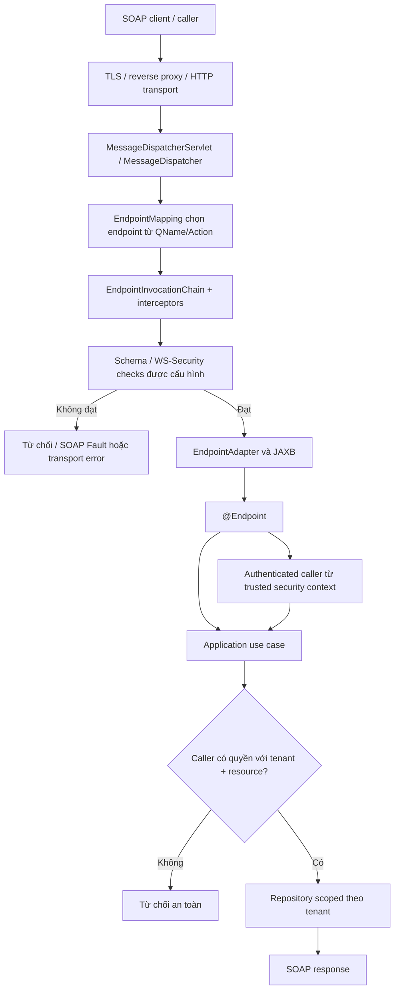

# Phân biệt khóa định tuyến với bằng chứng xác thực hoặc phân quyền

## Mục tiêu học tập

Trong chương **Định tuyến thông điệp** thuộc module **SPRING_WEB_SERVICES**, bài học tập trung vào một nguyên tắc an toàn quan trọng của tích hợp SOAP doanh nghiệp: **dữ liệu giúp chọn đích xử lý không tự chứng minh ai gửi thông điệp hoặc người gửi được phép làm gì**.

Sau bài này, bạn có thể:

1. Phân biệt ba hành động **routing (định tuyến)**, **authentication (xác thực danh tính)** và **authorization (phân quyền)** trong Spring Web Services (Spring-WS).
2. Nhận diện các khóa định tuyến SOAP: QName của payload root, HTTP SOAPAction, WS-Addressing Action/To, đường dẫn endpoint và một số metadata hợp đồng.
3. Giải thích tại sao `tenantId`, `customerId`, `userId`, `correlationId`, SOAP Header tùy biến hay `mustUnderstand` **không phải** bằng chứng xác thực dù chúng hữu ích cho định tuyến, tìm kiếm hoặc ghi log.
4. Hiểu thứ tự khái niệm của `MessageDispatcherServlet`, `EndpointMapping`, `EndpointInvocationChain`, `EndpointInterceptor`, `EndpointAdapter` và các thành phần bảo mật.
5. Thiết kế endpoint contract-first dùng `@PayloadRoot` nhưng lấy **authenticated caller** từ một cơ chế tin cậy, rồi phân quyền trong application service theo tenant và đối tượng nghiệp vụ.
6. Biết khi nào **TLS/mTLS**, **WS-Security**, chữ ký XML, token, timestamp, chống replay và chứng chỉ tạo được bằng chứng có ý nghĩa, và những điều kiện cần kiểm tra thêm.
7. Phân tích các tấn công như giả mạo SOAPAction, WS-Addressing, tenant ID, forwarded header, truy cập chéo tenant và XML Signature Wrapping.
8. Thiết kế bảng kiểm thử chứng minh request được định tuyến đúng **và** được từ chối khi thiếu xác thực hoặc không đủ quyền.

## 1. Ba câu hỏi khác nhau của một SOAP request

Một client gửi yêu cầu xem hóa đơn:

```xml
<inv:GetInvoiceRequest xmlns:inv="urn:example:invoices:v1">
    <inv:tenantId>tenant-a</inv:tenantId>
    <inv:invoiceId>INV-000042</inv:invoiceId>
</inv:GetInvoiceRequest>
```

Từ bản XML này, ứng dụng có thể biết **loại tác vụ** và **đối tượng được yêu cầu**. Nhưng nó chưa thể biết ai thực sự gửi và người đó có quyền xem hóa đơn hay không.

| Câu hỏi | Khái niệm | Kết quả điển hình |
| --- | --- | --- |
| “Thông điệp cần được gửi tới thao tác nào?” | **Routing** | Chọn endpoint `GetInvoice` từ QName payload hoặc SOAPAction. |
| “Bên gửi thực sự là ai?” | **Authentication** | Thiết lập danh tính đã xác minh, ví dụ `partner-service-a` hoặc người dùng được xác thực. |
| “Danh tính đó có được xem hóa đơn này không?” | **Authorization** | Kiểm tra quyền `invoice:read`, tenant và quyền trên tài nguyên `INV-000042`. |

### 1.1. Routing không chứng minh danh tính

Một khóa định tuyến như `GetInvoiceRequest` là **tín hiệu chọn handler**, không phải mật khẩu hay chữ ký. Bất kỳ người gọi nào có thể tạo XML theo QName đó nếu họ có thể gửi dữ liệu đến endpoint.

Tương tự, một HTTP request mang header:

```http
SOAPAction: "urn:example:invoices:v1/GetInvoice"
```

chỉ đang **tự khai báo ý định thao tác**. Header này không chứng minh quyền `invoice:read`, cũng không chứng minh tenant thuộc về người gửi.

### 1.2. Xác thực không tự đồng nghĩa có quyền

Ngay cả khi TLS/mTLS hoặc WS-Security xác minh được rằng bên gửi là `partner-service-b`, chưa có cơ sở kết luận bên đó được xem dữ liệu của `tenant-a`. Xác thực trả lời **ai**; phân quyền trả lời **được phép làm gì, trên đối tượng nào, trong phạm vi nào**.

### 1.3. Một trường vừa có thể dùng routing vừa phải được kiểm tra quyền

Trong dịch vụ đa tenant, `tenantId` có thể là thông tin **chọn phân vùng dữ liệu**. Tuy nhiên, trước khi truy cập hoặc trả dữ liệu, application service phải đối chiếu `tenantId` với **danh tính và quyền đã xác minh**.

Quy tắc tối thiểu:

> Không bao giờ biến giá trị do client tự gửi thành “trusted identity” chỉ bằng cách đặt tên trường là `authenticatedUser`, `role`, `tenantId` hoặc `securityContext`.

## 2. Những khóa định tuyến phổ biến trong Spring-WS

Các nguồn dữ liệu dưới đây có thể giúp hệ thống chọn nơi xử lý, nhưng mức độ tin cậy và ý nghĩa bảo mật khác nhau.

| Trường/khóa | Đọc ở đâu | Dùng để làm gì | Có chứng minh danh tính/quyền không? |
| --- | --- | --- | --- |
| **QName payload root** | Phần tử nghiệp vụ trực tiếp trong SOAP Body | Ánh xạ operation `GetInvoiceRequest` với `@PayloadRoot`. | **Không**. |
| **SOAPAction** | HTTP header SOAP 1.1 theo binding | Chọn thao tác hoặc hỗ trợ dispatch với `@SoapAction`. | **Không**. |
| **WS-Addressing Action** | SOAP Header `wsa:Action` | Diễn đạt hành động của thông điệp, có thể phục vụ routing. | **Không**, nếu chỉ đọc giá trị. |
| **WS-Addressing To** | SOAP Header `wsa:To` | Xác định đích logic theo WS-Addressing. | **Không**; cần kiểm tra phù hợp endpoint/policy. |
| **HTTP URL/path** | HTTP request target | Chọn service/servlet hoặc gateway route. | **Không**. |
| **Host/X-Forwarded-Host** | HTTP/gateway metadata | Virtual host hoặc URL công bố. | **Không**; forwarded metadata chỉ tin từ proxy được cấu hình. |
| **tenantId/customerId** | SOAP Body hoặc custom SOAP Header | Chọn miền dữ liệu, đối tác hoặc nhánh nghiệp vụ. | **Không**; cần đối chiếu authorization. |
| **MessageID/correlationId** | WS-Addressing/custom Header | Theo dõi yêu cầu, tương quan log, đôi khi deduplication. | **Không**; không thay thế chống replay. |
| **actor/role** | Thuộc tính SOAP Header | Chỉ định SOAP node dự kiến xử lý header. | **Không**. |
| **mustUnderstand** | Thuộc tính SOAP Header | Yêu cầu node đích hiểu/xử lý header bắt buộc. | **Không**. |
| **Certificate/token đã xác minh** | TLS hoặc WS-Security/security stack | Thiết lập danh tính và thuộc tính đáng tin theo chính sách. | Có thể là **đầu vào của authentication**; chưa tự chứng minh quyền với từng tài nguyên. |

Một dữ liệu **chỉ trở thành căn cứ bảo mật** khi đã trải qua bước kiểm chứng thích hợp, gắn được với một principal đáng tin, nằm đúng phạm vi tin cậy, và được policy ứng dụng diễn giải. Ví dụ: một `tenantId` trong **Body đã được ký** có thể có tính toàn vẹn sau khi chữ ký được xác minh, nhưng việc nó được ký **vẫn không đủ** để cho phép caller đọc hóa đơn của tenant đó.

## 3. Hệ thống định tuyến SOAP đọc gì từ XSD/WSDL?

Với thiết kế **contract-first**, XSD định nghĩa phần tử nghiệp vụ còn WSDL 1.1 mô tả operation, message, binding và service port.

Ví dụ XSD rút gọn:

```xml
<?xml version="1.0" encoding="UTF-8"?>
<xs:schema
    xmlns:xs="http://www.w3.org/2001/XMLSchema"
    xmlns:tns="urn:example:invoices:v1"
    targetNamespace="urn:example:invoices:v1"
    elementFormDefault="qualified">

    <xs:element name="GetInvoiceRequest">
        <xs:complexType>
            <xs:sequence>
                <xs:element name="tenantId" type="xs:string"/>
                <xs:element name="invoiceId" type="xs:string"/>
            </xs:sequence>
        </xs:complexType>
    </xs:element>

    <xs:element name="GetInvoiceResponse">
        <xs:complexType>
            <xs:sequence>
                <xs:element name="invoiceId" type="xs:string"/>
                <xs:element name="amount" type="xs:decimal"/>
            </xs:sequence>
        </xs:complexType>
    </xs:element>
</xs:schema>
```

Trong WSDL 1.1, phần `wsdl:message` có thể tham chiếu phần tử:

```xml
<wsdl:message name="GetInvoiceInput">
    <wsdl:part name="parameters" element="inv:GetInvoiceRequest"/>
</wsdl:message>
```

và SOAP 1.1 binding cho operation có thể khai báo:

```xml
<wsdl:operation name="GetInvoice">
    <soap:operation
        soapAction="urn:example:invoices:v1/GetInvoice"/>
    <wsdl:input>
        <soap:body use="literal"/>
    </wsdl:input>
    <wsdl:output>
        <soap:body use="literal"/>
    </wsdl:output>
</wsdl:operation>
```

Các đoạn WSDL trên **chỉ là trích đoạn**; một tài liệu WSDL hoàn chỉnh còn có `definitions`, `types`, `portType`, `binding`, `service` và các namespace khai báo hợp lệ.

### 3.1. Điều gì được XSD/WSDL bảo đảm?

XSD validation có thể kiểm tra `tenantId` và `invoiceId` tồn tại và mang kiểu chuỗi; nếu có pattern, enumeration hoặc length facets thì có thể kiểm tra thêm cú pháp.

WSDL có thể cho client biết `GetInvoice` cần request/response và SOAPAction nào. Tuy nhiên:

- XSD **không xác minh** caller là ai.
- WSDL khai báo operation **không cấp quyền** được gọi operation đó.
- JAXB unmarshalling thành công **không chứng minh** bất kỳ trường request nào là đáng tin.
- Việc client sinh proxy từ WSDL **không bảo đảm** client đã cài đặt WS-Security hoặc mTLS đúng.
- Sự tồn tại của `tenantId` không chứng minh principal được truy cập tenant đó.

Tài liệu hợp đồng cần bổ sung **security profile**: phương thức xác thực, khóa/chứng chỉ tin cậy, phạm vi ký, timestamp, chống replay và chính sách phân quyền.

## 4. QName payload: khóa routing đáng tin về mặt cú pháp, không đáng tin về nguồn

Một request SOAP 1.1:

```xml
<soap:Envelope
    xmlns:soap="http://schemas.xmlsoap.org/soap/envelope/"
    xmlns:inv="urn:example:invoices:v1">
    <soap:Body>
        <inv:GetInvoiceRequest>
            <inv:tenantId>tenant-a</inv:tenantId>
            <inv:invoiceId>INV-000042</inv:invoiceId>
        </inv:GetInvoiceRequest>
    </soap:Body>
</soap:Envelope>
```

`@PayloadRoot` ánh xạ theo **QName** `{urn:example:invoices:v1}GetInvoiceRequest`, tức namespace URI và local name. Đổi tiền tố `inv` thành `i` mà vẫn trỏ đến cùng namespace **không thay đổi** QName.

Spring-WS có thể định tuyến:

```java
@Endpoint
public class InvoiceEndpoint {

    private static final String NAMESPACE =
            "urn:example:invoices:v1";

    @PayloadRoot(
        namespace = NAMESPACE,
        localPart = "GetInvoiceRequest")
    @ResponsePayload
    public GetInvoiceResponse getInvoice(
            @RequestPayload GetInvoiceRequest request) {
        // ...
    }
}
```

Đoạn mã là **khung endpoint**, giả định đã có JAXB classes và cấu hình Spring-WS. Nó chỉ mô tả tiêu chí **chọn handler**, không mô tả xác thực hoặc phân quyền.

### 4.1. Tên QName chính xác không phải bằng chứng nguyên vẹn

Người tấn công có thể sao chép QName hợp lệ và đổi `invoiceId`. Nếu server chỉ dựa vào `@PayloadRoot`, nó vẫn chọn cùng phương thức.

Có thể hình dung:

```text
SOAP request A:
{urn:example:invoices:v1}GetInvoiceRequest
  tenantId = tenant-a
  invoiceId = INV-000042

SOAP request B:
{urn:example:invoices:v1}GetInvoiceRequest
  tenantId = tenant-b
  invoiceId = INV-999999

Cả A và B đều khớp cùng @PayloadRoot.
Quyền truy cập của caller đối với mỗi hóa đơn là câu hỏi RIÊNG.
```

**Nếu ứng dụng coi QName “đã được route” là đã được xác thực**, nó rất dễ mắc lỗi kiểm soát truy cập. Đó là sai lầm về **ranh giới tin cậy**, không phải lỗi của `@PayloadRoot`.

## 5. SOAPAction và WS-Addressing: mô tả hành động, không chứng minh ai gọi

### 5.1. HTTP SOAPAction trong SOAP 1.1

SOAP 1.1 qua HTTP thường có:

```http
POST /ws/invoices HTTP/1.1
Host: api.example.com
Content-Type: text/xml; charset=utf-8
SOAPAction: "urn:example:invoices:v1/GetInvoice"
```

`SOAPAction` có thể được ánh xạ qua `SoapActionAnnotationMethodEndpointMapping`/`@SoapAction`. Vì là HTTP header do người gửi hoặc hop trung gian cung cấp, nó **có thể bị giả mạo hoặc đổi giá trị** nếu không có lớp bảo vệ/kiểm tra phù hợp.

**Tình huống sai lầm:** `SOAPAction="AdminExportInvoices"` được hiểu là caller có role admin. Bất kỳ client nào có thể tự đặt chuỗi đó. Bản thân SOAPAction không chứa bằng chứng xác thực hay phân quyền.

### 5.2. WS-Addressing Action là SOAP Header, không phải SOAPAction

WS-Addressing dùng các header như `wsa:Action`, `wsa:To`, `wsa:MessageID` và `wsa:ReplyTo` theo version WS-Addressing đã thỏa thuận.

Ví dụ minh họa:

```xml
<wsa:Action
    xmlns:wsa="http://www.w3.org/2005/08/addressing">
    urn:example:invoices:v1/GetInvoice
</wsa:Action>
```

`wsa:Action` cũng biểu thị **hành động**, nhưng nằm trong **SOAP Header**, không phải HTTP SOAPAction. Nếu không được ký và xác minh theo chính sách thích hợp, header này có thể bị sửa.

Ngay cả khi chữ ký bảo vệ `wsa:Action`, hệ thống vẫn phải xác nhận người ký **được phép thực hiện** hành động đó.

### 5.3. Kiểm tra tính nhất quán giữa các chỉ dấu

Giả sử request có:

```text
SOAPAction: urn:example:invoices:v1/DeleteInvoice
WS-Addressing Action: urn:example:invoices:v1/DeleteInvoice
SOAP Body payload QName: {urn:example:invoices:v1}GetInvoiceRequest
```

Chỉ dấu **không khớp**. Một hệ thống có nhiều mapping có thể chọn endpoint khác nhau tùy thứ tự `EndpointMapping`, hoặc từ chối theo chính sách.

Cách thiết kế an toàn:

1. Chọn quy tắc routing chính theo WSDL, thường là **QName payload** cho document/literal contract-first.
2. Nếu dùng SOAPAction hoặc WS-Addressing Action, định nghĩa quan hệ mong đợi giữa Action và QName cho từng operation.
3. **Từ chối hoặc tạo Fault** khi các chỉ dấu bất nhất theo chính sách; không âm thầm dùng action có vẻ “ưu tiên cao” để vượt qua quyền hạn.
4. Kiểm tra quyền theo **authenticated caller + operation + resource/tenant** dù mapping nào chọn endpoint.

Việc từ chối mâu thuẫn có thể cần interceptor hoặc logic protocol riêng, không tự được bảo đảm chỉ bởi việc gắn đồng thời nhiều annotation.

## 6. Cơ chế Spring-WS và vị trí của ranh giới tin cậy

Một đường xử lý điển hình:



Sơ đồ thể hiện kiến trúc khái niệm. TLS/mTLS tại gateway có thể xác thực caller trước khi Spring-WS xử lý, nhưng **WS-Security header processing trong interceptor Spring-WS thường diễn ra sau khi EndpointMapping đã chọn chain**.

### 6.1. Tác động đến custom routing

Spring-WS `EndpointMapping` được `MessageDispatcher` gọi để xác định endpoint và `EndpointInvocationChain`. Sau đó chain mới có cơ hội chạy `EndpointInterceptor`. Vì vậy:

- Một custom `EndpointMapping` **đọc raw `tenantId` hoặc `wsa:Action` trước security interceptor** đang đọc dữ liệu *chưa được security interceptor xác minh*.
- Nếu mapping chỉ chọn **một handler chức năng** để các kiểm tra tiếp theo áp dụng, rủi ro có thể kiểm soát được.
- Nếu mapping chọn **đường xử lý có chính sách bảo mật yếu hơn**, hoặc chọn database/tenant secret trước khi xác minh, một giá trị giả mạo có thể tạo lỗ hổng.
- Không thể sửa rủi ro bằng câu “có `Wss4jSecurityInterceptor` ở đâu đó” nếu interceptor đó **không được gắn vào mọi đường xử lý cần bảo vệ**.

**Quy tắc thiết kế:** mapping nên dựa trên **hợp đồng ổn định** (QName/Action) và mọi endpoint cần bảo vệ phải đi qua kiểm tra bảo mật bắt buộc. Nếu cần sử dụng principal đáng tin để chọn backend, hãy làm việc đó **sau authentication**, ở gateway đã xác thực hoặc application service/security-aware routing layer phù hợp, thay vì coi raw header là principal.

### 6.2. EndpointInterceptor không phải lúc nào cũng là “bộ lọc trước tất cả”

`EndpointInterceptor.handleRequest` được gọi **sau khi mapping xác định endpoint/chain**, trước khi `EndpointAdapter` gọi method. Nó là điểm phù hợp cho schema validation, WS-Security và một số chính sách dùng chung, nhưng không mặc định chạy cho request **không có endpoint mapping**.

Do đó cần thiết kế thêm biện pháp ở transport/gateway đối với request chưa map, malformed XML, vượt kích thước hoặc cố tình chọn một nhánh không gắn interceptor. Không được dựa vào việc một interceptor gắn riêng cho vài QName sẽ bảo vệ mọi operation được công bố hoặc thêm về sau.

### 6.3. Chọn chính sách “fail closed”

Một hệ thống nên áp dụng chính sách từ chối khi:

- Request thiếu bằng chứng xác thực bắt buộc.
- Chữ ký không hợp lệ, thiếu phần ký quan trọng hoặc không gắn được message với principal tin cậy.
- Tenant yêu cầu không nằm trong phạm vi quyền của caller.
- Operation có yêu cầu quyền đặc biệt mà principal không có.
- Security interceptor bị thiếu hoặc chưa cấu hình cho một endpoint nhạy cảm.
- Các chỉ dấu routing mâu thuẫn theo chính sách đã công bố.

“Fail closed” không có nghĩa trả cùng một HTTP status cho mọi lỗi; nó nghĩa là **không thực hiện tác động nghiệp vụ hoặc trả dữ liệu bảo vệ khi điều kiện cần chưa được chứng minh**.

## 7. Bảng phân biệt thông tin và bằng chứng

Một số giá trị trông giống chứng cứ nhưng thực chất chỉ là **claim**:

| Đầu vào quan sát | Khả năng dùng | Cần gì trước khi tin? |
| --- | --- | --- |
| `userId=admin` trong Body | Dữ liệu nghiệp vụ hoặc yêu cầu thay mặt | Xác thực caller và ủy quyền acting-on-behalf-of; không tin chuỗi tự khai. |
| `tenantId=tenant-a` trong Body | Chọn tenant được yêu cầu | Xác nhận caller có quyền với tenant-a và hóa đơn cụ thể. |
| `role=MANAGER` trong custom Header | Metadata từ client | Chỉ có ý nghĩa nếu được cung cấp/khẳng định bởi hệ thống tin cậy theo chính sách. |
| `SOAPAction=GetInvoice` | Chọn operation | Cần authn và authz của operation và resource. |
| `wsa:Action=GetInvoice` | Routing WS-Addressing | Kiểm tra nhất quán; nếu security-sensitive thì yêu cầu bảo vệ integrity theo policy. |
| `wsa:MessageID` | Correlation, deduplication | Replay prevention cần xác thực/nhận dạng, thời hạn và state cache phù hợp. |
| `X-Forwarded-Client-Cert` | Có thể chuyển danh tính qua gateway | Chỉ tin khi gateway đáng tin **xóa/ghi đè** header bên ngoài, dùng kênh bảo vệ và backend không truy cập trực tiếp. |
| `wsse:Security` tồn tại | Cho biết client gửi security header | Phải kiểm tra cấu trúc, token/chữ ký, certificate trust, timestamp và signed parts. |
| Chữ ký XML hợp lệ | Integrity/authenticity của phần **thực sự được ký** theo khóa tin cậy | Vẫn phải kiểm tra key-to-identity, policy, anti-replay và authorization. |
| Chứng chỉ mTLS đã được tin cậy | Xác thực peer tại hop TLS | Phải ánh xạ danh tính chứng chỉ với quyền operation/tenant; kiểm tra đường đi qua proxy. |

Một chữ ký hợp lệ là **bằng chứng về phần dữ liệu đã được ký theo một khóa** trong một bối cảnh tin cậy, không phải “tấm vé toàn quyền”. Nếu SOAP Body được ký nhưng routing/identity-critical header không được ký, phần header đó có thể vẫn bị sửa theo tình huống và security profile. Nếu validator kiểm tra chữ ký trên một phần tử nhưng endpoint xử lý một bản sao không được ký, hệ thống còn có nguy cơ **XML Signature Wrapping**.

## 8. Tấn công xuyên tenant: case study

Giả sử `partner-b` được xác thực hợp lệ và chỉ có quyền xem dữ liệu `tenant-b`. Một endpoint thực hiện:

```java
// Anti-pattern: không được dùng trong production!
@PayloadRoot(
    namespace = "urn:example:invoices:v1",
    localPart = "GetInvoiceRequest")
@ResponsePayload
public GetInvoiceResponse getInvoice(
        @RequestPayload GetInvoiceRequest request) {

    // tenantId do client tự nhập, hoàn toàn không kiểm tra quyền.
    Invoice invoice = repository.findByTenantIdAndInvoiceId(
            request.getTenantId(), request.getInvoiceId());

    return mapper.toResponse(invoice);
}
```

Người gọi chỉ cần thay:

```xml
<inv:tenantId>tenant-b</inv:tenantId>
```

thành:

```xml
<inv:tenantId>tenant-a</inv:tenantId>
```

Định tuyến vẫn đúng `GetInvoiceRequest` và repository có thể tìm được dữ liệu của tenant-a. Đây là lỗi **Broken Object Level Authorization (BOLA)/IDOR**, không phải thiếu WSDL hay sai QName.

### 8.1. Sửa bằng kiểm tra quyền sau xác thực

Luồng phù hợp:

```text
Authenticated caller: partner-b
  |
  | request tenantId = tenant-a, invoiceId = INV-000042
  v
Application service
  |
  +-- caller có quyền invoice:read cho tenant-a?  ---> KHÔNG
  |
  +-- Không đọc/trả dữ liệu tenant-a.
  +-- Trả lỗi quyền phù hợp chính sách, không tiết lộ hóa đơn có tồn tại.
```

Cần xác minh cả quyền với **tenant** và quyền với **resource**. Chỉ so sánh `caller.tenantId == request.tenantId` có thể chưa đủ khi:

- Một caller có nhiều tenant được ủy quyền.
- Người dùng thuộc tenant nhưng chỉ được xem hóa đơn do mình phụ trách.
- Có quyền `invoice:read` nhưng không có quyền xem hóa đơn nhạy cảm.
- Service account được gọi một số operation nhưng không được download file đính kèm.

### 8.2. Quy tắc truy vấn cũng phải được scope

Ngoài bước authorization, repository nên truy vấn theo tenant xác định:

```java
Optional<InvoiceSummary> findByTenantIdAndInvoiceId(
        String tenantId, String invoiceId);
```

Tránh truy vấn chỉ theo một `invoiceId` không bảo đảm duy nhất toàn hệ thống rồi trả nhầm dữ liệu. Tenant-scoped query là lớp giảm rủi ro, **không thay thế** kiểm tra quyền người gọi.

## 9. Thiết kế Spring-WS endpoint tách routing và quyền truy cập

Ta sử dụng các thành phần:

- `GetInvoiceRequest` và `GetInvoiceResponse`: lớp JAXB sinh từ XSD.
- `InvoiceEndpoint`: SOAP adapter có `@PayloadRoot` cố định.
- `VerifiedCallerProvider`: abstraction cung cấp danh tính **đã được xác thực**, không lấy từ request payload.
- `InvoiceQueryUseCase`: application service quyết định có thể đọc hóa đơn hay không.
- `InvoiceRepository`: truy xuất dữ liệu theo tenant và invoice ID.
- `InvoiceSoapMapper`: ánh xạ kết quả nghiệp vụ thành JAXB response.

### 9.1. Định nghĩa verified caller

```java
package com.example.invoice.application;

import java.util.Set;

public record VerifiedCaller(
        String subject,
        Set<String> tenantIds,
        Set<String> permissions) {

    public boolean hasTenant(String tenantId) {
        return tenantIds.contains(tenantId);
    }

    public boolean hasPermission(String permission) {
        return permissions.contains(permission);
    }
}
```

**Quan trọng:** record này chỉ là kiểu dữ liệu. `new VerifiedCaller("admin", ..., ...)` **không tạo ra xác thực**. Chỉ code nằm trong ranh giới tin cậy mới được xây nó, sau khi xác minh bằng mTLS/token/WS-Security hoặc cơ chế tổ chức đã phê duyệt.

Trong hệ thống thật nên bảo đảm dữ liệu bất biến, không null và có provenance của principal; có thể dùng constructor kiểm tra và `Set.copyOf(...)`. Đây là ví dụ ngắn để giải thích luồng phụ thuộc, không phải toàn bộ security framework.

### 9.2. Abstraction lấy danh tính đã xác minh

```java
package com.example.invoice.application;

public interface VerifiedCallerProvider {
    VerifiedCaller requireVerifiedCaller();
}
```

Một implementation phù hợp có thể lấy authenticated principal từ **Spring Security context**, kết quả WS-Security đã kiểm tra hoặc danh tính mTLS do tầng hạ tầng chuyển vào **qua kênh đáng tin cậy**. Nó phải **từ chối** khi không có principal đã được xác minh.

Không viết implementation như sau:

```java
// SAI: tên header không biến nó thành thông tin đã xác thực.
return new VerifiedCaller(
        request.getHeader("X-User-Id"),
        Set.of(request.getHeader("X-Tenant-Id")),
        Set.of("invoice:read"));
```

Đoạn sai chỉ minh họa rủi ro. Khi có gateway, backend phải chống truy cập bypass trực tiếp, gateway phải loại bỏ header cùng tên từ caller và gắn danh tính qua một kết nối được bảo vệ hoặc cơ chế chữ ký/token nội bộ đã kiểm tra. Không dựa vào “header do proxy gửi” nếu không chứng minh được header **chỉ** có thể được đặt bởi proxy tin cậy.

### 9.3. Application use case kiểm tra quyền

```java
package com.example.invoice.application;

public interface InvoiceQueryUseCase {
    InvoiceSummary getInvoice(
            VerifiedCaller caller,
            String requestedTenantId,
            String invoiceId);
}
```

Có thể triển khai:

```java
package com.example.invoice.application;

import org.springframework.stereotype.Service;
import org.springframework.transaction.annotation.Transactional;

@Service
public class DefaultInvoiceQueryUseCase implements InvoiceQueryUseCase {

    private final InvoiceRepository repository;
    private final InvoiceAuthorization authorization;

    public DefaultInvoiceQueryUseCase(
            InvoiceRepository repository,
            InvoiceAuthorization authorization) {
        this.repository = repository;
        this.authorization = authorization;
    }

    @Override
    @Transactional(readOnly = true)
    public InvoiceSummary getInvoice(
            VerifiedCaller caller,
            String requestedTenantId,
            String invoiceId) {

        if (caller == null
                || !caller.hasTenant(requestedTenantId)
                || !caller.hasPermission("invoice:read")) {
            throw new InvoiceAccessDeniedException();
        }

        InvoiceSummary invoice = repository
                .findByTenantIdAndInvoiceId(
                        requestedTenantId, invoiceId)
                .orElseThrow(InvoiceNotAvailableException::new);

        if (!authorization.canRead(caller, invoice)) {
            throw new InvoiceAccessDeniedException();
        }

        return invoice;
    }
}
```

Các interface/types `InvoiceRepository`, `InvoiceAuthorization`, `InvoiceSummary` và exception được giả định tồn tại trong module application. **Đây là khung kiến trúc**, không phải toàn bộ project có thể biên dịch độc lập.

Những điểm cần giữ khi triển khai thật:

1. **Không tin `requestedTenantId`** chỉ vì nó hợp lệ theo XSD.
2. Kiểm tra quyền operation/tenant **trước khi tra cứu** khi có thể.
3. Truy vấn có điều kiện tenant để tránh trả nhầm dữ liệu xuyên tenant.
4. Kiểm tra quyền trên **hóa đơn cụ thể** trước khi trả response.
5. Để tránh lộ thông tin về tồn tại của tài nguyên, thiết kế lỗi phân quyền/không tồn tại theo chính sách; log nội bộ khác thông tin hiển thị cho client.
6. Nghiệp vụ có thể áp thêm kiểm soát theo nguồn dữ liệu, thời điểm, loại hóa đơn, trạng thái và giới hạn truy cập.

### 9.4. SOAP endpoint chỉ làm vai trò adapter

```java
package com.example.invoice.soap;

import org.springframework.ws.server.endpoint.annotation.Endpoint;
import org.springframework.ws.server.endpoint.annotation.PayloadRoot;
import org.springframework.ws.server.endpoint.annotation.RequestPayload;
import org.springframework.ws.server.endpoint.annotation.ResponsePayload;

@Endpoint
public class InvoiceEndpoint {

    private static final String NS = "urn:example:invoices:v1";

    private final VerifiedCallerProvider callers;
    private final InvoiceQueryUseCase useCase;
    private final InvoiceSoapMapper mapper;

    public InvoiceEndpoint(
            VerifiedCallerProvider callers,
            InvoiceQueryUseCase useCase,
            InvoiceSoapMapper mapper) {
        this.callers = callers;
        this.useCase = useCase;
        this.mapper = mapper;
    }

    @PayloadRoot(namespace = NS, localPart = "GetInvoiceRequest")
    @ResponsePayload
    public GetInvoiceResponse getInvoice(
            @RequestPayload GetInvoiceRequest request) {

        VerifiedCaller caller = callers.requireVerifiedCaller();

        InvoiceSummary result = useCase.getInvoice(
                caller, request.getTenantId(), request.getInvoiceId());

        return mapper.toResponse(result);
    }
}
```

Ví dụ giả định có imports cho các kiểu application/JAXB/mapper thuộc project. Ý nghĩa:

- `@PayloadRoot` xử lý **routing**.
- `VerifiedCallerProvider.requireVerifiedCaller()` yêu cầu **authentication** đã hoàn tất.
- `InvoiceQueryUseCase` thực thi **authorization** gắn với tenant và tài nguyên.
- `InvoiceSoapMapper` chỉ biến kết quả được phép trả thành JAXB XML.

Thiết kế này không tự tạo bảo mật: phải cấu hình **provider đáng tin**, security interceptor/gateway và exception resolver an toàn. Mục đích là **ngăn sự nhầm lẫn giữa các trách nhiệm**.

### 9.5. Vì sao không authorize trong `@PayloadRoot` annotation?

`@PayloadRoot` chỉ có `namespace` và `localPart`, không có tiêu chí “người ký có quyền với hóa đơn”. Nó nên dùng để map một **loại thông điệp**, không phải làm RBAC/ABAC engine.

Nếu đặt toàn bộ kiểm tra quyền trong một custom `EndpointMapping` trước security interceptor, có thể bạn đang dùng thông tin chưa xác minh, hoặc vô tình tạo đường đi bỏ qua interceptor. Chọn endpoint **chức năng** trước, nhưng cấm hiệu ứng nghiệp vụ cho đến khi **xác thực + phân quyền** hoàn tất.

## 10. Authentication ở những lớp nào?

### 10.1. TLS và mTLS

**TLS** bảo vệ kênh truyền; **mTLS** còn giúp xác thực peer bằng chứng chỉ ở hop TLS hiện tại. Nhưng việc peer đã có chứng chỉ tin cậy chưa chứng minh quyền đối với tenant hay resource.

Một hệ thống có đường đi:

```text
Client --mTLS--> Gateway --TLS/mTLS--> Spring-WS backend
```

phải xác định:

- Gateway xác thực client ở đâu?
- Gateway chuyển **identity đã xác minh** cho backend thế nào?
- Backend có thể bị gọi trực tiếp ngoài gateway không?
- Gateway có xóa/ghi đè header identity do client gửi không?
- Backend có xác minh kết nối từ gateway và ràng buộc principal không?
- Giữa hai hop có chính sách phân quyền hay message-level security bổ sung không?

**Không coi `X-Forwarded-Client-Cert` hoặc `X-User-Id` tự động an toàn** nếu client vẫn có thể đặt header đó. Header chỉ là phương tiện chuyển metadata; mức tin cậy phụ thuộc kiến trúc mạng và cơ chế bảo vệ nguồn gửi.

### 10.2. WS-Security

Trong SOAP, một `wsse:Security` header có thể chứa token, timestamp, chữ ký và thông tin mã hóa. Khi dùng Spring-WS với WSS4J, interceptor được cấu hình để thực thi validation theo policy.

Các yêu cầu quan trọng:

1. Kiểm tra token/chữ ký bằng khóa và **chuỗi tin cậy chứng chỉ** phù hợp.
2. Kiểm tra phần nào được ký và **phần nào được ứng dụng thật sự sử dụng**.
3. Khi routing dùng `wsa:Action`/`wsa:To` hoặc header bảo mật khác, đánh giá yêu cầu ký cả các header này theo profile.
4. Kiểm tra timestamp/cửa sổ hiệu lực và chống replay theo chính sách, không dùng mỗi `MessageID` như bằng chứng.
5. Bảo vệ chống XML Signature Wrapping và sai liên kết giữa principal, action, resource.
6. Không cho phép bypass bằng cách gửi header thiếu `mustUnderstand` hoặc sửa thuộc tính `role`.
7. Kết quả xác thực phải được ánh xạ thành **authenticated principal** đáng tin để phân quyền.

Ví dụ một SOAP header có `wsse:Security`:

```xml
<soap:Header
    xmlns:soap="http://schemas.xmlsoap.org/soap/envelope/"
    xmlns:wsse="http://docs.oasis-open.org/wss/2004/01/oasis-200401-wss-wssecurity-secext-1.0.xsd">
    <wsse:Security soap:mustUnderstand="1">
        <!-- Token / Timestamp / Signature tuân theo profile thực tế -->
    </wsse:Security>
</soap:Header>
```

Đây **chỉ là vị trí minh họa**, không phải thông điệp WS-Security hợp lệ hoàn chỉnh. Không coi `soap:mustUnderstand="1"` hay sự tồn tại của `wsse:Security` là dấu hiệu chữ ký đã được xác minh.

### 10.3. Authentication chưa thay thế authorization

Một certificate có thể xác thực `partner-a`, nhưng application service vẫn cần chính sách như:

```text
principal = partner-a
operation = invoice:read
requestedTenant = tenant-b
invoiceId = INV-000042

policy:
  partner-a được phép invoice:read trên tenant-a
  partner-a KHÔNG có quyền tenant-b

=> TỪ CHỐI, dù chữ ký/mTLS đều hợp lệ.
```

Điều quan trọng hơn nữa với **delegation**: nếu partner gọi thay người dùng cuối, phải có cơ chế chứng minh **delegation/acting-on-behalf-of** và phạm vi quyền. Không lấy `endUserId` trong Body rồi coi là danh tính người được ủy quyền.

## 11. SOAP Header actor, role và mustUnderstand không cấp quyền

SOAP Header có ba cơ chế thường bị hiểu sai:

| Thuộc tính | SOAP version | Ý nghĩa thật | Không có nghĩa |
| --- | --- | --- | --- |
| `actor` | SOAP 1.1 | Chỉ định SOAP actor dự kiến xử lý header. | “Actor này đã được xác thực.” |
| `role` | SOAP 1.2 | Chỉ định vai trò SOAP node dự kiến xử lý header. | “Node mang role này có quyền nghiệp vụ.” |
| `mustUnderstand` | SOAP 1.1/1.2 | Node nhận phù hợp phải hiểu và xử lý header bắt buộc hoặc tạo `MustUnderstand` Fault. | “Header được ký”, “token hợp lệ” hoặc “caller có quyền”. |

Một client có thể gửi:

```xml
<roles:Manager
    xmlns:roles="urn:example:roles:v1"
    xmlns:soap="http://schemas.xmlsoap.org/soap/envelope/"
    soap:mustUnderstand="1">
    true
</roles:Manager>
```

Nếu đây là **header tùy biến do client tự khai**, `mustUnderstand=1` chỉ đặt nghĩa vụ xử lý theo SOAP. Nó **không làm** `Manager=true` trở thành chứng cứ đáng tin. Phải xác minh ngữ nghĩa và provenance của claim theo chính sách; nếu chưa có cơ chế tin cậy thì không dùng để cấp quyền.

### 11.1. Gateway và ultimate receiver

Nếu một gateway xử lý header dành cho chính nó, endpoint backend không mặc nhiên có quyền tin mọi metadata gateway ghi thêm. Cần xác định:

- Gateway và backend có quan hệ tin cậy gì?
- Có kết nối bảo vệ hop tiếp theo không?
- Header được sinh sau xác thực hay client có thể đặt cùng tên?
- Có ký/ghi lại identity assertion nội bộ không?
- Có truy vết, giới hạn thời gian và bảo vệ replay không?

Chỉ vì một SOAP message đi qua “gateway bảo mật” không có nghĩa mọi đường đi backend đều đi qua gateway đó. Cần chặn đường bypass.

## 12. Cấu hình interceptor: tránh chỗ trống trong chính sách

Spring-WS có `WsConfigurer` để đăng ký các `EndpointInterceptor` theo cấu hình annotation-driven. Ví dụ minh họa gắn một interceptor WS-Security được ứng dụng cấu hình sẵn:

```java
import java.util.List;

import org.springframework.context.annotation.Configuration;
import org.springframework.ws.config.annotation.EnableWs;
import org.springframework.ws.config.annotation.WsConfigurer;
import org.springframework.ws.server.EndpointInterceptor;
import org.springframework.ws.soap.security.wss4j2.Wss4jSecurityInterceptor;

@Configuration
@EnableWs
public class InvoiceSoapConfiguration implements WsConfigurer {

    private final Wss4jSecurityInterceptor security;

    public InvoiceSoapConfiguration(
            Wss4jSecurityInterceptor security) {
        this.security = security;
    }

    @Override
    public void addInterceptors(
            List<EndpointInterceptor> interceptors) {
        interceptors.add(security);
    }
}
```

**Điều kiện quan trọng:** đây không phải cấu hình WSS4J đầy đủ. Bean `Wss4jSecurityInterceptor` phải được cấu hình với validation actions (ví dụ Signature/Timestamp theo profile), truststore/crypto, callback handler và yêu cầu về signed parts thích hợp. Nếu chỉ tạo interceptor mặc định mà không cấu hình bảo mật, **không có bảo đảm** việc xác thực đã diễn ra.

### 12.1. Interceptor gắn theo mapping cần được kiểm tra

Vì interceptor có thể gắn ở mức endpoint mapping hoặc chọn lọc theo payload QName/SOAPAction, cần kiểm tra:

- Mọi endpoint nhạy cảm đều qua security interceptor.
- Khi thêm operation mới, không có “đường đi mới” bỏ qua validation.
- Việc có nhiều `EndpointMapping` không tạo ra chain thiếu interceptor.
- Interceptor thực sự kiểm tra **đúng message/headers** và trả lỗi khi thiếu chữ ký.
- Không có custom endpoint/bypass được triển khai mà không có chính sách.
- Gateway chặn các request thô vượt giới hạn/không hợp lệ trước khi tới pipeline nếu cần.

Nếu một policy cần áp dụng cho **mọi** SOAP operation, gắn security interceptor theo phạm vi toàn cục thích hợp và test từng route; đừng tin rằng một interceptor cấu hình chỉ cho `GetInvoiceRequest` cũng bảo vệ `ExportInvoicesRequest`.

### 12.2. Thứ tự kiểm tra và authenticated context

Không nên đưa domain code chạy trước khi các kiểm tra bảo mật cần thiết hoàn tất. Trong một chain phù hợp, security interceptor kiểm tra và từ chối request sai trước khi `EndpointAdapter` gọi method nghiệp vụ.

Tuy nhiên, **mapping đã chạy trước chain**. Vì thế `VerifiedCallerProvider` ở endpoint phải biết lấy principal từ kết quả xác thực nào. Nếu có nhiều cơ chế authentication (mTLS, UsernameToken, X.509 signature), cần thống nhất **identity mapping**, xử lý xung đột và chính sách ưu tiên.

Nếu vừa có mTLS principal A vừa có signed token principal B, ứng dụng không nên âm thầm chọn principal nào cho quyền cao hơn; phải có chính sách ràng buộc hoặc từ chối xung đột.

## 13. Routing theo tenant: khi nào chấp nhận, khi nào nguy hiểm?

Không phải mọi việc dùng `tenantId` trước khi authenticate đều bất hợp lệ. Cần phân biệt mục đích và tác động:

### 13.1. Có thể chấp nhận với điều kiện

- Chọn **cùng một** endpoint xử lý đa tenant mà không mở rộng quyền; authorization sau đó **bắt buộc** kiểm tra tenant.
- Định tuyến qua các nhánh có chính sách bảo mật **tương đương**, không cho phép chọn một nhánh “không cần chữ ký”.
- Chọn một shard **không trả dữ liệu** cho đến khi authenticated principal và resource authorization được xác minh.
- Sử dụng routing hint có kiểm soát cho performance, nhưng không để nó quyết định trust hoặc cấp quyền.

Trong các trường hợp này, routing key chỉ là **hint**; mọi tác động bảo mật được kiểm tra ở tầng sau.

### 13.2. Không chấp nhận

- `tenantId` lấy từ Header chưa ký để chọn kết nối DB chứa dữ liệu nhạy cảm, rồi trả dữ liệu mà không so quyền.
- `role=admin` tự khai để chọn admin endpoint không dùng security interceptor.
- `SOAPAction=ExportAll` khiến hệ thống bỏ qua kiểm tra quyền vì “đã route tới admin handler”.
- `wsa:To` giả mạo dẫn tới backend nội bộ hoặc external service không nằm trong allowlist.
- Dùng Host/X-Forwarded-Host do client gửi để đổi vùng trust hoặc tenant mà không kiểm tra proxy.
- Chọn keystore/truststore hoặc thuật toán security yếu theo tên tenant do client tự cung cấp mà không có chính sách được kiểm soát.

Đối với nhiều tenant có yêu cầu cách ly mạnh, cân nhắc ánh xạ **authenticated client identity → tenant policy → backend** tại một gateway đã xác thực, thay vì để request tự chỉ định bất kỳ tenant nào.

### 13.3. Rủi ro “confused deputy”

Một dịch vụ Spring-WS có quyền đọc dữ liệu của nhiều tenant. Client có quyền thấp có thể khiến dịch vụ dùng quyền cao của nó để đọc một tenant khác thông qua giá trị `tenantId`.

Đây là một dạng **confused deputy**: service thực hiện thao tác “thay mặt” nhưng không kiểm tra quyền của bên yêu cầu. Giải pháp không phải cấm mọi khóa định tuyến, mà là **ràng buộc quyền đã xác minh của caller vào chính đối tượng mà service truy cập**.

## 14. Lỗi định tuyến, xác thực và phân quyền cần phản hồi khác nhau

Khi xử lý lỗi, nên phân loại rõ ràng thay vì trả một SOAP Fault “Internal Error” cho mọi trường hợp.

| Trường hợp | Nơi phát hiện thường gặp | Cách xử lý theo nguyên tắc |
| --- | --- | --- |
| Payload QName không được hỗ trợ | `EndpointMapping`/dispatcher | Từ chối operation không biết hoặc lỗi định tuyến theo contract. |
| SOAPAction/WS-A Action mâu thuẫn payload | Binding/policy/interceptor | Từ chối theo quy tắc nhất quán, không dùng action giả để mở quyền. |
| Request thiếu token/chữ ký bắt buộc | Security interceptor/transport | Từ chối trước endpoint, báo lỗi bảo mật thích hợp. |
| Chữ ký có nhưng không hợp lệ | WSS4J/security stack | Lỗi xác minh integrity/authenticity; không coi là request đã authenticate. |
| mTLS client certificate không hợp lệ | TLS handshake/gateway | Có thể đóng kết nối/HTTP error trước khi tạo SOAP Fault. |
| Principal hợp lệ nhưng không có quyền operation | Authorization layer | Từ chối an toàn, không thực hiện nghiệp vụ. |
| Principal có operation permission nhưng không có quyền hóa đơn cụ thể | Application service | Từ chối theo resource/tenant policy; tránh lộ tồn tại tài nguyên. |
| Header `mustUnderstand` được nhắm tới node nhưng không hiểu | SOAP protocol processing | SOAP Fault `MustUnderstand`; không đồng nghĩa authentication failure. |
| Dữ liệu XML sai schema | Validation interceptor | Lỗi dữ liệu hợp đồng, không phải lỗi chứng thực. |
| Hóa đơn không tồn tại cho caller được phép | Domain/application | Fault nghiệp vụ hoặc response theo WSDL, không lộ thông tin không cần thiết. |

### 14.1. SOAP Fault không tự chứng minh kiểm soát an toàn

Một hệ thống có thể trả `soap:Client` cho lỗi phân quyền nhưng vẫn **ghi dữ liệu trước khi trả lỗi**. Điều đó không an toàn. Điều cần xác minh là **không có side effect bảo vệ nào diễn ra trước quyết định authorization**.

SOAP 1.1 dùng `faultcode`/`faultstring`; SOAP 1.2 dùng `Code`/`Reason`. HTTP gateway có thể trả 401, 403 hoặc 413 tùy lớp phát hiện và profile triển khai, nên không giả định mọi lỗi bảo mật đều có SOAP Fault.

### 14.2. Không lộ tài nguyên qua Fault detail

Nếu caller không có quyền với `INV-000042`, phản hồi chi tiết kiểu:

```text
Invoice exists, owned by tenant-a, amount 999999.00, but you are denied.
```

là không phù hợp. Dù giao thức có Fault detail, vẫn phải hạn chế thông tin đủ cho client xử lý nhưng không tiết lộ tenant, quyền, trạng thái tài nguyên hoặc chi tiết truy vấn nội bộ.

## 15. Kiểm thử bằng bảng ma trận route × identity × resource

Phân tách điều kiện **route có match** và **caller có quyền** giúp tìm lỗi mà unit test endpoint thông thường bỏ sót.

| Case | Route/payload | Authentication | Authorization | Kỳ vọng |
| --- | --- | --- | --- | --- |
| A | `GetInvoiceRequest` hợp lệ | Caller `partner-a` hợp lệ | Có quyền `invoice:read` trên `tenant-a` và invoice | Trả response hợp đồng. |
| B | Cùng QName như A | Không có chứng thực | Chưa thể xác định | Từ chối, không gọi use case ghi/đọc bảo vệ. |
| C | Cùng QName như A | Chữ ký/token giả | Không hợp lệ | Security rejection trước nghiệp vụ. |
| D | Cùng QName như A | Caller `partner-b` hợp lệ | Request `tenant-a` ngoài quyền | Từ chối, không lộ hóa đơn. |
| E | Cùng QName như A | Caller `partner-a` hợp lệ | Có quyền tenant nhưng không quyền invoice cụ thể | Từ chối resource access. |
| F | SOAPAction đổi sang `ExportInvoices`, Body vẫn `GetInvoiceRequest` | Caller hợp lệ nhưng quyền hạn thấp | Không có quyền export | Từ chối nếu action/QName không khớp policy; không route vào quyền cao. |
| G | WS-A Action sửa, signature không bảo vệ header | Chữ ký Body có thể vẫn hợp lệ | Hành động security-sensitive khác | Từ chối theo signed-parts/action-consistency policy. |
| H | QName không tồn tại trong WSDL | Caller hợp lệ | Không áp dụng | Lỗi routing; không rơi vào default handler nhạy cảm. |
| I | `tenantId` từ custom Header giả mạo | Caller hợp lệ | Header không phải chứng cứ tenant | Kiểm tra quyền từ principal; từ chối nếu không hợp lệ. |
| J | Trùng `MessageID` của request cũ | Caller hợp lệ | Quyền hợp lệ | Replay/idempotency policy quyết định chặn hoặc xử lý an toàn. |
| K | `X-Forwarded-Client-Cert` do client tự đặt | Chưa có bằng chứng gateway đáng tin | Không áp dụng | Không chấp nhận header làm authenticated principal. |
| L | Header `mustUnderstand=true` nhắm tới node nhưng không được hiểu | Bất kỳ | Chưa đến nghiệp vụ | SOAP `MustUnderstand` Fault khi giao thức yêu cầu. |

Quan trọng: một kiểm thử chỉ kiểm tra HTTP 200 hay SOAP response “đúng schema” có thể bỏ sót **lỗi truy cập chéo tenant**. Cần assert rằng repository/service **không thực hiện lời gọi nhạy cảm** trong các trường hợp bị từ chối.

## 16. Unit test phân quyền không cần SOAP runtime

Nhờ `InvoiceQueryUseCase` nhận `VerifiedCaller`, ta có thể kiểm thử quy tắc độc lập với XML/SOAP. Ví dụ Mockito pseudocode gần Java:

```java
import static org.junit.jupiter.api.Assertions.assertThrows;
import static org.mockito.Mockito.verifyNoInteractions;

import java.util.Set;
import org.junit.jupiter.api.Test;

class InvoiceAuthorizationTest {

    @Test
    void rejectsCrossTenantBeforeRepositoryLookup() {
        VerifiedCaller partnerB = new VerifiedCaller(
                "partner-b",
                Set.of("tenant-b"),
                Set.of("invoice:read"));

        // Khởi tạo use case bằng repository mock và policy mock.
        InvoiceQueryUseCase useCase = testFixtureUseCase();

        assertThrows(
                InvoiceAccessDeniedException.class,
                () -> useCase.getInvoice(
                        partnerB, "tenant-a", "INV-000042"));

        verifyNoInteractions(repositoryMock());
    }
}
```

Đây là **khung mô tả test**, không phải class biên dịch độc lập vì `testFixtureUseCase()` và `repositoryMock()` là các helper giả định. Khi triển khai thật, dùng cùng mock repository được tiêm vào use case, rồi `verifyNoInteractions(repository)` để chứng minh không đọc dữ liệu cross-tenant.

Nên bổ sung test:

- Principal đúng tenant và permission → service truy vấn đúng `tenantId`.
- Principal đúng tenant nhưng thiếu permission `invoice:read` → không gọi repository.
- Principal đủ quyền operation nhưng không được xem invoice cụ thể → không trả dữ liệu.
- Principal null/không có identity tin cậy → từ chối.
- Repository trả invoice sai tenant do lỗi adapter → application service không được trả nó, nếu domain model mang tenant ID và policy yêu cầu kiểm soát bổ sung.

## 17. SOAP dispatch test và bảo mật tích hợp

`MockWebServiceClient` của Spring-WS giúp kiểm tra `MessageDispatcher`, `EndpointMapping`, `EndpointAdapter`, interceptor và resolver **được đăng ký trong ApplicationContext**. Có thể kiểm tra:

1. QName `{urn:example:invoices:v1}GetInvoiceRequest` map đúng endpoint.
2. SOAPAction/WS-A Action nhất quán nếu policy dùng.
3. Request không hợp lệ theo XSD bị từ chối khi có `PayloadValidatingInterceptor`.
4. Security interceptor đã cấu hình từ chối request thiếu/sai WS-Security.
5. Use case nhận principal từ provider đã được thiết lập trong test context, không nhận principal giả từ SOAP Body.
6. Lỗi quyền được map thành SOAP Fault an toàn theo profile.

Tuy nhiên, `MockWebServiceClient` **không thử TLS handshake**, reverse proxy, HTTP header rewriting, mTLS trust hoặc các gateway network rules. Phải thêm integration tests qua transport thật để kiểm tra **đầu vào đã xác thực đến backend qua đúng trust boundary**.

### 17.1. Gợi ý bài kiểm thử theo tầng

| Tầng | Bài test | Không chứng minh |
| --- | --- | --- |
| Unit: `InvoiceQueryUseCase` | Tenant/resource authorization và logic use case. | SOAP QName, header, interceptor. |
| Unit: `InvoiceEndpoint` | Gọi `VerifiedCallerProvider` và use case đúng tham số; marshal mapping thông qua mapper. | Principal provider thực sự đáng tin. |
| Spring-WS dispatch: `MockWebServiceClient` | Annotation mapping, JAXB, interceptor/resolver trong context. | mTLS/gateway/network path. |
| Integration qua HTTP/TLS | Certificate trust, SOAPAction/Content-Type, proxy stripping, endpoint public URL. | Tất cả đối tác luôn tương thích nếu chưa test họ. |
| Security conformance | Chữ ký/token/timestamp/signed parts, replay và Fault. | Business resource authorization nếu không có case xuyên tenant. |
| End-to-end với đối tác | Client → gateway → backend → response/Fault. | Mọi cấu hình trong tương lai nếu thay version/cert mà không re-test. |

### 17.2. Thử nghiệm giả mạo có chủ đích

Một bộ test bảo mật hữu ích cần thử:

- Gửi đúng SOAP Body nhưng thiếu WS-Security Header.
- Gửi WS-Security Header “đúng tên” nhưng có chữ ký không hợp lệ.
- Ký Body nhưng sửa `wsa:Action`/`wsa:To` nếu policy yêu cầu bảo vệ các header đó.
- Đổi `tenantId` trong một phần tử ngoài vùng được ký; xác nhận validator và use case không bị đánh lừa.
- Thử dữ liệu XML có phần tử trùng tên để kiểm tra liên kết giữa XML Signature và payload mà endpoint thực sự xử lý.
- Đặt `X-Forwarded-User` hoặc `X-Forwarded-Client-Cert` giả, gửi từ mạng không phải gateway tin cậy.
- Gửi cùng `MessageID`/timestamp nhiều lần để kiểm tra chống replay.
- Gọi URL backend trực tiếp thay vì qua gateway, nếu mạng cho phép; kiến trúc production phải chặn bypass.
- Gửi payload QName của operation ít quyền nhưng SOAPAction của operation đặc quyền.
- Gửi request hợp lệ cho tenant khác từ principal đã xác thực.

Chỉ thực hiện thử nghiệm trong môi trường được phép kiểm thử; không dùng payload phá tải trên production. Bảo đảm mọi test phủ định khẳng định **không có side effect hoặc data disclosure**.

## 18. Các anti-pattern cần tránh

### 18.1. “Có @PayloadRoot thì operation an toàn”

Sai. `@PayloadRoot` chỉ chọn handler theo QName. Không có kiểm tra credential hay permission mặc định từ annotation này.

### 18.2. “SOAPAction=AdminExport nghĩa là admin”

Sai. Đó là chuỗi mô tả action do client có thể gửi. Phải có authentication và policy authorization độc lập.

### 18.3. “Tôi có mTLS rồi, không cần phân quyền tenant”

Sai. mTLS có thể xác thực một peer, nhưng dịch vụ vẫn phải xác nhận peer đó có quyền trên tenant và tài nguyên cụ thể.

### 18.4. “Header có mustUnderstand=1 nên chắc chắn đã ký”

Sai. `mustUnderstand` là quy tắc xử lý SOAP Header, không phải phép xác minh chữ ký hay chứng chỉ.

### 18.5. “Vì Body đã ký, mọi Header đều an toàn”

Sai. Chữ ký chỉ bảo vệ các phần được ký theo chính sách và cách validator kiểm tra. Các header quan trọng có thể cần được ký riêng; phải tránh xử lý nhầm phần tử chưa ký.

### 18.6. “Security interceptor đã bật ở một endpoint, mọi endpoint đều được bảo vệ”

Sai. Interceptor có thể gắn theo mapping/chain; cần xác minh phạm vi toàn bộ operation, đặc biệt các endpoint mới và custom mapping.

### 18.7. “Gateway đã xác thực nên backend tin mọi X-Forwarded header”

Sai. Cần chặn bypass, bảo vệ hop gateway→backend, loại bỏ giá trị từ caller và xác minh nguồn của identity assertion.

### 18.8. “Chỉ kiểm tra tenantId là đủ”

Chưa chắc. Phải kiểm tra **operation permission**, **resource ownership/visibility** và các chính sách theo vai trò/trạng thái. Một tenant có thể chứa nhiều chủ thể với quyền khác nhau.

### 18.9. “Chữ ký hợp lệ nghĩa là người gọi muốn thao tác đó”

Chưa đủ. Cần liên kết signature với identity, message/payload thực được xử lý, action/endpoint đúng và chống replay. Một thông điệp từng hợp lệ có thể bị **phát lại** nếu không có biện pháp thích hợp.

## 19. Bài tập thực hành và đáp án

### Bài 1 — Xác định trách nhiệm

Một request có payload `GetInvoiceRequest`, SOAPAction `GetInvoice`, chứng chỉ mTLS hợp lệ của `partner-c`, và yêu cầu xem hóa đơn thuộc `tenant-d`. Thành phần nào trả lời các câu hỏi routing, authentication, authorization?

**Đáp án:** `EndpointMapping` dùng QName/SOAPAction để chọn handler; tầng mTLS (hoặc security framework) xác thực peer `partner-c`; application authorization kiểm tra `partner-c` có quyền `invoice:read` trên `tenant-d` và hóa đơn cụ thể hay không. Routing và mTLS đều không tự cấp quyền với tenant-d.

### Bài 2 — Giả mạo SOAPAction

Caller không có quyền export đặt `SOAPAction="AdminExport"`. Vì sao không được coi đây là quyền admin?

**Đáp án:** SOAPAction là metadata định tuyến do người gửi cung cấp, không phải chứng chỉ, token hay policy assertion đã xác minh. Endpoint xử lý export vẫn phải yêu cầu authenticated principal và quyền export cụ thể.

### Bài 3 — Định tuyến trước security interceptor

Custom `EndpointMapping` đọc `tenantId` từ Body để chọn một trong hai backend, một backend có security interceptor và một backend không. Rủi ro?

**Đáp án:** Mapping thường diễn ra trước `EndpointInterceptor`; client có thể thay `tenantId` chưa được xác minh để đi vào nhánh yếu hơn. Thiết kế phải bảo đảm mọi nhánh có chính sách bảo mật bắt buộc và kiểm tra quyền sau xác thực; không dùng routing hint để lựa chọn trust level.

### Bài 4 — Signed Body nhưng header bị sửa

Một SOAP request có chữ ký hợp lệ chỉ trên Body. Đối tác sửa `wsa:Action` để ứng dụng gọi thao tác đặc quyền. Cần kiểm tra gì?

**Đáp án:** Xác định signed parts của WS-SecurityPolicy, yêu cầu bảo vệ header Action/To nếu chúng tác động tới xử lý, kiểm tra Action khớp Body QName/WSDL và phân quyền operation theo authenticated caller. Không cho rằng ký Body tự bảo vệ mọi header.

### Bài 5 — Chứng chỉ đã xác minh

Client dùng chứng chỉ mTLS đúng và được ánh xạ tới `partner-a`. Request chứa `tenantId=tenant-b`. Có nên đọc hóa đơn không?

**Đáp án:** Chỉ khi policy xác nhận `partner-a` được phép xem tenant-b và hóa đơn cụ thể. Nếu không có quyền, phải từ chối dù mTLS hợp lệ.

### Bài 6 — SOAP role/mustUnderstand

Một custom header `<x:AdminRole soap:mustUnderstand="1">true</x:AdminRole>` được client gửi. Có thể dùng nó để cấp quyền không?

**Đáp án:** Không. `mustUnderstand` bắt node xử lý header theo ngữ nghĩa SOAP; nó không chứng minh claim `AdminRole` đúng. Cần principal/claims từ security stack đã xác minh và kiểm tra authorization.

### Bài 7 — Gateway-forwarded identity

Backend chỉ tin `X-User-Id` nếu gateway đã xác thực client. Điều kiện tối thiểu nào cần có?

**Đáp án:** Backend phải chỉ nhận đường truyền từ gateway tin cậy hoặc xác minh identity assertion nội bộ; gateway phải xóa/ghi đè header caller tự đặt; hop giữa gateway/backend được bảo vệ; phải có quy tắc ánh xạ identity và chống bypass. Nếu không đáp ứng, không dùng header làm principal.

### Bài 8 — Unit test phát hiện BOLA

Viết kỳ vọng test khi `partner-b` chỉ có quyền `tenant-b` nhưng request đọc `tenant-a`.

**Đáp án:** Application service ném lỗi truy cập bị từ chối, không trả `InvoiceSummary`, và repository không được truy vấn dữ liệu tenant-a. Test nên xác nhận cả exception/response và **không có data disclosure hoặc side effect**.

### Bài 9 — MessageID không phải chống replay hoàn chỉnh

Vì sao không nên dùng `wsa:MessageID` chưa xác thực làm bằng chứng request là mới?

**Đáp án:** Client có thể tự đặt hoặc thay đổi MessageID. Chống replay cần liên kết thông điệp với principal/credential đã xác thực, timestamp/nonce hoặc định danh phù hợp, kiểm tra cửa sổ thời gian và lưu trạng thái chống lặp theo chính sách.

### Bài 10 — Phân biệt contract validation và security

XSD xác nhận request có `tenantId`, `invoiceId` và đúng kiểu `xs:string`. Vì sao test đó chưa đủ để kết luận bảo mật?

**Đáp án:** XSD chỉ kiểm tra cấu trúc và giá trị theo schema, không xác thực chữ ký, danh tính hay quyền. Cần WS-Security/TLS, authorization theo resource/tenant và integration tests tương ứng.

## 20. Checklist trước khi công bố một đường SOAP routing

- [ ] Mỗi operation có QName payload và SOAPAction/WS-A Action nhất quán với XSD/WSDL.
- [ ] Quy tắc routing được mô tả rõ, không phụ thuộc sự trùng hợp về thứ tự mapping.
- [ ] Không có route/default endpoint nhạy cảm được chọn dựa trên header tự khai mà bỏ qua security.
- [ ] Mọi endpoint nhạy cảm được bao phủ bởi interceptor/policy phù hợp; kiểm tra cả đường không map được endpoint.
- [ ] TLS/mTLS được cấu hình đúng cho các hop; backend không bị truy cập bypass gateway.
- [ ] WS-Security xác minh token/chữ ký/timestamp/chứng chỉ và phạm vi signed parts theo hợp đồng.
- [ ] Header dùng làm cơ sở bảo mật có provenance và integrity được xác minh; chống signature wrapping.
- [ ] Principal được xây dựng từ security context đáng tin, **không từ `tenantId/userId/role` client tự gửi**.
- [ ] Application service kiểm tra operation permission, tenant scope và quyền trên tài nguyên trước khi trả dữ liệu/thay đổi trạng thái.
- [ ] Repository dùng truy vấn scoped theo tenant khi phù hợp; không dựa duy nhất vào ID có thể đoán.
- [ ] Chống replay/idempotency có liên kết với principal và policy của thao tác.
- [ ] Kiểm thử cả trường hợp hợp lệ và các trường hợp forged SOAPAction, WS-A Action, tenant, forwarded headers.
- [ ] SOAP Fault và transport errors không làm lộ tài nguyên, danh tính nội bộ, token hoặc thông tin bảo mật.
- [ ] Log ghi loại route, principal đã được xác minh, outcome và correlation an toàn; không log secret.
- [ ] Khi thêm endpoint hoặc đổi WSDL/XSD, chạy lại security coverage và interoperability tests.

## 21. Tài liệu tham khảo chính thức

Các đường dẫn giúp đối chiếu API với phiên bản Spring-WS đang sử dụng:

1. [Spring Web Services 4.1.4 — Reference](https://docs.spring.io/spring-ws/docs/4.1.4/reference/html/) — `MessageDispatcher`, endpoint mappings, annotation-driven endpoint, interceptors và WS-Security.
2. [Spring-WS — EndpointMapping API](https://docs.spring.io/spring-ws/docs/4.1.x/api/org/springframework/ws/server/EndpointMapping.html) — `getEndpoint(MessageContext)` và `EndpointInvocationChain`.
3. [Spring-WS — EndpointInterceptor API](https://docs.spring.io/spring-ws/docs/4.1.x/api/org/springframework/ws/server/EndpointInterceptor.html) — thứ tự trước/sau endpoint, chặn request.
4. [Spring-WS — PayloadRoot API](https://docs.spring.io/spring-ws/docs/4.1.x/api/org/springframework/ws/server/endpoint/annotation/PayloadRoot.html) — mapping theo QName của payload root.
5. [Spring-WS — Wss4jSecurityInterceptor](https://docs.spring.io/spring-ws/docs/4.1.x/api/org/springframework/ws/soap/security/wss4j2/Wss4jSecurityInterceptor.html) — xác minh WS-Security theo action/policy.
6. [W3C SOAP 1.2 Part 1: Messaging Framework](https://www.w3.org/TR/soap12-part1/) — header roles, mustUnderstand và mô hình xử lý.
7. [W3C WS-Addressing Core](https://www.w3.org/TR/ws-addr-core/) — Action, To, MessageID và định danh thông điệp.
8. [OASIS WS-Security 1.1](https://docs.oasis-open.org/wss/v1.1/wss-v1.1-spec-os-SOAPMessageSecurity.pdf) — mô hình token, chữ ký, bảo mật thông điệp.
9. [OWASP API Security Top 10 — Broken Object Level Authorization](https://owasp.org/API-Security/editions/2023/en/0xa1-broken-object-level-authorization/) — rủi ro truy cập tài nguyên vượt quyền.
10. [Spring Security Reference](https://docs.spring.io/spring-security/reference/) — principal, authentication, authorization và security context ở ứng dụng Java.

**Lưu ý triển khai:** API mẫu và thứ tự khái niệm trong bài dựa trên thiết kế Spring-WS 4.1.x. Khi sử dụng Spring-WS 5.x hoặc Spring Boot major khác, hãy đối chiếu API/configuration của đúng nhánh. Các code fragment đã đánh dấu là khung kiến trúc cần được nối với security provider, repository, JAXB và exception resolver thật, không phải project hoàn chỉnh.

## Tổng kết

**Khóa định tuyến** trả lời “thông điệp này được xử lý bởi endpoint nào?”; **bằng chứng xác thực** trả lời “bên gửi đã được xác minh là ai?”; **phân quyền** trả lời “bên gửi đó được làm gì với tenant và tài nguyên cụ thể?”. **QName payload, SOAPAction, WS-Addressing Action, URL, tenantId, correlationId, actor/role và mustUnderstand không tự tạo ra quyền hoặc danh tính đáng tin**.

Trong Spring Web Services theo hướng **contract-first**, hãy dùng `EndpointMapping` để chọn **handler chức năng**, bảo vệ thông điệp bằng transport/security stack đúng chính sách, cung cấp **authenticated principal** qua ranh giới tin cậy, rồi để **application service kiểm tra operation + tenant + resource authorization** trước mọi hiệu ứng nghiệp vụ. Việc kiểm thử phải chứng minh đồng thời **định tuyến đúng**, **xác thực đúng**, **phân quyền đúng** và **không có đường bypass** khi SOAP Header, SOAPAction hoặc dữ liệu tenant bị giả mạo.

