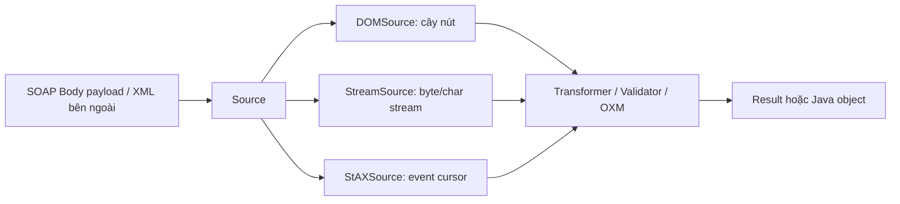

# DOMSource, StreamSource, StAXSource và đặc điểm truy cập dữ liệu

Trong dịch vụ SOAP **contract-first**, không phải mọi payload đều cần chuyển thành lớp JAXB trước khi xử lý. Có lúc một endpoint phải đọc một XML document do đối tác cung cấp, giữ nguyên các phần tử mở rộng, dùng XPath để tìm nút, hoặc xử lý một danh sách lớn mà không muốn tạo toàn bộ cây DOM. Java và Spring Web Services (Spring-WS) cung cấp cách làm việc trực tiếp với XML thông qua abstraction **`javax.xml.transform.Source`** và các kiểu triển khai như **`DOMSource`**, **`StreamSource`**, **`StAXSource`**.

Bài thuộc chương **Xử lý XML trực tiếp** của module **SPRING_WEB_SERVICES**. Mục tiêu là hiểu **ba kiểu nguồn dữ liệu**, chọn đúng cách truy cập, quản lý vòng đời reader/parser và sử dụng an toàn trong các dịch vụ SOAP xây dựng từ XSD/WSDL. Nội dung liên hệ với JAXB/Spring OXM, endpoint và SOAP client, schema validation, SOAP Fault, interceptor, XML security, WS-Security, chứng chỉ và kiểm thử tương thích giữa các hệ thống doanh nghiệp.

Các ví dụ dùng API JAXP/StAX có trong Java SE hiện đại và Spring-WS theo mô hình Jakarta. **`javax.xml.transform.*`, `javax.xml.parsers.*` và `javax.xml.stream.*` vẫn là namespace của các API XML thuộc Java SE**, không đổi thành `jakarta.xml.transform` hay `jakarta.xml.stream` chỉ vì JAXB/SAAJ chuyển sang Jakarta.

## 1. `Source` là gì và không phải là gì?

`Source` là **đầu vào trừu tượng cho một bộ xử lý XML**, ví dụ `Transformer`, `Validator` hoặc thành phần ánh xạ XML. Nó **không tự parse XML**, không mặc nhiên là cây DOM và cũng không bảo đảm dữ liệu có thể đọc lại nhiều lần. Dạng `Source` cho biết dữ liệu đang được cung cấp bằng cấu trúc nào hoặc thông qua cơ chế đọc nào.

Các interface/class:

```java
import javax.xml.transform.Source;
import javax.xml.transform.dom.DOMSource;
import javax.xml.transform.stream.StreamSource;
import javax.xml.transform.stax.StAXSource;
```

Đầu ra của transformation được biểu diễn bằng **`Result`**, không phải `Source`:

```java
import javax.xml.transform.Result;
import javax.xml.transform.dom.DOMResult;
import javax.xml.transform.stream.StreamResult;
import javax.xml.transform.stax.StAXResult;
```

| Loại | Ý nghĩa | Dùng cho |
| --- | --- | --- |
| `DOMSource` | Tham chiếu một nút/cây DOM đã hình thành | Phân tích và biến đổi XML khi đã có DOM tree |
| `StreamSource` | Tham chiếu nguồn byte, character hoặc URI hệ thống | Truyền XML cho parser/transformer đọc từ đầu vào tuần tự |
| `StAXSource` | Bọc một `XMLStreamReader` hoặc `XMLEventReader` | Đưa luồng sự kiện StAX vào API chấp nhận `Source` |
| `DOMResult` | Đích nhận DOM tree | Ghi output của một transformer vào DOM |
| `StreamResult` | Đích nhận byte/character/file | Serialize XML ra stream hoặc writer |
| `StAXResult` | Đích nhận StAX writer | Ghi sự kiện XML qua API StAX |

**Nguồn và đích không hoán đổi cho nhau.** Một `StreamSource` tạo từ `InputStream` cho bộ xử lý **đọc** dữ liệu; một `StreamResult` tạo từ `OutputStream` cho bộ xử lý **ghi** dữ liệu.



Sơ đồ chỉ nhóm các cách cung cấp XML; nó không ngụ ý cùng một `Source` sẽ tự chuyển thành cả ba dạng. Muốn chuyển đổi, phải sử dụng bộ xử lý tương ứng và chịu chi phí parse/buffer của quá trình đó.

## 2. Bảng so sánh quyết định lựa chọn

| Đặc điểm | `DOMSource` | `StreamSource` | `StAXSource` |
| --- | --- | --- | --- |
| Dữ liệu được giữ | Một `Node`/`Document` DOM đã có | `InputStream`, `Reader` hoặc `systemId` | Reader StAX có vị trí hiện tại |
| Mô hình truy cập | Cây nút, có thể đi cha–con–anh em và tìm kiếm | Không tự có API duyệt nút; consumer quyết định cách parse | Dòng sự kiện, đọc theo thứ tự tiến |
| Truy cập ngẫu nhiên | Có trên cây DOM | Không trực tiếp | Không; không quay lại sự kiện đã đi qua |
| Đọc lại nguồn | Có thể lặp trên DOM nếu còn sống và không bị thay đổi | Thường phải tạo stream/reader mới hoặc mở lại URI | Thường phải tạo StAX reader mới từ dữ liệu gốc |
| Bộ nhớ của representation | Thường tỷ lệ với kích thước tài liệu | Bản thân wrapper nhẹ; consumer có thể buffer toàn bộ | Thường phù hợp xử lý tuần tự, nhưng consumer có thể buffer |
| Vòng đời | Giữ nút/cây DOM đủ lâu | Quản lý stream/reader và thời điểm tiêu thụ | Quản lý trạng thái và đóng event/stream reader |
| Bài toán thuận tiện | XPath, cập nhật cây, đọc nhiều nhánh | Chuyển XML nguồn cho transformer/validator | Parse từng phần tử, tài liệu lớn, đọc sự kiện |
| Rủi ro nổi bật | RAM, mutate nhầm cây, thread safety | Tiêu thụ một lần, charset/URI, external entities | Cursor bị đi quá, đóng sớm, không đọc lại |

**Bộ nhớ chỉ là xu hướng, không phải bảo đảm.** `StreamSource` chỉ cho biết đầu vào dạng stream; nếu consumer chuyển toàn bộ nội dung thành DOM thì tổng chi phí vẫn gần cách parse DOM ngay từ đầu. `StAXSource` cũng không đảm bảo streaming end-to-end nếu transformer, JAXB, validation hay WS-Security materialize tài liệu trong bộ nhớ.

## 3. Hợp đồng SOAP/XSD dùng xuyên suốt ví dụ

Giả sử dịch vụ tra cứu đơn hàng nhận một request có mã đơn hàng và phiên bản yêu cầu:

```xml
<?xml version="1.0" encoding="UTF-8"?>
<xs:schema xmlns:xs="http://www.w3.org/2001/XMLSchema"
           targetNamespace="https://example.org/orders/v1"
           xmlns:o="https://example.org/orders/v1"
           elementFormDefault="qualified">

    <xs:element name="GetOrderRequest">
        <xs:complexType>
            <xs:sequence>
                <xs:element name="orderId" type="xs:string"/>
                <xs:element name="includeLines" type="xs:boolean"
                            minOccurs="0"/>
            </xs:sequence>
        </xs:complexType>
    </xs:element>

    <xs:element name="GetOrderResponse">
        <xs:complexType>
            <xs:sequence>
                <xs:element name="orderId" type="xs:string"/>
                <xs:element name="status" type="xs:string"/>
            </xs:sequence>
        </xs:complexType>
    </xs:element>
</xs:schema>
```

Payload `GetOrderRequest` hợp lệ:

```xml
<o:GetOrderRequest xmlns:o="https://example.org/orders/v1">
    <o:orderId>ORD-1001</o:orderId>
    <o:includeLines>true</o:includeLines>
</o:GetOrderRequest>
```

Trong SOAP 1.1, phần tử này nằm **bên trong SOAP Body**:

```xml
<s:Envelope xmlns:s="http://schemas.xmlsoap.org/soap/envelope/"
            xmlns:o="https://example.org/orders/v1">
    <s:Header/>
    <s:Body>
        <o:GetOrderRequest>
            <o:orderId>ORD-1001</o:orderId>
            <o:includeLines>true</o:includeLines>
        </o:GetOrderRequest>
    </s:Body>
</s:Envelope>
```

Khi Spring-WS gọi `WebServiceMessage#getPayloadSource()`, đối tượng `Source` thường đại diện **payload bên trong Body**, không nhất thiết chứa toàn bộ `Envelope` và `Header`. Vì vậy đừng tìm `s:Envelope` bên trong một `Source` của payload; muốn đọc header hay security metadata, sử dụng `SoapMessage`/interceptor phù hợp.

Định danh `GetOrderRequest` là QName `{https://example.org/orders/v1}GetOrderRequest`. Prefix `o` là tùy chọn; URI namespace và local name mới có ý nghĩa đối với XSD và `@PayloadRoot`.

## 4. `DOMSource`: truy cập cây DOM

### 4.1. DOM là cây nút XML

**DOM (Document Object Model)** biểu diễn XML thành các nút như `Document`, `Element`, `Text`, `Attr`. Đã có DOM thì có thể duyệt nhiều lần, truy cập nút con, tra cứu bằng tên mở rộng và thay đổi cây nếu được phép.

```text
Document
└── Element: GetOrderRequest
    ├── Element: orderId
    │   └── Text: ORD-1001
    └── Element: includeLines
        └── Text: true
```

`DOMSource` **không tạo cây**. Nó chỉ bọc một nút DOM hiện có, ví dụ:

```java
Document document = /* DOM đã được parse an toàn */;
DOMSource entireDocument = new DOMSource(document);
DOMSource payloadOnly = new DOMSource(document.getDocumentElement());
```

Chọn `Document` hay `Element` có ý nghĩa nếu tài liệu có processing instruction, comment ở mức document hoặc các nút cần giữ. Đối với payload SOAP, thường làm việc với phần tử gốc nghiệp vụ là đủ; nếu hợp đồng cần phân tích toàn document, phải xác định rõ phạm vi.

### 4.2. Parse XML an toàn thành DOM

Ví dụ helper tạo DOM từ chuỗi XML **không tin cậy**. Trong môi trường production cần chọn một parser/provider thực thi được các tính năng bảo mật dưới đây; nếu không hỗ trợ thì **từ chối khởi tạo**, không tắt bảo vệ để tiếp tục:

```java
import java.io.StringReader;
import javax.xml.XMLConstants;
import javax.xml.parsers.DocumentBuilderFactory;
import javax.xml.parsers.ParserConfigurationException;
import org.w3c.dom.Document;
import org.xml.sax.InputSource;

public final class SecureDom {
    private SecureDom() { }

    public static DocumentBuilderFactory factory()
            throws ParserConfigurationException {
        DocumentBuilderFactory f = DocumentBuilderFactory.newInstance();
        f.setNamespaceAware(true);
        f.setFeature(XMLConstants.FEATURE_SECURE_PROCESSING, true);
        f.setFeature(
                "http://apache.org/xml/features/disallow-doctype-decl", true);
        f.setFeature(
                "http://xml.org/sax/features/external-general-entities",
                false);
        f.setFeature(
                "http://xml.org/sax/features/external-parameter-entities",
                false);
        f.setXIncludeAware(false);
        f.setExpandEntityReferences(false);
        f.setAttribute(XMLConstants.ACCESS_EXTERNAL_DTD, "");
        f.setAttribute(XMLConstants.ACCESS_EXTERNAL_SCHEMA, "");
        return f;
    }

    public static Document parse(String xml) throws Exception {
        try (StringReader reader = new StringReader(xml)) {
            return factory().newDocumentBuilder().parse(
                    new InputSource(reader));
        }
    }
}
```

`setNamespaceAware(true)` rất quan trọng: XSD/Spring-WS định tuyến theo QName, không chỉ dựa vào chuỗi prefix. Với các parser có hỗ trợ JAXP property khác nhau, `setAttribute` hoặc `setFeature` có thể báo lỗi; hệ thống cần coi đó là **lỗi cấu hình an toàn** và xử lý rõ ràng.

Đây là minh họa bảo vệ parser cơ bản, không thay thế các **giới hạn kích thước payload, độ sâu cây, thời gian parse** hoặc cơ chế bảo mật của gateway.

### 4.3. Đọc phần tử con bằng namespace URI

```java
import org.w3c.dom.Document;
import org.w3c.dom.Element;
import org.w3c.dom.Node;

public final class DomOrderReader {
    private static final String NS = "https://example.org/orders/v1";

    public static String orderId(Document doc) {
        Element root = doc.getDocumentElement();
        if (!NS.equals(root.getNamespaceURI())
                || !"GetOrderRequest".equals(root.getLocalName())) {
            throw new IllegalArgumentException("Unexpected payload QName");
        }

        // Chỉ duyệt con trực tiếp, không vô tình chọn một orderId lồng sâu.
        for (Node child = root.getFirstChild();
                child != null; child = child.getNextSibling()) {
            if (child.getNodeType() == Node.ELEMENT_NODE
                    && NS.equals(child.getNamespaceURI())
                    && "orderId".equals(child.getLocalName())) {
                return child.getTextContent();
            }
        }
        throw new IllegalArgumentException("Missing orderId");
    }
}
```

Ví dụ này chỉ trích xuất một trường; nó **chưa xác thực XSD** để kiểm tra `xs:sequence`, `includeLines`, dữ liệu lặp hay kiểu `xs:boolean`. Nếu dùng `getElementsByTagNameNS`, cần lưu ý phương thức tìm trong **toàn bộ các hậu duệ**, có thể chọn nhầm một trường cùng tên ở vị trí lồng sâu hơn. Với dữ liệu có XSD nghiêm ngặt, nên validate trước khi xử lý nghiệp vụ.

### 4.4. Khi nào DOM thực sự phù hợp?

DOM có lợi thế khi cần:

- Đọc nhiều nhánh của cùng một XML mà không muốn parse lại.
- Thực hiện XPath, so sánh nút hoặc thao tác XML phức tạp.
- Sửa một phần cây rồi tạo `DOMSource` cho transformer hoặc serializer.
- Dùng một thư viện yêu cầu đầu vào dạng DOM.

Đổi lại, DOM giữ các nút và quan hệ trong bộ nhớ, chi phí đáng kể với XML rất lớn. DOM tree **có thể thay đổi (mutable)**; không chia sẻ để nhiều thread đồng thời sửa/đọc mà không có cơ chế đồng bộ hoặc bất biến thích hợp. Với SOAP có chữ ký XML, **không tùy tiện biến đổi DOM của phần tử đã ký**.

## 5. `StreamSource`: đưa byte/character stream vào bộ xử lý

`StreamSource` bao bọc nguồn XML dưới một trong các dạng phổ biến:

```java
import java.io.InputStream;
import java.io.Reader;
import java.io.StringReader;
import javax.xml.transform.stream.StreamSource;

StreamSource fromText = new StreamSource(
        new StringReader("<root><value>42</value></root>"));

InputStream bytes = /* luồng từ resource hoặc request */;
StreamSource fromBytes = new StreamSource(bytes);

Reader chars = /* luồng ký tự được tạo bởi ứng dụng */;
StreamSource fromChars = new StreamSource(chars);

StreamSource bySystemId =
        new StreamSource("file:/opt/contracts/orders.xml");
```

**Ví dụ URI ở đây chỉ minh họa API, không khuyến nghị truy cập file/URL tùy ý**. Khi dùng `systemId` không có stream/reader, processor có thể tự truy cập tài nguyên đó. Với dữ liệu không tin cậy, phải kiểm soát quyền truy cập tài nguyên ngoài và tránh SSRF, XXE hoặc đọc file ngoài ý muốn.

### 5.1. Không có sẵn cây hay con trỏ nút

`StreamSource` không cung cấp `getFirstChild()` như DOM, cũng không có `next()` như StAX. Nó chỉ đưa nguồn để **consumer** đọc. Ví dụ chuyển StreamSource thành DOM bằng identity transformer:

```java
import java.io.StringReader;
import javax.xml.XMLConstants;
import javax.xml.transform.TransformerFactory;
import javax.xml.transform.dom.DOMResult;
import javax.xml.transform.stream.StreamSource;
import org.w3c.dom.Document;

public final class StreamToDom {
    public static Document convert(String xml) throws Exception {
        TransformerFactory factory = TransformerFactory.newInstance();
        factory.setFeature(XMLConstants.FEATURE_SECURE_PROCESSING, true);
        factory.setAttribute(XMLConstants.ACCESS_EXTERNAL_DTD, "");
        factory.setAttribute(XMLConstants.ACCESS_EXTERNAL_STYLESHEET, "");

        DOMResult output = new DOMResult();
        try (StringReader input = new StringReader(xml)) {
            factory.newTransformer().transform(
                    new StreamSource(input), output);
        }
        return (Document) output.getNode();
    }
}
```

Ở đây, đầu vào là **`StreamSource` nhưng kết quả lại là DOM**. Điều đó chứng minh không thể suy luận rằng “dùng StreamSource thì chắc chắn tiết kiệm bộ nhớ”: xử lý cụ thể đã materialize toàn bộ cây DOM. Trong môi trường khác, `Validator`, JAXB, XSLT hoặc security code có thể đọc nguồn với chiến lược khác nhau.

### 5.2. InputStream, Reader và encoding

| Đưa vào `StreamSource` | Ai giải quyết encoding? | Lưu ý |
| --- | --- | --- |
| `InputStream` (byte) | XML parser đọc byte và khai báo encoding/BOM khi phù hợp | Dùng khi cần giữ byte XML gốc và để parser xác định charset |
| `Reader` (character) | Encoding đã được giải mã ở tầng tạo Reader | Khai báo `encoding` trong XML không thể sửa charset đã decode sai |
| `systemId` | Processor có thể mở URL/resource | Cần bảo vệ tài nguyên ngoài và xác định URI cơ sở |

Ví dụ, nếu dữ liệu gốc là UTF-8 nhưng mã Java tạo `InputStreamReader` bằng charset khác, chữ tiếng Việt có thể bị hỏng **trước khi** `StreamSource` được chuyển cho validator. Với SOAP transport, việc giải mã còn phải tuân thủ thông tin HTTP/SOAP media type và parser của stack đang dùng.

### 5.3. `systemId` không chỉ là “địa chỉ tải file”

`Source#setSystemId(...)` có thể cung cấp **base URI** cho việc giải quyết các đường dẫn tương đối trong một số thao tác XML/XSLT. Ví dụ tài liệu XML hoặc stylesheet tham chiếu tài nguyên tương đối, bộ xử lý có thể dùng `systemId` làm cơ sở. Vì thế:

- Với nguồn đáng tin cậy, có thể đặt `systemId` để hỗ trợ URI resolution phù hợp.
- Với dữ liệu ngoài, hạn chế hoặc chặn truy cập tài nguyên ngoài bằng parser/transformer/schema factory.
- Không đưa một `systemId` do client tùy ý quyết định vào processor có thể truy cập mạng hoặc filesystem.

Không giả định mọi `Source` đều có `systemId` hoặc mọi consumer đều dùng nó theo cách giống nhau.

### 5.4. Đọc một lần và quyền sở hữu stream

`StreamSource` bọc `InputStream`/`Reader` thường là **nguồn tiêu thụ tiến**. Sau khi một `Transformer` đọc đến cuối, đưa lại **cùng** `StreamSource` vào `Validator` có thể tạo lỗi hoặc chỉ còn EOF.

```java
// Không nên dùng cùng reader đã tiêu thụ cho cả hai lần:
StringReader reader = new StringReader(xml);
StreamSource source = new StreamSource(reader);
transformer.transform(source, output);
// validator.validate(source);  // reader có thể đã hết dữ liệu!
```

Thay bằng **nguồn mới cho mỗi lượt**:

```java
try (StringReader first = new StringReader(xml);
     StringReader second = new StringReader(xml)) {
    validator.validate(new StreamSource(first));
    transformer.transform(new StreamSource(second), output);
}
```

Ví dụ giả định `xml` là String đã có, `validator`, `transformer`, `output` được cấu hình phù hợp. Nếu XML rất lớn, việc giữ cả chuỗi trong bộ nhớ không phải giải pháp tối ưu; nên dùng nguồn có thể mở lại đáng tin cậy hoặc thiết kế pipeline chỉ cần parse một lần.

**Ai đóng stream?** Khi ứng dụng mở `InputStream`/`Reader`, ứng dụng thường phải đảm bảo đóng đúng thời điểm sau khi consumer xử lý xong, trừ khi API cụ thể đã chuyển quyền sở hữu một cách rõ ràng. Không đóng reader trước khi transformer/validator tiêu thụ; cũng đừng mặc nhiên trông chờ processor đóng một stream do mình tạo.

## 6. `StAXSource`: XML pull parser với con trỏ có trạng thái

**StAX (Streaming API for XML)** cho phép ứng dụng **chủ động kéo sự kiện** từ XML theo thứ tự. Trong Java có hai kiểu reader chính:

- `XMLStreamReader`: API **cursor**, cung cấp sự kiện hiện tại và `next()` để chuyển tới sự kiện kế.
- `XMLEventReader`: API **iterator**, trả đối tượng `XMLEvent`, có thể xem `peek()` mà chưa tiêu thụ.

`StAXSource` bọc **một trong hai reader đó** để các thành phần chấp nhận `Source` có thể dùng. Nó không sở hữu khả năng tua ngược về đầu file.

```java
import javax.xml.stream.XMLInputFactory;
import javax.xml.stream.XMLStreamReader;
import javax.xml.stream.XMLEventReader;
import javax.xml.transform.stax.StAXSource;

XMLInputFactory factory = XMLInputFactory.newFactory();

// Hai cách xây StAXSource, minh họa; tạo reader từ input thực tế.
XMLStreamReader cursor = factory.createXMLStreamReader(reader1);
StAXSource fromCursor = new StAXSource(cursor);

XMLEventReader events = factory.createXMLEventReader(reader2);
StAXSource fromEvents = new StAXSource(events);
```

`reader1` và `reader2` là **hai nguồn độc lập**. Trong mã thật, hãy đóng cả reader StAX lẫn stream/reader nguồn theo vòng đời phù hợp. Không dùng một nguồn đã tiêu thụ để tạo hai reader rồi giả định chúng cùng đọc từ đầu.

### 6.1. Cấu hình `XMLInputFactory` an toàn

Nguồn XML ngoài phải được xử lý với DTD và external entities theo chính sách rõ ràng:

```java
import javax.xml.stream.XMLInputFactory;
import javax.xml.stream.XMLStreamException;

public final class SecureStax {
    private SecureStax() { }

    public static XMLInputFactory factory() {
        XMLInputFactory f = XMLInputFactory.newFactory();
        f.setProperty(XMLInputFactory.SUPPORT_DTD, false);
        f.setProperty(
                XMLInputFactory.IS_SUPPORTING_EXTERNAL_ENTITIES, false);
        f.setXMLResolver((publicId, systemId, baseUri, namespace) -> {
            throw new XMLStreamException(
                    "External XML entities are not allowed");
        });
        return f;
    }
}
```

Một provider có thể không hỗ trợ một số property hoặc áp dụng cách xử lý riêng; khi đó cần xác minh cấu hình qua **test XXE cụ thể** và từ chối cấu hình không bảo đảm yêu cầu bảo mật. Kiểm tra thêm giới hạn tài nguyên và document size, vì việc tắt DTD không tự chặn mọi kiểu payload tiêu tốn CPU/RAM.

### 6.2. Đọc từng sự kiện bằng `XMLStreamReader`

Ví dụ đọc `orderId` mà không tự tạo DOM:

```java
import java.io.StringReader;
import javax.xml.namespace.QName;
import javax.xml.stream.XMLStreamConstants;
import javax.xml.stream.XMLStreamReader;

public final class StaxOrderReader {
    private static final String NS = "https://example.org/orders/v1";

    public static String orderId(String xml) throws Exception {
        XMLStreamReader r = SecureStax.factory()
                .createXMLStreamReader(new StringReader(xml));
        try {
            boolean inRequest = false;
            int depth = 0;

            while (r.hasNext()) {
                int event = r.next();
                if (event == XMLStreamConstants.START_ELEMENT) {
                    depth++;
                    QName name = r.getName();
                    if (depth == 1) {
                        if (!new QName(NS, "GetOrderRequest").equals(name)) {
                            throw new IllegalArgumentException(
                                    "Unexpected payload root");
                        }
                        inRequest = true;
                    } else if (inRequest && depth == 2
                            && new QName(NS, "orderId").equals(name)) {
                        // getElementText() đọc đến END_ELEMENT của orderId.
                        return r.getElementText();
                    }
                } else if (event == XMLStreamConstants.END_ELEMENT) {
                    depth--;
                }
            }
            throw new IllegalArgumentException("Missing orderId");
        } finally {
            r.close();
        }
    }
}
```

Ví dụ dùng `StringReader` và đối tượng `XMLStreamReader` được đóng khi xong; với `InputStream` hoặc reader có tài nguyên bên ngoài, đóng nguồn đó theo ownership rõ ràng. Đoạn mã trên **trích một trường rồi kết thúc**, không xác thực toàn XSD hay kiểm tra xem `orderId` có xuất hiện trùng, `includeLines` đúng thứ tự hoặc payload có phần tử thừa không. Muốn dùng kết quả cho nghiệp vụ, cần schema/business validation tương ứng.

Đặc biệt với `XMLStreamReader`:

- `next()` di chuyển con trỏ; sự kiện đã đi qua **không còn khả năng truy cập lại** bằng API cursor.
- `getElementText()` **tiêu thụ** chuỗi sự kiện cho đến kết thúc phần tử hiện tại; không gọi nó rồi trông chờ con trỏ vẫn nằm tại `START_ELEMENT`.
- `nextTag()` bỏ qua whitespace/comment/processing instruction thích hợp nhưng có thể báo lỗi nếu gặp text không phải whitespace; không dùng khi nội dung trộn (*mixed content*) có ý nghĩa.
- Phải kiểm tra `getEventType()` và QName đúng sự kiện; không gọi `getLocalName()` hoặc `getText()` trên một trạng thái không hỗ trợ.

### 6.3. `StAXSource` qua identity transformer

Khi API chỉ nhận `Source`, có thể bọc reader StAX:

```java
import java.io.StringReader;
import java.io.StringWriter;
import javax.xml.XMLConstants;
import javax.xml.stream.XMLStreamReader;
import javax.xml.transform.TransformerFactory;
import javax.xml.transform.stax.StAXSource;
import javax.xml.transform.stream.StreamResult;

public final class StaxSourceExample {
    public static String transform(String xml) throws Exception {
        StringWriter output = new StringWriter();
        try (StringReader input = new StringReader(xml)) {
            XMLStreamReader cursor =
                    SecureStax.factory().createXMLStreamReader(input);
            try {
                // Reader mới đang ở START_DOCUMENT, vị trí cho phép
                // để tạo StAXSource; START_ELEMENT cũng được chấp nhận.
                StAXSource source = new StAXSource(cursor);
                TransformerFactory tf = TransformerFactory.newInstance();
                tf.setFeature(
                        XMLConstants.FEATURE_SECURE_PROCESSING, true);
                tf.setAttribute(XMLConstants.ACCESS_EXTERNAL_DTD, "");
                tf.setAttribute(
                        XMLConstants.ACCESS_EXTERNAL_STYLESHEET, "");

                tf.newTransformer().transform(
                        source, new StreamResult(output));
                return output.toString();
            } finally {
                cursor.close();
            }
        }
    }
}
```

`StAXSource` dùng **reader ở vị trí hiện tại**: với `XMLStreamReader`, constructor mong reader đang ở `START_DOCUMENT` hoặc `START_ELEMENT`. Khi reader đã đi qua root và đứng ở `CHARACTERS` hay `END_ELEMENT` không phù hợp, không thể kỳ vọng constructor nhận như một tài liệu đầy đủ. Cần kiểm tra điều kiện API trước khi chuyển reader cho bộ xử lý.

Transformer có thể tiêu thụ reader và tạo output XML mới; nó **không tự sinh SOAP Envelope** nếu input chỉ là payload. Việc serialize lại XML có thể thay đổi prefix, XML declaration hoặc cách xuống dòng; điều này cần được cân nhắc với XML Signature và công cụ so sánh message.

### 6.4. Cursor và event reader không giống nhau

| API StAX | Cách truy cập | Thao tác điển hình |
| --- | --- | --- |
| `XMLStreamReader` | Cursor tại một event; có methods `next`, `getName`, `getText` | Ít đối tượng sự kiện, thao tác tuyến tính |
| `XMLEventReader` | Iterator trả các đối tượng `XMLEvent`, `peek` nhìn sự kiện sắp tới | Logic theo loại event, chuyển event cho consumer |
| `StAXSource` | Adapter từ một trong hai reader sang `Source` | Truyền stream sự kiện vào JAXP/Spring OXM |

Cả hai loại reader đều cần đóng. `StAXSource` không đồng nghĩa với việc sao chép các sự kiện vào bộ nhớ; nó tham chiếu reader đang chạy. Không chia sẻ một reader mutable cho nhiều thread hoặc nhiều consumer đồng thời.

## 7. Khả năng truy cập dữ liệu: xem trước, quay lại và đọc nhiều lần

### 7.1. Ba mô hình cần phân biệt

```text
DOMSource
  root → child → sibling → parent → root → ...
  (đã có cây; có thể duyệt lại)

StreamSource
  InputStream/Reader → consumer đọc → EOF
  (wrapper không cung cấp API nút)

StAXSource
  START_DOCUMENT → START_ELEMENT → CHARACTERS → END_ELEMENT → ...
  (reader tiến tới; không tua ngược)
```

Từ đây có một hệ quả kiến trúc: khi **cần đọc cùng payload hai lần**, nên thiết kế rõ có cache DOM/buffer hợp lệ hay có nguồn có thể mở lại. Đừng tiêu thụ payload trong logging interceptor rồi hy vọng endpoint hoặc JAXB unmarshal vẫn còn đủ sự kiện.

### 7.2. Đọc lại `Source` sau khi xác thực

Giả sử service muốn:

1. Validate XSD.
2. Trích xuất `orderId`.
3. Ghi lại payload đã chuẩn hóa để debug.

Với DOM, có thể parse/validate một lần, giữ DOM trong scope request rồi duyệt nhiều lần. Với StreamSource/StAXSource, việc tiêu thụ một lượt thường khiến lượt sau không còn dữ liệu. Các lựa chọn:

- **Parse DOM có kiểm soát** nếu tài liệu nhỏ/vừa và việc truy cập nhiều lần là chủ đích.
- **Mở lại nguồn** nếu XML đến từ resource có thể đọc lại và được xác thực tính toàn vẹn, song việc đọc lại network resource có rủi ro thay đổi dữ liệu giữa các lượt.
- **Chuyển qua một pipeline duy nhất**: validate và extract khi stream còn tiến, nếu thư viện/thiết kế cho phép.
- **Buffer có giới hạn** trong bộ nhớ hoặc lưu trữ tạm an toàn nếu yêu cầu nghiệp vụ thật sự cần đọc nhiều lượt. Với SOAP message đã ký, phải bảo toàn dữ liệu được ký theo policy.

Không mặc định một `StreamSource` có `systemId` là luôn có thể mở lại cùng nội dung: URI có thể thay đổi hoặc không còn truy cập được.

### 7.3. DOM mutability và tác động tới chữ ký XML

DOM dễ thao tác nhưng việc thêm, bỏ hoặc đổi thứ tự nút **thay đổi tài liệu**. Nếu một XML Signature đã được xác minh trên một phạm vi dữ liệu, sửa DOM sau đó có thể khiến dữ liệu được xử lý không còn là dữ liệu đã được ký. Với hệ dùng WS-Security, nên dựa vào kết quả xác minh và policy signed parts từ thư viện chuyên trách; đừng tự parse rồi chọn một node cùng tên nhưng không nằm trong vùng đã xác thực.

## 8. Tích hợp với Spring-WS: `@RequestPayload Source`

Spring-WS có thể đưa XML payload đến phương thức endpoint bằng `@RequestPayload` dưới dạng `Source`, thay vì JAXB object:

```java
import javax.xml.transform.Source;
import org.springframework.ws.server.endpoint.annotation.Endpoint;
import org.springframework.ws.server.endpoint.annotation.PayloadRoot;
import org.springframework.ws.server.endpoint.annotation.RequestPayload;
import org.springframework.ws.server.endpoint.annotation.ResponsePayload;

@Endpoint
public class XmlOrdersEndpoint {
    private static final String NS = "https://example.org/orders/v1";
    private final OrderXmlProcessor processor;

    public XmlOrdersEndpoint(OrderXmlProcessor processor) {
        this.processor = processor;
    }

    @PayloadRoot(namespace = NS, localPart = "GetOrderRequest")
    @ResponsePayload
    public Source getOrder(@RequestPayload Source payload) {
        return processor.handle(payload);
    }
}
```

Ở đây `OrderXmlProcessor` là service xử lý XML phải được triển khai riêng. Cấu hình Spring-WS cần có adapter/resolver hỗ trợ `Source` cho request/response. Khi endpoint nhận `Source`, **không giả định kiểu runtime chắc chắn là `DOMSource`, `StreamSource` hay `StAXSource`**; message factory và Spring-WS adapter quyết định representation đang được cung cấp.

Quan trọng:

- `@PayloadRoot` vẫn định tuyến theo **QName của payload root**, không theo tên class Java.
- `Source` thường đại diện **SOAP Body payload**, không tự bao gồm SOAP Header.
- `@ResponsePayload` có thể gửi XML `Source` trả về làm payload khi adapter phù hợp.
- Một callback hoặc interceptor đọc trước cùng payload có thể ảnh hưởng khả năng tiêu thụ tiếp tùy implementation. Cần kiểm thử bằng message factory được sử dụng thật.

### 8.1. Tạo response XML không ghép chuỗi dữ liệu chưa tin cậy

Nếu nhận `orderId` rồi muốn trả response:

```xml
<o:GetOrderResponse xmlns:o="https://example.org/orders/v1">
    <o:orderId>ORD-1001</o:orderId>
    <o:status>CONFIRMED</o:status>
</o:GetOrderResponse>
```

Tránh xây XML bằng:

```java
// KHÔNG NÊN: orderId có thể chứa ký tự XML đặc biệt.
String xml = "<o:orderId>" + orderId + "</o:orderId>";
```

Nên tạo DOM an toàn, để serializer xử lý escaping:

```java
import javax.xml.transform.Source;
import javax.xml.transform.dom.DOMSource;
import org.w3c.dom.Document;
import org.w3c.dom.Element;

public final class OrderResponseXml {
    private static final String NS = "https://example.org/orders/v1";

    public static Source confirmed(String orderId) throws Exception {
        Document doc =
                SecureDom.factory().newDocumentBuilder().newDocument();

        Element root = doc.createElementNS(NS, "o:GetOrderResponse");
        doc.appendChild(root);

        Element id = doc.createElementNS(NS, "o:orderId");
        id.setTextContent(orderId);
        root.appendChild(id);

        Element status = doc.createElementNS(NS, "o:status");
        status.setTextContent("CONFIRMED");
        root.appendChild(status);

        return new DOMSource(doc);
    }
}
```

Đây là helper tạo response XML, chưa thực hiện tra cứu nghiệp vụ, xác thực quyền hoặc SOAP Fault. Với XML response đã nằm trong DOM, Spring-WS dùng adapter/serializer thích hợp để ghi vào SOAP Body. Một ứng dụng dùng JAXB hoàn toàn có thể trả đối tượng JAXB thay cho `DOMSource`; chọn trực tiếp XML khi có lý do kỹ thuật rõ.

### 8.2. Lấy `Source` qua `MessageContext`

Một endpoint hoặc interceptor có thể truy cập:

```java
import javax.xml.transform.Source;
import org.springframework.ws.context.MessageContext;

public Source currentPayload(MessageContext context) {
    return context.getRequest().getPayloadSource();
}
```

Phương thức minh họa trả một `Source` gắn với request đang xử lý. **Đừng lưu Source/Reader sang một thread hoặc xử lý nền sau khi vòng đời message đã kết thúc**, bởi message, stream hay cursor có thể đã được đóng hoặc tiêu thụ. Nếu cần xử lý bất đồng bộ, phải chuyển dữ liệu sang định dạng/vùng lưu trữ do ứng dụng sở hữu với giới hạn tài nguyên và cơ chế bảo mật phù hợp.

## 9. `Source`, JAXB và Spring OXM phối hợp như thế nào?

**JAXB/Jaxb2Marshaller** xử lý Java object ↔ XML. **`Source`** cung cấp cách biểu diễn XML cho quá trình unmarshal/transform:

```java
import javax.xml.transform.Source;
import org.springframework.oxm.jaxb.Jaxb2Marshaller;

public GetOrderRequest unmarshal(
        Source payload,
        Jaxb2Marshaller marshaller) {
    Object value = marshaller.unmarshal(payload);
    if (value instanceof GetOrderRequest request) {
        return request;
    }
    throw new IllegalArgumentException("Unexpected JAXB root");
}
```

`GetOrderRequest` là lớp JAXB minh họa, phải được sinh/ánh xạ từ XSD. Với những schema mà JAXB sinh root bằng `ObjectFactory`, unmarshal có thể trả `JAXBElement<GetOrderRequest>` thay vì object trực tiếp; xử lý theo binding thực tế.

Một `Source` được đưa vào JAXB có thể bị tiêu thụ. Không gọi `marshaller.unmarshal(payload)` rồi dùng **cùng source** lần thứ hai để chạy schema validator hoặc transform mà không biết nó có thể đọc lại hay không.

### 9.1. Khi nào bỏ qua JAXB?

Xử lý XML trực tiếp có thể hợp lý khi:

- Dữ liệu có nhiều phần tử mở rộng hoặc schema thay đổi theo đối tác.
- Cần XPath, chữ ký XML hoặc thao tác ở mức cấu trúc.
- Cần đọc tuần tự một tài liệu lớn với StAX mà không tạo toàn bộ object graph.
- Ứng dụng đóng vai trò chuyển đổi hoặc định tuyến giữa các hợp đồng XML.

Ngược lại, JAXB giúp giảm việc tự viết parser ở phần nghiệp vụ cố định, mang type safety và dễ bám XSD. Cả hai hướng vẫn cần **định tuyến SOAP đúng, validation, security và contract tests**.

## 10. XSD validation: `Source` không tự bảo đảm hợp đồng

Ví dụ XSD ở mục 3 quy định `orderId` đứng trước `includeLines`. Một XML well-formed với thứ tự ngược lại có thể parse thành DOM hoặc phát ra các sự kiện StAX bình thường nhưng **không hợp lệ theo XSD**:

```xml
<o:GetOrderRequest xmlns:o="https://example.org/orders/v1">
    <o:includeLines>true</o:includeLines>
    <o:orderId>ORD-1001</o:orderId>
</o:GetOrderRequest>
```

Với Java XML Validation:

```java
import java.io.File;
import javax.xml.XMLConstants;
import javax.xml.transform.dom.DOMSource;
import javax.xml.validation.Schema;
import javax.xml.validation.SchemaFactory;
import javax.xml.validation.Validator;
import org.w3c.dom.Document;

public final class OrderSchemaValidator {
    public static void validateDom(
            Document document, File trustedXsd) throws Exception {
        SchemaFactory factory = SchemaFactory.newInstance(
                XMLConstants.W3C_XML_SCHEMA_NS_URI);
        factory.setFeature(
                XMLConstants.FEATURE_SECURE_PROCESSING, true);
        factory.setProperty(XMLConstants.ACCESS_EXTERNAL_DTD, "");
        factory.setProperty(XMLConstants.ACCESS_EXTERNAL_SCHEMA, "");

        Schema schema = factory.newSchema(trustedXsd);
        Validator validator = schema.newValidator();
        validator.setProperty(XMLConstants.ACCESS_EXTERNAL_DTD, "");
        validator.setProperty(XMLConstants.ACCESS_EXTERNAL_SCHEMA, "");
        validator.validate(new DOMSource(document));
    }
}
```

`trustedXsd` phải là schema từ nguồn được kiểm soát. Ví dụ tắt mọi schema import bên ngoài; nếu hợp đồng thật có import/include hợp lệ, cần thiết kế **resolver/allowlist offline** phù hợp, không mở mạng tự do chỉ để schema tải được. Một số parser/provider có thể có khác biệt về feature/property; fail closed khi chính sách bảo vệ không được đáp ứng.

`Schema` có thể được quản lý/reuse phù hợp; `Validator` thường dùng **riêng cho mỗi lần validation** nếu có trạng thái xử lý. Với `StreamSource` hoặc `StAXSource`, validator sẽ tiêu thụ source theo cách xử lý của provider; nếu còn cần đọc tiếp thì tạo nguồn riêng hoặc thiết kế pipeline phù hợp.

Trong Spring-WS, `PayloadValidatingInterceptor` có thể xác thực payload theo XSD khi được cấu hình/đăng ký. **XSD validation không xác minh WS-Security signature hoặc business authorization**. Ngoài ra, một XML đúng schema vẫn có thể chứa `orderId` không tồn tại.

## 11. Lỗi nguồn XML, SOAP Fault và bảo mật

### 11.1. Những tầng lỗi khác nhau

| Tình huống | Tầng phát hiện thường gặp | Cách phân loại |
| --- | --- | --- |
| XML chưa well-formed | Parser, SOAP message factory hoặc transformer | Lỗi cú pháp/thông điệp |
| SOAP 1.2 gửi tới endpoint chỉ SOAP 1.1 | SOAP parser/message factory/transport | Lỗi phiên bản giao thức |
| `Source`/reader đã bị tiêu thụ | Transformer, JAXB, validator hoặc code xử lý XML | Lỗi vòng đời/tổ chức pipeline |
| `StAXSource` tạo ở vị trí cursor không hợp lệ | API StAXSource / reader | Lỗi trạng thái con trỏ |
| Namespace payload sai | Endpoint mapping hoặc XSD validation | Lỗi QName/hợp đồng |
| Thứ tự phần tử sai XSD | Schema validator | Lỗi hợp đồng dữ liệu |
| Không tìm thấy order | Business service | Lỗi nghiệp vụ |
| Chữ ký WS-Security không hợp lệ | Security interceptor | Lỗi bảo mật thông điệp |
| Certificate TLS không tin cậy | Transport/TLS | Lỗi bảo mật kết nối |

Message factory có thể từ chối SOAP Envelope trước khi method `@Endpoint` chạy. Nếu XML payload sai schema, interceptor có thể tạo SOAP Fault theo cấu hình; nếu business code ném exception, exception resolver có thể ánh xạ thành Fault nghiệp vụ.

**Đừng biến mọi exception thành một SOAP Fault giống nhau.** Với SOAP 1.1 thường phân biệt `Client`/`Server`; SOAP 1.2 dùng `Sender`/`Receiver`. Chi tiết Fault code và HTTP status còn phụ thuộc stack, version và cấu hình lỗi. Không đưa raw XML chứa dữ liệu nhạy cảm hoặc stack trace nội bộ vào Fault response.

### 11.2. XML security khi xử lý trực tiếp

Sử dụng XML ở dạng `Source` không làm cho dữ liệu tự an toàn. Những rủi ro cần kiểm soát:

- **XXE/SSRF và đọc file:** parser, transformer, schema factory hoặc stylesheet có thể truy cập tài nguyên ngoài nếu cấu hình không giới hạn.
- **DTD/entity expansion:** nội dung có thể kích hoạt tiêu thụ tài nguyên quá mức khi parser cho phép.
- **Bộ nhớ:** DOM với message lớn, hoặc buffering từ transformer/WS-Security có thể gây áp lực RAM.
- **XML Signature wrapping:** không lựa chọn một nút chỉ vì trùng QName nếu phần tử đó không phải nội dung đã được xác minh.
- **Logging:** không dump toàn bộ SOAP Body/Header chứa dữ liệu cá nhân, token hay chữ ký.
- **Chứng chỉ:** TLS trust/hostname verification và WS-Security trust policy là những kiểm tra khác nhau.

Các cấu hình `SecureDom`, `SecureStax` và `TransformerFactory` trong bài **chỉ là nền tảng khởi đầu**. Cần thực hiện test XML độc hại/giới hạn tài nguyên với parser provider, môi trường JVM và policy thực tế; không coi một flag là lớp phòng vệ duy nhất.

### 11.3. WS-Security và chuyển đổi XML

WS-Security có thể ký một phần SOAP Header, SOAP Body hoặc attachment. Nếu sau khi xác minh một chữ ký, ứng dụng marshal/transform XML thành nội dung khác rồi sử dụng bản mới cho quyết định nhạy cảm, cần chứng minh vùng dữ liệu được xử lý đúng với **vùng dữ liệu đã được ký/xác minh**. Không tự tin rằng XML semantic equivalence khi parse/serialize lại là đủ cho mọi XML Signature.

Một `DOMSource` có thể phục vụ các thư viện thao tác chữ ký dựa trên DOM, trong khi `StAXSource` phù hợp một số luồng streaming. Nhưng quyết định bảo mật phụ thuộc **thư viện WS-Security, signed-part policy và representation mà thư viện hỗ trợ**, không chỉ phụ thuộc kiểu `Source`.

## 12. Hiệu năng: phân biệt “streaming đầu vào” và “streaming toàn pipeline”

So sánh định tính:

| Đặc điểm | DOM | StreamSource + consumer | StAX cursor |
| --- | --- | --- | --- |
| Tạo toàn bộ cây nút | Có | Tùy consumer | Không bắt buộc ở bước parse |
| Truy cập bất kỳ phần tử nào nhiều lần | Dễ | Cần parse/buffer lại | Không hỗ trợ quay lại |
| Chi phí khởi tạo | Parse toàn tài liệu | Wrapper nhẹ | Tạo parser và đọc tuần tự |
| Chi phí trên XML lớn | Có thể lớn theo số nút | Phụ thuộc transformer/JAXB/validator | Có lợi khi logic chỉ cần duyệt một lượt |
| Kết hợp XPath đầy đủ | Tự nhiên với DOM | Thường cần representation phù hợp | Cần thiết kế thuật toán hoặc chuyển mô hình |
| Tác động của WS-Security | Có thể đòi hỏi DOM/canonicalization | Có thể buffer | Có thể buffer hoặc dùng security stack hỗ trợ streaming |

Không gán con số tốc độ cố định kiểu “StAX nhanh gấp N lần DOM” nếu chưa đo trên workload thật. Xác định kích thước payload, cấu trúc lồng nhau, số field cần truy cập, thao tác validation, việc ký/kiểm tra chữ ký và hành vi transport/message factory trước khi chọn.

Một chiến lược hợp lý:

1. Payload nhỏ/vừa, truy cập nhiều lần, XPath phức tạp → cân nhắc DOM có giới hạn kích thước.
2. Chỉ chuyển tiếp/đưa XML đến JAXP processor khác → `StreamSource` là adapter đơn giản nếu ownership và security được kiểm soát.
3. Tài liệu lớn, đọc các trường theo thứ tự, ít cần quay lại → cân nhắc `XMLStreamReader` và `StAXSource`.
4. Hợp đồng dữ liệu ổn định, nghiệp vụ Java chủ đạo → cân nhắc JAXB/Spring OXM, không bắt buộc xử lý XML thủ công.

## 13. Kiểm thử lựa chọn `Source` trong Spring-WS

### 13.1. Ma trận kiểm thử cần có

| Ca thử | Mục tiêu |
| --- | --- |
| DOMSource từ Document có namespace | Đọc đúng QName và phần tử con |
| DOMSource từ Element | Xử lý đúng phạm vi root element, không phụ thuộc XML declaration |
| StreamSource từ InputStream UTF-8 | Giữ đúng ký tự tiếng Việt và namespace |
| StreamSource từ Reader | Kiểm tra charset được decode đúng trước khi parse |
| StreamSource không có dữ liệu | Phát hiện EOF / dữ liệu thiếu rõ ràng |
| Dùng lại StreamSource đã đọc | Không âm thầm dựa vào source có thể đọc lại |
| StAXSource từ START_DOCUMENT | Processor nhận và tiêu thụ reader đúng |
| StAXSource từ START_ELEMENT | Xác định rõ chỉ xử lý subtree nếu API/provider hỗ trợ |
| StAXSource từ vị trí sai | Phát hiện lỗi trạng thái cursor |
| Reader bị đóng trước khi tiêu thụ | Test làm rõ ownership và lỗi vòng đời |
| XML sai namespace payload | Endpoint mapping/schema chặn đúng |
| XML sai `xs:sequence` | XSD validation phát hiện |
| XML có DTD/external entity | Parser từ chối theo chính sách |
| Payload cực lớn hoặc quá sâu | Có resource limits, không gây tràn bộ nhớ không kiểm soát |
| SOAP Header chứa WS-Security | Được xử lý bằng security interceptor, không coi là payload thường |
| SOAP Fault từ XML không hợp lệ | Client nhận kết quả lỗi theo SOAP version và cấu hình |
| Nhiều request song song | Không chia sẻ DOM mutable hay StAX reader giữa request |
| Interceptor đọc payload trước endpoint | Không làm endpoint nhận dữ liệu đã bị tiêu thụ |

### 13.2. So sánh ba nguồn bằng cùng một transformation

Một cách kiểm chứng đơn giản là tạo **ba nguồn mới độc lập**, cho mỗi nguồn đi qua identity transformer rồi kiểm tra **XML cấu trúc tương đương** (không so sánh prefix/string byte-for-byte):

```java
// Giả định document, xml và secure StAX factory đã được chuẩn bị.
Source dom = new DOMSource(document);
Source stream = new StreamSource(new StringReader(xml));
XMLStreamReader cursor = SecureStax.factory()
        .createXMLStreamReader(new StringReader(xml));
Source stax = new StAXSource(cursor);

// Dùng một Transformer mới hoặc một cơ chế đã quản lý lifecycle
// phù hợp cho từng lượt transform.
// Đóng cursor và các Reader sau khi các lượt xử lý hoàn tất.
```

Không dùng đoạn này như chương trình độc lập: nó nêu **cách chuẩn bị ba loại `Source`**. Muốn so sánh chính xác, test phải có import, variable, transformer, output, parser security và cleanup thích hợp; với XML đầu vào là SOAP payload, so sánh theo QName/cấu trúc, không giả định prefix được giữ nguyên.

### 13.3. Kiểm thử Spring-WS thực sự

Với Spring-WS, `MockWebServiceClient` có thể kiểm tra endpoint khi gửi XML payload, `MockWebServiceServer` kiểm tra client `WebServiceTemplate` tạo/gửi thông điệp như thế nào. Tuy nhiên, mock test không thay thế end-to-end test cho HTTP, SOAP version, message factory, TLS, proxy hay WS-Security.

Đặc biệt kiểm thử:

- `@RequestPayload Source` nhận loại representation nào trong cấu hình message factory đang dùng.
- Endpoint có thể đọc payload sau khi `EndpointInterceptor` hoặc validator đã chạy không.
- Response `@ResponsePayload Source` được serialize thành SOAP Body đúng XSD hay không.
- SOAP Fault khi reader/transformer gặp lỗi và cơ chế exception resolver phản hồi có đúng policy không.

## 14. Lỗi thường gặp và cách chẩn đoán

| Triệu chứng | Nguyên nhân thường gặp | Kiểm tra đầu tiên |
| --- | --- | --- |
| `ClassCastException: StreamSource cannot be cast to DOMSource` | Tự giả định runtime Source luôn là DOM | Dùng API `Source` tổng quát hoặc chuyển đổi có kiểm soát |
| Lần đọc XML thứ hai rỗng | Reader/stream đã đến EOF | Tạo source mới, hoặc dùng DOM/buffer theo thiết kế |
| `StAXSource` không tạo được | Reader đang ở event không được phép | Kiểm tra cursor ở START_DOCUMENT/START_ELEMENT |
| `getElementText()` khiến parser bỏ qua phần tử tiếp | API đã tiêu thụ đến END_ELEMENT | Thiết kế lại vòng lặp theo trạng thái reader |
| Parser tìm root nhưng namespace là null | Quên namespace-aware ở DOM parser | Bật `setNamespaceAware(true)` |
| XML đúng tên trường nhưng sai namespace | Chỉ so local name/prefix | Đối chiếu QName gồm URI và local name |
| SAX/DOM báo lỗi entity bên ngoài | Parser security cấu hình đúng đang từ chối DTD | Xác minh hợp đồng có cần DTD; không mở rộng quyền tùy tiện |
| `TransformerException` khi chuyển XML | Source đã tiêu thụ, XML sai cú pháp hoặc provider không hỗ trợ | Kiểm tra exception cause và lifecycle |
| JAXB unmarshal lỗi với StAXSource | XML root khác schema, reader sai vị trí hoặc hỗ trợ provider | Xem QName, JAXB classes và cursor state |
| Soap Fault trước khi endpoint chạy | SOAP Envelope/version sai, transport/parser lỗi | Kiểm tra wire format và message factory |
| Validation trượt dù direct XML parse được | Payload không đúng XSD hoặc schema khác version | Kiểm tra schema và namespace thực |
| Memory tăng với StreamSource | Consumer materialize DOM/object graph | Profiling toàn pipeline, không chỉ wrapper |
| Chữ ký WS-Security sai sau transform | Nội dung/khu vực đã ký thay đổi | Kiểm tra signed parts và bước verify trước/sau |

**Quy trình khoanh vùng:** trước tiên xác định lỗi là đọc SOAP Envelope, parse XML, chuyển `Source`, validation XSD hay xử lý nghiệp vụ. Đừng sửa XSD chỉ vì `StAXSource` đã bị đọc quá vị trí, và đừng đổ lỗi message factory khi một transformer bị cấu hình cho phép truy cập external entity.

## 15. Bài tập tự kiểm tra

**Câu 1.** Một method nhận `StreamSource` từ Spring-WS, gọi `validator.validate(source)` rồi `jaxb.unmarshal(source)`. Vì sao có thể lỗi?

**Đáp án:** `StreamSource` có thể chứa stream/reader đã bị validator tiêu thụ. Lượt unmarshal không còn dữ liệu. Cần dùng nguồn mới hoặc thiết kế pipeline/DOM có chủ đích.

**Câu 2.** Có thể dùng `DOMSource` để đọc ngược từ node con về node cha không?

**Đáp án:** `DOMSource` bọc DOM node; chính API DOM như `Node#getParentNode()` cho phép duyệt lên cây khi node có parent. Nó không tự triển khai phương thức navigation, nhưng cung cấp representation có khả năng truy cập ngẫu nhiên.

**Câu 3.** Tại sao dùng `StreamSource` chưa chắc tiết kiệm RAM?

**Đáp án:** Vì transformer, JAXB, XSD validator hoặc security stack tiêu thụ nó có thể tạo DOM/buffer hoặc object graph lớn. `StreamSource` chỉ biểu diễn nguồn đầu vào.

**Câu 4.** Vì sao `StAXSource` không phù hợp khi nhiều component cần duyệt cùng tài liệu ở các vị trí tùy ý?

**Đáp án:** StAX reader là cursor/iterator tiến tới; các sự kiện đã tiêu thụ không thể đọc lại trực tiếp. Cần mở lại reader hoặc chọn một representation khác.

**Câu 5.** `XMLStreamReader#getElementText()` có giữ con trỏ ở đầu phần tử không?

**Đáp án:** Không. Nó tiêu thụ nội dung phần tử cho tới sự kiện kết thúc tương ứng; thuật toán duyệt tiếp phải tính đến vị trí mới của cursor.

**Câu 6.** XML chứa `<a:orderId>` và `<b:orderId>` với cùng URI namespace nhưng prefix khác nhau. Có cùng QName không?

**Đáp án:** Có, nếu local name và URI namespace giống nhau. Prefix không phải thành phần quyết định tên mở rộng.

**Câu 7.** Một endpoint có `@RequestPayload Source` có tự nhận SOAP Header WS-Security dưới cùng `Source` không?

**Đáp án:** Không mặc nhiên. Payload Source đại diện dữ liệu Body, còn SOAP Header cần truy cập qua `SoapMessage`/interceptor bảo mật đúng mức.

**Câu 8.** Vì sao không nên tự tạo XML bằng nối chuỗi `"<orderId>" + userInput + "</orderId>"`?

**Đáp án:** Dữ liệu có ký tự `&` hoặc `<` khiến XML sai hoặc thay đổi cấu trúc không mong muốn. Dùng DOM `setTextContent`, JAXB hoặc serializer XML để escaping đúng.

**Câu 9.** `DOMSource` có đảm bảo tài liệu an toàn trước XXE không?

**Đáp án:** Không. XXE xảy ra khi DOM được parse hoặc khi component khác xử lý tài nguyên. Phải cấu hình parser và giới hạn external resources trước khi tạo DOM.

**Câu 10.** Có nên sửa DOM đã xác minh chữ ký WS-Security rồi coi dữ liệu mới cũng được ký không?

**Đáp án:** Không. Phải bảo đảm nội dung thực sự được dùng cho quyết định nghiệp vụ trùng với nội dung đã được xác minh theo signed-part policy. Mọi biến đổi cần được thiết kế và đánh giá bảo mật.

## Ghi nhớ

- **`DOMSource`** bọc một cây DOM đã có: dễ truy cập nhiều lần, XPath và chỉnh sửa nút nhưng có chi phí RAM, mutability và rủi ro khi dùng với XML đã ký.
- **`StreamSource`** đưa byte/character stream hoặc systemId cho processor: wrapper đơn giản, nhưng thường có vòng đời tiêu thụ một lượt và **không bảo đảm streaming end-to-end**.
- **`StAXSource`** bọc `XMLStreamReader`/`XMLEventReader`: phù hợp duyệt tuần tự theo sự kiện, không hỗ trợ tua ngược và phụ thuộc vị trí/lifecycle của reader.
- **`Source` không phải `Result`, cũng không phải SOAP Envelope**. Trong Spring-WS, payload Source thường chỉ biểu diễn nội dung Body; message factory và transport xử lý SOAP message.
- **Parse được XML chưa chắc đúng XSD hoặc an toàn**: kiểm tra QName, schema, XXE/resource limits, SOAP Fault, WS-Security và certificate trust theo tầng riêng.
- **Chọn mô hình truy cập theo nhu cầu thực tế và kiểm thử cả pipeline**: DOM cho nhiều lượt đọc, stream cho giao tiếp processor, StAX cho xử lý tiến; không chọn chỉ dựa vào tên class.
