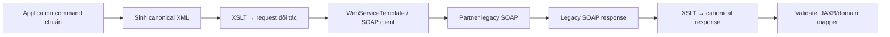
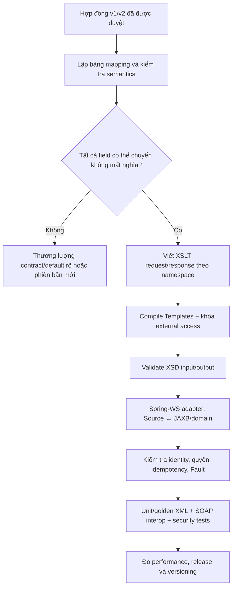

# Áp dụng XSLT cho chuyển đổi dữ liệu giữa các định dạng hợp đồng

## 1. Bài toán: hai hợp đồng SOAP cùng nghiệp vụ nhưng khác cấu trúc XML

Một doanh nghiệp triển khai dịch vụ nhận đơn hàng bằng **Spring Web Services (Spring-WS)** theo hướng **contract-first**. Hệ thống mới công bố XSD/WSDL v2 với operation `SubmitOrder`, trong khi một đối tác lâu năm vẫn gửi thông điệp theo hợp đồng v1 với operation `PlaceOrder`. Hai thông điệp diễn đạt cùng ý định kinh doanh nhưng có **QName, tên phần tử và cách nhóm dữ liệu khác nhau**.

Ví dụ, đối tác cũ gửi `PlaceOrderRequest`:

```xml
<old:PlaceOrderRequest xmlns:old="urn:example:orders:legacy:v1">
  <old:orderReference>EXT-1001</old:orderReference>
  <old:items>
    <old:item>
      <old:productId>SKU-01</old:productId>
      <old:qty>2</old:qty>
    </old:item>
    <old:item>
      <old:productId>SKU-02</old:productId>
      <old:qty>1</old:qty>
    </old:item>
  </old:items>
</old:PlaceOrderRequest>
```

Ứng dụng mới đã thống nhất payload chuẩn `SubmitOrderRequest`:

```xml
<ord:SubmitOrderRequest xmlns:ord="urn:example:orders:canonical:v2">
  <ord:externalOrderRef>EXT-1001</ord:externalOrderRef>
  <ord:lines>
    <ord:line>
      <ord:productCode>SKU-01</ord:productCode>
      <ord:quantity>2</ord:quantity>
    </ord:line>
    <ord:line>
      <ord:productCode>SKU-02</ord:productCode>
      <ord:quantity>1</ord:quantity>
    </ord:line>
  </ord:lines>
</ord:SubmitOrderRequest>
```

Thay vì buộc đối tác sửa client ngay hoặc viết nhiều đoạn duyệt DOM thủ công, ta có thể dùng **XSLT (Extensible Stylesheet Language Transformations)** để chuyển XML hợp đồng cũ sang dạng chuẩn, rồi xử lý bằng cùng application service. Ở chiều trả lời, một XSLT khác chuyển response chuẩn về cấu trúc mà client cũ chờ đợi.

Trong module **SPRING_WEB_SERVICES**, bài thuộc chương **Xử lý XML trực tiếp**. Nội dung kết nối XSLT với thiết kế XSD/WSDL, JAXB, SOAP endpoint/client, SOAP Fault, interceptor, XML security, WS-Security, chứng chỉ và kiểm thử tương thích. Tập trung vào **chuyển đổi cấu trúc tài liệu XML**, không coi XSLT là nơi thay thế domain logic, quyền truy cập hay giao dịch nghiệp vụ.

**Sau bài học, bạn có thể:**

1. Xác định khi nào dùng XSLT thay cho JAXB mapper hoặc Java DOM/SAX/StAX.
2. Viết stylesheet XSLT 1.0 để đổi tên phần tử, tổ chức lại danh sách và đổi namespace hợp đồng.
3. Sử dụng JAXP `TransformerFactory`, `Templates`, `Transformer`, `Source` và `Result` trong Java/Spring-WS.
4. Xây dựng boundary chuyển request/response mà vẫn công bố đúng WSDL và SOAP Fault cho từng phiên bản.
5. Kiểm soát `document()`, external DTD, `xsl:include/import`, XML parser, tài nguyên bộ nhớ và nguy cơ sai lệch dữ liệu.
6. Tạo bộ test đối chiếu XSD trước/sau chuyển đổi và xác minh SOAP interoperability.

## 2. XSLT là gì? Nó chuyển đổi lớp nào trong SOAP?

XSLT là ngôn ngữ khai báo dựa trên XML. Một **stylesheet** mô tả quy tắc chọn node đầu vào bằng **XPath** và tạo cây kết quả mới. XSLT có thể sao chép, đổi tên, sắp xếp, lọc hoặc tổng hợp các phần của tài liệu XML, tùy khả năng của phiên bản XSLT và processor.

Trong Spring-WS, ta thường muốn đổi **phần payload trong SOAP Body**, không phải tự dựng lại toàn bộ Envelope. Spring-WS và message factory chịu trách nhiệm giao thức SOAP; XSD/WSDL quy định hình dạng payload và operation.

```mermaid
flowchart LR
    A["SOAP client v1"] --> B["Spring-WS: Envelope / Header / Body"]
    B --> C["Verify security và validate v1"]
    C --> D["XSLT v1 → XML chuẩn v2"]
    D --> E["Validate v2; map sang application command"]
    E --> F["Application service"]
    F --> G["Sinh XML response chuẩn v2"]
    G --> H["XSLT v2 → response v1"]
    H --> I["Validate response v1"]
    I --> J["Spring-WS: SOAP response / Fault v1"]
```



Điểm quan trọng của kiến trúc:

- **Hợp đồng v1** vẫn có QName request/response và WSDL binding cũ để client cũ gọi.
- **Hợp đồng v2** có QName/schema chuẩn để hệ thống nội bộ làm việc.
- **XSLT** chuyển XML giữa hai biểu diễn đã được thống nhất; nó không tự tạo quyền truy cập, idempotency hay tính nhất quán.
- **SOAP Header** có thể chứa WS-Security, correlation hoặc WS-Addressing. Nếu chỉ xử lý payload, đừng tự ý đổi Header; phải kiểm tra các ràng buộc chữ ký và policy ở lớp SOAP.
- **SOAP Envelope version** (SOAP 1.1 hay 1.2) là vấn đề của message factory/WSDL binding, không giải quyết bằng cách đổi prefix XML trong XSLT.

### 2.1. XSLT so với các cách chuyển đổi khác

| Cách tiếp cận | Phù hợp khi | Hạn chế cần cân nhắc |
|---|---|---|
| **XSLT** | XML đầu vào/đầu ra có cấu trúc xác định, nhiều quy tắc đổi tên/nhóm/phân nhánh, cần version hóa mapping độc lập Java | XPath/namespace dễ sai; stylesheet có khả năng truy cập tài nguyên ngoài nếu không khóa; debug cần golden XML |
| **JAXB + mapper Java** | Cần object domain, business validation, số tiền/thời gian/enum có semantics phức tạp | Sinh nhiều DTO cho mỗi schema; phải viết và bảo trì mapper |
| **DOM** | Cần điều chỉnh một số node, truy cập ngẫu nhiên và logic Java cấp thấp | Code duyệt/sửa cây thường dài, memory lớn |
| **SAX/StAX** | Luồng XML rất lớn, cần đọc tuần tự hoặc biến đổi gần streaming | Khó tổ chức lại dữ liệu có quan hệ nhiều nhánh; phải kiểm tra giới hạn stream và framework |
| **XSLT 2.0/3.0** | Cần grouping, hàm mạnh hơn, xử lý text/date phức tạp | JAXP/JDK không tự bảo đảm hỗ trợ; phải chọn processor (ví dụ Saxon) và kiểm thử |

**Quy tắc lựa chọn:** nếu chỉ muốn chuyển `xs:dateTime` sang `Instant` hoặc ghép amount/currency thành `Money` trong domain, mapper Java thường trực quan hơn. Nếu cần đổi cấu trúc hàng chục phần tử giữa hai hợp đồng XML, XSLT có thể giảm nhiều code thủ công. Không chuyển một quy trình cấp quyền/thanh toán thành chuỗi template XSLT.

## 3. Kiến thức nền: XSLT, XPath, namespace và QName

Một stylesheet XSLT bản 1.0 có hình thức:

```xml
<?xml version="1.0" encoding="UTF-8"?>
<xsl:stylesheet version="1.0"
    xmlns:xsl="http://www.w3.org/1999/XSL/Transform"
    xmlns:old="urn:example:orders:legacy:v1"
    xmlns:ord="urn:example:orders:canonical:v2"
    exclude-result-prefixes="old">

  <xsl:output method="xml" encoding="UTF-8" indent="yes"/>

  <xsl:template match="/">
    <!-- Chọn root đầu vào, rồi tạo cấu trúc đầu ra. -->
  </xsl:template>
</xsl:stylesheet>
```

Những ý nghĩa cần nhớ:

| Thành phần | Tác dụng |
|---|---|
| `xsl:stylesheet` / `xsl:transform` | Phần tử gốc của stylesheet và phiên bản XSLT |
| `xmlns:xsl` | Namespace dành riêng cho instruction XSLT |
| `xmlns:old` | Prefix dùng trong XPath để tham chiếu **namespace URI của input** |
| `xmlns:ord` | Prefix dùng khi sinh **phần tử output thuộc namespace v2** |
| `xsl:template match="/"` | Quy tắc bắt đầu tại document root |
| `xsl:value-of select="..."` | Lấy giá trị chuỗi của node và escape ký tự XML khi xuất text |
| `xsl:for-each` | Lặp qua tập node được XPath chọn |
| `xsl:choose` / `xsl:when` | Chọn nhánh xuất XML có điều kiện |
| `exclude-result-prefixes` | Không tự xuất một số namespace dùng riêng cho XPath nếu không cần |

### 3.1. Tiền tố XML không phải danh tính của element

Hai phần tử sau cùng QName:

```xml
<a:PlaceOrderRequest xmlns:a="urn:example:orders:legacy:v1"/>
<legacy:PlaceOrderRequest xmlns:legacy="urn:example:orders:legacy:v1"/>
```

XPath `old:PlaceOrderRequest` trong stylesheet vẫn khớp vì `old` được khai báo cùng **namespace URI**, dù input dùng prefix `a` hay `legacy`.

**Bẫy phổ biến:** `select="PlaceOrderRequest/items/item"` chọn các phần tử **không thuộc namespace** theo cách hiểu XPath 1.0 thông dụng, nên không khớp XML có namespace v1. Hãy khai báo prefix và chọn `old:PlaceOrderRequest/old:items/old:item`.

### 3.2. Default namespace trong stylesheet

Nếu một phần tử literal output đặt trong namespace v2, nó mang QName v2; việc thêm `xmlns:ord` hay khai báo default namespace là lựa chọn cú pháp, không làm thay đổi URI. Tuy nhiên **unprefixed names trong XPath 1.0 không tự nhận default namespace của stylesheet**. Để tránh nhầm, ví dụ trong bài sử dụng prefix tường minh `old` cho input và `ord` cho output.

### 3.3. Chọn phiên bản XSLT dựa trên processor

Các processor XSLT đi kèm JAXP/JDK thông dụng hỗ trợ **XSLT 1.0**. Những tính năng như `xsl:for-each-group`, `format-dateTime`, sequence và XPath 2.0/3.x cần **processor tương ứng**; không thể chỉ đổi `version="3.0"` rồi mặc định `TransformerFactory.newInstance()` của mọi JVM hiểu được.

Đối với tích hợp doanh nghiệp, nên lưu trong tài liệu deployment: XSLT version, processor được chấp nhận, phiên bản thư viện, security options, kết quả kiểm thử và cách compile stylesheet. Tránh để provider được lựa chọn ngẫu nhiên theo classpath.

## 4. Xác lập bản đồ ánh xạ trước khi viết XSLT

Hãy viết bảng đối chiếu giữa v1 và v2:

| Trường hợp đồng v1 | Trường hợp đồng v2 | Quy tắc |
|---|---|---|
| `old:PlaceOrderRequest` | `ord:SubmitOrderRequest` | Đổi root QName; giữ nguyên ý định đặt hàng |
| `old:orderReference` | `ord:externalOrderRef` | Copy nguyên mã tham chiếu, không ép thành số |
| `old:items/old:item` | `ord:lines/ord:line` | Mỗi item v1 tạo đúng một line v2 |
| `old:productId` | `ord:productCode` | Copy SKU, không tự tra bảng mã |
| `old:qty` | `ord:quantity` | Copy giá trị dương theo XSD |
| `ord:SubmitOrderResponse` | `old:PlaceOrderResponse` | Ánh xạ mã biên nhận và trạng thái theo vocabulary đã thỏa thuận |

**Điều kiện học thuật của ví dụ:** giả định hai hợp đồng có cùng semantics về mã hàng và số lượng; trạng thái phản hồi của v1 và v2 có thể biểu diễn cùng các giá trị ví dụ như `RECEIVED`. Nếu hệ thống thật dùng các trạng thái khác nghĩa nhau, phải mô tả bảng chuyển trạng thái và trường hợp không thể ánh xạ, không copy tùy tiện.

Các quy tắc **không nên tự làm trong stylesheet khi chưa có thỏa thuận**:

- Tự tạo `clientRequestId` mới cho mỗi retry khiến command không idempotent.
- Gán `currency=USD` khi hợp đồng cũ chưa đảm bảo đơn vị tiền.
- Đổi timestamp thiếu offset thành UTC dựa trên timezone của máy chạy.
- Cắt chuỗi số, làm tròn `BigDecimal` hoặc bỏ các dòng hàng không hợp lệ để biến request sai thành request thành công.
- Dựa vào `orderReference` để cấp quyền truy cập: identity phải đến từ authentication/authorization.

Nếu một field mới là bắt buộc mà v1 không chứa đủ dữ liệu để điền, đây là **vấn đề thiết kế hợp đồng**, không phải một kỹ thuật XSLT có thể tự giải quyết. Có thể dùng metadata được xác thực từ ứng dụng, một business default đã công bố hoặc yêu cầu đối tác nâng phiên bản.

## 5. XSLT 1.0 chuyển request từ v1 sang XML chuẩn v2

Giả sử lưu stylesheet `legacy-to-canonical-order.xsl` trong classpath của ứng dụng. Dưới đây là ví dụ đầy đủ cho phép đổi root, nhóm line và giữ namespace đúng:

```xml
<?xml version="1.0" encoding="UTF-8"?>
<xsl:stylesheet version="1.0"
    xmlns:xsl="http://www.w3.org/1999/XSL/Transform"
    xmlns:old="urn:example:orders:legacy:v1"
    xmlns:ord="urn:example:orders:canonical:v2"
    exclude-result-prefixes="old">

  <xsl:output method="xml" encoding="UTF-8"
              omit-xml-declaration="yes" indent="yes"/>

  <xsl:template match="/">
    <xsl:choose>
      <xsl:when test="old:PlaceOrderRequest">
        <ord:SubmitOrderRequest>
          <ord:externalOrderRef>
            <xsl:value-of
                select="old:PlaceOrderRequest/old:orderReference"/>
          </ord:externalOrderRef>
          <ord:lines>
            <xsl:for-each
                select="old:PlaceOrderRequest/old:items/old:item">
              <ord:line>
                <ord:productCode>
                  <xsl:value-of select="old:productId"/>
                </ord:productCode>
                <ord:quantity>
                  <xsl:value-of select="old:qty"/>
                </ord:quantity>
              </ord:line>
            </xsl:for-each>
          </ord:lines>
        </ord:SubmitOrderRequest>
      </xsl:when>
      <xsl:otherwise>
        <xsl:message terminate="yes">
          Unexpected contract root
        </xsl:message>
      </xsl:otherwise>
    </xsl:choose>
  </xsl:template>
</xsl:stylesheet>
```

Giải thích:

1. `test="old:PlaceOrderRequest"` xác nhận document root thuộc QName v1. Nếu root lạ, `xsl:message terminate="yes"` yêu cầu quá trình transform dừng thay vì sinh response rỗng trông như thành công.
2. `xsl:value-of` lấy giá trị chuỗi và xử lý escape XML khi ghi text. Nó **không kiểm tra độ dài/range**; XSD hoặc application phải đảm nhiệm.
3. `xsl:for-each` tạo một `ord:line` cho mỗi `old:item`, giữ thứ tự node đầu vào trừ khi có quy tắc sắp xếp khác.
4. Các phần tử `ord:*` nằm trong namespace v2; XSLT không đổi SOAP Envelope vì đầu vào được thiết kế là **payload fragment**.
5. Nếu `old:items` không có item, stylesheet có thể sinh `<ord:lines/>`; đó có thể là **sai XSD** nếu v2 yêu cầu ít nhất một dòng. Cần validate v1 trước transform và validate v2 sau transform.

### 5.1. Kết quả kỳ vọng

Input ở phần 1 trở thành:

```xml
<ord:SubmitOrderRequest xmlns:ord="urn:example:orders:canonical:v2">
  <ord:externalOrderRef>EXT-1001</ord:externalOrderRef>
  <ord:lines>
    <ord:line>
      <ord:productCode>SKU-01</ord:productCode>
      <ord:quantity>2</ord:quantity>
    </ord:line>
    <ord:line>
      <ord:productCode>SKU-02</ord:productCode>
      <ord:quantity>1</ord:quantity>
    </ord:line>
  </ord:lines>
</ord:SubmitOrderRequest>
```

Do lựa chọn của processor, output có thể kèm whitespace và khai báo namespace khác nhưng vẫn đúng cùng QName. Khi test, ưu tiên so **giá trị và cấu trúc XML** thay vì so chuỗi ký tự tuyệt đối.

### 5.2. Tránh template mặc định nuốt lỗi dữ liệu

XSLT có những *built-in template rules* có thể duyệt và ghi text ngay cả khi không có template do bạn định nghĩa. Trong bài toán hợp đồng, nếu transform nhận sai root mà chỉ tạo vài text node hoặc trả tài liệu rỗng, lỗi sẽ khó phát hiện.

Vì vậy:

- Kiểm tra root QName đã dự kiến.
- Validate schema trước và sau chuyển đổi.
- Test XML với root, namespace và cardinality sai.
- Không coi quá trình `transform(...)` kết thúc không exception là bằng chứng output có hợp đồng hợp lệ.

## 6. Chuyển response v2 về định dạng legacy v1

Một endpoint tương thích cũ phải gửi **response theo hợp đồng cũ**. Nếu bên trong đã dùng `SubmitOrderResponse` v2, cần stylesheet đảo chiều cho response.

Giả sử response chuẩn là:

```xml
<ord:SubmitOrderResponse xmlns:ord="urn:example:orders:canonical:v2">
  <ord:orderId>ORD-9001</ord:orderId>
  <ord:state>RECEIVED</ord:state>
</ord:SubmitOrderResponse>
```

Client v1 chờ:

```xml
<old:PlaceOrderResponse xmlns:old="urn:example:orders:legacy:v1">
  <old:receiptCode>ORD-9001</old:receiptCode>
  <old:processingState>RECEIVED</old:processingState>
</old:PlaceOrderResponse>
```

Stylesheet `canonical-to-legacy-response.xsl`:

```xml
<?xml version="1.0" encoding="UTF-8"?>
<xsl:stylesheet version="1.0"
    xmlns:xsl="http://www.w3.org/1999/XSL/Transform"
    xmlns:ord="urn:example:orders:canonical:v2"
    xmlns:old="urn:example:orders:legacy:v1"
    exclude-result-prefixes="ord">

  <xsl:output method="xml" encoding="UTF-8"
              omit-xml-declaration="yes"/>

  <xsl:template match="/">
    <xsl:choose>
      <xsl:when test="ord:SubmitOrderResponse">
        <old:PlaceOrderResponse>
          <old:receiptCode>
            <xsl:value-of select="ord:SubmitOrderResponse/ord:orderId"/>
          </old:receiptCode>
          <old:processingState>
            <xsl:value-of select="ord:SubmitOrderResponse/ord:state"/>
          </old:processingState>
        </old:PlaceOrderResponse>
      </xsl:when>
      <xsl:otherwise>
        <xsl:message terminate="yes">Unexpected response root</xsl:message>
      </xsl:otherwise>
    </xsl:choose>
  </xsl:template>
</xsl:stylesheet>
```

**Ràng buộc nghiệp vụ:** ví dụ này chỉ hợp lệ nếu `old:processingState` và `ord:state` có vocabulary và nghĩa tương thích. Nếu v1 không biết giá trị mới như `CANCELLATION_PENDING`, copy trực tiếp sẽ làm client cũ lỗi. Hãy định nghĩa bảng mapping có điều kiện và test mọi state, hoặc version hợp đồng nếu không thể bảo toàn ý nghĩa.

**Đừng thực hiện chuyển đổi “vòng tròn” theo suy đoán.** Request v1 → v2 và response v2 → v1 là hai stylesheet độc lập với các tập quy tắc khác nhau. XSLT không tự động có nghịch đảo toán học của một phép biến đổi bất kỳ: field bị bỏ, tổng hợp hoặc chuẩn hóa có thể không phục hồi được.

## 7. JAXP: `TransformerFactory`, `Templates` và `Transformer`

Trong Java, API chuẩn JAXP cho XSLT nằm trong `javax.xml.transform.*`. Những interface này vẫn mang package `javax.xml.transform` trong JDK hiện đại, kể cả khi Spring-WS/JAXB của ứng dụng dùng namespace API `jakarta.*`.

| Kiểu JAXP | Nhiệm vụ | Vòng đời đề xuất |
|---|---|---|
| `TransformerFactory` | Chọn processor, cấu hình chính sách và compile stylesheet | Tạo/cấu hình khi startup |
| `Templates` | Stylesheet đã biên dịch, dùng tạo transformer | Cache và dùng lại giữa các request |
| `Transformer` | Thực hiện một lần chuyển đổi; có tham số và trạng thái theo invocation | **Tạo mới mỗi request**, không dùng chung đa luồng |
| `Source` | Input cho transform: `DOMSource`, `SAXSource`, `StreamSource` | Phụ thuộc nguồn và vòng đời stream |
| `Result` | Đích output: `DOMResult`, `SAXResult`, `StreamResult` | Chọn theo downstream consumer |
| `URIResolver` | Tùy biến cách resolve URI trong stylesheet/`document()` | Chỉ dùng khi có allowlist tài nguyên đã được tin cậy |

Một `Templates` đã biên dịch được thiết kế để dùng lại an toàn giữa nhiều luồng, còn `Transformer` là đối tượng có trạng thái: `setParameter`, output properties và error listener có thể khác theo request. Không lưu một `Transformer` singleton rồi gọi đồng thời từ nhiều endpoint.

### 7.1. Lựa chọn `Source` và `Result`

| Cặp | Khi nào phù hợp | Đánh đổi |
|---|---|---|
| `StreamSource → StreamResult` | Transform từ/ra XML stream hoặc writer | Chỉ dùng một lần với stream đầu vào; processor có thể vẫn buffer nội bộ |
| `DOMSource → DOMResult` | Cần truy cập node kết quả, validate, unmarshal hoặc truyền cho Spring-WS | Tạo cây kết quả trong bộ nhớ |
| `SAXSource → SAXResult` | Có pipeline parser/handler SAX được cấu hình, tránh một số bản sao DOM | XSLT processor không nhất thiết là streaming theo nghĩa xử lý từng record |
| Spring-WS `Source` payload → `DOMResult` | Endpoint muốn biến đổi payload trực tiếp rồi đưa vào JAXB hoặc response | Cần bảo đảm payload Source được tiêu thụ đúng một lần |

`StreamSource` hoặc `SAXSource` không bảo đảm toàn bộ XSLT xử lý streaming: processor có thể cần xây dựng cây do XPath chứa truy vấn toàn cục, sort hoặc tham chiếu nhiều nhánh. Với payload lớn, phải benchmark memory thực tế.

## 8. Viết service chuyển đổi XSLT an toàn và tái sử dụng

Trong ứng dụng thực tế, nên **compile stylesheet từ classpath khi khởi động**, áp dụng chính sách không cho truy cập tài nguyên ngoài, cache `Templates` và tạo `Transformer` mới cho mỗi lần gọi.

Ví dụ dưới đây minh họa một service Spring dành riêng cho hai hướng chuyển đổi:

```java
package com.example.orders.soap.transform;

import java.io.IOException;
import java.io.InputStream;
import javax.xml.XMLConstants;
import javax.xml.transform.Source;
import javax.xml.transform.Templates;
import javax.xml.transform.Transformer;
import javax.xml.transform.TransformerConfigurationException;
import javax.xml.transform.TransformerException;
import javax.xml.transform.TransformerFactory;
import javax.xml.transform.dom.DOMResult;
import javax.xml.transform.dom.DOMSource;
import javax.xml.transform.stream.StreamSource;
import org.springframework.core.io.ClassPathResource;
import org.springframework.stereotype.Component;
import org.w3c.dom.Document;
import org.w3c.dom.Node;

@Component
public final class OrderContractXslt {
    private final Templates requestStylesheet;
    private final Templates responseStylesheet;

    public OrderContractXslt() {
        this.requestStylesheet = compile(
                "xslt/legacy-to-canonical-order.xsl");
        this.responseStylesheet = compile(
                "xslt/canonical-to-legacy-response.xsl");
    }

    private static Templates compile(String classpathLocation) {
        TransformerFactory factory = TransformerFactory.newInstance();
        try {
            factory.setFeature(
                    XMLConstants.FEATURE_SECURE_PROCESSING, true);
            // Từ chối tải DTD, xsl:include/import và các stylesheet ngoài.
            factory.setAttribute(XMLConstants.ACCESS_EXTERNAL_DTD, "");
            factory.setAttribute(XMLConstants.ACCESS_EXTERNAL_STYLESHEET, "");
        } catch (TransformerConfigurationException
                 | IllegalArgumentException ex) {
            // Nếu provider không áp dụng được policy, không chạy không bảo vệ.
            throw new IllegalStateException(
                    "XSLT provider does not support required security", ex);
        }

        var resource = new ClassPathResource(classpathLocation);
        try (InputStream input = resource.getInputStream()) {
            StreamSource stylesheet = new StreamSource(input);
            return factory.newTemplates(stylesheet);
        } catch (IOException | TransformerConfigurationException ex) {
            throw new IllegalStateException(
                    "Cannot compile approved XSLT: " + classpathLocation, ex);
        }
    }

    public DOMSource legacyToCanonical(Source legacyPayload) {
        return transform(requestStylesheet, legacyPayload);
    }

    public DOMSource canonicalToLegacyResponse(Source canonicalPayload) {
        return transform(responseStylesheet, canonicalPayload);
    }

    private static DOMSource transform(Templates stylesheet, Source input) {
        try {
            Transformer transformer = stylesheet.newTransformer();
            DOMResult result = new DOMResult();
            transformer.transform(input, result);

            Node node = result.getNode();
            if (!(node instanceof Document document)
                    || document.getDocumentElement() == null) {
                throw new IllegalStateException(
                        "XSLT did not create a document element");
            }
            return new DOMSource(document.getDocumentElement());
        } catch (TransformerException ex) {
            throw new ContractTransformationException(
                    "Contract XML conversion failed", ex);
        }
    }
}
```

Ứng dụng cần định nghĩa `ContractTransformationException` (ví dụ một runtime exception chuyên biệt) và ánh xạ nó thành lỗi phù hợp qua exception resolver. Đoạn code minh họa sử dụng **DOMResult**, nên thích hợp cho message nhỏ/vừa; với tải lớn cần kiểm tra bộ nhớ hoặc chọn kiến trúc khác.

**Về khả năng chạy:** class có hai stylesheet tồn tại trên classpath, không chứa `xsl:include/import` hoặc `document()`. Nếu thật sự cần include file khác, phải dùng resolver giới hạn tài nguyên đã ký duyệt; không đơn giản bỏ thuộc tính `ACCESS_EXTERNAL_STYLESHEET` cho phép tải URL bất kỳ.

### 8.1. Vì sao khởi tạo một lần và tạo Transformer mỗi request?

- `newTemplates(...)` có thể phân tích và compile stylesheet, không nên làm lại cho mỗi SOAP request.
- `Templates` có thể được chia sẻ giữa các request/threads.
- `newTransformer()` cho một execution mới tránh chia sẻ mutable parameters, context và output state.
- Nếu stylesheet lỗi hoặc provider thiếu security feature, ứng dụng thất bại khi startup thay vì nhận request rồi chạy ở chế độ không bảo vệ.

### 8.2. Đừng dùng một `Transformer` singleton

Ví dụ phản diện:

```java
// KHÔNG NÊN trong singleton Spring component:
private Transformer sharedTransformer;

public Source transform(Source input) {
    sharedTransformer.setParameter("tenant", currentTenant);
    // Một request khác có thể đổi parameter ngay trước khi transform().
    ...
}
```

Các `Transformer` có thể được cấu hình tham số riêng của từng lần gọi, nhưng không được dùng chung mà không có cơ chế đồng bộ và isolation phù hợp. Cách đơn giản: cache `Templates`, khởi tạo `Transformer` cục bộ mỗi invocation.

## 9. Tích hợp XSLT tại endpoint Spring-WS

Spring-WS cho phép endpoint xử lý payload trực tiếp bằng `javax.xml.transform.Source`, thay vì yêu cầu mọi request phải unmarshalling ngay thành generated JAXB class. Đây là một lựa chọn hợp lý khi **cần thay đổi XML trước bước ánh xạ Java**.

### 9.1. Endpoint theo hợp đồng cũ

Ví dụ kiến trúc cho operation `PlaceOrder` legacy:

```java
package com.example.orders.soap.endpoint;

import javax.xml.transform.Source;
import org.springframework.ws.server.endpoint.annotation.Endpoint;
import org.springframework.ws.server.endpoint.annotation.PayloadRoot;
import org.springframework.ws.server.endpoint.annotation.RequestPayload;
import org.springframework.ws.server.endpoint.annotation.ResponsePayload;

@Endpoint
public final class LegacyOrderEndpoint {
    private static final String NS =
            "urn:example:orders:legacy:v1";

    private final OrderContractXslt xslt;
    private final CanonicalOrderRequestReader requestReader;
    private final OrderApplicationService orderService;
    private final CanonicalOrderResponseWriter responseWriter;

    public LegacyOrderEndpoint(
            OrderContractXslt xslt,
            CanonicalOrderRequestReader requestReader,
            OrderApplicationService orderService,
            CanonicalOrderResponseWriter responseWriter) {
        this.xslt = xslt;
        this.requestReader = requestReader;
        this.orderService = orderService;
        this.responseWriter = responseWriter;
    }

    @PayloadRoot(namespace = NS, localPart = "PlaceOrderRequest")
    @ResponsePayload
    public Source placeOrder(@RequestPayload Source legacyPayload) {
        Source canonicalRequest = xslt.legacyToCanonical(legacyPayload);
        SubmitOrderCommand command = requestReader.read(canonicalRequest);
        OrderReceipt receipt = orderService.submit(command);
        Source canonicalResponse = responseWriter.write(receipt);
        return xslt.canonicalToLegacyResponse(canonicalResponse);
    }
}
```

Đoạn này là **khung kiến trúc**; các interface `CanonicalOrderRequestReader`, `OrderApplicationService`, `CanonicalOrderResponseWriter` và kiểu domain `SubmitOrderCommand`/`OrderReceipt` do dự án định nghĩa. Trong implementation:

1. Interceptor/validator kiểm tra payload `PlaceOrderRequest` đúng **XSD legacy v1** và security policy trước khi xử lý.
2. `OrderContractXslt` đổi request thành một `SubmitOrderRequest` v2.
3. `CanonicalOrderRequestReader` validate output theo **XSD canonical v2**, sau đó JAXB unmarshal và map sang domain command.
4. `OrderApplicationService` thực hiện quyền truy cập, idempotency và nghiệp vụ (không ở stylesheet).
5. `CanonicalOrderResponseWriter` tạo XML `SubmitOrderResponse` v2 đúng schema.
6. XSLT đổi response chuẩn về `PlaceOrderResponse` v1; response cuối cần **validate XSD legacy** trước khi gửi client.

**Cảnh báo:** chỉ ghi XML payload vào `@ResponsePayload Source`. Không thêm `<soap:Envelope>` trong XSLT để tránh lồng Envelope trong Body. Spring-WS message factory sẽ tạo Envelope, HTTP Content-Type và SOAP Fault theo SOAP version đã cấu hình.

### 9.2. Khi nào vẫn nên dùng JAXB trực tiếp?

Một endpoint v2 thuần có thể giữ chữ ký:

```java
@PayloadRoot(
    namespace = "urn:example:orders:canonical:v2",
    localPart = "SubmitOrderRequest")
@ResponsePayload
public SubmitOrderResponse submit(
        @RequestPayload SubmitOrderRequest request) {
    // Map JAXB DTO sang domain, gọi application service,
    // trả JAXB response theo cùng XSD v2.
}
```

Đối tác mới không cần chịu chi phí XSLT legacy. Cả hai endpoint (v1 và v2) có thể dùng chung application service, nhưng các rule XML và mapping ở boundary phải tách riêng.

**Không bắt buộc một module triển khai cả hai endpoint.** Có thể xây một compatibility gateway/adapter đứng trước ứng dụng chính, nhưng quyền sở hữu hợp đồng, retry, correlation và security giữa hai tầng phải được mô tả rõ.

### 9.3. XSLT trong SOAP client

Một ứng dụng Java tiêu thụ SOAP từ hệ thống cũ cũng có thể dùng XSLT ở **outbound adapter**:



Khi client gửi `Source` thay vì JAXB object, có thể sử dụng các API gửi `Source`/message callback được Spring-WS hỗ trợ, tùy thiết kế. `WebServiceTemplate` vẫn phải cấu hình endpoint URL, SOAPAction theo binding, SOAP 1.1/1.2, TLS/truststore, WS-Security và xử lý Fault. XSLT chỉ tạo payload tương thích, **không tự gửi HTTP**.

Nếu cả hai bên hỗ trợ sinh JAXB từ WSDL, mapper Java giữa hai DTO có thể dễ bảo trì hơn cho payload nhỏ. Lựa chọn cần dựa vào số lượng quy tắc và độ ổn định của contract, không chỉ vì XSLT “không cần viết Java”.

## 10. XSD validation trước và sau chuyển đổi

Một stylesheet có thể sinh XML **well-formed** nhưng vẫn **không hợp lệ theo XSD**. Ví dụ:

- Input có `old:qty=0` nhưng XSD v1 yêu cầu số nguyên dương.
- XSLT tạo `ord:line` nhưng thiếu `ord:productCode`.
- Kết quả có QName đúng nhưng thứ tự `xs:sequence` bị đảo.
- Response v2 có trạng thái `RETRYING` mà enum v1 không chấp nhận.
- Một field mới của v2 là bắt buộc nhưng không tồn tại trong v1.

Vì vậy, pipeline cần hai kiểm tra rõ ràng:

```text
SOAP v1 body
  → validate với legacy-order-v1.xsd
  → XSLT legacy-to-canonical-order.xsl
  → validate với canonical-order-v2.xsd
  → JAXB / application service

canonical response
  → validate với canonical-order-v2.xsd
  → XSLT canonical-to-legacy-response.xsl
  → validate với legacy-order-v1.xsd
  → SOAP response v1
```

### 10.1. Phân biệt validation XML với validation nghiệp vụ

| Kiểm tra | Ví dụ | Thực hiện ở đâu? |
|---|---|---|
| Cú pháp và namespace | QName của request đúng v1/v2 | Parser và XSD validation |
| Cấu trúc và loại giá trị | Có ít nhất một line; `quantity` dương | XSD và facets |
| Mapping không mất dữ liệu | Một `old:item` thành đúng một `ord:line` | Unit/golden XML tests cho XSLT |
| Quyền của đối tác | Partner A không được xem đơn của B | Application/security context |
| Idempotency | Gửi lại cùng yêu cầu không tạo hai đơn | Business service và persistence |
| Độ chính xác tiền/thời gian | Không đổi đơn vị, rounding hoặc timezone ngầm | Hợp đồng, mapper/domain và test biên |

XSLT không phải công cụ thay thế authorization. Kể cả khi XML đã transform và validate thành công, server vẫn phải xác thực và kiểm tra actor được phép thực thi operation trên dữ liệu.

### 10.2. JAXP `SchemaFactory` và nguồn XSD đáng tin cậy

Với ứng dụng cần validate XML kết quả bằng Java, dùng `javax.xml.validation.SchemaFactory` và khóa truy cập tài nguyên bên ngoài:

```java
import java.io.InputStream;
import javax.xml.XMLConstants;
import javax.xml.transform.Source;
import javax.xml.transform.stream.StreamSource;
import javax.xml.validation.Schema;
import javax.xml.validation.SchemaFactory;
import javax.xml.validation.Validator;
import org.springframework.core.io.ClassPathResource;

public final class CanonicalSchemaValidation {
    private final Schema schema;

    public CanonicalSchemaValidation() throws Exception {
        SchemaFactory factory = SchemaFactory.newInstance(
                XMLConstants.W3C_XML_SCHEMA_NS_URI);
        factory.setFeature(XMLConstants.FEATURE_SECURE_PROCESSING, true);
        factory.setProperty(XMLConstants.ACCESS_EXTERNAL_DTD, "");
        factory.setProperty(XMLConstants.ACCESS_EXTERNAL_SCHEMA, "");

        try (InputStream xsd = new ClassPathResource(
                "contracts/orders/v2/canonical-order.xsd").getInputStream()) {
            schema = factory.newSchema(new StreamSource(xsd));
        }
    }

    public void validate(Source payload) throws Exception {
        Validator validator = schema.newValidator();
        validator.validate(payload);
    }
}
```

`Schema` có thể dùng lại; `Validator` nên tạo mới mỗi lần kiểm tra vì có trạng thái. Đoạn này giả định XSD không cần `xs:include/import` từ tài nguyên ngoài. Nếu có nhiều file schema, cần quản lý resource resolution có kiểm soát, không nới toàn bộ quyền truy cập network.

**Một `Source` có thể tiêu thụ một lần:** nếu `Source` là `StreamSource` hoặc một luồng SAX tiến tới, gọi `validate(payload)` rồi gọi tiếp `unmarshal(payload)` có thể không còn dữ liệu. Với pipeline cần dùng lại, hãy tạo một representation thích hợp, ví dụ `DOMSource` đã được kiểm soát bộ nhớ, hoặc thiết kế pipeline tạo lại Source từ dữ liệu an toàn.

## 11. Bảo mật XSLT: stylesheet cũng là mã thực thi có quyền truy cập tài nguyên

XSLT không chỉ “đổi tên thẻ”. Nhiều processor có thể truy cập tài nguyên bên ngoài thông qua:

- `document('https://...')` hoặc URI được truyền từ input.
- `xsl:include` / `xsl:import` để tải stylesheet khác.
- DTD/external entities trong XML hoặc stylesheet.
- Extension functions của processor, đôi khi có khả năng gọi Java hay truy cập filesystem/network.
- Các cơ chế URI resolver/cataloɡ không được giới hạn.

Nếu cho một client tự gửi stylesheet hoặc để stylesheet tham chiếu URI lấy từ payload không tin cậy, ứng dụng có nguy cơ **SSRF, đọc file nội bộ, lộ dữ liệu và denial of service**.

### 11.1. Các nguyên tắc phòng vệ

1. **Chỉ chạy stylesheet đã được tổ chức duyệt và đóng gói cùng ứng dụng.** Không nhận XSLT tùy ý từ SOAP request hoặc URL của đối tác trừ khi có sandbox chuyên biệt và quy trình đánh giá rủi ro.
2. **Bật secure processing** và hạn chế `ACCESS_EXTERNAL_DTD`, `ACCESS_EXTERNAL_STYLESHEET` của `TransformerFactory`.
3. **Không cho phép remote include/document** khi bài toán chỉ cần mapping nội bộ. Nếu có include hợp lệ, dùng allowlist/catalog giới hạn tài nguyên đã phê duyệt.
4. **Tắt hoặc giới hạn extension functions** bằng cơ chế riêng của processor khi được hỗ trợ; JAXP secure processing không bảo đảm vô hiệu mọi extension trong mọi engine.
5. **Cấu hình XML parser đầu vào an toàn**: chặn DTD/external entities không cần, giới hạn kích thước/độ sâu, timeout, số node và số lượng request.
6. **Bảo vệ secrets và nội dung SOAP**: không truyền private key, token hoặc thông tin chứng chỉ nhạy cảm làm tham số XSLT; log chỉ metadata cần chẩn đoán.
7. **Test chính sách fail closed**: nếu provider không hỗ trợ một thuộc tính bảo mật bắt buộc, dừng khởi động hoặc chọn processor được kiểm chứng; đừng nuốt exception rồi chạy không bảo vệ.

### 11.2. Input `StreamSource` không tự bảo đảm chống XXE

Một `StreamSource` xây từ dữ liệu XML chưa tin cậy có thể khiến transformer tự chọn parser bên dưới. Bản thân việc gọi `new StreamSource(inputStream)` không đủ để chứng minh parser đã cấm DTD/external entity.

Ví dụ ý tưởng khi cần tự parse XML từ nguồn không tin cậy trước XSLT: dùng `SAXSource` với `XMLReader` được cấu hình chống external entity:

```java
import java.io.InputStream;
import org.xml.sax.InputSource;
import org.xml.sax.XMLReader;
import javax.xml.parsers.SAXParserFactory;
import javax.xml.transform.sax.SAXSource;

public final class SafeXmlSource {
    private SafeXmlSource() {}

    public static SAXSource fromUntrustedStream(InputStream input)
            throws Exception {
        SAXParserFactory factory = SAXParserFactory.newInstance();
        factory.setNamespaceAware(true);
        factory.setXIncludeAware(false);
        factory.setFeature(
            "http://apache.org/xml/features/disallow-doctype-decl", true);
        factory.setFeature(
            "http://xml.org/sax/features/external-general-entities", false);
        factory.setFeature(
            "http://xml.org/sax/features/external-parameter-entities", false);

        XMLReader reader = factory.newSAXParser().getXMLReader();
        return new SAXSource(reader, new InputSource(input));
    }
}
```

**Tính khả chuyển:** một số feature URI có thể không được parser/provider hỗ trợ. Trong hệ thống có chính sách bắt buộc, phải **fail closed** và kiểm thử bằng payload chứa DTD/external entity; không catch lỗi feature rồi bỏ qua. Cần kiểm soát việc đóng `InputStream` ở tầng gọi và giới hạn kích thước message trước khi parse.

Đối với `@RequestPayload Source` của Spring-WS, XML có thể đã được message factory parse trước khi tới endpoint. Vì thế cấu hình an toàn phải bắt đầu từ **HTTP ingress/SOAP message factory/parser**; không thể “chữa XXE quá muộn” chỉ bằng mã XSLT trong method endpoint.

### 11.3. XSLT và WS-Security/XML Signature

WS-Security signature thường bảo vệ SOAP Body và/hoặc Header dưới dạng XML canonicalized. **Chuyển đổi Body bằng XSLT có thể thay đổi những node được ký**, khiến signature verification không còn hợp lệ nếu thực hiện sai thứ tự.

Thứ tự tư duy cho inbound:

```text
Nhận SOAP
  → xác minh TLS/mTLS, WS-Security signature/timestamp theo policy
  → xác minh request được phép xử lý
  → chuyển payload bằng XSLT
  → validate XSD chuẩn
  → xử lý nghiệp vụ
```

Với outbound, hoàn tất mapping và marshal payload **trước** bước ký thông điệp theo WS-Security policy. Không sửa nội dung đã ký hoặc tin dữ liệu ngoài vùng chữ ký. `xsl:value-of` escape XML đúng cú pháp **không thay thế** chữ ký, xác thực hay chống replay.

Khi xử lý SOAP Headers như WS-Addressing `Action`, correlation hoặc tenant, hãy dùng API Spring-WS/interceptor thích hợp và ánh xạ chúng độc lập với XSLT payload. Nếu cần chuyển toàn bộ Envelope vì gateway đặc thù, phải có thiết kế security/message-level riêng và kiểm thử từng policy.

## 12. Lỗi XSLT, SOAP Fault và chính sách xử lý

Có ba loại lỗi dễ bị trộn:

| Tình huống | Lớp phát hiện | Cách phản hồi gợi ý |
|---|---|---|
| XML input sai schema v1 | XSD validation trước transform | SOAP Fault yêu cầu không hợp lệ theo contract v1 |
| Root QName không phải `PlaceOrderRequest` | Endpoint mapping hoặc template root check | Từ chối; không sinh request/response giả |
| XSLT transform thất bại vì dữ liệu không hợp lệ | Converter/validation | Fault ổn định cho invalid input, nếu đó là lỗi phía caller |
| Stylesheet bị lỗi, thiếu file hoặc fail compile | Khởi tạo ứng dụng | Fail startup/deployment, không nhận traffic |
| XSLT sinh output sai schema v2 | Validation sau transform | Lỗi tích hợp nội bộ; log có redaction, trả server fault nếu không do caller |
| Response v2 không có mapping sang state legacy | Business compatibility policy | Không trả state sai; áp dụng rule được công bố hoặc Fault thích hợp |
| Không có quyền hoặc WS-Security thất bại | Security/authorization | Từ chối trước business side effect |
| Lỗi DB/queue sau chuyển đổi hợp lệ | Application/infrastructure | SOAP Fault phù hợp, tránh lộ chi tiết hạ tầng |

**Đừng biến mọi `TransformerException` thành “XML do client sai”.** Có thể do stylesheet cấu hình sai, dữ liệu đầu vào không hợp lệ hoặc lỗi tài nguyên; phân loại nguyên nhân theo điều kiện đã validate và vị trí xảy ra lỗi.

Spring-WS có `SoapFaultMappingExceptionResolver` và các exception resolver tùy biến để ánh xạ exception thành SOAP Fault. Nếu đối tác cần typed fault detail, phải công bố XSD/WSDL của fault theo binding và kiểm thử bằng generated client.

### 12.1. Không cho stylesheet tự xuất SOAP Fault bằng chuỗi XML

Không nên dùng XSLT để tạo:

```xml
<soap:Envelope>...<soap:Fault>...</soap:Fault></soap:Envelope>
```

rồi ghi kết quả này vào `@ResponsePayload Source`. Spring-WS đã quản lý Envelope; kết quả sẽ có nguy cơ xuất hiện **Envelope lồng trong SOAP Body**. Thay vào đó, để exception resolver của Spring-WS tạo Fault theo SOAP 1.1/1.2 và policy đã thống nhất.

## 13. Tính toàn vẹn dữ liệu, thời gian, số tiền và phiên bản

XSLT phù hợp với thao tác **đổi cấu trúc XML có semantics bảo toàn**; các loại dữ liệu sau cần kiểm soát chặt:

### 13.1. Số và đơn vị tiền

- `xs:decimal` trong XML là biểu diễn thập phân chính xác. XSLT 1.0 dùng mô hình number dựa trên dấu phẩy động cho nhiều phép tính số; không nên dùng các phép nhân/chia `number()` tùy ý để tính tiền nhạy cảm với precision.
- Nếu chỉ đổi tên phần tử `<old:amount>149.50</old:amount>` thành `<new:amount>149.50</new:amount>`, dùng `xsl:value-of` có thể giữ chuỗi lexical phù hợp; sau đó validate XSD.
- Nếu cần chuyển đổi currency, thuế suất hoặc rounding, hãy xử lý bằng `BigDecimal`/domain service với rule nghiệp vụ đã phê duyệt hoặc engine XSLT có khả năng decimal được kiểm chứng, không giả định mọi XSLT 1.0 cho kết quả tài chính chính xác.
- `149.5` và `149.50` có thể bằng nhau về giá trị nhưng khác biểu diễn; contract phải nêu rõ yêu cầu giữ format hay chỉ giữ giá trị số.

### 13.2. Ngày giờ và timezone

- `xs:date` là ngày lịch, không tự suy ra một UTC instant.
- `xs:dateTime` có thể thiếu offset trong XSD 1.0; chỉ chuyển sang `Instant` khi hợp đồng quy định offset/`Z` hoặc có policy timezone đáng tin cậy.
- Tránh biến `2026-11-27T09:30:00+07:00` thành `2026-11-27T09:30:00Z` bằng cách thay chuỗi; hai giá trị này lệch nhau 7 giờ.
- XSLT 1.0 không cung cấp bộ hàm xử lý timezone/date arithmetic hiện đại của XSLT 2.0/3.0; nên chuyển các phép tính thời gian nghiệp vụ sang domain mapper.

### 13.3. Thay đổi hợp đồng có thể làm stylesheet lỗi

Nếu v2 thêm field `currency` bắt buộc hoặc enum trạng thái mới, một stylesheet v1→v2 hoặc v2→v1 cũ có thể không còn đầy đủ. Phải xem XSLT là **một artifact gắn phiên bản hợp đồng**, không chỉ là “utility chung”.

Ví dụ:

```text
xslt/
  orders/
    legacy-v1-to-canonical-v2.xsl
    canonical-v2-to-legacy-v1-response.xsl
  payments/
    partner-a-v1-to-internal-v3.xsl
```

Đặt schema/golden XML/version của stylesheet trong source control; mọi thay đổi XSD phải kích hoạt test của các mapping liên quan. Đừng sửa stylesheet production mà không đánh giá consumer cũ.

## 14. Hiệu năng và vận hành: XSLT không tự động là streaming

Tại tải lớn, bộ nhớ và CPU của transform có thể đáng kể:

| Chi phí | Nguyên nhân | Hướng tối ưu |
|---|---|---|
| Compile stylesheet mỗi request | Parse/compile XSLT lặp lại | Cache `Templates` từ startup |
| Concurrent Transformer dùng chung | State/parameters bị chia sẻ | Tạo `Transformer` mới mỗi invocation |
| SOAP/SAAJ tree và `DOMResult` | Nhiều node và object trên heap | Giới hạn payload, đo allocation, tránh giữ bản sao lâu |
| XPath chọn nhiều node | Duyệt cây nhiều lần, XPath toàn cục | Dùng biểu thức rõ ràng, profile với dữ liệu thật |
| XSLT sort/grouping | Processor cần buffer dữ liệu | Đánh giá engine, hoặc đổi API thành phân trang/batch |
| Chuỗi XSLT nối tiếp nhau | Nhiều cây trung gian/serialize | Rà soát có thể gộp bước, nhưng vẫn giữ kiểm thử và boundaries |
| Validation trước/sau | Thêm lượt parse/duyệt | Cần cho tính đúng đắn; đo để sizing, không bỏ bừa |
| WS-Security canonicalization/signature | Hash/transform bổ sung | Đo end-to-end trên payload đại diện |

**Phân biệt throughput và độ trễ:** 1 MB XML đầu vào không đồng nghĩa chỉ chiếm 1 MB heap sau khi đi qua SAAJ, XSLT, DOMResult, JAXB và application DTO. Không nên đặt concurrency theo kích thước file XML thô; cần benchmark heap/GC và kiểm soát giới hạn HTTP.

### 14.1. Đừng tự tạo bộ nhớ đệm XSLT không giới hạn

Nếu hệ thống hỗ trợ hàng nghìn partner, không cache tùy ý mọi stylesheet dựa trên ID do request gửi. Có thể xảy ra memory leak hoặc cho người dùng chọn stylesheet ngoài policy.

Nên có một danh mục mapping đã được cấu hình và duyệt:

| Key mapping | Stylesheet trên classpath | Hợp đồng |
|---|---|---|
| `orders:legacy-v1:request` | `legacy-to-canonical-order.xsl` | v1 request → v2 canonical |
| `orders:legacy-v1:response` | `canonical-to-legacy-response.xsl` | v2 canonical response → v1 |

Client không được tự đặt đường dẫn `../../secrets.xml` hoặc URI ngoài để chọn stylesheet. Mọi tùy biến theo partner phải do cấu hình server và xác thực điều khiển.

## 15. Kiểm thử XSLT và hợp đồng XML

### 15.1. Ba mức kiểm thử bắt buộc

1. **XSLT unit test:** đưa một XML input cụ thể vào `Templates.newTransformer()`, kiểm tra output root QName, trường dữ liệu và cardinality.
2. **Schema/mapper integration test:** validate input với XSD v1, output với XSD v2, unmarshal bằng JAXB thật và kiểm tra domain semantics.
3. **Spring-WS/interop test:** gửi SOAP Envelope qua dispatcher, kiểm tra authentication, operation mapping, SOAP response/Fault, WSDL và client công nghệ khác.

### 15.2. Ví dụ JUnit kiểm tra chuyển request

Giả sử `OrderContractXslt` là bean/service từ phần 8 và unit test cung cấp XML payload trực tiếp:

```java
import static org.junit.jupiter.api.Assertions.assertEquals;
import java.io.StringReader;
import javax.xml.transform.dom.DOMSource;
import javax.xml.transform.stream.StreamSource;
import org.junit.jupiter.api.Test;
import org.w3c.dom.Element;

class OrderContractXsltTest {

    @Test
    void convertsLegacyOrderIntoCanonicalRequest() {
        String oldXml = """
            <old:PlaceOrderRequest
                xmlns:old="urn:example:orders:legacy:v1">
              <old:orderReference>EXT-1001</old:orderReference>
              <old:items>
                <old:item>
                  <old:productId>SKU-01</old:productId>
                  <old:qty>2</old:qty>
                </old:item>
              </old:items>
            </old:PlaceOrderRequest>
            """;

        OrderContractXslt xslt = new OrderContractXslt();
        DOMSource converted = xslt.legacyToCanonical(
                new StreamSource(new StringReader(oldXml)));
        Element root = (Element) converted.getNode();

        assertEquals("SubmitOrderRequest", root.getLocalName());
        assertEquals("urn:example:orders:canonical:v2",
                root.getNamespaceURI());
        assertEquals(1, root.getElementsByTagNameNS(
                "urn:example:orders:canonical:v2", "line").getLength());
        assertEquals("EXT-1001",
                root.getElementsByTagNameNS(
                    "urn:example:orders:canonical:v2",
                    "externalOrderRef").item(0).getTextContent().trim());
    }
}
```

Ví dụ dùng Java text block (Java 15+) và test JAXB/XML độc lập. **Test chạy transform thành công không đồng nghĩa XML chắc chắn đúng XSD**; phải có thêm kiểm tra schema và số lượng/dữ liệu dòng hàng thực tế.

### 15.3. Ma trận golden XML và negative tests

| Trường hợp | Đầu vào | Điều cần xác minh |
|---|---|---|
| Happy path một dòng | `PlaceOrderRequest` có một `item` | Đúng QName v2, mã tham chiếu và quantity |
| Happy path nhiều dòng | Hai hoặc nhiều item | Không mất dòng, không đổi thứ tự ngoài chủ đích |
| Prefix khác nhau | `old:` và `a:` cùng namespace URI | XSLT vẫn tạo output tương đương |
| Namespace sai | Local name đúng nhưng URI khác | Không nhận nhầm hợp đồng |
| Root bất ngờ | `CancelOrderRequest` đưa vào stylesheet đặt hàng | Dừng transform, không sinh XML rỗng |
| Thiếu `orderReference` | XSD v1 không hợp lệ | Bị từ chối trước khi vào nghiệp vụ |
| Quantity `0`/âm | Vi phạm facets XSD | Không được tự sửa thành `1` |
| SKU chứa `&amp;`/ký tự đặc biệt | `SKU&amp;NEW` | Output vẫn well-formed; không tạo XML injection |
| Response state lạ | `CANCELLATION_PENDING` chưa có ở v1 | Mapping theo policy hoặc lỗi; không âm thầm copy sai |
| XSLT chứa `document()` | URI ngoài | External access bị vô hiệu theo policy |
| XML chứa DTD/external entity | Payload không tin cậy | Parser/transport từ chối an toàn |
| SOAP Header có chữ ký hợp lệ | Signed Body | Verify trước transform; response mới được ký theo policy |
| SOAP client v1 thật | WSDL v1 và payload legacy | Client xử lý response/Fault mà không cần biết XML canonical |

### 15.4. Test XML nên so cấu trúc thay vì prefix

Không nên đặt test phụ thuộc chính xác:

```text
<ord:SubmitOrderRequest ...>
```

vì processor khác có thể ghi:

```text
<ns1:SubmitOrderRequest xmlns:ns1="urn:example:orders:canonical:v2">
```

Hai XML có cùng QName. Dùng XML-aware assertion (namespace URI + local name + giá trị, schema validity). Với tài liệu cần XML Signature, validation chữ ký phải được thực hiện bằng thư viện bảo mật đúng thuật toán; không dùng so sánh text thay thế canonicalization.

## 16. Những lỗi thực tế và cách xử lý

| Hiện tượng | Nguyên nhân có thể | Cách kiểm tra/sửa |
|---|---|---|
| XSLT trả output trống | XPath không khai báo namespace, template không khớp root | So namespace URI, thêm điều kiện root và negative test |
| Output đúng text nhưng sai QName | Literal result element không gắn namespace v2 | Dùng `ord:` với URI chuẩn và validate XSD |
| Server báo lỗi `@PayloadRoot` sau transform | XSLT chạy trước/sau endpoint mapping khác dự kiến | Mapping phải xử lý QName inbound v1, transform ở boundary phù hợp |
| JAXB không unmarshal output | Tạo sai root element, thứ tự hoặc dữ liệu | Validate XSD v2 và so generated JAXB package |
| State trả về không được client cũ hiểu | Copy enum mới mà không có mapping | Review semantics, version và test golden response v1 |
| XSLT 2.0 lỗi với JDK mặc định | Processor chỉ hỗ trợ XSLT 1.0 | Dùng XSLT 1.0 hoặc chọn engine 2.0/3.0 đã xác minh |
| `TransformerException` sau khi deploy | Stylesheet import remote file, provider thay đổi | Đóng gói static XSLT, pin engine, fail startup với policy rõ |
| Bị XXE/SSRF | `document()`, external DTD hoặc untrusted stylesheet | Chặn external access, harden parser, không chấp nhận XSLT tùy ý |
| Mất XML Signature sau biến đổi | Body đã được ký nhưng bị sửa | Verify trước transform; sign sau khi tạo outbound payload |
| Máy chạy hết bộ nhớ | Nhiều DOM tree, JAXB, XSLT trên payload lớn | Giới hạn size/concurrency, benchmark, cân nhắc paging |
| XSLT compile ở mỗi request | Không cache `Templates` | Compile khi startup, Transformer mới theo request |
| XPath xử lý sai `&amp;` | Dùng nối chuỗi XML/escape thủ công | Dùng `xsl:value-of`/JAXP Result, không tự ghép markup |
| XSD v2 thay đổi nhưng mapper XSLT chưa cập nhật | Không kiểm thử thay đổi hợp đồng | CI chạy contract tests cho mọi mapping liên quan |
| SOAP Fault bị lồng Envelope trong Body | XSLT tự sinh toàn bộ SOAP Envelope | Để Spring-WS exception resolver quản lý Fault |
| XSLT chạy đúng nhưng nghiệp vụ sai | Coi transform thành công là business validation | Gọi domain service với quyền, idempotency và invariant đầy đủ |

## 17. Quy trình triển khai trong một dự án Spring-WS



Một kế hoạch thực hành:

1. **Chốt contract của hai phía**: giữ bản XSD/WSDL v1 và v2 được version hóa, xác định operation cùng các loại SOAP Fault.
2. **Viết bảng ánh xạ**: root QName, field path, cardinality, enum, precision, timezone, null/nil, giá trị không thể map.
3. **Chọn công cụ thích hợp**: XSLT 1.0 cho đổi cấu trúc đơn giản; processor mạnh hơn hoặc mapper Java cho nghiệp vụ số/ngày giờ phức tạp.
4. **Viết stylesheet test được độc lập**: dùng XPath có namespace, xử lý root bất ngờ rõ ràng, không tải dữ liệu ngoài.
5. **Tạo service chuyển đổi**: compile `Templates` tại startup, `Transformer` riêng mỗi request, giới hạn nguồn XSLT.
6. **Đặt transform tại boundary SOAP**: `@RequestPayload Source` cho legacy, chuyển sang JAXB/domain rồi trả legacy payload qua `@ResponsePayload Source`.
7. **Validation và security**: validate input/output theo schema tương ứng, verify WS-Security trước khi thay Body, giữ HTTPS/cert và authorization của application service.
8. **Kiểm thử negative cases**: root lạ, sai namespace, DTD, external URI, state chưa được hỗ trợ, payload quá lớn và SOAP Fault.
9. **Kiểm thử liên thông**: client v1 và v2 đọc đúng WSDL, URL, SOAP binding, response và typed fault khi có.
10. **Quan sát và version hóa**: theo dõi mapping failure, schema invalid, latency và heap; không thay đổi XSLT ngoài review cùng hợp đồng.

### Checklist trước khi đưa vào production

- [ ] XSD/WSDL của input và output được quản lý phiên bản riêng, được client đồng thuận.
- [ ] Có tài liệu mapping từng field và quy tắc cho dữ liệu không thể chuyển.
- [ ] XSLT chỉ xử lý payload cần thiết, không vô ý thay SOAP Envelope hoặc Header.
- [ ] XPath dùng namespace URI đúng, không phụ thuộc tiền tố XML của producer.
- [ ] `TransformerFactory` bị hạn chế external DTD/stylesheet và extension theo processor.
- [ ] XML parser inbound chặn DTD/external entity/XXE theo policy, có giới hạn size và timeout.
- [ ] `Templates` được compile/cached đúng; `Transformer` tạo mới mỗi lần.
- [ ] Cả XML trước và sau transform được validate theo XSD tương ứng.
- [ ] Domain vẫn kiểm tra authorization, idempotency, precision và timezone.
- [ ] Có SOAP Fault mapping an toàn và WS-Security signature verification đúng thứ tự.
- [ ] Có golden XML test, test đối tác, benchmark và kế hoạch nâng version.

## 18. Bài tập thực hành

### Bài tập A — Chuyển request v1 sang v2

Dùng XML đầu vào ở phần 1 và stylesheet phần 5. Hãy:

1. Chạy chuyển đổi với JAXP `TransformerFactory` và kiểm tra root QName v2.
2. Thêm ba mặt hàng; xác nhận không mất dòng và không đổi quantity.
3. Đổi prefix input từ `old` thành `abc` nhưng giữ namespace URI; chứng minh kết quả không đổi về nghĩa.
4. Sửa namespace URI input sang giá trị khác; kiểm tra transform bị từ chối.
5. Viết một bộ XSD validation đảm bảo cả input v1 và output v2 đều hợp lệ.

### Bài tập B — Xử lý trạng thái response

Giả sử v1 chỉ chấp nhận `RECEIVED`, `CONFIRMED` và `REJECTED`, trong khi v2 có thêm `CANCELLATION_PENDING`. Viết một bảng mapping đầy đủ, quyết định khi nào chuyển thành trạng thái legacy và khi nào phải trả lỗi rõ ràng. Tại sao việc chọn ngẫu nhiên `CONFIRMED` có thể gây hậu quả nghiệp vụ nghiêm trọng?

### Bài tập C — Thiết kế endpoint compatibility

Tạo `LegacyOrderEndpoint` nhận `@RequestPayload Source` theo QName v1. Tách application service nhận command độc lập JAXB. Dùng stylesheet v1→v2 cho request và v2→v1 cho response. Test:

- Request v1 hợp lệ → response v1 hợp lệ.
- Request sai schema/namespace → Fault theo hợp đồng.
- Đối tác chưa xác thực → không chạy application service.
- Gửi lại command sau timeout → sử dụng cơ chế idempotency được ứng dụng định nghĩa.

### Bài tập D — Harden XSLT

Tạo một stylesheet thử nghiệm chứa `document('file:///...')` hoặc URL ngoài trong môi trường kiểm thử cách ly, **không dùng dữ liệu bí mật thật**. Xác nhận policy external access từ chối truy xuất. Thử cấu hình parser SAX để từ chối DTD/external entity và chứng minh khi provider không hỗ trợ feature thì ứng dụng fail closed, không âm thầm chạy không bảo vệ.

### Bài tập E — Benchmark và quyết định kiến trúc

Tạo payload gồm 100, 1.000 và 10.000 dòng hàng. So sánh thời gian/heap khi:

- XSLT dùng `DOMResult` + JAXB.
- Mapper Java trực tiếp từ generated DTO v1 sang command v2.
- Một phương án xử lý streaming khi phù hợp.

Giải thích chi phí compile stylesheet, validation, SAAJ tree, XML Signature và concurrency. Đề xuất cách tổ chức batch/pagination nếu thông điệp quá lớn; không kết luận XSLT streaming chỉ vì input là `StreamSource`.

---

**Ghi nhớ:** XSLT rất hữu ích để **chuyển đổi cấu trúc XML giữa hai định dạng hợp đồng** trong một hệ thống SOAP contract-first, nhất là khi cần duy trì tương thích với đối tác legacy. Nhưng một stylesheet chỉ giải quyết phép ánh xạ dữ liệu: **XSD/WSDL** vẫn định nghĩa hợp đồng, **JAXB/mapper** đưa XML vào Java, **endpoint/application service** bảo đảm nghiệp vụ, và **SOAP Fault, interceptor, XML/WS-Security, chứng chỉ, transport** bảo vệ quá trình tích hợp. Hãy version hóa mapping, kiểm tra QName và schema ở cả hai chiều, khóa truy cập tài nguyên ngoài và đo hiệu năng trên thông điệp thực tế trước khi sử dụng trong production.
