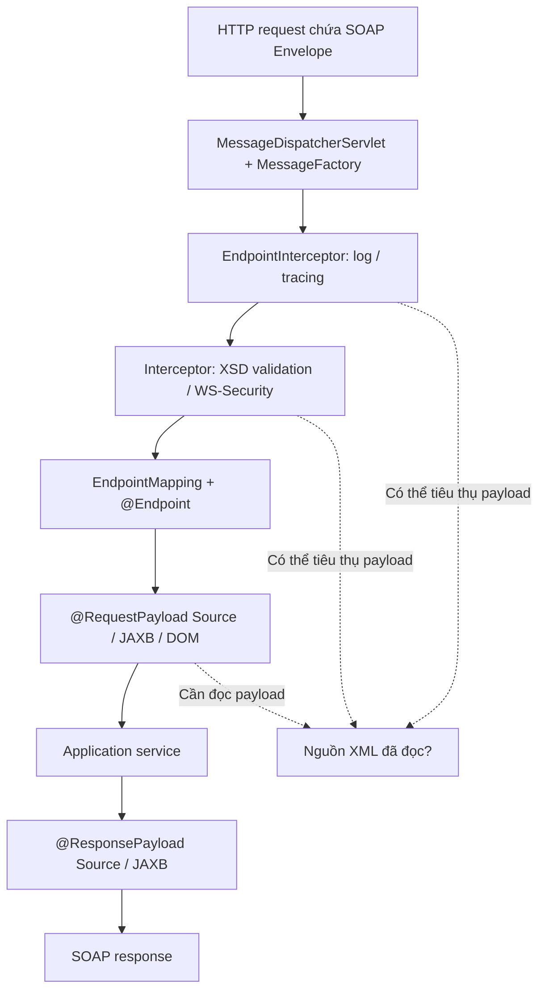
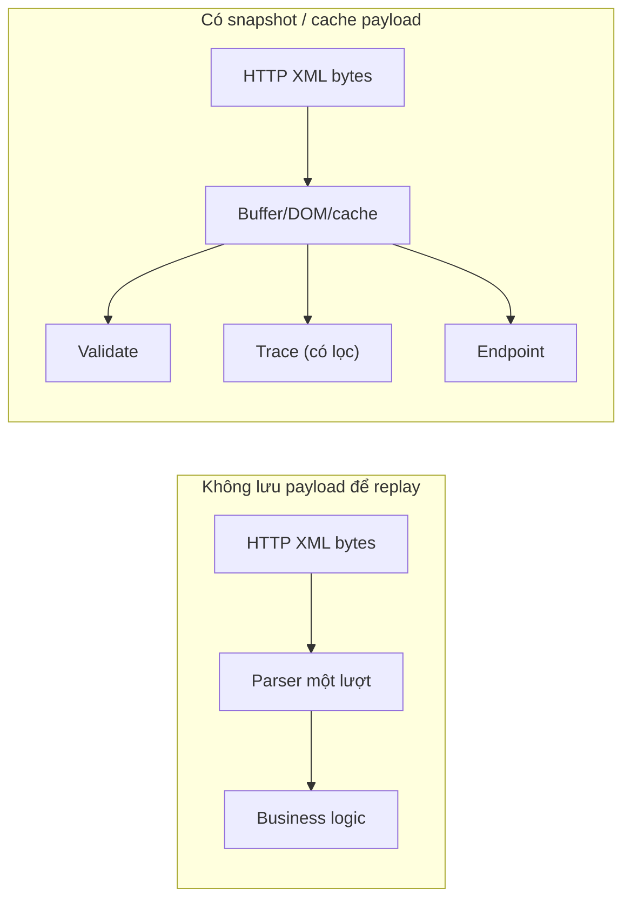
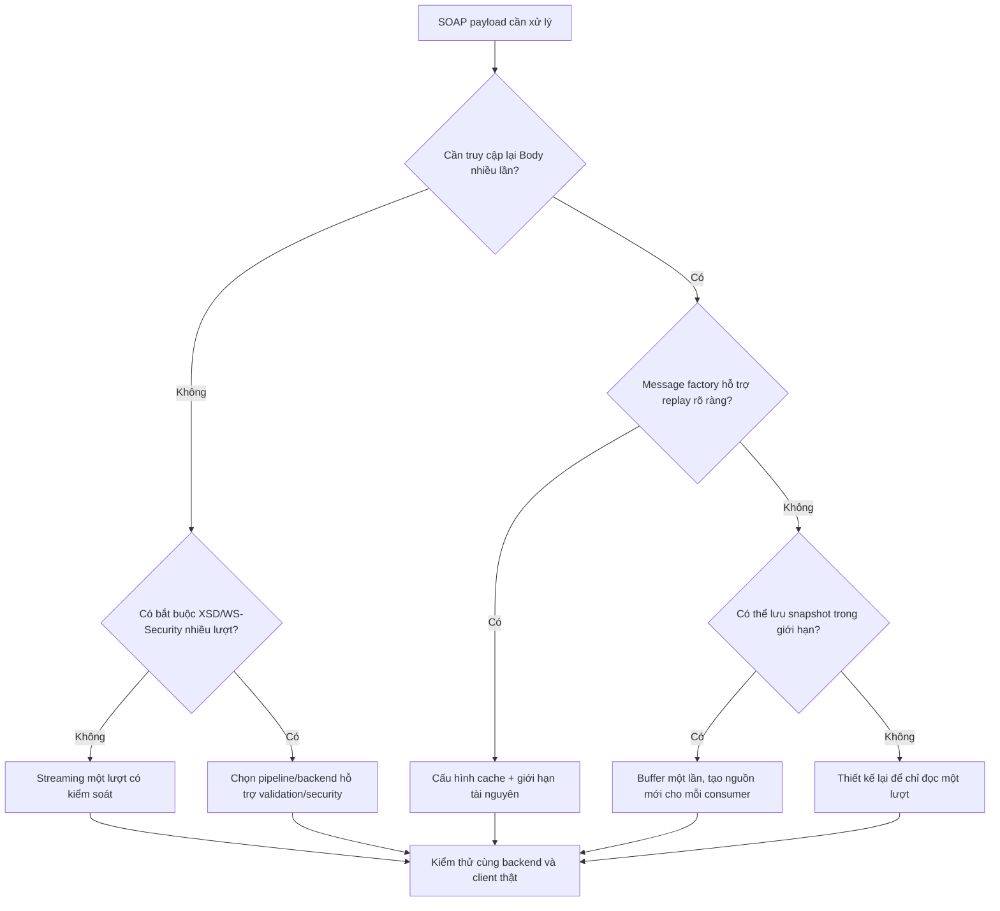

# Đọc theo luồng, đọc nhiều lần và ảnh hưởng của payload caching

Khi phát triển dịch vụ SOAP **contract-first** bằng Spring Web Services (Spring-WS), không phải mọi payload đều cần chuyển ngay thành đối tượng JAXB. Có những trường hợp endpoint trực tiếp xử lý `Source`, StAX, SAX hoặc DOM: chuyển tiếp một thông điệp XML, đọc vài trường trong tài liệu lớn, kiểm tra chữ ký, ghi dấu vết hay thực hiện biến đổi XML. Tuy nhiên, đọc XML **theo luồng** kéo theo một ràng buộc quan trọng: **nguồn dữ liệu đã được tiêu thụ có thể không đọc lại được**. Một interceptor đọc SOAP Body để log, rồi endpoint cố đọc lại cùng payload, có thể gặp stream rỗng hoặc lỗi parser dù XML ban đầu hoàn toàn hợp lệ.

Bài thuộc chương **Xử lý XML trực tiếp**, tập trung vào **đọc theo luồng, đọc nhiều lần và ảnh hưởng của payload caching**: xác định loại nguồn XML nào có thể đọc lại, giải thích thời điểm Spring-WS có thể giữ payload trong bộ nhớ, thiết kế interceptor và endpoint không tiêu thụ nhầm dữ liệu, cân nhắc hiệu năng/bảo mật, và kiểm thử hành vi thực tế. Kiến thức này liên quan chặt chẽ đến XSD/WSDL, JAXB/OXM, SOAP client, SOAP Fault, WS-Security và yêu cầu tích hợp doanh nghiệp ổn định.

## 1. Vấn đề cốt lõi: một SOAP Body nhưng có nhiều người muốn đọc

Một request SOAP qua HTTP có thể đi qua các bước:



Sơ đồ mô tả các nhu cầu truy cập XML, **không khẳng định mọi interceptor luôn chạy theo thứ tự này**. Thứ tự kiểm tra bảo mật, validation, endpoint selection và xử lý response tùy loại interceptor và cấu hình Spring-WS. Vấn đề cần giải quyết không phải "có bao nhiêu lớp dùng XML" mà là **chúng có đang chia sẻ một nguồn dữ liệu chỉ đọc được một lần hay không**.

Ví dụ, một interceptor lấy `getPayloadSource()`, áp dụng `Transformer` để ghi XML ra log. Tiếp đó endpoint nhận `@RequestPayload Source` và cố parse. Nếu underlying `Source` lấy từ `InputStream`/StAX reader ở trạng thái *forward-only* và không có cơ chế cache/replay, lần đọc đầu đã đẩy cursor đến cuối luồng. Lần thứ hai có thể trả rỗng, báo "unexpected end of document", hoặc có hành vi khác tùy implementation.

**Không có quy tắc chung rằng "gọi `getPayloadSource()` hai lần luôn thất bại" hoặc "luôn an toàn".** Kết quả phụ thuộc message factory, cách nó lưu SOAP Body, kiểu `Source` được trả về, trạng thái của reader, và việc có bật payload caching hay không.

## 2. Phân biệt ba khái niệm dễ bị gộp làm một

| Khái niệm | Ý nghĩa | Điều không được suy ra |
| --- | --- | --- |
| **Streaming** | Dữ liệu XML được xử lý tuần tự, không nhất thiết dựng toàn bộ cây XML | Không tự bảo đảm có thể đọc lần hai |
| **Buffering / materialization** | Chuyển dữ liệu thành byte array, `String`, DOM hoặc một cấu trúc ở bộ nhớ | Không tự bảo đảm kết quả luôn hợp lệ theo XSD |
| **Payload caching** | Cơ chế do message factory/ứng dụng giữ lại payload đủ để truy cập lại theo cách được hỗ trợ | Không đồng nghĩa cache toàn bộ Envelope/attachment; không phải tính năng mặc định thống nhất của mọi SOAP implementation |

Một luồng đọc một lần thường tiết kiệm bộ nhớ khi dữ liệu rất lớn. Cache/buffer có thể làm việc đọc lặp dễ dàng nhưng tăng chi phí bộ nhớ, CPU và đôi khi thời gian phản hồi.

Có hai dạng "đọc lại" cần phân biệt:

1. **Đọc lại cùng đối tượng `Source`/reader.** Nếu reader đã đến cuối, phần lớn nguồn kiểu forward-only sẽ không tự đặt cursor về đầu.
2. **Yêu cầu message factory cung cấp một nguồn đọc mới từ payload đã được lưu.** Điều này *có thể* được hỗ trợ khi payload được cache hoặc biểu diễn bằng cây XML; nó không phải tính năng chung của mọi `Source`.

Ngay cả khi message cho phép lấy lại `Source`, việc giữ một tham chiếu tới `XMLStreamReader` cũ rồi gọi `next()` lần nữa **không làm nó quay về đầu**.

## 3. Các dạng `Source`, parser và khả năng đọc lặp

Trong Spring-WS, `WebServiceMessage#getPayloadSource()` trả về một `javax.xml.transform.Source` đại diện cho **SOAP Body payload**, không phải lời hứa về khả năng replay. Các dạng thường gặp:

| Kiểu / API | Mô hình truy cập | Có thể đọc lại không? | Ghi chú |
| --- | --- | --- | --- |
| `StreamSource(InputStream)` | Byte stream tiến về phía trước | **Thường không**, nếu không rewind/reopen | Reader/InputStream có trạng thái, có thể bị đóng |
| `StreamSource(Reader)` | Character stream tiến về phía trước | **Thường không** | Reopen Reader hoặc lưu bản sao nếu cần đọc lại |
| `StAXSource` / `XMLStreamReader` | Kéo sự kiện XML bằng `next()` | **Không tự quay đầu** | Cursor sau khi đọc ở vị trí mới |
| `SAXSource` | Đẩy sự kiện qua `XMLReader`/`InputSource` | Phụ thuộc khả năng tạo nguồn mới | `InputSource` chứa stream một lần cũng có thể bị tiêu thụ |
| `DOMSource` | Cây DOM `Node` trong bộ nhớ | **Thường có thể duyệt lại** | Cây bị sửa có thể khiến kết quả các lần đọc khác nhau |
| `StringSource` (Spring XML) | Chuỗi XML lưu trong bộ nhớ | Có thể tạo lại nguồn từ chuỗi | Tính replay phụ thuộc instance/implementation; tạo `StringSource` mới là cách rõ ràng |
| JAXB object | Object graph Java | Có thể marshal nhiều lần nếu không bị thay đổi | Đây không phải `Source`; mỗi lần marshal vẫn tốn công chuyển đổi |

Đừng suy đoán kiểu của `getPayloadSource()` chỉ từ SOAP version hoặc tên endpoint. Một cấu hình message factory dùng DOM có thể giữ payload như cây XML; một cấu hình tối ưu streaming có thể trả `StAXSource`/nguồn đọc một lần. **Hãy kiểm thử với chính phiên bản Spring-WS và message factory đang triển khai.**

### StAX và SAX không cùng cách lập trình

- **StAX (pull):** ứng dụng chủ động gọi `XMLStreamReader.next()`, xem sự kiện `START_ELEMENT`, `CHARACTERS`, `END_ELEMENT`.
- **SAX (push):** XML reader gọi callback trên handler khi đọc các thẻ và ký tự.
- **DOM (tree):** toàn bộ nút XML được materialize để truy vấn ngẫu nhiên và chỉnh sửa.

StAX và SAX thường phù hợp với tài liệu lớn vì có thể xử lý tuần tự; DOM thường thuận tiện hơn khi phải kiểm tra nhiều vị trí hoặc thao tác với chữ ký XML, nhưng cần bộ nhớ tỷ lệ với kích thước và số nút của tài liệu.

## 4. Ví dụ XSD/WSDL và SOAP payload dùng xuyên suốt

Giả sử hợp đồng dịch vụ tra cứu tài liệu đã công bố XSD với namespace `https://example.com/documents/v1`:

```xml
<?xml version="1.0" encoding="UTF-8"?>
<xs:schema xmlns:xs="http://www.w3.org/2001/XMLSchema"
           xmlns:doc="https://example.com/documents/v1"
           targetNamespace="https://example.com/documents/v1"
           elementFormDefault="qualified">
    <xs:element name="ReadDocumentRequest">
        <xs:complexType>
            <xs:sequence>
                <xs:element name="documentId" type="xs:string"/>
                <xs:element name="includeMetadata" type="xs:boolean"
                            minOccurs="0"/>
            </xs:sequence>
        </xs:complexType>
    </xs:element>
    <xs:element name="ReadDocumentResponse">
        <xs:complexType>
            <xs:sequence>
                <xs:element name="documentId" type="xs:string"/>
                <xs:element name="status" type="xs:string"/>
            </xs:sequence>
        </xs:complexType>
    </xs:element>
</xs:schema>
```

Một SOAP 1.1 request phù hợp:

```xml
<soap:Envelope
    xmlns:soap="http://schemas.xmlsoap.org/soap/envelope/"
    xmlns:doc="https://example.com/documents/v1">
    <soap:Header/>
    <soap:Body>
        <doc:ReadDocumentRequest>
            <doc:documentId>D-1042</doc:documentId>
            <doc:includeMetadata>true</doc:includeMetadata>
        </doc:ReadDocumentRequest>
    </soap:Body>
</soap:Envelope>
```

WSDL 1.1 cho document/literal thường tham chiếu các **global elements** `doc:ReadDocumentRequest` và `doc:ReadDocumentResponse` tại `wsdl:part/@element`. Vì vậy, dù endpoint dùng JAXB hay StAX, kết quả phải là **payload XML có đúng QName**. Streaming không được phép tự thay đổi namespace, thứ tự phần tử hoặc logic kiểm tra XSD.

## 5. Đọc tuần tự bằng StAX: hiệu quả nhưng chỉ đi về phía trước

Để hiểu semantics của một reader, hãy tách khỏi Spring-WS và đọc **một XML payload** từ `InputStream` đã biết. Ví dụ:

```java
import java.io.InputStream;
import javax.xml.stream.XMLInputFactory;
import javax.xml.stream.XMLStreamConstants;
import javax.xml.stream.XMLStreamReader;

public final class StreamingDocumentId {
    public static String readDocumentId(InputStream input)
            throws Exception {
        XMLInputFactory factory = XMLInputFactory.newFactory();
        // Từ chối DTD và external entity trong dữ liệu không tin cậy.
        factory.setProperty(XMLInputFactory.SUPPORT_DTD, false);
        factory.setProperty(
                XMLInputFactory.IS_SUPPORTING_EXTERNAL_ENTITIES, false);

        XMLStreamReader reader = factory.createXMLStreamReader(input);
        try {
            while (reader.hasNext()) {
                int event = reader.next();
                if (event == XMLStreamConstants.START_ELEMENT
                        && "documentId".equals(reader.getLocalName())
                        && "https://example.com/documents/v1"
                            .equals(reader.getNamespaceURI())) {
                    return reader.getElementText();
                }
            }
            throw new IllegalArgumentException(
                    "documentId element not found");
        } finally {
            reader.close();
            // Caller owns input; this method does not close it.
        }
    }
}
```

Đoạn code minh họa luồng đọc *pull* và cách không phụ thuộc prefix XML. Ở đây `input` có thể là fragment payload XML `<doc:ReadDocumentRequest>...` đã tách khỏi SOAP Envelope. **Không đưa cả SOAP Envelope vào rồi hiểu rằng tìm `documentId` là đủ để validate message**: code chỉ đọc một trường, không kiểm tra root, thứ tự, schema hay quyền truy cập. Khi triển khai thật, cần kiểm tra QName root, cấu trúc, giá trị và sử dụng parser cùng validation phù hợp.

Một vài điểm cần nhớ:

1. `next()` **làm thay đổi trạng thái cursor**; `getElementText()` cũng tiêu thụ các sự kiện XML tương ứng đến end element.
2. Sau khi tìm được `documentId` và `return`, reader **không còn ở vị trí ban đầu**; upstream stream cũng có thể đã đọc trước thêm byte do buffering.
3. Không có lệnh `resetToStart()` chuẩn trên `XMLStreamReader`; muốn đọc lại cần một reader và nguồn byte mới.
4. `reader.close()` giải phóng tài nguyên của reader, nhưng quyền sở hữu và việc đóng `InputStream` gốc vẫn cần được quản lý riêng.
5. Một số `XMLInputFactory` implementation có thể không hỗ trợ một property bảo mật; khi cấu hình yêu cầu, phải xử lý lỗi theo hướng **fail closed**, không âm thầm chạy với external entity bật.

**Đây là ví dụ về StAX thuần Java.** Nó không có nghĩa Spring-WS luôn giao trực tiếp `InputStream` HTTP cho endpoint. SOAP message factory có thể đã parse hoặc materialize Envelope trước khi endpoint được gọi.

## 6. Thế nào là đọc một lần và đọc lần thứ hai?

Xét code kiểu:

```java
Source source = message.getPayloadSource();
Transformer transformer = TransformerFactory
        .newInstance().newTransformer();
transformer.transform(source, firstResult);
// ...
transformer.transform(source, secondResult);
```

Đây là **đoạn phản ví dụ**, không phải mã mẫu nên dùng trong production. Với `StreamSource` chứa `InputStream` đã đọc hết hoặc `StAXSource` dùng cursor đã di chuyển, lần `transform` thứ hai có thể thất bại. Với `DOMSource`, lần thứ hai có thể chạy được. Kết quả còn phụ thuộc công cụ transform và trạng thái thực tế.

Ngoài ra, **hai lần gọi `message.getPayloadSource()`** chưa chắc trả về cùng một object `Source`. Nếu backend giữ được nội dung payload và cung cấp nguồn mới, có thể đọc lại; nếu backend chỉ giữ một reader tiến về phía trước, không thể suy luận như vậy. Vì thế cần đánh giá **khả năng replay của message backend**, không chỉ nhìn cách gọi API.

Quy tắc an toàn: **mặc định coi nguồn XML đang nhận là one-shot trừ khi giao diện và cấu hình message factory chứng minh điều ngược lại**.

## 7. Cách Spring-WS giữ payload: SAAJ, Axiom và payload caching

Trong các phiên bản/cấu hình Spring-WS khác nhau có thể gặp các message factory và backend khác nhau:

| Kiểu backend | Đặc điểm chung | Hệ quả cho việc đọc lặp |
| --- | --- | --- |
| **SAAJ** (`SaajSoapMessageFactory`) | Sử dụng mô hình SOAP message dựa trên SAAJ, thường có cấu trúc XML được lưu trong bộ nhớ | Nhiều thao tác đọc lại payload có thể được hỗ trợ, nhưng vẫn phải xác minh từng API; không gán cùng semantics với mọi `Source` |
| **Apache Axiom** (`AxiomSoapMessageFactory`, *nếu phiên bản ứng dụng còn hỗ trợ*) | Hướng đến xử lý XML lazy/streaming; có cấu hình cache payload trong các nhánh hỗ trợ | Cấu hình caching ảnh hưởng trực tiếp khả năng đọc lại và chi phí bộ nhớ |
| **Tích hợp message factory khác** | Có thể dùng byte buffer, DOM, stream hoặc parser riêng | Kiểm tra tài liệu, classpath, các extension và hành vi thực tế |

### `payloadCaching` trên `AxiomSoapMessageFactory`

Trong các phiên bản Spring-WS có `AxiomSoapMessageFactory`, option `payloadCaching` ảnh hưởng đến việc payload được giữ lại để có thể đọc nhiều lần:

```java
// Minh họa API cho nhánh Spring-WS có AxiomSoapMessageFactory.
// Không phải cấu hình chung được bảo đảm có ở mọi Spring-WS release.
AxiomSoapMessageFactory factory = new AxiomSoapMessageFactory();
factory.setPayloadCaching(true);  // Ưu tiên khả năng truy cập lặp
// factory.setPayloadCaching(false); // Ưu tiên đọc tuần tự, ít cache hơn
```

Nếu dự án dùng phiên bản Spring-WS **không còn cung cấp lớp này hoặc không cấu hình được Axiom**, đoạn mã chỉ có ý nghĩa lịch sử/kiến trúc; không thể copy rồi biên dịch tùy ý. Trong một dự án mới, hãy xác định rõ **SOAP message factory thực tế**, khả năng streaming/replay và chiến lược giới hạn tài nguyên thay vì tìm cách bật một setter không tồn tại.

Về mặt hành vi:

- **Caching bật:** nhiều lớp xử lý có thể truy cập lại payload đã được lưu, thuận lợi cho tracing, XSD validation và endpoint processing. Đổi lại, ứng dụng phải trả giá cho bộ nhớ/cấu trúc trung gian và đôi khi thêm CPU.
- **Caching tắt:** phù hợp những đường xử lý cố ý tiêu thụ payload **một lần**, hạn chế lưu payload lớn. Nhưng interceptor đọc toàn bộ Body trước endpoint có thể làm endpoint không còn dữ liệu để xử lý.
- **Caching không bảo đảm vô hạn:** giới hạn bộ nhớ, kích thước request, attachments/MTOM, các API truy cập raw stream và lifecycle vẫn phải được kiểm soát.

**Không có một thuộc tính `payloadCaching=true` chung áp dụng cho mọi Spring-WS/SAAJ/DOM implementation.** Không nên thay đổi cấu hình theo lời khuyên trên Internet khi chưa xác nhận phiên bản, class đang sử dụng và các test liên quan.

## 8. Caching, replay và tài nguyên bộ nhớ

Có thể hình dung hai kiến trúc:



Ví dụ một message có kích thước **5 MiB trên wire** không có nghĩa một DOM tree chỉ chiếm 5 MiB heap. Cây DOM chứa object/metadata, ký tự UTF-16 hoặc các cấu trúc phụ thuộc parser; nhiều bản sao `String`, DOM và byte array có thể đẩy tổng sử dụng bộ nhớ cao hơn đáng kể.

Với nhiều request song song, điều quan trọng là **bộ nhớ đang giữ đồng thời**, không chỉ kích thước một message. Tư duy đánh giá gần đúng:

```text
memory pressure ~ concurrent in-flight messages
                × retained bytes/DOM size per message
                × number of copies/materializations
```

Đây chỉ là mô hình khái niệm, **không phải công thức dự báo heap chính xác**; bộ nhớ còn phụ thuộc parser, object graph, GC, response và attachment.

| Mục tiêu | Streaming one-pass | Payload cached/buffered |
| --- | --- | --- |
| Đọc tài liệu rất lớn | Có thể giảm bộ nhớ đỉnh | Rủi ro tăng memory/GC |
| Truy cập XML nhiều lần | Cần thiết kế pipeline một lượt hoặc nguồn có thể mở lại | Thuận lợi hơn nếu cache cung cấp replay |
| Kiểm tra XSD + xử lý nghiệp vụ | Phải phối hợp validation và xử lý hoặc có cơ chế replay | Có thể thực hiện các lượt riêng |
| Logging toàn payload | Vẫn gây tiêu thụ stream và lộ dữ liệu | Dễ thực hiện nhưng có rủi ro dữ liệu và chi phí |
| Debug độ trễ | Ít thao tác copy nếu được thiết kế đúng | Có thể thêm cost materialization |
| WS-Security/XML Signature | Phải kiểm tra hỗ trợ thực tế của security stack | Thường dễ tương thích hơn với các thao tác cần truy cập nhiều node |

**Kết luận thiết kế:** không bật cache chỉ vì "cho tiện debug" và cũng không tắt cache chỉ để "tối ưu memory" khi pipeline vẫn có validation, logging hoặc signature verification cần đọc payload nhiều lần.

## 9. Interceptor là nơi dễ vô tình tiêu thụ payload nhất

Giả sử một interceptor muốn log body:

```java
// Pseudocode: kiểu logging nguy hiểm với Source one-shot.
Source payload = messageContext.getRequest().getPayloadSource();
Transformer transformer = transformerFactory.newTransformer();
transformer.transform(payload, logBuffer);
return true; // Endpoint tiếp tục, nhưng stream có thể đã bị tiêu thụ.
```

Đoạn trên minh họa **anti-pattern**, không phải ví dụ chạy độc lập: `messageContext`, `transformerFactory` và `logBuffer` do ứng dụng cung cấp. Nếu message backend đang streaming và không cache, endpoint nhận `@RequestPayload Source` phía sau có thể không còn nội dung.

Một số nguy cơ khác:

1. **Hai interceptor cùng đọc Body:** tracer và validator độc lập cùng muốn chuyển `Source` thành XML.
2. **Interceptor đọc toàn bộ message để debug**: có thể gây copy DOM, tiêu thụ stream và làm lộ SOAP Header chứa token/chữ ký.
3. **Đọc message trước WS-Security verification**: một bước parse/transform không tương thích có thể làm lệch cách xử lý chữ ký hoặc tài nguyên XML.
4. **Gọi `Source` rồi chuyển lại cho endpoint**: nếu interceptor không thay thế nguồn bằng bản có thể đọc, nó chỉ truyền tiếp tham chiếu đến luồng đã tiêu thụ.
5. **Log exception chứa payload**: ngoài vấn đề replay còn có rủi ro lưu thông tin cá nhân và bí mật lên log.

### Những phương án an toàn hơn

- Ưu tiên log **metadata** như correlation ID, operation, QName root, kích thước, thời gian, fault category; tránh log toàn SOAP Body trong production.
- Nếu bắt buộc đọc body ở nhiều giai đoạn, chọn message factory/cache strategy có hỗ trợ replay và **kiểm thử rõ** hành vi trước/sau interceptor.
- Nếu nguồn đầu vào do ứng dụng tự quản lý, có thể **lưu một snapshot có giới hạn** trước khi parse, rồi tạo `InputStream`/reader mới cho từng consumer. Tuy nhiên, với Spring-WS không thể tùy tiện thay `getPayloadSource()` bằng cùng byte array nếu không tuân theo API message factory.
- Xử lý validation theo cơ chế mà backend và Spring-WS hỗ trợ, thay vì tự "parse rồi trả source cũ" trong interceptor.
- Dùng công cụ log có cơ chế masking/allowlist các trường nhạy cảm; đặt giới hạn độ dài và tắt trong những đường truyền cần bảo vệ cao.

**Caching và logging là hai quyết định độc lập.** Bật cache để validation và endpoint có thể đọc lại payload **không có nghĩa** nên xuất toàn bộ payload vào log.

## 10. Endpoint `@RequestPayload Source`: đọc một lần có kiểm soát

Spring-WS hỗ trợ kiểu tham số `Source` trong những cấu hình endpoint adapter phù hợp. Có hai phong cách thường gặp:

1. **Streaming thật:** dùng API parser tuần tự trên nguồn có khả năng chuyển thành reader/stream; cố gắng giữ một lượt xử lý.
2. **Materialize có chủ đích:** chuyển `Source` thành DOM một lần, rồi thao tác nhiều lần trên cây DOM. Cách này **không còn streaming thuần** và phải đo bộ nhớ theo tải.

Ví dụ dưới đây dùng cách **thứ hai** để thể hiện rõ vị trí dữ liệu được chuyển từ one-shot source sang tree. Nó nhận `ReadDocumentRequest` dưới dạng `Source` và trả `DOMSource` chứa response payload:

```java
import javax.xml.XMLConstants;
import javax.xml.parsers.DocumentBuilderFactory;
import javax.xml.transform.Source;
import javax.xml.transform.Transformer;
import javax.xml.transform.TransformerFactory;
import javax.xml.transform.dom.DOMResult;
import javax.xml.transform.dom.DOMSource;
import org.w3c.dom.Document;
import org.w3c.dom.Element;
import org.w3c.dom.NodeList;
import org.springframework.ws.server.endpoint.annotation.Endpoint;
import org.springframework.ws.server.endpoint.annotation.PayloadRoot;
import org.springframework.ws.server.endpoint.annotation.RequestPayload;
import org.springframework.ws.server.endpoint.annotation.ResponsePayload;

@Endpoint
public class DocumentsXmlEndpoint {
    private static final String NS =
            "https://example.com/documents/v1";

    @PayloadRoot(namespace = NS, localPart = "ReadDocumentRequest")
    @ResponsePayload
    public Source read(@RequestPayload Source payload) throws Exception {
        // 1. Chuyển Source sang DOM CHỈ MỘT LẦN.
        DocumentBuilderFactory dbf =
                DocumentBuilderFactory.newInstance();
        dbf.setNamespaceAware(true);
        Document in = dbf.newDocumentBuilder().newDocument();

        TransformerFactory tf = TransformerFactory.newInstance();
        tf.setFeature(XMLConstants.FEATURE_SECURE_PROCESSING, true);
        tf.setAttribute(XMLConstants.ACCESS_EXTERNAL_DTD, "");
        tf.setAttribute(XMLConstants.ACCESS_EXTERNAL_STYLESHEET, "");
        Transformer transformer = tf.newTransformer();
        transformer.transform(payload, new DOMResult(in));

        // 2. Từ đây đọc nhiều lần trên DOM, không đọc lại Source.
        Element root = in.getDocumentElement();
        if (root == null
                || !NS.equals(root.getNamespaceURI())
                || !"ReadDocumentRequest".equals(root.getLocalName())) {
            throw new IllegalArgumentException("Unexpected payload QName");
        }
        NodeList ids = root.getElementsByTagNameNS(NS, "documentId");
        if (ids.getLength() != 1) {
            throw new IllegalArgumentException("Invalid documentId");
        }
        String documentId = ids.item(0).getTextContent();

        // 3. Tạo mới đúng root QName response từ XSD.
        Document out = dbf.newDocumentBuilder().newDocument();
        Element response =
                out.createElementNS(NS, "doc:ReadDocumentResponse");
        out.appendChild(response);
        append(out, response, "documentId", documentId);
        append(out, response, "status", "FOUND");
        return new DOMSource(response);
    }

    private static void append(Document doc, Element parent,
                               String name, String value) {
        Element child = doc.createElementNS(NS, "doc:" + name);
        child.setTextContent(value);
        parent.appendChild(child);
    }
}
```

Đây là **ví dụ minh họa việc tiêu thụ nguồn một lần**, không phải template production hoàn chỉnh:

- Lớp response service thực tế phải kiểm tra `documentId`, phân quyền, lấy dữ liệu thật và tạo SOAP Fault nghiệp vụ khi cần; `FOUND` được hard-code để tập trung vào semantics của `Source`.
- `getElementsByTagNameNS` có thể tìm cả descendant, không chỉ phần tử con trực tiếp; muốn chấp nhận input không tin cậy cần **XSD validation** và kiểm tra đúng cấu trúc, số lượng, độ dài trường.
- API `TransformerFactory`/security properties cần được hỗ trợ bởi implementation đang dùng; nếu không có thể báo lỗi khi cấu hình. Không tự bỏ qua lỗi bảo mật để cho XML chạy được.
- Vì chuyển toàn payload thành DOM, phương án này **tốn bộ nhớ**; không nên quảng bá nó như cách streaming cho tài liệu hàng trăm MiB.
- Sau khi `transformer.transform(payload, ...)` hoàn thành, **không gọi lại `transform` trên nguồn cũ**. Nếu cần truy cập thêm, đọc từ `in` là cây DOM đã tạo.

### Khi nào dùng JAXB thay vì Source?

Khi XSD định nghĩa ổn định kiểu `ReadDocumentRequest`, JAXB/XJC thường là lựa chọn dễ bảo trì hơn: bean Java biểu diễn các trường, Spring OXM xử lý marshal/unmarshal và validator có thể kiểm tra XSD. Chọn `Source` khi thật sự cần XML-level transform, chuyển tiếp payload hoặc có yêu cầu streaming; **đừng chỉ chọn vì không muốn sinh JAXB class**.

## 11. Outbound streaming cũng có lifecycle và replay

Một endpoint có thể trả `@ResponsePayload Source`. Với `DOMSource`, cây DOM thường tồn tại đến khi framework serialize response. Với `StreamSource` bọc `Reader` hoặc `InputStream`, cần đặc biệt chú ý vòng đời nguồn:

```java
@ResponsePayload
public Source response() {
    // Ví dụ minh họa: StringReader nằm trên heap, chưa bị đóng.
    return new StreamSource(new StringReader(
        "<doc:ReadDocumentResponse " +
        "xmlns:doc=\"https://example.com/documents/v1\">" +
        "<doc:documentId>D-1042</doc:documentId>" +
        "<doc:status>FOUND</doc:status>" +
        "</doc:ReadDocumentResponse>"));
}
```

Đây là đoạn minh họa **return type và nguồn XML**, không phải một endpoint đầy đủ: thiếu `@PayloadRoot`/class và imports. Với chuỗi XML tự dựng, cần serializer đúng cách và không nối trực tiếp dữ liệu không tin cậy. `StringReader` ở đây chỉ làm ví dụ; đối với file/network stream, cần cân nhắc rõ **ai sở hữu tài nguyên**.

**Lỗi thường gặp:** mở stream trong `try-with-resources` của method endpoint rồi trả `new StreamSource(stream)`. Khi method kết thúc, `try` đã đóng stream nhưng framework có thể **chưa serialize SOAP response**. Kết quả là "stream closed", Body thiếu nội dung hoặc lỗi chuyển đổi. Không được đóng nguồn trước khi consumer cuối đọc xong; tốt hơn dùng cơ chế quản lý tài nguyên/streaming được Spring-WS hỗ trợ rõ ràng.

Một luồng response đã bị interceptor log tiêu thụ trước khi gửi HTTP có thể gặp vấn đề tương tự inbound. Caching thường cần được cân nhắc **ở đúng giai đoạn output**, không chỉ request.

## 12. Payload caching không đồng nghĩa có thể đọc lại mọi thứ

Khi message factory báo payload có thể truy cập lại, phải làm rõ **phạm vi của cache**:

| Nội dung | Cần xác minh riêng |
| --- | --- |
| Root element và các nút trong SOAP Body | Message backend có giữ đầy đủ dữ liệu cần parse lại không? |
| SOAP Header | Message có lưu và cho truy cập lặp các header theo cùng semantics không? |
| MTOM / XOP attachments | Attachment có thể là dữ liệu ngoài Body; stream của attachment có replay được không? |
| Dữ liệu đã được ký WS-Security | Có đang xác minh/tiếp tục dùng đúng node và canonicalization không? |
| InputStream HTTP ban đầu | Có thể đã bị tiêu thụ bởi message factory, dù SOAP payload đã được cache |
| Kết quả `Source` trả ra endpoint | Return-value handler serialize một lần; interceptor có đọc trước không? |
| Log/tracing snapshot | Có thể là bản copy, không làm tài nguyên gốc replay được nếu không cấu hình rõ |

Đặc biệt với **MTOM**, payload XML có thể chứa `xop:Include` tham chiếu binary attachment. Đọc lại payload XML không đồng nghĩa có thể đọc lại binary `DataHandler`/stream của attachment. Cần test riêng cách marshaller, attachment resolver và transport xử lý tài nguyên lớn.

Với **WS-Security**, một số cơ chế xác minh chữ ký XML có thể cần DOM hoặc truy cập nhiều node; bảo mật có thể không tương thích với thiết kế one-shot streaming đơn giản. Không tắt signature verification hoặc schema validation để chỉ nhằm giữ khả năng streaming; hãy chọn thông điệp, parser và chiến lược cache phù hợp yêu cầu bảo mật.

## 13. Security: hạn chế XXE, entity expansion và payload quá lớn

Streaming không tự biến XML thành đầu vào an toàn. Nếu ứng dụng trực tiếp tạo parser hoặc transformer:

1. **Chặn external entity/DTD** trừ khi có use case tin cậy được kiểm soát. Ví dụ StAX ở phần 5 tắt `SUPPORT_DTD` và `IS_SUPPORTING_EXTERNAL_ENTITIES`.
2. **Giới hạn external resource** trên JAXP/TransformerFactory khi có hỗ trợ, ví dụ `XMLConstants.ACCESS_EXTERNAL_DTD` và `ACCESS_EXTERNAL_STYLESHEET` bằng chuỗi rỗng.
3. **Hạn chế kích thước request**, thời gian xử lý, số node/độ sâu XML và số lượng message đồng thời ở transport/parser.
4. **Không tải schema theo đường dẫn từ client**; XSD phải là artifact đã được ứng dụng quản lý. XML instance có `xsi:schemaLocation` không phải quyền cho phép truy cập URL bất kỳ.
5. **Kiểm tra tên QName theo namespace**, không chỉ so `getLocalName()` vì có thể xuất hiện phần tử cùng local name nhưng namespace giả.
6. **Không log token hoặc thông tin nhạy cảm** khi kiểm tra stream; độ dài log cũng cần giới hạn.
7. **Phân biệt schema validation và security**: XSD bắt sai kiểu/cấu trúc; WS-Security bảo vệ danh tính, chữ ký, mã hóa và timestamp; quyền truy cập là lớp khác.

Nếu đang xử lý SOAP message có chữ ký, tránh thay đổi hoặc dựng lại node theo cách khiến dữ liệu sau kiểm tra chữ ký **khác** dữ liệu endpoint sử dụng. Cần chống các biến thể XML Signature Wrapping, duy trì quan hệ giữa node được xác minh và node được xử lý.

**Không cache không phải biện pháp chống DoS đầy đủ.** Stream parser vẫn có thể tiêu thụ CPU, bộ nhớ cho text/event buffer, và một request rất dài vẫn giữ connection/worker trong thời gian dài. Ngược lại, cache không được không giới hạn chỉ vì service yêu cầu đọc nhiều lần.

## 14. Lỗi phát sinh khi stream bị đọc trước và cách chẩn đoán

| Hiện tượng | Nguyên nhân khả dĩ | Hướng điều tra |
| --- | --- | --- |
| Endpoint báo EOF/empty payload dù HTTP body có XML | Interceptor/transformer đã đọc stream trước | Tắt riêng tính năng đọc body trong test; kiểm tra cache/message factory |
| Lúc debug được, lúc production lỗi | Logging interceptor và cấu hình message factory khác | So thứ tự interceptor, Spring-WS version và caching |
| Chỉ lỗi với payload rất lớn | Memory pressure, timeout, parser giới hạn tài nguyên | Đo kích thước, heap, GC, timeout và cơ chế buffer |
| `Transformer` xử lý lần đầu được, lần hai lỗi | `StreamSource`/`StAXSource` one-shot | Tạo nguồn mới hoặc materialize có giới hạn |
| `XMLStreamReader` không còn sự kiện cần đọc | Cursor đã tiến qua element, `getElementText()` đã consume | Thiết kế một lượt hoặc tạo reader mới |
| Lỗi `Stream closed` khi ghi response | Endpoint đóng stream trước khi framework serialize | Kiểm tra ownership/lifecycle của StreamSource |
| XSD validation chỉ chạy được nếu bật cache | Validator và endpoint cùng đọc payload | Chọn pipeline được hỗ trợ, không bỏ validation |
| SOAP Fault thay vì business response | XML parse/validation/marshalling fail | Xem root cause và phase; không tự coi là lỗi nghiệp vụ |
| Tracing làm lộ mật khẩu/token | Ghi toàn SOAP Header/Body | Mask/allowlist, tắt body logging cho dữ liệu nhạy cảm |
| WS-Security verification fail sau chuyển đổi | Node/canonical form/chữ ký bị ảnh hưởng | Kiểm tra cách parse và mutate message, không sửa payload bừa |
| MTOM attachment đọc lần hai được 0 byte | Binary stream riêng bị tiêu thụ | Quản lý attachment caching và lifecycle riêng |
| Client đọc response không được | Response Source lỗi namespace, thứ tự, bị đóng sớm | Validate output XSD và test HTTP thật |

Đừng chỉ dựa vào thông điệp "XML parse error" để kết luận XSD sai. Nếu cùng request XML chạy thành công khi **không có** tracing interceptor nhưng hỏng khi bật tracing, một bước đã tiêu thụ payload trước endpoint là giả thuyết quan trọng hơn việc thay XSD.

### Quy trình tái hiện có kiểm soát

1. Giữ nguyên **một request SOAP** và XSD/WSDL; ghi nhận payload length, endpoint QName và phiên bản dịch vụ.
2. Chạy **không có interceptor đọc Body**; xác minh endpoint đọc/validate request đúng.
3. Bật interceptor đọc Body; so kết quả và loại lỗi.
4. Xác định message factory thật, kiểu Source mà API trả, cách nó tạo reader, `payloadCaching` nếu có.
5. Chạy lại khi có caching được hỗ trợ; ghi nhận memory, GC, thời gian và cách WS-Security/XSD validation vận hành.
6. Thử message nhỏ, message lớn, concurrent requests và một request có lỗi XML/XSD.
7. Chốt một chiến lược và tạo regression test, không để tùy cấu hình debug quyết định đúng/sai nghiệp vụ.

## 15. Kiểm thử hành vi đọc một lần và đọc nhiều lần

Để tránh chỉ kiểm thử với DOMSource (vốn dễ đọc lại), hãy chủ động thiết kế các nhóm test cho **one-shot sources**.

| Mã | Cấu hình/tình huống | Kết quả cần xác minh |
| --- | --- | --- |
| S01 | `StreamSource` từ `InputStream` mới, transform một lượt | Đọc thành công, dữ liệu đúng |
| S02 | Transform **cùng** `StreamSource` lần hai | Không giả định thành công; test ghi nhận backend behavior |
| S03 | Tạo hai `InputStream` mới từ **cùng byte[]** hợp lệ | Hai lượt đọc độc lập thành công |
| S04 | `XMLStreamReader` đọc đến `documentId` | Cursor tiến về phía trước, không reset tự động |
| S05 | Đọc lại cùng `DOMSource` không sửa DOM | Kết quả tương đương theo cấu trúc XML |
| S06 | Interceptor đọc Body rồi endpoint nhận Source one-shot | Tái hiện lỗi tiêu thụ stream hoặc cơ chế bảo vệ đã định nghĩa |
| S07 | Interceptor chỉ log metadata, không đọc Body | Endpoint vẫn nhận đủ payload |
| S08 | Backend có cơ chế payload caching/replay phù hợp | Validator và endpoint đọc được theo API cam kết |
| S09 | Backend tắt caching ở nhánh hỗ trợ | Pipeline one-shot được test, không có consumer thừa |
| S10 | `Source` được materialize thành DOM một lượt | DOM dùng lại được; Source cũ không được reuse |
| S11 | Trả `StreamSource` từ stream bị đóng trước lúc serialize | Test phát hiện lỗi lifecycle outbound |
| S12 | Trả `DOMSource` có root QName đúng | Response XSD-valid, client đọc được |
| S13 | Trả `DOMSource` thiếu namespace | XSD response validation từ chối |
| S14 | Payload sai `xs:sequence` | Validation từ chối dù parser đọc được XML |
| S15 | Payload có DTD/external entity | Parser/security policy ngăn truy cập ngoài |
| S16 | Payload vượt giới hạn kích thước | Từ chối theo giới hạn tài nguyên đã công bố |
| S17 | Nhiều request lớn cùng lúc, cache bật | Giám sát heap/GC, không phá giới hạn bộ nhớ |
| S18 | SOAP có WS-Security Signature | Xác minh thành công với message hợp lệ và từ chối chữ ký sai |
| S19 | SOAP sử dụng MTOM attachment | Kiểm tra stream attachment riêng, không suy từ cache Body |
| S20 | SOAP client được sinh từ WSDL gọi endpoint | Contract và SOAP Fault tương thích từ góc nhìn đối tác |

**Lưu ý kỹ thuật:** S02 là test nhằm phát hiện một nguồn **không bảo đảm replay**, không phải yêu cầu mọi implementation phải ném exception lần hai; có implementation chỉ trả rỗng hoặc làm việc khác. S08/S09 phải chạy trên message factory có chính sách cache được xác định, không chỉ trên unit test với `StringSource`.

### Các lớp kiểm thử nên có trong pipeline

- **Unit XML/parser:** tạo payload bằng `ByteArrayInputStream`, thử StAX/SAX/DOM riêng, kiểm tra resource ownership và parse limits.
- **Spring-WS endpoint:** dùng `MockWebServiceClient` để kiểm tra interceptor, argument handling, response và Fault.
- **Spring-WS client:** dùng `MockWebServiceServer` hoặc kiểm thử integration cho `WebServiceTemplate` khi gửi/nhận payload.
- **HTTP integration:** dùng chính `MessageDispatcherServlet`, message factory, reverse proxy/security trong môi trường tương tự production; gửi payload nhỏ/lớn và đồng thời.
- **Interoperability:** thử client được sinh từ WSDL công bố, đủ các XSD import, chứng chỉ và profile WS-Security được yêu cầu.

Với `MockWebServiceClient`, nhiều request creator có thể giữ sẵn XML trong một nguồn có thể replay. Nếu mục tiêu là tìm lỗi one-shot của HTTP streaming, **mock endpoint không thay thế kiểm thử transport/message factory thật**.

## 16. Cây quyết định chọn chiến lược đọc XML



Gợi ý ra quyết định:

1. Nếu SOAP Body nhỏ và nhiều interceptor thật sự cần xem nội dung, **cache/replay có giới hạn** có thể là lựa chọn thực dụng.
2. Nếu payload lớn và chỉ cần trích xuất vài trường, cân nhắc **streaming one-pass** và bỏ các bước log XML đầy đủ.
3. Nếu cần xác thực XML Signature hoặc XSD validation phức tạp, đừng tắt các bước đó chỉ để dùng streaming; chọn backend hoặc cách xử lý có khả năng hỗ trợ tính toàn vẹn và hợp đồng.
4. Nếu endpoint dùng JAXB object được tạo từ XSD, đừng tự chuyển payload sang DOM/Source chỉ vì muốn đọc hai lần; kiểm soát các consumer tại biên và để OXM xử lý đúng nhiệm vụ.
5. Nếu có attachment lớn, xem **lifecycle/caching của binary riêng** chứ không áp một chính sách từ XML Body cho toàn bộ message.

## 17. Bài tập thực hành: tìm lỗi interceptor tiêu thụ payload

**Bối cảnh:** dịch vụ `ReadDocument` đang hoạt động với endpoint `@RequestPayload Source`. Nhóm vận hành thêm một interceptor ghi toàn bộ SOAP Body vào log trước khi endpoint xử lý. Sau triển khai, một số request báo EOF/empty payload. Các request nhỏ trong test lại thường chạy được.

**Yêu cầu:** đề xuất điều tra, ít nhất hai cách sửa và cách chứng minh sửa đúng.

**Hướng giải quyết:**

1. Trước hết xác định **message factory thực tế** và `Source` endpoint nhận; kiểm tra có sử dụng backend hỗ trợ payload caching hay không, và phương thức đọc của interceptor.
2. Tắt hoặc thay đổi interceptor để chỉ log **metadata** (operation/QName, correlation ID, thời gian). Nếu endpoint hoạt động ổn định, khả năng interceptor đã tiêu thụ nguồn one-shot cần được điều tra.
3. Nếu yêu cầu nghiệp vụ bắt buộc đọc Body hai lần, chọn cấu hình **payload caching/replay được backend hỗ trợ**, kiểm thử cùng XML validation và WS-Security, đặt giới hạn kích thước.
4. Nếu không thể cache toàn bộ message do kích thước, thiết kế lại để xử lý XML **một lượt**, vừa thu thập thông tin cần thiết vừa thực hiện logic, hoặc lưu snapshot có giới hạn từ nguồn mà ứng dụng thực sự sở hữu rồi cấp từng nguồn mới cho các consumer.
5. Thử `StreamSource` one-shot và `DOMSource` trong unit test để phân biệt lỗi replay; sau đó thử HTTP integration với **factory thật** và cả request lớn/concurrent.
6. Kiểm tra response XSD, SOAP Fault, thời gian/heap/GC, TLS/WS-Security và masking dữ liệu nhạy cảm trước khi bật lại tracing ở production.

Một cách sửa **không phù hợp** là bỏ `PayloadValidatingInterceptor` hoặc tắt WS-Security để endpoint có đủ stream đọc; cách đó chỉ đổi vấn đề vận hành lấy một lỗ hổng hợp đồng/bảo mật.

## 18. Checklist trước khi triển khai xử lý XML trực tiếp

1. **Hiểu rõ nguồn nào one-shot**: `InputStream`, `Reader`, `StAXSource`, `XMLStreamReader` không tự replay.
2. **Phân biệt `Source` với dữ liệu thực tế phía sau**; `DOMSource` có cây XML khác `StreamSource` gắn raw stream.
3. **Xác định message factory đang dùng**, phiên bản Spring-WS và khả năng caching/replay thực sự, không giả định toàn bộ Spring-WS đều có cùng setter.
4. **Giữ một lượt tiêu thụ khi dùng streaming**, không cho logging/validator đọc trước một nguồn mà endpoint còn cần.
5. **Có chiến lược đọc lại rõ ràng** nếu buộc có nhiều consumer: replay được backend hỗ trợ, snapshot có giới hạn hoặc thiết kế lại pipeline.
6. **Quản lý lifecycle inbound/outbound**, đặc biệt không đóng `StreamSource` trước khi framework serialize response.
7. **Đo bộ nhớ và độ trễ khi bật cache**, thử concurrency và payload lớn; không suy từ kích thước XML wire ra chính xác heap.
8. **Không log SOAP Body/Header nguyên vẹn** khi có thông tin cá nhân, chứng chỉ, chữ ký hoặc token.
9. **Parser/transformer an toàn** trước XXE, external DTD/schema, entity expansion và tài nguyên quá lớn.
10. **XSD/WSDL vẫn là nguồn hợp đồng**, luôn xác minh QName, thứ tự, kiểu dữ liệu và SOAP Fault khi XML sai.
11. **WS-Security/TLS/MTOM có kiểm thử riêng**, không hiểu nhầm caching XML Body thành replay mọi attachment.
12. **Có test một lượt, hai lượt và interceptor tiêu thụ stream**, không chỉ test với DOM hoặc StringSource trong bộ nhớ.
13. **Thử HTTP integration/client thật** sau khi chọn factory, schema validation và logging, tránh sai khác giữa test và production.

**Kết luận:** Streaming giúp đọc XML tuần tự và có thể giảm memory footprint, nhưng một `Source` hoặc `XMLStreamReader` đã bị tiêu thụ thường **không thể đọc lại nguyên vẹn**. Payload caching có thể hỗ trợ nhiều bước xử lý cùng xem SOAP Body, song khả năng đó phụ thuộc message factory và đánh đổi bằng bộ nhớ, CPU cùng rủi ro dữ liệu. Với Spring-WS contract-first, lựa chọn đúng là **biết rõ ai đọc payload, đọc bao nhiêu lần, ở backend nào và bằng cách nào**, rồi kiểm thử chung với XSD validation, JAXB, SOAP Fault, WS-Security và client thực tế.
