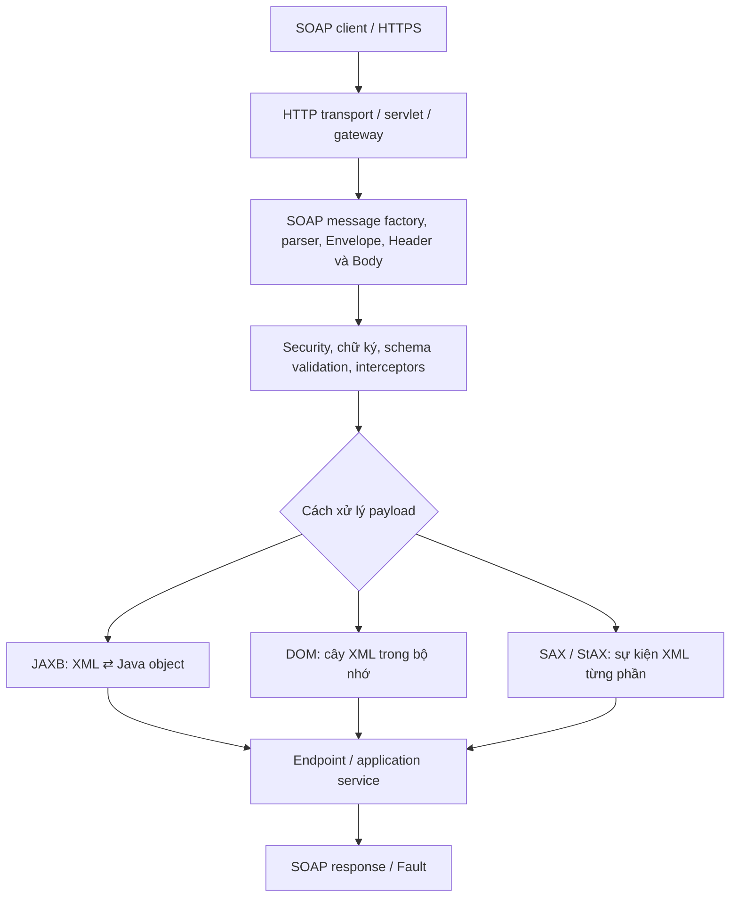
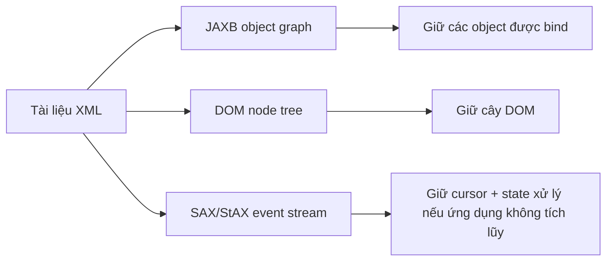
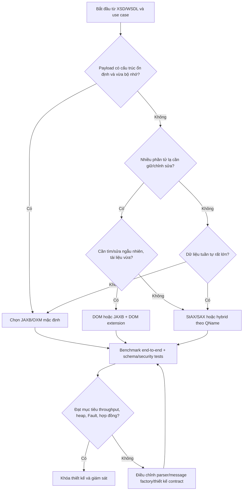
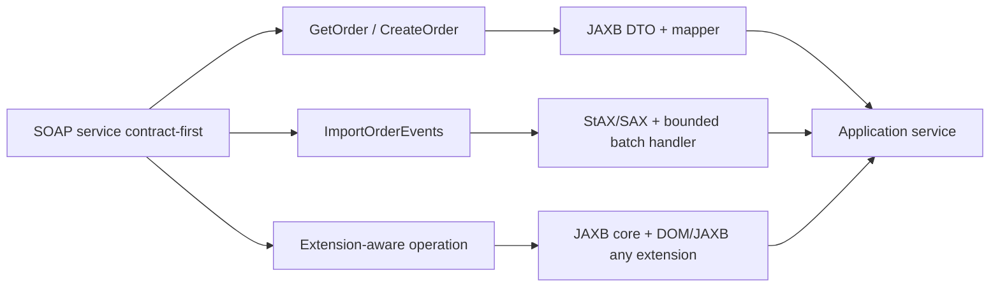
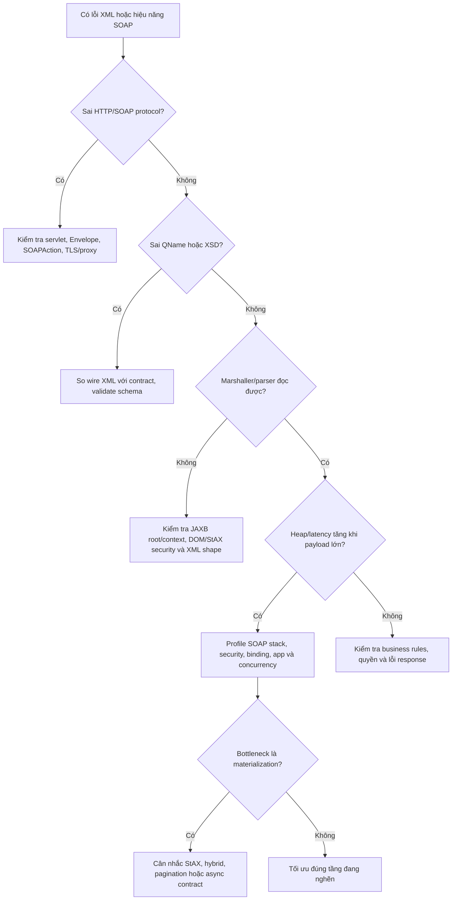

# Chọn JAXB hay XML trực tiếp theo kích thước và độ linh hoạt cần thiết

## 1. Vì sao phải chọn cách đọc và tạo XML phù hợp?

Trong ứng dụng **Spring Web Services (Spring-WS)** phát triển dịch vụ SOAP theo hướng **contract-first**, **XSD** quy định các phần tử và kiểu dữ liệu XML; **WSDL** mô tả thao tác, binding và địa chỉ truy cập. Khi SOAP message đến server hoặc được client gửi đi, ứng dụng phải chuyển dữ liệu trong **SOAP Body** thành thông tin có thể xử lý.

Có hai cách tiếp cận lớn:

- **JAXB/OXM:** ánh xạ XML thành những đối tượng Java có cấu trúc, thường là lớp được **XJC sinh từ XSD**, rồi dùng marshaller/unmarshaller để chuyển đổi hai chiều. Đây thường là lựa chọn mặc định hợp lý cho contract-first có schema rõ ràng.
- **Xử lý XML trực tiếp:** làm việc với XML qua **DOM**, **SAX**, **StAX**, **JAXP `Source`/`Result`**, XPath hoặc các API liên quan. Cách này hữu ích khi cần giữ cấu trúc XML nguyên dạng, xử lý các phần tử không biết trước hoặc muốn **đọc dần** dữ liệu lớn mà không xây dựng toàn bộ mô hình đối tượng.

Chọn cách nào không đơn thuần là “JAXB chậm, XML trực tiếp nhanh”. Việc phân tích cần xem **kích thước và hình dạng payload**, mức **ổn định của schema**, nhu cầu **đọc ngẫu nhiên hay tuần tự**, **khả năng bảo trì**, cùng các yêu cầu **SOAP Fault, schema validation, WS-Security và chứng chỉ**.

> **Quy tắc thực dụng:** Với phần lớn SOAP operation có hợp đồng rõ và payload vừa phải, hãy bắt đầu bằng **JAXB**. Chỉ chọn xử lý XML trực tiếp, đặc biệt là streaming bằng StAX/SAX, khi có nhu cầu về cấu trúc linh hoạt hoặc bằng chứng hiệu năng/bộ nhớ đủ mạnh — và khi toàn bộ đường xử lý SOAP thực sự cho phép cách đó.

### Mục tiêu học tập

Sau bài thuộc chương **Xử lý XML trực tiếp** của module `SPRING_WEB_SERVICES`, bạn có thể:

1. Phân biệt **JAXB/OXM**, **DOM**, **SAX**, **StAX**, `Source` và `Result` theo cách giữ dữ liệu, API và chi phí vận hành.
2. Chọn hướng triển khai cho request/response nhỏ, tài liệu XML thay đổi nhiều, danh sách rất lớn hoặc thông điệp có phần mở rộng.
3. Giải thích vì sao `@RequestPayload Source` không đồng nghĩa mọi tầng SOAP đều stream với bộ nhớ cố định.
4. Viết ví dụ Spring-WS dùng JAXB và ví dụ xử lý trực tiếp DOM/Source mà vẫn tôn trọng QName, XSD và hợp đồng.
5. Áp dụng các biện pháp chống XXE, giới hạn tài nguyên, validation và xác minh WS-Security khi xử lý XML.
6. Xây dựng phép đo/kiểm thử cho kích thước payload, số request đồng thời, khả năng tương thích client và SOAP Fault.

## 2. Bốn lớp phải phân biệt trước khi đánh giá hiệu năng

Hệ thống SOAP có nhiều lớp; tối ưu một lớp không bảo đảm toàn bộ đường đi đã tối ưu.



**Bốn câu hỏi khác nhau**:

1. **SOAP message factory** nhận và lưu SOAP Envelope như thế nào? Nó có cần materialize thông điệp không?
2. **Bảo mật và validation** có yêu cầu đọc/giữ toàn bộ Body, xử lý chữ ký XML hoặc tạo DOM không?
3. **Binding** có tạo toàn bộ cây Java/DOM hay đọc từng sự kiện để xử lý tuần tự?
4. **Application service** có gom mọi bản ghi vào `List` trước khi phản hồi, hay xử lý/ghi ra theo từng phần?

Chỉ thay một phương thức JAXB thành `Source` không làm ba lớp còn lại tự trở thành streaming. Đặc biệt, SOAP stacks, thao tác ký số, logging toàn payload, schema validation và một số interceptor có thể **buffer** dữ liệu trước khi endpoint được gọi.

## 3. So sánh JAXB, DOM, SAX, StAX và Source

### 3.1. Bảng lựa chọn kỹ thuật

| Công nghệ | Mô hình dữ liệu khi xử lý | Ưu điểm | Giới hạn, chi phí |
| --- | --- | --- | --- |
| **JAXB/Jaxb2Marshaller** | XML ↔ lớp Java theo binding. | Kiểu dữ liệu rõ, code dễ đọc, thuận lợi cho XSD/XJC và hợp đồng ổn định. | Có thể tạo đồ thị object lớn; binding phức tạp nếu XML không ổn định hoặc nhiều wildcard. |
| **DOM** | Tạo **cây node XML đầy đủ** có thể truy cập ngẫu nhiên. | Dễ sửa node, dùng XPath, giữ cấu trúc và namespace, thao tác các mảnh XML. | Bộ nhớ phụ thuộc kích thước/cấu trúc cây, số node và text; không phải streaming. |
| **SAX** | Parser **đẩy callback** theo sự kiện start/end/text. | Phù hợp đọc tuần tự với state nhỏ, không cần toàn bộ cây XML. | Khó quản lý trạng thái lồng nhau; truy cập ngẫu nhiên và sửa tài liệu bất tiện. |
| **StAX** | Ứng dụng **kéo sự kiện** từ `XMLStreamReader` hoặc `XMLEventReader`. | Luồng xử lý tuần tự dễ kiểm soát hơn SAX, đọc từng record, có thể kết hợp tạo XML bằng writer. | Cần quản lý cursor/namespace và vòng đời stream; không có truy cập ngẫu nhiên nếu không buffer. |
| **`Source`/`Result` (JAXP)** | **Abstraction** của đầu vào/đầu ra XML, ví dụ `DOMSource`, `SAXSource`, `StreamSource`, `StAXSource`. | Dễ tích hợp endpoint/transformer/OXM với nhiều biểu diễn. | Không phải chiến lược streaming tự thân; cách hiện thực và tầng bên dưới quyết định chi phí. |

Một sơ đồ về bộ nhớ ở **tầng xử lý payload**, chưa tính SOAP stack:



Các quan hệ trên chỉ là **mô hình xu hướng**, không phải một cam kết mức dùng bộ nhớ cố định. JAXB có thể hỗ trợ xử lý theo phần tử hoặc streaming qua cách dùng JAXB runtime nâng cao; StAX cũng có thể tiêu tốn nhiều bộ nhớ nếu code chủ động xây `List` hoặc DOM. Bộ nhớ cuối cùng chịu ảnh hưởng của parser, SOAP message factory, validation, chữ ký, kích thước object và mức đồng thời.

### 3.2. DOM và StAX giải quyết những bài toán khác nhau

**DOM** phù hợp khi một tài liệu tương đối nhỏ cần:

- Tìm các element bằng QName hoặc XPath;
- Thêm/xóa một số node, giữ lại cấu trúc mở rộng không dễ biểu diễn bằng model Java;
- Tra cứu nhiều vị trí khác nhau trong cùng tài liệu.

**StAX** thường phù hợp hơn khi:

- Payload là danh sách dài các record có cấu trúc lặp lại;
- Các record có thể **xử lý tuần tự**, không cần nhìn trước toàn bộ tài liệu;
- Ứng dụng có thể ghi kết quả vào pipeline hoặc database theo lô nhỏ;
- Cần kiểm soát vị trí đọc, số record và dừng sớm khi đạt ngưỡng.

**SAX** cũng có đặc tính đọc dần nhưng sử dụng **push callbacks**; các state machine lồng nhau thường khó bảo trì hơn StAX trong use case nghiệp vụ. Không nên chọn SAX chỉ vì nghe có vẻ nhẹ hơn nếu nhóm không cần callback model.

### 3.3. Source không phải một bộ parser duy nhất

Trong Spring-WS, một endpoint có thể làm việc với `@RequestPayload Source`. Nhưng `Source` có nhiều implementation:

```text
javax.xml.transform.Source
 ├── DOMSource     → đã có cây DOM trong bộ nhớ
 ├── SAXSource     → nguồn SAX/input tương ứng
 ├── StreamSource  → byte stream, char reader hoặc systemId
 └── StAXSource    → bọc XMLStreamReader/XMLEventReader
```

Nếu Spring-WS trả về một `DOMSource` thì truy cập kiểu `Source` vẫn đang dựa vào DOM. Nếu dùng `StreamSource` nhưng biến nó thành `DOMResult` ngay sau đó, ta lại materialize cả cây. Bởi vậy, đánh giá streaming phải dựa trên **đường đi thực tế của dữ liệu**, không dựa vào tên interface.

## 4. Khung ra quyết định: kích thước là một biến, không phải biến duy nhất

Không có ngưỡng phổ quát kiểu “dưới 1 MB dùng JAXB, trên 1 MB dùng StAX”. Một payload nhỏ nhưng cực nhiều node hoặc nhiều lớp lồng nhau có thể tốn bộ nhớ đáng kể; một payload lớn dạng text/binary có thể cần phương án khác.

| Tiêu chí | Nghiêng về JAXB/OXM | Nghiêng về XML trực tiếp |
| --- | --- | --- |
| **Schema rõ và tương đối ổn định** | DTO JAXB sinh từ XSD, nhiều trường chuẩn hóa. | Dữ liệu được đối tác mở rộng thường xuyên, nhiều phần chưa biết. |
| **Kích thước Body** | Nhỏ/vừa và đã đo đủ khả năng đáp ứng. | Rất lớn, nhiều record lặp lại, áp lực heap/GC được xác minh. |
| **Mô hình truy cập** | Cần dữ liệu object để áp dụng nhiều quy tắc/tra cứu nhiều lần. | Đọc tuần tự, xử lý từng record, không cần giữ toàn bộ. |
| **Cần giữ XML gốc** | Ít cần bảo toàn những node chưa biết. | Gateway, XML extension, chuyển tiếp một vùng XML theo policy. |
| **Nhiều phép sửa node/XPath** | Nếu model Java đủ, vẫn dễ thao tác. | DOM phù hợp khi tài liệu vừa và cần thay đổi cây. |
| **Độ an toàn kiểu dữ liệu** | Enum, decimal, ngày tháng được biểu diễn bằng kiểu Java. | Cần tự kiểm tra QName, chuỗi, số, thời gian, trạng thái thiếu/nil. |
| **Độ phức tạp bảo trì** | Thường thấp hơn cho request/response nghiệp vụ thông thường. | Cao hơn nếu tự viết parser, state machine và generator XML. |
| **Tích hợp WS-Security/XML Signature** | Dễ phối hợp với stack chuẩn nếu schema/adapter được hỗ trợ. | Cần kiểm tra kỹ streaming có bị materialize khi ký/xác thực không. |
| **Khả năng tương thích client** | Dễ dùng XSD/WSDL và JAXB binding được công bố. | Vẫn phải tuân thủ XSD/WSDL; thao tác trực tiếp không miễn kiểm thử. |

### 4.1. Quy trình quyết định



### 4.2. Kích thước phải gắn với số request đồng thời

Khi đo, không chỉ quan tâm số byte XML trên đường truyền. Cần xem:

- **Heap peak** khi nhiều SOAP requests đến đồng thời;
- Số lượng **object Java/DOM nodes**, tỷ lệ và thời gian garbage collection;
- Chi phí CPU parse, JAXB unmarshal/marshal, XSD validation và chữ ký;
- Độ trễ **p50/p95/p99** và throughput khi số request song song tăng;
- Dung lượng request/response sau nén, ảnh hưởng base64/attachments;
- Thời gian giữ message trong interceptor, logging hoặc retry;
- Tần suất payload nhỏ so với payload rất lớn; trường hợp biên thường gây sự cố production.

Ví dụ một request có vài nghìn bản ghi chưa chắc gây khó khăn trên một server có ít request đồng thời; cùng loại thông điệp khi nhiều tiến trình song song có thể vượt giới hạn heap. Chỉ benchmark với một XML mẫu nhỏ sẽ đưa ra kết luận sai.

### 4.3. Đừng “streaming” một nghiệp vụ vốn cần toàn bộ dữ liệu

Nếu cần kiểm tra một điều kiện **toàn cục** như tổng số tiền, tính duy nhất giữa các bản ghi hoặc tính chữ ký trên một tập dữ liệu, vẫn có thể xử lý dạng luồng nếu thuật toán dùng state hoặc external storage phù hợp. Nhưng không phải bài toán nào cũng làm được mà không giữ thêm state.

Nếu code StAX đọc từng record nhưng cuối cùng thêm toàn bộ vào `List<Order>` rồi gửi tiếp, lợi ích bộ nhớ so với JAXB có thể không đáng kể. Trước khi thay parser, hãy xem có thể thay đổi **kiến trúc ứng dụng**: phân trang operation, xử lý theo lô, upload bất đồng bộ có trạng thái, hoặc gửi dữ liệu dạng attachment/MTOM theo hợp đồng.

## 5. Ví dụ xuyên suốt: từ hợp đồng SOAP đến cách xử lý

Giả sử một hệ thống quản lý đơn hàng cung cấp hai thao tác:

- `GetOrder` nhận một mã đơn và trả thông tin đã chuẩn hóa, khá nhỏ.
- `ImportOrderEvents` nhận một tập sự kiện đơn hàng có thể rất dài, được chia theo partner và thời gian.

Hai nghiệp vụ đều dùng SOAP/XSD contract-first, nhưng nhu cầu vật lý khác nhau. `GetOrder` thích hợp cho JAXB; `ImportOrderEvents` cần cân nhắc batch, streaming hoặc kiến trúc xử lý khác.

### 5.1. XSD cơ bản cho GetOrder

File minh họa `src/main/resources/xsd/orders-v1.xsd`:

```xml
<?xml version="1.0" encoding="UTF-8"?>
<xs:schema xmlns:xs="http://www.w3.org/2001/XMLSchema"
           xmlns:ord="https://example.com/orders/v1"
           targetNamespace="https://example.com/orders/v1"
           elementFormDefault="qualified">

    <xs:simpleType name="PublicOrderStatus">
        <xs:restriction base="xs:string">
            <xs:enumeration value="PENDING"/>
            <xs:enumeration value="CONFIRMED"/>
            <xs:enumeration value="SHIPPED"/>
            <xs:enumeration value="CANCELLED"/>
        </xs:restriction>
    </xs:simpleType>

    <xs:element name="GetOrderRequest">
        <xs:complexType>
            <xs:sequence>
                <xs:element name="orderId" type="xs:string"/>
            </xs:sequence>
        </xs:complexType>
    </xs:element>

    <xs:element name="GetOrderResponse">
        <xs:complexType>
            <xs:sequence>
                <xs:element name="orderId" type="xs:string"/>
                <xs:element name="status" type="ord:PublicOrderStatus"/>
                <xs:element name="totalAmount" type="xs:decimal"/>
            </xs:sequence>
        </xs:complexType>
    </xs:element>

    <xs:element name="ImportOrderEventsRequest">
        <xs:complexType>
            <xs:sequence>
                <xs:element name="batchId" type="xs:string"/>
                <xs:element name="event" minOccurs="1" maxOccurs="unbounded">
                    <xs:complexType>
                        <xs:sequence>
                            <xs:element name="orderId" type="xs:string"/>
                            <xs:element name="kind" type="xs:string"/>
                        </xs:sequence>
                    </xs:complexType>
                </xs:element>
            </xs:sequence>
        </xs:complexType>
    </xs:element>
</xs:schema>
```

Đây là **schema học tập rút gọn**. Dịch vụ thật cần kiểu ID, kiểu sự kiện, timestamp, phân biệt trạng thái, ràng buộc kích thước batch, kết quả xử lý và SOAP Fault rõ ràng. `maxOccurs="unbounded"` chỉ nói tập sự kiện có thể nhiều ở tầng XSD; nó **không** xác định server có đủ bộ nhớ hay được phép tiếp nhận một batch vô hạn.

### 5.2. Hai SOAP Body có hình dạng khác nhau

`GetOrderRequest`:

```xml
<ord:GetOrderRequest xmlns:ord="https://example.com/orders/v1">
    <ord:orderId>ORD-2026-001</ord:orderId>
</ord:GetOrderRequest>
```

`ImportOrderEventsRequest`:

```xml
<ord:ImportOrderEventsRequest xmlns:ord="https://example.com/orders/v1">
    <ord:batchId>BATCH-001</ord:batchId>
    <ord:event>
        <ord:orderId>ORD-2026-001</ord:orderId>
        <ord:kind>CREATED</ord:kind>
    </ord:event>
    <ord:event>
        <ord:orderId>ORD-2026-002</ord:orderId>
        <ord:kind>CONFIRMED</ord:kind>
    </ord:event>
</ord:ImportOrderEventsRequest>
```

Ở đây chỉ có hai `event` để nhìn rõ định dạng, nhưng hệ thống có thể nhận hàng nghìn phần tử. Nếu cần chấp nhận batch lớn, phải xác định hạn mức thực tế ở cả XSD (nếu cố định được), transport, SOAP parser, application service và persistence.

### 5.3. Hợp đồng không thay đổi khi đổi kỹ thuật xử lý

`@PayloadRoot(namespace=..., localPart=...)` chọn endpoint bằng **QName của phần tử payload gốc**, bất kể method được viết với `@RequestPayload GetOrderRequest` hay `@RequestPayload Element`/`Source`.

Khi chuyển từ JAXB sang DOM/StAX, **XSD/WSDL vẫn là hợp đồng đã cam kết**. Java implementation được phép đổi, nhưng XML ngoài đường truyền — phần tử, namespace, thứ tự, nil, enum, SOAP Fault — không được thay đổi tùy tiện. Kỹ thuật xử lý trực tiếp không phải lý do bỏ contract-first hoặc ngừng kiểm thử với client cũ.

## 6. Hướng JAXB: ưu tiên tính rõ ràng cho nghiệp vụ thông thường

Với `GetOrderRequest` và `GetOrderResponse`, XJC có thể sinh những lớp Java như `GetOrderRequest`, `GetOrderResponse`, `PublicOrderStatus` và `ObjectFactory` trong package `com.example.orders.contract.v1`. Mã Java làm việc với **kiểu dữ liệu** thay vì tự tìm từng XML node.

### 6.1. Endpoint dùng lớp JAXB từ XSD

```java
import org.springframework.ws.server.endpoint.annotation.Endpoint;
import org.springframework.ws.server.endpoint.annotation.PayloadRoot;
import org.springframework.ws.server.endpoint.annotation.RequestPayload;
import org.springframework.ws.server.endpoint.annotation.ResponsePayload;

@Endpoint
public class OrderJaxbEndpoint {
    private static final String NS = "https://example.com/orders/v1";

    private final OrderQueryService queryService;
    private final OrderContractMapper mapper;

    public OrderJaxbEndpoint(
            OrderQueryService queryService,
            OrderContractMapper mapper) {
        this.queryService = queryService;
        this.mapper = mapper;
    }

    @PayloadRoot(namespace = NS, localPart = "GetOrderRequest")
    @ResponsePayload
    public GetOrderResponse getOrder(
            @RequestPayload GetOrderRequest request) {

        OrderSummary order = queryService.findVisibleOrder(
            request.getOrderId()
        );
        return mapper.toContractResponse(order);
    }
}
```

`OrderQueryService`, `OrderSummary` và `OrderContractMapper` là thành phần nội bộ do ứng dụng tự triển khai. Ví dụ giả định các lớp JAXB được sinh theo XSD, Spring-WS đã cấu hình endpoint adapter phù hợp và service có cơ chế xác thực, phân quyền riêng. Không được dùng `request.getOrderId()` để bỏ qua authorization; người gọi vẫn chỉ được xem đơn thuộc phạm vi được cấp quyền.

Trong cách này:

- `@PayloadRoot` chọn endpoint bằng QName của **Body root**.
- `@RequestPayload` kết hợp endpoint adapter/JAXB binding đọc nội dung XML thành class Java.
- Ứng dụng xử lý domain/application model riêng, **không trả thẳng JPA entity**.
- `@ResponsePayload` kết hợp handler tạo XML response theo contract.

### 6.2. OXM cho SOAP client dùng WebServiceTemplate

Ở phía client, Spring OXM có `Jaxb2Marshaller`:

```java
import org.springframework.context.annotation.Bean;
import org.springframework.context.annotation.Configuration;
import org.springframework.oxm.jaxb.Jaxb2Marshaller;
import org.springframework.ws.client.core.WebServiceTemplate;

@Configuration
public class OrderClientXmlConfig {

    @Bean
    public Jaxb2Marshaller orderMarshaller() {
        Jaxb2Marshaller marshaller = new Jaxb2Marshaller();
        marshaller.setContextPath("com.example.orders.contract.v1");
        return marshaller;
    }

    @Bean
    public WebServiceTemplate orderWebServiceTemplate(
            Jaxb2Marshaller orderMarshaller) {
        WebServiceTemplate template = new WebServiceTemplate();
        template.setMarshaller(orderMarshaller);
        template.setUnmarshaller(orderMarshaller);
        return template;
    }
}
```

`setContextPath` phù hợp khi package XJC sinh có `ObjectFactory`/binding metadata hợp lệ. Với ít class JAXB viết tay hoặc muốn giới hạn tập class tường minh, có thể chọn `setClassesToBeBound(...)` thay thế; không cần dùng đồng thời cả hai cách trong một bean.

Ví dụ client gọi service:

```java
GetOrderRequest request = new GetOrderRequest();
request.setOrderId("ORD-2026-001");

Object value = webServiceTemplate.marshalSendAndReceive(
    "https://api.example.com/ws", request);

GetOrderResponse response = (GetOrderResponse) value;
```

Ví dụ giả định request/response sinh có root `@XmlRootElement` tương ứng. Nếu mã XJC sinh kiểu gốc qua `JAXBElement`, phải dùng wrapper và giải mã kiểu trả về đúng cách. Client production còn cần HTTP timeout, SOAP version, SOAPAction nếu WSDL đòi hỏi, TLS/mTLS, truststore, WS-Security và xử lý SOAP Fault.

### 6.3. Lợi ích và giới hạn cần nhìn nhận đúng

JAXB có lợi thế ở **mã nghiệp vụ dễ hiểu, tái sử dụng kiểu Java và bám sát XSD**. Ví dụ `xs:decimal` thường ánh xạ thành `BigDecimal`, enum XSD có thể thành enum Java, và kiểu ngày giờ thường có binding xác định; điều này giảm lỗi so với tự tìm chuỗi XML rồi parse tùy ý.

Nhưng cần phân biệt:

- XJC sinh class **không có nghĩa** schema đã được thiết kế tốt hoặc hợp đồng đã tương thích ngược.
- Unmarshal thành công **không bảo đảm** mọi ràng buộc XSD được thực thi nếu chưa bật schema validation.
- `List` sinh từ `maxOccurs="unbounded"` có thể chứa toàn bộ record khi unmarshal; bộ nhớ tăng theo số record được giữ.
- JAXB runtime và SOAP message factory có chi phí riêng. Việc tạo `JAXBContext` nên được quản lý/tái sử dụng thích hợp; không tạo lại context tốn kém cho mỗi request nếu không cần.
- Không trộn mã sinh `javax.xml.bind.*` của JAXB 2.x với runtime/annotations `jakarta.xml.bind.*` của thế hệ mới. `javax.xml.datatype.XMLGregorianCalendar` vẫn là kiểu JDK được dùng khi binding ngày giờ, không tự đổi package đó thành `jakarta`.

**Khi nào chọn JAXB?** Thao tác kiểu `GetOrder`, `CreatePayment`, `CheckCustomer` với schema và tập trường rõ ràng, kích thước tương đối ổn định, domain model cần nhiều ràng buộc và việc đọc toàn bộ payload không gây áp lực đo được lên hệ thống.

## 7. Hướng DOM: giữ cấu trúc XML mà không cần model Java cho từng node

DOM là lựa chọn xử lý XML trực tiếp khi muốn **đọc/biến đổi các node** trong tài liệu có kích thước chấp nhận được. Spring-WS hỗ trợ những kiểu tham số/return XML như `org.w3c.dom.Element` hoặc JAXP `Source` qua các endpoint adapter/processor phù hợp.

**DOM không phải streaming:** nếu tài liệu lớn, chi phí heap của cây DOM và node metadata có thể lớn hơn nhiều so với số byte XML gốc. Vì vậy DOM là cách xử lý **linh hoạt về cấu trúc**, không phải giải pháp mặc định cho payload hàng trăm nghìn record.

### 7.1. Endpoint nhận và trả Element

Ví dụ dưới đây dùng một **phương án thay thế** cho `OrderJaxbEndpoint` ở mục 6. **Không đăng ký đồng thời hai phương thức với cùng `@PayloadRoot`** trong cùng một hệ thống mapping khi chưa giải quyết xung đột.

```java
import javax.xml.parsers.DocumentBuilderFactory;
import javax.xml.parsers.ParserConfigurationException;
import org.w3c.dom.Document;
import org.w3c.dom.Element;
import org.w3c.dom.Node;
import org.springframework.ws.server.endpoint.annotation.Endpoint;
import org.springframework.ws.server.endpoint.annotation.PayloadRoot;
import org.springframework.ws.server.endpoint.annotation.RequestPayload;
import org.springframework.ws.server.endpoint.annotation.ResponsePayload;

@Endpoint
public class OrderDomEndpoint {
    private static final String NS = "https://example.com/orders/v1";

    private final OrderQueryService service;

    public OrderDomEndpoint(OrderQueryService service) {
        this.service = service;
    }

    @PayloadRoot(namespace = NS, localPart = "GetOrderRequest")
    @ResponsePayload
    public Element getOrder(@RequestPayload Element request)
            throws ParserConfigurationException {

        String orderId = requiredDirectChildText(request, "orderId");
        OrderSummary summary = service.findVisibleOrder(orderId);

        DocumentBuilderFactory factory =
            DocumentBuilderFactory.newInstance();
        factory.setNamespaceAware(true);
        Document document = factory.newDocumentBuilder().newDocument();

        Element response = document.createElementNS(
            NS, "ord:GetOrderResponse");
        document.appendChild(response);

        addTextElement(document, response,
            "orderId", summary.orderId());
        addTextElement(document, response,
            "status", summary.publicStatus());
        addTextElement(document, response,
            "totalAmount", summary.totalAmount().toPlainString());

        return response;
    }

    private static void addTextElement(
            Document document,
            Element parent,
            String localName,
            String text) {

        Element child = document.createElementNS(
            NS, "ord:" + localName);
        child.setTextContent(text);
        parent.appendChild(child);
    }

    private static String requiredDirectChildText(
            Element parent, String localName) {

        String found = null;
        for (Node n = parent.getFirstChild(); n != null;
                n = n.getNextSibling()) {
            if (n.getNodeType() != Node.ELEMENT_NODE) {
                continue;
            }
            Element e = (Element) n;
            if (NS.equals(e.getNamespaceURI())
                    && localName.equals(e.getLocalName())) {
                if (found != null) {
                    throw new IllegalArgumentException(
                        "Phần tử lặp không đúng hợp đồng");
                }
                for (Node nested = e.getFirstChild(); nested != null;
                        nested = nested.getNextSibling()) {
                    if (nested.getNodeType() == Node.ELEMENT_NODE) {
                        throw new IllegalArgumentException(
                            "Trường đơn giản chứa phần tử con");
                    }
                }
                found = e.getTextContent();
            }
        }
        if (found == null || found.isBlank()) {
            throw new IllegalArgumentException(
                "Thiếu phần tử bắt buộc");
        }
        return found;
    }
}
```

Mã trên minh họa rõ việc **xây dựng XML có namespace** và chỉ tìm **con trực tiếp** của root. Nó không phải một ứng dụng hoàn chỉnh: `OrderSummary` và `OrderQueryService` là các kiểu nội bộ giả định; cần cấu hình resolver để chuyển lỗi dữ liệu thành SOAP Fault an toàn, schema validation để kiểm tra tất cả phần tử theo XSD, security interceptor và timeout.

### 7.2. Vì sao không dùng getElementsByTagName("orderId") một cách thiếu kiểm soát?

`getElementsByTagName(...)` tìm nhiều element descendant, có thể tìm thấy node cùng tên ở **bất kỳ độ sâu nào**, trong khi hợp đồng thường yêu cầu `orderId` là con trực tiếp của `GetOrderRequest`. `getElementsByTagNameNS(...)` có kiểm tra namespace, nhưng vẫn tìm các descendant phù hợp, không tự giới hạn con trực tiếp.

Trong dữ liệu XML không tin cậy, code chỉ xét local name hoặc tìm node đầu tiên mà không kiểm tra cha/namespace có thể đọc **sai trường** — nhất là với phần tử mở rộng hoặc message có nhiều namespace. Hãy xử lý theo QName và cấu trúc XSD đã công bố.

### 7.3. Tạo Element không tự gây XML injection kiểu nối chuỗi

Trong ví dụ, `document.createElementNS(...)` và `setTextContent(...)` tạo node theo API DOM. Nếu `summary.orderId()` chứa ký tự `&` hoặc `<`, DOM/XML serializer sẽ xử lý escaping thích hợp khi serialize; code **không nối nguyên văn giá trị thành cú pháp XML**.

Không làm theo cách:

```java
// Ví dụ phản diện: tránh ghép dữ liệu không tin cậy vào XML bằng chuỗi.
String xml = "<ord:orderId>" + userSuppliedOrderId + "</ord:orderId>";
```

Nối chuỗi dễ tạo XML không well-formed, XML injection, sai namespace hoặc lỗi encoding. Nếu cần tạo XML trực tiếp cho payload lớn, dùng `XMLStreamWriter`/serializer và luôn kiểm tra XML phát ra theo schema.

### 7.4. Vì sao tạo DOM trong ví dụ chưa cần bật parser cho input?

`factory.newDocumentBuilder().newDocument()` chỉ tạo **document rỗng trong bộ nhớ**, không parse nội dung XML đầu vào. Tuy nhiên, nếu dùng `DocumentBuilder.parse(...)` trên XML từ client, phải cấu hình an toàn để chống XXE và hạn chế external entities/DTD. Không suy từ một ví dụ tạo document rỗng rằng cấu hình parser mặc định đủ an toàn cho XML không tin cậy.

## 8. Source/Result: giao diện chung cho xử lý XML

Spring-WS có thể nhận/trả payload qua `Source`/`Result`. Đây là lựa chọn khi muốn **giữ biểu diễn XML** mà không ánh xạ toàn bộ vào JAXB DTO.

### 8.1. Method signature trực tiếp với Source

Một endpoint có thể có chữ ký như:

```java
import javax.xml.transform.Source;
import org.springframework.ws.server.endpoint.annotation.PayloadRoot;
import org.springframework.ws.server.endpoint.annotation.RequestPayload;
import org.springframework.ws.server.endpoint.annotation.ResponsePayload;

// Minh họa một phương án endpoint khác, không đăng ký cùng QName
// với các phiên bản JAXB/DOM trước trong cùng hệ thống.
@PayloadRoot(
    namespace = "https://example.com/orders/v1",
    localPart = "ImportOrderEventsRequest")
@ResponsePayload
public Source importEvents(@RequestPayload Source payload) {
    // Kiểm tra Source cụ thể, schema/security, xử lý dữ liệu,
    // rồi trả về một Source chứa XML response theo XSD.
    throw new UnsupportedOperationException("Minh họa chữ ký");
}
```

Phương thức trên cần nằm trong lớp `@Endpoint` có bean và adapter tương thích; đây chỉ là **một chữ ký minh họa**, không phải implementation production.

Một `Source` có thể dựa trên DOM, stream, SAX hoặc StAX. Khi nhận được `Source`, không nên ép kiểu mù quáng sang `StreamSource` hoặc `StAXSource`; hãy quan sát implementation thật và chọn cách xử lý phù hợp.

### 8.2. Transform Source sang DOMResult vẫn giữ cả cây

Một ví dụ Java cho phép biến `Source` thành DOM để xử lý XPath/sửa node:

```java
import javax.xml.XMLConstants;
import javax.xml.transform.Source;
import javax.xml.transform.Transformer;
import javax.xml.transform.TransformerFactory;
import javax.xml.transform.dom.DOMResult;

public static DOMResult materializeToDom(Source xml) throws Exception {
    TransformerFactory factory = TransformerFactory.newInstance();
    factory.setFeature(XMLConstants.FEATURE_SECURE_PROCESSING, true);
    factory.setAttribute(XMLConstants.ACCESS_EXTERNAL_DTD, "");
    factory.setAttribute(XMLConstants.ACCESS_EXTERNAL_STYLESHEET, "");

    Transformer transformer = factory.newTransformer();
    DOMResult result = new DOMResult();
    transformer.transform(xml, result);
    return result;
}
```

Đoạn này minh họa **đích là DOM**: nó cần bộ nhớ để giữ toàn bộ node tree. Cấu hình bảo mật của `TransformerFactory` phải được provider hỗ trợ; nếu provider báo không hỗ trợ thuộc tính hardening cần thiết, hãy **fail closed** hoặc dùng provider/cấu hình phù hợp, không lặng lẽ bỏ qua.

Việc `Source` đã được tạo trong Spring-WS không bảo đảm parser **trước đó** an toàn. Nếu tầng trước đã resolve một external entity, cấu hình `TransformerFactory` ở đây không thể đảo ngược tác hại đã xảy ra. Cần hardening ở **mọi điểm parse và transform** của XML không tin cậy.

### 8.3. Source có thể bị tiêu thụ một lần

Một số `Source` dựa trên stream/reader có tính **one-shot**: sau khi đọc một lần, bạn không thể tùy tiện đọc lại nếu stream không hỗ trợ reset hoặc đã bị đóng. Vì vậy:

- Không gọi hai lần transformer/unmarshaller trên cùng source mà không biết nó có khả năng đọc lại.
- Đừng dùng logging/interceptor để đọc hết stream rồi mong endpoint vẫn nhận nguyên payload.
- Xác định rõ **ai sở hữu và đóng stream**, tùy message factory/transport.
- Khi cần retry hoặc kiểm tra nhiều lần, phải cân nhắc buffering có giới hạn, nguồn có thể tái tạo hoặc thay thiết kế operation.

**Kết luận của mục này:** `@RequestPayload Source` tăng **tính linh hoạt biểu diễn**, nhưng không phải bằng chứng ứng dụng đang xử lý với bộ nhớ thấp hoặc streaming end-to-end.

## 9. Hướng StAX: xử lý tuần tự một danh sách XML lớn

**StAX (Streaming API for XML)** cung cấp `XMLStreamReader` hoặc `XMLEventReader` để đọc lần lượt các sự kiện XML. Khác DOM, ứng dụng **không cần tạo toàn bộ cây node**. Với một batch nhập hàng nghìn sự kiện, có thể kiểm tra từng event, chuyển thành command nội bộ và xử lý theo lô có giới hạn.

### 9.1. Điều kiện để StAX thực sự tiết kiệm bộ nhớ

StAX hữu ích khi tất cả các điều kiện sau được xem xét:

- Có thể nhận một **nguồn dữ liệu đọc dần** thay vì đã materialize toàn bộ SOAP message thành DOM.
- Ứng dụng chỉ giữ lượng state có giới hạn, không gom toàn bộ record vào `List`.
- Dữ liệu được xử lý theo lô/stream và không phụ thuộc truy cập ngẫu nhiên mọi node.
- Schema validation, security interceptor, chữ ký và logging không vô tình materialize toàn bộ payload trước parser.
- Phần phát SOAP response cũng không tự buffer một kết quả khổng lồ ngoài tầm kiểm soát.

Do đó, một ví dụ Java StAX hoạt động trên `InputStream` **chỉ chứng minh khả năng streaming của parser này**. Nó chưa chứng minh `MessageDispatcherServlet`, SOAP message factory, WS-Security và `@RequestPayload` đã cấp luồng input tương đương trên đường xử lý thực tế.

### 9.2. Ví dụ Java: đọc tuần tự từng event

Sau đây là **lõi parser** minh họa dùng cho một nguồn XML đáng kiểm soát. Ở đây XML được giả định là payload `ImportOrderEventsRequest` theo schema mục 5, mã hóa UTF-8; nó không chứa SOAP Envelope. Để tích hợp vào Spring-WS, cần thiết kế tầng nhận nguồn/payload thực sự có streaming và cơ chế xác thực/validation phù hợp.

```java
import java.io.InputStream;
import java.util.function.Consumer;
import javax.xml.stream.XMLInputFactory;
import javax.xml.stream.XMLStreamConstants;
import javax.xml.stream.XMLStreamException;
import javax.xml.stream.XMLStreamReader;

public final class OrderEventStreamReader {
    private static final String NS = "https://example.com/orders/v1";
    private static final long MAX_EVENTS = 5_000;

    public record OrderEvent(String orderId, String kind) {}

    public void consume(
            InputStream xmlPayload,
            Consumer<OrderEvent> sink) throws XMLStreamException {

        XMLInputFactory factory = XMLInputFactory.newFactory();
        factory.setProperty(XMLInputFactory.SUPPORT_DTD, false);
        factory.setProperty(
            XMLInputFactory.IS_SUPPORTING_EXTERNAL_ENTITIES, false);
        factory.setXMLResolver(
            (publicId, systemId, baseUri, namespace) -> {
                throw new XMLStreamException(
                    "Không cho phép tham chiếu XML ngoài");
            }
        );

        XMLStreamReader reader =
            factory.createXMLStreamReader(xmlPayload, "UTF-8");
        try {
            long count = 0;
            while (reader.hasNext()) {
                int event = reader.next();
                if (event == XMLStreamConstants.START_ELEMENT
                        && NS.equals(reader.getNamespaceURI())
                        && "event".equals(reader.getLocalName())) {

                    if (++count > MAX_EVENTS) {
                        throw new XMLStreamException(
                            "Batch vượt số lượng event cho phép");
                    }
                    sink.accept(readOneEvent(reader));
                }
            }
        } finally {
            reader.close();
        }
    }

    private OrderEvent readOneEvent(XMLStreamReader reader)
            throws XMLStreamException {

        String orderId = null;
        String kind = null;

        while (reader.hasNext()) {
            int event = reader.next();

            if (event == XMLStreamConstants.START_ELEMENT) {
                if (!NS.equals(reader.getNamespaceURI())) {
                    throw new XMLStreamException(
                        "Namespace event con không hợp lệ");
                }
                switch (reader.getLocalName()) {
                    case "orderId" -> {
                        if (orderId != null) {
                            throw new XMLStreamException(
                                "orderId bị lặp");
                        }
                        orderId = reader.getElementText();
                    }
                    case "kind" -> {
                        if (kind != null) {
                            throw new XMLStreamException(
                                "kind bị lặp");
                        }
                        kind = reader.getElementText();
                    }
                    default -> throw new XMLStreamException(
                        "Phần tử con ngoài hợp đồng");
                }
            } else if (event == XMLStreamConstants.END_ELEMENT
                    && NS.equals(reader.getNamespaceURI())
                    && "event".equals(reader.getLocalName())) {

                if (orderId == null || orderId.isBlank()
                        || kind == null || kind.isBlank()) {
                    throw new XMLStreamException(
                        "Thiếu dữ liệu event bắt buộc");
                }
                return new OrderEvent(orderId, kind);
            }
        }
        throw new XMLStreamException("Event XML bị cắt dở");
    }
}
```

**Giới hạn có chủ đích của ví dụ:**

- Mã dùng cú pháp Java hiện đại (`record`, `switch` expression dạng nhánh), không phải project Spring-WS độc lập.
- `MAX_EVENTS` giới hạn record ở tầng ứng dụng; con số chỉ minh họa, phải chọn từ năng lực hệ thống và hợp đồng.
- Đây **không phải full XSD validator**: đoạn code chưa kiểm tra cấu trúc wrapper, thứ tự `batchId`, schema của toàn tài liệu, giới hạn độ dài text hoặc quyền nghiệp vụ. Nó cũng chưa có logic idempotency, transaction hay kiểm soát đồng thời.
- Chỉ một phần tử `event` được đọc thành `OrderEvent` nhỏ tại một thời điểm. Nếu `sink` tự gom toàn bộ record hoặc giữ reference, lợi ích bộ nhớ bị mất.
- `XMLStreamReader.close()` không nên được coi là đảm bảo đóng `InputStream` do bên gọi sở hữu trong mọi provider; quản lý stream theo contract của tầng cấp phát.
- Cấu hình tắt DTD/external entities phải được provider chấp nhận. Nếu provider không hỗ trợ các thuộc tính bảo vệ cần thiết, phải xử lý **fail closed** hoặc chọn implementation an toàn khác, không âm thầm mở rộng quyền parser.

### 9.3. Không tin QName chỉ vì có cùng local name

Trong code StAX, phải kiểm tra:

```java
NS.equals(reader.getNamespaceURI())
    && "event".equals(reader.getLocalName())
```

Không chỉ kiểm tra `reader.getLocalName().equals("event")`. Với SOAP tích hợp nhiều namespace, đối tác có thể gửi phần tử `event` từ namespace khác. Nếu parser đọc sai node, dữ liệu nghiệp vụ có thể bị thay đổi dù XML well-formed.

**Tương tự với DOM/XPath:** luôn kiểm soát **QName đầy đủ**, vị trí con trong schema, cardinality, giá trị nil và enum; tránh lấy phần tử đầu tiên tìm thấy ở bất kỳ độ sâu nào.

### 9.4. Đọc dần không giải quyết tất cả nghiệp vụ nhập batch

Giả sử batch có 5.000 sự kiện và thứ tự là quan trọng. Một tiến trình StAX có thể:

1. Xác minh batch ID, danh tính và policy bảo mật của thông điệp.
2. Đọc lần lượt `event`, validate business fields và giới hạn độ dài.
3. Ghi vào hàng đợi hoặc staging table theo lô **có giới hạn**, với idempotency key và trạng thái batch rõ ràng.
4. Chỉ xác nhận hoàn thành khi mọi điều kiện đã được kiểm tra, tùy mô hình giao dịch.

**Vấn đề giao dịch:** Nếu ghi thẳng từng event rồi gặp XML sai ở cuối stream, hệ thống có thể đã xử lý **một phần batch**. Nếu hợp đồng đòi hỏi **all-or-nothing**, cần transaction/staging/compensation phù hợp, và phải giới hạn tài nguyên cũng như thời gian giữ transaction. StAX không tự giải quyết rollback hoặc exactly-once semantics.

### 9.5. Tạo XML trực tiếp bằng XMLStreamWriter

Khi tạo kết quả XML lớn, `XMLOutputFactory`/`XMLStreamWriter` có thể giúp xuất tuần tự mà không xây toàn bộ DOM:

```java
import java.io.OutputStream;
import javax.xml.stream.XMLOutputFactory;
import javax.xml.stream.XMLStreamWriter;

public static void writeOrderResult(
        OutputStream out, String id, String status) throws Exception {

    String ns = "https://example.com/orders/v1";
    XMLStreamWriter writer = XMLOutputFactory.newFactory()
        .createXMLStreamWriter(out, "UTF-8");
    try {
        writer.writeStartDocument("UTF-8", "1.0");
        writer.writeStartElement("ord", "GetOrderResponse", ns);
        writer.writeNamespace("ord", ns);

        writer.writeStartElement("ord", "orderId", ns);
        writer.writeCharacters(id);
        writer.writeEndElement();

        writer.writeStartElement("ord", "status", ns);
        writer.writeCharacters(status);
        writer.writeEndElement();

        writer.writeEndElement();
        writer.writeEndDocument();
        writer.flush();
    } finally {
        writer.close();
    }
}
```

`writeCharacters(...)` thực hiện escaping ký tự trong text. Ví dụ tạo **một payload XML document**, không tạo SOAP Envelope hoặc đính kèm bảo mật; `OutputStream` ở đây là abstraction riêng, **không phải thứ có thể đưa thẳng vào `@ResponsePayload`** mà không có adapter/response transport tương ứng.

Muốn phát SOAP response thực sự theo kiểu stream, phải chọn một đường output được Spring-WS/message factory hỗ trợ; cân nhắc rằng một khi HTTP response **đã commit**, lỗi phát sinh giữa chừng có thể không còn khả năng biến thành SOAP Fault hoàn chỉnh. Hãy xác minh lỗi trước khi ghi, hoặc thiết kế operation bất đồng bộ/batch có trạng thái nếu yêu cầu toàn vẹn quan trọng.

## 10. Trở ngại của streaming trong Spring-WS và SOAP

### 10.1. Thay binding không thay SOAP message factory

Spring-WS vận hành trên các implementation của `WebServiceMessage` và SOAP message factory. Tùy phiên bản/framework, stack dùng **SAAJ** hoặc implementation SOAP khác với đặc tính parse, materialize và attachment khác nhau. Một số stack có khả năng xử lý XML deferred/lazy, nhưng **không mặc nhiên bảo đảm end-to-end streaming**.

Những thao tác thường tạo thêm chi phí bộ nhớ:

- Đọc toàn bộ `SOAP Envelope` để log hoặc lưu vào `String`;
- Chuyển `Source` thành `DOMSource`/`DOMResult`;
- Unmarshal toàn bộ tập `maxOccurs="unbounded"` thành `List`;
- Dùng XML Signature canonicalization hoặc xử lý WS-Security yêu cầu cây node;
- Dùng schema validation yêu cầu buffering trong một số pipeline/implementation;
- Chạy interceptor đọc Body nhiều lần, buộc hệ thống phải lưu nội dung để replay;
- Tạo response khổng lồ dưới dạng `StringSource` hoặc `StringBuilder`;
- Thực hiện retry với message không có cơ chế tái tạo nguồn.

Khi đánh giá giải pháp streaming, hãy **đo cùng SOAP message factory, transport, validator, WSS4J, interceptor, logger và client thực tế**. Một micro-benchmark chỉ chạy `XMLStreamReader` từ file chưa đại diện cho hiệu năng production.

### 10.2. MTOM và attachment cho dữ liệu nhị phân

Nếu SOAP Body cần chở **file hoặc dữ liệu nhị phân lớn**, việc đặt chúng vào `xs:base64Binary` dạng text XML có thể tăng kích thước truyền tải và gây thêm chi phí encode/decode. **MTOM/XOP** có thể tối ưu cách truyền dữ liệu nhị phân bằng MIME attachment theo hợp đồng và stack tương thích.

Những lưu ý:

- MTOM là một lựa chọn cho **binary payload**, không phải giải pháp thay thế StAX cho danh sách hàng nghìn phần tử XML.
- Cần đồng bộ WSDL/XSD, JAXB/OXM, SOAP message factory, transport, client và các chính sách WS-Security.
- Kiểm tra giới hạn kích thước attachment, file type, malware scanning nếu phù hợp, quyền truy cập và việc dọn file tạm.
- Không giả định “bật MTOM” là mọi attachment được stream hoàn toàn; phải benchmark memory và disk I/O.

### 10.3. Phân trang hoặc batch có giới hạn thường đơn giản hơn

Nếu `ImportOrderEvents` có thể phát triển đến quy mô rất lớn, hãy cân nhắc điều chỉnh **hợp đồng**:

```text
ImportOrderEventsBatch(batchId, pageNumber, events[1..N])
    → Accepted(batchId, acceptedCount, nextPage)

GetImportStatus(batchId)
    → status, acceptedCount, rejectedCount, publicErrorSummary
```

Đây là **mô hình đề xuất** cho hợp đồng mới, không phải operation có sẵn của Spring-WS. Nó giúp:

- Chốt giới hạn mỗi batch và quản trị backpressure;
- Tránh giữ HTTP connection/transaction quá lâu;
- Trả lỗi nghiệp vụ theo từng batch, hỗ trợ retry/idempotency;
- Giữ khả năng tương thích dễ kiểm soát hơn so với một request khổng lồ.

Nếu WSDL/XSD cũ đã được công bố, thêm hoặc sửa operation phải có chiến lược versioning và thử client cũ. Không đổi cách chia batch một cách ngầm định chỉ vì server chuyển từ JAXB sang StAX.

## 11. Phương án kết hợp: JAXB cho phần ổn định, XML trực tiếp cho phần linh hoạt

Không nhất thiết toàn bộ ứng dụng phải chọn **một** cơ chế cho mọi operation.

### 11.1. Tách theo operation

Một kiến trúc thường hợp lý:



- **GetOrder/CreateOrder:** JAXB cho các trường có kiểu chặt và dễ bảo trì.
- **ImportOrderEvents:** StAX/SAX nếu có đường nhận payload stream phù hợp và bài toán thực sự tuần tự.
- **Dữ liệu mở rộng:** vẫn dùng JAXB cho trường chính, xử lý một số node mở rộng bằng DOM/JAXB `@XmlAnyElement` khi contract cho phép.

### 11.2. JAXB @XmlAnyElement là điểm giữa

Một XSD có `xs:any namespace="##other" processContents="lax"` ở vùng `extensions` có thể được XJC ánh xạ sang một collection của các đối tượng/DOM elements:

```java
import jakarta.xml.bind.annotation.XmlAnyElement;
import java.util.List;

// Hình dạng minh họa của một trường JAXB, không sửa generated class.
@XmlAnyElement(lax = true)
private List<Object> any;
```

Khi JAXB context biết binding cho một phần tử mở rộng, dữ liệu có thể thành JAXB object hoặc `JAXBElement<?>`; nếu chưa biết, có thể là `org.w3c.dom.Element`. **`@XmlAnyElement(lax=true)`** điều khiển khả năng binding JAXB, khác với **`processContents="lax"`** của schema validator.

Đây là giải pháp khi **phần lớn message có kiểu rõ ràng nhưng có vùng mở rộng nhỏ**. Nếu phần mở rộng thực sự khổng lồ, việc materialize toàn bộ vùng vào DOM vẫn tốn bộ nhớ; cần cân nhắc thiết kế khác. Và nếu extension chứa hành động nghiệp vụ bắt buộc phải hiểu, không được coi việc `xs:any` chấp nhận nó là cam kết tương thích ngược.

### 11.3. Không đưa DOM/JAXB contract type vào domain model

Cho dù chọn cách nào, đừng để mô hình nghiệp vụ phải phụ thuộc trực tiếp vào toàn bộ SOAP XML hoặc các kiểu JAXB bên ngoài:

```text
JAXB object / DOM Element / StAX event
              ↓
     Contract adapter + validation
              ↓
    Application command / result
              ↓
        Domain / persistence
```

Ví dụ một `OrderEvent` được StAX đọc ra có thể được chuyển thành command đã xác thực và đưa qua application service kiểm tra quyền. Một JAXB `GetOrderResponse` được ánh xạ từ `OrderSummary`. Điều này giữ ranh giới giữa **wire contract**, **domain** và **entity lưu trữ**; tránh để thay đổi schema XML hoặc framework làm lan truyền tới nghiệp vụ.

## 12. SOAP client có thể gửi/nhận XML trực tiếp như thế nào?

Phía client Spring-WS có `WebServiceTemplate`. Nếu đã có XML đúng hợp đồng thay vì một JAXB object, có thể dùng **`sendSourceAndReceiveToResult`** để gửi `Source` và ghi phần payload phản hồi vào `Result`.

### 12.1. Ví dụ client với StringSource và DOMResult

```java
import javax.xml.transform.dom.DOMResult;
import org.springframework.xml.transform.StringSource;
import org.springframework.ws.client.core.WebServiceTemplate;
import org.springframework.ws.soap.client.core.SoapActionCallback;
import org.w3c.dom.Node;

// Đoạn mã ở trong một method client đã có WebServiceTemplate.
StringSource payload = new StringSource("""
    <ord:GetOrderRequest xmlns:ord="https://example.com/orders/v1">
      <ord:orderId>ORD-2026-001</ord:orderId>
    </ord:GetOrderRequest>
    """);

DOMResult responseResult = new DOMResult();
boolean hasResponse = template.sendSourceAndReceiveToResult(
    "https://api.example.com/ws",
    payload,
    new SoapActionCallback("https://example.com/orders/GetOrder"),
    responseResult
);

if (hasResponse) {
    Node responseNode = responseResult.getNode();
    // Đọc QName và trường theo XSD; có thể là Document/Element.
    // Không coi DOMResult là bằng chứng xử lý streaming.
}
```

`SoapActionCallback` chỉ minh họa trường hợp binding **SOAP 1.1** yêu cầu action. Giá trị thực phải lấy từ WSDL và quy tắc đối tác, không suy ra tùy tiện; SOAP 1.2 có cách diễn đạt action/HTTP binding khác. `StringSource` lưu XML trong chuỗi Java và `DOMResult` tạo DOM để nhận phản hồi: **mẫu này phù hợp payload nhỏ**, không phải một công thức đạt hiệu năng tốt cho XML lớn.

Client production cần **timeout, truststore/chứng chỉ, WS-Security, handling SOAP Fault, schema validation, idempotency/retry policy** và giới hạn tài nguyên. Nếu chỉ muốn marshal/unmarshal object contract-first đã biết, `WebServiceTemplate.marshalSendAndReceive(...)` với `Jaxb2Marshaller` thường dễ duy trì hơn.

### 12.2. StreamSource không đảm bảo bên gửi không buffer

`StreamSource` có thể trỏ tới `InputStream` hoặc `Reader`:

```java
import java.io.InputStream;
import javax.xml.transform.stream.StreamSource;

// Minh họa khi stream thuộc tài nguyên được quản lý ở tầng caller.
StreamSource requestPayload = new StreamSource(inputStream);
```

Nhưng khi `WebServiceTemplate` gửi request, SOAP message factory hoặc security interceptor có thể cần **đọc và giữ toàn bộ dữ liệu** trước khi truyền. Để khẳng định có streaming thực tế, phải kiểm tra implementation, tính one-shot/retry và benchmark ở đầu cuối; không suy ra chỉ vì input là `InputStream`.

Không nên trả về `InputStream` còn mở từ một method ứng dụng mà không rõ bên nào sẽ đóng, khi nào stream bị tiêu thụ và liệu message factory có đọc dữ liệu bất đồng bộ hay không. Ranh giới ownership của stream quan trọng không kém lựa chọn parser.

## 13. An toàn XML và tính toàn vẹn khi chọn xử lý trực tiếp

Trong tích hợp doanh nghiệp, payload thường đến từ nguồn ngoài hệ thống. Khi bỏ JAXB abstraction để xử lý node trực tiếp, trách nhiệm **không chỉ là parse đúng XML**, mà còn phải đảm bảo **không sử dụng dữ liệu không tin cậy vượt quá phạm vi hợp đồng**.

### 13.1. Ma trận rủi ro

| Rủi ro | Vì sao liên quan đến DOM/StAX/Source? | Biện pháp |
| --- | --- | --- |
| **XXE/external entities** | Parser hoặc transformer có thể đọc file/URL qua DTD/entity. | Tắt DTD/external entities, hạn chế access external, dùng resolver kiểm soát và fail closed. |
| **Entity expansion/độ sâu quá mức** | XML chứa cây lồng nhau hoặc entity expansion tốn tài nguyên. | Giới hạn byte, depth, node, text length, thời gian và parser implementation. |
| **Namespace confusion** | Chỉ kiểm tra `localName` rồi đọc nhầm phần tử khác namespace. | So QName, đúng vị trí cha/con và cardinality. |
| **XML injection** | Xây XML bằng nối chuỗi có thể tạo tag/attribute ngoài dự kiến. | Dùng DOM, `XMLStreamWriter` hoặc JAXB serializer, không ghép text tùy ý. |
| **Rò rỉ thông tin** | Log toàn bộ XML chứa token, PII, số tiền hoặc dữ liệu nội bộ. | Mask/redact, chỉ log QName, trace ID và metadata an toàn. |
| **XML Signature wrapping** | Ứng dụng sử dụng một node khác node đã được xác minh chữ ký. | Bảo đảm đúng signed node/canonicalization, ID, namespace và vùng dữ liệu thực sự tiêu thụ. |
| **Rủi ro từ extension** | Tự tin một `xs:any` hoặc node lạ mà chưa có chính sách. | Chỉ xử lý QName được duyệt; phần bắt buộc phải có hợp đồng/thỏa thuận tương thích. |
| **Partial write/partial response** | Streaming đã commit trước khi gặp lỗi cuối tài liệu. | Validate/đánh giá trước khi commit khi có thể, staging/async contract, chính sách lỗi rõ ràng. |

### 13.2. DOM parser an toàn phải cấu hình từ trước khi parse

Một ví dụ cấu hình **phòng thủ** khi thực sự phải parse XML từ `InputStream` không tin cậy:

```java
import java.io.InputStream;
import javax.xml.XMLConstants;
import javax.xml.parsers.DocumentBuilderFactory;
import org.w3c.dom.Document;

public static Document parseXmlDefensively(InputStream input)
        throws Exception {

    DocumentBuilderFactory factory =
        DocumentBuilderFactory.newInstance();
    factory.setNamespaceAware(true);
    factory.setFeature(XMLConstants.FEATURE_SECURE_PROCESSING, true);
    factory.setFeature(
        "http://apache.org/xml/features/disallow-doctype-decl", true);
    factory.setFeature(
        "http://xml.org/sax/features/external-general-entities", false);
    factory.setFeature(
        "http://xml.org/sax/features/external-parameter-entities", false);
    factory.setXIncludeAware(false);
    factory.setExpandEntityReferences(false);
    factory.setAttribute(XMLConstants.ACCESS_EXTERNAL_DTD, "");
    factory.setAttribute(XMLConstants.ACCESS_EXTERNAL_SCHEMA, "");

    return factory.newDocumentBuilder().parse(input);
}
```

Đây là một **mẫu hardening**, không thay thế việc kiểm tra provider/JDK đang chạy. Một số feature URI có tính phụ thuộc implementation và có thể không được parser hỗ trợ. Nếu bộ parser không đáp ứng các biện pháp cần thiết, phải **báo lỗi/đổi parser hoặc hạn chế input**; không catch rồi bỏ qua lỗi cấu hình. Cũng cần giới hạn byte/depth ở ngoài parser và kiểm tra XML trả về theo XSD.

### 13.3. XSD validation và JAXB unmarshalling là hai việc khác nhau

Nếu XSD quy định:

```xml
<xs:element name="orderId" type="xs:string"/>
```

thì một `orderId` rỗng vẫn có thể hợp lệ ở mức `xs:string` nếu schema không đặt `minLength`. Nếu cần mã có độ dài/định dạng cụ thể, **thiết kế XSD rõ** rồi kiểm tra bằng validator trong đường xử lý.

JAXB unmarshalling thành object không chứng minh XSD đã được validate. Ngược lại, **DOM/StAX đọc được node** không chứng minh giá trị hợp lệ. Cả hai hướng đều có thể dùng schema validation thích hợp, nhưng khi muốn streaming cần xem validator có hỗ trợ xử lý theo dòng và chi phí thực tế của nó trong Spring-WS stack.

Một hệ thống cần nhiều lớp validation:

```text
XML well-formed
     ↓
SOAP Envelope/Body đúng version và cấu trúc giao thức
     ↓
XSD payload hợp lệ (QName, thứ tự, kiểu, cardinality)
     ↓
Security (danh tính, chữ ký, quyền được phép)
     ↓
Nghiệp vụ (trạng thái, số tiền, idempotency, quyền tài nguyên)
```

Đây là sơ đồ trách nhiệm khái niệm, **không ấn định thứ tự tuyệt đối của security và validation** ở mọi cấu hình. Trong môi trường có SOAP encryption, một số bước phải giải mã/xác minh trước khi ứng dụng có thể hiểu hoặc validate payload rõ; thứ tự phải được thiết kế theo policy và kiểm thử.

### 13.4. WS-Security, chữ ký và giới hạn của streaming

**WS-Security** có thể mang token, timestamp, chữ ký số, encryption hoặc những tham chiếu đến phần SOAP được bảo vệ. Chữ ký XML thường liên quan đến **canonicalization** và node references; một số implementation bảo mật cần giữ cây XML hoặc materialize các vùng được ký. Không nên hứa rằng thay JAXB bằng StAX sẽ giữ bộ nhớ gần như hằng số trong đường xử lý WS-Security đầy đủ.

Khi sử dụng DOM để sửa response:

- Không sửa dữ liệu đã được ký sau khi ký mà không áp dụng lại chính sách chữ ký.
- Không chấp nhận node “trông giống” phần được ký mà không đối chiếu chính xác những element đã được bảo vệ.
- Không tự ý thay prefix/namespace, thứ tự hay whitespace có ý nghĩa khi đang thao tác với dữ liệu đã ký; cần hiểu XML Signature canonicalization và phạm vi xác thực.
- Đảm bảo SOAP security interceptor xác minh **chính node mà ứng dụng dùng**.

TLS/mTLS và chứng chỉ bảo vệ **kênh truyền/danh tính transport** theo cấu hình. Chúng không tự kiểm tra cấu trúc hoặc ngữ nghĩa XML. Schema validation, WS-Security, authorization và parser hardening là các trách nhiệm bổ sung.

### 13.5. SOAP Fault khi parser hay binding gặp lỗi

Các lỗi nên được phân biệt:

| Lỗi | Ví dụ | Cách xử lý ở SOAP server |
| --- | --- | --- |
| **XML không well-formed** | Thiếu tag đóng hoặc entity sai. | Parser/protocol layer có thể từ chối trước endpoint; trả lỗi theo SOAP stack/policy. |
| **Sai SOAP version** | SOAP 1.2 Envelope gửi tới stack chỉ chấp nhận SOAP 1.1. | Xử lý version mismatch theo giao thức/binding, có thể không vào endpoint. |
| **Payload root sai QName** | `GetOrderRequest` đúng tên nhưng namespace v2 gửi tới mapping v1. | Không được định tuyến nhầm; cơ chế không tìm thấy endpoint xử lý theo cấu hình. |
| **XSD không hợp lệ** | `orderId` thiếu hoặc trạng thái ngoài enumeration. | Schema validator/interceptor tạo lỗi công khai theo policy. |
| **XML trực tiếp có cấu trúc không hỗ trợ** | DOM/StAX gặp node lạ hoặc quá giới hạn. | Chuyển thành SOAP Fault phù hợp, không rò stack trace/parser internals. |
| **Nghiệp vụ từ chối** | Không có quyền hoặc event đã xử lý. | Dùng mã lỗi/ngữ nghĩa Fault được hợp đồng công bố. |
| **Lỗi giữa lúc stream response** | Backend lỗi sau khi một phần XML đã gửi. | Có thể **không tạo được SOAP Fault hợp lệ** sau khi HTTP commit; cần thiết kế xử lý trước/async/staging. |

Đối với SOAP 1.1, Fault khác SOAP 1.2 về cấu trúc và mã; client phải được thử đúng version. Spring-WS có cơ chế exception/fault resolver, nhưng **không phải mọi ngoại lệ ở parser/transport đều đi qua cùng resolver**. Không cung cấp raw SQL, đường dẫn file nội bộ, token hoặc stack trace trong SOAP `detail`.

## 14. Đo hiệu năng và kiểm thử trước khi quyết định

Một lựa chọn JAXB/DOM/StAX đúng phải được xác nhận bằng **thực nghiệm trong bối cảnh ứng dụng**, không chỉ so thời gian parse một XML riêng lẻ.

### 14.1. Ma trận benchmark

| Tình huống | Dữ liệu thử | Phép đo và câu hỏi |
| --- | --- | --- |
| Request nhỏ thường gặp | Một `GetOrderRequest` với vài trường. | JAXB có đủ nhanh, dễ bảo trì, ít cấu hình không? |
| Response nhỏ/vừa | `GetOrderResponse` với vài phần tử. | Thời gian serialize, heap, schema validation, XML đúng QName? |
| Batch vừa | `ImportOrderEventsRequest` có số sự kiện ở gần tải thường gặp. | Heap peak, GC, p95 latency, throughput với concurrency? |
| Batch sát hạn mức | Batch gần số record/byte lớn nhất cho phép. | Có vượt quota, timeout hoặc tạo quá nhiều object/DOM nodes không? |
| Nhiều yêu cầu đồng thời | Các kích thước khác nhau trộn như production. | GC pause, peak RSS/heap, thread pool saturation, queueing và retry? |
| Bật đầy đủ security | Cùng tập dữ liệu nhưng có WS-Security/chữ ký/TLS. | Lợi ích streaming còn giữ hay stack materialize Body? |
| XML có lỗi ở cuối stream | Thiếu tag đóng/giá trị sai ở event cuối. | Có partial side effect? Có thể trả SOAP Fault hợp lệ không? |
| Client từ contract cũ | Request/response XML fixture của WSDL/XSD cũ. | JAXB hoặc XML trực tiếp có giữ wire compatibility không? |

### 14.2. Điều kiện benchmark phải nhất quán

Để so sánh công bằng, giữ cố định:

1. **Cùng XSD/WSDL, cùng SOAP operation và cùng nội dung XML** — không so JAXB trên Body chuẩn với StAX trên file chỉ chứa record.
2. **Cùng đường vận chuyển:** SOAP message factory, HTTP server, security interceptor, schema validation, compression và logging.
3. **Cùng nghiệp vụ:** cùng cách kiểm tra quyền, ánh xạ dữ liệu và ghi persistence. Parser nhanh hơn nhưng bỏ validation không phải một tối ưu hợp lệ.
4. **Cùng tải:** warm-up JVM, số request đồng thời, kích thước payload, tỷ lệ request lỗi và môi trường GC/heap.
5. **Cùng kết quả:** đầu ra đúng QName/XSD, số record được xử lý bằng nhau, không mất hoặc xử lý trùng event.
6. **Cùng chính sách lỗi:** request lỗi ở giữa hoặc cuối batch phải dẫn đến kết quả có ngữ nghĩa tương đương.

Không chọn một benchmark “StAX chỉ parse không làm gì” rồi đem so với “JAXB parse + gọi database + validate chữ ký” để kết luận StAX luôn nhanh hơn. Ngược lại, nếu app chỉ cần hai trường trong một tài liệu cực lớn, benchmark JAXB unmarshal toàn bộ cũng chưa phải cách sử dụng JAXB tối ưu nhất; có thể cân nhắc JAXB unmarshal từng fragment hoặc chọn phương án lai nếu toolchain hỗ trợ và phức tạp được chấp nhận.

### 14.3. Kết quả benchmark nên ra quyết định gì?

Khi chạy thử, hãy ghi rõ:

```text
Operation:
  ImportOrderEvents

Contract version:
  https://example.com/orders/v1

Environment:
  JVM version / heap / GC / Spring-WS / JAXB implementation /
  message factory / WS-Security / XSD validator

Measured:
  payload bytes, record count, concurrency,
  throughput, p50/p95/p99 latency,
  peak heap and RSS, GC time,
  parse errors, incomplete batches, SOAP Fault correctness

Decision:
  JAXB / DOM / StAX / hybrid
  + lý do, giới hạn hỗ trợ và kế hoạch vận hành
```

Không cần buộc mọi lựa chọn vào một **số MB cố định**. Một quyết định kỹ thuật tốt nêu được **mục tiêu năng lực**, bối cảnh tải, dữ liệu thực tế và chi phí bảo trì đổi lấy lợi ích đo được.

## 15. Kiểm thử chức năng và tương thích trong Spring-WS

### 15.1. Kiểm tra hợp đồng XML độc lập với cách parse

Cả ba cách JAXB, DOM và StAX đều phải tạo/đọc payload dựa trên cùng XSD:

```xml
<ord:GetOrderResponse xmlns:ord="https://example.com/orders/v1">
    <ord:orderId>ORD-2026-001</ord:orderId>
    <ord:status>CONFIRMED</ord:status>
    <ord:totalAmount>129.50</ord:totalAmount>
</ord:GetOrderResponse>
```

Với hướng JAXB, test marshal `GetOrderResponse` thành XML và validate theo XSD. Với hướng DOM, serialize `Element` kết quả rồi validate. Với hướng StAX, validate output được writer tạo, kể cả namespace và thứ tự. **Không dựa vào việc một XML được chính code của mình đọc lại thành công**: nên test với schema validator và client công nghệ khác hoặc client được sinh từ WSDL đã phát hành.

### 15.2. Ví dụ kiểm thử endpoint qua MockWebServiceClient

Spring-WS cung cấp `MockWebServiceClient` để kiểm tra request đi qua dispatcher, endpoint adapter, interceptor và tạo response (theo Spring test context đang có):

```java
import org.springframework.xml.transform.StringSource;
import org.springframework.ws.test.server.MockWebServiceClient;
import static org.springframework.ws.test.server.RequestCreators.withPayload;
import static org.springframework.ws.test.server.ResponseMatchers.noFault;
import static org.springframework.ws.test.server.ResponseMatchers.payload;

// Đoạn minh họa thân test với client đã tạo từ ApplicationContext.
StringSource request = new StringSource("""
    <ord:GetOrderRequest xmlns:ord="https://example.com/orders/v1">
      <ord:orderId>ORD-2026-001</ord:orderId>
    </ord:GetOrderRequest>
    """);

StringSource expected = new StringSource("""
    <ord:GetOrderResponse xmlns:ord="https://example.com/orders/v1">
      <ord:orderId>ORD-2026-001</ord:orderId>
      <ord:status>CONFIRMED</ord:status>
      <ord:totalAmount>129.50</ord:totalAmount>
    </ord:GetOrderResponse>
    """);

client.sendRequest(withPayload(request))
    .andExpect(noFault())
    .andExpect(payload(expected));
```

`client` ở ví dụ là `MockWebServiceClient` đã được tạo trong JUnit/Spring test context. Nó minh họa **một thân test**, không phải một file chạy độc lập. Kết quả chỉ đạt khi service giả lập, schema, endpoint và marshaller hoặc DOM builder được cấu hình đúng.

**Lưu ý:** không đăng ký cùng lúc endpoint JAXB và DOM có **cùng `@PayloadRoot`** để thử so sánh trong một server nếu chưa giải quyết xung đột. Hãy tạo các test configurations riêng hoặc thay thế bean theo từng scenario; tất cả phải tạo cùng output contract để đối chiếu.

### 15.3. Các test âm tính bắt buộc

| Dữ liệu không hợp lệ | JAXB/OXM | DOM/StAX/Source | Kỳ vọng hệ thống |
| --- | --- | --- | --- |
| XML thiếu tag đóng | Parser/binding không đọc được. | Parser báo lỗi. | Không gọi nghiệp vụ; lỗi công khai phù hợp. |
| Root đúng tên nhưng sai namespace | Mapping/binding có thể từ chối. | Parser vẫn đọc được nếu không kiểm tra QName. | Không xử lý như request hợp đồng v1. |
| Thiếu phần tử bắt buộc | JAXB có thể tạo object thiếu giá trị nếu không validate; phụ thuộc binding. | DOM/StAX cần validation/kiểm tra rõ. | Bị từ chối khi schema/business validation áp dụng. |
| Enum status ngoài danh mục | JAXB enum có thể báo lỗi hoặc fail validation. | String trực tiếp dễ bị bỏ qua nếu không check. | Không chấp nhận trạng thái ngoài contract. |
| Phần tử lạ thuộc namespace khác | Binding có thể từ chối hoặc nhận theo wildcard. | DOM/StAX đọc được nhưng chưa có nghĩa được phép. | Chỉ xử lý theo quy tắc extension được công bố. |
| DTD có external entity | Parser cấu hình không an toàn có rủi ro. | DOM/StAX có rủi ro nếu không harden. | Chặn external entities/DTD theo policy. |
| Batch vượt số event tối đa | Danh sách có thể quá lớn nếu không giới hạn. | Streaming vẫn phải tự kiểm soát quota. | Từ chối an toàn, không gây quá tải. |
| Chữ ký sai hoặc timestamp hết hạn | Security stack phải từ chối. | Cũng phải từ chối, không bỏ qua vì dùng XML trực tiếp. | Không cho nghiệp vụ chạy. |
| Lỗi ở event cuối của batch | Có thể phát hiện sau unmarshal/validation. | Có thể đã xử lý record trước đó. | Side effects tuân thủ quy tắc atomicity/idempotency đã cam kết. |

### 15.4. Kiểm thử metadata, HTTP và bảo mật ngoài dispatcher

`MockWebServiceClient` không chạy qua toàn bộ HTTP container/gateway thực, vì vậy nên kiểm tra thêm:

- HTTP URL của `MessageDispatcherServlet` và WSDL được công bố tại đúng địa chỉ đối tác;
- SOAP 1.1/1.2 Envelope, `Content-Type` và SOAPAction theo WSDL;
- Chứng chỉ TLS/mTLS, truststore, hostname verification, proxy và forwarded headers;
- Mức byte tối đa của request và attachment, timeout/connection limit;
- WSS4J/WS-Security trên tài liệu có chữ ký, encryption, token và timestamp;
- Memory/GC khi request đồng thời, không chỉ unmarshal một lần;
- Cách SOAP Fault được gửi sau khi gặp lỗi parser/validation hoặc ở giữa response streaming.

## 16. Chẩn đoán tình huống thực tế

| Triệu chứng | Khả năng liên quan | Hướng kiểm tra |
| --- | --- | --- |
| SOAP server hết heap khi batch rất lớn | JAXB/DOM giữ object graph; SOAP factory/log/security cũng buffer. | Heap profile, GC, số request đồng thời; kiểm tra toàn pipeline trước khi chuyển StAX. |
| Đã dùng `@RequestPayload Source` nhưng heap không giảm | Source thực tế là DOMSource hoặc downstream transform thành DOM. | Kiểm tra implementation của Source và tầng tạo message, tránh materialize khi không cần. |
| StAX parse nhanh nhưng tổng request chậm | Database, XSD validation, WS-Security, HTTP hoặc xử lý record mới là nút thắt. | Profile end-to-end theo tầng, tối ưu đúng bottleneck. |
| Một số phần tử XML bị đọc nhầm | Code chỉ xét `localName`, thiếu namespace/parent constraints. | Kiểm tra QName, thứ tự và cardinality theo XSD. |
| JAXB lỗi sau nâng Spring stack | Trộn `javax.xml.bind` và `jakarta.xml.bind` hoặc thiếu provider. | Khóa versions XJC/JAXB API/runtime, regenerate code từ schema đúng. |
| JAXB marshal lỗi thiếu `@XmlRootElement` | Kiểu Java đại diện named complex type, chưa có root element metadata. | Dùng `JAXBElement`/`ObjectFactory` đúng QName hoặc điều chỉnh binding có chủ đích. |
| DOM parse được XML từ đối tác nhưng validator báo lỗi | XML well-formed nhưng sai schema, namespace, thứ tự hoặc kiểu. | So XSD đã phát hành và XML thực; không tắt validation để che lỗi. |
| Thông điệp chứa ký tự `&` làm XML lỗi | Code tạo XML bằng nối chuỗi. | Dùng DOM `setTextContent`, StAX `writeCharacters` hoặc JAXB marshal. |
| StAX bỏ qua quá nhiều node không biết | Parser tự chọn node theo tên mà không kiểm tra hợp đồng. | Fail/skip theo quy tắc được duyệt, QName allowlist và schema. |
| Batch xử lý một phần rồi báo Fault | Dữ liệu được ghi trước khi kiểm tra hết stream. | Staging, transaction/idempotency, định nghĩa kết quả partial failure. |
| XML Signature hợp lệ nhưng ứng dụng dùng dữ liệu khác | Có thể liên quan ID/namespace/signature wrapping hoặc node mutation. | Xác minh node được ký và node thực sự tiêu thụ, đánh giá WS-Security flow. |
| Client cũ không đọc được response dù JAXB mới hoạt động | XML contract có thể đã thay đổi khi chuyển implementation. | So QName, namespace, thứ tự, enum, nil, SOAP Fault bằng fixture WSDL/XSD cũ. |

### 16.1. Quy trình chẩn đoán nhanh



**Ghi nhớ khi chẩn đoán:** thay đổi parser chỉ đáng làm khi nó giải quyết vấn đề được đo. Không nên sửa `@PayloadRoot` để che lỗi SOAPAction hoặc schema, và không nên bỏ WS-Security/validation để có một benchmark đẹp hơn.

## 17. Bài tập tình huống: hai SOAP operation, hai lựa chọn kỹ thuật

**Bối cảnh:** Một hệ thống bán hàng chạy Spring-WS có:

- `GetOrder`: đa số request nhỏ, cần trả một số trường ổn định từ dữ liệu nghiệp vụ.
- `ImportOrderEvents`: đối tác gửi nhiều event trong một request; thỉnh thoảng vượt ngưỡng tài nguyên ở thời gian cao điểm. Đối tác yêu cầu không xử lý trùng và phải báo trạng thái batch rõ ràng.

**Yêu cầu phân tích và thực hành:**

1. Viết XSD/WSDL riêng cho hai operation hoặc dùng schema chung có các global elements rõ ràng, không phụ thuộc Java package.
2. Chọn **JAXB** cho `GetOrder` và giải thích lợi ích từ kiểu Java, XJC, mapper và maintainability.
3. Thiết kế thử nghiệm `ImportOrderEvents` bằng JAXB để lấy baseline về throughput/heap và độ trễ.
4. Thiết kế phiên bản **StAX prototype** chỉ đọc event theo QName và xử lý theo lô có giới hạn; xác nhận SOAP message factory/security layer có thực sự không buffer quá mức.
5. Quy định giới hạn byte, số event, độ sâu XML, số request đồng thời, thời gian xử lý và idempotency key; không chỉ dựa vào `maxOccurs="unbounded"`.
6. Quyết định xử lý atomic hay partial, cùng quy tắc báo lỗi nếu event cuối cùng không hợp lệ.
7. Viết unit test JAXB round-trip, DOM/STAX parser test, XSD validation và Spring-WS integration test với `MockWebServiceClient`.
8. Kiểm tra WS-Security, SOAP Fault, TLS/mTLS và client cũ trên cả hai phương án.
9. Nếu StAX không giảm heap vì SOAP stack buffer, đề xuất lại **batch có giới hạn hoặc operation async** thay vì tiếp tục chỉnh parser mà không có bằng chứng.
10. Viết một quyết định kỹ thuật gồm: lựa chọn cuối, lý do, dữ liệu đo, rủi ro còn lại, cách quay lui và quy tắc giám sát production.

### Gợi ý đáp án thiết kế

Một quyết định có thể hợp lý là giữ **JAXB cho GetOrder**, tiếp tục thử **StAX hoặc hybrid cho ImportOrderEvents** nhưng chỉ chốt khi benchmark đầy đủ stack chứng minh lợi ích. Nếu bộ xử lý chữ ký/validation buộc SOAP Body phải được materialize, phương án **phân batch có giới hạn và trả trạng thái theo batch** có thể đơn giản, minh bạch và dễ bảo trì hơn việc cố đạt streaming end-to-end.

Không có một đáp án duy nhất áp dụng cho mọi hệ thống. Chất lượng quyết định nằm ở việc **giữ nguyên hợp đồng đã công bố, bảo mật và ngữ nghĩa nghiệp vụ**, đồng thời đáp ứng mục tiêu tải bằng dữ liệu thực nghiệm.

## 18. Ngộ nhận phổ biến

| Ngộ nhận | Điều chính xác hơn |
| --- | --- |
| “JAXB luôn chậm hơn StAX.” | Phụ thuộc cấu trúc XML, runtime, validator, security, business logic và workload; phải đo. |
| “Dùng Source nghĩa là streaming.” | `Source` chỉ là abstraction; `DOMSource` vẫn giữ cây DOM. |
| “DOM phù hợp payload lớn vì không có JAXB object.” | DOM vẫn materialize node tree và có chi phí bộ nhớ đáng kể. |
| “StAX dùng ít bộ nhớ dù gom mọi event vào List.” | Nếu ứng dụng giữ tất cả record, chi phí bộ nhớ vẫn tăng. |
| “Chuyển sang StAX là khỏi cần XSD/WSDL.” | Contract-first vẫn áp dụng; parser không thay thế hợp đồng. |
| “Parse được XML là đã validate kiểu và nghiệp vụ.” | XML well-formed, XSD validity, authorization và business validation là các cấp khác nhau. |
| “JAXB tự kiểm tra mọi constraint của XSD.” | Phải bật và kiểm thử schema validation phù hợp. |
| “@RequestPayload Element/Source tự quyết định SOAP operation.” | `@PayloadRoot` vẫn định tuyến theo QName Body; adapter chịu trách nhiệm dạng tham số. |
| “Nếu payload rất lớn thì bắt buộc dùng StAX.” | Có thể phù hợp hơn với phân trang, giới hạn batch, async processing hoặc MTOM cho binary. |
| “MTOM giúp stream tất cả XML record.” | MTOM chủ yếu tối ưu binary payload/attachment, không thay logic xử lý record XML. |
| “SOAP Fault luôn tạo được kể cả khi stream đã gửi một nửa response.” | Sau HTTP commit, không bảo đảm còn thay thành SOAP Fault hoàn chỉnh. |
| “XML Signature tự bảo vệ mọi node extension.” | Phải xác định chính xác phần được ký/xác minh và phần application thực sự tiêu thụ. |
| “Đổi parser thì client cũ không bị ảnh hưởng.” | Chỉ đúng nếu wire XML, namespace, schema, SOAP Fault và hành vi vẫn tương thích — cần test. |

## 19. Checklist lựa chọn JAXB hay xử lý XML trực tiếp

- [ ] XSD/WSDL **contract-first** được xác định trước, có namespace, kiểu dữ liệu, giới hạn và chính sách lỗi rõ ràng.
- [ ] Đã đo **kích thước và hình dạng payload** (số node, độ sâu, số record, phần mở rộng, binary), không chỉ số byte.
- [ ] Đã đo **concurrency, throughput, heap, GC và p95/p99 latency** theo đường SOAP end-to-end.
- [ ] Với request/response nhỏ và schema ổn định, ưu tiên **JAXB/XJC + mapper** vì kiểu Java và khả năng bảo trì.
- [ ] Khi cần sửa/duyệt cây XML có kích thước vừa, cân nhắc **DOM** và chấp nhận chi phí materialization.
- [ ] Khi cần xử lý tuần tự dữ liệu lớn, thử **StAX/SAX** với nguồn thực sự streaming; không tự động coi `Source` là streaming.
- [ ] Nếu phần lớn contract ổn định và chỉ một vùng XML linh hoạt, cân nhắc **JAXB + DOM extension/`@XmlAnyElement`**.
- [ ] SOAP message factory, schema validation, WS-Security, logging và retry **không vô tình làm mất lợi ích bộ nhớ** của streaming.
- [ ] DOM/StAX parser, JAXP transformer và schema resolver được **harden** chống external resources/XXE, có giới hạn kích thước/độ sâu.
- [ ] Mọi nhánh đọc XML kiểm tra **QName = namespace URI + localName**, cấu trúc cha/con, thứ tự và cardinality theo contract.
- [ ] Mọi nhánh tạo XML dùng JAXB/DOM/XMLStreamWriter, tránh ghép thẳng nội dung không tin cậy vào XML string.
- [ ] Application service kiểm tra **xác thực/ủy quyền, idempotency, tính toàn vẹn giao dịch** độc lập với parser.
- [ ] SOAP Fault, phần tử tùy chọn, `xsi:nil`, enum, date/time, decimal và SOAP Header được kiểm thử đúng phiên bản.
- [ ] Có test với **client hiện hữu** và XML fixtures từ WSDL/XSD đã phát hành, không chỉ round-trip trong cùng implementation.
- [ ] Khi payload rất lớn nhưng không stream được đầu cuối, cân nhắc **batch có giới hạn, pagination, async operation hoặc MTOM cho dữ liệu nhị phân**.
- [ ] Quyết định kỹ thuật được ghi lại cùng dữ liệu benchmark, giới hạn hỗ trợ và kế hoạch giám sát/rollback.

## 20. Câu hỏi tự kiểm tra

1. JAXB và XJC có vai trò gì trong Spring-WS contract-first? Vì sao XJC không phải marshaller runtime?
2. Trong những điều kiện nào JAXB là lựa chọn dễ bảo trì hơn việc đọc XML bằng DOM?
3. DOM và StAX khác nhau thế nào về khả năng truy cập ngẫu nhiên, sửa nội dung và mức bộ nhớ ở tầng payload?
4. Vì sao một endpoint nhận `@RequestPayload Source` vẫn có thể giữ cả SOAP Body trong bộ nhớ?
5. `DOMSource`, `StreamSource` và `StAXSource` có phải ba cách đảm bảo streaming tương đương nhau không?
6. Khi sử dụng StAX để đọc nhiều `event`, tại sao chỉ dùng `getLocalName()` mà bỏ `getNamespaceURI()` có thể gây lỗi?
7. Một ứng dụng đọc XML bằng StAX nhưng ghi mỗi event vào `List` lớn. Bạn có mong bộ nhớ gần như không đổi không? Vì sao?
8. Nếu request chứa dữ liệu nhị phân lớn, khi nào cân nhắc MTOM thay vì viết parser StAX thủ công?
9. Vì sao việc dùng XSD/JAXB hoặc parse XML thành công không chứng minh người gửi được quyền cập nhật trạng thái đơn hàng?
10. Việc dùng WS-Security/XML Signature có thể ảnh hưởng lợi ích streaming ở những tầng nào?
11. Nếu một stream response đã commit và backend lỗi, tại sao việc trả SOAP Fault mới có thể không thực hiện được?
12. Làm thế nào kiểm chứng DOM builder không tạo XML injection khi giá trị chứa `&` hoặc `<`?
13. Khi so hiệu năng JAXB và StAX, những yếu tố môi trường và nghiệp vụ nào phải giữ giống nhau?
14. Nếu SOAP contract đang có `xs:any` ở vùng `extensions` nhỏ, vì sao JAXB kết hợp DOM element có thể hợp lý hơn việc viết lại toàn bộ endpoint bằng StAX?
15. Chuyển implementation từ JAXB sang DOM có buộc thay namespace/WSDL không? Trong tình huống nào vẫn có thể phải version contract?
16. Một batch lỗi ở event cuối nhưng 100 event trước đã lưu database. Bạn thiết kế transaction, staging, idempotency và phản hồi SOAP như thế nào?

## 21. Tổng kết

**JAXB** thích hợp khi XML có schema rõ và ứng dụng cần làm việc với **kiểu Java có cấu trúc**; **DOM** tiện cho tài liệu vừa cần giữ/chỉnh sửa cây XML; **SAX/StAX** phù hợp đọc tuần tự, đặc biệt với những danh sách lớn khi toàn bộ đường xử lý hỗ trợ streaming; `Source`/`Result` là **abstraction**, không phải cam kết về bộ nhớ. Các phương án này có thể **kết hợp** theo operation hoặc vùng dữ liệu thay vì bắt cả dịch vụ dùng cùng một kỹ thuật.

Trong **Spring Web Services**, lựa chọn chính xác phải đi từ yêu cầu nghiệp vụ, **XSD/WSDL contract-first** và kết quả **benchmark end-to-end**. Dù dùng JAXB hay XML trực tiếp, hệ thống vẫn phải giữ đúng QName/namespace, schema validation, SOAP Fault, interceptor, XML security, WS-Security, chứng chỉ, quyền truy cập và khả năng tương thích với client đã phát hành. **Chọn cấu trúc đơn giản nhất đáp ứng nhu cầu, chỉ tối ưu phần thật sự bị đo là nút thắt, và không đánh đổi tính an toàn hoặc ý nghĩa hợp đồng để lấy tốc độ.**
