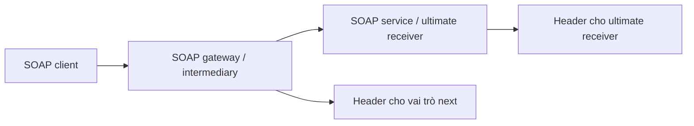
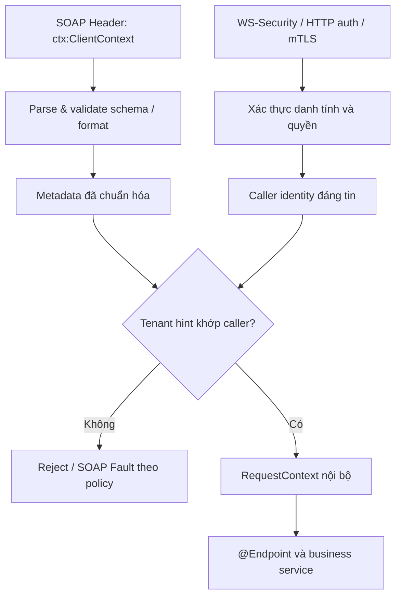

# SOAP header nghiệp vụ và dữ liệu định tuyến, bảo mật

Một dịch vụ SOAP theo hướng **contract-first** không chỉ có nội dung nghiệp vụ trong `soap:Body`. Thông điệp còn có thể mang `soap:Header` chứa **mã tương quan**, **định danh yêu cầu**, **thông tin nguồn gọi**, **chỉ dẫn định tuyến**, hoặc **dữ liệu bảo mật** như WS-Security UsernameToken, Timestamp và XML Signature. Khi tích hợp các hệ thống doanh nghiệp, việc không phân biệt rõ những loại dữ liệu này có thể gây lỗi định tuyến, mất khả năng truy vết, chấp nhận nhầm quyền truy cập hoặc làm chữ ký XML không còn hợp lệ.

Bài học thuộc chương **Header và ngữ cảnh** của module **SPRING_WEB_SERVICES**. Mục tiêu là hiểu từ giao thức SOAP, hợp đồng XSD/WSDL tới cách khai báo/đọc/ghi header trong Spring Web Services (Spring-WS), chuyển thông tin sang **ngữ cảnh xử lý an toàn**, và kiểm thử hành vi của SOAP client/endpoint. Các nội dung liên quan JAXB/OXM, SOAP Fault, interceptor, XML security, WS-Security và chứng chỉ được đặt đúng vai trò để bảo đảm tích hợp ổn định.

**Tư tưởng trung tâm:** `soap:Header` là **vùng mở rộng của thông điệp SOAP**, không phải một bản ghi đã được xác thực. **Header nghiệp vụ**, **header định tuyến** và **header bảo mật** có thể cùng tồn tại nhưng khác namespace, mục đích, quy tắc tin cậy và người chịu trách nhiệm xử lý.

## 1. Mục tiêu học tập

Sau bài này, bạn có thể:

- Phân biệt SOAP Envelope, Header, Body, HTTP headers và thông tin ngữ cảnh chỉ tồn tại bên trong server.
- Đọc QName của các **header blocks** và giải thích `mustUnderstand`, `actor`, `role`, `relay` trong SOAP 1.1 và SOAP 1.2.
- Thiết kế header nghiệp vụ có XSD rõ ràng, liên hệ với `wsdl:message` và `soap:header` của WSDL 1.1.
- Nhận diện WS-Addressing `To`, `Action`, `MessageID`, `ReplyTo`, `RelatesTo` và phân biệt chúng với SOAPAction hay `@PayloadRoot`.
- Phân biệt `wsse:Security`, token, timestamp, signature và bảo mật TLS/HTTP; tránh coi trường tenant/caller do client gửi như bằng chứng danh tính.
- Dùng Spring-WS để đọc header trong endpoint, viết header từ `WebServiceTemplate` và tổ chức interceptor/context mà không lẫn trạng thái giữa các request.
- Xác định lỗi phải chuyển thành SOAP Fault, đặc biệt khi có header `mustUnderstand` mà node nhận không xử lý được.
- Lập ma trận test header, QName, bảo mật, tương quan và khả năng tương thích.

## 2. Cấu trúc SOAP Envelope: Header đứng ở đâu?

SOAP 1.1 sử dụng namespace `http://schemas.xmlsoap.org/soap/envelope/`. Một Envelope có thể chứa một `Header` tùy chọn, sau đó là một `Body` bắt buộc.

```xml
<soap:Envelope
    xmlns:soap="http://schemas.xmlsoap.org/soap/envelope/"
    xmlns:ord="urn:example:orders:body:v1"
    xmlns:ctx="urn:example:orders:header:v1">
    <soap:Header>
        <ctx:ClientContext soap:mustUnderstand="1">
            <ctx:correlationId>corr-8a12</ctx:correlationId>
            <ctx:sourceSystem>partner-portal</ctx:sourceSystem>
        </ctx:ClientContext>
    </soap:Header>
    <soap:Body>
        <ord:GetOrderStatusRequest>
            <ord:orderId>ORD-100</ord:orderId>
        </ord:GetOrderStatusRequest>
    </soap:Body>
</soap:Envelope>
```

Ở đây, `ctx:ClientContext` là một **header block**: phần tử con trực tiếp của `soap:Header`. Còn `ctx:correlationId` và `ctx:sourceSystem` là phần tử con **bên trong header block**.

Một thông điệp có thể mang nhiều header blocks độc lập:

```text
SOAP Envelope
├── SOAP Header
│   ├── ctx:ClientContext        (nghiệp vụ / quan sát)
│   ├── wsa:Action               (WS-Addressing, nếu dùng)
│   ├── wsa:MessageID            (WS-Addressing, nếu dùng)
│   └── wsse:Security            (WS-Security, nếu dùng)
└── SOAP Body
    └── ord:GetOrderStatusRequest
```

**SOAP Header khác SOAP Body.** Đối với endpoint Spring-WS định tuyến bằng `@PayloadRoot`, thông thường QName của **phần tử payload đầu tiên trong Body** dùng để tìm handler. Chỉ vì SOAP Header có `ctx:ClientContext` hoặc `wsa:Action` không có nghĩa `@PayloadRoot` sẽ tự chuyển sang sử dụng chúng.

### Phân biệt các lớp “header”

| Tên | Nằm ở đâu? | Ví dụ | Ai xử lý? |
|---|---|---|---|
| **HTTP header** | HTTP request/response, ngoài XML Envelope | `Authorization`, `Content-Type`, `SOAPAction` | Transport, gateway, HTTP security |
| **SOAP header block** | Bên trong `soap:Header` | `ctx:ClientContext` | SOAP node, endpoint/interceptor |
| **WS-Addressing header** | SOAP Header theo chuẩn WS-Addressing | `wsa:Action`, `wsa:MessageID` | Hạ tầng WS-Addressing / ứng dụng |
| **WS-Security header** | `wsse:Security` trong SOAP Header | `wsu:Timestamp`, `ds:Signature` | Security engine/interceptor |
| **Application request context** | Bộ nhớ xử lý bên trong server | Caller đã xác thực, correlation ID đã chuẩn hóa | Framework và business code |
| **SOAP Body payload** | Trong `soap:Body` | `ord:GetOrderStatusRequest` | JAXB/OXM, schema validator, endpoint |

Không dùng từ “header” chung chung trong đặc tả tích hợp: hãy ghi rõ **HTTP header** hay **SOAP header block**, namespace nào, mức độ bắt buộc, ai kiểm chứng và điều kiện phản hồi lỗi.

## 3. Header blocks cũng được định danh bằng QName

Giống phần tử nghiệp vụ, tên header được xác định bằng **namespace URI + local name**, không phải prefix.

Hai header sau có cùng expanded QName:

```xml
<a:ClientContext xmlns:a="urn:example:orders:header:v1"/>
<b:ClientContext xmlns:b="urn:example:orders:header:v1"/>
```

QName ở cả hai là:

```text
{urn:example:orders:header:v1}ClientContext
```

Nếu đổi URI `urn:example:orders:header:v1` thành `urn:example:orders:header:v2` thì đã đổi QName dù vẫn viết `a:ClientContext`. Spring-WS nên kiểm tra QName của header bằng `javax.xml.namespace.QName` hoặc XML parser namespace-aware, không so chuỗi prefix `a`/`b`.

**SOAP Header có thể chứa nhiều namespace** trong cùng thông điệp: header nghiệp vụ `urn:example:orders:header:v1`, body `urn:example:orders:body:v1`, WS-Addressing và WS-Security theo chuẩn riêng. Đây là thiết kế bình thường, không phải “sai namespace”.

### Default namespace và lỗi thường gặp

```xml
<soap:Header xmlns:soap="http://schemas.xmlsoap.org/soap/envelope/">
    <ClientContext xmlns="urn:example:orders:header:v1">
        <correlationId>corr-8a12</correlationId>
    </ClientContext>
</soap:Header>
```

Phần tử `ClientContext` và `correlationId` đều thuộc default namespace `urn:example:orders:header:v1`, tương đương cách ghi có prefix `ctx`. Nhưng:

```xml
<soap:Header
    xmlns:soap="http://schemas.xmlsoap.org/soap/envelope/"
    xmlns:ctx="urn:example:orders:header:v1">
    <ctx:ClientContext>
        <correlationId>corr-8a12</correlationId>
    </ctx:ClientContext>
</soap:Header>
```

thì `correlationId` **không namespace** (không có default namespace), dù root đúng QName. Nếu XSD yêu cầu các phần tử con `qualified`, header sẽ không hợp lệ.

Một lỗi nguy hiểm hơn là đặt default namespace SOAP lên cả phần tử nghiệp vụ: header `ClientContext` có thể vô tình trở thành phần tử thuộc SOAP Envelope namespace. Luôn inspect QName thực tế thay vì đoán từ tên thẻ.

## 4. Thiết kế header nghiệp vụ: cần truyền gì và không nên truyền gì?

Header nghiệp vụ phù hợp với **metadata của lần trao đổi**, khi thông tin đó không phải phần chính của hành động nghiệp vụ. Ví dụ với dịch vụ tra cứu đơn hàng:

| Trường | Ý nghĩa | Chính sách tham khảo |
|---|---|---|
| `correlationId` | Kết nối log/request giữa các hệ thống | Sinh/chuẩn hóa nếu thiếu; giới hạn độ dài và ký tự |
| `sourceSystem` | Hệ thống tự khai báo nguồn gửi | Hữu ích để quan sát; không dùng độc lập để cấp quyền |
| `tenantHint` | Gợi ý tenant cho định tuyến nghiệp vụ | Phải đối chiếu với danh tính đã xác thực |
| `locale` | Ngôn ngữ ưa thích cho thông điệp người dùng | Ràng buộc tập giá trị, không đưa thẳng vào XPath/SQL |
| `idempotencyKey` | Định danh chống lặp khi thao tác có side effect | Cần unique constraint/store và chính sách retry |
| `businessProcessId` | Định danh luồng quy trình liên hệ nhiều operation | Không tự thay thế WS-Addressing MessageID |
| `deadline` | Yêu cầu thời hạn xử lý từ phía client | Server đặt trần/giới hạn đáng tin, không bỏ qua timeout nội bộ |

Không phải mọi metadata đều cần ở SOAP Header. Nếu một trường trực tiếp quyết định **nghĩa của operation** hoặc bắt buộc để nghiệp vụ xử lý, đưa vào SOAP Body cũng có thể hợp lý. Quyết định dựa trên thiết kế contract, khả năng sinh client và sự rõ ràng đối với đối tác.

### Tránh đặt credential tùy ý trong header nghiệp vụ

Không tự tạo:

```xml
<ctx:ClientContext>
    <ctx:isAdmin>true</ctx:isAdmin>
    <ctx:tenantId>another-customer</ctx:tenantId>
</ctx:ClientContext>
```

rồi mặc định coi đó là sự thật. Bất kỳ client nào tự soạn XML đều có thể điền các giá trị này nếu không có cơ chế xác thực và kiểm tra toàn vẹn. Danh tính, role/permission và tenant đáng tin phải được **xác minh ở tầng security** (TLS/mTLS, HTTP auth, WS-Security hoặc cơ chế được hai bên phê duyệt), rồi mới đưa vào business context.

`correlationId` cũng là dữ liệu do phía gửi cung cấp; cần giới hạn độ dài, định dạng, tránh newline/log injection và không để nó trở thành khóa truy cập dữ liệu nhạy cảm.

## 5. XSD contract-first cho SOAP header và body

Để mô tả header rõ ràng, có thể định nghĩa một **global element** trong XSD riêng, bên cạnh XSD nghiệp vụ của Body. Ví dụ `order-header-v1.xsd`:

```xml
<?xml version="1.0" encoding="UTF-8"?>
<xs:schema
    xmlns:xs="http://www.w3.org/2001/XMLSchema"
    xmlns:ctx="urn:example:orders:header:v1"
    targetNamespace="urn:example:orders:header:v1"
    elementFormDefault="qualified">

    <xs:simpleType name="CorrelationIdType">
        <xs:restriction base="xs:token">
            <xs:minLength value="1"/>
            <xs:maxLength value="80"/>
        </xs:restriction>
    </xs:simpleType>

    <xs:element name="ClientContext">
        <xs:complexType>
            <xs:sequence>
                <xs:element name="correlationId"
                            type="ctx:CorrelationIdType"/>
                <xs:element name="sourceSystem"
                            type="xs:string"/>
                <xs:element name="tenantHint"
                            type="xs:string"
                            minOccurs="0"/>
                <xs:element name="idempotencyKey"
                            type="xs:string"
                            minOccurs="0"/>
            </xs:sequence>
            <!-- Cho phép thuộc tính từ namespace SOAP,
                 chẳng hạn soap:mustUnderstand, nếu có.
                 Không thay thế việc xử lý protocol. -->
            <xs:anyAttribute namespace="##other"
                             processContents="lax"/>
        </xs:complexType>
    </xs:element>
</xs:schema>
```

Và `order-body-v1.xsd`:

```xml
<?xml version="1.0" encoding="UTF-8"?>
<xs:schema
    xmlns:xs="http://www.w3.org/2001/XMLSchema"
    targetNamespace="urn:example:orders:body:v1"
    xmlns:ord="urn:example:orders:body:v1"
    elementFormDefault="qualified">

    <xs:element name="GetOrderStatusRequest">
        <xs:complexType>
            <xs:sequence>
                <xs:element name="orderId" type="xs:string"/>
            </xs:sequence>
        </xs:complexType>
    </xs:element>

    <xs:element name="GetOrderStatusResponse">
        <xs:complexType>
            <xs:sequence>
                <xs:element name="orderId" type="xs:string"/>
                <xs:element name="status" type="xs:string"/>
            </xs:sequence>
        </xs:complexType>
    </xs:element>
</xs:schema>
```

Trong ví dụ này:

- SOAP Header dùng `{urn:example:orders:header:v1}ClientContext`.
- SOAP Body request dùng `{urn:example:orders:body:v1}GetOrderStatusRequest`.
- Hai namespace được **cố ý tách rời** để versioning chính sách metadata không mặc nhiên đổi toàn bộ payload nghiệp vụ.
- `xs:sequence` yêu cầu các child trong `ClientContext` theo thứ tự đã khai báo.
- `processContents="lax"` trên `xs:anyAttribute` cho phép một số thuộc tính SOAP ngoài namespace header khi có cấu hình tương ứng; nó **không có nghĩa** bỏ qua yêu cầu mustUnderstand hoặc tùy tiện chấp nhận mọi header khác.
- `idempotencyKey` trong header có thể hữu ích cho operation ghi dữ liệu; đối với `GetOrderStatus` chỉ là minh họa cấu trúc dùng chung, không nên suy ra operation tra cứu cần cơ chế ghi chống lặp.

**Cảnh báo validation:** `PayloadValidatingInterceptor` của Spring-WS tập trung vào **payload của SOAP Body**. Việc nó kiểm XSD Body không tự chứng minh `ClientContext` trong SOAP Header đã đúng schema. Header cần được parse/validate tường minh qua component phụ trách, hoặc giải pháp validation được cấu hình riêng.

## 6. WSDL 1.1 khai báo SOAP Header ở đâu?

Trong WSDL 1.1, đầu tiên phải có các `wsdl:message` và `wsdl:part` trỏ đến **global element** tương ứng trong XSD. SOAP header được gắn với input/output ở **lớp binding**, thường bằng phần tử `soap:header`.

Một WSDL 1.1 **minh họa** đủ các thành phần chính (đường dẫn XSD phải được công bố/truy cập đúng từ URL WSDL):

```xml
<?xml version="1.0" encoding="UTF-8"?>
<wsdl:definitions
    xmlns:wsdl="http://schemas.xmlsoap.org/wsdl/"
    xmlns:xs="http://www.w3.org/2001/XMLSchema"
    xmlns:soap="http://schemas.xmlsoap.org/wsdl/soap/"
    xmlns:tns="urn:example:orders:wsdl:v1"
    xmlns:ord="urn:example:orders:body:v1"
    xmlns:ctx="urn:example:orders:header:v1"
    targetNamespace="urn:example:orders:wsdl:v1"
    name="OrdersService">

    <wsdl:types>
        <xs:schema targetNamespace="urn:example:orders:wsdl:v1">
            <xs:import
                namespace="urn:example:orders:body:v1"
                schemaLocation="order-body-v1.xsd"/>
            <xs:import
                namespace="urn:example:orders:header:v1"
                schemaLocation="order-header-v1.xsd"/>
        </xs:schema>
    </wsdl:types>

    <wsdl:message name="GetOrderStatusInput">
        <wsdl:part name="parameters"
                   element="ord:GetOrderStatusRequest"/>
    </wsdl:message>

    <wsdl:message name="GetOrderStatusOutput">
        <wsdl:part name="parameters"
                   element="ord:GetOrderStatusResponse"/>
    </wsdl:message>

    <wsdl:message name="ClientContextMessage">
        <wsdl:part name="context"
                   element="ctx:ClientContext"/>
    </wsdl:message>

    <wsdl:portType name="OrdersPortType">
        <wsdl:operation name="GetOrderStatus">
            <wsdl:input message="tns:GetOrderStatusInput"/>
            <wsdl:output message="tns:GetOrderStatusOutput"/>
        </wsdl:operation>
    </wsdl:portType>

    <wsdl:binding name="OrdersSoap11Binding"
                  type="tns:OrdersPortType">
        <soap:binding
            style="document"
            transport="http://schemas.xmlsoap.org/soap/http"/>

        <wsdl:operation name="GetOrderStatus">
            <soap:operation
                soapAction="urn:example:orders:GetOrderStatus"/>
            <wsdl:input>
                <soap:body use="literal"/>
                <soap:header
                    message="tns:ClientContextMessage"
                    part="context"
                    use="literal"/>
            </wsdl:input>
            <wsdl:output>
                <soap:body use="literal"/>
            </wsdl:output>
        </wsdl:operation>
    </wsdl:binding>

    <wsdl:service name="OrdersService">
        <wsdl:port name="OrdersSoap11Port"
                   binding="tns:OrdersSoap11Binding">
            <soap:address
                location="https://api.example.org/ws/orders"/>
        </wsdl:port>
    </wsdl:service>
</wsdl:definitions>
```

Đường truy vết:

```text
wsdl:binding / wsdl:operation / wsdl:input
  soap:body use="literal"
    -> wsdl:message GetOrderStatusInput
    -> wsdl:part parameters
    -> XSD element ord:GetOrderStatusRequest

  soap:header message="tns:ClientContextMessage"
              part="context" use="literal"
    -> wsdl:message ClientContextMessage
    -> wsdl:part context
    -> XSD element ctx:ClientContext
```

**Quan trọng:**

1. `soap:header` nằm ở **binding**; `wsdl:portType` vẫn mô tả operation request–response với một input và một output. Một SOAP header không tạo ra operation mới.
2. Header message có thể được khai báo **riêng** với message của Body, như ví dụ này. WSDL cho phép binding header tham chiếu message/part tương ứng.
3. `wsdl:part/@element` trỏ đến **global element**, không phải chỉ tên `xs:complexType`.
4. `soap:header` là mô tả đóng gói trên wire, **không tự kiểm tra** chữ ký, token, quyền truy cập hay phát sinh SOAP Fault.
5. WSDL 1.1 không diễn đạt đầy đủ mọi ràng buộc “header này bắt buộc để được cấp quyền” hoặc WS-SecurityPolicy. Cần tài liệu contract và policy bảo mật đi kèm, cùng test interoperability.
6. Nếu WSDL có import XSD tương đối nhưng server không công bố hai tệp XSD đó, công cụ sinh client có thể thất bại dù endpoint chạy được.

Nếu hợp đồng tích hợp rất chặt về `soap:header`, fault và WS-Policy, việc duy trì **WSDL tĩnh** do nhóm sở hữu thường dễ kiểm soát hơn so với chỉ sinh WSDL từ quy ước Request/Response của XSD. Hãy luôn kiểm tra WSDL thực sự được công bố.

## 7. `mustUnderstand`: yêu cầu xử lý chứ không phải “có thể bỏ qua”

`mustUnderstand` là một thuộc tính SOAP protocol trên **header block**, dùng để yêu cầu node SOAP được nhắm tới phải hiểu và xử lý phần header theo nghĩa của nó. Giá trị đó không tự biến nội dung header thành đáng tin hay hợp lệ.

SOAP 1.1:

```xml
<ctx:ClientContext
    xmlns:ctx="urn:example:orders:header:v1"
    xmlns:soap="http://schemas.xmlsoap.org/soap/envelope/"
    soap:mustUnderstand="1">
    <ctx:correlationId>corr-8a12</ctx:correlationId>
    <ctx:sourceSystem>partner-portal</ctx:sourceSystem>
</ctx:ClientContext>
```

Nếu node nhận là đích xử lý header block này mà **không hiểu/không thể xử lý theo yêu cầu**, nó cần tuân thủ quy tắc xử lý `MustUnderstand` của SOAP, thường bằng một SOAP Fault tương ứng, thay vì lặng lẽ bỏ qua rồi tiếp tục xử lý như thành công.

### Những điều `mustUnderstand` không nói lên

- Không chứng minh `sourceSystem` đã được xác thực.
- Không tự kích hoạt Spring-WS parser XSD cho header.
- Không tự yêu cầu hệ thống ký/mã hóa header.
- Không tự làm header hiện diện trong mọi request hoặc được sinh đúng bởi client.
- Không tự định nghĩa behavior nghiệp vụ khi field bên trong sai.
- Không cho phép server tùy ý bỏ qua header nhắm tới mình với `mustUnderstand="1"`.

Một header **không có mustUnderstand** vẫn có thể là **bắt buộc theo contract nghiệp vụ**. Khi đó ứng dụng phải xác minh sự hiện diện và nội dung của nó, rồi trả lỗi theo quy ước khi thiếu/sai. Ngược lại, `mustUnderstand="1"` nhấn mạnh nghĩa vụ xử lý theo SOAP protocol, không thay thế chính sách truy cập của ứng dụng.

### SOAP 1.1 và SOAP 1.2 khác nhau

| Khía cạnh | SOAP 1.1 | SOAP 1.2 |
|---|---|---|
| Envelope namespace | `http://schemas.xmlsoap.org/soap/envelope/` | `http://www.w3.org/2003/05/soap-envelope` |
| Thuộc tính định tuyến vai trò | `soap:actor` | `env:role` |
| Xử lý bắt buộc | `soap:mustUnderstand="1"` | `env:mustUnderstand="true"` hoặc `"1"` |
| Header forwarding | Quy tắc SOAP 1.1 | Có thêm `env:relay` cho header được định tuyến phù hợp |
| Fault khi không hiểu header bắt buộc | `MustUnderstand` theo SOAP 1.1 | `env:MustUnderstand` theo SOAP 1.2 |
| Cấu trúc Fault | `faultcode`, `faultstring`, `detail` | `Code`, `Reason`, `Detail` |

Trong SOAP 1.1, giá trị `mustUnderstand` được biểu diễn theo quy tắc boolean của SOAP 1.1 (`0`/`1`). Trong SOAP 1.2, biểu diễn thuộc tính tuân theo kiểu boolean tương ứng, và `role`/`relay` thay đổi cách xử lý header tại các node.

Không dùng `soap:actor` của SOAP 1.1 như một thuộc tính thay thế trực tiếp cho `env:role` của SOAP 1.2 khi chưa thay toàn bộ Envelope/binding tương ứng.

## 8. `actor`, `role` và trung gian SOAP

Một thông điệp có thể đi qua nhiều SOAP nodes: gateway, relay, intermediary, rồi tới dịch vụ nghiệp vụ. Header blocks có thể được **nhắm tới một vai trò/node nhất định**, không mặc nhiên dành cho mọi node trong đường đi.

Ví dụ SOAP 1.1:

```xml
<ctx:AuditHint
    xmlns:ctx="urn:example:orders:header:v1"
    xmlns:soap="http://schemas.xmlsoap.org/soap/envelope/"
    soap:actor="http://schemas.xmlsoap.org/soap/actor/next"
    soap:mustUnderstand="1">
    ...
</ctx:AuditHint>
```

Giá trị `http://schemas.xmlsoap.org/soap/actor/next` chỉ một actor chuẩn cho node tiếp theo phù hợp SOAP 1.1. Trong SOAP 1.2, vai trò có thể được biểu diễn bằng `env:role`, với các URI chuẩn như `http://www.w3.org/2003/05/soap-envelope/role/next` và `.../ultimateReceiver`.



Sơ đồ chỉ minh họa vai trò xử lý header. Một HTTP reverse proxy không tự động trở thành SOAP intermediary hiểu các role; nếu gateway chỉ chuyển byte qua mạng, không nên giả định nó xử lý `mustUnderstand`. Muốn xử lý SOAP headers, gateway phải được thiết kế như một SOAP node với behavior phù hợp.

### Không tự ý xóa hoặc chuyển tiếp header đã ký

Một intermediary có thể có nghĩa vụ xử lý/loại bỏ/chuyển tiếp header theo SOAP processing model và role/relay. Nhưng trong môi trường **WS-Security**, việc xóa hoặc thay đổi một header nằm trong vùng được ký có thể làm chữ ký không còn hợp lệ.

Vì thế, thiết kế gateway phải xác định: node nào xác minh chữ ký, node nào là người nhận cuối cùng, header nào được phép biến đổi, và khi cần có cơ chế kiểm chứng/ký lại trong ranh giới tin cậy. Không mặc định “đổi prefix là tương đương” thì **chữ ký XML cũng luôn còn hợp lệ**.

## 9. Dữ liệu định tuyến: `@PayloadRoot`, SOAPAction và WS-Addressing

Có ba loại chỉ dẫn thường bị gộp làm một:

| Thông tin | Vị trí | Ý nghĩa điển hình |
|---|---|---|
| QName của Body payload | Trong `soap:Body` | Chọn loại yêu cầu nghiệp vụ |
| `SOAPAction` | HTTP header cho SOAP 1.1 HTTP binding | Mô tả ý định của request theo binding, có thể được gateway/framework sử dụng |
| `wsa:Action` | SOAP Header theo WS-Addressing | Định danh action ngữ nghĩa trong cơ chế WS-Addressing |
| `wsa:To` | SOAP Header | Địa chỉ đích logic |
| `wsa:MessageID` | SOAP Header | Định danh message |
| `wsa:ReplyTo` | SOAP Header | Endpoint nhận phản hồi theo mô hình addressing |
| `wsa:RelatesTo` | SOAP Header | Liên hệ response với message trước đó |

**Không có một luật chung rằng tất cả các giá trị này phải bằng tên Java method hoặc local name của Body.** Contract, binding và policy quyết định cách sử dụng; một số hệ thống có thể kiểm tính nhất quán giữa SOAPAction và WS-Addressing Action.

### SOAPAction nằm ở HTTP, không phải mặc định trong `soap:Header`

Ví dụ SOAP 1.1:

```http
POST /ws/orders HTTP/1.1
Host: api.example.org
Content-Type: text/xml; charset=utf-8
SOAPAction: "urn:example:orders:GetOrderStatus"

[SOAP 1.1 Envelope chứa GetOrderStatusRequest]
```

`SOAPAction` không phải `ctx:ClientContext` và cũng không phải `wsa:Action`. Trong Spring-WS, `@PayloadRoot` mapping theo QName Body; một cấu hình khác có thể dùng ánh xạ theo SOAPAction. Vì vậy, không thể nói “Spring-WS luôn định tuyến chỉ bằng SOAPAction” hay “SOAPAction không bao giờ được dùng”.

### WS-Addressing khi hệ thống tích hợp yêu cầu

Ví dụ các header blocks theo WS-Addressing 1.0:

```xml
<soap:Header
    xmlns:soap="http://schemas.xmlsoap.org/soap/envelope/"
    xmlns:wsa="http://www.w3.org/2005/08/addressing">

    <wsa:To>https://api.example.org/ws/orders</wsa:To>
    <wsa:Action>urn:example:orders:GetOrderStatus</wsa:Action>
    <wsa:MessageID>urn:uuid:5ae5b2f1-7788-4c40-aefa-000000000001</wsa:MessageID>
    <wsa:ReplyTo>
        <wsa:Address>
            http://www.w3.org/2005/08/addressing/anonymous
        </wsa:Address>
    </wsa:ReplyTo>
</soap:Header>
```

Ở đây các URI/nội dung là ví dụ. `ReplyTo` dạng anonymous thể hiện kiểu trả lời qua kênh tương ứng trong nhiều trường hợp; **không phải mọi hệ thống đều hỗ trợ callback tới URL tùy ý từ ReplyTo**. Việc cho client tùy ý chỉ định URL callback có thể tạo rủi ro SSRF hoặc gửi dữ liệu ra đích không tin cậy, nên phải có allowlist/chính sách xác minh.

Nếu dịch vụ **không dùng WS-Addressing**, không nên tự thêm các header `wsa:*` chỉ để “tăng khả năng định tuyến”. Một SOAP client phải tuân thủ WSDL/binding/policy do đối tác công bố.

### `MessageID`, `correlationId` và `idempotencyKey` không đồng nhất

- **WS-Addressing MessageID:** định danh một SOAP message trong mô hình addressing; response có thể dùng `RelatesTo` để trỏ lại.
- **Business correlationId:** gom nhiều request, log và sự kiện của một quy trình.
- **Idempotency key:** giúp server nhận diện retry cùng một thao tác có side effect để ngăn xử lý lặp.

Ví dụ một chuỗi retry có thể tạo SOAP message mới với `MessageID` mới nhưng **giữ nguyên idempotency key** để không tạo hai đơn. Không dùng `MessageID` thay idempotency key nếu contract chưa quy định và chưa có data store kiểm soát trùng lặp.

## 10. WS-Security: header bảo mật và phạm vi tin cậy

WS-Security đặt nhiều cấu trúc bảo mật vào một hoặc nhiều `wsse:Security` header blocks. Các thành phần thường gặp:

- **UsernameToken**: thông tin xác thực theo policy; password text/digest và khả năng chống replay phải được đánh giá cùng TLS.
- **Timestamp**: thời điểm tạo/hết hạn; cần giới hạn clock skew và replay theo chính sách.
- **BinarySecurityToken** hoặc tham chiếu chứng chỉ: mang/nhận diện token/chứng chỉ trong cơ chế cụ thể.
- **XML Signature**: chứng minh toàn vẹn và nguồn gốc của các phần tử được ký theo khóa/chính sách.
- **XML Encryption**: bảo vệ nội dung được mã hóa tại tầng thông điệp.
- **SecurityTokenReference**: tham chiếu token dùng cho xác minh.

Một header rút gọn theo hình dạng WS-Security (giá trị và thành phần cố tình lược bỏ; **không phải thông điệp đã được ký hoặc chứng thực**):

```xml
<wsse:Security
    xmlns:wsse="http://docs.oasis-open.org/wss/2004/01/oasis-200401-wss-wssecurity-secext-1.0.xsd"
    xmlns:wsu="http://docs.oasis-open.org/wss/2004/01/oasis-200401-wss-wssecurity-utility-1.0.xsd"
    xmlns:soap="http://schemas.xmlsoap.org/soap/envelope/"
    soap:mustUnderstand="1">
    <wsu:Timestamp wsu:Id="TS-1">
        <wsu:Created>2026-11-27T00:00:00Z</wsu:Created>
        <wsu:Expires>2026-11-27T00:05:00Z</wsu:Expires>
    </wsu:Timestamp>
    <!-- Chữ ký / token đúng chuẩn được tạo và kiểm bởi thư viện WS-Security. -->
</wsse:Security>
```

Ví dụ trên **không đủ** để đạt một policy đòi Signature hoặc UsernameToken. Không nên tự ghép XML Signature từ string hoặc coi một `wsu:Timestamp` tự có là đã xác thực. Phải dùng thư viện hỗ trợ WS-Security và kiểm thử liên thông với đối tác.

### Ba tầng bảo mật khác nhau

| Tầng | Mục tiêu | Ví dụ |
|---|---|---|
| Transport | Bảo vệ kết nối và xác thực certificate tại kênh | HTTPS/TLS, mutual TLS |
| HTTP access control | Quyền truy cập URL/operation ở tầng HTTP | Spring Security Basic/OAuth2, gateway policy |
| SOAP message | Xác minh token, thời hạn, chữ ký, mã hóa message | Spring-WS Security / Apache WSS4J |

TLS không bảo đảm rằng một SOAP header business `tenantHint` là đúng; WS-Security signature cũng không tự cho phép caller truy cập mọi tenant. Phải **xác minh danh tính và quyền truy cập nghiệp vụ**.

### Ký header nào?

Nếu `ClientContext` chứa thông tin được dùng trong quyết định bảo mật hoặc chống lặp, cần thống nhất chính sách toàn vẹn và nguồn tin cậy. Có thể yêu cầu ký Body, Timestamp, WS-Addressing headers và những header nghiệp vụ quan trọng theo policy của đối tác. Nếu chỉ Body được ký nhưng `tenantHint`/`Action` không được bảo vệ, hệ thống phải xem xét nguy cơ kẻ trung gian chỉnh sửa metadata.

**Không tự kết luận “có chữ ký SOAP là mọi header đã được ký”**. Chữ ký bao phủ các tham chiếu/parts cụ thể. Khi xác minh, dùng WSS4J và kiểm tra các thành phần **bắt buộc phải được ký** theo policy, chống signature wrapping và xử lý đúng XML ID/canonicalization.

## 11. Spring-WS đọc header trong endpoint như thế nào?

Trong Spring-WS, `@Endpoint` nhận payload XML thông qua `@RequestPayload`. Với SOAP Header, có thể sử dụng `@SoapHeader` để yêu cầu framework cung cấp một `SoapHeaderElement` theo QName.

Ví dụ endpoint ở mức cấu trúc:

```java
import org.springframework.ws.server.endpoint.annotation.Endpoint;
import org.springframework.ws.server.endpoint.annotation.PayloadRoot;
import org.springframework.ws.server.endpoint.annotation.RequestPayload;
import org.springframework.ws.server.endpoint.annotation.ResponsePayload;
import org.springframework.ws.soap.SoapHeaderElement;
import org.springframework.ws.soap.server.endpoint.annotation.SoapHeader;

@Endpoint
public class OrderEndpoint {

    private static final String BODY_NS =
        "urn:example:orders:body:v1";

    private final OrderService service;
    private final ClientContextReader contextReader;

    public OrderEndpoint(OrderService service,
                         ClientContextReader contextReader) {
        this.service = service;
        this.contextReader = contextReader;
    }

    @PayloadRoot(
        namespace = BODY_NS,
        localPart = "GetOrderStatusRequest"
    )
    @ResponsePayload
    public GetOrderStatusResponse getStatus(
            @RequestPayload GetOrderStatusRequest request,
            @SoapHeader(
                "{urn:example:orders:header:v1}ClientContext"
            ) SoapHeaderElement clientContextHeader) {

        ClientContext context =
            contextReader.readAndValidate(clientContextHeader);

        return service.getOrderStatus(
            request.getOrderId(),
            context.correlationId()
        );
    }
}
```

Các lớp `OrderService`, `ClientContextReader`, `ClientContext` và JAXB request/response được ứng dụng định nghĩa; đoạn code này thể hiện **điểm tích hợp**, chưa phải một endpoint standalone. Trong triển khai thật, cần kiểm tra hành vi khi header bị thiếu và cách argument resolver của Spring-WS/version cụ thể xử lý tình huống đó. `ClientContextReader` phải parse theo namespace, kiểm schema/quy tắc field và không tự xác thực `sourceSystem` thành danh tính.

Phân biệt:

- `@PayloadRoot` chọn method từ **QName của Body payload**.
- `@SoapHeader` truy xuất **header block** theo QName do annotation chỉ định.
- `@ResponsePayload` đưa response nghiệp vụ vào Body.
- Security interceptor/HTTP layer xử lý **định danh đáng tin** và kiểm chữ ký/token; endpoint không tự coi header text là credential hợp lệ.

Nếu header có thể vắng mặt hợp lệ, hãy thiết kế đường xử lý rõ ràng và test thay vì giả định `@SoapHeader` luôn trả null. Một cách khác là đọc `SoapMessage`/`MessageContext` bằng API SOAP Header và tự quyết định khi không tìm thấy phần tử.

### Phương án đọc thủ công qua `MessageContext`

Khi cần kiểm tra nhiều header hoặc xử lý điều kiện có/không có header, một interceptor có thể duyệt trực tiếp `SoapHeader`:

```java
import java.util.Iterator;
import javax.xml.namespace.QName;

import org.springframework.ws.context.MessageContext;
import org.springframework.ws.soap.SoapHeader;
import org.springframework.ws.soap.SoapHeaderElement;
import org.springframework.ws.soap.SoapMessage;

public final class HeaderLookup {

    private static final QName CONTEXT_NAME =
        new QName(
            "urn:example:orders:header:v1",
            "ClientContext"
        );

    public static SoapHeaderElement findContext(
            MessageContext context) {

        SoapMessage request =
            (SoapMessage) context.getRequest();
        SoapHeader header = request.getSoapHeader();

        Iterator<SoapHeaderElement> matches =
            header.examineHeaderElements(CONTEXT_NAME);

        return matches.hasNext() ? matches.next() : null;
    }
}
```

Đây là helper tìm **phần tử header**; nó chưa validate nội dung hoặc bảo đảm đúng số lượng, chưa xét actor/role và mustUnderstand. Nếu contract chỉ cho phép một header `ClientContext`, nên từ chối tình huống nhiều header trùng QName; không lấy phần tử đầu tiên rồi bỏ qua những phần tử còn lại.

`javax.xml.namespace.QName` vẫn thuộc JDK ngay cả khi ứng dụng dùng JAXB Jakarta. Nếu dùng Spring-WS với transport không có SOAP, không được cast message sang `SoapMessage` mà không xác minh loại message.

## 12. Ngữ cảnh server: chuyển từ header thô sang dữ liệu đã kiểm chứng

Một thiết kế tốt chia **dữ liệu nhận được** thành ba nhóm rõ ràng:

1. **Raw header data:** XML bên client gửi, chưa được tin cậy.
2. **Validated business metadata:** đã kiểm QName/schema/format/range và chính sách header nghiệp vụ.
3. **Authenticated security context:** danh tính/role/tenant/claim được một thành phần bảo mật xác minh theo policy.

Ví dụ luồng:



Một ngữ cảnh nội bộ có thể là immutable record:

```java
public record VerifiedRequestContext(
    String correlationId,
    String authenticatedCaller,
    String tenantId,
    String sourceSystem
) {}
```

Đây là cấu trúc dữ liệu ứng dụng. `authenticatedCaller` và `tenantId` phải do security/authorization layer xác lập, không đơn giản sao chép từ `sourceSystem` và `tenantHint` do client tự khai báo.

### Cơ chế lưu context trong Spring-WS

Có thể truyền `VerifiedRequestContext` trực tiếp qua method parameters/service calls, hoặc sử dụng **MessageContext property** nếu cần chuyển giữa các thành phần tham gia cùng lần dispatch. Với `MessageContext`, một interceptor có thể gắn object:

```java
messageContext.setProperty(
    "app.verifiedRequestContext",
    verifiedContext
);
```

Một thành phần phía sau lấy bằng key tương ứng, kiểm tra type trước khi dùng. Đây là dữ liệu **gắn với MessageContext của lượt xử lý**; không phải một field `currentRequestContext` trong interceptor singleton.

Nếu dùng request-scoped bean hoặc ThreadLocal, phải xác nhận transport và lifecycle cụ thể:

- **Servlet HTTP request scope** không mặc nhiên tồn tại trong SOAP/JMS hoặc worker async.
- **ThreadLocal** có thể bị giữ lại trong thread pool nếu thiếu `remove()` trong `finally`.
- **Async processing** không tự truyền context từ servlet thread sang worker.
- **Multiple replicas** không chia sẻ memory; dữ liệu cần bền vững phải lưu ở DB/queue/storage phù hợp.
- **Thông tin nhạy cảm** không được giữ lâu trong cache/log sau khi request kết thúc.

Nguyên tắc thuận tiện nhất cho endpoint đơn giản vẫn là **truyền giá trị đã kiểm chứng một cách tường minh**.

## 13. Client Spring-WS ghi SOAP Header như thế nào?

Với `WebServiceTemplate`, `WebServiceMessageCallback` cho phép chỉnh request SOAP trước khi gửi. Có thể dùng JAXB/Spring OXM để marshal **global element của header** vào `SoapHeader`, thay vì nối chuỗi XML chứa dữ liệu do user cung cấp.

Ví dụ giả định có `Jaxb2Marshaller` cho package header, và `clientContextRoot` là JAXB object có `@XmlRootElement` hoặc `JAXBElement<T>` của global element `ClientContext`:

```java
import org.springframework.oxm.jaxb.Jaxb2Marshaller;
import org.springframework.ws.client.core.WebServiceTemplate;
import org.springframework.ws.soap.SoapMessage;

public final class OrdersSoapClient {

    private final WebServiceTemplate template;
    private final Jaxb2Marshaller headerMarshaller;
    private final String endpointUri;

    public OrdersSoapClient(
            WebServiceTemplate template,
            Jaxb2Marshaller headerMarshaller,
            String endpointUri) {
        this.template = template;
        this.headerMarshaller = headerMarshaller;
        this.endpointUri = endpointUri;
    }

    public Object getStatus(
            Object bodyRequest,
            Object clientContextRoot) {

        return template.marshalSendAndReceive(
            endpointUri,
            bodyRequest,
            message -> {
                SoapMessage soap = (SoapMessage) message;
                soap.setSoapAction(
                    "urn:example:orders:GetOrderStatus"
                );

                // clientContextRoot có QName ClientContext.
                headerMarshaller.marshal(
                    clientContextRoot,
                    soap.getSoapHeader().getResult()
                );
            }
        );
    }
}
```

**Giả định quan trọng:** `template` đã được cấu hình marshaller/unmarshaller cho Body, `headerMarshaller` đã có JAXB metadata phù hợp, message factory dùng SOAP 1.1 theo WSDL ví dụ và `clientContextRoot` là JAXB root hợp lệ. `Object` trong chữ ký chỉ để dễ nhìn luồng; code thực nên dùng các kiểu JAXB đã sinh và xử lý response/Fault rõ ràng.

Mỗi lần gọi phải tạo **header context riêng** (hoặc object immutable không bị sửa trong lúc marshal). Không giữ một `ClientContext` mutable trong field singleton rồi liên tục thay `correlationId` trước mỗi lời gọi — hai thread có thể trộn thông tin. `Jaxb2Marshaller` có thể dùng chung sau cấu hình nếu các adapter/listener của nó an toàn đồng thời.

### Nếu phải đặt `mustUnderstand`

`mustUnderstand` là thuộc tính SOAP trên **header block**, không phải trường nghiệp vụ trong `ClientContext`. Tùy API và kiểu thông điệp SOAP, có thể truy xuất `SoapHeaderElement` và gọi phương thức thiết lập mustUnderstand tương ứng, hoặc tạo cấu trúc header được framework/WS-Security interceptor quản lý. Không tự tạo attribute `mustUnderstand` không namespace: thuộc tính phải thuộc **SOAP Envelope namespace** đúng phiên bản.

Ví dụ mã ý tưởng khi header block đã được tạo bởi SOAP API:

```java
SoapHeaderElement headerElement = /* phần tử đã tạo qua SoapHeader */;
headerElement.setMustUnderstand(true);
```

Nếu dùng JAXB marshal trực tiếp cả header root vào `SoapHeader`, cách lấy `SoapHeaderElement` tương ứng và gán thuộc tính phụ thuộc message API/implementation; cần test output thật, không giả định sample này là method hoàn chỉnh.

### Chọn SOAPAction đúng contract

`SOAPAction` là HTTP header ở SOAP 1.1 HTTP binding. `soap.setSoapAction(...)` là API Spring-WS áp dụng cho `SoapMessage`; không tự ghép nó bằng cách thêm `<SOAPAction>` bên trong SOAP Header. Khi dùng SOAP 1.2, cách biểu diễn action/Content-Type khác, nên phải tuân theo binding được công bố.

## 14. Phía server tạo SOAP response header

Nếu contract yêu cầu response cũng phải có metadata tương quan, server có thể thêm một header block `ServerContext` hoặc `ClientContextResponse` đã được định nghĩa riêng trong XSD/WSDL.

Ví dụ SOAP response 1.1:

```xml
<soap:Envelope
    xmlns:soap="http://schemas.xmlsoap.org/soap/envelope/"
    xmlns:ctx="urn:example:orders:header:v1"
    xmlns:ord="urn:example:orders:body:v1">
    <soap:Header>
        <ctx:ServerContext>
            <ctx:correlationId>corr-8a12</ctx:correlationId>
            <ctx:processedBy>orders-service</ctx:processedBy>
        </ctx:ServerContext>
    </soap:Header>
    <soap:Body>
        <ord:GetOrderStatusResponse>
            <ord:orderId>ORD-100</ord:orderId>
            <ord:status>SHIPPED</ord:status>
        </ord:GetOrderStatusResponse>
    </soap:Body>
</soap:Envelope>
```

`ServerContext` ở đây là **ví dụ minh họa thêm**, chưa có trong XSD/WSDL mục 5–6. Muốn coi đây là contract thực, cần khai báo global element tương ứng, message và `soap:header` ở response binding, rồi kiểm thử client có đọc được hay không.

Một endpoint/interceptor có thể dùng `MessageContext.getResponse()` để truy cập message response và thêm header bằng API SOAP/JAXB. Cần phân biệt:

- **Response Header** có thể chứa correlation ID, thông tin server hoặc WS-Addressing `RelatesTo`.
- **Response Body** chứa dữ liệu `GetOrderStatusResponse` hoặc `soap:Fault`.
- **HTTP response headers** như caching/security headers không tự xuất hiện trong SOAP Header.
- **WS-Security outbound** có thể ký/mã hóa phần tương ứng; nên để interceptor bảo mật thực hiện đúng thứ tự đã cấu hình.

Nếu một response không được tạo vì lỗi xảy ra trước SOAP dispatcher (TLS handshake, HTTP auth, proxy), ứng dụng có thể không có cơ hội tạo SOAP response header. Không bắt buộc mọi lỗi ngoài mạng đều mang `correlationId` trong SOAP XML.

## 15. Xử lý header thiếu, trùng, sai namespace và bị giả mạo

Một parser header chỉ đọc được XML chưa đủ để bảo đảm contract. Cần chính sách cho các trường hợp:

| Trường hợp | Ví dụ | Xử lý gợi ý |
|---|---|---|
| Header nghiệp vụ cần thiết bị thiếu | Không có `ctx:ClientContext` | Từ chối theo contract hoặc sinh fallback nếu contract cho phép |
| Header không bắt buộc bị thiếu | Không có `correlationId` | Server tạo ID mới và ghi nhận nguồn |
| Trùng header block cùng QName | Hai `ctx:ClientContext` | Từ chối nếu contract yêu cầu một; tránh chọn ngẫu nhiên |
| Header namespace sai | `ctx:ClientContext` trỏ sang `/v2` | Không coi là header `v1` |
| Child namespace sai | `<correlationId>` không namespace khi XSD yêu cầu qualified | Header validation fail |
| Field quá dài hoặc chứa ký tự điều khiển | Correlation ID vượt giới hạn | Từ chối/chuẩn hóa an toàn, không đưa thẳng vào log |
| `tenantHint` không khớp caller | Client khai tenant khác | Từ chối authorization; không tin header thô |
| `mustUnderstand="1"` với header node không hiểu | Header bắt buộc nhắm tới node | Theo SOAP processing model: MustUnderstand Fault |
| `wsa:To`/`ReplyTo` bất thường | Đích khác policy hoặc URL nội bộ | Từ chối hoặc bỏ theo chính sách; tránh SSRF |
| WS-Security timestamp hết hạn | Request replay/cũ | Reject theo policy và giới hạn clock skew |
| Signature thiếu header bắt buộc | Metadata quan trọng không được ký | Từ chối theo signed-parts policy |
| SOAP version không khớp | Envelope 1.2 tới binding 1.1 | Protocol-level error, không “sửa” bằng đổi prefix |
| SOAPAction khác Action | HTTP action và `wsa:Action` không tương thích | Kiểm tra theo WSDL/WS-A policy; không suy luận mù |

**Quy tắc sai namespace:** QName so theo **namespace URI + local name**, phân biệt chữ hoa/thường, dấu `/` cuối hoặc `urn:...:v1` so với `urn:...:v2`. Prefix khác nhưng URI/local name giống nhau thì vẫn là cùng header QName.

### Khi nào trả SOAP Fault?

Cần phân loại:

- **MustUnderstand Fault**: node nhận được nhắm xử lý header bắt buộc nhưng không hiểu cách xử lý theo SOAP.
- **SOAP protocol error**: Envelope version, cấu trúc Header/Body hoặc encoding không đúng.
- **Header contract validation error**: thiếu/sai cấu trúc `ClientContext`; có thể ánh xạ sang client/sender Fault theo chính sách.
- **Security Fault**: token/signature/timestamp không hợp lệ hoặc vi phạm WS-SecurityPolicy.
- **Business Fault**: truy vấn đơn hàng không tồn tại, không đủ quyền theo domain, hoặc trạng thái nghiệp vụ khác được contract quy định.
- **Transport error**: TLS/mTLS, DNS, timeout, HTTP authentication bị chặn trước SOAP processing, có thể không có SOAP Fault.

`@EnableWs` hay `@PayloadRoot` không tự làm mọi loại lỗi trên có cùng một XML Fault detail. Hãy xác định fault mapping và khả năng client xử lý lỗi ở từng tầng.

## 16. SOAP Fault và `mustUnderstand` ở hai phiên bản

Một ví dụ SOAP 1.1 MustUnderstand Fault được rút gọn:

```xml
<soap:Envelope
    xmlns:soap="http://schemas.xmlsoap.org/soap/envelope/">
    <soap:Body>
        <soap:Fault>
            <faultcode>soap:MustUnderstand</faultcode>
            <faultstring>Required SOAP header is not understood</faultstring>
        </soap:Fault>
    </soap:Body>
</soap:Envelope>
```

Phần này minh họa **hình dạng lỗi giao thức**, không khẳng định mọi Spring-WS message factory/interceptor sẽ sinh chính xác câu chữ trên. SOAP 1.1 có `faultcode`/`faultstring`; SOAP 1.2 dùng các phần tử `Code`, `Reason` và có thể chỉ rõ header chưa được hiểu theo cấu trúc chuẩn.

Đối với lỗi business header, hệ thống có thể cần Fault detail theo XSD:

```xml
<soap:Envelope
    xmlns:soap="http://schemas.xmlsoap.org/soap/envelope/"
    xmlns:err="urn:example:orders:error:v1">
    <soap:Body>
        <soap:Fault>
            <faultcode>soap:Client</faultcode>
            <faultstring>Invalid client context</faultstring>
            <detail>
                <err:HeaderValidationFault>
                    <err:code>INVALID_CONTEXT</err:code>
                </err:HeaderValidationFault>
            </detail>
        </soap:Fault>
    </soap:Body>
</soap:Envelope>
```

`err:HeaderValidationFault` là **ví dụ contract riêng** chưa được khai báo trong XSD/WSDL mẫu. Muốn công bố, cần định nghĩa element, WSDL fault nếu phù hợp mô hình operation, và triển khai Fault detail. Không nhét token, raw credential, nội dung khóa hoặc stack trace vào `faultstring`/`detail`.

Với WS-Security, lỗi xác minh có thể phát sinh **trước endpoint nghiệp vụ** và được security interceptor xử lý khác business exception. Một phần lỗi security có thể được che thông tin chi tiết để tránh lộ cấu hình xác thực.

## 17. Interceptor Spring-WS: nơi kiểm tra và lưu ngữ cảnh

Spring-WS hỗ trợ `EndpointInterceptor` với các callback liên quan request, response, fault và hoàn tất. Một interceptor có thể:

- Đọc SOAP Header, kiểm sự hiện diện và QName.
- Kiểm kiểu, giới hạn và XSD của header nghiệp vụ.
- Đối chiếu metadata với danh tính đã được xác thực.
- Lưu `VerifiedRequestContext` vào `MessageContext` của lời gọi.
- Gắn correlation ID an toàn vào log/response khi phù hợp.
- Trả lỗi theo policy nếu metadata không hợp lệ.

Phác thảo interceptor **stateless**:

```java
import org.springframework.ws.context.MessageContext;
import org.springframework.ws.server.EndpointInterceptor;

public final class BusinessHeaderInterceptor
        implements EndpointInterceptor {

    private final ClientContextValidator validator;

    public BusinessHeaderInterceptor(
            ClientContextValidator validator) {
        this.validator = validator;
    }

    @Override
    public boolean handleRequest(
            MessageContext context, Object endpoint) throws Exception {

        var header = HeaderLookup.findContext(context);

        VerifiedRequestContext verified =
            validator.validateWithAuthenticatedCaller(
                header, context
            );

        context.setProperty(
            "app.verifiedRequestContext", verified
        );
        return true;
    }

    @Override
    public boolean handleResponse(
            MessageContext context, Object endpoint) {
        return true;
    }

    @Override
    public boolean handleFault(
            MessageContext context, Object endpoint) {
        return true;
    }

    @Override
    public void afterCompletion(
            MessageContext context,
            Object endpoint,
            Exception ex) {
        // Cleanup các tài nguyên phát sinh cho lượt này, nếu có.
    }
}
```

`ClientContextValidator`, `VerifiedRequestContext` và `HeaderLookup` là thành phần do ứng dụng xây dựng; mã này **chưa hiện thực** việc xác minh danh tính hoặc cách dựng SOAP Fault. Một interceptor production cần xác định đúng phương thức interface và cách xử lý exception theo phiên bản Spring-WS đang dùng.

**Không lưu** `private String currentCorrelationId` hoặc `private ClientContext lastHeader` trong interceptor singleton. Nhiều request đồng thời sẽ ghi đè nhau. Nếu need cache, key phải có tenant/version rõ ràng, không cache SOAP message mutable và dùng cấu trúc concurrent phù hợp.

### Đăng ký interceptor qua `WsConfigurer`

```java
import java.util.List;
import org.springframework.context.annotation.Configuration;
import org.springframework.ws.config.annotation.WsConfigurer;
import org.springframework.ws.server.EndpointInterceptor;

@Configuration
public class SoapInterceptorConfiguration implements WsConfigurer {

    private final BusinessHeaderInterceptor businessInterceptor;

    public SoapInterceptorConfiguration(
            BusinessHeaderInterceptor businessInterceptor) {
        this.businessInterceptor = businessInterceptor;
    }

    @Override
    public void addInterceptors(
            List<EndpointInterceptor> interceptors) {
        interceptors.add(businessInterceptor);
    }
}
```

Ví dụ giả định `BusinessHeaderInterceptor` đã được khai báo thành bean ở một cấu hình độc lập hoặc qua component registration phù hợp. Không tạo vòng phụ thuộc giữa configuration class và bean do chính class đó khai báo.

**Thứ tự interceptor có ý nghĩa:** việc xác minh WS-Security, kiểm header nghiệp vụ và validation cần tuân theo chính sách cụ thể. Không để handler tin `tenantHint` trước khi có caller identity đã được security layer xác lập. Mặt khác, một số lỗi không match endpoint/HTTP security/TLS có thể xảy ra **trước** khi các endpoint interceptors này được gọi. Do đó, không dựa vào chúng như hàng rào bảo mật duy nhất trước mọi SOAP request.

## 18. Kiểm thử header, context và bảo mật

Một bộ test nên bao phủ **XML/SOAP**, **ngữ cảnh**, **security** và **transport**.

| Mã | Tình huống | Kỳ vọng |
|---|---|---|
| H01 | `ctx` đổi prefix thành `h` nhưng URI/local name giữ nguyên | Header được nhận như cùng QName |
| H02 | Body đúng, header ClientContext thiếu | Reject hoặc fallback đúng policy |
| H03 | Hai header ClientContext cùng QName | Không xử lý tùy tiện header đầu tiên |
| H04 | Header root đúng, child không namespace | Header validation từ chối |
| H05 | correlationId quá dài | Không chấp nhận/log nguyên văn |
| H06 | tenantHint khác tenant đã xác thực | Từ chối authorization |
| H07 | SourceSystem giả mạo nhưng không chứng thực | Không được cấp quyền dựa trên giá trị tự khai |
| H08 | Header `mustUnderstand="1"` mà node nhận không hỗ trợ | Phản hồi theo MustUnderstand SOAP processing |
| H09 | Header tùy chọn không có | Vẫn xử lý nếu contract cho phép |
| H10 | WS-Addressing Action/To sai theo policy | Từ chối/route theo policy, không bỏ qua xung đột |
| H11 | Signature không bao phủ header cần bảo vệ | Từ chối khi signed-parts policy yêu cầu |
| H12 | Timestamp hết hạn / replay | Từ chối theo chính sách bảo mật |
| H13 | SOAP 1.2 Envelope gửi tới service chỉ hỗ trợ SOAP 1.1 | Lỗi version/binding, không coi là sai business header |
| H14 | Hai request đồng thời có correlationId riêng | Không lẫn header, log, response hoặc context |
| H15 | WSDL tham chiếu header XSD bị 404 | Test công bố contract thất bại |
| H16 | Client dùng prefix khác trong response header | Client đọc đúng bằng QName |

### Kiểm thử Spring-WS

- **`MockWebServiceClient`**: gửi một SOAP Envelope chứa Header/Body hoặc tạo message theo helper phù hợp; kiểm xem endpoint/interceptor nhận `ClientContext` và trả SOAP response/Fault đúng. Matcher chỉ kiểm payload Body không đủ để xác nhận header đã được xử lý.
- **`MockWebServiceServer`**: giả lập SOAP server cho `WebServiceTemplate`; dùng matcher tùy biến đọc `SoapMessage.getSoapHeader()` để assert QName và trường bắt buộc, thay vì chỉ so Body.
- **JAXB unit test**: marshal/unmarshal global header element, assert namespace/local name, thứ tự và constraint theo XSD.
- **Security integration test**: dùng certificate/test keys riêng trong môi trường test, kiểm UsernameToken, Timestamp, signed parts, replay; không dùng private key production.
- **HTTP/TLS integration test**: kiểm header HTTP, SOAPAction, SOAP version, mTLS, proxy và URL WSDL/XSD công khai.
- **Concurrency test**: gửi request A/B với correlationId và tenant khác nhau, xác minh log, MessageContext, response/Fault không chứa metadata chéo.

**Lưu ý:** một test mock chỉ xác nhận method endpoint trả kết quả không chứng minh WS-Security signature được kiểm tra thật, truststore đúng hay header behavior qua proxy. Kiểm thử liên thông với client/server độc lập là phần cần thiết khi tích hợp doanh nghiệp.

### Ví dụ ma trận định tuyến tổng hợp

| Body QName | Header ClientContext | SOAPAction | Kết quả |
|---|---|---|---|
| Đúng `GetOrderStatusRequest` | Đúng, đủ metadata | Đúng binding | Kỳ vọng xử lý thành công |
| Đúng | Prefix header đổi, URI giữ | Đúng | Vẫn xử lý nếu contract/QName giữ nguyên |
| Đúng | URI header đổi sang version khác | Đúng | Header contract không khớp; reject/policy |
| Đúng | Thiếu header bắt buộc | Đúng | Reject/fallback theo contract |
| Sai `GetOrderStatusRequest` URI | Header đúng | Đúng | `@PayloadRoot` thường không match |
| Đúng | Header đúng nhưng chữ ký sai | Đúng | Security layer từ chối |
| Đúng | Header đúng | SOAPAction khác | Tùy mapping strategy/policy; phải test |

Không kết luận rằng SOAPAction “đúng” sẽ khắc phục Body QName sai; cũng không kết luận header QName đúng đồng nghĩa thông điệp hợp lệ khi credential/chữ ký sai.

## 19. Các lỗi thường gặp và quy trình chẩn đoán

| Triệu chứng | Nguyên nhân khả dĩ | Bước kiểm tra |
|---|---|---|
| Endpoint nhận Body nhưng không thấy ClientContext | Header QName sai hoặc chưa có header | Inspect QName của các phần tử trực tiếp trong SOAP Header |
| Spring-WS báo unexpected element trong header | Package JAXB namespace sai hoặc header XSD cũ | So `@XmlSchema`/`@XmlRootElement` và global element XSD |
| Payload validation pass nhưng ClientContext sai | Chỉ bật `PayloadValidatingInterceptor` cho Body | Bổ sung validation riêng cho Header |
| Client có token nhưng vẫn bị 401 | HTTP/mTLS/authentication khác WS-Security | Xác định tầng lỗi đầu tiên |
| MustUnderstand Fault | Header bắt buộc không được node đích hiểu/xử lý | Kiểm role/actor, policy và SOAP version |
| SOAPAction và wsa:Action xung đột | Client dùng config binding khác nhau | So WSDL/WS-A policy và header thực tế |
| Response A chứa correlationId B | Singleton interceptor/endpoint giữ mutable field | Chuyển state vào MessageContext/request-local |
| Chữ ký lỗi sau khi gateway chỉnh XML | Biến đổi signed parts/namespace/canonicalization | Kiểm signature verification và đường qua gateway |
| Client sinh mã không hiểu header | WSDL thiếu `soap:header` hoặc XSD import không tải được | Kiểm binding message/part, URL schema |
| SourceSystem đổi được quyền | Tin giá trị tự khai làm danh tính | Đối chiếu với caller identity đã xác thực |
| Retry tạo đơn trùng | Chỉ gửi idempotencyKey nhưng không có atomic dedup | Unique key, transaction, chính sách idempotency |
| Không có response SOAP khi lỗi TLS | Request bị chặn trước SOAP engine | Kiểm TLS/proxy/HTTP logs, không tìm SOAP Fault |
| Header response hợp lệ nhưng Body sai | Gộp kiểm thử Header với Body | Validate XSD cho từng phần và toàn Envelope |
| SOAP 1.2 Header sai attribute `actor` | Dùng SOAP 1.1 conventions trên SOAP 1.2 | Kiểm role/relay/version |

Một quy trình debug có thể tái sử dụng:

1. Kiểm tra **transport**: HTTP path, TLS/mTLS, authentication, Content-Type, SOAP version.
2. Parse SOAP Envelope theo namespace, liệt kê **expanded QName của các header blocks** và phần tử Body đầu tiên.
3. Xác nhận `mustUnderstand`, actor/role và node thực sự chịu trách nhiệm xử lý từng header.
4. Truy WSDL: `wsdl:binding` → `soap:header` → `wsdl:message` → `wsdl:part/@element` → XSD global element.
5. So XSD/JAXB header; kiểm child QName, sequence, kiểu và giới hạn dữ liệu.
6. Kiểm WS-Addressing Action/To/MessageID cùng policy nếu hệ thống dùng.
7. Xác minh WS-Security signature, Timestamp, token và authorization **trước khi tin metadata**.
8. Kiểm request-local context, response Header/Body và Fault; đối chiếu correlation ID giữa các lớp.
9. Chạy lại bằng hai request khác nhau để phát hiện state leak; không chỉ dựa vào một request thành công.
10. Thử bằng client độc lập tiêu thụ WSDL/XSD đã công bố, kiểm lỗi xuất bản contract.

## 20. Bài thực hành: phân loại header và xác định mức độ tin cậy

Một hệ thống đơn hàng cung cấp `GetOrderStatus` và `CreateOrder`. Đối tác gửi SOAP 1.1 tới `/ws/orders`; Body của mỗi operation có global element từ XSD. Có chính sách yêu cầu `ClientContext` chứa correlation ID; với `CreateOrder` phải có idempotency key; dịch vụ dùng WS-Security signature để xác thực caller và bảo vệ các phần tử bắt buộc.

Cho SOAP request minh họa:

```xml
<soap:Envelope
    xmlns:soap="http://schemas.xmlsoap.org/soap/envelope/"
    xmlns:ctx="urn:example:orders:header:v1"
    xmlns:ord="urn:example:orders:body:v1"
    xmlns:wsa="http://www.w3.org/2005/08/addressing">
    <soap:Header>
        <ctx:ClientContext soap:mustUnderstand="1">
            <ctx:correlationId>corr-9001</ctx:correlationId>
            <ctx:sourceSystem>partner-portal</ctx:sourceSystem>
            <ctx:tenantHint>tenant-A</ctx:tenantHint>
            <ctx:idempotencyKey>idem-1001</ctx:idempotencyKey>
        </ctx:ClientContext>
        <wsa:Action>urn:example:orders:CreateOrder</wsa:Action>
        <wsa:MessageID>urn:uuid:5ae5b2f1-7788-4c40-aefa-000000000002</wsa:MessageID>
        <!-- wsse:Security được lược bỏ trong bài tập. -->
    </soap:Header>
    <soap:Body>
        <ord:CreateOrderRequest>
            <ord:orderId>ORD-201</ord:orderId>
        </ord:CreateOrderRequest>
    </soap:Body>
</soap:Envelope>
```

`CreateOrderRequest`, `CreateOrder`, `ServerContext` và WS-Security policy ở bài tập này mở rộng ngoài XSD/WSDL mẫu mục 5–6, nên đây là **payload thực hành riêng**, không phải XML đã được khẳng định hợp lệ với hai schema mẫu trước.

### Câu hỏi

1. Có bao nhiêu SOAP header blocks được thể hiện rõ trong `soap:Header` của bài tập? Các child nào chỉ là nội dung của một block?
2. Expanded QName của `ClientContext` là gì?
3. Đổi prefix `ctx` thành `h` và giữ URI có đổi QName không?
4. `sourceSystem=partner-portal` và `tenantHint=tenant-A` đã đủ chứng minh caller được phép truy cập tenant-A chưa?
5. Khi retry `CreateOrder` sau timeout, nên giữ nguyên `idempotencyKey` hay tạo mới? Có thể dùng `MessageID` thay thế trực tiếp không?
6. Vì sao `@PayloadRoot` thông thường dựa vào `CreateOrderRequest` trong Body, không dựa vào `ctx:ClientContext`?
7. Nếu header đặt `soap:mustUnderstand="1"` nhưng node nhận không biết xử lý, cần phản hồi theo cơ chế nào?
8. Nếu WS-Security chữ ký chỉ bao phủ Body, một kẻ trung gian thay `tenantHint` có thể gây rủi ro gì?
9. Khi client gửi SOAP 1.2, cần thay đổi những quy ước protocol nào?
10. Nếu response chứa correlation ID của request khác, kiểm tra các loại shared state nào trong endpoint/interceptor?

### Đáp án tham khảo

1. Có **ba header blocks được thể hiện rõ**: `ctx:ClientContext`, `wsa:Action` và `wsa:MessageID`. `ctx:correlationId`, `ctx:sourceSystem`, `ctx:tenantHint`, `ctx:idempotencyKey` là child của `ClientContext`, không phải các header blocks trực tiếp. `wsse:Security` chỉ là comment nên không tính.
2. `{urn:example:orders:header:v1}ClientContext`.
3. Không, nếu namespace URI/local name giữ nguyên và binding logic không nhầm prefix.
4. Chưa. Phải có danh tính đã xác thực, tenant authorization và kiểm toàn vẹn/chữ ký theo policy.
5. Giữ idempotency key cho cùng một thao tác retry; WS-Addressing MessageID có mục đích khác, chỉ dùng thay thế khi contract định nghĩa rõ và cơ chế xử lý trùng đáp ứng được.
6. `@PayloadRoot` mapping theo QName của phần tử nghiệp vụ trực tiếp trong SOAP Body. Header là nguồn metadata riêng; các mapping strategy khác có thể có nhưng không được giả định mặc định.
7. SOAP `MustUnderstand` Fault theo đúng version và actor/role của node xử lý.
8. Nếu header quan trọng không được ký hay bảo vệ và ứng dụng tin nó, có thể xảy ra tampering, chọn sai tenant hoặc vượt qua kiểm tra logic; phải đối chiếu với security context và signed-parts policy.
9. Envelope namespace, Content-Type/action, role/relay và cấu trúc Fault phải phù hợp SOAP 1.2; không chỉ đổi prefix XML.
10. Field mutable trên singleton endpoint/interceptor, shared JAXB DTO, context/cache thiếu tenant, ThreadLocal không cleanup, callback và async context propagation.

### Thử nghiệm mở rộng

Xây dựng ba trường hợp tự động:

- **Cùng QName, khác prefix:** gửi `ClientContext` với prefix `ctx` rồi `h`, xác minh cùng quy tắc parse và validation.
- **Sai security context:** gửi `tenantHint` khác caller được xác thực, xác minh không gọi business service và không rò thông tin nhạy cảm trong Fault.
- **Hai request đồng thời:** gửi hai correlation ID khác nhau; xác minh response, Fault, log và context **không trao đổi dữ liệu chéo**.

Kết quả mong đợi không chỉ là HTTP 200. Phải đối chiếu SOAP Header/Body, QName, header validation, security policy và idempotency ở data store.

## 21. Tổng kết

SOAP Header là vùng mở rộng có cấu trúc của thông điệp SOAP. **Header nghiệp vụ** mang metadata như correlation ID và idempotency key; **WS-Addressing** mang thông tin action, đích và liên hệ message; **WS-Security** mang dữ liệu xác thực, chữ ký, timestamp và mã hóa. Các header blocks được nhận diện bằng **QName**, có thể dùng `mustUnderstand` và actor/role để xác định trách nhiệm xử lý, nhưng **không tự trở nên đáng tin** chỉ vì chúng nằm trong SOAP Envelope.

Trong Spring Web Services theo hướng **contract-first**, hãy khai báo global element header bằng XSD, nối qua `soap:header` trong WSDL khi cần, xử lý qua endpoint/interceptor và chuyển dữ liệu từ header thô thành **context đã kiểm chứng của từng request**. Phân biệt Header với Body, SOAPAction với `wsa:Action`, và metadata client tự khai với identity đã xác thực. Cùng với XML parsing an toàn, WS-Security/TLS và bộ kiểm thử liên thông, cách tổ chức này giúp dịch vụ SOAP xử lý định tuyến, bảo mật và thông tin nghiệp vụ ổn định giữa các hệ thống doanh nghiệp.
