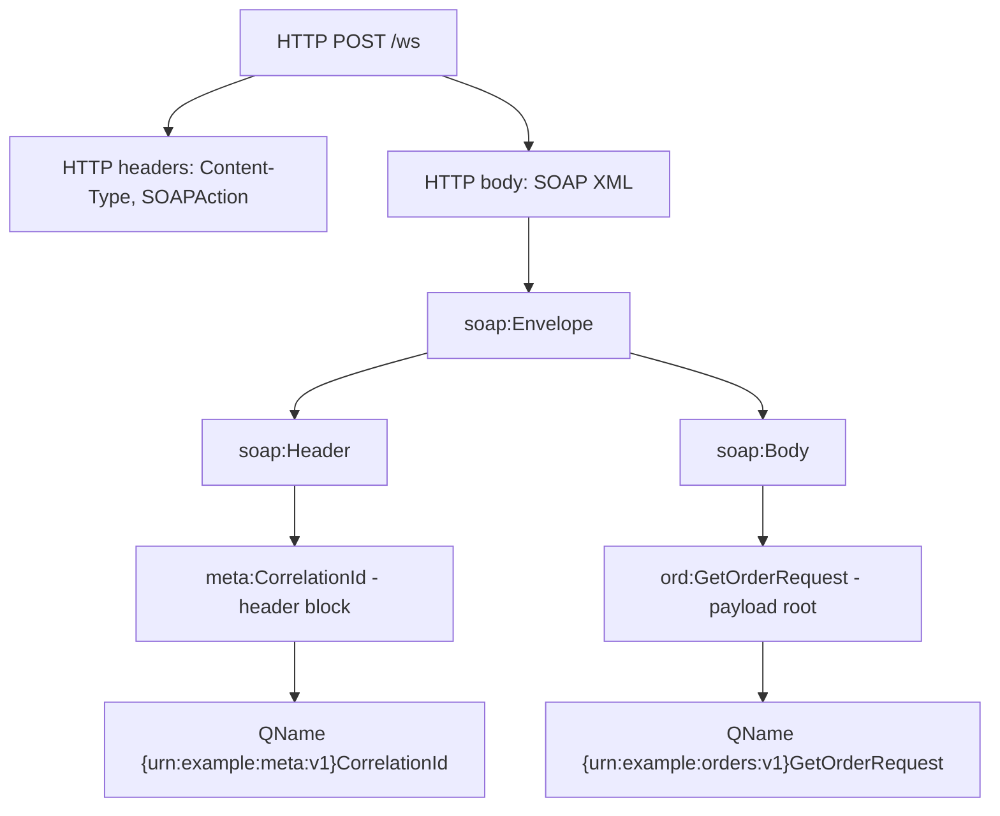
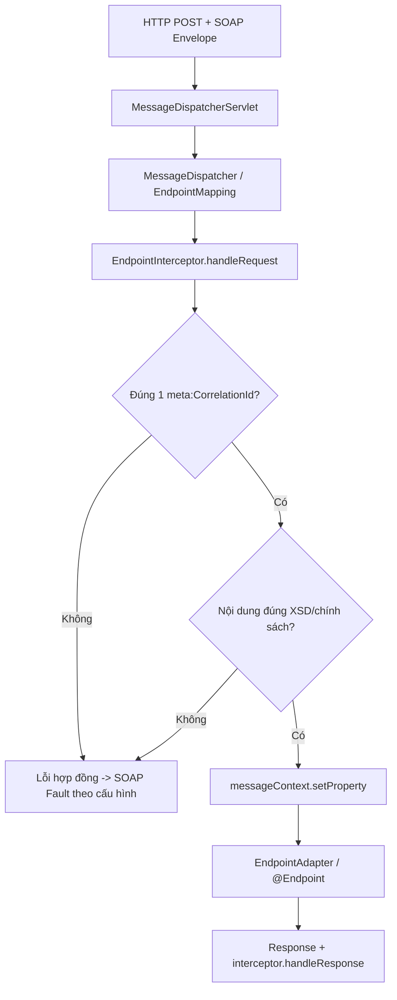
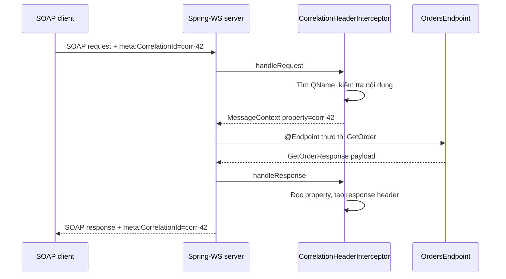

# QName của header, namespace và quy tắc tìm đúng phần tử

## 1. Vì sao tìm đúng SOAP Header lại quan trọng?

Trong một hệ thống tích hợp đơn hàng, client gửi SOAP request `GetOrderRequest` và đính kèm một mã theo dõi `CorrelationId`. Phần nghiệp vụ nằm trong `soap:Body`, còn mã theo dõi nằm trong `soap:Header`. Server cần tìm **đúng header block** để ghi log, kết nối các bước xử lý và có thể trả mã theo dõi tương ứng trong response.

Thoạt nhìn, việc tìm một phần tử có tên `CorrelationId` rất đơn giản. Nhưng trong XML, **tên đầy đủ của phần tử không chỉ là chuỗi local name**. Hai phần tử cùng tên `CorrelationId` thuộc hai namespace khác nhau là **hai phần tử khác nhau**. Ngược lại, cùng một phần tử có thể được viết với các prefix khác nhau mà vẫn mang cùng QName.

Trong **Spring Web Services (Spring-WS)** theo hướng **contract-first**, đọc sai header có thể gây:

- Mất liên kết trace giữa client, server và đối tác.
- Nhận nhầm header nghiệp vụ thành WS-Addressing hoặc ngược lại.
- Bỏ qua một header `mustUnderstand` bắt buộc phải xử lý.
- Chấp nhận header giả mạo có cùng local name nhưng khác namespace.
- Lỗi định tuyến, xác thực hoặc tương thích dù phần tử trong SOAP Body vẫn đúng XSD/WSDL.

Bài học thuộc chương **Header và ngữ cảnh** của module `SPRING_WEB_SERVICES`. Nó gắn với thiết kế XSD/WSDL, JAXB, Spring-WS endpoint/client, SOAP Fault, interceptor, XML security, WS-Security, chứng chỉ và kiểm thử tích hợp doanh nghiệp. Phạm vi tập trung là **QName của các header block, namespace và cách xác định chính xác phần tử cần đọc**, không phải toàn bộ cấu hình WS-Security.

### Mục tiêu

Sau bài này, bạn có thể:

1. Phân biệt HTTP header, SOAP Header, SOAP Body và các header block.
2. Phân tích QName theo `namespace URI` và `local part`; hiểu prefix chỉ là cách viết.
3. Chỉ ra phần tử trực tiếp trong SOAP Header và phân biệt nó với phần tử lồng bên trong.
4. Tìm header bằng `QName` với Spring-WS `SoapHeader`/`SoapHeaderElement`, không chỉ so local name.
5. Xử lý trường hợp thiếu header, duplicate, namespace sai và các thuộc tính `mustUnderstand`, `actor`/`role`.
6. Đọc/ghi header có kiểm soát ở interceptor, endpoint và `WebServiceTemplate`.
7. Phân biệt header nghiệp vụ với WS-Addressing Action và WS-Security.
8. Kiểm thử tính tương thích, validation và bảo mật khi nhận XML từ đối tác.

## 2. Phân biệt ba loại “header” dễ nhầm

Một HTTP POST chứa SOAP 1.1 có thể như sau:

```http
POST /ws HTTP/1.1
Host: api.example.org
Content-Type: text/xml; charset=utf-8
SOAPAction: "urn:example:orders:v1:GetOrder"
X-Request-ID: http-req-42

<?xml version="1.0" encoding="UTF-8"?>
<soap:Envelope
    xmlns:soap="http://schemas.xmlsoap.org/soap/envelope/"
    xmlns:meta="urn:example:meta:v1"
    xmlns:ord="urn:example:orders:v1">
    <soap:Header>
        <meta:CorrelationId>corr-42</meta:CorrelationId>
    </soap:Header>
    <soap:Body>
        <ord:GetOrderRequest>
            <ord:orderId>ORD-100</ord:orderId>
        </ord:GetOrderRequest>
    </soap:Body>
</soap:Envelope>
```

Ở đây có những khái niệm khác nhau:

| Thành phần | Vị trí | Thuộc lớp nào? | Cách đọc phù hợp |
| --- | --- | --- | --- |
| `Content-Type` | HTTP headers | Transport | HTTP request / message sender / proxy |
| `SOAPAction` | HTTP header trong SOAP 1.1 HTTP binding | Transport/SOAP binding | HTTP/SOAP metadata theo API hỗ trợ |
| `X-Request-ID` | HTTP headers | Transport/tracing | Servlet/filter hoặc HTTP callback |
| `soap:Header` | Bên trong SOAP Envelope | SOAP message | `SoapMessage.getSoapHeader()` |
| `meta:CorrelationId` | Phần tử con trực tiếp của SOAP Header | SOAP header block nghiệp vụ | `QName`/`SoapHeaderElement` |
| `ord:GetOrderRequest` | Phần tử con nghiệp vụ của SOAP Body | SOAP payload | `@PayloadRoot`, JAXB, XSD |

**SOAP Header không phải HTTP header.** Chỉ vì HTTP và SOAP đều dùng chữ “header” không có nghĩa `X-Request-ID`, `SOAPAction` và `meta:CorrelationId` là một trường có thể đọc thay thế cho nhau.

### 2.1. Sơ đồ lớp thông điệp



Trong mô hình SOAP, `soap:Header` là **vùng chứa**. Các phần tử con trực tiếp bên trong nó là **header blocks** mà SOAP node có thể xử lý theo vai trò, quy tắc `mustUnderstand` và thỏa thuận giữa hai bên.

Đừng chỉ định `@PayloadRoot(localPart="CorrelationId")` để đọc SOAP Header: `@PayloadRoot` thông thường dùng QName của payload trong **SOAP Body** để chọn Spring-WS endpoint.

## 3. QName: namespace URI + local name

Tên đầy đủ của một phần tử XML thường được biểu diễn như sau:

```text
QName = {namespace URI}localPart
```

Với:

```xml
<meta:CorrelationId
    xmlns:meta="urn:example:meta:v1">corr-42</meta:CorrelationId>
```

ta có:

```text
namespaceURI = urn:example:meta:v1
localPart    = CorrelationId
expandedName = {urn:example:meta:v1}CorrelationId
prefix       = meta  (chỉ là cách viết trong tài liệu này)
```

Trong Java:

```java
import javax.xml.namespace.QName;

QName expected = new QName(
    "urn:example:meta:v1",
    "CorrelationId"
);
```

`QName` của Java nằm ở package `javax.xml.namespace`, kể cả khi các JAXB generated classes sử dụng `jakarta.xml.bind`. Hai namespace Java API này phục vụ hai vai trò khác nhau; không nên đổi `QName` thành một import `jakarta.xml.namespace` không tồn tại chỉ vì dự án dùng Jakarta JAXB.

### 3.1. Prefix khác nhau, QName vẫn giống nhau

Ba cách viết sau có cùng expanded name:

```xml
<meta:CorrelationId
    xmlns:meta="urn:example:meta:v1">corr-42</meta:CorrelationId>
```

```xml
<x:CorrelationId
    xmlns:x="urn:example:meta:v1">corr-42</x:CorrelationId>
```

```xml
<CorrelationId xmlns="urn:example:meta:v1">
    corr-42
</CorrelationId>
```

Cả ba biểu diễn `{urn:example:meta:v1}CorrelationId`. Client, server, JAXB hoặc XML serializer có thể thay prefix mà **không thay đổi ngữ nghĩa QName**.

Vì vậy, các cách kiểm tra sau **không đủ**:

```java
// Sai về cách xác nhận đúng header:
element.getPrefix().equals("meta");
element.getLocalName().equals("CorrelationId");
element.getTagName().equals("meta:CorrelationId");
```

Đây là đoạn minh họa API kiểu DOM `Element`. So prefix có thể loại bỏ một header đúng; chỉ so local name có thể chấp nhận header từ namespace sai.

### 3.2. Cùng local name, khác namespace là header khác nhau

```xml
<h1:CorrelationId xmlns:h1="urn:example:meta:v1">corr-42</h1:CorrelationId>
```

```xml
<h2:CorrelationId xmlns:h2="urn:vendor:legacy:meta">corr-42</h2:CorrelationId>
```

Hai QName:

```text
{urn:example:meta:v1}CorrelationId
{urn:vendor:legacy:meta}CorrelationId
```

**không bằng nhau** dù nội dung và local name giống nhau. Một server yêu cầu QName thứ nhất phải từ chối hoặc bỏ qua QName thứ hai theo contract; không “fallback” sang local name khi thấy thiếu header đúng.

### 3.3. Header không có namespace cũng khác

```xml
<CorrelationId>corr-42</CorrelationId>
```

Nếu không có default namespace trong scope, expanded name là:

```text
{}CorrelationId
```

Nó **không** khớp `{urn:example:meta:v1}CorrelationId`. Không nên coi thiếu prefix có nghĩa là thiếu namespace: phải xét xem tại vị trí đó có `xmlns="..."` đang có hiệu lực hay không.

### 3.4. Namespace URI được so sánh chính xác

Các URI dưới đây là **những chuỗi namespace khác nhau**:

```text
urn:example:meta:v1
urn:example:meta:v2
urn:example:meta:v1/
URN:example:meta:v1
```

Đừng tự bỏ dấu `/` cuối, viết thường URI hoặc thay version trước khi so QName. Namespace là định danh contract; phép “chuẩn hóa” tùy tiện có thể khiến thông điệp không tương thích được chấp nhận.

## 4. Scope của namespace và các bẫy khi đọc SOAP Header

### 4.1. Khai báo prefix có thể nằm ở ancestor

```xml
<soap:Envelope
    xmlns:soap="http://schemas.xmlsoap.org/soap/envelope/"
    xmlns:meta="urn:example:meta:v1">
    <soap:Header>
        <meta:CorrelationId>corr-42</meta:CorrelationId>
    </soap:Header>
    <soap:Body/>
</soap:Envelope>
```

Header block không tự khai báo `xmlns:meta`, nhưng prefix `meta` vẫn hợp lệ vì được kế thừa từ `Envelope`. Khi dùng XML parser namespace-aware, phải lấy expanded QName của node thay vì đòi nhìn thấy thuộc tính `xmlns:meta` trực tiếp trên header block.

### 4.2. Default namespace ảnh hưởng phần tử, không mặc định ảnh hưởng thuộc tính không prefix

```xml
<CorrelationId xmlns="urn:example:meta:v1"
               version="1">corr-42</CorrelationId>
```

Phần tử có QName `{urn:example:meta:v1}CorrelationId`, nhưng thuộc tính `version` không có prefix là thuộc namespace rỗng. Nếu schema quy định một **qualified attribute** `{urn:example:meta:v1}version` thì XML này không tự đáp ứng điều đó.

Muốn thuộc tính thuộc namespace `urn:example:meta:v1`, phải viết rõ prefix:

```xml
<CorrelationId
    xmlns="urn:example:meta:v1"
    xmlns:meta="urn:example:meta:v1"
    meta:version="1">corr-42</CorrelationId>
```

Quy tắc unprefixed attributes không kế thừa default namespace rất quan trọng khi thiết kế XSD cho header có thuộc tính điều khiển.

### 4.3. Prefix bị gán lại ở phần tử con

```xml
<soap:Header
    xmlns:soap="http://schemas.xmlsoap.org/soap/envelope/"
    xmlns:meta="urn:example:meta:v1">
    <meta:Context>
        <meta:CorrelationId
            xmlns:meta="urn:vendor:other">wrong</meta:CorrelationId>
    </meta:Context>
</soap:Header>
```

Prefix `meta` trên phần tử `CorrelationId` đã được **gán lại namespace** tại node đó. Không được suy namespace chỉ từ prefix trông giống nhau ở ancestor. Parser namespace-aware sẽ cho biết QName chính xác.

Ngoài ra, `CorrelationId` trong ví dụ là **phần tử con của `meta:Context`**, không phải một header block trực tiếp nằm dưới `soap:Header`.

### 4.4. Chỉ tìm phần tử con trực tiếp của SOAP Header khi cần một header block

Hai message:

```xml
<soap:Header xmlns:soap="http://schemas.xmlsoap.org/soap/envelope/"
             xmlns:meta="urn:example:meta:v1">
    <meta:CorrelationId>corr-42</meta:CorrelationId>
</soap:Header>
```

và:

```xml
<soap:Header xmlns:soap="http://schemas.xmlsoap.org/soap/envelope/"
             xmlns:meta="urn:example:meta:v1">
    <meta:Tracing>
        <meta:CorrelationId>corr-42</meta:CorrelationId>
    </meta:Tracing>
</soap:Header>
```

**không có cùng tập header blocks**. Trường hợp thứ nhất có header block `meta:CorrelationId`. Trường hợp thứ hai có header block `meta:Tracing` chứa phần tử `CorrelationId` lồng bên trong. Nếu contract yêu cầu header block `CorrelationId`, không được dùng một phép tìm toàn cây kiểu `getElementsByTagNameNS("*", "CorrelationId")` để vô tình lấy phần tử lồng.

Quy tắc tìm kiếm đúng là:

1. Xác định chính xác `soap:Envelope/soap:Header` của SOAP version.
2. Duyệt **các phần tử con trực tiếp** của `soap:Header`.
3. So **đầy đủ QName** với QName contract.
4. Kiểm tra số lần xuất hiện, role/actor, mustUnderstand và nội dung theo XSD/business rules.

## 5. SOAP Header block: tên element và các thuộc tính SOAP đặc biệt

Ví dụ:

```xml
<soap:Envelope
    xmlns:soap="http://schemas.xmlsoap.org/soap/envelope/"
    xmlns:meta="urn:example:meta:v1"
    xmlns:ord="urn:example:orders:v1">
    <soap:Header>
        <meta:CorrelationId soap:mustUnderstand="0">
            corr-42
        </meta:CorrelationId>
    </soap:Header>
    <soap:Body>
        <ord:GetOrderRequest>
            <ord:orderId>ORD-100</ord:orderId>
        </ord:GetOrderRequest>
    </soap:Body>
</soap:Envelope>
```

`meta:CorrelationId` là header block. `soap:mustUnderstand` là **thuộc tính thuộc SOAP Envelope namespace** trên header block — không phải một phần QName của `CorrelationId` và cũng không phải `meta:mustUnderstand`.

| Trường | Vai trò |
| --- | --- |
| Header block QName | Định danh loại metadata/protocol block cần xử lý |
| `soap:mustUnderstand` | Yêu cầu SOAP node được nhắm tới phải hiểu/xử lý block theo quy tắc SOAP |
| SOAP 1.1 `soap:actor` | Chỉ định SOAP node/actor được nhắm tới trong SOAP processing |
| SOAP 1.2 `env:role` | Chỉ định role xử lý header block theo SOAP 1.2 |
| SOAP 1.2 `env:relay` | Liên quan việc chuyển tiếp block chưa được xử lý ở intermediary |
| Phần tử con / văn bản | Dữ liệu nội bộ của header theo namespace/XSD riêng |

### 5.1. `mustUnderstand` không phải “bắt buộc hiện diện”

Hai khái niệm thường bị trộn:

- **Header bắt buộc phải có**: quy tắc của contract ứng dụng, kiểm tra số lượng phần tử và nội dung.
- **Header có `mustUnderstand`**: quy tắc xử lý SOAP áp dụng cho header block nhắm tới SOAP node tương ứng.

Nếu contract yêu cầu `CorrelationId` xuất hiện đúng một lần, nhưng client không gửi block nào, ứng dụng cần xử lý thiếu header theo chính sách. `mustUnderstand="1"` **không tự tạo ra block còn thiếu**.

Ngược lại, một header block **có mặt** với `mustUnderstand="1"` nhưng node nhận không hiểu được một block nhắm tới mình có thể phải tạo SOAP `MustUnderstand` Fault theo phiên bản giao thức.

### 5.2. SOAP 1.1 actor và SOAP 1.2 role

Trong SOAP 1.1, thuộc tính `actor` có thể chỉ ra node đích:

```xml
<meta:RoutingHint
    xmlns:meta="urn:example:meta:v1"
    xmlns:soap="http://schemas.xmlsoap.org/soap/envelope/"
    soap:actor="http://schemas.xmlsoap.org/soap/actor/next"
    soap:mustUnderstand="1">east</meta:RoutingHint>
```

Trong SOAP 1.2, một header có thể dùng `role` và `mustUnderstand` trong namespace SOAP 1.2:

```xml
<meta:RoutingHint
    xmlns:meta="urn:example:meta:v1"
    xmlns:env="http://www.w3.org/2003/05/soap-envelope"
    env:role="http://www.w3.org/2003/05/soap-envelope/role/next"
    env:mustUnderstand="true">east</meta:RoutingHint>
```

Các ví dụ trên chỉ minh họa hình thức attribute. Việc header có được xử lý, bỏ qua hay relay phụ thuộc node role, giao thức SOAP version và cơ chế xử lý thực tế.

**Không trộn SOAP 1.1 và SOAP 1.2**: Envelope namespace, HTTP media type, Fault structure và một số thuộc tính/header processing khác nhau. Một XPath chỉ cố định namespace SOAP 1.1 sẽ không tìm được Header của message SOAP 1.2.

### 5.3. Định danh header block khác định danh endpoint

`@PayloadRoot` chọn endpoint bằng QName payload root trong Body. `SoapHeader`/header processing đọc các block trong Header. `@SoapAction` hay WS-Addressing Action lại phục vụ metadata định tuyến nếu ứng dụng đã cấu hình.

Một request có thể có:

```text
Body root     = {urn:example:orders:v1}GetOrderRequest
Header block  = {urn:example:meta:v1}CorrelationId
WS-A Action   = {http://www.w3.org/2005/08/addressing}Action
SOAPAction    = "urn:example:orders:v1:GetOrder" (HTTP header)
```

Chúng là các định danh **khác loại**; không thể thay thế bằng nhau chỉ vì nằm trên cùng request.

## 6. WSDL và XSD có thể khai báo SOAP Header như thế nào?

Một hợp đồng SOAP dành cho đối tác nên mô tả rõ các header nghiệp vụ quan trọng, nhất là khi cần sinh client code từ WSDL hoặc có ràng buộc về tính tương thích.

### 6.1. XSD khai báo global element cho header

Giả sử `meta.xsd`:

```xml
<?xml version="1.0" encoding="UTF-8"?>
<xs:schema
    xmlns:xs="http://www.w3.org/2001/XMLSchema"
    targetNamespace="urn:example:meta:v1"
    xmlns:meta="urn:example:meta:v1"
    elementFormDefault="qualified">

    <xs:simpleType name="CorrelationIdType">
        <xs:restriction base="xs:string">
            <xs:minLength value="1"/>
            <xs:maxLength value="64"/>
            <xs:pattern value="[A-Za-z0-9._:-]+"/>
        </xs:restriction>
    </xs:simpleType>

    <xs:element name="CorrelationId"
                type="meta:CorrelationIdType"/>
</xs:schema>
```

Đây là **global element** có QName `{urn:example:meta:v1}CorrelationId`. Quy tắc `minLength`/`maxLength`/`pattern` kiểm soát giá trị khi thực sự thực hiện XSD validation; chỉ sinh JAXB class không tự đảm bảo mọi setter Java từ chối dữ liệu không hợp lệ.

### 6.2. WSDL 1.1 `soap:header` trong SOAP binding

Trong một WSDL 1.1 document/literal, header có thể được mô tả bằng một message part riêng:

```xml
<!-- Giả sử các prefix wsdl, soap, tns, ord, meta đã được
     khai báo phù hợp ở wsdl:definitions và schema đã import. -->

<wsdl:message name="GetOrderInput">
    <wsdl:part name="parameters"
               element="ord:GetOrderRequest"/>
</wsdl:message>

<wsdl:message name="GetOrderHeader">
    <wsdl:part name="correlation"
               element="meta:CorrelationId"/>
</wsdl:message>

<wsdl:binding name="OrdersSoap11Binding"
              type="tns:OrdersPortType">
    <soap:binding
        style="document"
        transport="http://schemas.xmlsoap.org/soap/http"/>
    <wsdl:operation name="GetOrder">
        <soap:operation
            soapAction="urn:example:orders:v1:GetOrder"/>
        <wsdl:input>
            <soap:body use="literal" parts="parameters"/>
            <soap:header
                message="tns:GetOrderHeader"
                part="correlation"
                use="literal"/>
        </wsdl:input>
        <wsdl:output>
            <soap:body use="literal"/>
        </wsdl:output>
    </wsdl:operation>
</wsdl:binding>
```

Đoạn trên là **trích đoạn minh họa**, chưa phải WSDL độc lập có `definitions`, `types`, `portType` và `service`. WSDL thực tế cần khai báo namespace của schema, import XSD đúng URI/đường dẫn và các message/operation liên quan.

Ý nghĩa:

- `wsdl:part element="meta:CorrelationId"` chỉ tới **global element của header**.
- `soap:header` khai báo cách binding SOAP đưa part đó vào Header.
- `soap:body` chỉ tới phần body thích hợp; header không trở thành child của `GetOrderRequest`.
- WSDL định nghĩa contract, nhưng không tự bật header validation, security hoặc tạo logic đọc header trên server.

Không phải mọi WSDL đều mô tả đầy đủ header tùy biến; các tiêu chuẩn như WS-Security còn có chính sách/profile riêng. Vì thế ngoài WSDL, đối tác cần thỏa thuận rõ header nào bắt buộc, dạng QName, role, mustUnderstand và tiêu chí xử lý thiếu/sai.

### 6.3. Header schema và JAXB

XJC có thể sinh binding cho `meta:CorrelationId`; nếu element được biểu diễn bằng `JAXBElement<String>`, factory method từ `ObjectFactory` mang QName của **header global element**. Chỉ marshal một `String` không thể tự xác định root phải là `{urn:example:meta:v1}CorrelationId`.

Nếu một Java class được dùng cho hai global elements cùng cấu trúc, **QName vẫn là định danh khác nhau**. Cần dùng đúng factory/root binding tương ứng header contract.

## 7. Các API Spring-WS để duyệt và nhận diện header

Ở phía server, Spring-WS cung cấp đối tượng `MessageContext` chứa request/response `WebServiceMessage`. Với SOAP request, thông điệp có thể là `SoapMessage`, cung cấp `getSoapHeader()`. `SoapHeader` cho phép duyệt các `SoapHeaderElement` — mỗi phần tử đại diện một header block.

Những lớp/API thường gặp:

| API | Vai trò |
| --- | --- |
| `org.springframework.ws.context.MessageContext` | Truy cập request/response và giữ thuộc tính trong vòng xử lý |
| `org.springframework.ws.WebServiceMessage` | Trừu tượng hóa thông điệp ở Spring-WS |
| `org.springframework.ws.soap.SoapMessage` | Truy cập SOAP Envelope, Header, Body và SOAPAction |
| `org.springframework.ws.soap.SoapHeader` | Thao tác với container SOAP Header |
| `org.springframework.ws.soap.SoapHeaderElement` | Đại diện một header block |
| `SoapHeader.examineAllHeaderElements()` | Duyệt các header blocks được cung cấp bởi implementation |
| `SoapHeaderElement.getName()` | Lấy `QName` của header block |
| `SoapHeaderElement.getSource()` | Lấy biểu diễn XML của block để giải mã/đọc nội dung |
| `SoapHeader.addHeaderElement(QName)` | Tạo header block mới có QName tương ứng |

Các API cụ thể và tính năng khi xử lý role/actor có thể thay đổi theo phiên bản và SOAP implementation. Khi dùng một phiên bản Spring-WS nhất định, nên đối chiếu Javadoc của chính phiên bản đó.

### 7.1. Duyệt header blocks và so QName đầy đủ

Ví dụ Java, dùng Spring-WS SOAP types:

```java
import java.util.Iterator;
import javax.xml.namespace.QName;
import org.springframework.ws.soap.SoapHeader;
import org.springframework.ws.soap.SoapHeaderElement;
import org.springframework.ws.soap.SoapMessage;

public class HeaderLookup {

    private static final QName CORRELATION =
        new QName("urn:example:meta:v1", "CorrelationId");

    public static SoapHeaderElement findExactlyOne(
            SoapMessage message) {

        SoapHeader header = message.getSoapHeader();
        if (header == null) {
            throw new IllegalArgumentException(
                "SOAP Header is missing"
            );
        }

        SoapHeaderElement found = null;
        Iterator<SoapHeaderElement> blocks =
            header.examineAllHeaderElements();

        while (blocks.hasNext()) {
            SoapHeaderElement element = blocks.next();
            if (!CORRELATION.equals(element.getName())) {
                continue;
            }
            if (found != null) {
                throw new IllegalArgumentException(
                    "Duplicate CorrelationId header"
                );
            }
            found = element;
        }

        if (found == null) {
            throw new IllegalArgumentException(
                "Required CorrelationId header is missing"
            );
        }
        return found;
    }
}
```

Hàm này trả về đúng **một block có QName `{urn:example:meta:v1}CorrelationId`** và từ chối nếu thiếu/trùng. Đây là **ví dụ lookup**, chưa triển khai xử lý lỗi thành SOAP Fault hoặc validation nội dung. Trong một service có role/actor đặc thù, cần thêm kiểm tra header block có nhắm tới SOAP node hiện tại không, chứ không mặc định mọi header ở mọi role đều cần xử lý như nhau.

### 7.2. Vì sao không chỉ lấy header đầu tiên?

Request có thể chứa:

```xml
<soap:Header
    xmlns:soap="http://schemas.xmlsoap.org/soap/envelope/"
    xmlns:other="urn:vendor:legacy"
    xmlns:meta="urn:example:meta:v1">
    <other:CorrelationId>legacy-1</other:CorrelationId>
    <meta:CorrelationId>corr-42</meta:CorrelationId>
</soap:Header>
```

Nếu chỉ lấy header đầu tiên hoặc tìm theo `localPart="CorrelationId"`, server có thể đọc nhầm `legacy-1`. Duyệt đầy đủ QName sẽ bỏ qua block `{urn:vendor:legacy}CorrelationId` và chọn đúng block `{urn:example:meta:v1}CorrelationId`.

Thứ tự header blocks có thể có ý nghĩa đối với một số SOAP processing rules, nhưng **một header singleton theo contract không nên được xác định chỉ bằng vị trí xuất hiện**.

### 7.3. Trường hợp không tìm được header

Có ba loại thiếu khác nhau:

1. **Không có SOAP Header container**: message không gửi header nào (tùy SOAP implementation vẫn có thể trả một đối tượng header trống).
2. **Có SOAP Header nhưng không có block đúng QName**: có thể có header namespace khác hoặc local name khác.
3. **Có block đúng QName nhưng không hợp lệ về nội dung hoặc role**: đã tìm thấy element, nhưng chưa đáp ứng contract.

Phải đưa ra policy theo từng trường hợp. Ví dụ `CorrelationId` có thể là optional, được server tự sinh khi thiếu; ngược lại `TenantId` phục vụ authorization có thể phải xuất hiện và được xác minh bằng danh tính đáng tin cậy.

**Không bao giờ dùng thiếu header bắt buộc làm lý do tự tin chấp nhận một header khác có cùng local name.**

## 8. Đọc nội dung header sau khi đã tìm đúng QName

Phép so QName chỉ xác định **loại header**, chưa xác minh **giá trị**. Một block đúng tên vẫn có thể chứa chuỗi rỗng, ký tự bất hợp lệ, cấu trúc con khác XSD hoặc dữ liệu được gửi bởi caller không đáng tin.

### 8.1. Ví dụ SOAP Header đơn giản có text

```xml
<meta:CorrelationId
    xmlns:meta="urn:example:meta:v1">corr-42</meta:CorrelationId>
```

Nếu contract định nghĩa `CorrelationId` là simpleType `xs:string` có restriction như mục 6, server có thể đọc text, kiểm tra regex/độ dài và đưa giá trị đã được kiểm tra vào log/tracing context.

Tuy nhiên, nếu trong thực tế header có nested XML:

```xml
<meta:CorrelationId xmlns:meta="urn:example:meta:v1">
    <meta:Value>corr-42</meta:Value>
</meta:CorrelationId>
```

thì đây **không còn đúng hình thức simple content** được XSD mục 6 cho phép. Không nên chỉ lấy `getTextContent()` của toàn cây rồi coi như hợp lệ; điều đó có thể bỏ qua sai cấu trúc.

### 8.2. Có thể dùng JAXB để unmarshalling header có cấu trúc

Với header phức tạp như:

```xml
<meta:RequestContext xmlns:meta="urn:example:meta:v1">
    <meta:CorrelationId>corr-42</meta:CorrelationId>
    <meta:ClientCode>PARTNER-A</meta:ClientCode>
</meta:RequestContext>
```

nên thiết kế XSD của `RequestContext`, sinh JAXB model rồi unmarshal `SoapHeaderElement.getSource()` bằng JAXB binding phù hợp. Nếu phần tử root được sinh dưới dạng `JAXBElement<RequestContextType>`, phải kiểm tra QName root trước khi lấy `getValue()`.

Lợi ích: quy tắc schema có thể được kiểm chứng rõ hơn, nhưng vẫn cần **bật XSD validation hoặc business validation** khi muốn thực thi đầy đủ `minOccurs`, `maxLength`, `xs:pattern`, `xs:choice`, v.v.

### 8.3. Không nên dùng một phép DOM search trên toàn SOAP Envelope

Đây là ý tưởng sai:

```java
// Minh họa anti-pattern; không nên tìm header bằng cách này.
document.getElementsByTagName("CorrelationId").item(0);
```

Vấn đề:

- Phụ thuộc tên prefix/default namespace của XML source.
- Có thể trả về phần tử trong SOAP Body hoặc block khác.
- Không kiểm tra QName đầy đủ.
- Không kiểm tra duplicate/role/`mustUnderstand`.

Nếu dùng DOM, hãy duyệt **đúng các element children của SOAP Header** và dùng `Element.getNamespaceURI()` + `Element.getLocalName()`, hoặc API namespace-aware của Spring-WS.

## 9. Dùng `EndpointInterceptor` để nhận header và lưu vào `MessageContext`

Trong một hệ thống cần xác minh header trước khi gọi nghiệp vụ, **server-side `EndpointInterceptor`** là một điểm mở rộng hữu ích. Interceptor có thể đọc request SOAP, tìm block đúng QName, validate nội dung và lưu một giá trị đã chuẩn hóa vào `MessageContext` để các bước phía sau dùng.

### 9.1. Sơ đồ hoạt động



Nhớ rằng **endpoint interceptor thường chạy sau khi endpoint đã được mapping**. Nếu SOAP XML không parse được hoặc không tìm thấy endpoint, interceptor gắn với mapping đó có thể không chạy. Với các header bảo mật cần kiểm soát trước dispatch, phải thiết kế security pipeline phù hợp và xác minh phạm vi interceptor trên mọi đường routing.

### 9.2. Ví dụ kiểm tra header bằng QName và nội dung text

Ví dụ sau tập trung vào cách tìm header và sử dụng `MessageContext`. Nó dùng DOM transformation để lấy text của **một header simple-content**; với header phức tạp, nên dùng JAXB/XSD validation thay vì tự parse thủ công.

```java
import java.util.Iterator;
import javax.xml.XMLConstants;
import javax.xml.namespace.QName;
import javax.xml.transform.Transformer;
import javax.xml.transform.TransformerFactory;
import javax.xml.transform.dom.DOMResult;
import org.w3c.dom.Document;
import org.w3c.dom.Element;
import org.w3c.dom.Node;
import org.springframework.ws.context.MessageContext;
import org.springframework.ws.server.EndpointInterceptor;
import org.springframework.ws.soap.SoapHeader;
import org.springframework.ws.soap.SoapHeaderElement;
import org.springframework.ws.soap.SoapMessage;

public class CorrelationHeaderInterceptor
        implements EndpointInterceptor {

    public static final String PROPERTY =
        "orders.correlationId";

    private static final QName NAME = new QName(
        "urn:example:meta:v1", "CorrelationId"
    );

    @Override
    public boolean handleRequest(
            MessageContext context, Object endpoint)
            throws Exception {

        if (!(context.getRequest() instanceof SoapMessage soap)) {
            throw new IllegalArgumentException(
                "SOAP request is required"
            );
        }

        SoapHeader header = soap.getSoapHeader();
        if (header == null) {
            throw new IllegalArgumentException(
                "CorrelationId is required"
            );
        }

        SoapHeaderElement match = null;
        Iterator<SoapHeaderElement> it =
            header.examineAllHeaderElements();

        while (it.hasNext()) {
            SoapHeaderElement element = it.next();
            if (!NAME.equals(element.getName())) {
                continue;
            }
            if (match != null) {
                throw new IllegalArgumentException(
                    "Duplicate CorrelationId header"
                );
            }
            match = element;
        }

        if (match == null) {
            throw new IllegalArgumentException(
                "Missing CorrelationId header"
            );
        }

        String id = textOfSimpleElement(match);
        if (!id.matches("[A-Za-z0-9._:-]{1,64}")) {
            throw new IllegalArgumentException(
                "Invalid CorrelationId value"
            );
        }

        context.setProperty(PROPERTY, id);
        return true;
    }

    private static String textOfSimpleElement(
            SoapHeaderElement element) throws Exception {

        TransformerFactory factory =
            TransformerFactory.newInstance();
        factory.setFeature(
            XMLConstants.FEATURE_SECURE_PROCESSING, true
        );
        factory.setAttribute(
            XMLConstants.ACCESS_EXTERNAL_DTD, ""
        );
        factory.setAttribute(
            XMLConstants.ACCESS_EXTERNAL_STYLESHEET, ""
        );

        Transformer transformer = factory.newTransformer();
        DOMResult dom = new DOMResult();
        transformer.transform(element.getSource(), dom);

        Node node = dom.getNode();
        Element root;
        if (node instanceof Document document) {
            root = document.getDocumentElement();
        } else if (node instanceof Element domElement) {
            root = domElement;
        } else {
            throw new IllegalArgumentException(
                "Unexpected header XML representation"
            );
        }

        if (root == null ||
                !NAME.getNamespaceURI().equals(
                    root.getNamespaceURI()) ||
                !NAME.getLocalPart().equals(root.getLocalName())) {
            throw new IllegalArgumentException(
                "Unexpected header QName"
            );
        }

        for (Node child = root.getFirstChild();
                child != null; child = child.getNextSibling()) {
            if (child.getNodeType() == Node.ELEMENT_NODE) {
                throw new IllegalArgumentException(
                    "Nested XML is not allowed in CorrelationId"
                );
            }
        }

        return root.getTextContent().trim();
    }

    @Override
    public boolean handleResponse(
            MessageContext context, Object endpoint)
            throws Exception {
        return true;
    }

    @Override
    public boolean handleFault(
            MessageContext context, Object endpoint)
            throws Exception {
        return true;
    }

    @Override
    public void afterCompletion(
            MessageContext context, Object endpoint, Exception ex)
            throws Exception {
        // Đóng span/cleanup MDC nếu đã tạo theo request.
    }
}
```

**Giới hạn của ví dụ:**

- Đây là logic minh họa **tìm QName và kiểm tra text**, chưa bao gồm Spring bean registration, cấu hình exception-to-Fault, xác định role/actor hay client/server authentication.
- `IllegalArgumentException` không tự đảm bảo SOAP Fault đúng contract; cần exception resolver/interceptor response thích hợp. Không để nguyên thông điệp lỗi nội bộ nhạy cảm trả cho đối tác.
- XML parser/transformer implementation có thể có những giới hạn riêng; production cần cấu hình an toàn từ message factory tới JAXB/XML parser, schema validation và kiểm tra external resource access.
- Kiểm tra text bằng regex là một chính sách minh họa cho `CorrelationId`, **không phải kiểm tra chữ ký, token hoặc xác thực danh tính**.
- Code dùng Java có `instanceof` pattern matching và Jakarta/Spring-WS stack phù hợp. Mã ví dụ chỉ hoạt động khi ứng dụng đã có SOAP context và interceptor được đăng ký.

### 9.3. Vì sao lưu vào `MessageContext`?

`MessageContext` cung cấp ngữ cảnh của **một vòng xử lý message**. Giá trị `CorrelationId` sau khi kiểm tra có thể được gắn bằng:

```java
messageContext.setProperty(
    "orders.correlationId", "corr-42"
);
```

Ở thành phần khác thuộc cùng quá trình xử lý, có thể đọc:

```java
Object value = messageContext.getProperty(
    "orders.correlationId"
);
```

Đây là **application property trong Spring-WS MessageContext**, không phải một header XML mới và cũng không phải HTTP header. Muốn client nhận được `CorrelationId` trên response thì phải **chủ động thêm header block vào SOAP response** hoặc công bố cơ chế truyền ở kênh khác.

Một giá trị trong `MessageContext` không tự được persist vào database và không tự truyền sang asynchronous thread. Nếu dùng MDC/thread-local tracing, cần đảm bảo cleanup khi kết thúc request, kể cả nhánh SOAP Fault, để tránh rò thông tin giữa các request trong thread pool.

## 10. Đọc một header cụ thể tại `@Endpoint`

Spring-WS cũng hỗ trợ binding một header SOAP theo QName trong method endpoint ở những cấu hình/argument resolvers phù hợp. Một dạng thường gặp là annotation `@SoapHeader`:

```java
import org.springframework.ws.server.endpoint.annotation.Endpoint;
import org.springframework.ws.server.endpoint.annotation.PayloadRoot;
import org.springframework.ws.server.endpoint.annotation.RequestPayload;
import org.springframework.ws.soap.SoapHeaderElement;
import org.springframework.ws.soap.server.endpoint.annotation.SoapHeader;

@Endpoint
public class OrderEndpoint {

    @PayloadRoot(
        namespace = "urn:example:orders:v1",
        localPart = "GetOrderRequest"
    )
    public void getOrder(
            @RequestPayload javax.xml.transform.Source request,
            @SoapHeader("{urn:example:meta:v1}CorrelationId")
                SoapHeaderElement correlationHeader) {

        // correlationHeader đại diện cho header block
        // có QName contract đã khai báo.
        // Đọc/validate Source của block trước khi tin dữ liệu.
    }
}
```

Đoạn này chỉ minh họa **header-parameter binding** chứ chưa triển khai response; cách xử lý thiếu header và các kiểu argument được hỗ trợ phải được kiểm tra với phiên bản Spring-WS/endpoint adapter đang dùng.

**Khi nào dùng cách nào?**

| Cách tiếp cận | Phù hợp khi | Lưu ý |
| --- | --- | --- |
| `@SoapHeader` ngay tại endpoint | Method chỉ cần một header cụ thể | Phụ thuộc argument resolver; validation và duplicate policy vẫn phải thiết kế |
| `EndpointInterceptor` | Nhiều endpoints có cùng quy tắc header/correlation | Phải đăng ký chain đúng và đảm bảo coverage trên mọi mapping |
| WS-Security interceptor chuyên dụng | Token, chữ ký XML, encryption, policy | Không tự parse `wsse:Security` bằng local-name search |
| HTTP filter | Xử lý HTTP headers/authentication, trước servlet | Không thể coi HTTP header là SOAP Header block |
| JAXB header model | Header có nhiều trường, schema rõ ràng | Đúng global element QName, schema validation và root binding |

Không nên lựa chọn chỉ dựa trên việc ít dòng code. Với metadata bảo mật hoặc thông tin ảnh hưởng authorization, ưu tiên kiểm tra theo cơ chế chuyên dụng, có độ bao phủ và kiểm thử phù hợp.

## 11. Gửi SOAP Header từ `WebServiceTemplate` ở phía client

Spring-WS client thường dùng `WebServiceTemplate` để marshal payload, tạo SOAP Envelope và gửi qua HTTP(S). Để thêm một SOAP Header tùy biến, có thể sử dụng `WebServiceMessageCallback` trước khi message được gửi.

### 11.1. Chuẩn bị phần payload riêng với header

Trong mô hình JAXB sinh từ XSD nghiệp vụ:

```text
GetOrderRequestType
    -> ObjectFactory.createGetOrderRequest(...)
    -> SOAP Body root {urn:example:orders:v1}GetOrderRequest

CorrelationId
    -> SOAP Header block {urn:example:meta:v1}CorrelationId
```

Không chèn `CorrelationId` thành một field của `GetOrderRequestType` chỉ vì việc thêm XML Header khó hơn. Làm vậy thay đổi hợp đồng XSD của Body, không tương đương SOAP Header.

### 11.2. Ví dụ callback ghi header XML đã được kiểm soát

Đoạn code minh họa dưới đây dùng `SoapHeader.getResult()` làm vị trí ghi **một child header block hoàn chỉnh**. Để tránh XML injection, giá trị đầu vào được kiểm tra theo chính sách `CorrelationIdType` trước khi đưa vào XML. Trong triển khai có model JAXB cho header, có thể thay việc dựng XML bằng JAXB marshalling.

```java
import jakarta.xml.bind.JAXBElement;
import javax.xml.transform.Transformer;
import javax.xml.transform.TransformerFactory;
import javax.xml.transform.stream.StreamSource;
import java.io.StringReader;
import org.springframework.ws.client.core.WebServiceTemplate;
import org.springframework.ws.client.core.WebServiceMessageCallback;
import org.springframework.ws.soap.SoapMessage;

public class OrdersSoapClient {

    private final WebServiceTemplate template;
    private final ObjectFactory factory = new ObjectFactory();

    public OrdersSoapClient(WebServiceTemplate template) {
        this.template = template;
    }

    public Object getOrder(String orderId, String correlationId) {
        if (correlationId == null ||
                !correlationId.matches("[A-Za-z0-9._:-]{1,64}")) {
            throw new IllegalArgumentException(
                "Invalid correlation ID"
            );
        }

        GetOrderRequestType request = new GetOrderRequestType();
        request.setOrderId(orderId);
        JAXBElement<GetOrderRequestType> payload =
            factory.createGetOrderRequest(request);

        WebServiceMessageCallback callback = message -> {
            if (!(message instanceof SoapMessage soap)) {
                throw new IllegalStateException(
                    "SOAP message required"
                );
            }

            String headerXml =
                "<meta:CorrelationId " +
                "xmlns:meta=\"urn:example:meta:v1\">" +
                correlationId +
                "</meta:CorrelationId>";

            Transformer transformer =
                TransformerFactory.newInstance()
                    .newTransformer();

            transformer.transform(
                new StreamSource(new StringReader(headerXml)),
                soap.getSoapHeader().getResult()
            );

            // Chỉ đặt theo SOAPAction đã công bố trong WSDL.
            soap.setSoapAction(
                "urn:example:orders:v1:GetOrder"
            );
        };

        return template.marshalSendAndReceive(
            "https://api.example.org/ws",
            payload,
            callback
        );
    }
}
```

**Điều kiện của ví dụ:**

- `ObjectFactory`, `GetOrderRequestType` là JAXB classes giả định được sinh từ schema contract. `WebServiceTemplate` đã có JAXB marshaller/unmarshaller, message factory và sender tương thích với SOAP version.
- `https://api.example.org/ws` và SOAPAction là địa chỉ/action minh họa; phải đối chiếu WSDL public thực tế.
- Giá trị `correlationId` được giới hạn chặt để tránh chèn ký tự markup. Với dữ liệu phức tạp hoặc không tự kiểm soát, **không** nối chuỗi XML; dùng JAXB hoặc XML writer an toàn.
- Cấu hình `TransformerFactory`/XML parsing và giới hạn xử lý dữ liệu phải được harden theo thư viện/stack production; đoạn code minh họa quy trình ghi header chứ chưa phải một security implementation.
- API xử lý SOAP Header ở từng implementation có thể khác chi tiết khi đã có header blocks khác. Cần chạy integration test với cả WS-Security/WS-Addressing nếu chúng cùng được thêm vào header.

Một SOAP request sau callback có thể trông như:

```xml
<soap:Envelope
    xmlns:soap="http://schemas.xmlsoap.org/soap/envelope/"
    xmlns:meta="urn:example:meta:v1"
    xmlns:ord="urn:example:orders:v1">
    <soap:Header>
        <meta:CorrelationId>corr-42</meta:CorrelationId>
    </soap:Header>
    <soap:Body>
        <ord:GetOrderRequest>
            <ord:orderId>ORD-100</ord:orderId>
        </ord:GetOrderRequest>
    </soap:Body>
</soap:Envelope>
```

Thứ tự prefix hoặc khai báo namespace có thể khác vì XML serializer lựa chọn cách viết. Điều cần kiểm tra là **QName của header block và Body root**, cùng nội dung/thuộc tính theo contract.

### 11.3. `SoapActionCallback` chỉ đặt action, không tạo SOAP Header nghiệp vụ

Spring-WS có `SoapActionCallback` để đặt SOAPAction theo binding. Ví dụ:

```java
new SoapActionCallback("urn:example:orders:v1:GetOrder");
```

Lời gọi này **không thêm** `meta:CorrelationId` vào `soap:Header`. Nếu cần vừa đặt action vừa thêm XML header, hãy kết hợp các thao tác bằng callback phù hợp như ví dụ mục 11.2 hoặc một abstraction client đã được kiểm thử.

Một HTTP header `X-Correlation-ID` cũng không tự biến thành SOAP Header. Nếu muốn bridge hai giá trị, đó là quyết định của ứng dụng/gateway và cần quy tắc ưu tiên, kiểm soát trust và validation.

## 12. Trả CorrelationId trong SOAP response

Một số giao thức yêu cầu server **echo** mã correlation mà client gửi, hoặc sinh một response tracking ID riêng. Đây không phải hành vi mặc định của JAXB endpoint: server phải chủ động ghi SOAP Header trong response.

### 12.1. Luồng qua `MessageContext`



Nếu contract response không quy định header `CorrelationId`, tự ý thêm block bắt buộc mới (nhất là `mustUnderstand="1"`) có thể phá tương thích với client cũ. Khi thêm header vào response, cần công bố rõ quy tắc trong WSDL/policy và kiểm thử client.

### 12.2. Ví dụ response header ở interceptor

Một phương thức `handleResponse` có thể lấy giá trị đã đặt trong `MessageContext`:

```java
@Override
public boolean handleResponse(
        MessageContext context, Object endpoint) throws Exception {

    Object value = context.getProperty(
        CorrelationHeaderInterceptor.PROPERTY
    );

    if (!(value instanceof String id)) {
        return true; // Policy ví dụ: không echo nếu không có ID.
    }

    if (!(context.getResponse() instanceof SoapMessage response)) {
        return true;
    }

    String xml =
        "<meta:CorrelationId " +
        "xmlns:meta=\"urn:example:meta:v1\">" +
        id +
        "</meta:CorrelationId>";

    TransformerFactory.newInstance()
        .newTransformer()
        .transform(
            new StreamSource(new StringReader(xml)),
            response.getSoapHeader().getResult()
        );

    return true;
}
```

Đây là **đoạn trích để ghép vào một interceptor có import/cấu hình phù hợp**, không phải một class Java độc lập. Nó giả định `id` đã được validate ở `handleRequest` và response là SOAP. Nếu muốn echo trên **SOAP Fault**, phải thiết kế thêm xử lý ở `handleFault`/Fault response theo policy; đừng tự kết luận `handleResponse` luôn chạy cho cả Fault.

### 12.3. Correlation ID phải được xem là dữ liệu từ bên ngoài

Ngay cả khi client gửi `corr-42` hợp format, nó không tự mang ý nghĩa xác thực danh tính hay quyền truy cập. Nếu dùng ID để liên kết logs:

- Giới hạn độ dài và ký tự để chống log injection và tiêu tốn tài nguyên.
- Không dùng trực tiếp làm primary key bảo mật hoặc kiểm tra authorization.
- Có thể sinh ID nội bộ khác khi header thiếu/sai theo policy, đồng thời lưu quan hệ giữa ID client và server.
- Không để caller giả mạo ID rồi truy xuất logs hoặc dữ liệu của người khác chỉ bằng ID đó.

## 13. Tìm header bằng XPath hoặc DOM: luôn dùng namespace-aware matching

Đôi khi bạn không sử dụng Spring-WS `SoapHeaderElement` trực tiếp, mà cần XML XPath/DOM để làm validation hoặc test. Quy tắc QName vẫn không thay đổi.

### 13.1. XPath đúng phải bind namespace

Ví dụ biểu thức:

```xpath
/soap:Envelope/soap:Header/meta:CorrelationId
```

Trong XPath 1.0, prefix `soap` và `meta` là **prefix trong expression**, được ánh xạ qua `NamespaceContext` của XPath engine:

```text
soap -> http://schemas.xmlsoap.org/soap/envelope/
meta -> urn:example:meta:v1
```

Không nhất thiết XML nguồn phải sử dụng đúng các prefix `soap`/`meta` này. Nếu XML dùng `s:Envelope` và `x:CorrelationId` nhưng ánh xạ URI giống nhau, XPath vẫn có thể match.

### 13.2. Vì sao XPath `//*[local-name()='CorrelationId']` nguy hiểm?

Biểu thức:

```xpath
//*[local-name()='CorrelationId']
```

chọn mọi element có local name `CorrelationId` ở bất kỳ namespace, vị trí và độ sâu nào. Nó có thể bắt:

- Header từ namespace đối tác khác.
- Phần tử con lồng trong `meta:Tracing`.
- Một field tình cờ tên `CorrelationId` trong SOAP Body.
- Phần tử giả mạo được chèn vào vị trí không hợp contract.

Nếu cần lấy một header block, dùng **đường đi qua SOAP Header + QName đầy đủ**, rồi kiểm tra cardinality.

### 13.3. DOM API tương ứng

Một XML DOM parser đã bật namespace awareness cung cấp:

```java
String namespace = element.getNamespaceURI();
String localPart = element.getLocalName();

boolean sameName =
    "urn:example:meta:v1".equals(namespace)
    && "CorrelationId".equals(localPart);
```

Khi duyệt DOM, hãy bắt đầu từ đúng `soap:Header` và chỉ lấy `Node.ELEMENT_NODE` là **con trực tiếp**, thay vì tìm xuống mọi cấp. Nếu `getLocalName()` trả `null`, cần kiểm tra parser có bật `namespaceAware` hay không.

Với message SOAP 1.2, `soap:Envelope` và `soap:Header` có namespace khác SOAP 1.1; XPath/DOM code phải nhận biết version hoặc dựa vào SOAP abstraction phù hợp.

## 14. Xử lý số lượng header và sự mơ hồ

Không phải mọi header đều là singleton; nhưng nếu contract yêu cầu **chính xác một** `CorrelationId` thì cần kiểm tra cả thiếu lẫn nhiều bản sao.

### 14.1. Hai block cùng QName

```xml
<soap:Header
    xmlns:soap="http://schemas.xmlsoap.org/soap/envelope/"
    xmlns:meta="urn:example:meta:v1">
    <meta:CorrelationId>corr-42</meta:CorrelationId>
    <meta:CorrelationId>corr-999</meta:CorrelationId>
</soap:Header>
```

Cách xử lý an toàn cho singleton là **từ chối ambiguity**. Không tự lấy phần tử đầu tiên/ cuối cùng hoặc nối hai giá trị. Lựa chọn đó có thể bị khai thác nếu proxy, security layer và business service chọn các bản sao khác nhau.

### 14.2. Hai block cùng local name nhưng khác QName

```xml
<soap:Header
    xmlns:soap="http://schemas.xmlsoap.org/soap/envelope/"
    xmlns:meta="urn:example:meta:v1"
    xmlns:legacy="urn:vendor:legacy">
    <legacy:CorrelationId>legacy-1</legacy:CorrelationId>
    <meta:CorrelationId>corr-42</meta:CorrelationId>
</soap:Header>
```

Đối với QName contract `{urn:example:meta:v1}CorrelationId`, message chỉ có **một block khớp**. Việc header khác có cùng local name có thể được phép theo extensibility policy của SOAP service; không tính nó là duplicate của QName cần đọc.

### 14.3. Header không đúng role/actor

Một SOAP intermediary và ultimate receiver có thể nhận các header blocks với role/actor khác nhau. Với business header đích cuối:

- Xác định block có được **nhắm tới node hiện tại** hay không.
- Tìm hiểu semantics của default actor/role theo SOAP version.
- Không xử lý hoặc xóa header dành cho node khác một cách tùy tiện.
- Kiểm tra `mustUnderstand` của những block nhắm tới mình theo yêu cầu giao thức.

Code `findExactlyOne` ở mục 7 chủ ý minh họa **so QName + cardinality**; nó chưa kiểm tra role/actor. Với hệ thống làm SOAP intermediary, cần mở rộng việc kiểm tra theo role trước khi coi block hợp lệ.

### 14.4. Header thiếu và giá trị rỗng không giống nhau

```xml
<!-- Không có header block -->
<soap:Header xmlns:soap="http://schemas.xmlsoap.org/soap/envelope/"/>
```

```xml
<!-- Có block nhưng text trống -->
<soap:Header xmlns:soap="http://schemas.xmlsoap.org/soap/envelope/"
             xmlns:meta="urn:example:meta:v1">
    <meta:CorrelationId/>
</soap:Header>
```

Trường hợp thứ nhất không match QName; trường hợp thứ hai match QName nhưng vi phạm `xs:minLength=1`/pattern nếu validation được áp dụng. Log và SOAP Fault nên phân biệt **missing** với **invalid value**, dù client có thể được trả cùng một mã lỗi tổng quát để tránh lộ chi tiết.

## 15. WS-Addressing và WS-Security: những header có quy tắc riêng

### 15.1. WS-Addressing Action là một QName chuẩn riêng

Một SOAP Header có thể chứa:

```xml
<wsa:Action
    xmlns:wsa="http://www.w3.org/2005/08/addressing">
    urn:example:orders:v1:GetOrder
</wsa:Action>
```

QName của block là:

```text
{http://www.w3.org/2005/08/addressing}Action
```

Nội dung text `urn:example:orders:v1:GetOrder` **không phải QName của block**; đó là giá trị Action URI theo WS-Addressing.

Nếu client có:

```http
SOAPAction: "urn:example:orders:v1:GetOrder"
```

thì **HTTP SOAPAction** và **SOAP Header `wsa:Action`** là hai vị trí dữ liệu riêng biệt. Nếu binding/profile yêu cầu hai giá trị nhất quán, phải xác thực theo profile đó; không coi sự trùng chuỗi là tự động được framework kiểm tra trong mọi cấu hình.

### 15.2. WS-Security block không nên xử lý bằng tìm text thủ công

Một SOAP Header có thể chứa:

```xml
<wsse:Security
    xmlns:wsse="http://docs.oasis-open.org/wss/2004/01/oasis-200401-wss-wssecurity-secext-1.0.xsd">
    <!-- SecurityTokenReference, Signature, Timestamp... -->
</wsse:Security>
```

QName ngoài của block là:

```text
{http://docs.oasis-open.org/wss/2004/01/oasis-200401-wss-wssecurity-secext-1.0.xsd}Security
```

Nhưng việc tìm thấy `wsse:Security` **không chứng minh token/chữ ký hợp lệ**. Phải dùng thư viện WS-Security như WSS4J tích hợp với Spring-WS (khi stack hỗ trợ) để:

- Xác minh XML Signature, reference, canonicalization và trust.
- Kiểm tra timestamp/replay protection theo policy.
- Áp dụng encryption/decryption khi contract yêu cầu.
- Quản lý credential, certificate, keystore/truststore và thuật toán.
- Kiểm soát các phần SOAP Header/Body bắt buộc phải được ký.

Không dùng `getElementsByTagNameNS("*", "Security")` rồi tin vào nội dung từ client; đó là lỗi nghiêm trọng về xác thực.

### 15.3. QName đúng chưa đủ để tin header

Một client không được xác thực vẫn có thể gửi:

```xml
<meta:TenantId xmlns:meta="urn:example:meta:v1">TENANT-ADMIN</meta:TenantId>
```

Header có QName đúng nhưng **không chứng minh caller thuộc tenant đó**. Phải liên kết thông tin với identity đã xác thực hoặc dữ liệu được bảo vệ bằng cơ chế phù hợp. Correlation ID, TenantId và các header điều khiển nghiệp vụ **không tự trở thành sự thật** chỉ vì khớp namespace.

### 15.4. XML Signature có thể bị ảnh hưởng khi sửa header

Nếu một header đã được ký, việc thay nội dung, một số thuộc tính, namespace context hoặc cấu trúc XML có thể làm chữ ký không hợp lệ. Không nên để interceptor logging hoặc correlation tùy tiện thay đổi những block nằm trong phạm vi chữ ký.

Định tuyến theo WS-Addressing Action hoặc SOAPAction cũng phải xét phần thông tin có được xác thực/bảo vệ hay không. Một lớp routing chọn đúng QName nhưng bỏ qua các quy tắc chữ ký và authorization vẫn chưa an toàn.

## 16. Chẩn đoán các lỗi header và namespace thường gặp

| Triệu chứng | Nguyên nhân có thể | Cách kiểm tra |
| --- | --- | --- |
| XML có `<CorrelationId>` nhưng lookup không tìm thấy | Element không thuộc namespace `urn:example:meta:v1` | In/so `QName` gồm namespace URI và local part |
| Header dùng prefix `x` thay vì `meta`, test chuỗi thất bại | Test so prefix literal thay vì QName | Dùng namespace-aware matching |
| Server đọc mã sai từ header legacy | Chỉ so local name hoặc lấy phần tử đầu tiên | Duyệt direct header blocks, lọc QName chính xác |
| Header đúng QName nhưng bị coi là thiếu | Element thực ra nằm dưới `meta:Tracing`, không phải child trực tiếp của SOAP Header | Kiểm tra vị trí node trong XML tree |
| XML parser báo unbound prefix | Thiếu `xmlns:meta` ở phần tử hoặc ancestor | Xác nhận khai báo namespace đang có hiệu lực |
| Header tìm thấy nhưng dữ liệu không hợp schema | Trống, nested XML không đúng, quá dài hoặc sai pattern | Validate XML content theo XSD/header policy |
| Kết quả tùy thuộc thứ tự header | Có duplicate cùng QName, hệ thống chọn first/last | Đếm block theo QName và từ chối ambiguity |
| Server nhận header đúng tên nhưng không xử lý | Header nhắm tới SOAP role/actor khác | Kiểm tra SOAP version, role/actor và mustUnderstand |
| Nhận `MustUnderstand` Fault | Header bắt buộc hiểu nhưng node được nhắm tới không xử lý | Kiểm tra header QName, role, `mustUnderstand` và support policy |
| SOAP 1.2 header không tìm thấy bằng XPath | XPath gắn cứng SOAP 1.1 namespace | Bind đúng SOAP 1.2 Envelope namespace |
| HTTP `SOAPAction` đúng nhưng `wsa:Action` sai | Hai tín hiệu action ở hai vị trí khác nhau | Kiểm tra binding/WS-Addressing profile và invariant |
| `wsse:Security` xuất hiện nhưng authentication thất bại | Tìm đúng QName chưa có nghĩa token/chữ ký đúng | Kiểm tra WSS4J processing, trust và policy |
| JAXB không marshal được header root | Model là named type không có element root binding | Dùng global element `JAXBElement`/`ObjectFactory` hoặc binding thích hợp |
| Client không thấy CorrelationId trong response | Server chỉ lưu trong `MessageContext`, chưa ghi SOAP response header | Kiểm tra `handleResponse`/`handleFault` và WSDL response header |
| Log CorrelationId của request khác xuất hiện | MDC/thread-local không cleanup, hoặc context propagation sai | Kiểm tra request scope, `afterCompletion` và test concurrent requests |
| SOAP endpoint không được gọi khi header có lỗi | Interceptor/WS-Security chặn trước adapter | Xem logs theo tầng, Fault và interceptor ordering |
| HTTP 403/401 nhưng không có SOAP Fault | HTTP filter/proxy chặn trước SOAP processing | Xác nhận HTTP authentication, CSRF, gateway |
| HTTP 500 là HTML, không có SOAP Envelope | Servlet/proxy/server error | Xem Content-Type/body và access logs, không giả định SOAP Fault |

### 16.1. Ba câu hỏi đầu tiên khi lookup thất bại

1. **Ta có đang đọc SOAP Header hay HTTP header/Body?** Xác nhận lớp dữ liệu và vị trí trong Envelope.
2. **QName mong đợi và QName thực tế là gì?** Ghi chính xác `{namespaceURI}localPart` chứ không chỉ tên có prefix.
3. **Ta đang tìm direct header block hay mọi descendant?** Xác định đúng cấu trúc contract và số lượng block.

Sau đó mới kiểm tra role, `mustUnderstand`, schema validation, security và logic nghiệp vụ.

### 16.2. Quy tắc xử lý lỗi nên được đặc tả

Với `CorrelationId` bắt buộc, một policy ví dụ có thể là:

| Tình huống | Phản ứng ứng dụng được đề xuất |
| --- | --- |
| Thiếu block đúng QName | Từ chối với SOAP Fault được mô tả hoặc sinh ID nội bộ nếu contract cho phép |
| Có đúng một block và giá trị hợp lệ | Tiếp tục; đưa giá trị vào tracing context |
| Có nhiều block cùng QName | Từ chối, tránh first/last-wins |
| Có block cùng local name nhưng namespace khác | Không coi là header contract; nếu header đúng QName thiếu thì áp dụng chính sách “thiếu” |
| Giá trị rỗng hoặc vượt giới hạn | Từ chối hoặc xử lý theo validation policy |
| Header nhắm tới role khác | Tuân thủ SOAP processing model; không tùy tiện tiêu thụ |
| Header bắt buộc hiểu nhưng không được xử lý | SOAP MustUnderstand semantics theo đúng version |
| Header mang thông tin xác thực không hợp lệ | Security Fault/transport rejection theo policy, không chỉ bỏ qua rồi thực thi |

Bảng trên mô tả **chính sách thiết kế**, không phải hành vi tự động của mọi Spring-WS installation. SOAP Fault, HTTP status và content phải được kiểm thử theo phiên bản SOAP và cấu hình resolver thực tế.

## 17. Kiểm thử SOAP Header qua HTTP

### 17.1. Gửi một SOAP 1.1 Envelope đầy đủ

Lưu vào file minh họa `get-order-with-header.xml`:

```xml
<?xml version="1.0" encoding="UTF-8"?>
<soap:Envelope
    xmlns:soap="http://schemas.xmlsoap.org/soap/envelope/"
    xmlns:meta="urn:example:meta:v1"
    xmlns:ord="urn:example:orders:v1">
    <soap:Header>
        <meta:CorrelationId>corr-42</meta:CorrelationId>
    </soap:Header>
    <soap:Body>
        <ord:GetOrderRequest>
            <ord:orderId>ORD-100</ord:orderId>
        </ord:GetOrderRequest>
    </soap:Body>
</soap:Envelope>
```

Giả sử Spring-WS server đã chạy local tại `http://localhost:8080/ws`, có endpoint `GetOrder` và xử lý header theo contract. Gửi:

```bash
curl -i -X POST "http://localhost:8080/ws" \
  -H "Content-Type: text/xml; charset=utf-8" \
  -H 'SOAPAction: "urn:example:orders:v1:GetOrder"' \
  --data-binary @get-order-with-header.xml
```

Lệnh dùng cú pháp Bash. Trên Windows PowerShell, dùng `curl.exe` và điều chỉnh cách quote/tiếp dòng. Các host, WSDL/XSD và service trong ví dụ cần được triển khai trước khi chạy; chúng không tự có chỉ nhờ bài viết này.

**Kỳ vọng hợp đồng:** service nhận đúng header `{urn:example:meta:v1}CorrelationId` và payload `{urn:example:orders:v1}GetOrderRequest`. Nếu trả header correlation trong response, phải xác định response contract đã công bố cơ chế đó. SOAPAction cần khớp WSDL thực tế; một WSDL được sinh từ XSD không nhất thiết có action giống ví dụ.

### 17.2. Bộ ca kiểm thử QName và cấu trúc

| Ca | SOAP Header input | Điều cần xác minh |
| --- | --- | --- |
| H01 | `<meta:CorrelationId>corr-42</meta:CorrelationId>` với URI đúng | Thành công, lấy `corr-42` |
| H02 | Đổi prefix thành `x` nhưng URI giữ nguyên | Vẫn thành công |
| H03 | Dùng default namespace đúng URI | Vẫn thành công |
| H04 | Local name đúng, namespace sai | Không coi là CorrelationId theo contract |
| H05 | Không có namespace | Không match QName bắt buộc |
| H06 | Không có SOAP Header block | Áp dụng chính sách missing header |
| H07 | Hai header blocks cùng QName | Từ chối duplicate khi contract singleton |
| H08 | `CorrelationId` chỉ nằm dưới `meta:Tracing` | Không nhầm với direct header block |
| H09 | Giá trị rỗng | Bị validation từ chối nếu `minLength=1` được yêu cầu |
| H10 | Giá trị vượt 64 ký tự | Bị validation từ chối |
| H11 | Header `mustUnderstand="1"` nhắm tới receiver không hỗ trợ | Kiểm tra MustUnderstand Fault |
| H12 | Header nhắm tới SOAP actor/role khác | Được xử lý theo SOAP role model |
| H13 | SOAP 1.2 Envelope hợp lệ | Dùng đúng media type, namespace và role semantics |
| H14 | Chỉ có HTTP `X-Correlation-ID`, không có SOAP Header | Không tự coi HTTP header là SOAP block |
| H15 | Header đúng QName nhưng có nested XML trái XSD | Schema/structure validation từ chối |
| H16 | Request có WS-Security token sai | Bị security policy từ chối, dù CorrelationId hợp lệ |

Một test nên xác minh **không chỉ response code** mà còn cả việc:

- Business method có thực sự được gọi hay không?
- Header nào được chọn (QName và role)?
- Mã correlation đã được đưa vào logging context đúng request chưa?
- Những trường hợp lỗi có phát SOAP Fault đúng version/policy không?
- Có xử lý nhầm hoặc ghi nhầm dữ liệu từ header namespace khác không?

### 17.3. Kiểm thử SOAP message-level với `MockWebServiceClient`

Spring-WS có `MockWebServiceClient` để kiểm thử message-level endpoint mà không nhất thiết mở HTTP socket. Với header, nên gửi **toàn bộ SOAP Envelope**, thay vì chỉ gửi payload Body như các test đơn giản.

Khung test minh họa:

```java
import org.junit.jupiter.api.Test;
import org.springframework.beans.factory.annotation.Autowired;
import org.springframework.boot.test.context.SpringBootTest;
import org.springframework.context.ApplicationContext;
import org.springframework.xml.transform.StringSource;
import org.springframework.ws.test.server.MockWebServiceClient;

import static org.springframework.ws.test.server.RequestCreators.withSoapEnvelope;
import static org.springframework.ws.test.server.ResponseMatchers.payload;

@SpringBootTest
class OrderHeaderTest {

    @Autowired
    ApplicationContext applicationContext;

    @Test
    void acceptsCorrectCorrelationHeader() {
        MockWebServiceClient client =
            MockWebServiceClient.createClient(applicationContext);

        StringSource requestEnvelope = new StringSource("""
            <soap:Envelope
                xmlns:soap="http://schemas.xmlsoap.org/soap/envelope/"
                xmlns:meta="urn:example:meta:v1"
                xmlns:ord="urn:example:orders:v1">
                <soap:Header>
                    <meta:CorrelationId>corr-42</meta:CorrelationId>
                </soap:Header>
                <soap:Body>
                    <ord:GetOrderRequest>
                        <ord:orderId>ORD-100</ord:orderId>
                    </ord:GetOrderRequest>
                </soap:Body>
            </soap:Envelope>
            """);

        StringSource expectedPayload = new StringSource("""
            <GetOrderResponse xmlns="urn:example:orders:v1">
                <orderId>ORD-100</orderId>
                <status>CREATED</status>
            </GetOrderResponse>
            """);

        client.sendRequest(withSoapEnvelope(requestEnvelope))
              .andExpect(payload(expectedPayload));
    }
}
```

Đây là **test fixture minh họa**, chưa tự chạy độc lập: cần `spring-ws-test`, JUnit, Spring test context, endpoint/mapping/interceptor, service nghiệp vụ với dữ liệu cố định và stack SOAP/JAXB phù hợp. Nếu bản Spring-WS test đang dùng có cách dựng full Envelope khác, sử dụng API request creator tương ứng của phiên bản đó.

**Điều test trên xác nhận:** với message đã gửi, response Body có payload kỳ vọng. Nó **chưa** tự khẳng định mọi yêu cầu header như duplicate policy hay echo header đều được kiểm chứng. Cần thêm assertions trên interceptor/service, hoặc matcher riêng đọc response header theo QName.

### 17.4. Test bất biến “sai header thì nghiệp vụ không chạy”

Với một header bắt buộc hoặc ảnh hưởng security, test không chỉ chờ exception:

```text
Given:
  Body root = GetOrderRequest đúng namespace
  Header = legacy:CorrelationId, thiếu meta:CorrelationId

When:
  Gửi SOAP request tới endpoint

Then:
  Không chấp nhận legacy header thay cho meta header
  Không gọi OrderService.getOrder(...)
  Trả lỗi theo hợp đồng đã thống nhất
```

Tương tự, với duplicate header, xác minh **không xảy ra side effect** nếu contract yêu cầu reject ambiguity. Có thể dùng mock nghiệp vụ để assert method được gọi 0 lần.

### 17.5. Test qua đúng URL public và nhiều phiên bản client

Test message-level không thay thế được:

- TLS handshake/mTLS certificate.
- Reverse proxy, HTTP auth, forwarded headers và servlet mapping.
- Content-Type khác nhau giữa SOAP 1.1/1.2.
- HTTP SOAPAction thực tế.
- Client của đối tác có serializer/prefix khác.
- WS-Security Signature/Encryption và header roles đi qua nhiều hop.

Do đó, cần thêm một bài test end-to-end với client độc lập sử dụng **WSDL/XSD thực tế công bố**. Không nên kết luận service tương thích chỉ vì mock Spring-WS nội bộ pass.

## 18. Bài thực hành có đáp án

### Bài 1. Hai prefix nhưng một QName

Cho:

```xml
<m:CorrelationId xmlns:m="urn:example:meta:v1">corr-42</m:CorrelationId>
```

và:

```xml
<a:CorrelationId xmlns:a="urn:example:meta:v1">corr-42</a:CorrelationId>
```

**Câu hỏi:** Hai phần tử có cùng QName không? Nên so `m`/`a` hay namespace URI?

**Đáp án:** Có. Cả hai đều là `{urn:example:meta:v1}CorrelationId`. Khi tìm header, so `QName` gồm namespace URI và local part; prefix `m`/`a` không phải yếu tố nhận diện contract.

### Bài 2. Cùng local name nhưng khác QName

Cho:

```xml
<x:CorrelationId xmlns:x="urn:vendor:legacy">legacy-1</x:CorrelationId>
```

Contract yêu cầu `{urn:example:meta:v1}CorrelationId`.

**Đáp án:** Không khớp. Element đang có QName `{urn:vendor:legacy}CorrelationId`. Không fallback theo `localPart` để đọc `legacy-1`.

### Bài 3. Prefix nằm ở Envelope

```xml
<soap:Envelope
    xmlns:soap="http://schemas.xmlsoap.org/soap/envelope/"
    xmlns:meta="urn:example:meta:v1">
    <soap:Header>
        <meta:CorrelationId>corr-42</meta:CorrelationId>
    </soap:Header>
    <soap:Body/>
</soap:Envelope>
```

**Câu hỏi:** Có cần `xmlns:meta` nằm trực tiếp trên `CorrelationId` không?

**Đáp án:** Không. Namespace prefix khai báo ở ancestor vẫn có hiệu lực tại descendant cho đến khi bị override. Parser namespace-aware nhận đúng `{urn:example:meta:v1}CorrelationId`.

### Bài 4. Default namespace và thuộc tính

```xml
<CorrelationId xmlns="urn:example:meta:v1"
               version="1">corr-42</CorrelationId>
```

**Câu hỏi:** QName của element và thuộc tính `version` là gì?

**Đáp án:** Element là `{urn:example:meta:v1}CorrelationId`. Thuộc tính không prefix `version` thuộc namespace rỗng (không tự kế thừa default namespace). Nếu contract yêu cầu qualified attribute, phải ghi thuộc tính với prefix/namespace phù hợp.

### Bài 5. Header lồng có được coi là header block không?

```xml
<soap:Header
    xmlns:soap="http://schemas.xmlsoap.org/soap/envelope/"
    xmlns:meta="urn:example:meta:v1">
    <meta:Tracing>
        <meta:CorrelationId>corr-42</meta:CorrelationId>
    </meta:Tracing>
</soap:Header>
```

**Đáp án:** Header block trực tiếp là `{urn:example:meta:v1}Tracing`; `CorrelationId` là child nằm bên trong. Nếu contract yêu cầu header block `CorrelationId` trực tiếp dưới SOAP Header, không được dùng XPath descendant search để đánh đồng hai cấu trúc.

### Bài 6. Duplicate cùng QName

SOAP Header chứa hai `meta:CorrelationId`, lần lượt là `corr-42` và `corr-99`. Contract quy định đúng một block.

**Đáp án:** Từ chối vì mơ hồ; không dùng first-wins/last-wins. Kiểm tra cardinality theo QName và phát SOAP Fault/application error theo policy đã thống nhất.

### Bài 7. `mustUnderstand` có thay thế kiểm tra bắt buộc header?

Client không gửi `CorrelationId`. WSDL/contract ứng dụng yêu cầu header bắt buộc.

**Đáp án:** Không. `mustUnderstand` áp dụng cách xử lý header block **đã xuất hiện** và được nhắm tới SOAP node theo giao thức, không bắt buộc client tự tạo một block còn thiếu. Server phải kiểm tra sự hiện diện theo contract ứng dụng.

### Bài 8. QName đúng nhưng giá trị rỗng

```xml
<meta:CorrelationId
    xmlns:meta="urn:example:meta:v1"/>
```

XSD định nghĩa kiểu có `xs:minLength value="1"` và pattern chỉ cho chữ, số và một số dấu.

**Đáp án:** Header QName đúng, nhưng giá trị không hợp XSD nếu thực thi validation. Lookup thành công **không đồng nghĩa** content validation thành công.

### Bài 9. HTTP SOAPAction và XML WS-Addressing

```http
SOAPAction: "urn:example:orders:v1:GetOrder"
```

```xml
<wsa:Action
    xmlns:wsa="http://www.w3.org/2005/08/addressing">
    urn:example:orders:v1:CancelOrder
</wsa:Action>
```

**Đáp án:** HTTP SOAPAction và SOAP Header `wsa:Action` nằm ở hai tầng/vị trí khác nhau. Không tự coi chúng là một trường. Nếu profile đòi nhất quán, phải kiểm tra và từ chối mismatch trước khi thực hiện operation có side effect.

### Bài 10. Có `wsse:Security` thì đã xác thực chưa?

Request chứa block `{...wssecurity-secext-1.0.xsd}Security` nhưng chữ ký XML sai.

**Đáp án:** Chưa. QName đúng chỉ cho biết block được nhận diện, không chứng minh signature, token hay certificate hợp lệ. Cần WS-Security processor/interceptor, signature/trust validation và policy thích hợp; request phải bị từ chối nếu bảo mật yêu cầu.

### Bài 11. `MessageContext` có tự tạo header response?

Interceptor thực hiện:

```java
context.setProperty("orders.correlationId", "corr-42");
```

**Câu hỏi:** Client có tự thấy SOAP response header `meta:CorrelationId` không?

**Đáp án:** Không. `MessageContext` property chỉ là dữ liệu của vòng xử lý server. Muốn client đọc header, server phải chủ động ghi block đúng QName vào SOAP response, áp dụng các quy tắc response contract và Fault handling.

### Bài 12. SOAP 1.2 với XPath SOAP 1.1

Client gửi SOAP 1.2 Envelope nhưng test XPath dùng:

```xpath
/s:Envelope/s:Header/meta:CorrelationId
```

trong đó `s` được bind tới `http://schemas.xmlsoap.org/soap/envelope/`.

**Đáp án:** XPath không tìm được vì SOAP 1.2 Envelope thuộc `http://www.w3.org/2003/05/soap-envelope`. Cần bind đúng namespace theo SOAP version và kiểm tra Content-Type/processing pipeline nhất quán.

### Bài 13. Header đúng nhưng nhắm tới node khác

Trong kiến trúc có SOAP intermediary, một header block `RoutingHint` dùng role/actor dành cho intermediary. Ultimate receiver cũng nhìn thấy bản tin.

**Đáp án:** Không nên mặc định ultimate receiver xử lý mọi header có cùng QName. Cần xét role/actor và các quy tắc relay/`mustUnderstand` của SOAP version, đồng thời tránh bỏ hoặc sửa header dành cho node khác ngoài chính sách.

### Bài 14. Chỉ nhận được HTTP `X-Request-ID`

Gateway thêm `X-Request-ID: http-42` nhưng SOAP Envelope không có `meta:CorrelationId`.

**Đáp án:** Không tự coi HTTP header là SOAP Header block. Nếu hệ thống muốn ánh xạ, hãy xác định rõ trust boundary và quy tắc tạo/ưu tiên ID, sau đó ghi SOAP Header một cách chủ động khi contract yêu cầu.

## 19. Checklist cho triển khai doanh nghiệp

| Hạng mục | Câu hỏi cần xác nhận |
| --- | --- |
| Contract | Header nào bắt buộc/tùy chọn? QName, kiểu dữ liệu và cardinality chính xác là gì? |
| Namespace | Có so cả namespace URI + local part, không phụ thuộc prefix không? |
| Cấu trúc | Chỉ kiểm tra direct header blocks khi contract yêu cầu block trực tiếp? |
| XSD/WSDL | Có global element schema và `soap:header`/policy nếu các bên cần codegen? |
| Role/actor | Header có được nhắm tới SOAP node hiện tại? `mustUnderstand`/relay có được áp dụng đúng? |
| Validation | Có kiểm tra format, length, duplicate, missing và nested-content không? |
| Runtime Spring-WS | Đã đăng ký interceptor/header resolver đúng context và endpoint mappings? |
| Response | Header có phải echo trong response/Fault? Có khớp response contract không? |
| JAXB | Root QName của generated `JAXBElement`/`@XmlRootElement` đúng contract? |
| WS-Addressing | `wsa:Action` có cần kiểm tra và nhất quán với SOAPAction không? |
| WS-Security | Có verify signature/token/certificate/replay, không tin sự hiện diện `wsse:Security` đơn thuần? |
| XML security | Parser/transformer có hạn chế external entities, DTD và tài nguyên? |
| Observability | Correlation ID được validate và log an toàn, cleanup đúng request scope? |
| Test | Có test prefix khác, namespace sai, duplicate, nested, missing, role, SOAP 1.2, Fault? |
| Interoperability | Đã thử với WSDL/XSD public và SOAP client độc lập của đối tác? |

## 20. Tổng kết

**Tìm đúng SOAP Header là bài toán định danh XML và kiểm soát contract, không phải so chuỗi tên tag.** Trong Spring-WS:

- HTTP header và SOAP Header là hai lớp dữ liệu khác nhau.
- `SoapHeader` chứa các header blocks; cần tìm **phần tử con trực tiếp có QName đúng**.
- QName được xác định bởi **namespace URI + local name**. Prefix có thể đổi mà QName không đổi; cùng local name nhưng namespace khác là phần tử khác.
- Default namespace áp dụng cho unprefixed elements trong scope, **không tự áp dụng cho unprefixed attributes**.
- `SoapHeaderElement.getName()` và `QName.equals(...)` giúp nhận diện đúng block; sau đó phải kiểm tra sự hiện diện, cardinality, role và nội dung.
- `mustUnderstand` là quy tắc xử lý SOAP header nhắm tới node, **không** thay thế kiểm tra bắt buộc có mặt theo contract ứng dụng.
- `EndpointInterceptor`, `@SoapHeader`, JAXB và `MessageContext` phục vụ những nhu cầu khác nhau. Property trong context **không tự được đưa ra SOAP response**.
- WS-Addressing Action, SOAPAction và `wsse:Security` đều có vị trí/quy tắc riêng; **QName đúng chưa đủ để chứng minh bảo mật**.
- Kiểm thử cần bao phủ namespace/prefix khác nhau, duplicate, phần tử lồng, SOAP version, response header, Fault và quyền gọi operation.

Mô hình tư duy ngắn:

```text
Nhận SOAP XML
    -> Xác định SOAP version / Header container
    -> Duyệt direct header blocks
    -> So {namespaceURI}localPart với QName contract
    -> Xác minh role, cardinality, mustUnderstand
    -> Validate nội dung / security / business policy
    -> Lưu dữ liệu an toàn vào MessageContext hoặc truyền cho endpoint
    -> Tạo response header/Fault nếu contract yêu cầu
```

Khi nhiều tổ chức cùng tích hợp SOAP, hãy xem QName của header và quy tắc xử lý nó như một phần **hợp đồng giao tiếp được kiểm thử**, chứ không phải một chi tiết XML trình bày tự do.

### Tài liệu tham khảo

- [W3C — Namespaces in XML 1.0](https://www.w3.org/TR/xml-names/).
- [W3C — SOAP 1.1](https://www.w3.org/TR/2000/NOTE-SOAP-20000508/).
- [W3C — SOAP Version 1.2 Part 1: Messaging Framework](https://www.w3.org/TR/soap12-part1/).
- [W3C — SOAP Version 1.2 Part 2: Adjuncts](https://www.w3.org/TR/soap12-part2/).
- [W3C — Web Services Description Language (WSDL) 1.1](https://www.w3.org/TR/2001/NOTE-wsdl-20010315).
- [W3C — XML Schema Part 1: Structures](https://www.w3.org/TR/xmlschema-1/).
- [W3C — Web Services Addressing 1.0 Core](https://www.w3.org/TR/ws-addr-core/).
- [Spring Web Services — Reference Documentation](https://docs.spring.io/spring-ws/docs/current/reference/html/).
- [Spring Web Services — API Documentation](https://docs.spring.io/spring-ws/docs/current/api/).
