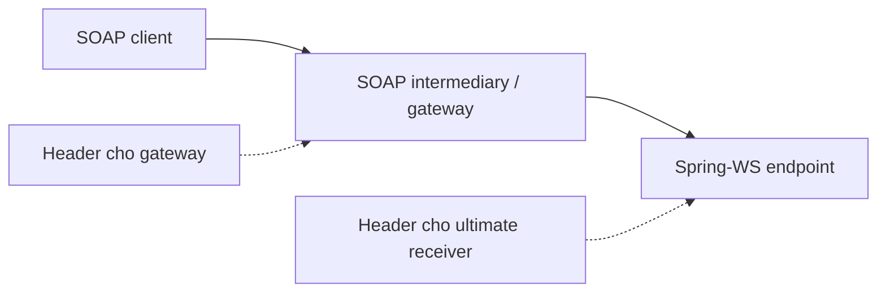
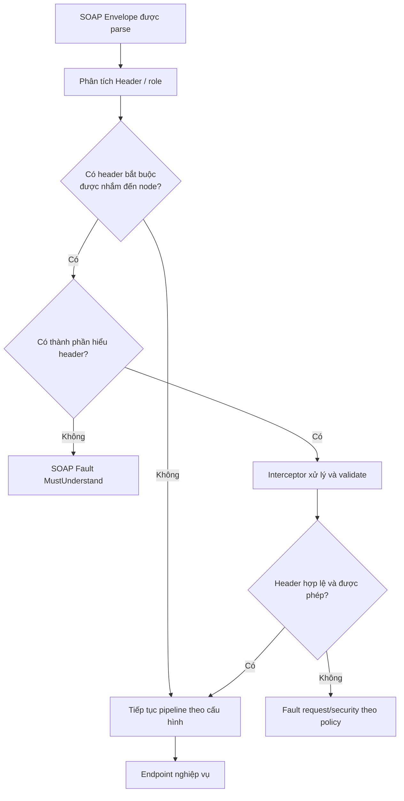

# Xử lý mustUnderstand qua SoapEndpointInterceptor

Khi một SOAP client gửi một phần tử trong `SOAP Header` kèm `mustUnderstand="1"`, nó không chỉ gửi thêm dữ liệu. Nó yêu cầu **SOAP node nhận thông điệp phải hiểu và xử lý header đó nếu header được nhắm đến node ấy**. Nếu không có thành phần nào nhận trách nhiệm xử lý, bên nhận phải báo lỗi giao thức **SOAP Fault `MustUnderstand`** thay vì âm thầm bỏ qua.

Trong **Spring Web Services (Spring-WS)**, giao diện `SoapEndpointInterceptor` là một điểm mở rộng quan trọng để khai báo những SOAP Header mà một interceptor nhận biết. Bài thuộc chương **Header và ngữ cảnh** của module **SPRING_WEB_SERVICES**. Bối cảnh là phát triển dịch vụ SOAP **contract-first**: thiết kế XSD/WSDL, ánh xạ JAXB, xây dựng endpoint và SOAP client, xử lý SOAP Fault/interceptor, bảo vệ XML/WS-Security, kiểm tra chứng chỉ và thử nghiệm tương thích khi tích hợp hệ thống doanh nghiệp.

Bài phân biệt rõ **được công nhận là hiểu header** với **đã thực sự xác thực và thực thi header**, giải thích `actor/role` của SOAP 1.1/1.2, sau đó xây dựng ví dụ có `SoapEndpointInterceptor#understands(...)`, `handleRequest(...)` và kiểm thử trên đường truyền.

Các ví dụ Java dùng Spring-WS hiện đại trên Java 17+, hệ Jakarta cho JAXB/SAAJ và SOAP 1.1 trừ khi chỉ rõ SOAP 1.2. Tên URI, operation và endpoint dưới đây là minh họa; hợp đồng của đối tác luôn là nguồn quyết định.

## 1. SOAP Header khác SOAP Body và HTTP Header như thế nào?

Một request SOAP 1.1 có thể có dạng:

```xml
<s:Envelope xmlns:s="http://schemas.xmlsoap.org/soap/envelope/"
            xmlns:o="https://example.org/orders/v1"
            xmlns:m="https://example.org/orders/meta/v1">
    <s:Header>
        <m:RequestContext s:mustUnderstand="1">
            <m:correlationId>req-2026-501</m:correlationId>
            <m:sourceSystem>warehouse-app</m:sourceSystem>
        </m:RequestContext>
    </s:Header>
    <s:Body>
        <o:GetOrderRequest>
            <o:orderId>ORD-1001</o:orderId>
        </o:GetOrderRequest>
    </s:Body>
</s:Envelope>
```

Trong ví dụ:

- `o:GetOrderRequest` là **payload nghiệp vụ** bên trong SOAP Body; Spring-WS có thể định tuyến bằng `@PayloadRoot` và ánh xạ bằng JAXB.
- `m:RequestContext` là **SOAP Header block**; QName của nó là `{https://example.org/orders/meta/v1}RequestContext`.
- `s:mustUnderstand="1"` là **thuộc tính thuộc SOAP Envelope namespace**, không phải trường `mustUnderstand` trong XSD nghiệp vụ của `RequestContext`.
- `correlationId` và `sourceSystem` là nội dung metadata. Chúng không tự chứng minh danh tính hay quyền truy cập của client.
- Một HTTP header như `SOAPAction` hoặc `X-Correlation-ID` nằm **bên ngoài** SOAP Envelope, ở tầng transport.

**Prefix XML không phải định danh header.** Thay `m` thành `meta` vẫn là cùng QName nếu namespace URI và local name giữ nguyên. Thay namespace URI trong khi giữ local name `RequestContext` sẽ tạo một header khác.

### 1.1. Tầng nào chịu trách nhiệm?

| Thành phần | Vai trò |
| --- | --- |
| SOAP client | Tạo Envelope/Body/Header và đặt `mustUnderstand` theo hợp đồng |
| `WebServiceMessageFactory` / `SoapMessageFactory` | Tạo và đọc thông điệp SOAP đúng version |
| `SoapMessageDispatcher` / hạ tầng Spring-WS | Áp dụng quy tắc dispatch và xử lý mustUnderstand theo cơ chế Spring-WS |
| `SoapEndpointInterceptor` | Công bố khả năng hiểu header SOAP, xử lý header trong vòng đời interceptor |
| `@Endpoint` | Thực thi nghiệp vụ sau khi request được dispatch và các kiểm tra cần thiết hoàn tất |
| XSD validator | Kiểm tra cấu trúc/kiểu/namespace của payload hoặc header khi được cấu hình |
| WS-Security interceptor | Xác minh token, signature, timestamp, certificate, policy theo cấu hình |
| HTTP transport | Truyền byte, HTTP status/header, TLS connection |

Không có một interceptor “biết tên header” nào mặc nhiên thay thế các lớp kiểm tra XSD, chữ ký, authorization và chính sách replay.

## 2. Ngữ nghĩa `mustUnderstand` của SOAP

### 2.1. Header bắt buộc phải hiểu

`mustUnderstand` là một thuộc tính tiêu chuẩn của **SOAP Header block**. Nó nói rằng node được nhắm đến phải **hiểu và xử lý đúng ngữ nghĩa** header; nếu không thể làm điều đó, node không được tiếp tục xử lý message như thể không có yêu cầu.

SOAP 1.1 thường biểu diễn:

```xml
<m:RequestContext
    xmlns:m="https://example.org/orders/meta/v1"
    xmlns:s="http://schemas.xmlsoap.org/soap/envelope/"
    s:mustUnderstand="1">
    <m:correlationId>req-2026-501</m:correlationId>
</m:RequestContext>
```

Nếu thuộc tính không có hoặc ở trạng thái false, quy tắc **MustUnderstand** không ép node xử lý block đó. Tuy nhiên, **hợp đồng ứng dụng** vẫn có thể yêu cầu header; thiếu hoặc sai header vẫn có thể bị từ chối vì quy tắc nghiệp vụ/chính sách bảo mật khác.

**Không nhầm:**

1. **Có header**: phần tử xuất hiện trong SOAP Header.
2. **mustUnderstand**: node nhận có nghĩa vụ hiểu và xử lý khi header được nhắm đến nó.
3. **Đúng XSD**: nội dung XML của header có hợp lệ theo schema không.
4. **Đáng tin cậy**: dữ liệu header có được xác thực về nguồn, toàn vẹn và quyền sử dụng hay không.

Một header có thể thỏa điều kiện (1) và (2), nhưng vẫn vi phạm (3) hoặc (4).

### 2.2. SOAP 1.1 và SOAP 1.2 khác nhau ở đâu?

| Đặc tính | SOAP 1.1 | SOAP 1.2 |
| --- | --- | --- |
| Namespace Envelope | `http://schemas.xmlsoap.org/soap/envelope/` | `http://www.w3.org/2003/05/soap-envelope` |
| Thuộc tính nghĩa vụ xử lý | `s:mustUnderstand` | `env:mustUnderstand` |
| Giá trị true thường dùng | `1` | `true` hoặc `1` |
| Giá trị false thường dùng | `0` | `false` hoặc `0` |
| Chỉ định node đích | `actor` | `role` |
| Chuyển tiếp header chưa xử lý | Theo quy tắc SOAP 1.1 | SOAP 1.2 còn có thuộc tính `relay` |
| Fault code khi không hiểu | `MustUnderstand` trong SOAP 1.1 | `env:MustUnderstand` trong SOAP 1.2 |

Đừng dùng namespace SOAP 1.1 Envelope cho message SOAP 1.2. Dù phần tử nghiệp vụ `m:RequestContext` giống nhau, **SOAP version** vẫn chi phối `mustUnderstand`, role, Fault và HTTP binding.

Ví dụ SOAP 1.2:

```xml
<env:Envelope xmlns:env="http://www.w3.org/2003/05/soap-envelope"
              xmlns:m="https://example.org/orders/meta/v1"
              xmlns:o="https://example.org/orders/v1">
    <env:Header>
        <m:RequestContext env:mustUnderstand="true">
            <m:correlationId>req-2026-501</m:correlationId>
        </m:RequestContext>
    </env:Header>
    <env:Body>
        <o:GetOrderRequest>
            <o:orderId>ORD-1001</o:orderId>
        </o:GetOrderRequest>
    </env:Body>
</env:Envelope>
```

### 2.3. Khi nào phát sinh `MustUnderstand` Fault?

Điều kiện cốt lõi: **một SOAP Header block được nhắm đến node đang xử lý, được đánh dấu mustUnderstand=true, nhưng node không hiểu/xử lý được block đó**.

Ví dụ client gửi:

```xml
<s:Header xmlns:s="http://schemas.xmlsoap.org/soap/envelope/"
          xmlns:x="https://example.org/unknown/v1">
    <x:SpecialRouting s:mustUnderstand="1">
        <x:route>A</x:route>
    </x:SpecialRouting>
</s:Header>
```

Nếu server không có thành phần nhận trách nhiệm đối với `{https://example.org/unknown/v1}SpecialRouting` và header nhắm tới server hiện tại, request cần bị từ chối bằng lỗi giao thức tương ứng. Không được mặc định “lấy Body để xử lý trước, còn Header không biết thì bỏ qua”.

Ngược lại, **header không có mustUnderstand** có thể được bỏ qua theo ngữ nghĩa SOAP, trừ khi có quy tắc khác trong WSDL/policy/ứng dụng. Một SOAP Fault do **thiếu header bắt buộc theo nghiệp vụ** khác với SOAP Fault `MustUnderstand` do **không hiểu header đã gửi**.

## 3. `actor` và `role`: header dành cho node nào?

Trong thực tế, SOAP message có thể đi qua nhiều node:



Một header có `mustUnderstand="1"` không nhất thiết buộc **mọi** node trên đường đi phải hiểu nó. Nghĩa vụ phát sinh khi header **được nhắm đến** node theo `actor` (SOAP 1.1) hoặc `role` (SOAP 1.2).

### 3.1. SOAP 1.1 `actor`

SOAP 1.1 hỗ trợ thuộc tính `s:actor`, ví dụ:

```xml
<m:GatewayContext
    xmlns:m="https://example.org/gateway/v1"
    xmlns:s="http://schemas.xmlsoap.org/soap/envelope/"
    s:actor="http://schemas.xmlsoap.org/soap/actor/next"
    s:mustUnderstand="1">
    <m:routeKey>zone-a</m:routeKey>
</m:GatewayContext>
```

Giá trị `.../actor/next` nhắm đến node SOAP kế tiếp theo SOAP 1.1. Một header không khai báo `actor` thường dành cho **ultimate receiver**. Đừng giả định một API Gateway HTTP thuần có xử lý SOAP theo các quy tắc intermediary; hành vi chỉ áp dụng khi component đó thực sự đóng vai trò SOAP node.

### 3.2. SOAP 1.2 `role`

SOAP 1.2 có các role chuẩn như `next`, `ultimateReceiver` và `none`, cùng khả năng role do ứng dụng quy định. Thuộc tính `relay` áp dụng theo quy tắc SOAP 1.2 cho việc chuyển tiếp các header phù hợp; nó **không** biến một header `mustUnderstand` chưa được hiểu thành header được phép âm thầm chấp nhận.

Khi thiết kế Spring-WS:

- Xác định Spring-WS server đang là **ultimate receiver** hay có một SOAP intermediary cần xử lý riêng.
- Không nhận trách nhiệm cho mọi header chỉ vì `mustUnderstand=1`.
- Nếu có routing theo `actor/role`, phải bảo đảm dispatcher/interceptor và gateway được cấu hình đúng vai trò.
- Kiểm thử cả header nhắm tới node hiện tại và header dành cho node khác. Hành vi xử lý/chuyển tiếp phải tuân thủ SOAP version và topology thực tế.

## 4. Spring-WS nhận biết header bằng `SoapEndpointInterceptor`

### 4.1. Giao diện chuyên SOAP

Spring-WS cung cấp `org.springframework.ws.soap.server.SoapEndpointInterceptor`, một specialization của `EndpointInterceptor`. Ngoài các callback vòng đời thông thường, nó có phương thức:

```java
boolean understands(SoapHeaderElement header);
```

Ý nghĩa: interceptor trả lời **liệu nó hiểu header SOAP cụ thể này hay không**. Dispatcher có thể sử dụng khai báo đó khi áp dụng quy tắc xử lý `mustUnderstand`.

Các phương thức liên quan:

| Method | Câu hỏi nó trả lời |
| --- | --- |
| `understands(SoapHeaderElement)` | “Interceptor này nhận biết và chịu trách nhiệm với header nào?” |
| `handleRequest(MessageContext, Object)` | “Khi request được xử lý, tôi sẽ kiểm tra/thực thi header và quyết định cho đi tiếp không?” |
| `handleResponse(MessageContext, Object)` | “Tôi có xử lý hoặc bổ sung gì ở response?” |
| `handleFault(MessageContext, Object)` | “Tôi có xử lý gì sau khi response là SOAP Fault?” |
| `afterCompletion(MessageContext, Object, Exception)` | “Có việc dọn dẹp tài nguyên sau xử lý không?” |

**Điểm quyết định:** `understands(...)` **không phải** hàm xác thực chữ ký, unmarshal, kiểm tra nội dung hay cấp quyền; nó chỉ khai báo khả năng hiểu header. Nếu trả `true` mà `handleRequest(...)` không thực sự xử lý đúng thì ta đã phá hỏng hợp đồng `mustUnderstand` về mặt ngữ nghĩa.

### 4.2. Vòng đời tiêu biểu



Sơ đồ mô tả **trách nhiệm logic**, không đảm bảo thứ tự gọi mọi callback giống hệt trên từng phiên bản Spring-WS. `understands(...)` được dispatcher sử dụng trong cơ chế mustUnderstand, còn `handleRequest(...)` tham gia chuỗi interceptor; cần kiểm tra cấu hình và hành vi bản Spring-WS dùng thực tế bằng test.

Nếu một header **đã được nhận là hiểu** nhưng giá trị sai định dạng, nên phát sinh lỗi **validation hoặc security thích hợp**, không giả vờ rằng interceptor “không hiểu QName” chỉ vì giá trị `correlationId` rỗng.

## 5. Thiết kế một header metadata đúng hợp đồng

Giả sử dịch vụ `GetOrder` yêu cầu metadata để theo dõi yêu cầu giữa các hệ thống. Tách phần Body và Header giúp ý nghĩa rõ:

**Body:** `GetOrderRequest` chứa mã đơn hàng.

```xml
<xs:schema xmlns:xs="http://www.w3.org/2001/XMLSchema"
           targetNamespace="https://example.org/orders/v1"
           elementFormDefault="qualified">
    <xs:element name="GetOrderRequest">
        <xs:complexType>
            <xs:sequence>
                <xs:element name="orderId" type="xs:string"/>
            </xs:sequence>
        </xs:complexType>
    </xs:element>
    <xs:element name="GetOrderResponse">
        <xs:complexType>
            <xs:sequence>
                <xs:element name="orderId" type="xs:string"/>
                <xs:element name="status" type="xs:string"/>
            </xs:sequence>
        </xs:complexType>
    </xs:element>
</xs:schema>
```

**Header:** `RequestContext` chứa correlation ID, source system:

```xml
<xs:schema xmlns:xs="http://www.w3.org/2001/XMLSchema"
           targetNamespace="https://example.org/orders/meta/v1"
           elementFormDefault="qualified">
    <xs:element name="RequestContext">
        <xs:complexType>
            <xs:sequence>
                <xs:element name="correlationId" type="xs:string"/>
                <xs:element name="sourceSystem" type="xs:string"
                            minOccurs="0"/>
            </xs:sequence>
        </xs:complexType>
    </xs:element>
</xs:schema>
```

Sử dụng QName không trùng:

```text
Body:   {https://example.org/orders/v1}GetOrderRequest
Header: {https://example.org/orders/meta/v1}RequestContext
```

### 5.1. Khai báo `soap:header` trong WSDL

WSDL 1.1 cho phép `wsdl:binding` gắn một message part vào SOAP Header:

```xml
<!-- Fragment trong WSDL 1.1, giả định các prefix đã được khai báo. -->
<wsdl:message name="RequestContextMessage">
    <wsdl:part name="context" element="m:RequestContext"/>
</wsdl:message>

<wsdl:binding name="OrdersSoap11Binding" type="tns:OrdersPortType">
    <soap:binding style="document"
                  transport="http://schemas.xmlsoap.org/soap/http"/>
    <wsdl:operation name="GetOrder">
        <soap:operation soapAction="urn:example:orders:GetOrder"/>
        <wsdl:input>
            <soap:body use="literal"/>
            <soap:header
                message="tns:RequestContextMessage"
                part="context"
                use="literal"/>
        </wsdl:input>
        <wsdl:output>
            <soap:body use="literal"/>
        </wsdl:output>
    </wsdl:operation>
</wsdl:binding>
```

Đây là fragment học thuật, không phải WSDL độc lập: cần `wsdl:definitions`, namespaces, `wsdl:types` và `wsdl:portType/message` input/output đầy đủ. `soap:header` mô tả một Header block dùng theo binding. Nó **không tự gắn `mustUnderstand="1"` trên mọi thông điệp**, không đảm bảo client sẽ gửi header, và không cấu hình tự động `SoapEndpointInterceptor`.

Muốn bắt buộc xử lý metadata, cần phối hợp **WSDL/policy/thỏa thuận tích hợp**, quy tắc SOAP trên message được gửi và logic kiểm tra tại server. WSDL sinh đơn giản từ XSD không nhất thiết sinh các `soap:header` tùy chỉnh; phải đọc tài liệu WSDL được công bố thực tế.

## 6. Lớp JAXB cho `RequestContext`

Để interceptor không phải ghép chuỗi XML thủ công, ta ánh xạ phần tử header vào Java:

```java
import jakarta.xml.bind.annotation.XmlAccessType;
import jakarta.xml.bind.annotation.XmlAccessorType;
import jakarta.xml.bind.annotation.XmlElement;
import jakarta.xml.bind.annotation.XmlRootElement;
import jakarta.xml.bind.annotation.XmlType;

@XmlRootElement(
    name = "RequestContext",
    namespace = "https://example.org/orders/meta/v1")
@XmlAccessorType(XmlAccessType.FIELD)
@XmlType(propOrder = {"correlationId", "sourceSystem"})
public class RequestContext {
    @XmlElement(
        namespace = "https://example.org/orders/meta/v1",
        required = true)
    private String correlationId;

    @XmlElement(namespace = "https://example.org/orders/meta/v1")
    private String sourceSystem;

    public RequestContext() { }

    public RequestContext(String correlationId, String sourceSystem) {
        this.correlationId = correlationId;
        this.sourceSystem = sourceSystem;
    }

    public String getCorrelationId() {
        return correlationId;
    }

    public String getSourceSystem() {
        return sourceSystem;
    }
}
```

Trong dự án contract-first chính thức, ưu tiên **sinh lớp JAXB từ XSD**. Mã trên minh họa cùng quy tắc QName. `@XmlElement(required=true)` không thay thế schema validation: JAXB unmarshal có thể tạo object thiếu giá trị nếu validator không được bật.

Ví dụ bean Spring OXM:

```java
import org.springframework.context.annotation.Bean;
import org.springframework.context.annotation.Configuration;
import org.springframework.core.io.ClassPathResource;
import org.springframework.oxm.jaxb.Jaxb2Marshaller;

@Configuration
public class HeaderMappingConfiguration {

    @Bean
    public Jaxb2Marshaller requestContextMarshaller() {
        Jaxb2Marshaller mapping = new Jaxb2Marshaller();
        mapping.setClassesToBeBound(RequestContext.class);
        mapping.setSchema(
                new ClassPathResource("xsd/request-context.xsd"));
        mapping.setSupportDtd(false);
        mapping.setProcessExternalEntities(false);
        return mapping;
    }
}
```

File `xsd/request-context.xsd` là XSD metadata ở mục 5 được lưu trong classpath theo quy ước dự án. Nếu mã sinh từ XSD không có `@XmlRootElement`, JAXB có thể trả `JAXBElement<RequestContext>` qua `ObjectFactory`. Cần xử lý kiểu kết quả và QName đúng schema thật; không ép kiểu vô điều kiện.

## 7. Cài đặt `SoapEndpointInterceptor`

Ta muốn interceptor chỉ công nhận **một header QName**:

```text
{https://example.org/orders/meta/v1}RequestContext
```

Và trong quá trình xử lý request, interceptor phải:

1. Tìm header đúng QName, không so prefix.
2. Từ chối thiếu hoặc nhiều header nếu hợp đồng quy định đúng một.
3. Unmarshal/validate theo XSD metadata.
4. Chuẩn hóa correlation ID, giới hạn độ dài và ký tự.
5. Đặt giá trị đã kiểm tra vào `MessageContext` để endpoint sử dụng.
6. Không tin `sourceSystem` như danh tính được xác thực khi chưa đối chiếu security principal.

### 7.1. Component kiểm tra giá trị

```java
public final class CorrelationIds {
    private CorrelationIds() { }

    public static String normalize(String value) {
        if (value == null || value.isBlank()) {
            throw new InvalidContextHeaderException(
                    "correlationId is required");
        }
        String id = value.trim();
        if (id.length() > 64 ||
                !id.matches("[A-Za-z0-9._:-]+")) {
            throw new InvalidContextHeaderException(
                    "Invalid correlationId");
        }
        return id;
    }
}

public class InvalidContextHeaderException extends RuntimeException {
    public InvalidContextHeaderException(String message) {
        super(message);
    }
}
```

Hai class `public` này cần đặt trong **hai file Java riêng** khi đưa vào dự án thật. Quy tắc độ dài/regex chỉ minh họa một hợp đồng metadata; điều kiện thật cần do các bên tích hợp thống nhất. Không dùng `correlationId` làm credential hoặc token xác thực.

### 7.2. Interceptor đầy đủ

```java
import java.util.Iterator;
import javax.xml.namespace.QName;
import jakarta.xml.bind.JAXBElement;
import org.springframework.oxm.jaxb.Jaxb2Marshaller;
import org.springframework.ws.WebServiceMessage;
import org.springframework.ws.context.MessageContext;
import org.springframework.ws.soap.SoapHeaderElement;
import org.springframework.ws.soap.SoapMessage;
import org.springframework.ws.soap.server.SoapEndpointInterceptor;

public final class RequestContextInterceptor
        implements SoapEndpointInterceptor {

    public static final String CORRELATION_ID_PROPERTY =
            "orders.tracing.correlationId";

    private static final QName REQUEST_CONTEXT_QNAME =
            new QName("https://example.org/orders/meta/v1",
                      "RequestContext");

    private final Jaxb2Marshaller headerMarshaller;

    public RequestContextInterceptor(
            Jaxb2Marshaller headerMarshaller) {
        this.headerMarshaller = headerMarshaller;
    }

    @Override
    public boolean understands(SoapHeaderElement header) {
        // Chỉ nhận trách nhiệm cho QName được hỗ trợ.
        // Không trả true cho mọi header có mustUnderstand=true.
        return REQUEST_CONTEXT_QNAME.equals(header.getName());
    }

    @Override
    public boolean handleRequest(
            MessageContext context, Object endpoint) {

        WebServiceMessage request = context.getRequest();
        if (!(request instanceof SoapMessage soap)) {
            throw new InvalidContextHeaderException(
                    "Expected a SOAP message");
        }

        SoapHeaderElement selected = null;
        int matches = 0;

        Iterator<SoapHeaderElement> iterator =
                soap.getSoapHeader().examineAllHeaderElements();
        while (iterator.hasNext()) {
            SoapHeaderElement item = iterator.next();
            if (understands(item)) {
                selected = item;
                matches++;
            }
        }

        if (matches != 1) {
            throw new InvalidContextHeaderException(
                    "Exactly one RequestContext header is required");
        }

        Object parsed = headerMarshaller.unmarshal(
                selected.getSource());
        RequestContext metadata = toRequestContext(parsed);

        String correlationId = CorrelationIds.normalize(
                metadata.getCorrelationId());
        context.setProperty(
                CORRELATION_ID_PROPERTY, correlationId);

        // Metadata sourceSystem chỉ là lời khai của client.
        // Nếu dùng để phân quyền phải đối chiếu identity đã xác thực.
        return true;
    }

    private static RequestContext toRequestContext(Object raw) {
        if (raw instanceof RequestContext direct) {
            return direct;
        }
        if (raw instanceof JAXBElement<?> element
                && REQUEST_CONTEXT_QNAME.equals(element.getName())
                && element.getValue() instanceof RequestContext wrapped) {
            return wrapped;
        }
        throw new InvalidContextHeaderException(
                "Unexpected RequestContext JAXB root");
    }

    @Override
    public boolean handleResponse(
            MessageContext context, Object endpoint) {
        return true;
    }

    @Override
    public boolean handleFault(
            MessageContext context, Object endpoint) {
        return true;
    }

    @Override
    public void afterCompletion(
            MessageContext context, Object endpoint, Exception ex) {
        // Nếu cấp tài nguyên bên ngoài, dọn theo vòng đời request.
    }
}
```

Các lớp Java trên mang tính **khung minh họa** và cần cấu hình thêm endpoint, WSDL, XSD, các bean và exception resolver để chạy như một dịch vụ. Điểm học thuật cốt lõi:

- `understands(...)` chỉ so QName, trả `false` cho header lạ.
- `handleRequest(...)` **thực sự đọc, xác thực và chuẩn hóa** metadata đã nhận hiểu.
- `MessageContext#setProperty` lưu dữ liệu **trong phạm vi xử lý message**, không ghi nó vào SOAP response hay HTTP response.
- `RequestContextInterceptor` là bean dùng lại; không cất correlation ID vào field mutable của singleton interceptor.
- `handleResponse` và `handleFault` có thể dùng nếu cần thêm metadata response, nhưng không bắt buộc cho ví dụ đọc request.

**Giới hạn role:** `examineAllHeaderElements()` duyệt các phần tử header hiện diện; mã này được viết cho topology đơn giản **ultimate receiver**, trong đó `RequestContext` nhắm tới server. Nếu service đóng vai trò SOAP intermediary, cần xét `actor/role` đúng node, không xử lý một header dành cho node khác chỉ vì QName khớp. Hãy bổ sung logic/kiểm thử vai trò phù hợp và dựa vào cơ chế targeting của SOAP stack.

### 7.3. Vì sao không chỉ kiểm tra `header.getMustUnderstand()`?

Không nên viết:

```java
@Override
public boolean understands(SoapHeaderElement header) {
    return header.getMustUnderstand(); // SAI: nhận bừa mọi header bắt buộc
}
```

Đoạn sai này có thể làm dispatcher tưởng mọi header có `mustUnderstand=true` đều được interceptor hiểu. Một client gửi `x:UnknownSecurityPolicy` sẽ không bị từ chối theo đúng quy tắc nếu không có thành phần khác xử lý. **Điều kiện hiểu phải dựa trên QName và ngữ nghĩa đã triển khai**, không chỉ dựa trên giá trị cờ.

Cũng không nên viết `return true;` cho mọi header để “hết lỗi MustUnderstand”. Đó là cách **vô hiệu hóa một bảo đảm giao thức**.

## 8. Đăng ký interceptor vào Spring-WS

`SoapEndpointInterceptor` chỉ có hiệu lực khi được **đăng ký trong chuỗi interceptor/dispatcher phù hợp**. Một bean tồn tại trong Spring container không tự đảm bảo dispatcher sẽ dùng nó để xử lý tất cả request.

Ví dụ Spring-WS Java configuration **tách bean interceptor và cấu hình đăng ký** thành hai class:

```java
import java.util.List;
import org.springframework.context.annotation.Bean;
import org.springframework.context.annotation.Configuration;
import org.springframework.oxm.jaxb.Jaxb2Marshaller;
import org.springframework.ws.config.annotation.EnableWs;
import org.springframework.ws.config.annotation.WsConfigurer;
import org.springframework.ws.server.EndpointInterceptor;

@Configuration
public class RequestContextBeans {
    @Bean
    public RequestContextInterceptor requestContextInterceptor(
            Jaxb2Marshaller requestContextMarshaller) {
        return new RequestContextInterceptor(requestContextMarshaller);
    }
}

@Configuration
@EnableWs
public class SoapWsConfigurer implements WsConfigurer {
    private final RequestContextInterceptor contextInterceptor;

    public SoapWsConfigurer(
            RequestContextInterceptor contextInterceptor) {
        this.contextInterceptor = contextInterceptor;
    }

    @Override
    public void addInterceptors(List<EndpointInterceptor> interceptors) {
        interceptors.add(contextInterceptor);
    }
}
```

Hai class `public` được đặt trong **hai file Java riêng**. Tách riêng cấu hình tạo bean giúp tránh vòng phụ thuộc do constructor của một `@Configuration` cố inject bean được khai báo bên trong chính cấu hình ấy. Trong ứng dụng dùng auto-configuration, cần tránh đăng ký trùng servlet hoặc interceptor theo một cách khác.

### 8.1. Phạm vi và thứ tự xử lý

Nếu một interceptor được đăng ký cho mọi endpoint nhưng chỉ operation `GetOrder` có `RequestContext` bắt buộc, việc `handleRequest(...)` **luôn** từ chối request thiếu header sẽ phá vỡ các operation khác. Phải làm rõ phạm vi áp dụng:

- Chỉ đăng ký interceptor cho endpoint phù hợp khi cấu hình hỗ trợ mapping/selection.
- Hoặc phân biệt operation/QName payload và chỉ bắt buộc metadata ở những operation liên quan.
- Hoặc xác định quy định **mọi operation** đều phải có header đó ngay từ WSDL/policy.

Đối với bảo mật, không dựa vào thứ tự mặc định chưa được kiểm tra. Nếu `sourceSystem` ảnh hưởng authorization, hãy xác minh identity/chữ ký WS-Security trước khi dùng claim này để cấp quyền; những bước trích xuất correlation ID chỉ phục vụ logging có thể có chính sách khác, nhưng vẫn phải giới hạn/validate input.

## 9. Endpoint đọc metadata đã được chuẩn hóa

Khi interceptor xử lý xong, phương thức endpoint có thể tập trung vào nghiệp vụ:

```java
import org.springframework.ws.context.MessageContext;
import org.springframework.ws.server.endpoint.annotation.Endpoint;
import org.springframework.ws.server.endpoint.annotation.PayloadRoot;
import org.springframework.ws.server.endpoint.annotation.RequestPayload;
import org.springframework.ws.server.endpoint.annotation.ResponsePayload;

@Endpoint
public class OrdersEndpoint {
    private static final String NS = "https://example.org/orders/v1";

    private final OrderService orderService;

    public OrdersEndpoint(OrderService orderService) {
        this.orderService = orderService;
    }

    @PayloadRoot(namespace = NS, localPart = "GetOrderRequest")
    @ResponsePayload
    public GetOrderResponse getOrder(
            @RequestPayload GetOrderRequest request,
            MessageContext context) {

        String correlationId = (String) context.getProperty(
                RequestContextInterceptor.CORRELATION_ID_PROPERTY);
        if (correlationId == null) {
            throw new IllegalStateException(
                    "RequestContext was not processed");
        }
        return orderService.getOrder(
                request.getOrderId(), correlationId);
    }
}
```

`OrderService`, `GetOrderRequest` và `GetOrderResponse` là các kiểu minh họa cần có implementation/JAXB mapping tương ứng XSD. Ở đây:

- `@PayloadRoot` định tuyến bằng **Body root QName**, không bằng QName của SOAP Header.
- `@RequestPayload` xử lý dữ liệu nghiệp vụ XML/Java.
- `MessageContext` cung cấp property do interceptor đặt.
- Nếu interceptor chưa chạy, endpoint **không** nên tự coi header lạ là đã được xác thực.

`MessageContext` chỉ phục vụ vòng đời một message, không dùng làm database, session hay nơi giữ state người dùng giữa các request. Không lưu `correlationId` vào field mutable của `@Endpoint` singleton.

## 10. Client đặt `mustUnderstand` đúng cách

Client Spring-WS có thể gửi SOAP Body qua JAXB và thêm `RequestContext` vào SOAP Header bằng callback. Với Spring OXM:

```java
import javax.xml.namespace.QName;
import org.springframework.oxm.jaxb.Jaxb2Marshaller;
import org.springframework.ws.client.core.WebServiceTemplate;
import org.springframework.ws.soap.SoapHeaderElement;
import org.springframework.ws.soap.SoapMessage;

public final class OrdersClient {
    private static final QName HEADER_NAME =
            new QName("https://example.org/orders/meta/v1",
                      "RequestContext");

    private final WebServiceTemplate template;
    private final Jaxb2Marshaller headerMarshaller;
    private final String endpointUri;

    public OrdersClient(WebServiceTemplate template,
                        Jaxb2Marshaller headerMarshaller,
                        String endpointUri) {
        this.template = template;
        this.headerMarshaller = headerMarshaller;
        this.endpointUri = endpointUri;
    }

    public GetOrderResponse getOrder(String orderId, String traceId) {
        GetOrderRequest body = new GetOrderRequest();
        body.setOrderId(orderId);
        RequestContext metadata =
                new RequestContext(traceId, "warehouse-app");

        Object result = template.marshalSendAndReceive(
                endpointUri,
                body,
                message -> {
                    SoapMessage soap = (SoapMessage) message;
                    soap.setSoapAction("urn:example:orders:GetOrder");

                    // Marshalling root element RequestContext trực tiếp
                    // vào SOAP Header:
                    headerMarshaller.marshal(
                            metadata,
                            soap.getSoapHeader().getResult());

                    // Tìm phần tử header đã marshal để đặt
                    // thuộc tính SOAP mustUnderstand trên đúng block.
                    var elements = soap.getSoapHeader()
                                       .examineAllHeaderElements();
                    while (elements.hasNext()) {
                        SoapHeaderElement header = elements.next();
                        if (HEADER_NAME.equals(header.getName())) {
                            header.setMustUnderstand(true);
                        }
                    }
                });

        return (GetOrderResponse) result;
    }
}
```

Đây là ví dụ minh họa cách **thêm một header và đặt cờ trên phần tử vừa tạo**. Runtime phải có JAXB marshaller cho cả Body và Header, SOAP message factory đúng version, operation/`SOAPAction` theo WSDL thật và endpoint URI từ cấu hình môi trường. Khi dùng message implementation/buffering khác, hãy **kiểm thử bản XML được serialize** để bảo đảm phần tử vừa marshal có thể được tìm thấy và cập nhật thuộc tính trong callback.

Một cách thay thế là **tạo `SoapHeaderElement` bằng API của `SoapHeader` rồi ghi nội dung con**. Khi làm cách này, **không marshal một root `RequestContext` hoàn chỉnh vào bên trong `SoapHeaderElement RequestContext`** nếu sẽ tạo hai lớp `RequestContext` lồng nhau. Phải chọn cách ghi phù hợp với XML hợp đồng.

### 10.1. Kiểm tra SOAP message trên wire

Expected SOAP 1.1 Header:

```xml
<s:Header xmlns:s="http://schemas.xmlsoap.org/soap/envelope/"
          xmlns:m="https://example.org/orders/meta/v1">
    <m:RequestContext s:mustUnderstand="1">
        <m:correlationId>req-2026-501</m:correlationId>
        <m:sourceSystem>warehouse-app</m:sourceSystem>
    </m:RequestContext>
</s:Header>
```

Không nên assert rằng giá trị `SOAPAction` là XML node trong Header: `SOAPAction` trong SOAP 1.1 qua HTTP là thông tin binding/HTTP, còn `RequestContext` là SOAP Header block. Với SOAP 1.2, action/media type có quy tắc khác và phải được kiểm tra theo version.

## 11. SOAP Fault `MustUnderstand` và các Fault khác

### 11.1. Fault do header không được hiểu

Khi một header bắt buộc nhắm tới server nhưng **không có thành phần hiểu**, phản hồi SOAP 1.1 có thể mang Fault:

```xml
<s:Envelope xmlns:s="http://schemas.xmlsoap.org/soap/envelope/">
    <s:Body>
        <s:Fault>
            <faultcode>s:MustUnderstand</faultcode>
            <faultstring>Mandatory SOAP header was not understood</faultstring>
        </s:Fault>
    </s:Body>
</s:Envelope>
```

Đây là **ví dụ ý nghĩa Fault**, không cam kết chính xác nội dung `faultstring`, HTTP status hoặc namespace prefix của provider đang dùng. Spring-WS và SOAP version quyết định hình thức kết quả cụ thể.

### 11.2. Header được hiểu nhưng sai dữ liệu

Giả sử `RequestContext` có:

```xml
<m:RequestContext xmlns:m="https://example.org/orders/meta/v1"
                  xmlns:s="http://schemas.xmlsoap.org/soap/envelope/"
                  s:mustUnderstand="1">
    <m:correlationId>   </m:correlationId>
</m:RequestContext>
```

Interceptor **hiểu QName** và cố gắng xử lý, nhưng `correlationId` sai chính sách. Đây không phải trường hợp “không biết header là gì” theo nghĩa mustUnderstand; đây là **header được hiểu nhưng không hợp lệ**. Có thể ánh xạ `InvalidContextHeaderException` thành SOAP Fault phù hợp với lỗi request, ví dụ SOAP 1.1 `Client` hoặc SOAP 1.2 `Sender` theo cấu hình. Nếu lỗi xảy ra ở server (schema hỏng, JAXB provider thiếu), Fault dạng server có thể thích hợp hơn.

Một hệ thống cần **exception resolver** hoặc cơ chế xử lý lỗi để biến exception ứng dụng thành SOAP Fault có định dạng ổn định. Không phải mọi exception được ném trong interceptor sẽ tự có đúng Fault code như mong muốn nếu chưa cấu hình.

### 11.3. Bảng phân loại lỗi

| Trường hợp | Tầng phát hiện | Kết quả mong đợi |
| --- | --- | --- |
| Header lạ có mustUnderstand=true, nhắm tới node hiện tại | SOAP dispatcher | SOAP Fault `MustUnderstand` |
| Header lạ có mustUnderstand=false | SOAP processing/policy | Có thể bỏ qua nếu policy không bắt buộc |
| Header lạ nhắm tới node SOAP khác | SOAP role/actor handling | Không tự nhận trách nhiệm xử lý nếu không phải node đích |
| `RequestContext` bắt buộc nhưng hoàn toàn vắng mặt | Interceptor/hợp đồng | Fault do thiếu metadata theo policy; **không phải mặc định MustUnderstand** |
| `RequestContext` bị trùng | Interceptor/validation | Từ chối nếu hợp đồng chỉ cho phép một |
| `RequestContext` có QName đúng, nội dung sai XSD | Header validation | Fault request/schema |
| `RequestContext` có correlationId rỗng | Business metadata validation | Fault request theo hợp đồng |
| Token/chữ ký WS-Security không hợp lệ | Security interceptor | Security Fault/từ chối theo chính sách |
| SOAP Envelope sai version | SOAP message factory/transport | VersionMismatch hoặc lỗi giao thức phù hợp |
| Exception trong nghiệp vụ `getOrder` | Endpoint/exception resolver | Business SOAP Fault hoặc response lỗi đã quy định |

**Không gửi raw stack trace, token, khóa riêng, certificate details hoặc toàn bộ header nhạy cảm vào Fault detail.** Trả mã lỗi có thể xử lý phía client, lưu nguyên nhân đầy đủ vào hệ thống logging bảo mật với correlation ID đã chuẩn hóa.

## 12. `SoapEndpointInterceptor` không phải interceptor bảo mật “vạn năng”

Một header có `mustUnderstand="1"` có thể là metadata nghiệp vụ, nhưng cũng có thể thuộc **WS-Security**, ví dụ `wsse:Security`. Những trường hợp này cần tách biệt:

- **`SoapEndpointInterceptor#understands`**: node có component nhận biết header QName không?
- **Security processor/WSS4J**: token có hợp lệ? Chữ ký có đúng? Timestamp có hết hạn? Chứng chỉ có được tin? Signed parts có đúng policy?
- **Authorization layer**: principal đã được xác minh có quyền xem đơn hàng/tenant không?
- **XSD/JAXB validation**: phần tử có cấu trúc đúng schema không?

**Không viết interceptor trả `true` cho `wsse:Security` chỉ để loại bỏ Fault `MustUnderstand`.** Nếu không có bộ xử lý WSS4J/policy tương ứng, bạn đã khiến hệ thống công bố rằng nó hiểu một header bảo mật mà thực chất không xác minh gì.

Với SOAP Header có chữ ký, không được parse một element giống tên rồi coi đó là phần đã ký nếu thư viện bảo mật xác minh vùng dữ liệu khác. Rủi ro **XML Signature wrapping** xuất hiện khi kiểm tra chữ ký một node nhưng xử lý nghiệp vụ ở một node giả mạo khác. Cần dùng kết quả xác minh và API của security stack theo chính sách signed parts/ID reference.

### 12.1. Thứ tự interceptor và ranh giới tin cậy

Ví dụ chuỗi:

```text
SOAP message
    │
    ├── Security interceptor: xác minh signature/token/timestamp
    │
    ├── Header interceptor: đọc RequestContext, validate QName/XSD
    │
    ├── XSD payload validation (nếu áp dụng)
    │
    └── Endpoint: kiểm tra quyền, xử lý nghiệp vụ
```

Đây là thứ tự **đề xuất để suy luận khi metadata ảnh hưởng quyền truy cập**, không phải khẳng định Spring-WS luôn tự sắp xếp như vậy. Vòng đời dispatcher và interceptor thực tế phải được cấu hình, kiểm thử; một số bước xác minh có thể xảy ra trước bước mapping/dispatch hoặc qua transport gateway.

Một `sourceSystem` hoặc `tenantId` do client đưa vào Header **không trở thành identity tin cậy** chỉ vì `mustUnderstand=true` hoặc vì interceptor `understands` trả `true`. Đối chiếu với authenticated principal, quyền tenant và policy riêng.

### 12.2. SOAP Header qua gateway/intermediary

Nếu một gateway thực sự là SOAP intermediary và tiêu thụ một header có role dành cho nó, có thể cần quy tắc loại bỏ hoặc chuyển tiếp header theo SOAP version. Nếu chỉ là HTTP reverse proxy, gateway thường không đọc ngữ nghĩa SOAP header. Đừng dựa vào `actor/role` để thay thế bảo mật tầng transport hoặc tách trách nhiệm giữa các node mà không kiểm thử.

## 13. Kiểm thử mustUnderstand với Spring-WS

Một unit test gọi trực tiếp `interceptor.understands(...)` chưa đủ: cần kiểm tra **SOAP message thật** và cách dispatcher xử lý header bắt buộc.

### 13.1. Ma trận hành vi

| Ca thử | Header gửi | Kỳ vọng |
| --- | --- | --- |
| 1 | `RequestContext` đúng QName, MU=true, dữ liệu hợp lệ | Interceptor xử lý, endpoint được gọi |
| 2 | `RequestContext` đúng QName, MU=false, dữ liệu hợp lệ | Interceptor vẫn xử lý nếu policy yêu cầu; không phụ thuộc vào MU=true |
| 3 | `UnknownHeader` khác QName, MU=true, nhắm endpoint | Dispatcher báo `MustUnderstand` |
| 4 | `UnknownHeader` khác QName, MU=false | Không bị `MustUnderstand` do header này; policy khác có thể từ chối |
| 5 | `RequestContext` thiếu, không có header nào | Contract/policy quyết định lỗi thiếu header; không mặc nhiên `MustUnderstand` |
| 6 | `RequestContext` xuất hiện hai lần | Interceptor từ chối nếu chỉ cho một |
| 7 | `RequestContext` sai namespace URI, MU=true | Không được interceptor nhận hiểu; nếu nhắm node thì `MustUnderstand` |
| 8 | `RequestContext` đúng QName nhưng `correlationId` rỗng | Header hiểu được, lỗi validation riêng |
| 9 | Header đúng QName nhưng `actor/role` nhắm node khác | Xử lý theo vai trò SOAP; không tự nhận trách nhiệm |
| 10 | SOAP 1.2 `mustUnderstand="true"` trên server SOAP 1.2 | Hành vi MU đúng SOAP 1.2 |
| 11 | SOAP 1.2 gửi vào server chỉ nhận SOAP 1.1 | Lỗi version/protocol, không phải lỗi JAXB Body |
| 12 | Header `wsse:Security` có MU=true, không cấu hình security | Không được “bypass” bằng interceptor nhận mọi QName |
| 13 | Chữ ký hoặc token WS-Security sai | Security layer từ chối theo policy |
| 14 | Hai request đồng thời có correlationId khác nhau | `MessageContext` không rò state giữa request |

Nên thử thêm response SOAP Fault code, Fault detail phù hợp và **xác nhận endpoint không chạy** trong các ca bị chặn. Một Fault được trả về chưa chứng minh nguyên nhân đúng nếu không kiểm tra code và đường xử lý.

### 13.2. Test `understands` ở mức unit

Nếu dựng một `SoapHeaderElement` thử nghiệm có QName, assert:

```java
assertTrue(interceptor.understands(requestContextHeader));
assertFalse(interceptor.understands(unknownHeader));
```

Hai dòng này giả định các fixture `requestContextHeader` và `unknownHeader` được tạo qua `SoapMessage`/mock phù hợp với Spring-WS. Kiểm thử unit này chứng minh **hàm nhận biết QName**, chưa chứng minh dispatcher gọi interceptor hay trả SOAP Fault đúng.

### 13.3. Kiểm thử endpoint bằng `MockWebServiceClient`

Với `MockWebServiceClient`, có thể gửi Body hợp lệ vào Spring-WS context và dùng callback để thêm SOAP Header (tùy API test phiên bản đang dùng), sau đó assert response:

```java
import org.springframework.xml.transform.StringSource;
import org.springframework.ws.test.server.MockWebServiceClient;
import static org.springframework.ws.test.server.RequestCreators.*;
import static org.springframework.ws.test.server.ResponseMatchers.*;

StringSource body = new StringSource(
    "<o:GetOrderRequest xmlns:o='https://example.org/orders/v1'>" +
    "<o:orderId>ORD-1001</o:orderId>" +
    "</o:GetOrderRequest>");

// Chỉ kiểm tra Body: ca này KHÔNG chứng minh mustUnderstand.
mockClient.sendRequest(withPayload(body))
          .andExpect(noFault());
```

Đoạn trên là **khung kiểm thử Body**; nếu `RequestContext` bắt buộc cho mọi operation và interceptor đã được kích hoạt, test `noFault()` này **sẽ không đúng kỳ vọng** khi chưa gắn Header. Để kiểm thử mustUnderstand thật, cần tạo SOAP message với Header, kiểm tra đúng QName/MU flag và dùng test client gửi message qua pipeline có interceptor đã đăng ký.

Khi API Spring-WS Test hỗ trợ callback từ `RequestCreator`, có thể dùng callback viết Header hoặc định nghĩa `RequestCreator` riêng. Ví dụ logic viết Header để tích hợp vào request:

```java
// Phần thân callback cần được gắn vào request creator phù hợp.
message -> {
    SoapMessage soap = (SoapMessage) message;
    headerMarshaller.marshal(
        new RequestContext("req-test-1", "test-system"),
        soap.getSoapHeader().getResult());
    // Tìm header đúng QName rồi setMustUnderstand(true).
}
```

Đoạn trên chỉ minh họa callback, không phải method Java độc lập. Cần kiểm chứng cấu trúc XML trên wire thay vì chỉ kiểm tra object JAXB. Một test **thiếu header** khi policy bắt buộc nên assert Fault, không `noFault()`.

### 13.4. Kiểm thử end-to-end

Unit/mock test không thay thế:

- HTTP request có SOAP 1.1 `Content-Type: text/xml` và `SOAPAction` đúng hợp đồng.
- SOAP 1.2 sử dụng Envelope namespace và media type `application/soap+xml` phù hợp.
- Endpoint URL thực sự nhận POST, không nhầm URL GET WSDL.
- Parser SOAP nhận đúng `mustUnderstand`, actor/role và QName ở wire.
- WS-Security token/signature/timestamp, chứng chỉ và truststore.
- Proxy/intermediary có xử lý hoặc relay header theo đúng vai trò được thỏa thuận.

## 14. Chẩn đoán các lỗi thường gặp

| Triệu chứng | Nguyên nhân thường gặp | Hướng kiểm tra |
| --- | --- | --- |
| Fault `MustUnderstand` dù có interceptor | Chưa đăng ký `SoapEndpointInterceptor`, sai QName hoặc vai trò | Kiểm tra Spring context/dispatcher, namespace URI, actor/role |
| Interceptor `understands(...)` đúng nhưng `handleRequest(...)` không chạy | Mapping, chain, lifecycle hoặc dispatcher config khác dự kiến | Tracing interceptor và test tích hợp |
| Header đã được hiểu nhưng endpoint vẫn lỗi | Nội dung header sai schema/logic, WS-Security hoặc Body sai | Phân loại Fault thực, không chỉ nhìn tên header |
| MU=true trên header lạ vẫn không bị chặn | Interceptor trả true bừa cho mọi QName, hoặc header nhắm node khác | Kiểm tra hàm `understands` và targeting |
| Header có cùng local name nhưng không khớp | Sai namespace URI | So QName, không so prefix/local name đơn lẻ |
| `handleRequest(...)` báo thiếu header | Client chỉ marshal Body, callback chưa ghi Header | Capture SOAP Envelope thật |
| JAXB header unmarshal bị `ClassCastException` | Root là `JAXBElement<?>` hoặc model chưa đúng | Dùng `ObjectFactory`, kiểm tra QName và generated classes |
| Hai request bị lẫn correlation ID | Lưu state vào singleton field hoặc ThreadLocal không dọn | Dùng `MessageContext` theo request |
| Header có `clientId` mà quyền vẫn bị từ chối | Dữ liệu chưa được xác thực hoặc không khớp principal | Kiểm tra security identity/authorization |
| SOAP 1.2 request bị từ chối trước interceptor | Message factory/transport chỉ nhận SOAP 1.1 | So WSDL binding, Envelope và Content-Type |
| Client báo security fault sau khi thêm Header | Signed parts hoặc thứ tự ký/XML transformation không đúng | Kiểm tra policy và signature verification |
| SOAP intermediary xử lý nhầm header | Không xét `actor/role` và trách nhiệm từng node | Kiểm thử topology/gateway thực |

Trình tự xử lý sự cố nên là **capture Envelope → xác định SOAP version → kiểm tra Header QName/role/MU → xác nhận interceptor được đăng ký → phân loại Fault → kiểm tra XSD/security/endpoint**. Không đổi XSD Body nếu nguyên nhân thật là một header bắt buộc không được dispatcher hiểu.

## 15. Quy tắc thiết kế tốt cho header bắt buộc

1. **Dùng QName ổn định, có namespace riêng** cho mỗi loại SOAP Header với ý nghĩa rõ ràng.
2. **Mô tả header trong WSDL/binding và chính sách tích hợp** nếu nó thuộc hợp đồng. Không mong công cụ sinh WSDL từ XSD tự đoán header tùy chỉnh.
3. **`understands(...)` chỉ trả true cho những header thật sự được hỗ trợ.**
4. **`handleRequest(...)` phải thực thi đúng phần đã nhận hiểu**, xác thực schema/nội dung và xử lý lỗi riêng.
5. **Tôn trọng actor/role.** Node không nên tự tuyên bố hiểu một header thuộc nhiệm vụ của node khác.
6. **Không dùng `mustUnderstand` làm xác thực hoặc phân quyền.** Security claim cần được ký/xác minh và đối chiếu quyền.
7. **Dùng property trong `MessageContext` cho metadata request**, tránh mutable state singleton và log nhạy cảm.
8. **Định nghĩa SOAP Fault rõ ràng** giữa không hiểu header, header sai dữ liệu, lỗi nghiệp vụ và security failure.
9. **Thử cả header lạ bắt buộc**, không chỉ thử request thành công.
10. **Kiểm thử client và server qua wire** trong đúng SOAP version, transport, security policy và cấu hình gateway thực tế.

## 16. Bài tập tự kiểm tra

**Câu 1.** Client gửi `<x:Unknown s:mustUnderstand="1"/>` nhắm tới server hiện tại. Interceptor chỉ hiểu QName `RequestContext`. Server nên làm gì?

**Đáp án:** Không được bỏ qua header bắt buộc chưa được hiểu. Theo quy tắc SOAP, phải phản hồi Fault `MustUnderstand` phù hợp với phiên bản SOAP và cấu hình xử lý.

**Câu 2.** Vì sao `understands(header) { return header.getMustUnderstand(); }` sai?

**Đáp án:** Nó nhận trách nhiệm cho **mọi** header bắt buộc, kể cả QName và ngữ nghĩa chưa được triển khai. Phải xác định được loại header thật sự hỗ trợ.

**Câu 3.** Một `RequestContext` có MU=true và QName đúng, nhưng `correlationId` rỗng. Có nên trả Fault `MustUnderstand` không?

**Đáp án:** Thông thường đây là **header đã hiểu nhưng sai giá trị**. Hãy xác thực và trả Fault request/policy phù hợp; không đánh đồng lỗi nội dung với lỗi không hiểu header.

**Câu 4.** Một header không có `mustUnderstand` có thể là bắt buộc theo hợp đồng nghiệp vụ không?

**Đáp án:** Có. WSDL/policy/ứng dụng có thể yêu cầu header. `mustUnderstand` chỉ biểu thị nghĩa vụ hiểu/xử lý nếu header được gửi và nhắm tới node.

**Câu 5.** Hai header `m:RequestContext` và `other:RequestContext` dùng hai prefix khác nhau nhưng cùng namespace URI. `understands(...)` có nên coi chúng là hai loại không?

**Đáp án:** Không. QName dựa trên **URI namespace + local name**, không dựa trên prefix.

**Câu 6.** SOAP Gateway là intermediary còn Spring-WS server là ultimate receiver. Header dành cho `actor/next` có buộc Spring-WS server cuối cùng luôn phải xử lý không?

**Đáp án:** Không mặc nhiên. Phải xét node nào là next tại từng chặng và quy tắc forwarding/role. Nếu gateway là SOAP node xử lý header đó, backend không tự nhận trách nhiệm chỉ vì QName trùng.

**Câu 7.** Interceptor đã lưu `context.setProperty("orders.tracing.correlationId", id)`. Client có tự nhận một SOAP response Header cùng tên không?

**Đáp án:** Không. Property ở `MessageContext` chỉ phục vụ xử lý nội bộ. Muốn trả metadata ra client, phải chủ động ghi SOAP Header/Body theo hợp đồng.

**Câu 8.** Nếu WSS4J không được cấu hình, có nên thêm `understands(wsse:Security) = true` để tránh Fault không?

**Đáp án:** Không. Làm vậy che giấu sự thiếu hụt xử lý bảo mật. Cần cấu hình security interceptor/policy thật sự và kiểm thử chữ ký, token và chứng chỉ.

**Câu 9.** Một test chỉ gọi trực tiếp `understands(...)` và thấy true có chứng minh request SOAP được xử lý đúng không?

**Đáp án:** Không. Cần kiểm thử dispatcher, `handleRequest`, schema validation, lỗi, endpoint và message trên wire.

**Câu 10.** Vì sao một header được ký và có MU=true vẫn cần kiểm tra quyền truy cập nghiệp vụ?

**Đáp án:** Chữ ký xác minh tính toàn vẹn/nguồn theo policy; `mustUnderstand` là nghĩa vụ SOAP; authorization quyết định principal có quyền thực hiện operation hoặc xem tài nguyên cụ thể hay không.

## Ghi nhớ

- **`mustUnderstand` là cam kết xử lý header SOAP được nhắm đến node**, không phải nhãn “header quan trọng” hay cơ chế authentication.
- **`SoapEndpointInterceptor#understands(SoapHeaderElement)` khai báo header được hiểu; `handleRequest(...)` phải thực sự xử lý và kiểm tra nó.** Không nhận hiểu mọi header cho qua lỗi.
- **SOAP 1.1 dùng `actor`, SOAP 1.2 dùng `role`**; chỉ node được nhắm tới mới có nghĩa vụ tương ứng. `MustUnderstand` là SOAP Fault giao thức, khác lỗi header sai dữ liệu.
- **WSDL `soap:header` mô tả header trong binding**, còn nội dung và `mustUnderstand` trên message, validation và policy phải được xây dựng/kiểm thử riêng.
- **XSD/JAXB, WS-Security, chứng chỉ, quyền nghiệp vụ và SOAP dispatcher có trách nhiệm khác nhau.** Dữ liệu đã unmarshal không mặc nhiên đáng tin cậy.
- **Luôn test cả header lạ với MU=true, header thiếu/trùng/sai QName, role, SOAP version và security failure**, không chỉ request happy path.
