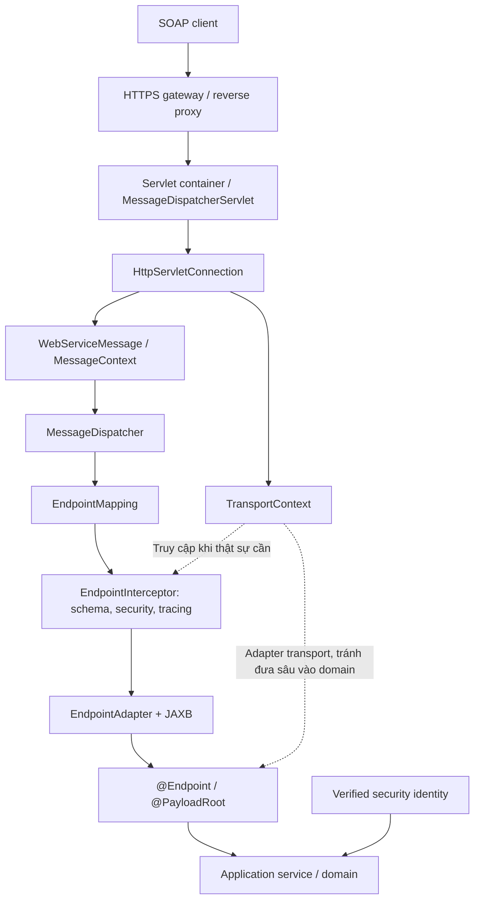

# TransportContext và truy cập thông tin phương tiện truyền tải khi cần

## Mục tiêu học tập

Trong chương **Header và ngữ cảnh** của module **SPRING_WEB_SERVICES**, bài này làm rõ cách Spring Web Services (Spring-WS) cho phép truy cập thông tin của **phương tiện truyền tải** bên dưới thông điệp SOAP, đặc biệt trong ứng dụng SOAP/HTTP chạy trên Servlet container.

Sau bài học, bạn có thể:

1. Phân biệt **SOAP Envelope/Header**, **HTTP headers**, **MessageContext**, **TransportContext** và **SecurityContext** theo đúng trách nhiệm.
2. Sử dụng `TransportContextHolder.getTransportContext()`, `TransportContext.getConnection()` và `HttpServletConnection` để truy cập `HttpServletRequest` hoặc `HttpServletResponse` khi thực sự cần.
3. Đọc an toàn các metadata như địa chỉ peer, HTTP method, request URI, correlation header, đồng thời hiểu giới hạn và ý nghĩa thực sự của từng giá trị.
4. Tránh `NullPointerException`/`ClassCastException` khi transport context vắng mặt, khi chạy không qua HTTP Servlet hoặc trong unit test.
5. Thiết kế adapter/interceptor gom logic đọc transport metadata thay vì đưa `HttpServletRequest` vào domain service hoặc xử lý trực tiếp trong mọi SOAP endpoint.
6. Hiểu cơ chế gắn context với thread, vòng đời request, tác động của tác vụ bất đồng bộ và những nguy cơ khi truyền `TransportContext` sang thread khác.
7. Phân biệt metadata được client/gateway tự khai với **danh tính đã xác thực**, không dùng `X-Forwarded-For` hoặc `X-User-Id` làm bằng chứng phân quyền.
8. Xây dựng unit test cho lớp truy cập transport và integration test cho SOAP endpoint, HTTP gateway, TLS/mTLS và WS-Security theo đúng phạm vi mỗi bài test.

## 1. Tại sao một SOAP service đôi khi vẫn cần thông tin HTTP?

Trong thiết kế SOAP theo hướng **contract-first**, các operation và payload được mô tả trong **WSDL/XSD**, còn client/server trao đổi thông điệp SOAP theo hợp đồng. Spring-WS cố gắng giữ phần xử lý nghiệp vụ **không phụ thuộc phương tiện truyền tải**: cùng ý nghĩa thông điệp có thể được trao đổi qua HTTP hoặc một phương tiện khác nếu stack và triển khai hỗ trợ.

Tuy nhiên, trong thực tế vận hành doanh nghiệp, ta có thể cần:

- Đọc **địa chỉ peer** để điều tra sự cố hoặc phân tích an ninh, với nhận thức rõ về proxy.
- Lấy **request URI, HTTP method** hoặc thông tin Servlet để kiểm tra cấu hình gateway/quan sát.
- Lấy **correlation ID** từ HTTP header do đối tác gửi, kiểm tra định dạng rồi liên kết với trace của server.
- Thêm một **HTTP response header** như `X-Request-ID` cho client hỗ trợ truy vết.
- Truy cập metadata về **connection** hoặc **transport** phục vụ adapter tích hợp đặc thù.
- Phân biệt lỗi xảy ra ở **HTTP/TLS transport** với lỗi nghiệp vụ trả qua **SOAP Fault**.

Spring-WS cung cấp **`TransportContext`** cho nhu cầu này. Nhưng đó là một **lối thoát có kiểm soát khỏi abstraction SOAP**, không phải cách mặc định để truy cập dữ liệu nghiệp vụ hoặc ra quyết định phân quyền.

### 1.1. Ví dụ dễ nhầm

Giả sử client gửi:

```http
POST /ws/orders HTTP/1.1
Host: api.example.com
Content-Type: text/xml; charset=utf-8
SOAPAction: "urn:example:orders:v1/GetOrder"
X-Correlation-ID: client-req-000042
X-Tenant-ID: tenant-a
```

và SOAP Body:

```xml
<ord:GetOrderRequest xmlns:ord="urn:example:orders:v1">
    <ord:orderId>ORD-000042</ord:orderId>
</ord:GetOrderRequest>
```

Các giá trị ở đây **không có cùng ý nghĩa**:

- `SOAPAction` là metadata của SOAP/HTTP binding, có thể được dùng làm chỉ dấu định tuyến.
- `X-Correlation-ID` là nhãn truy vết do client cung cấp; bản thân nó **không chứng minh danh tính**.
- `X-Tenant-ID` do client tự khai, **không đủ để cấp quyền** đọc dữ liệu tenant-a.
- `GetOrderRequest` là phần tử nghiệp vụ thuộc **XSD** và có thể dùng để định tuyến bằng `@PayloadRoot`.
- Danh tính đã xác thực phải đến từ một **security boundary đáng tin** như mTLS/WS-Security/token đã kiểm tra và được ứng dụng phân quyền riêng.

## 2. Bốn loại ngữ cảnh thường gặp

| Thành phần | Chứa hoặc đại diện cho | Cách truy cập thường gặp | Không nên dùng làm |
| --- | --- | --- | --- |
| **SOAP Header** | WS-Security, WS-Addressing, metadata SOAP theo namespace của từng header | `SoapMessage.getSoapHeader()`, SOAP-specific API, interceptor | HTTP header hoặc bằng chứng quyền chưa được xác minh |
| **`MessageContext`** | Request/response `WebServiceMessage` và các thuộc tính của một cuộc trao đổi SOAP | Được truyền vào `EndpointInterceptor` và các thành phần dispatcher | Nơi mặc định chứa thông tin HTTP Servlet hoặc security principal |
| **`TransportContext`** | `WebServiceConnection` đang được xử lý ở tầng transport | `TransportContextHolder.getTransportContext()` → `getConnection()` | Nguồn xác thực/phân quyền mặc định; dữ liệu nghiệp vụ |
| **Servlet request/response** | HTTP method, URI, peer address, headers, status và response headers | Qua `HttpServletConnection` trong SOAP/HTTP servlet, hoặc Servlet Filter | Thay thế việc đọc SOAP Body và xử lý WS-Security |
| **Authenticated security context** | Principal/claims đã được xác minh theo cấu hình bảo mật | API security context/provider tin cậy trong kiến trúc ứng dụng | Sao chép trực tiếp từ header tự khai |

**Mối quan hệ:** Một `MessageContext` đại diện cho cuộc trao đổi SOAP ở mức thông điệp; `TransportContext` cho biết **kết nối bên dưới** khi có. Hai khái niệm cùng hiện diện trong nhiều lời gọi nhưng **không đồng nhất**.

### 2.1. Sơ đồ lớp xử lý



Đường chấm minh họa **khả năng đọc context**, không bắt buộc mọi endpoint phải dùng TransportContext. Đường đi chính của nghiệp vụ vẫn là **SOAP payload → JAXB → application service**.

## 3. API nền tảng của `TransportContext`

### 3.1. `TransportContextHolder`

Spring-WS có class:

```java
org.springframework.ws.transport.context.TransportContextHolder
```

Các phương thức cần biết:

```java
TransportContext context =
        TransportContextHolder.getTransportContext();

TransportContextHolder.setTransportContext(context);
```

- `getTransportContext()` trả về context liên kết với **thread hiện tại**, hoặc `null` nếu không có.
- `setTransportContext(...)` liên kết context với thread; truyền `null` có thể dùng để xóa liên kết trong **test/khung quản lý ngữ cảnh**.
- Trong request bình thường, **Spring-WS transport infrastructure** quản lý context. Code endpoint không nên tự gắn context tùy ý để “làm cho có”.

**Điểm cần chú ý về vòng đời:** Tài liệu API mô tả context được liên kết với thread và có thể được **kế thừa bởi child threads**. Điều này không có nghĩa có thể giữ hoặc tái sử dụng kết nối/`HttpServletRequest` trong background job. Bản tin và request/response thuộc **vòng đời yêu cầu**, có thể đã hoàn tất hoặc bị đóng khi thread phụ sử dụng.

### 3.2. `TransportContext`

Interface:

```java
package org.springframework.ws.transport.context;

public interface TransportContext {
    WebServiceConnection getConnection();
}
```

Đoạn code là biểu diễn rút gọn chữ ký interface. `TransportContext` không tự chứa `getHeader("X-...")` hoặc `getRemoteAddr()`. Bạn lấy `WebServiceConnection`, rồi xử lý theo **loại connection thực tế**.

### 3.3. `WebServiceConnection`

`WebServiceConnection` là abstraction transport của Spring-WS, có các phương thức cấp cơ sở như:

```java
URI getUri() throws URISyntaxException;
void send(WebServiceMessage message) throws IOException;
WebServiceMessage receive(WebServiceMessageFactory factory)
        throws IOException;
boolean hasError() throws IOException;
String getErrorMessage() throws IOException;
void close() throws IOException;
```

Các chữ ký trên chỉ được liệt kê để nhận diện API; **không gọi `send/receive/close` thủ công** trong endpoint đang được `MessageDispatcher` quản lý. Làm vậy có thể phá vòng đời SOAP response hoặc stream mà framework sử dụng.

Connection có thể là:

- **`HttpServletConnection`**: Spring-WS hoạt động ở phía server dựa trên Servlet API.
- **`HttpExchangeConnection`**: HTTP server ở môi trường khác, không phải Servlet.
- **HTTP client connection** như `HttpUrlConnection` hoặc `HttpComponents5Connection` khi ứng dụng gọi dịch vụ ngoài.
- **JMS connection** khi trao đổi thông điệp qua JMS.
- Các implementation khác tùy cấu hình transport, phiên bản Spring-WS và dependency.

Do vậy, `WebServiceConnection` **không luôn luôn là `HttpServletConnection`**.

### 3.4. `HttpServletConnection`

Khi transport thực tế là Spring-WS SOAP/HTTP servlet, class:

```java
org.springframework.ws.transport.http.HttpServletConnection
```

có các API quan trọng:

```java
HttpServletRequest getHttpServletRequest();
HttpServletResponse getHttpServletResponse();

Iterator<String> getRequestHeaderNames() throws IOException;
Iterator<String> getRequestHeaders(String name) throws IOException;

void addResponseHeader(String name, String value)
        throws IOException;
```

Với **Spring-WS 4.x**, `HttpServletRequest` và `HttpServletResponse` là các kiểu **`jakarta.servlet.http.*`**. Code dùng `javax.servlet.http.*` của thế hệ cũ không tương thích trực tiếp.

**Không tự khởi tạo `HttpServletConnection` bằng `new` trong endpoint:** constructor không phải API công khai để ứng dụng tạo transport thật. Framework tạo kết nối phù hợp; trong unit test có thể **mock interface/class**, không cần dựng connection thật.

## 4. Truy cập HTTP request an toàn, có kiểm tra kiểu

### 4.1. Ví dụ tối thiểu trong endpoint hoặc interceptor

Đây là đoạn truy cập kiểu an toàn với Java 17+:

```java
import jakarta.servlet.http.HttpServletRequest;

import org.springframework.ws.transport.WebServiceConnection;
import org.springframework.ws.transport.context.TransportContext;
import org.springframework.ws.transport.context.TransportContextHolder;
import org.springframework.ws.transport.http.HttpServletConnection;

TransportContext context =
        TransportContextHolder.getTransportContext();

if (context != null) {
    WebServiceConnection connection = context.getConnection();

    if (connection instanceof HttpServletConnection servletConnection) {
        HttpServletRequest request =
                servletConnection.getHttpServletRequest();

        String peerAddress = request.getRemoteAddr();
        String httpMethod = request.getMethod();
        String requestPath = request.getRequestURI();
        String correlationHeader =
                request.getHeader("X-Correlation-ID");

        // Dùng làm metadata/observability sau khi validate.
        // KHÔNG xem correlationHeader hay peerAddress là danh tính.
    }
}
```

Đoạn code giả định chạy **trong phạm vi xử lý request** do Spring-WS quản lý. Khi chạy test gọi method trực tiếp, `TransportContextHolder.getTransportContext()` có thể trả `null`. Nếu code được gọi ở JMS transport, type check không match và không có `HttpServletRequest`.

### 4.2. Vì sao phải tránh cast thẳng?

**Không an toàn:**

```java
HttpServletConnection connection =
        (HttpServletConnection)
        TransportContextHolder.getTransportContext().getConnection();
```

Có ít nhất hai lỗi:

1. `getTransportContext()` có thể trả `null` → `NullPointerException`.
2. Connection có thể là JMS hoặc HTTP client type khác → `ClassCastException`.

**An toàn hơn:** check `null`, check `instanceof`, rồi **có chiến lược rõ khi transport không phù hợp**: không thu metadata tùy chọn, hoặc báo lỗi cấu hình nếu application thật sự yêu cầu chạy qua Servlet.

### 4.3. `getRemoteAddr()` có ý nghĩa gì?

`HttpServletRequest.getRemoteAddr()` thường là **địa chỉ mạng của peer kết nối trực tiếp tới servlet container**. Nếu request đi qua reverse proxy hoặc gateway, giá trị có thể là **địa chỉ của proxy**, không phải IP người dùng gốc.

Không suy ra:

```text
getRemoteAddr() == IP người dùng cuối
getRemoteAddr() == danh tính xác thực
getRemoteAddr() == tenant hợp lệ
```

Tất cả đều là những kết luận **không được bảo đảm**. IP có thể dùng cho quan sát hoặc một lớp kiểm soát mạng có thiết kế đúng, nhưng **không đủ thay authentication/authorization của SOAP operation và dữ liệu**.

## 5. Trích metadata qua một adapter nhỏ, dễ kiểm thử

Để không phải gọi `TransportContextHolder` trực tiếp trong mọi `@Endpoint`, tạo một abstraction chuyên trách.

### 5.1. DTO bất biến chứa snapshot

**`HttpRequestSnapshot.java`**

```java
package com.example.orders.soap.transport;

import java.util.Optional;

public record HttpRequestSnapshot(
        String peerAddress,
        String method,
        String requestPath,
        Optional<String> clientCorrelationId) {
}
```

Ở đây dùng `Optional<String>` để biểu thị header client có thể vắng mặt hoặc sai định dạng. `peerAddress`, `method` và `requestPath` chỉ là metadata; không mang theo `HttpServletRequest`, stream hoặc connection.

### 5.2. Interface cho code gọi

**`RequestTransportReader.java`**

```java
package com.example.orders.soap.transport;

import java.util.Optional;

public interface RequestTransportReader {
    Optional<HttpRequestSnapshot> readCurrentHttpRequest();
}
```

Điểm có ích: endpoint hoặc interceptor phụ thuộc vào **interface của lớp biên**, không phụ thuộc trực tiếp `TransportContextHolder`. Unit test có thể dùng fake reader.

### 5.3. Implementation đọc từ Spring-WS transport

**`SpringWsRequestTransportReader.java`**

```java
package com.example.orders.soap.transport;

import java.util.Optional;

import jakarta.servlet.http.HttpServletRequest;
import org.springframework.stereotype.Component;
import org.springframework.ws.transport.WebServiceConnection;
import org.springframework.ws.transport.context.TransportContext;
import org.springframework.ws.transport.context.TransportContextHolder;
import org.springframework.ws.transport.http.HttpServletConnection;

@Component
public final class SpringWsRequestTransportReader
        implements RequestTransportReader {

    @Override
    public Optional<HttpRequestSnapshot> readCurrentHttpRequest() {
        TransportContext context =
                TransportContextHolder.getTransportContext();

        if (context == null) {
            return Optional.empty();
        }

        WebServiceConnection connection = context.getConnection();

        if (!(connection instanceof HttpServletConnection servlet)) {
            return Optional.empty();
        }

        HttpServletRequest request = servlet.getHttpServletRequest();
        if (request == null) {
            return Optional.empty();
        }

        return Optional.of(new HttpRequestSnapshot(
                request.getRemoteAddr(),
                request.getMethod(),
                request.getRequestURI(),
                sanitizeCorrelationId(
                        request.getHeader("X-Correlation-ID"))));
    }

    private static Optional<String> sanitizeCorrelationId(String raw) {
        if (raw == null || !raw.matches("[A-Za-z0-9._-]{1,64}")) {
            return Optional.empty();
        }
        return Optional.of(raw);
    }
}
```

Giải thích:

- **Optional.empty()** nghĩa là không có HTTP Servlet request trong context hiện tại; không tự tạo một `HttpServletRequest` giả.
- `instanceof` tránh giả định loại transport.
- Không lấy `request.getInputStream()` để đọc lại SOAP Envelope; framework đang quản lý stream đó.
- Correlation ID được giới hạn ký tự/độ dài để giảm nguy cơ log injection hoặc tràn log. Dù hợp lệ cú pháp, nó vẫn **là dữ liệu do client gửi**.
- Không đưa toàn bộ `HttpServletRequest` vào record hoặc cache; snapshot chứa thông tin đã chọn và không giữ connection sống qua request.

**Điều kiện:** ví dụ dùng Java 17+ và Jakarta Servlet API phù hợp với Spring-WS 4.x; nếu chạy stack cũ phải kiểm tra API/namespace tương ứng. Các class tách thành **ba file Java** đúng như tiêu đề từng mục.

### 5.4. Khi nào dùng Optional và khi nào fail fast?

| Nhu cầu | Hành vi hợp lý |
| --- | --- |
| Thu thập peer IP tùy chọn để debug | Trả `Optional.empty()` nếu context không có HTTP. |
| Chạy unit test endpoint không dựng Servlet | Fake reader trả metadata mẫu hoặc `Optional.empty()`. |
| Dịch vụ bắt buộc chỉ nhận SOAP/HTTP Servlet | Kiểm tra điều kiện tại cấu hình/transport boundary, báo lỗi rõ khi chạy sai. |
| Chính sách xác thực cần chứng chỉ mTLS | **Không** coi `Optional.empty()` là “caller anonymous có quyền thấp”; cần security layer fail closed theo chính sách. |
| Tác vụ chạy qua JMS | Không ép loại connection HTTP; dùng adapter transport khác hoặc bỏ metadata HTTP. |

Một quy tắc quan trọng: **metadata tùy chọn có thể vắng mặt**, nhưng **chứng cứ bảo mật bắt buộc không được “mặc định thành hợp lệ” khi vắng mặt**.

## 6. Dùng transport metadata ở đâu để giữ endpoint gọn?

Với Spring-WS contract-first, endpoint nên tập trung vào JAXB request/response và use case.

Ví dụ `OrderEndpoint`:

```java
@Endpoint
public class OrderEndpoint {

    private static final String NS = "urn:example:orders:v1";

    private final OrderLookupService service;
    private final OrderSoapMapper mapper;

    public OrderEndpoint(
            OrderLookupService service,
            OrderSoapMapper mapper) {
        this.service = service;
        this.mapper = mapper;
    }

    @PayloadRoot(namespace = NS, localPart = "GetOrderRequest")
    @ResponsePayload
    public GetOrderResponse getOrder(
            @RequestPayload GetOrderRequest request) {
        return mapper.toResponse(
                service.findById(request.getOrderId()));
    }
}
```

Đây là khung endpoint giả định lớp JAXB và service đã có. **Không cần TransportContext** khi thao tác chỉ cần dữ liệu nghiệp vụ và identity từ security layer.

Khi cần lưu vết request, có thể:

1. Dùng **`EndpointInterceptor`** để xử lý correlation/observability dùng chung cho nhiều operation.
2. Dùng **`RequestTransportReader`** ở một adapter/transport-aware component.
3. Truyền một DTO metadata **đã được lọc** vào audit/tracing component nếu cần; không đưa raw servlet request vào domain.
4. Dùng giải pháp observability/security được tổ chức hỗ trợ thay vì tự triển khai cho từng endpoint.

### 6.1. Khi nào endpoint được phép đọc transport?

Đôi khi một operation cần biết một metadata giao tiếp cụ thể, ví dụ đối tác yêu cầu đưa request correlation ID vào quá trình audit. Khi ấy endpoint có thể gọi một **application-facing abstraction** đã được thiết kế, ví dụ `RequestTraceProvider.currentTrace()`.

Tuy nhiên, không nên:

- Gắn `HttpServletRequest` thành dependency trực tiếp của domain service.
- Đọc `X-Tenant-ID` rồi cấp quyền vì “header được lấy qua TransportContext”.
- Phụ thuộc `TransportContextHolder` từ entity, repository hoặc scheduled job.
- Lưu `WebServiceConnection` làm field của singleton `@Endpoint`.
- Buộc mọi use case phải biết HTTP dù hợp đồng SOAP cũng được dùng qua JMS.

Đặt transport-specific code **ở rìa ứng dụng** giúp unit test và nâng cấp Spring-WS dễ hơn.

## 7. `MessageContext` không phải `TransportContext`

Một số người thấy hai tên cùng có “Context” nên nghĩ chúng chứa chung metadata. Không đúng.

### 7.1. `MessageContext`

Spring-WS `MessageContext` chứa:

```java
WebServiceMessage getRequest();
WebServiceMessage getResponse();
boolean hasResponse();

Object getProperty(String name);
void setProperty(String name, Object value);
```

Đây là bản tóm tắt API để học ý nghĩa. Với `MessageContext`, interceptor có thể làm việc với request/response SOAP, truyền thuộc tính giữa các bước của cùng một lần xử lý.

### 7.2. `TransportContext`

`TransportContext` có:

```java
WebServiceConnection getConnection();
```

Nó gắn với kết nối transport, **không trực tiếp cung cấp payload JAXB hoặc SOAP Header**.

### 7.3. Ví dụ sử dụng đúng

```text
Nhu cầu: kiểm tra SOAP Header wsse:Security
    → SOAP message + WSS4J security interceptor.

Nhu cầu: kiểm tra SOAP Body request theo XSD
    → Payload validation interceptor.

Nhu cầu: biết request đến từ địa chỉ peer nào
    → TransportContext + HttpServletConnection,
      sau đó coi IP là metadata, không phải identity.

Nhu cầu: gắn trace ID cho các interceptor cùng request
    → MessageContext property hoặc tracing context phù hợp.

Nhu cầu: xác định quyền tenant
    → Authenticated principal + authorization service,
      không phải raw HTTP header.
```

## 8. Phân biệt SOAP Header và HTTP Header

Một yêu cầu SOAP/HTTP có **ít nhất hai tầng header**.

### 8.1. HTTP header là một phần của transport

```http
POST /ws/orders HTTP/1.1
Host: api.example.com
Content-Type: text/xml; charset=utf-8
SOAPAction: "urn:example:orders:v1/GetOrder"
X-Correlation-ID: partner-request-42
```

Đây là metadata của **HTTP**. Có thể đọc `X-Correlation-ID` bằng `HttpServletRequest.getHeader(...)` khi đang xử lý trong servlet.

### 8.2. SOAP Header nằm trong XML Envelope

```xml
<soap:Envelope
    xmlns:soap="http://schemas.xmlsoap.org/soap/envelope/"
    xmlns:wsa="http://www.w3.org/2005/08/addressing"
    xmlns:ord="urn:example:orders:v1">
    <soap:Header>
        <wsa:Action soap:mustUnderstand="1">
            urn:example:orders:v1/GetOrder
        </wsa:Action>
    </soap:Header>
    <soap:Body>
        <ord:GetOrderRequest>
            <ord:orderId>ORD-000042</ord:orderId>
        </ord:GetOrderRequest>
    </soap:Body>
</soap:Envelope>
```

`wsa:Action` là **SOAP Header** theo WS-Addressing. Nó không phải HTTP header `SOAPAction`, dù cả hai có thể cùng diễn đạt hành động.

**`soap:mustUnderstand="1"` không biến Action thành dữ liệu đã được ký hay đã xác thực.** Một node nhận phải xử lý header được nhắm tới theo quy tắc SOAP; việc kiểm tra chữ ký/token vẫn do security stack thực hiện.

### 8.3. Chọn API theo lớp dữ liệu

| Muốn truy cập | API nên cân nhắc |
| --- | --- |
| SOAP payload | `@RequestPayload`, JAXB, `MessageContext.getRequest()`. |
| SOAP Header block | `SoapMessage.getSoapHeader()`, SOAP header APIs, `@SoapHeader` nếu phương thức hỗ trợ, interceptor. |
| HTTP request header | `HttpServletRequest.getHeader(...)` qua `HttpServletConnection`, hoặc Servlet Filter. |
| HTTP response header | `HttpServletConnection.addResponseHeader(...)` hoặc `HttpServletResponse` khi còn ghi được. |
| Authenticated principal | Security context/provider đã xác minh theo cơ chế tổ chức. |
| Thông tin request/response được interceptor truyền nội bộ | `MessageContext.setProperty/getProperty`. |

Không dùng DOM/XPath để tìm một HTTP header; HTTP header **không nằm trong XML Envelope**. Ngược lại, không tìm `wsse:Security` bằng `request.getHeader("wsse:Security")`.

## 9. Tạo correlation ID server-side và trả về HTTP response header

Một ví dụ sử dụng transport context hợp lý là **truy vết request**. Để phân biệt ID do client cung cấp và ID của server, ta có thể **tự sinh ID nội bộ**.

### 9.1. Interceptor gắn request ID

**`RequestIdInterceptor.java`**

```java
package com.example.orders.soap.transport;

import java.util.UUID;

import org.springframework.ws.context.MessageContext;
import org.springframework.ws.server.endpoint.interceptor.EndpointInterceptorAdapter;
import org.springframework.ws.transport.context.TransportContext;
import org.springframework.ws.transport.context.TransportContextHolder;
import org.springframework.ws.transport.http.HttpServletConnection;

public final class RequestIdInterceptor
        extends EndpointInterceptorAdapter {

    public static final String PROPERTY_NAME =
            "com.example.orders.serverRequestId";

    @Override
    public boolean handleRequest(
            MessageContext messageContext,
            Object endpoint) throws Exception {

        String requestId = UUID.randomUUID().toString();
        messageContext.setProperty(PROPERTY_NAME, requestId);

        TransportContext context =
                TransportContextHolder.getTransportContext();

        if (context != null
                && context.getConnection()
                    instanceof HttpServletConnection servlet) {
            servlet.addResponseHeader("X-Request-ID", requestId);
        }

        return true;
    }
}
```

Ở đây:

1. `UUID.randomUUID()` tạo **nhãn trace nội bộ**, không có nghĩa đây là token đăng nhập hay cơ chế chống replay.
2. `MessageContext.setProperty(...)` truyền ID cho các thành phần ở **cùng message processing** nếu cần.
3. `HttpServletConnection.addResponseHeader(...)` thêm metadata HTTP để đối tác tham chiếu khi báo lỗi.
4. Khi không có HTTP servlet transport, code **không ném `ClassCastException`**, vẫn có request ID nội bộ.
5. `handleRequest` của một `EndpointInterceptor` chạy sau khi mapping đã tìm được endpoint; **nó không bao phủ mọi lỗi** xảy ra trước mapping/parse hoặc ở gateway.

Nếu tổ chức cần request ID cho **cả lỗi chưa có SOAP endpoint** hoặc cho tất cả HTTP requests, có thể chọn **Servlet Filter** hoặc cơ chế gateway để gắn ID sớm hơn. Không mặc định interceptor Spring-WS đủ phủ mọi trường hợp.

### 9.2. Đăng ký interceptor

```java
package com.example.orders.soap.transport;

import java.util.List;

import org.springframework.context.annotation.Configuration;
import org.springframework.ws.config.annotation.EnableWs;
import org.springframework.ws.config.annotation.WsConfigurer;
import org.springframework.ws.server.EndpointInterceptor;

@Configuration
@EnableWs
public class SoapTransportConfiguration implements WsConfigurer {

    @Override
    public void addInterceptors(
            List<EndpointInterceptor> interceptors) {
        interceptors.add(new RequestIdInterceptor());
    }
}
```

Trong ứng dụng thật, cần bảo đảm cấu hình SOAP servlet, endpoint mapping, JAXB và các interceptor bảo mật/validation khác được đăng ký đúng. `RequestIdInterceptor` chỉ phụ trách tracing, **không thực hiện authentication**.

**Chú ý HTTP response:** HTTP headers chỉ có thể thêm khi response **chưa bị commit**. Đừng sửa `Content-Length`, `Content-Type` hoặc status code một cách tùy tiện từ endpoint; SOAP message factory/transport chịu trách nhiệm lớn cho các giá trị đó. Kiểm thử header thực bằng HTTP client, vì `MockWebServiceClient` không tạo response HTTP thật.

### 9.3. Nếu muốn giữ client correlation ID

Có thể ghi hai nhãn riêng:

```text
clientCorrelationId  = giá trị X-Correlation-ID đã kiểm tra cú pháp
serverRequestId      = UUID do server tự tạo
```

Không dùng giá trị client làm khóa duy nhất của audit trail nếu client được quyền lặp/chỉnh nó. Đừng ghi log toàn bộ header vì chúng có thể chứa `Authorization`, cookie, token hoặc dữ liệu cá nhân.

## 10. Reverse proxy, Forwarded headers và địa chỉ client

Đây là phần dễ sai nhất khi truy cập thông tin transport.

### 10.1. Mô hình thực tế

```text
SOAP client (198.51.100.17)
    |
    | HTTPS
    v
Gateway (10.0.0.10)
    |
    | HTTP/TLS nội bộ
    v
Spring-WS backend (10.0.0.20)
```

Trong ví dụ minh họa, `request.getRemoteAddr()` trên backend có thể là `10.0.0.10` — peer gateway — chứ không phải `198.51.100.17`.

Gateway có thể thêm:

```http
X-Forwarded-For: 198.51.100.17
X-Forwarded-Proto: https
X-Forwarded-Host: api.example.com
```

Nhưng các header này **không đáng tin nếu backend chấp nhận trực tiếp từ mạng client** hoặc gateway không xóa/ghi đè những giá trị caller tự gửi.

### 10.2. Điều kiện để xử lý forwarded metadata an toàn

1. Backend chỉ được truy cập từ proxy/gateway tin cậy hoặc có cách xác minh nguồn đáng tin.
2. Gateway **xóa/ghi đè** các forwarded headers mà client có thể tự đặt; cấu hình xử lý nhiều hop rõ ràng.
3. Hợp đồng giữa gateway và backend xác định hop tin cậy, độ dài header, số lượng hop và phương thức chuẩn hóa.
4. Kết nối gateway→backend được bảo vệ nếu có dữ liệu/identity nhạy cảm.
5. Nếu hệ thống cấu hình forwarded-header support ở framework/container, phải xác nhận **thành phần nào xử lý** và nó có làm thay đổi `getRemoteAddr()`/`getScheme()`/`isSecure()` không.
6. Không dùng một forwarded header đơn độc như bằng chứng caller đã xác thực.

**Điểm quan trọng:** Có thể bật chức năng xử lý `Forwarded`/`X-Forwarded-*` ở Servlet container hoặc Spring Boot; nhưng **bật mà không kiểm soát proxy tin cậy** có thể làm dữ liệu spoofable trông như địa chỉ client thật.

### 10.3. Phân biệt IP và danh tính

| Giá trị | Có thể biểu thị | Không chứng minh |
| --- | --- | --- |
| `getRemoteAddr()` | IP peer mà Servlet request đang thấy. | Danh tính người dùng, chứng chỉ hợp lệ, quyền tenant. |
| `X-Forwarded-For` | Chuỗi địa chỉ mà proxy khai báo. | IP client gốc nếu chain không đáng tin. |
| `X-Forwarded-Client-Cert` | Thông tin chứng chỉ được proxy khai báo. | Chứng chỉ client đã được backend xác minh nếu không có trust boundary rõ. |
| `request.getUserPrincipal()` | Principal do Servlet security layer cung cấp nếu cấu hình. | Tự động có authn cho mọi ứng dụng SOAP; authorization resource. |
| `wsse:Security` | SOAP header mang thông tin bảo mật. | Chữ ký/token đã xác minh chỉ vì header tồn tại. |

Nếu cần phân quyền, phải có cơ chế xác thực/ủy quyền riêng. **TransportContext không phải security context**.

## 11. TLS/mTLS và chứng chỉ: đọc metadata nào là hợp lý?

TLS và mTLS hoạt động tại **kênh truyền**. Khi servlet container trực tiếp xử lý TLS:

- `HttpServletRequest.isSecure()` có thể phản ánh request sử dụng kết nối bảo mật ở góc nhìn container.
- `HttpServletRequest.getScheme()` hoặc cổng có thể giúp chẩn đoán cấu hình routing.
- Metadata về chứng chỉ client có thể được container cung cấp qua cơ chế Servlet/TLS tùy cấu hình.

Tuy nhiên, khi TLS được **kết thúc tại gateway**, backend có thể không nhìn thấy phiên TLS hay chứng chỉ client gốc. Một số metadata chỉ được chuyển tiếp qua giao thức nội bộ được thiết kế riêng.

**Không đưa ra kết luận** “`request.isSecure() == true` thì người gọi đã được xác thực”. TLS xác thực server và bảo vệ kênh; mTLS xác thực peer client nếu cấu hình đúng; **quyền nghiệp vụ** vẫn cần kiểm tra riêng.

### 11.1. Không dùng TransportContext để tự xác minh chữ ký XML

WS-Security có thể ký SOAP Body/Header ở mức **thông điệp**. Việc xác minh chữ ký, certificate trust, canonicalization, timestamp, nonce và signed parts nên giao cho **security interceptor/stack** được duy trì (ví dụ Spring-WS kết hợp WSS4J) cùng security profile đã thống nhất.

Cố gắng đọc `X-Cert` qua `HttpServletRequest.getHeader()` rồi tự coi đó là certificate đã xác minh là một sai lầm nghiêm trọng. Header tự khai chỉ là **dữ liệu**, trừ khi đã có kênh/proxy/kiểm chứng đáng tin bảo đảm nguồn gốc và ý nghĩa.

### 11.2. Phần phải được bảo vệ có thể không nằm ở transport

Với kịch bản client→gateway→backend, TLS tại một hop không tự động bảo vệ thông điệp **xuyên qua gateway**. Nếu hợp đồng yêu cầu end-to-end integrity/authenticity giữa client và backend, cần đánh giá WS-Security chữ ký ở mức thông điệp theo chính sách.

SOAP Header như `wsa:Action`, `wsa:To`, `wsse:Security` phải được xử lý theo ngữ nghĩa của chính chúng. `TransportContext` chỉ cho phép truy cập connection; nó **không biến bất kỳ header SOAP/HTTP nào thành chứng cứ tin cậy**.

## 12. Bối cảnh thread: khi nào TransportContext không còn sử dụng an toàn?

`TransportContextHolder` liên kết context với thread và tài liệu API mô tả khả năng **kế thừa ở child threads**. Điều này dễ gây hiểu nhầm khi dùng `@Async`, `CompletableFuture` hoặc thread pool.

### 12.1. Mô hình đúng

```text
HTTP/SOAP request bắt đầu
  ├─ Spring-WS gắn transport context cho xử lý hiện tại
  ├─ Endpoint/interceptor có thể đọc metadata transport
  ├─ Copy dữ liệu CẦN THIẾT sang immutable snapshot
  ├─ Chuyển snapshot cho tác vụ bất đồng bộ (nếu thực sự cần)
  └─ HTTP/SOAP request kết thúc; connection/servlet lifecycle kết thúc
```

### 12.2. Mô hình rủi ro

```java
// Anti-pattern: không nên truyền object gắn với vòng đời HTTP.
TransportContext context =
        TransportContextHolder.getTransportContext();

executor.submit(() -> {
    // Đến lúc này HTTP request có thể đã đóng/response đã commit.
    WebServiceConnection connection = context.getConnection();
    // Sử dụng connection hoặc HttpServletRequest ở đây là rủi ro.
});
```

Ví dụ có thể ném `NullPointerException` ngay nếu context vắng mặt, hoặc gây lỗi vòng đời/request concurrency sau khi request kết thúc. Một thread pool cũng có thể **tái sử dụng worker threads**; không dựa vào việc context sẽ tự được truyền sang hoặc dọn sạch đúng cách ở mọi trường hợp.

**Giải pháp:** sao chép dữ liệu cần thiết:

```java
Optional<HttpRequestSnapshot> snapshot =
        transportReader.readCurrentHttpRequest();

executor.submit(() -> {
    snapshot.ifPresent(meta -> {
        // Chỉ dùng metadata đã tách khỏi Servlet/connection.
        // Không xem peerAddress/correlation ID là danh tính.
        recordAsyncTrace(meta);
    });
});
```

Đây là đoạn minh họa; `transportReader`, `executor` và `recordAsyncTrace` do ứng dụng định nghĩa. Không nên dùng snapshot IP/correlation ID để **thay authentication context**. Nếu tác vụ bất đồng bộ cần quyền, truyền một **identity/authorization assertion có kiểm soát** theo kiến trúc bảo mật và kiểm tra lại quyền tại ranh giới cần thiết.

### 12.3. Không tự set context trong production logic

`TransportContextHolder.setTransportContext(...)` là API thấp dùng bởi hạ tầng và có thể phục vụ unit test. Tự tạo context và giữ nó trong thread pool, static field hoặc bean singleton có thể gây rò rỉ giữa requests.

Trong ứng dụng production, hãy để framework quản lý vòng đời hoặc sử dụng **abstraction request metadata** do adapter tạo. Đặc biệt không dùng context này làm biến toàn cục để chia sẻ danh tính người gọi.

## 13. Ứng dụng không qua HTTP Servlet thì sao?

Spring-WS hỗ trợ nhiều transport abstraction. Nếu server được tích hợp với JMS hoặc một HTTP server không dùng Servlet, `TransportContext` vẫn có thể tồn tại nhưng kết nối thực tế **không phải `HttpServletConnection`**.

### 13.1. HTTP-specific code phải có ranh giới rõ

```java
TransportContext context =
        TransportContextHolder.getTransportContext();

if (context == null) {
    // Không có context trong scope hiện tại.
} else if (context.getConnection()
        instanceof HttpServletConnection servlet) {
    // Có thể lấy HttpServletRequest/HttpServletResponse.
} else {
    // Không phải Servlet transport: tránh giả định HTTP headers.
}
```

Nếu hệ thống cần cung cấp cùng một metadata trừu tượng cho SOAP/HTTP và SOAP/JMS, hãy định nghĩa interface như:

```java
public interface InvocationMetadataProvider {
    InvocationMetadata current();
}
```

và triển khai **mỗi transport một adapter**; trong đó `InvocationMetadata` chỉ mang các khái niệm thật sự chung (ví dụ server-generated trace ID), còn metadata đặc thù HTTP/JMS nằm ở adapter tương ứng.

### 13.2. Có thể dùng `connection.getUri()` không?

`WebServiceConnection.getUri()` cho biết URI của connection theo implementation. Nó không bảo đảm đó là **URL public** mà client ngoài Internet đã gọi, đặc biệt sau reverse proxy hoặc trong transport không phải HTTP.

Không dùng URI này làm sự thật duy nhất để:

- Sinh `soap:address` trong WSDL mà không tính gateway.
- Cấp quyền dựa trên hostname do client có thể ảnh hưởng.
- Xác định tenant chỉ bằng Host header chưa đáng tin.
- Tự xây URL redirect khi chưa có chính sách canonical URL.

Đối với WSDL công bố, kiểm tra `MessageDispatcherServlet`, cấu hình transform address và proxy headers của đúng phiên bản hệ thống.

## 14. Phía SOAP client: TransportContext không phải `HttpServletRequest`

Một Spring-WS application có thể vừa làm **SOAP server** vừa gọi một SOAP service khác bằng `WebServiceTemplate`.

Ở phía client, connection có thể là `HttpUrlConnection`, `HttpComponents5Connection` hoặc sender-specific implementation. Nó **không phải** `HttpServletConnection` của servlet phía server.

### 14.1. Chọn công cụ theo việc cần làm

| Nhu cầu phía client | Giải pháp nên xem |
| --- | --- |
| Gửi payload XML/JAXB | `WebServiceTemplate` và marshaller/unmarshaller hoặc callback phù hợp. |
| Đặt SOAP 1.1 SOAPAction | `SoapMessage.setSoapAction(...)` trong `WebServiceMessageCallback` khi dùng SOAP message. |
| Thêm SOAP Header nghiệp vụ | SOAP APIs/callback hoặc `ClientInterceptor`. |
| Đặt HTTP header transport tùy biến | Cấu hình `WebServiceMessageSender`/HTTP client cụ thể và request interceptors phù hợp phiên bản. |
| Cấu hình TLS/mTLS, connection pooling, timeout | HTTP client/message sender và trust/key material do chính sách quản lý. |
| Đọc HTTP response header | API connection/sender HTTP hoặc interceptor tầng HTTP hỗ trợ; không dùng Servlet request. |

Ví dụ callback chỉ đặt SOAPAction ở cấp SOAP:

```java
import org.springframework.ws.WebServiceMessage;
import org.springframework.ws.client.core.WebServiceMessageCallback;
import org.springframework.ws.soap.SoapMessage;

WebServiceMessageCallback setAction = message -> {
    if (message instanceof SoapMessage soapMessage) {
        soapMessage.setSoapAction(
                "urn:example:orders:v1/GetOrder");
    }
};
```

`WebServiceMessageCallback` làm việc với **SOAP message**; không cung cấp `HttpServletRequest`. Khi cần một HTTP header riêng như `X-Correlation-ID`, hãy thiết kế theo HTTP sender đang dùng thay vì ép kiểu connection servlet hoặc sử dụng SOAP Header giả để thay cho HTTP.

**Chú ý:** Giới hạn quyền truy cập transport, thời điểm tạo connection và loại connection thay đổi theo `WebServiceTemplate`/message sender. Không giả định `TransportContextHolder` luôn có context trong mọi callback/client interceptor.

## 15. Truy cập HTTP response: khi nào được phép?

`HttpServletConnection` cung cấp `getHttpServletResponse()` và `addResponseHeader(...)`. Trong các tình huống cần trả metadata thuần HTTP, nên làm **sớm khi response chưa commit**, và không đụng vào luồng SOAP do framework quản lý.

### 15.1. Thêm correlation header an toàn

```java
TransportContext context =
        TransportContextHolder.getTransportContext();

if (context != null
        && context.getConnection()
            instanceof HttpServletConnection servlet) {
    servlet.addResponseHeader(
            "X-Request-ID",
            serverGeneratedRequestId);
}
```

Đoạn ví dụ giả định `serverGeneratedRequestId` đã được tạo và kiểm tra, ngữ cảnh đang trong request handler/interceptor, và đã xử lý `IOException` nếu phát sinh.

### 15.2. Những thứ không nên tự sửa

- `Content-Type`: SOAP 1.1 có thể dùng `text/xml`; SOAP 1.2 thường dùng `application/soap+xml`. Tự đổi tùy ý có thể khiến client parse sai.
- `Content-Length`: framework/container quản lý theo byte thực và streaming; tính thủ công sai gây lỗi truyền tải.
- `Transfer-Encoding` hoặc connection headers: để HTTP stack quản lý.
- HTTP status của SOAP Fault: cần hiểu phiên bản SOAP và binding; đừng đặt `200 OK` khi lỗi chưa được xử lý chỉ để qua gateway.
- Response body output stream: không ghi nội dung tùy ý song song với Spring-WS SOAP message serializer.
- Headers an ninh như HSTS/CSP: phải được thiết kế thống nhất ở filter/gateway, không gắn bừa ở từng endpoint.

**Nguyên tắc:** nếu cần kiểm soát toàn bộ HTTP lifecycle (kể cả lỗi chưa parse được SOAP), **Servlet Filter hoặc gateway** thường là điểm đặt chính sách phù hợp hơn endpoint/interceptor.

## 16. Bảo mật: metadata transport phải được phân loại theo mức tin cậy

Một kỹ thuật quan trọng là **phân loại nguồn dữ liệu**:

| Nguồn | Ví dụ | Mức tin cậy mặc định |
| --- | --- | --- |
| SOAP Body từ client | `tenantId`, `userId`, `documentId` | **Untrusted input**; XSD validation không biến nó thành identity. |
| HTTP header từ client | `X-User-Id`, `X-Role`, `X-Correlation-ID` | **Untrusted input**; chỉ dùng sau kiểm tra theo mục đích. |
| Forwarded headers | `X-Forwarded-For`, `Forwarded` | Chỉ đáng tin khi có **trusted proxy boundary** đã cấu hình. |
| SOAP WS-Security Header | `wsse:Security` và token/chữ ký | Chỉ đáng tin **sau khi** security stack xác minh đúng profile, signed parts và certificate trust. |
| Servlet principal | `getUserPrincipal()` | Chỉ có nghĩa khi Servlet/Spring Security authentication đã được cấu hình và hoàn tất. |
| mTLS peer identity | Client certificate đã được TLS stack xác minh | Cơ sở xác thực peer của hop TLS; vẫn phải mapping sang quyền. |
| Server-generated correlation ID | `X-Request-ID` do server tạo | Phù hợp truy vết; **không phải** security credential hay proof-of-freshness. |

### 16.1. Một ví dụ tấn công phân quyền sai

**Thiết kế sai:**

```java
String tenantId = request.getHeader("X-Tenant-ID");

Order order = repository.findByTenantIdAndId(
        tenantId,
        payload.getOrderId());

// Không kiểm tra caller có quyền truy cập tenantId!
return mapper.toResponse(order);
```

Bất kỳ client nào có thể thay header nếu endpoint cho phép. Lỗi ở đây là **Broken Object Level Authorization**/truy cập xuyên tenant, không phải lỗi `TransportContextHolder`.

**Thiết kế đúng về nguyên tắc:**

```text
HTTP/SOAP request
    → XSD/WS-Security/TLS authentication phù hợp
    → verified principal
    → requested tenant/resource từ payload
    → application authorization check
    → repository scoped theo tenant
    → response hoặc SOAP Fault an toàn
```

**Điều kiện:** Những phần tử trên không có thứ tự cố định tuyệt đối ở mọi kiến trúc; điều không được thay đổi là **không cho phép hiệu ứng nghiệp vụ hoặc lộ dữ liệu trước khi các điều kiện bảo mật cần thiết đạt**.

### 16.2. Không log quá nhiều thông tin transport

Địa chỉ IP, Host, URI path hoặc headers có thể là **dữ liệu cá nhân, dữ liệu khách hàng hoặc thông tin hạ tầng**. Nên:

- Chỉ ghi các trường thật sự cần cho điều tra sự cố.
- Lọc ký tự và giới hạn độ dài correlation ID, User-Agent và forwarded strings trước khi log.
- Không log `Authorization`, cookie/session token, WS-Security token hoặc toàn SOAP body theo mặc định.
- Áp dụng retention, masking và phân quyền đọc log.
- Có trace ID do server tạo để không phụ thuộc hoàn toàn vào chuỗi client cung cấp.
- Tránh dùng IP như khóa định danh người dùng hoặc bằng chứng chống replay.

## 17. Unit test lớp đọc transport bằng Mockito và Spring Test

Để test `SpringWsRequestTransportReader` độc lập khỏi HTTP socket, có thể **tạm gắn một TransportContext giả** vào thread test. Vì `HttpServletConnection` có constructor protected, dùng Mockito tạo mock và `MockHttpServletRequest` cung cấp dữ liệu Servlet.

### 17.1. Test đọc metadata hợp lệ

```java
package com.example.orders.soap.transport;

import static org.junit.jupiter.api.Assertions.*;
import static org.mockito.Mockito.*;

import org.junit.jupiter.api.Test;
import org.springframework.mock.web.MockHttpServletRequest;
import org.springframework.ws.transport.context.DefaultTransportContext;
import org.springframework.ws.transport.context.TransportContext;
import org.springframework.ws.transport.context.TransportContextHolder;
import org.springframework.ws.transport.http.HttpServletConnection;

class SpringWsRequestTransportReaderTest {

    private final SpringWsRequestTransportReader reader =
            new SpringWsRequestTransportReader();

    @Test
    void readsServletMetadataWithinTransportContext() {
        MockHttpServletRequest servletRequest =
                new MockHttpServletRequest("POST", "/ws/orders");
        servletRequest.setRemoteAddr("198.51.100.17");
        servletRequest.addHeader("X-Correlation-ID", "client-42");

        HttpServletConnection connection =
                mock(HttpServletConnection.class);
        when(connection.getHttpServletRequest())
                .thenReturn(servletRequest);

        TransportContext previous =
                TransportContextHolder.getTransportContext();

        try {
            TransportContextHolder.setTransportContext(
                    new DefaultTransportContext(connection));

            HttpRequestSnapshot snapshot = reader
                    .readCurrentHttpRequest()
                    .orElseThrow();

            assertEquals("198.51.100.17", snapshot.peerAddress());
            assertEquals("POST", snapshot.method());
            assertEquals("/ws/orders", snapshot.requestPath());
            assertEquals(
                    "client-42",
                    snapshot.clientCorrelationId().orElseThrow());
        } finally {
            TransportContextHolder.setTransportContext(previous);
        }
    }
}
```

Test này cần JUnit Jupiter, Mockito và Spring Test (`MockHttpServletRequest`), và những lớp đã tạo ở phần 5.

**Vì sao `finally` quan trọng?** `TransportContextHolder` là thread-bound holder. Nếu không hoàn nguyên context sau test, test khác chạy trên cùng thread có thể đọc nhầm transport giả, gây flaky tests hoặc rò trạng thái.

### 17.2. Test khi context vắng mặt

```java
@Test
void returnsEmptyOutsideTransportScope() {
    TransportContext previous =
            TransportContextHolder.getTransportContext();

    try {
        TransportContextHolder.setTransportContext(null);

        assertTrue(reader.readCurrentHttpRequest().isEmpty());
    } finally {
        TransportContextHolder.setTransportContext(previous);
    }
}
```

Đây là method bổ sung vào test class ở trên; không phải file độc lập.

### 17.3. Test khi không phải Servlet transport

Có thể mock một `WebServiceConnection` chung, đặt vào `DefaultTransportContext`, rồi xác nhận reader trả `Optional.empty()`:

```java
WebServiceConnection nonServlet =
        mock(WebServiceConnection.class);

TransportContext previous =
        TransportContextHolder.getTransportContext();

try {
    TransportContextHolder.setTransportContext(
            new DefaultTransportContext(nonServlet));

    assertTrue(reader.readCurrentHttpRequest().isEmpty());
} finally {
    TransportContextHolder.setTransportContext(previous);
}
```

Phần này cần import `org.springframework.ws.transport.WebServiceConnection` và các static imports JUnit/Mockito như test trước đó. Mục đích là chứng minh **code không cast vô điều kiện sang Servlet**.

### 17.4. Test correlation ID sai định dạng

Thử các giá trị:

```text
null                     → Optional.empty()
client-42                → accepted
x.y_z-01                 → accepted
chuỗi chứa CR/LF         → Optional.empty()
chuỗi trên 64 ký tự      → Optional.empty()
chuỗi có khoảng trắng    → Optional.empty()
```

Test không phải bằng chứng caller đã xác thực. Nó chỉ kiểm tra **input validation cho mục tiêu observability**.

## 18. Kiểm thử SOAP pipeline và transport thật là hai việc khác nhau

### 18.1. `MockWebServiceClient`

`MockWebServiceClient` được dùng để kiểm tra `MessageDispatcher`/endpoint mapping, JAXB serialization, interceptor, SOAP response và SOAP Fault trong ApplicationContext.

Điều **nó không nhất thiết cung cấp** là một HTTP Servlet connection như production. Vì vậy, unit test gọi code đọc `TransportContextHolder` có thể nhận `null` hoặc một context không chứa `HttpServletConnection`.

Đừng sửa test để buộc mọi SOAP request phải có servlet chỉ nhằm làm test pass. Giữ logic SOAP độc lập HTTP và test adapter đọc transport **riêng** như phần 17.

### 18.2. Kiểm thử HTTP thực

Một integration test với server Spring Boot chạy trên cổng thực có thể gửi:

```http
POST /ws/orders HTTP/1.1
Host: localhost:8080
Content-Type: text/xml; charset=utf-8
SOAPAction: "urn:example:orders:v1/GetOrder"
X-Correlation-ID: client-42
```

cùng SOAP Envelope hợp lệ, rồi xác nhận:

- Body được định tuyến đến đúng `@Endpoint`.
- SOAP response hoặc Fault đúng XSD/WSDL và SOAP version.
- Header `X-Request-ID` được server trả về nếu interceptor/filter đã cấu hình.
- Metadata peer/method/path được ghi theo chính sách; không lộ token trong log.
- Request sai SOAPAction, HTTP Content-Type, SOAP version hoặc body size bị xử lý đúng thỏa thuận.
- Khi đi qua reverse proxy, IP/scheme/host được diễn giải phù hợp và không tin forwarded header giả.
- Khi bật mTLS/WS-Security, yêu cầu thiếu/sai chứng cứ bảo mật bị từ chối.

**Không lấy `MockWebServiceClient` làm phép thử mTLS hoặc HTTP proxy headers**. Nó xử lý SOAP pipeline mà không cần socket HTTP thật.

### 18.3. Bảng test ranh giới

| Kiểm thử | Đầu vào/điều kiện | Kỳ vọng |
| --- | --- | --- |
| HTTP Servlet bình thường | `HttpServletConnection` với method/path/remoteAddr | Reader trả snapshot. |
| Không có context | `TransportContextHolder` trả `null` | Reader trả empty, không NPE. |
| JMS/transport khác | Connection không phải `HttpServletConnection` | Reader trả empty, không ClassCastException. |
| Correlation header hợp lệ | `X-Correlation-ID: client-42` | Được giữ làm metadata tùy chọn. |
| Correlation header độc hại | CRLF/quá dài | Không dùng nguyên văn; bị loại theo policy. |
| Request từ gateway | `getRemoteAddr()` là IP gateway | Không gọi nó là IP gốc khi chưa có trust proxy. |
| Forwarded header spoofing | Caller trực tiếp đặt `X-Forwarded-For` | Không dùng làm chứng cứ xác thực/quyền. |
| Identity header spoofing | `X-Tenant-ID: admin` | Không cấp quyền dựa vào header. |
| Interceptor trả response header | `X-Request-ID` do server tạo | Có thể quan sát qua HTTP khi response chưa commit. |
| XML không parse được | Lỗi trước khi endpoint/interceptor chạy | Lỗi transport/stack phù hợp; interceptor không được giả định luôn chạy. |
| SOAP Header WS-Security thiếu chữ ký | Body XML vẫn hợp lệ | Security layer từ chối theo policy, không để endpoint thực thi nghiệp vụ. |
| Request đã kết thúc rồi chạy background | Worker nhận snapshot, không nhận Servlet request | Không truy cập live connection hoặc thread-bound context cũ. |
| SOAP client dùng WebServiceTemplate | Client connection không phải server Servlet | Dùng sender/callback phù hợp, không cast sang `HttpServletConnection`. |

## 19. Các lỗi thiết kế thường gặp

### 19.1. Cast trực tiếp sang HTTP Servlet

```java
(HttpServletConnection) ctx.getConnection()
```

Chỉ an toàn khi bạn **biết chắc** connection type và context không null; nên check kiểu. Một module SOAP đa transport sẽ gặp lỗi khi tái sử dụng code này.

### 19.2. Mang `HttpServletRequest` vào domain service

Điều này khiến quy tắc nghiệp vụ phụ thuộc HTTP, khó test với fake service, không thể tái sử dụng cho SOAP/JMS và làm lộ ranh giới transport.

**Thay bằng:** truyền dữ liệu nghiệp vụ và authenticated principal theo kiểu rõ ràng; metadata transport chỉ đi tới observability/audit component khi cần.

### 19.3. Dùng HTTP header để giả mạo danh tính

`X-User-Id`, `X-Role`, `X-Tenant-ID` và forwarded client certificate đều có thể bị caller tự khai nếu hệ thống không đặt ranh giới tin cậy.

**Thay bằng:** bảo vệ gateway/backend, xác minh identity theo security profile, phân quyền operation/tenant/resource ở application service.

### 19.4. Truyền `TransportContext` sang thread pool

Một connection gắn với request không sống mãi; worker async không nên giữ hoặc đóng connection đó. Thread context có thể kế thừa ở child thread nhưng không tạo ra bảo đảm lifecycle.

**Thay bằng:** snapshot metadata bất biến và giao nhiệm vụ đúng scope.

### 19.5. Đọc lại request body từ Servlet stream

SOAP stack có thể đã tiêu thụ/parse input stream. Tự đọc `request.getInputStream()` từ endpoint để ghi log hoặc xác minh XML dễ làm sai pipeline, tốn bộ nhớ và lộ dữ liệu nhạy cảm.

**Thay bằng:** SOAP APIs/interceptor chuyên trách và log theo chính sách; nếu thật sự cần capture raw bytes, thiết kế ở gateway/filter với giới hạn và kiểm soát riêng.

### 19.6. Sửa HTTP status thay vì trả SOAP Fault đúng hợp đồng

HTTP error và SOAP Fault là hai tầng khác nhau. Nếu một domain exception cần SOAP Fault detail theo WSDL, hãy cấu hình `EndpointExceptionResolver`/SOAP Fault mapper. Đừng tự gửi `response.setStatus(200)` hoặc ghi XML thủ công từ endpoint.

### 19.7. “Thấy context trong unit test thì production cũng luôn có”

Sai. Test tự gắn context bằng `setTransportContext` có thể che lỗi. Production đi qua loại connection khác hoặc bối cảnh khác sẽ có giá trị khác. Code vẫn cần null/type guards.

### 19.8. “Gắn correlation ID thì chống được replay”

Không. Correlation ID chỉ để liên kết trace. Chống replay WS-Security cần timestamp, nonce/message identifier đã được xác thực, trạng thái chống lặp và quy tắc idempotency phù hợp.

## 20. Bài tập thực hành và đáp án

### Bài 1. Chọn API

Một endpoint SOAP cần đọc phần tử `customerId` trong Body và HTTP header `X-Correlation-ID`. Nên dùng API nào cho từng dữ liệu?

**Đáp án:** `customerId` được đọc từ SOAP payload qua JAXB/`@RequestPayload` theo XSD; `X-Correlation-ID` được đọc từ HTTP transport qua `HttpServletRequest.getHeader(...)` khi connection là `HttpServletConnection`, tốt nhất bọc trong transport adapter. Không tìm HTTP header bằng XPath trên SOAP Body.

### Bài 2. Context vắng mặt

`TransportContextHolder.getTransportContext()` trả `null` trong unit test endpoint. Có nên sửa production code bằng cách tự tạo `HttpServletConnection`?

**Đáp án:** Không. Đây là hậu quả hợp lý khi test không có transport. Hãy bọc logic đọc context có `null` check, trả `Optional.empty()` hoặc tiêm reader fake; nếu cần integration test HTTP thì khởi động môi trường HTTP thật.

### Bài 3. Sai kiểu connection

Application nhận SOAP qua JMS. Tại sao cast `(HttpServletConnection) context.getConnection()` có thể lỗi?

**Đáp án:** `WebServiceConnection` là abstraction đa transport; connection JMS không phải Servlet. Cần `instanceof` hoặc adapter đặc thù cho transport, không giả định HTTP Servlet.

### Bài 4. IP qua gateway

Trong hệ thống client→gateway→backend, `getRemoteAddr()` ở backend trả IP gateway. Lập trình viên muốn dùng `X-Forwarded-For` làm danh tính người dùng. Có đúng không?

**Đáp án:** Không. `getRemoteAddr()` thường chỉ peer trực tiếp; forwarded headers có thể bị giả mạo nếu không được xử lý qua trusted proxy. Ngay cả IP client gốc đã xác định cũng không thay authentication/authorization.

### Bài 5. SOAP Header khác HTTP Header

`wsse:Security` và `SOAPAction` nằm ở đâu? `mustUnderstand` có xác minh chữ ký không?

**Đáp án:** `wsse:Security` là SOAP Header bên trong Envelope; `SOAPAction` của SOAP 1.1 là HTTP header. `mustUnderstand` chỉ quy định trách nhiệm xử lý SOAP header, không tự xác minh chữ ký hay token.

### Bài 6. Context và thread

Một `@Endpoint` gửi `HttpServletRequest` vào `CompletableFuture` để log sau 10 giây. Vấn đề gì có thể xảy ra?

**Đáp án:** Request/response có thể đã kết thúc; object kết nối không còn hợp lệ hoặc state không an toàn qua thread. Nên snapshot dữ liệu tối thiểu trước khi enqueue và không truyền request/context sống sang background.

### Bài 7. Viết unit test

Muốn kiểm tra method `readCurrentHttpRequest()` trong `SpringWsRequestTransportReader` mà không chạy HTTP server, cần gì?

**Đáp án:** Mock `HttpServletConnection`, dùng `MockHttpServletRequest`, đặt `DefaultTransportContext` vào `TransportContextHolder` trong phạm vi `try/finally`, sau test hoàn nguyên context. Thêm case vắng context và non-servlet connection.

### Bài 8. Response header

Muốn trả `X-Request-ID` cho SOAP client để tra cứu log. Đặt ở đâu và lưu ý gì?

**Đáp án:** Có thể đặt ở `EndpointInterceptor.handleRequest` bằng `HttpServletConnection.addResponseHeader(...)` khi response chưa commit, hoặc ở Servlet Filter/gateway nếu cần bao phủ lỗi trước dispatch. ID nên do server sinh hoặc kiểm soát. Test qua HTTP thật để xác minh.

### Bài 9. Chứng chỉ và authorization

Một proxy đưa `X-Forwarded-Client-Cert` vào HTTP request của backend. Backend có được mặc định coi chuỗi đó là chứng chỉ hợp lệ và cấp quyền mọi tenant không?

**Đáp án:** Không. Cần bảo đảm proxy là nguồn đáng tin, chống header spoofing/bypass, xác minh danh tính được truyền qua boundary phù hợp, sau đó phân quyền trên operation/tenant/resource. Certificate trust và authorization là hai kiểm tra riêng.

### Bài 10. Kiểm tra sau khi đổi transport

Ứng dụng trước dùng HTTP Servlet, nay thêm JMS receiver nhưng service nghiệp vụ không thay đổi. Module nào nên thay nhiều nhất?

**Đáp án:** Transport adapter/observability là nơi xử lý khác biệt của HTTP và JMS. SOAP endpoint/domain nên tiếp tục dùng cùng payload/use case khi hợp đồng phù hợp. Những đoạn code cast HTTP trong domain phải được tách ra để không làm hỏng JMS path.

## 21. Checklist trước khi dùng `TransportContext` trong production

- [ ] Có lý do rõ ràng cần truy cập transport; ưu tiên XSD/JAXB/SOAP APIs cho dữ liệu SOAP.
- [ ] `TransportContextHolder.getTransportContext()` được kiểm tra `null`.
- [ ] Connection được kiểm tra `instanceof` trước khi dùng `HttpServletConnection`.
- [ ] Dùng đúng `jakarta.servlet.http.*` trong Spring-WS 4.x hoặc kiểm tra API của nhánh đang triển khai.
- [ ] Không gọi `send/receive/close` trên connection mà dispatcher đang quản lý.
- [ ] Không đọc lại SOAP input stream trực tiếp từ Servlet request trong endpoint.
- [ ] Không giữ `TransportContext`/`WebServiceConnection`/`HttpServletRequest` trong singleton hoặc tác vụ async.
- [ ] Metadata được snapshot, chuẩn hóa và giới hạn kích thước/ký tự trước khi log/truyền tiếp.
- [ ] `getRemoteAddr()` được hiểu là peer theo góc nhìn container, không mặc định là IP client gốc.
- [ ] Forwarded headers chỉ được tin sau khi cấu hình trusted proxy và chống bypass/spoofing.
- [ ] Không cấp quyền dựa trên HTTP Header, correlation ID hoặc địa chỉ IP chưa xác minh.
- [ ] SOAP Header và HTTP Header được xử lý bằng API đúng tầng.
- [ ] TLS/mTLS, WS-Security, certificate trust và authorization được cấu hình/kiểm thử độc lập.
- [ ] HTTP response headers được thêm khi response chưa commit; không tự sửa SOAP transport status/body tùy ý.
- [ ] Code truy cập transport nằm ở adapter/interceptor, không lây lan vào domain.
- [ ] Có unit test cho HTTP, context vắng, non-HTTP, header không hợp lệ và cleanup `TransportContextHolder`.
- [ ] Có integration test HTTP/proxy/mTLS thực khi môi trường yêu cầu.
- [ ] WSDL/XSD và SOAP Fault vẫn tuân thủ hợp đồng sau khi thêm transport metadata.

## 22. Tài liệu tham khảo chính thức

Những tài liệu nên đối chiếu theo phiên bản Spring-WS/Spring Boot trong dự án:

1. [Spring Web Services Reference — TransportContext](https://docs.spring.io/spring-ws/docs/4.1.0/reference/pdf/index.pdf) — phân biệt message context với transport context và ví dụ đọc `HttpServletRequest`.
2. [Spring-WS API — TransportContextHolder](https://docs.spring.io/spring-ws/docs/4.1.4/api/org/springframework/ws/transport/context/TransportContextHolder.html) — context gắn thread, `getTransportContext` và `setTransportContext`.
3. [Spring-WS API — TransportContext](https://docs.spring.io/spring-ws/docs/4.1.x/api/org/springframework/ws/transport/context/TransportContext.html) — `getConnection()`.
4. [Spring-WS API — WebServiceConnection](https://docs.spring.io/spring-ws/docs/4.1.4/api/org/springframework/ws/transport/WebServiceConnection.html) — abstraction connection, `getUri()` và vòng đời.
5. [Spring-WS API — HttpServletConnection](https://docs.spring.io/spring-ws/docs/4.1.4/api/org/springframework/ws/transport/http/HttpServletConnection.html) — Servlet request/response, request/response headers.
6. [Spring-WS API — MessageContext](https://docs.spring.io/spring-ws/docs/4.1.x/api/org/springframework/ws/context/MessageContext.html) — SOAP request/response và context properties.
7. [Spring-WS API — EndpointInterceptor](https://docs.spring.io/spring-ws/docs/4.1.x/api/org/springframework/ws/server/EndpointInterceptor.html) — `handleRequest`, `handleResponse`, `handleFault` và `afterCompletion`.
8. [Spring-WS API — EndpointInterceptorAdapter](https://docs.spring.io/spring-ws/docs/4.1.x/api/org/springframework/ws/server/endpoint/interceptor/EndpointInterceptorAdapter.html) — lớp nền với các method mặc định.
9. [Spring Security Reference](https://docs.spring.io/spring-security/reference/) — xác thực principal và phân quyền trong ứng dụng Spring.
10. [Spring Boot Reference — Web Services](https://docs.spring.io/spring-boot/reference/io/webservices.html) — cấu hình SOAP endpoint và WSDL publication theo nhánh Boot hiện hành.

**Phạm vi phiên bản:** Các tên API Java ở bài này được đối chiếu với **Spring-WS 4.1.4**. Nếu dùng Spring-WS 5.x, một transport không phải HTTP Servlet hoặc Spring Boot có thay đổi cơ chế auto-configuration, cần kiểm tra tài liệu đúng phiên bản trước khi sử dụng nguyên mẫu code.

## Tổng kết

**`TransportContext` cho phép nhìn xuống phương tiện truyền tải bên dưới SOAP thông qua `WebServiceConnection`.** Với SOAP/HTTP chạy bằng Servlet, có thể lấy `HttpServletRequest`/`HttpServletResponse` qua `HttpServletConnection` để đọc metadata hoặc thêm response header khi thật sự cần. Nhưng context có thể không tồn tại hoặc dùng một connection loại khác; mọi code phải kiểm tra vòng đời, `null` và kiểu transport.

Đối với Spring Web Services theo hướng **contract-first**, hãy ưu tiên **SOAP payload/JAXB** cho dữ liệu nghiệp vụ, **SOAP Header APIs/WS-Security** cho header thông điệp và bảo mật, **TransportContext** cho thông tin transport, và **authenticated security context + application authorization** cho quyết định quyền. Giữ việc đọc transport trong adapter/interceptor, kiểm thử cả trường hợp không có context và qua HTTP/gateway thực tế, đồng thời không nhầm correlation ID, forwarded headers, IP hoặc SOAPAction với chứng cứ xác thực.

