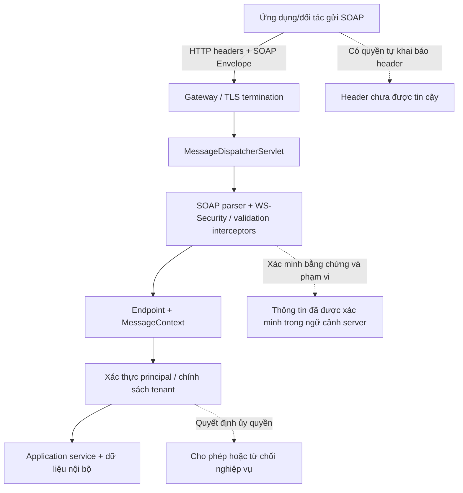

# Giới hạn tin cậy của dữ liệu header do bên gửi cung cấp

Trong dịch vụ SOAP phát triển theo hướng **contract-first** với Spring Web Services (Spring-WS), thông điệp không chỉ có `SOAP Body`. Bên gửi còn có thể cung cấp **SOAP Header**, các **HTTP header** và các trường ngữ cảnh như mã tenant, correlation ID, operation action, thông tin callback hoặc token bảo mật. Những dữ liệu này hữu ích để định tuyến, theo dõi và tích hợp giữa các hệ thống, nhưng chúng nằm ở **ranh giới tin cậy**: một bên gọi dịch vụ có thể tự tạo, sửa, bỏ hoặc gửi lặp lại nhiều header.

Bài thuộc chương **Header và ngữ cảnh**. Mục tiêu là nhận diện dữ liệu do bên gửi khai báo, phân biệt chúng với danh tính đã được xác thực, quyết định trường nào chỉ là *gợi ý* và trường nào cần xác minh bằng bằng chứng mật mã hoặc chính sách server. Bài kết nối SOAP Header với XSD/WSDL, JAXB, Spring-WS endpoint/client, HTTP transport, SOAP Fault, interceptor, XML security, WS-Security, chứng chỉ và kiểm thử liên thông doanh nghiệp.

> **Nguyên tắc xuyên suốt:** Một giá trị xuất hiện trong header **không trở thành đáng tin cậy chỉ vì nó có tên `UserId`, `TenantId`, `Role`, `Authenticated` hoặc `Security`**. Server phải biết *ai* đưa ra giá trị đó, *bằng chứng nào* xác minh nguồn gốc/tính toàn vẹn, *giá trị được phép dùng cho mục đích gì*, và *nó có gắn với request hiện tại hay không*.

## 1. Ranh giới tin cậy của một SOAP request

Xét luồng nhận request qua HTTPS:



Điểm quan trọng là **bên gửi sở hữu nội dung request**. HTTPS bảo vệ đường truyền đến điểm kết thúc TLS, nhưng không có nghĩa mọi trường do người gửi khai báo đều đúng về danh tính, quyền hạn hoặc dữ liệu nghiệp vụ. Nếu kẻ gửi được phép kết nối tới API, họ vẫn có thể cố gửi `<ctx:Role>ADMIN</ctx:Role>` dù không phải quản trị viên.

Phải phân biệt ít nhất bốn nhóm nguồn dữ liệu:

| Nguồn | Ví dụ | Mức tin cậy ban đầu |
| --- | --- | --- |
| HTTP header do client tự đặt | `X-Tenant-Id`, `X-User`, `X-Correlation-ID` | **Không tin cậy** đối với quyết định bảo mật |
| SOAP Header do client gửi | `ctx:TenantId`, `wsa:MessageID`, `wsa:ReplyTo` | **Không tin cậy** cho đến khi có kiểm tra phù hợp |
| Security assertion được xác minh | Chữ ký WS-Security đã kiểm chứng bằng khóa tin cậy, token đã xác minh claims/audience | Tin cậy **trong phạm vi những điều đã thực sự xác minh** |
| Dữ liệu/thuộc tính server tự xác lập | Principal từ cơ chế authentication đáng tin cậy, tenant membership từ hệ thống quyền | Có thể dùng để phân quyền sau khi kiểm tra chính sách và độ mới của dữ liệu |

“Đã xác minh chữ ký” không đồng nghĩa “được phép làm mọi operation”. Authentication trả lời **người gửi là ai**; authorization trả lời **người đó có quyền làm việc này với tài nguyên/tenant này không**. Cả hai khác với việc XML hợp lệ theo XSD.

## 2. Phân biệt HTTP Header, SOAP Header, WS-Addressing và WS-Security

Một request SOAP 1.1 có thể mang cùng lúc nhiều loại header:

```http
POST /ws HTTP/1.1
Host: api.example.com
Content-Type: text/xml; charset=utf-8
SOAPAction: "urn:example:orders:v1:GetOrder"
X-Correlation-ID: trace-5741
X-Tenant-ID: tenant-b
```

Phần SOAP message:

```xml
<soap:Envelope
    xmlns:soap="http://schemas.xmlsoap.org/soap/envelope/"
    xmlns:ctx="https://example.com/soap/context/v1"
    xmlns:ord="https://example.com/orders/v1"
    xmlns:wsa="http://www.w3.org/2005/08/addressing">
    <soap:Header>
        <ctx:TenantId soap:mustUnderstand="1">tenant-b</ctx:TenantId>
        <ctx:CorrelationId>trace-5741</ctx:CorrelationId>
        <wsa:MessageID>urn:uuid:11111111-2222-4333-8444-555555555555</wsa:MessageID>
    </soap:Header>
    <soap:Body>
        <ord:GetOrderRequest>
            <ord:orderId>42</ord:orderId>
        </ord:GetOrderRequest>
    </soap:Body>
</soap:Envelope>
```

Đây là **ví dụ XML minh họa**, không phải message hoàn chỉnh tuân thủ một profile WS-Addressing có đầy đủ các header bắt buộc. Nếu service yêu cầu WS-Security, SOAP Header còn có thể chứa `wsse:Security` với token, timestamp, signature hoặc thông tin mã hóa.

| Thành phần | Vị trí | Ý nghĩa điển hình | Sai lầm cần tránh |
| --- | --- | --- | --- |
| `SOAPAction` (SOAP 1.1) | HTTP header | Tín hiệu định tuyến operation | Coi action là chứng cứ được phép thực hiện operation |
| `X-Tenant-ID` | HTTP header | Gợi ý phạm vi tenant | Lấy làm tenant có hiệu lực mà không kiểm tra quyền |
| `ctx:TenantId` | SOAP Header | Ngữ cảnh nghiệp vụ do client đề xuất | Coi là tenant đã xác thực chỉ vì nằm trong Envelope |
| `ctx:CorrelationId` | SOAP Header | Đối chiếu log giữa các hệ thống | Coi là request ID duy nhất/đã được server chứng nhận |
| `wsa:MessageID` | SOAP Header | Định danh message phục vụ addressing/correlation | Mặc định dùng làm bằng chứng chống replay hoặc chống trùng giao dịch |
| `wsa:ReplyTo` | SOAP Header | Địa chỉ trả lời trong mô hình addressing | Gửi callback tới URL chưa được phê duyệt |
| `wsse:Security` | SOAP Header | Chứa dữ liệu bảo mật WS-Security | Nghĩ rằng chỉ cần thấy phần tử `Security` là đã xác minh chữ ký |
| `soap:mustUnderstand` | Thuộc tính của SOAP Header block | Yêu cầu bên nhận phù hợp phải hiểu/xử lý header | Xem nó là cờ xác thực hoặc nâng mức tin cậy |

**Vị trí không tạo ra niềm tin.** Một header chứa trong SOAP Envelope không an toàn hơn HTTP header nếu cả hai đều do cùng client thiếu tin cậy tạo ra.

## 3. Những mức tin cậy nên được tách riêng

Trong thiết kế endpoint, nên diễn giải dữ liệu theo các mức:

1. **Raw/received:** byte XML và header vừa được nhận. Chưa xác nhận cú pháp, kích thước, namespace hay nguồn gửi.
2. **Parsed:** XML/HTTP được parser đọc thành công; biết QName và chuỗi ký tự. Điều này **chỉ nói dữ liệu có thể đọc**, không nói dữ liệu đúng.
3. **Schema-valid:** element hoặc payload tuân theo XSD/WSDL ở phạm vi được kiểm tra. Điều này **không xác thực người gửi**.
4. **Cryptographically verified:** chữ ký/token/chứng chỉ đã được kiểm chứng theo truststore, policy, audience, thời hạn và phạm vi áp dụng. Chỉ phần dữ liệu **được bảo vệ/thực sự được xác minh** mới có thuộc tính toàn vẹn/nguồn gốc tương ứng.
5. **Authorized/business accepted:** danh tính và claims đã xác minh được server đối chiếu quyền, tenant và trạng thái nghiệp vụ hiện tại.

Ví dụ giá trị `tenant-b` chỉ gồm chữ và dấu gạch nên hợp lệ theo XSD `xs:string`. Điều đó không chứng minh người gọi thuộc tenant B. Ngay cả khi `TenantId` được ký bằng khóa của đối tác A, ứng dụng còn phải kiểm tra **đối tác A có quyền hoạt động cho tenant B không**.

### Ma trận quyết định theo mức tin cậy

| Dữ liệu | Sau khi parse | Sau khi XSD validate | Sau khi xác minh credential | Sau khi authorize |
| --- | --- | --- | --- | --- |
| `TenantId` | Có thể đọc chuỗi | Đúng format | Có thể biết người gửi là ai, nếu credential thực sự được xác minh | **Mới được chọn tài nguyên tenant** |
| `Role=ADMIN` do client gửi | Có thể đọc | Có thể là enum hợp lệ | Chữ ký chỉ chứng minh người ký đã gửi chuỗi đó | Không tự cấp ADMIN; kiểm tra vai trò ở nguồn quyền đáng tin cậy |
| `MessageID` | Có một ID | Đúng kiểu định danh nếu schema yêu cầu | Có thể bảo đảm ID không bị sửa nếu thuộc phần đã ký | Quyết định chống trùng/replay còn cần trạng thái server |
| `ReplyTo` | Có một URI | URI đúng cú pháp | Có thể biết người gửi đã đề nghị URI này | Chỉ callback nếu policy mạng và đích được phép |

Nên ghi nhãn trường theo provenance trong code: `rawTenantHint`, `verifiedPrincipal`, `authorizedTenant` thay vì dùng một biến `tenantId` được thay giá trị âm thầm qua nhiều giai đoạn.

## 4. `mustUnderstand`, `actor` và `role` không phải security proof

SOAP Header có cơ chế yêu cầu một node tham gia xử lý message phải hiểu header được gửi tới nó:

```xml
<ctx:TenantId
    xmlns:ctx="https://example.com/soap/context/v1"
    soap:mustUnderstand="1"
    xmlns:soap="http://schemas.xmlsoap.org/soap/envelope/">
    tenant-b
</ctx:TenantId>
```

Với SOAP 1.1, `mustUnderstand="1"` là cách yêu cầu node được nhắm tới phải xử lý header; SOAP 1.2 có cách diễn đạt tương ứng và khái niệm `role`. Nếu node liên quan không hiểu một header bắt buộc, nó phải xử lý theo quy tắc **MustUnderstand Fault** của phiên bản SOAP. Nhưng một bên gửi độc hại vẫn có thể tự viết `mustUnderstand="1"`.

Ba điều cần phân biệt:

- **`mustUnderstand`**: quy tắc xử lý giao thức, *không* phải cờ cho biết nội dung đúng.
- **`actor` (SOAP 1.1) / `role` (SOAP 1.2)**: xác định node SOAP nào được nhắm đến để xử lý header, *không* cấp quyền truy cập hệ thống.
- **Authorization**: quyết định quyền dựa trên danh tính/claims đã xác minh và chính sách server, *không* đến từ thuộc tính của SOAP Header.

Nếu `TenantId` được đánh dấu mustUnderstand, server có thể cần parse và thực thi chính sách xử lý header. Điều đó **không cho phép** server tin `TenantId` rồi bỏ bước kiểm tra membership.

## 5. Contract-first: khai báo header trong WSDL và giới hạn của XSD

XSD có thể định nghĩa một cấu trúc header rõ ràng:

```xml
<?xml version="1.0" encoding="UTF-8"?>
<xs:schema xmlns:xs="http://www.w3.org/2001/XMLSchema"
           xmlns:ctx="https://example.com/soap/context/v1"
           targetNamespace="https://example.com/soap/context/v1"
           elementFormDefault="qualified">

    <xs:simpleType name="TenantCode">
        <xs:restriction base="xs:string">
            <xs:pattern value="[a-z][a-z0-9-]{1,31}"/>
        </xs:restriction>
    </xs:simpleType>

    <xs:element name="TenantId" type="ctx:TenantCode"/>
    <xs:element name="CorrelationId" type="xs:string"/>
</xs:schema>
```

Trong WSDL 1.1, có thể gắn header vào operation bằng `soap:header` trong binding:

```xml
<!-- Fragment giả định tns:ContextHeaderMessage đã khai báo -->
<wsdl:input>
    <soap:body use="literal"/>
    <soap:header
        message="tns:ContextHeaderMessage"
        part="tenant"
        use="literal"/>
</wsdl:input>
```

`tns:ContextHeaderMessage` phải là một `wsdl:message` đã tồn tại, với part `tenant` tham chiếu global element `ctx:TenantId` trong XSD. Đây chỉ là **fragment** của `wsdl:binding`; WSDL hoàn chỉnh còn cần `definitions`, `types`, `messages`, `portType`, `service` và những binding tương ứng. Một số profile cũng biểu diễn yêu cầu bảo mật bằng WS-Policy/WS-SecurityPolicy.

**Hợp đồng giúp hai phía hiểu định dạng, không bảo đảm tính trung thực.** XSD nói `TenantId` là chuỗi đúng pattern, nhưng không thể nói tenant thuộc người gửi nào ở thời điểm hiện tại. WSDL nói operation có một header, nhưng không biến header đó thành principal. Thậm chí `PayloadValidatingInterceptor` thường tập trung vào **SOAP Body payload**; không được mặc định nó đã validate mọi SOAP Header.

Nếu muốn kiểm tra cấu trúc header, cần cơ chế phù hợp: xử lý QName và nội dung có kiểm soát, validate phần tử header theo schema riêng khi cần, áp chính sách SOAP `mustUnderstand`, và xác minh security tokens/chữ ký qua security interceptor độc lập.

## 6. HTTP header và reverse proxy: đừng tin một tên có tiền tố `X-`

Trong kiến trúc có gateway hoặc TLS termination, ứng dụng có thể đọc:

```http
X-Forwarded-For: 203.0.113.12
X-Forwarded-Proto: https
X-Forwarded-Host: partner.example.com
X-Authenticated-User: alice
```

Những trường này có thể hữu ích khi **proxy đáng tin cậy** tạo hoặc chuẩn hóa chúng. Nếu proxy chuyển tiếp nguyên một header mà client tự đặt, ứng dụng có thể bị đánh lừa rằng request đến từ IP khác, dùng HTTPS hoặc đã được xác thực dưới tên người dùng khác.

Chính sách đúng cần xác định **trust boundary ở đâu**:

1. Gateway chỉ nhận request trên các đường public được phép.
2. Gateway **xóa/ghi đè** những identity header nội bộ, không chỉ thêm header mới sau giá trị do client cung cấp.
3. Server ứng dụng chỉ tin metadata được truyền từ các proxy đã được xác thực/giới hạn ở tầng mạng, mTLS hoặc cơ chế tương đương.
4. Cấu hình xử lý `Forwarded`/`X-Forwarded-*` của Servlet container/Spring phải phù hợp với **số hop proxy tin cậy**, tránh tự ý tin chuỗi IP do người dùng nhập.
5. Quá trình xác thực/ủy quyền vẫn sử dụng một security principal đã được hệ thống tin cậy tạo ra; không dùng trực tiếp `X-Authenticated-User` khi chưa chứng minh nguồn của nó.

Trong Spring Boot, cấu hình forwarded headers có thể thay đổi theo phiên bản/môi trường; một ví dụ là `server.forward-headers-strategy`, nhưng **chỉ bật một tùy chọn xử lý header không tự làm cho nguồn header đáng tin**. Phải thiết kế chính sách gateway và kiểm thử khả năng giả mạo trước khi sử dụng.

Với HTTP headers, còn cần chú ý đến **nhiều giá trị cùng tên**, chữ hoa/chữ thường và cách proxy hợp nhất header. Nếu hệ thống không có quy tắc xử lý trùng lặp, hai bên có thể diễn giải `X-Tenant-ID` khác nhau. Với trường ảnh hưởng quyền truy cập, nên từ chối định dạng mơ hồ thay vì chọn ngẫu nhiên giá trị đầu hoặc cuối.

## 7. Đọc SOAP Header bằng Spring-WS: xử lý cấu trúc trước, quyền sau

Trong Spring-WS, `MessageContext` cho phép truy cập request/response message đang xử lý. Khi request là `SoapMessage`, ta có thể lấy `SoapHeader` và duyệt các `SoapHeaderElement` theo QName.

Ví dụ minh họa helper đọc **duy nhất một** header `ctx:TenantId`. Nó bảo vệ trước một số lỗi cấu trúc phổ biến: thiếu header, duplicate header, sai QName, nested XML không mong muốn, giá trị quá dài hoặc sai format.

```java
import java.util.Iterator;
import javax.xml.XMLConstants;
import javax.xml.namespace.QName;
import javax.xml.parsers.DocumentBuilderFactory;
import javax.xml.transform.TransformerFactory;
import javax.xml.transform.dom.DOMResult;
import org.w3c.dom.Document;
import org.w3c.dom.Element;
import org.w3c.dom.Node;
import org.springframework.ws.context.MessageContext;
import org.springframework.ws.soap.SoapHeader;
import org.springframework.ws.soap.SoapHeaderElement;
import org.springframework.ws.soap.SoapMessage;

public final class TenantHeaderReader {
    private static final String NS =
            "https://example.com/soap/context/v1";
    private static final QName TENANT =
            new QName(NS, "TenantId");

    private TenantHeaderReader() {}

    public static String readUntrustedTenantHint(
            MessageContext context) throws Exception {
        if (!(context.getRequest() instanceof SoapMessage soapMessage)) {
            throw new IllegalArgumentException("SOAP request expected");
        }
        SoapHeader header = soapMessage.getSoapHeader();
        if (header == null) {
            throw new IllegalArgumentException("Missing SOAP header");
        }

        String found = null;
        Iterator<SoapHeaderElement> elements =
                header.examineAllHeaderElements();
        while (elements.hasNext()) {
            SoapHeaderElement item = elements.next();
            if (!TENANT.equals(item.getName())) {
                continue;
            }
            if (found != null) {
                throw new IllegalArgumentException(
                        "Duplicate TenantId header");
            }
            found = simpleText(item);
        }
        if (found == null) {
            throw new IllegalArgumentException("Missing TenantId header");
        }
        return found; // CHƯA có nghĩa caller được phép dùng tenant này.
    }

    private static String simpleText(
            SoapHeaderElement headerElement) throws Exception {
        TransformerFactory tf = TransformerFactory.newInstance();
        tf.setFeature(XMLConstants.FEATURE_SECURE_PROCESSING, true);
        tf.setAttribute(XMLConstants.ACCESS_EXTERNAL_DTD, "");
        tf.setAttribute(XMLConstants.ACCESS_EXTERNAL_STYLESHEET, "");

        Document doc = DocumentBuilderFactory
                .newInstance().newDocumentBuilder().newDocument();
        tf.newTransformer().transform(
                headerElement.getSource(), new DOMResult(doc));
        Element root = doc.getDocumentElement();
        if (root == null
                || !NS.equals(root.getNamespaceURI())
                || !"TenantId".equals(root.getLocalName())) {
            throw new IllegalArgumentException("Invalid header QName");
        }
        for (Node n = root.getFirstChild(); n != null;
             n = n.getNextSibling()) {
            if (n.getNodeType() == Node.ELEMENT_NODE) {
                throw new IllegalArgumentException(
                        "Nested XML is not allowed for TenantId");
            }
        }
        String value = root.getTextContent();
        if (value == null
                || !value.matches("[a-z][a-z0-9-]{1,31}")) {
            throw new IllegalArgumentException("Invalid TenantId format");
        }
        return value;
    }
}
```

**Giới hạn của đoạn code:**

- Đây là **bước đọc cấu trúc**, không phải authentication/authorization; tên phương thức cố ý chứa `UntrustedTenantHint`.
- Ví dụ dùng cú pháp `instanceof` pattern matching của Java hiện đại và giả định endpoint hỗ trợ `MessageContext` argument. Package/API XML thuộc JAXP Java SE; JAXB `jakarta.xml.bind` là lớp độc lập.
- Việc gọi `getSource()` và transform có thể **tiêu thụ luồng** trong một số backend XML. Không nên đọc các header chứa chữ ký hoặc thực hiện các transform tùy tiện trước khi WS-Security interceptor hoàn tất xác minh; chọn thứ tự xử lý được framework hỗ trợ.
- Mã cấu hình transformer chọn chính sách *fail closed* khi provider không hỗ trợ các hạn chế cần thiết. Với XML không tin cậy, phải đặt thêm giới hạn kích thước và độ sâu, đồng thời kiểm tra parser/message factory có chặn XXE và các external entity.
- Kiểm tra duplicate QName chỉ áp dụng cho các element được helper duyệt. Nếu dùng nhiều phiên bản header namespace hoặc role/actor, cần quy định rõ những element nào được chấp nhận và kiểm thử việc chọn header nhắm đúng node.

## 8. Từ `TenantId` không tin cậy đến tenant được phép truy cập

Sau khi đọc `TenantId`, **không dùng thẳng giá trị đó trong truy vấn dữ liệu**. Hãy lấy danh tính đã được hệ thống xác thực từ security context và kiểm tra quyền tenant.

```java
import org.springframework.security.access.AccessDeniedException;
import org.springframework.security.authentication.AnonymousAuthenticationToken;
import org.springframework.security.core.Authentication;
import org.springframework.security.core.context.SecurityContextHolder;
import org.springframework.ws.context.MessageContext;
import org.springframework.ws.server.endpoint.annotation.Endpoint;
import org.springframework.ws.server.endpoint.annotation.PayloadRoot;
import org.springframework.ws.server.endpoint.annotation.RequestPayload;
import org.springframework.ws.server.endpoint.annotation.ResponsePayload;

@Endpoint
public class OrdersEndpoint {
    private final TenantAuthorizationService authorization;
    private final OrdersService orders;

    public OrdersEndpoint(
            TenantAuthorizationService authorization,
            OrdersService orders) {
        this.authorization = authorization;
        this.orders = orders;
    }

    @PayloadRoot(namespace = "https://example.com/orders/v1",
                 localPart = "GetOrderRequest")
    @ResponsePayload
    public GetOrderResponse getOrder(
            @RequestPayload GetOrderRequest request,
            MessageContext messageContext) throws Exception {

        Authentication principal = SecurityContextHolder
                .getContext().getAuthentication();
        if (principal == null || !principal.isAuthenticated()
                || principal instanceof AnonymousAuthenticationToken) {
            throw new AccessDeniedException("Authentication required");
        }

        String requestedTenant =
                TenantHeaderReader.readUntrustedTenantHint(messageContext);

        if (!authorization.canReadOrders(
                principal.getName(), requestedTenant)) {
            throw new AccessDeniedException("Tenant access denied");
        }

        // Chỉ từ đây tenant mới được chấp nhận cho operation này.
        return orders.getOrder(requestedTenant, request.getOrderId());
    }
}
```

`TenantAuthorizationService`, `OrdersService`, `GetOrderRequest` và `GetOrderResponse` là các thành phần ứng dụng/JAXB giả định đã được định nghĩa. Ví dụ tập trung vào **thứ tự kiểm tra tin cậy**, không trình bày repository hay cách tạo SOAP Fault đầy đủ.

Hai điều kiện quan trọng để code an toàn:

1. `Authentication` phải được tạo từ **cơ chế xác thực server đã kiểm chứng**, ví dụ mTLS/token hợp lệ hoặc WS-Security đã xác thực và tích hợp vào security context. Việc đọc một giá trị bất kỳ ở `SecurityContextHolder` không đủ nếu cấu hình security filter đã tin header do client tự giả mạo.
2. `canReadOrders` phải kiểm tra **cặp principal–tenant–operation** theo chính sách thực tế, không chỉ kiểm tra chuỗi tenant có tồn tại. Nếu quyền phụ thuộc từng đơn hàng, cần kiểm tra **principal–tenant–orderId** trước khi trả dữ liệu.

Đừng lấy `ctx:Role` để ghi đè `principal.getAuthorities()`. Nếu đối tác có cơ chế delegation hoặc acting-on-behalf-of, nó phải có **bằng chứng và policy delegation** rõ ràng, không chỉ là header `ActingUser=admin`.

## 9. WS-Security: từ phần tử `wsse:Security` đến bằng chứng có thể sử dụng

WS-Security cho phép mang thông tin an ninh trong SOAP Header: token, timestamp, chữ ký XML, dữ liệu mã hóa và những thành phần khác. Ví dụ cấu trúc khái niệm:

```xml
<soap:Header
    xmlns:soap="http://schemas.xmlsoap.org/soap/envelope/"
    xmlns:wsse="http://docs.oasis-open.org/wss/2004/01/oasis-200401-wss-wssecurity-secext-1.0.xsd">
    <wsse:Security>
        <!-- Timestamp, token, Signature ... theo profile đã thống nhất -->
    </wsse:Security>
</soap:Header>
```

Đây **không phải ví dụ chữ ký hợp lệ**; nó chỉ cho thấy vị trí header. Trong một hệ thống triển khai thật, Spring-WS có thể dùng interceptor WS-Security, ví dụ nhóm `Wss4jSecurityInterceptor` của nhánh Spring-WS phù hợp, để xác minh chữ ký, timestamp hoặc token theo cấu hình.

**Những điều một chữ ký hợp lệ có thể và không thể nói:**

| Kiểm tra | Có thể kết luận khi thực hiện đúng | Không tự kết luận |
| --- | --- | --- |
| Xác minh chữ ký XML | Các node/tham chiếu thực sự được ký không bị thay đổi bởi người không có khóa tương ứng | Mọi node trong Envelope đều được ký |
| Xây dựng trust chain/chính sách khóa | Người ký tương ứng với khóa/chứng chỉ được tin cậy theo policy | Người ký được phép thao tác mọi tenant |
| Kiểm tra timestamp | Thông điệp thuộc khoảng thời gian cho phép theo policy | Chưa từng được gửi lại trước đó |
| Kiểm tra token/audience/issuer | Claims có nguồn và phạm vi token phù hợp | Mọi giá trị header khác là thật |
| Kiểm tra replay cache/nonce/ID | Một số dạng phát lại bị phát hiện trong cửa sổ và phạm vi cache | Có bảo vệ tuyệt đối ngoài cửa sổ lưu hoặc qua mọi cụm máy |

Nếu policy chỉ ký **SOAP Body** mà không ký `ctx:TenantId`, kẻ trung gian có thể sửa tenant header mà không làm hỏng chữ ký Body. Nếu policy ký tenant header nhưng không ràng buộc identity–tenant, chủ sở hữu khóa vẫn có thể cố chọn tenant không thuộc quyền. Cần thiết kế **phạm vi chữ ký**, danh tính khóa, authorization và replay prevention như các lớp bổ trợ.

### Chống XML Signature Wrapping

Một lớp tấn công khai thác việc trình xác minh chữ ký kiểm tra **một node**, trong khi endpoint lại đọc **node khác** có local name gần giống. Cách phòng ngừa:

- Dùng thư viện WS-Security được duy trì và cấu hình đúng profile; không tự kiểm tra chữ ký bằng tìm chuỗi `<ds:Signature>`.
- Kiểm tra ID reference, vị trí node được ký, scope và phần tử Body/Header ứng dụng thực sự sử dụng.
- Không cho phép nhiều header bảo mật, duplicate ID hoặc cấu trúc bất thường vượt qua policy.
- Không tự sửa, sao chép hoặc thay thế các node đã ký giữa bước xác minh và bước xử lý nghiệp vụ.

Thấy `<wsse:Security>` không phải bằng chứng xác thực. Phải dựa vào **kết quả xác minh được đưa vào ngữ cảnh server một cách tin cậy**.

## 10. `SOAPAction`, WS-Addressing và các giá trị định tuyến do client khai báo

`SOAPAction` (SOAP 1.1), media type `action` (SOAP 1.2) và `wsa:Action` (WS-Addressing) có thể giúp server quyết định operation. Chúng khác nhau về vị trí và quy tắc, nhưng điểm chung là **giá trị action không phải authorization token**.

Ví dụ một bên gửi có thể viết:

```http
SOAPAction: "urn:example:orders:v1:CancelOrder"
```

hoặc đặt `wsa:Action` tương ứng. Nếu Spring-WS định tuyến bằng `@SoapAction`, `SoapActionAnnotationMethodEndpointMapping` có thể chọn method hủy đơn. Tuy nhiên, authorization phải tiếp tục kiểm tra người gọi có quyền hủy **đơn hàng cụ thể** hay không.

Tương tự, khi server định tuyến bằng `@PayloadRoot`, QName request hợp lệ không phải chứng cứ client có quyền. Nếu service đòi action và QName nhất quán, phải thiết kế validation/kiểm thử điều kiện này; hai annotation mapping không nhất thiết tạo ra một phép kiểm tra **AND** tự động.

### `wsa:MessageID`, `RelatesTo` và correlation ID

Những trường định danh message giúp nối request, response và log. Chúng thường được **bên gửi lựa chọn**, do đó:

- Không dùng `MessageID` như ID giao dịch **đã được hệ thống chứng nhận** nếu chưa kiểm tra trùng/replay.
- Nếu dùng để ngăn tạo trùng giao dịch, cần lưu trạng thái/nonce hoặc idempotency key **theo principal + operation + phạm vi dữ liệu**, với thời hạn và chính sách phù hợp.
- Để tránh log injection, đặt giới hạn chiều dài, format, loại bỏ ký tự điều khiển và không sử dụng ID client làm tên file hay truy vấn mà không kiểm soát.
- Server nên tạo **internal correlation ID** đáng tin cậy của riêng mình, có thể ghi kèm *external correlation ID* đã chuẩn hóa để đối chiếu với phía đối tác.

Một request được gửi lại với cùng `MessageID` không chắc chắn là replay độc hại: có thể do client retry sau timeout. Phân loại theo chính sách idempotency, trạng thái nghiệp vụ và thời hạn chứ không mặc định thực thi lại.

## 11. `wsa:ReplyTo` và nguy cơ SSRF khi có callback

WS-Addressing có thể chỉ định nơi nhận reply. Trong mô hình request-response đồng bộ thông thường, server trả lời trên chính kết nối HTTP; `ReplyTo` chỉ hữu ích khi hợp đồng và hạ tầng thực sự hỗ trợ kiểu trả lời đó.

Giả sử bên gửi chỉ định:

```xml
<wsa:ReplyTo xmlns:wsa="http://www.w3.org/2005/08/addressing">
    <wsa:Address>http://127.0.0.1:8080/admin</wsa:Address>
</wsa:ReplyTo>
```

Nếu một server mù quáng mở kết nối HTTP đến URI đó, nó có thể bị lợi dụng làm **SSRF** để truy cập dịch vụ nội bộ hoặc metadata endpoint. Đây là ví dụ một **giá trị header hợp lệ về hình thức nhưng nguy hiểm nếu coi là chỉ thị đáng tin**.

Đối với callback, nên áp dụng:

1. Chỉ cho phép callback ở các operation/profile đã được thiết kế để sử dụng.
2. Ưu tiên ánh xạ **định danh đối tác đã xác thực → callback URL đăng ký sẵn**, thay vì sử dụng URI tùy ý trong request.
3. Nếu policy cho phép URI động, áp dụng allowlist scheme/host/port, kiểm soát DNS resolution, chặn IP nội bộ/loopback/link-local và re-check khi kết nối/redirect; giới hạn redirect và egress network.
4. Có xác thực tới callback endpoint, chính sách TLS và quản lý lỗi/retry/idempotency riêng.
5. Không gửi nguyên SOAP Body hoặc token bảo mật tới một địa chỉ do client tùy ý đưa ra.

Header `ReplyTo` có thể đúng namespace XSD/WS-Addressing mà vẫn bị từ chối vì **chính sách egress**. XSD validation không phải bộ lọc SSRF.

## 12. SOAP Header, transport context và nguồn thông tin được tin

Spring-WS cho phép truy cập ngữ cảnh theo nhiều lớp:

| API/lớp thông tin | Nội dung | Mức độ tin cậy cần đánh giá |
| --- | --- | --- |
| `MessageContext#getRequest()` | SOAP/XML message tại Spring-WS | Nội dung do bên gửi tạo; chưa chắc đã xác thực |
| `SoapMessage#getSoapHeader()` | Các SOAP Header blocks | Chỉ là XML, cần kiểm tra QName/role/security |
| `TransportContextHolder` / HTTP transport | Metadata về kết nối HTTP/Servlet | URL, IP và forwarded headers phụ thuộc proxy; không tự xác thực actor |
| Spring Security `SecurityContextHolder` | `Authentication` do security infrastructure đặt | Chỉ đáng tin nếu filter/interceptor tạo nó bằng cơ chế xác minh đúng |
| WS-Security results đã kiểm tra | Credential, chữ ký/timestamp/token đã xác minh | Cần đối chiếu scope, người ký, quyền và freshness |
| Application authorization service | Tenant membership, quyền tác vụ/tài nguyên | Nguồn quyết định truy cập theo policy hiện hành |

**Không đồng nhất `HttpServletRequest.getRemoteAddr()` với danh tính người dùng.** Sau proxy, địa chỉ đó có thể là IP gateway, và các header như `X-Forwarded-For` có thể gồm nhiều hop. IP có thể là một tín hiệu phòng vệ bổ sung, nhưng không thay thế authentication/authorization.

Tương tự, `messageContext.getProperty("user")` hoặc một custom property chỉ đáng tin khi biết chính xác **thành phần nào ghi thuộc tính đó** và nó đã kiểm chứng dữ liệu hay chưa. Không nên đặt tên `authenticatedUser` cho giá trị được copy trực tiếp từ SOAP Header do client gửi.

## 13. Những nguy cơ XML-specific khi xử lý Header

Ngay cả khi không dùng WS-Security, SOAP Header vẫn là **XML có cấu trúc** và cần bảo vệ ở tầng parser:

- **XXE/external entity:** không nạp DTD hoặc tài nguyên ngoài từ XML client; cấu hình parser/transformer an toàn phù hợp với implementation.
- **Entity expansion hoặc XML quá phức tạp:** giới hạn kích thước request, độ sâu, số node và thời gian xử lý.
- **Namespace spoofing:** chỉ so local name `TenantId` là không đủ; phải so **`QName` gồm namespace URI**.
- **Duplicate header elements:** chọn phần tử đầu tiên mà không kiểm tra số lượng có thể dẫn đến việc interceptor và endpoint dùng hai giá trị khác nhau.
- **SOAP actor/role và mustUnderstand:** chỉ áp dụng quy tắc xử lý cho node được nhắm đến theo phiên bản SOAP; không bỏ qua yêu cầu giao thức và cũng không nâng mức tin cậy của nội dung.
- **Streaming/caching:** `SoapHeaderElement.getSource()` có thể không có khả năng đọc lại nếu backend dùng stream one-shot; interceptor log và endpoint không nên tự parse cùng một nguồn nhiều lần.
- **Signature wrapping:** tránh dùng cách chọn node XML "đầu tiên có tên giống" khi nhận header đã được ký.

Nếu cần khai thác giá trị text của một header, kiểm tra nó là **simple content** như hợp đồng quy định. Nếu đối tác gửi:

```xml
<ctx:TenantId xmlns:ctx="https://example.com/soap/context/v1">
    <ctx:TenantId>tenant-a</ctx:TenantId>
    tenant-b
</ctx:TenantId>
```

thì `getTextContent()` có thể tạo chuỗi mơ hồ. Một header được định nghĩa là simple string nên được từ chối khi có nested elements thay vì "chọn đại" text hoặc cố diễn giải khác nhau giữa các thành phần.

## 14. Phân loại lỗi và SOAP Fault phù hợp

| Trường hợp | Phân loại chính | Hướng phản hồi |
| --- | --- | --- |
| Header XML sai cú pháp | XML/SOAP parsing | Từ chối request; trả Fault nếu còn có thể tạo SOAP response |
| Header bắt buộc thiếu/sai format | Contract/header validation | SOAP Fault phía Client/Sender theo SOAP version và chính sách |
| Header `mustUnderstand` không được node đích xử lý | SOAP protocol | `MustUnderstand` Fault đúng quy tắc SOAP |
| Token/chữ ký sai hoặc timestamp không hợp lệ | Authentication/WS-Security | Security Fault/phản hồi tương ứng policy, không lộ chi tiết nội bộ |
| Tenant hợp lệ về format nhưng người dùng không có quyền | Authorization | Access-denied Fault phù hợp hợp đồng/chính sách |
| `ReplyTo` bị từ chối bởi allowlist/egress policy | Policy validation | Từ chối yêu cầu callback, không mở kết nối tới URL đó |
| SOAPAction khác operation hoặc QName | Routing/contract consistency | Từ chối mismatch theo quy tắc tích hợp đã công bố |
| Response thiếu header cần thiết | Server contract | Lỗi server; không xem là lỗi của client hợp lệ |
| Lỗi mạng trước khi tạo SOAP Envelope | HTTP/TLS/transport | Có thể không có SOAP Fault; không giả định client nhận XML |

Trong SOAP 1.1, nhiều lỗi request thường tương ứng với `soap:Client`, còn SOAP 1.2 dùng `Sender`; lỗi phía server thường dùng `Server` hoặc `Receiver`. Tuy nhiên, **`MustUnderstand` có fault code riêng**, còn các profile WS-Security có quy tắc fault riêng. Không biến mọi lỗi header thành một `Internal Server Error` hoặc phát tán exception Java cho đối tác.

Trong Spring-WS, có thể dùng `EndpointExceptionResolver` hoặc cơ chế mapping fault của service để tạo lỗi nghiệp vụ/ủy quyền thống nhất. Lỗi được interceptor chặn trước endpoint có thể do interceptor tạo Fault theo cách riêng, vì vậy test phải xác minh phản hồi **thực tế** thay vì giả định resolver nào cũng được gọi.

### Không làm rò rỉ thông tin qua Fault

Thông điệp đối ngoại nên có mã ổn định, chẳng hạn `INVALID_TENANT_CONTEXT`, `ACCESS_DENIED`, `INVALID_SECURITY_TOKEN`, với diễn giải vừa đủ. Không trả ra private key, certificate path, token, stack trace, đường dẫn máy chủ, nhóm quyền nội bộ hay thông tin tenant mà người gọi chưa được phép biết.

Một lỗi "tenant không tồn tại" đôi khi cần được trả dưới dạng lỗi truy cập chung để tránh tiết lộ tenant tồn tại cho người không có quyền. Quyết định cụ thể phụ thuộc chính sách sản phẩm và hợp đồng SOAP Fault.

## 15. Quan sát hệ thống: correlation ID phải có hai phiên bản

Theo dõi giao dịch tích hợp thường muốn giữ một mã do đối tác cung cấp. Nên tách:

```text
externalCorrelationId = giá trị từ HTTP/SOAP Header của client
internalTraceId       = giá trị do gateway/server tạo và quản lý
authenticatedActor    = danh tính đã xác minh từ security context
authorizedTenant      = tenant đã qua kiểm tra policy
```

Đừng dùng `externalCorrelationId` làm khóa bảo mật, idempotency key duy nhất toàn hệ thống hoặc tên log file không lọc. Một client có thể gửi cùng một mã trên hàng nghìn message; mã có thể chứa ký tự điều khiển, xuống dòng hoặc thông tin nhạy cảm.

Khi ghi log, nên lưu **mối liên hệ** giữa internal trace ID và external correlation ID đã chuẩn hóa, QName operation, kết quả kiểm tra authentication/authorization và fault category. Hạn chế log SOAP Header đầy đủ, nhất là `wsse:Security`, password/token, signature, certificate hoặc thông tin cá nhân.

Ví dụ log logic (giá trị minh họa):

```text
traceId=svc-7e4f
externalCorrelationId=trace-5741
operation={https://example.com/orders/v1}GetOrderRequest
authenticatedActor=partner-service-A
authorizedTenant=tenant-a
decision=DENY
reason=TENANT_SCOPE_MISMATCH
```

Trường `authorizedTenant` trong log ở trường hợp bị từ chối nên phản ánh **tenant đã được hệ thống xác lập** (nếu có), không copy nhầm requested tenant rồi khiến người điều tra tin rằng tenant đó đã được cấp quyền.

## 16. SOAP client có thể gửi header nhưng server vẫn phải kiểm chứng

Với Spring-WS `WebServiceTemplate`, bên gọi có thể thêm SOAP Header thông qua `WebServiceMessageCallback`. Ví dụ minh họa **client chủ động gửi tenant hint**:

```java
import java.nio.charset.StandardCharsets;
import org.springframework.ws.WebServiceMessage;
import org.springframework.ws.client.core.WebServiceMessageCallback;
import org.springframework.ws.soap.SoapMessage;
import org.springframework.xml.transform.StringSource;
import javax.xml.transform.TransformerFactory;

WebServiceMessageCallback addTenantHeader = (WebServiceMessage message) -> {
    if (!(message instanceof SoapMessage soapMessage)) {
        throw new IllegalStateException("SOAP message required");
    }
    String xml = """
        <ctx:TenantId xmlns:ctx="https://example.com/soap/context/v1">
            tenant-a
        </ctx:TenantId>
        """;
    TransformerFactory.newInstance().newTransformer()
            .transform(new StringSource(xml),
                       soapMessage.getSoapHeader().getResult());
};
```

Đây là **mã client minh họa**, sử dụng text block Java hiện đại. `getResult()` trả nơi để ghi XML vào SOAP Header ở những phiên bản API hỗ trợ; nếu dùng cơ chế `addHeaderElement(QName)` và ghi nội dung qua API tương ứng, cần giữ đúng QName. Trong ứng dụng thật, nên dùng XML serializer hoặc JAXB cho giá trị động thay vì nối chuỗi từ input và áp dụng cấu hình XML transformer an toàn.

Nếu client cần đặt cả SOAPAction, có thể dùng callback tổng hợp: trên cùng `SoapMessage`, gọi `setSoapAction(...)` theo contract và thêm header context; hoặc dùng callback tương đương được framework hỗ trợ. Nếu cần ký header, bước tạo SOAP message và bước WS-Security signing phải diễn ra theo thứ tự phù hợp.

**Điểm mấu chốt:** Ví dụ trên chỉ chứng minh bên gửi có thể tạo `TenantId`. Nó không chứng minh bên gửi được quyền dùng `tenant-a`. Server phải kiểm tra principal và tenant membership/authorization như phần 8.

## 17. Ma trận kiểm thử ranh giới tin cậy của header

| Ca | Tình huống / thay đổi đầu vào | Kết quả cần xác minh |
| --- | --- | --- |
| H01 | SOAP Header `TenantId=tenant-a`, principal được cấp quyền tenant A | Request được xử lý theo tenant A |
| H02 | `TenantId=tenant-b`, principal chỉ có quyền tenant A | Từ chối trước khi truy xuất dữ liệu tenant B |
| H03 | Header `Role=ADMIN` do client tự tạo | Không nâng quyền; authorization dựa trên server policy |
| H04 | Thiếu `TenantId` khi contract bắt buộc | Fault header/contract rõ ràng |
| H05 | Có hai phần tử `ctx:TenantId` | Từ chối đầu vào mơ hồ, không tự chọn phần tử đầu/cuối |
| H06 | Header cùng local name nhưng namespace giả | Không được chấp nhận là `ctx:TenantId` |
| H07 | `TenantId` có nested XML dù XSD định nghĩa simple type | Bị từ chối ở kiểm tra cấu trúc |
| H08 | Tenant quá dài hoặc chứa ký tự không hợp lệ | Bị từ chối trước khi sử dụng truy vấn |
| H09 | Header `mustUnderstand` được gửi đến node nhưng không được hiểu | Xử lý MustUnderstand theo phiên bản SOAP |
| H10 | SOAPAction chọn `CancelOrder`, principal chỉ được đọc | Không hủy đơn; authorization áp dụng riêng cho operation |
| H11 | WS-Security signature bị sửa hoặc credential sai | Bị từ chối bởi security validation |
| H12 | Chữ ký đúng nhưng **không bao phủ TenantId** và tenant bị thay | Không tự coi tenant là signed/authorized |
| H13 | Chữ ký đúng bao phủ TenantId nhưng principal không được quyền tenant | Vẫn từ chối theo chính sách |
| H14 | Timestamp cũ/nonce hoặc MessageID trùng theo replay policy | Chặn phát lại theo cửa sổ đã định nghĩa |
| H15 | `wsa:ReplyTo` trỏ tới loopback/IP nội bộ | Không tạo outbound callback tới đích đó |
| H16 | `X-Authenticated-User` bị client tự thêm khi gọi public API | Gateway loại bỏ/ghi đè; server không tin identity giả |
| H17 | Proxy gửi nhiều header `X-Tenant-ID` mâu thuẫn | Từ chối hoặc chuẩn hóa theo một quy tắc an toàn thống nhất |
| H18 | `X-Forwarded-Proto/Host` bị giả mạo | Không ảnh hưởng nguồn danh tính/authorization, không tạo URL độc hại |
| H19 | Correlation ID có xuống dòng/ký tự điều khiển | Được từ chối/chuẩn hóa trước khi log |
| H20 | SOAP Body đúng XSD, SOAP Header bảo mật không hợp lệ | Security validation từ chối dù Body hợp lệ |
| H21 | SOAP Header đúng nhưng Body vi phạm XSD | Payload validation từ chối |
| H22 | HTTP connection không đạt TLS/mTLS policy | Từ chối ở transport trước bước SOAP nghiệp vụ |
| H23 | Client Java và client .NET cùng gửi header theo WSDL | Hai phía hiểu cùng QName/format và cùng policy |
| H24 | Bật logging interceptor trên payload one-shot | Không vô ý tiêu thụ nguồn trước security/endpoint; không lộ token |

Các ca H11–H14 phải chạy với **chứng chỉ, token, chính sách chữ ký, cửa sổ timestamp và replay cache** giống môi trường mục tiêu. Một test XSD thuần không đủ để chứng minh chữ ký đúng hoặc phân quyền tenant. Các ca H16–H18 cần chạy qua đường gateway/proxy thực tế hoặc môi trường tương đương, không chỉ gọi trực tiếp method Java.

### Cần assert gì?

Với mỗi ca, ngoài SOAP Fault/HTTP status còn phải kiểm tra:

1. **Danh tính server thực sự sử dụng** và nguồn xác minh của danh tính đó.
2. **Tenant/resource nào được truy cập**, không chỉ có lỗi/không có lỗi.
3. **Có chạy application service hay không** sau khi authorization thất bại.
4. **Header nào được ký/xác minh**, kết quả kiểm tra replay và policy.
5. **Log có bảo toàn ranh giới tin cậy** và không xuất token/dữ liệu nhạy cảm.

Nên kết hợp `MockWebServiceClient` cho SOAP endpoint/interceptor, `MockWebServiceServer` cho hành vi client, và kiểm thử HTTP integration qua gateway để xác minh forwarded headers, TLS và WS-Security thực tế.

## 18. Case study: lỗi truy cập chéo tenant do tin SOAP Header

**Bối cảnh:** Một ứng dụng trung gian gọi `GetOrder`. Backend dùng:

```text
tenant = SOAP Header ctx:TenantId
order  = ordersRepository.findByTenantAndId(tenant, orderId)
```

Thiết kế này có vẻ hợp lý vì truy vấn đã có điều kiện `tenant`. Tuy nhiên, nếu user của tenant A gửi `TenantId=tenant-b`, truy vấn có thể trả dữ liệu tenant B **nếu không có bước xác minh membership**.

**Phân tích nguyên nhân:**

- `TenantId` chỉ đến từ XML của client nhưng bị nâng cấp thành **nguồn quyết định quyền truy cập**.
- Validation XSD chỉ kiểm tra `tenant-b` đúng format.
- SOAPAction và QName request chỉ xác định operation.
- Dù có HTTPS, người gọi hợp lệ vẫn có thể gửi tenant giả.

**Thiết kế lại:**

1. Xác thực client bằng cơ chế phù hợp (token/chứng chỉ/WS-Security), tạo principal đã được xác minh.
2. Parse header `TenantId` có kiểm tra QName, định dạng và số lượng.
3. Kiểm tra `principal` có quyền đọc order thuộc `TenantId` đó.
4. Nếu client hỗ trợ nhiều tenant, coi header là **lựa chọn phạm vi** trong tập tenant đã được cấp quyền, không phải bằng chứng tự cấp quyền.
5. Áp chính sách trên **tài nguyên cụ thể** khi cần, bởi có quyền tenant chưa chắc có quyền đọc mọi order.
6. Tạo audit log với internal trace ID, principal, tenant được ủy quyền và kết quả, không lấy `Role` do client khai báo.
7. Viết test H01/H02/H03 và thử thay token/header trước khi công bố WSDL.

**Bài học:** Ngay cả một truy vấn đã lọc theo tenant vẫn không an toàn nếu tenant lọc được lấy từ nguồn không đáng tin mà không được liên kết với quyền của principal.

## 19. Checklist thiết kế header trong dịch vụ Spring-WS

1. **Phân loại header**: HTTP, SOAP application header, WS-Addressing, WS-Security và các giá trị server tự tạo; không đồng nhất nguồn tin cậy.
2. **Khởi đầu bằng mức untrusted** cho mọi giá trị do bên gửi cung cấp, kể cả `TenantId`, `Role`, `UserId`, `MessageID` và `ReplyTo`.
3. **Khớp QName và hợp đồng**: namespace URI, local name, cấu trúc header, số lượng và format; không chỉ so tên chuỗi.
4. **Hiểu `mustUnderstand`/actor/role** là quy tắc xử lý SOAP, không phải chứng cứ authentication.
5. **Kiểm tra nguồn danh tính**: token, certificate hoặc WS-Security credential được hệ thống tin cậy xác minh, không lấy từ custom identity header chưa kiểm chứng.
6. **Ràng buộc quyền** theo principal–tenant–operation–resource; không dùng tenant hint làm thông tin ủy quyền cuối.
7. **Định nghĩa phạm vi ký**: xác minh những phần XML thực sự được bảo vệ, chống signature wrapping, duplicate ID và header giả.
8. **Thiết kế replay/idempotency** có scope và TTL phù hợp; không xem `MessageID` tự động chống phát lại.
9. **Không gọi URL tùy ý trong `ReplyTo`**; dùng endpoint đã đăng ký hoặc kiểm tra egress/allowlist chống SSRF.
10. **Cấu hình proxy tin cậy**: loại bỏ/ghi đè identity headers từ client, xử lý forwarded headers bằng trust boundary tường minh.
11. **Bảo vệ XML parser** trước XXE, entity expansion, quá tải và nguồn stream bị interceptor tiêu thụ.
12. **XSD/WSDL là hợp đồng cấu trúc**, còn authentication/authorization và WS-Security là các kiểm tra độc lập.
13. **SOAP Fault có phân loại phù hợp** cho contract, MustUnderstand, authentication, authorization, routing và lỗi server.
14. **Log theo nguyên tắc tối thiểu**: external correlation ID đã chuẩn hóa, internal trace ID và actor/tenant đã xác minh; không log token hoặc SOAP Header bí mật.
15. **Kiểm thử end-to-end** với client, gateway, Spring-WS interceptor, JAXB, schema validation, WS-Security và authorization cùng phiên bản triển khai.

**Kết luận:** SOAP Header và HTTP Header mang thông tin hữu ích nhưng thường bắt đầu như **dữ liệu do bên gửi tự khai báo**. Spring-WS có thể giúp đọc, định tuyến, validate và xác minh các cấu trúc đó, song framework không tự biến tên header thành quyền truy cập. Với dịch vụ SOAP contract-first, một thiết kế an toàn phải **giữ nguyên nguồn gốc dữ liệu, xác minh bằng chứng cần thiết, kiểm tra quyền trên từng operation/tài nguyên và chỉ sử dụng giá trị header trong phạm vi đã được cho phép**. Nhờ vậy, XSD/WSDL, JAXB, SOAP Fault, WS-Security và client tích hợp cùng vận hành trên một ranh giới tin cậy rõ ràng.
