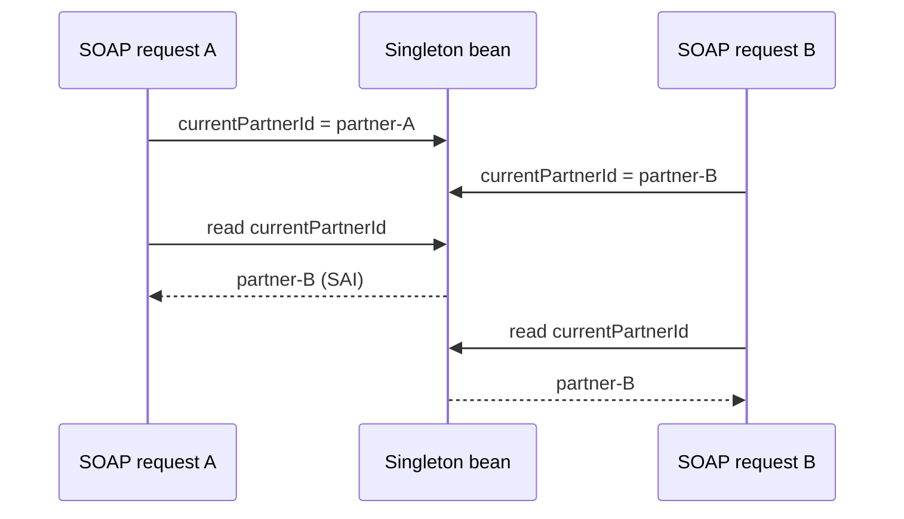
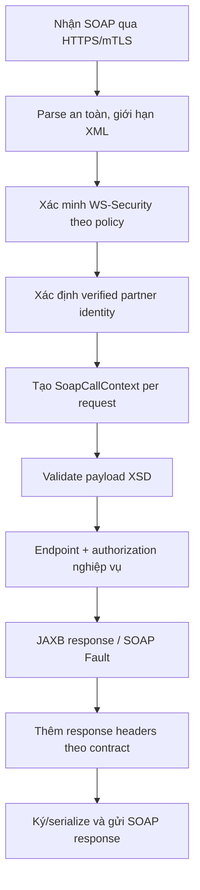
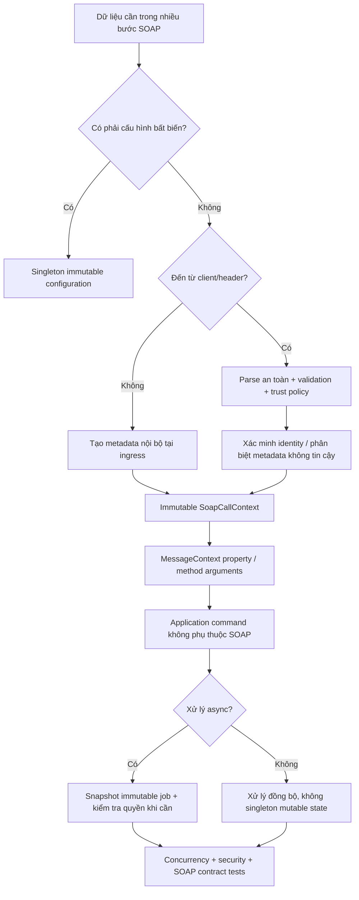

# Giữ dữ liệu từng yêu cầu ngoài trạng thái dùng chung của bean singleton

## 1. Tình huống: SOAP endpoint trả dữ liệu của nhầm đối tác

Giả sử một ứng dụng **Spring Web Services (Spring-WS)** công bố operation `GetOrder` cho nhiều đối tác doanh nghiệp. Mỗi SOAP request có một danh tính đối tác đã được xác minh qua mTLS hoặc WS-Security, cùng mã tương quan (`correlation ID`) để theo dõi lỗi. Lập trình viên muốn tái sử dụng danh tính trong nhiều bước xử lý nên lưu nó vào field của một Spring bean:

```java
import org.springframework.stereotype.Component;

@Component
public class UnsafePartnerContext {
    private String currentPartnerId;

    public void setCurrentPartnerId(String value) {
        this.currentPartnerId = value;
    }

    public String getCurrentPartnerId() {
        return currentPartnerId;
    }
}
```

`@Component` mặc định có **singleton scope** trong Spring. Chỉ có một instance `UnsafePartnerContext` trong application context đó, được nhiều request dùng chung. Khi request A ghi `partner-A`, rồi request B ghi `partner-B` trước lúc A đọc lại field, A có thể nhận danh tính B và trả dữ liệu trái quyền.



Đây không chỉ là lỗi đồng thời (*race condition*) khiến log sai. Nếu giá trị bị trộn là `partnerId`, `tenantId`, account ID, token hoặc quyền, đó có thể là **lỗ hổng cách ly dữ liệu giữa các đối tác**.

Trong module **SPRING_WEB_SERVICES**, bài thuộc chương **Header và ngữ cảnh**. Bài giải thích cách giữ dữ liệu của *mỗi lần gọi SOAP* ở đúng phạm vi khi phát triển service theo hướng **contract-first** với XSD/WSDL, JAXB, endpoint và SOAP client; đồng thời bảo vệ tính đúng đắn của SOAP Fault, interceptor, XML security, WS-Security, chứng chỉ và tích hợp doanh nghiệp.

**Sau bài này, bạn sẽ có thể:**

1. Phân biệt trạng thái **cấu hình dùng chung** với **dữ liệu riêng từng request**.
2. Sử dụng `MessageContext` và các object bất biến để trao đổi metadata giữa interceptor và endpoint.
3. Đọc SOAP Header đúng vai trò, không coi giá trị do client tự khai là identity đã xác thực.
4. Biết khi nào nên dùng `@RequestScope`, method parameters hoặc `ThreadLocal`/MDC, và giới hạn của từng cách.
5. Ngăn lỗi trộn ngữ cảnh khi xử lý đồng thời, thread pool, async hoặc retry.
6. Kiểm thử cách ly tenant/partner và kiểm tra SOAP Header, response, Fault, bảo mật và log.

## 2. Hiểu đúng vòng đời Spring bean và vòng đời SOAP request

### 2.1. Singleton không đồng nghĩa chỉ có một request

Trong Spring, các bean `@Endpoint`, `@Service`, `@Component`, `@Configuration` và interceptor được đăng ký thông thường đều là singleton trừ khi cấu hình scope khác. Một instance có thể xử lý nhiều request:

```text
Spring application context
├── OrderEndpoint             [singleton]
├── OrderQueryService         [singleton]
├── OrderMapper               [singleton]
├── PartnerContextInterceptor [singleton]
└── RequestLogger             [singleton]

SOAP request A ─┐
SOAP request B ─┼─> cùng các singleton ở trên
SOAP request C ─┘
```

Điều này **không làm singleton tự động không an toàn**. Singleton an toàn khi có **dependency dùng chung được thiết kế đúng** và **không lưu dữ liệu riêng một request vào mutable instance field**. Ví dụ endpoint chỉ có các field `private final OrderQueryService service` và `private final OrderMapper mapper`, còn `orderId` là biến local, thường là cách tổ chức phù hợp.

### 2.2. Dữ liệu nào được phép chia sẻ?

| Loại dữ liệu | Ví dụ | Vị trí thường phù hợp |
|---|---|---|
| Cấu hình bất biến | XML namespace, đường dẫn XSD, endpoint URI, giới hạn payload | `static final` hoặc immutable configuration bean |
| Dịch vụ không mang request state | Mapper không có state, repository adapter, signer service được thiết kế thread-safe | Singleton qua constructor injection |
| Tài nguyên có chính sách đồng thời | Connection pool, HTTP client, cache có key đúng | Singleton có concurrency control |
| Dữ liệu riêng request | `partnerId`, `correlationId`, thời điểm nhận, idempotency key | Biến local, immutable context object, `MessageContext` hoặc request scope thích hợp |
| SOAP Header/Body | Thông điệp XML của lần gọi | `WebServiceMessage` / `MessageContext` của lần xử lý |
| Kết quả nghiệp vụ | Response DTO, exception, danh sách đơn hàng | Tạo và sử dụng theo từng request |
| Logging context | Trace/correlation metadata | MDC/observation theo phạm vi có cleanup và propagation |
| Security principal | Identity, claims đã xác minh | Security context được framework quản lý; truyền snapshot đã kiểm chứng vào ứng dụng |

Một field `final` chỉ làm tham chiếu không đổi; **nó không làm đối tượng mà field tham chiếu thành bất biến hoặc thread-safe**. Ví dụ `private final HashMap<String,Object> currentRequest` trong singleton vẫn là một map dùng chung sai phạm vi nếu chứa dữ liệu của lần gọi.

## 3. Phân biệt SOAP Header, HTTP Header và `MessageContext`

Để đặt dữ liệu đúng nơi, cần hiểu ba cơ chế gần nhau nhưng không giống nhau.

### 3.1. SOAP Header là một phần của giao thức XML

Ví dụ request có correlation header:

```xml
<soap:Envelope
    xmlns:soap="http://schemas.xmlsoap.org/soap/envelope/"
    xmlns:ord="urn:example:orders:v1"
    xmlns:ctx="urn:example:context:v1">
  <soap:Header>
    <ctx:CorrelationId>req-20261127-001</ctx:CorrelationId>
  </soap:Header>
  <soap:Body>
    <ord:GetOrderRequest>
      <ord:orderId>ORD-1001</ord:orderId>
    </ord:GetOrderRequest>
  </soap:Body>
</soap:Envelope>
```

`ctx:CorrelationId` là một phần tử XML có QName `{urn:example:context:v1}CorrelationId`. Nó có thể phục vụ tracing, nhưng **không chứng minh danh tính hoặc quyền của người gọi**. Nếu dùng `wsse:Security`, `wsu:Timestamp` hay `wsa:Action`, đó cũng là SOAP Header, với yêu cầu xử lý riêng theo chuẩn/policy tương ứng.

### 3.2. HTTP Header thuộc transport

Một SOAP request qua HTTP có thể mang:

```http
POST /ws HTTP/1.1
Host: orders.example.org
Content-Type: text/xml; charset=utf-8
SOAPAction: "urn:example:orders:GetOrder"
X-Correlation-Id: req-20261127-001
```

`X-Correlation-Id` ở HTTP khác với phần tử `ctx:CorrelationId` trong SOAP Header. Hệ thống có thể có policy chọn một trong hai hoặc đối chiếu chúng, nhưng không được đồng nhất tự động. Proxy có thể thêm, xóa hoặc ghi đè HTTP headers. Chỉ tin một HTTP header mang thông tin identity khi nó đến từ **hạ tầng tin cậy đã xác thực nguồn và ngăn spoofing**.

### 3.3. `MessageContext` là ngữ cảnh xử lý nội bộ của Spring-WS

Spring-WS cung cấp `org.springframework.ws.context.MessageContext` để truy cập request/response `WebServiceMessage` và lưu các **property phục vụ chính lần gọi đang được xử lý**.

```java
// Ví dụ minh họa cách dùng trong một interceptor/endpoint:
messageContext.setProperty("request.correlationId", "req-20261127-001");

String correlationId = (String)
        messageContext.getProperty("request.correlationId");
```

Property này **không tự được serialize vào SOAP Header** và cũng **không tự gửi sang SOAP client**. Nó là dữ liệu nội bộ để các thành phần trong cùng pipeline chia sẻ mà không đặt vào một singleton field.

| Khái niệm | Nơi sống | Ai có thể thấy? | Phù hợp để lưu |
|---|---|---|---|
| SOAP Header | Trong SOAP Envelope trên dây | Những hop/recipient được phép xử lý thông điệp | Correlation metadata, WS-Security, WS-Addressing theo contract |
| HTTP Header | HTTP request/response qua transport | Client, reverse proxy, HTTP server | Content type, action, transport metadata |
| `MessageContext` property | Trong lời gọi xử lý Spring-WS | Interceptor, endpoint, adapter có cùng context | Metadata đã kiểm tra, request-local snapshots |
| Local Java variable | Stack/lời gọi method | Đoạn code được truyền tham số | Domain command, request payload, correlation |
| Singleton instance field | Trong bean dùng chung | Mọi request dùng bean | Chỉ cấu hình/shared state được đồng bộ, **không dùng cho current request** |

Một `MessageContext` không phải persistent store: không giữ nó sau khi request kết thúc, không serialize nó vào queue, và không truyền nguyên object sang background job.

## 4. Anti-pattern: lưu trạng thái từng request trong endpoint singleton

Hãy xem ví dụ:

```java
import org.springframework.ws.server.endpoint.annotation.Endpoint;

@Endpoint
public class UnsafeOrderEndpoint {
    private String currentCorrelationId;
    private String currentPartnerId;

    public void updateContext(String correlationId, String partnerId) {
        currentCorrelationId = correlationId;
        currentPartnerId = partnerId;
    }

    public String describeCurrentCall() {
        return currentCorrelationId + ":" + currentPartnerId;
    }
}
```

Đặt `volatile` lên hai field này **không giải quyết vấn đề**: request khác vẫn có thể ghi đè. `synchronized` toàn bộ method có thể che bớt race trong một số thiết kế nhỏ nhưng làm mất concurrency, dễ bỏ sót đoạn code/bean khác và không đảm bảo isolation qua nhiều bước; đó không phải cách đúng để lưu thông tin caller.

### 4.1. Điều gì khiến lỗi khó phát hiện?

- Test đơn luồng tuần tự thường luôn pass.
- Kết nối keep-alive, thread pool và scheduler khiến luồng xử lý thay đổi không dễ dự đoán.
- Endpoint có thể gọi repository hoặc hệ thống ngoài, mở cửa sổ thời gian cho request khác ghi đè field.
- Log correlation có thể trộn giá trị, làm nhóm vận hành tưởng đang xem request khác.
- Khi một field chứa thông tin tenant/authorization, lỗi trở thành rò rỉ dữ liệu chứ không chỉ sai log.

### 4.2. Quy tắc thiết kế thay thế

**Đừng hỏi: “Làm sao có một field `currentPartnerId` mà mọi lớp đều đọc được?”** Hãy hỏi: “Dữ liệu đó bắt nguồn từ request nào, đã xác minh ở đâu, ai cần nó và truyền bằng cách nào?”

Trật tự ưu tiên thực dụng:

1. **Method parameter hoặc command bất biến:** rõ nhất ở application/domain boundary.
2. **`MessageContext` property:** hữu ích khi nhiều interceptor/endpoint cùng xử lý một SOAP exchange.
3. **Request-scoped bean:** cân nhắc khi project là servlet application và có nhu cầu thật sự; cần hiểu scope/async.
4. **MDC/ThreadLocal:** chỉ cho tác vụ có quy tắc quản lý/cleanup rất chặt, không xem là nguồn sự thật về identity.

## 5. Thiết kế một object bất biến cho ngữ cảnh request

Giả sử request cần ba dữ liệu:

- `partnerId`: danh tính đối tác đã được xác minh, dùng cho authorization.
- `correlationId`: mã truy vết, có thể được bên gọi đề xuất nhưng phải kiểm tra trước khi dùng.
- `receivedAt`: thời điểm hệ thống ghi nhận yêu cầu, do server tạo.

Ta định nghĩa một record:

```java
package com.example.orders.soap.context;

import java.time.Instant;

public record SoapCallContext(
        String partnerId,
        String correlationId,
        Instant receivedAt) {

    public static final String KEY =
            SoapCallContext.class.getName();

    public SoapCallContext {
        if (partnerId == null || partnerId.isBlank()) {
            throw new IllegalArgumentException("partnerId is required");
        }
        if (correlationId == null || correlationId.isBlank()) {
            throw new IllegalArgumentException("correlationId is required");
        }
        if (receivedAt == null) {
            throw new IllegalArgumentException("receivedAt is required");
        }
    }
}
```

**Vì sao record?** Mỗi lần gọi tạo một instance riêng, không có setters; các field `String` và `Instant` đều bất biến. Ta truyền object này sang code cần dùng mà không sợ một interceptor chỉnh `partnerId` nửa chừng.

Chú ý:

- Một record chứa `List` hoặc `Map` có thể vẫn giữ tham chiếu tới collection mutable. Khi cần, tạo defensive copy hoặc dùng immutable collection.
- `partnerId` là khóa identity đã xác minh, không có nghĩa mọi operation đều được phép với mọi `orderId`; application service phải kiểm tra ownership/permission.
- Không nhét password, private key, nội dung bearer token hoặc toàn bộ XML chứa dữ liệu nhạy cảm vào request context.
- `KEY` dùng cho property nội bộ, không phải tên SOAP Header; tránh đặt tên key quá chung như `"user"` dễ va chạm với extension khác.

## 6. Lấy identity từ nguồn đã xác thực, không từ Header chưa xác minh

Một thiết kế an toàn cần phân tách hai luồng dữ liệu:

**Luồng A — danh tính đáng tin cậy:** mTLS, WS-Security signature/UsernameToken hoặc cơ chế xác thực khác được hạ tầng xác minh theo policy. Kết quả được ánh xạ thành `VerifiedPartner`.

**Luồng B — metadata do client đề xuất:** correlation ID trong SOAP Header/HTTP Header. Giá trị này chỉ phục vụ quan sát và phải được kiểm tra độ dài, ký tự, nguồn ưu tiên; nó **không** là bằng chứng authorization.

Ví dụ các port do ứng dụng tự định nghĩa:

```java
package com.example.orders.soap.context;

import java.util.Optional;
import org.springframework.ws.context.MessageContext;

public record VerifiedPartner(String partnerId) {
    public VerifiedPartner {
        if (partnerId == null || partnerId.isBlank()) {
            throw new IllegalArgumentException("Verified partner id missing");
        }
    }
}

public interface VerifiedPartnerSource {
    /**
     * Chỉ trả về khi cơ chế xác thực phía trước đã hoàn tất.
     * Nếu không xác minh được, ném lỗi và không cho gọi business code.
     */
    VerifiedPartner requireVerifiedPartner(MessageContext context);
}

public interface CorrelationIdReader {
    /**
     * Đọc dữ liệu tương quan có thể do client cung cấp.
     * Chưa được xem là thông tin bảo mật đáng tin cậy.
     */
    Optional<String> readCandidate(MessageContext context);
}
```

Các interface trên là **ranh giới kiến trúc**, không phải một implementation TLS/WS-Security hoàn chỉnh. Trong production, `VerifiedPartnerSource` phải kết nối với security context/adapter đã được kiểm chứng. Không triển khai bằng cách đọc `<partnerId>partner-A</partnerId>` trong SOAP Body hoặc một HTTP header tuỳ ý.

Ba khai báo `public` trong khối code minh họa cần đặt vào **ba file Java riêng** (`VerifiedPartner.java`, `VerifiedPartnerSource.java`, `CorrelationIdReader.java`) khi triển khai dự án thực tế.

Một hệ thống dùng mTLS có thể ánh xạ danh tính từ chứng chỉ đã được TLS stack xác thực sang partner có trong registry; hệ thống dùng WS-Security phải xác minh signature/timestamp, thuật toán, key trust và policy rồi mới ánh xạ. Sự có mặt của một phần tử `wsse:Security` **chưa chứng minh** nó đã được xác thực.

### 6.1. Correlation ID cần kiểm soát như dữ liệu không tin cậy

Một client có thể gửi chuỗi rất dài hoặc ký tự điều khiển nhằm phá log. Có thể chấp nhận correlation ID nếu đúng pattern, nếu không thì tạo mã mới; hoặc từ chối theo hợp đồng đã thỏa thuận. Ví dụ sau chọn policy **tạo mã server** khi candidate không hợp lệ:

```java
import java.util.UUID;
import java.util.regex.Pattern;

public final class CorrelationIds {
    private static final Pattern SAFE =
            Pattern.compile("[A-Za-z0-9._-]{1,64}");

    private CorrelationIds() {}

    public static String normalizeOrCreate(String candidate) {
        if (candidate != null && SAFE.matcher(candidate).matches()) {
            return candidate;
        }
        return UUID.randomUUID().toString();
    }
}
```

Giới hạn 64 ký tự và tập ký tự là **chính sách minh họa**, không phải chuẩn SOAP bắt buộc. Với WS-Addressing `wsa:MessageID` là URI có semantics riêng, cần validate theo chuẩn tương ứng, không dùng pattern này thay cho validation WS-Addressing.

## 7. Ghi context vào `MessageContext` bằng interceptor stateless

Một `EndpointInterceptor` là vị trí phù hợp để chuẩn bị dữ liệu dùng chung trong **một lần xử lý SOAP**. Bản thân interceptor có thể là singleton, miễn nó không lưu `currentPartner` hoặc `currentCorrelation` trong field mutable.

### 7.1. Interceptor đầy đủ

```java
package com.example.orders.soap.context;

import java.time.Clock;
import java.util.Optional;
import org.springframework.ws.context.MessageContext;
import org.springframework.ws.server.EndpointInterceptor;

public final class SoapCallContextInterceptor
        implements EndpointInterceptor {

    private final VerifiedPartnerSource verifiedPartnerSource;
    private final CorrelationIdReader correlationIdReader;
    private final Clock clock;

    public SoapCallContextInterceptor(
            VerifiedPartnerSource verifiedPartnerSource,
            CorrelationIdReader correlationIdReader,
            Clock clock) {
        this.verifiedPartnerSource = verifiedPartnerSource;
        this.correlationIdReader = correlationIdReader;
        this.clock = clock;
    }

    @Override
    public boolean handleRequest(
            MessageContext messageContext, Object endpoint) {

        VerifiedPartner verified =
                verifiedPartnerSource.requireVerifiedPartner(messageContext);

        String proposed = correlationIdReader
                .readCandidate(messageContext)
                .orElse(null);

        SoapCallContext perCall = new SoapCallContext(
                verified.partnerId(),
                CorrelationIds.normalizeOrCreate(proposed),
                clock.instant());

        // Đây là property của exchange HIỆN TẠI,
        // không phải state của singleton interceptor.
        messageContext.setProperty(SoapCallContext.KEY, perCall);
        return true;
    }

    @Override
    public boolean handleResponse(
            MessageContext messageContext, Object endpoint) {
        return true;
    }

    @Override
    public boolean handleFault(
            MessageContext messageContext, Object endpoint) {
        return true;
    }

    @Override
    public void afterCompletion(
            MessageContext messageContext,
            Object endpoint,
            Exception ex) {
        // Không lưu mutable request state trong bean, nên không cần reset field.
        // Nếu có ThreadLocal/MDC bên ngoài, cần cleanup đúng vòng đời.
    }
}
```

Phân tích:

1. Ba dependency trong constructor là các **dịch vụ dùng chung**; chúng phải được thiết kế thread-safe nếu được dùng đồng thời.
2. `VerifiedPartnerSource` trả identity đã xác minh, hoặc ném lỗi để ngăn business processing.
3. `CorrelationIds` áp dụng policy giới hạn giá trị do client đề xuất.
4. `clock.instant()` tạo thời điểm nhận theo đồng hồ inject được, dễ kiểm thử; không lấy từ SOAP Header do bên ngoài tự khai.
5. `SoapCallContext` được tạo **một instance mới cho một message context**.
6. `setProperty` chia sẻ metadata với endpoint và interceptor khác trong cùng exchange; không ghi giá trị request ra field của singleton.

**Thứ tự interceptor quan trọng:** lớp xác thực/schema validation cần hoạt động theo chính sách đã thiết kế, và `VerifiedPartnerSource` chỉ được dùng khi thông tin bảo mật đã xác minh. Không nên giải thích `handleRequest` có thể tự thay thế mọi bước security; cấu hình interceptor/transport cụ thể của dự án phải bảo đảm điều kiện tiền đề này.

### 7.2. Đăng ký interceptor

Với cấu hình Spring-WS dùng `@EnableWs`, có thể đăng ký interceptor bằng `WsConfigurer` và `WsConfigurerAdapter` nếu phiên bản framework có cung cấp. Để tránh dựa vào adapter deprecated/khác phiên bản, ví dụ dưới đây triển khai trực tiếp interface `WsConfigurer` theo API phù hợp ở các stack Spring-WS hiện đại:

```java
import java.time.Clock;
import java.util.List;
import org.springframework.context.annotation.Configuration;
import org.springframework.ws.config.annotation.EnableWs;
import org.springframework.ws.config.annotation.WsConfigurer;
import org.springframework.ws.server.EndpointInterceptor;

// VerifiedPartnerSource và CorrelationIdReader được cung cấp như
// các bean bởi cấu hình bảo mật và SOAP Header riêng.
```

Phần trên chỉ liệt kê import định hướng. Cách đăng ký cụ thể cần xác minh API `WsConfigurer#addInterceptors` của phiên bản đang dùng, vì một số cấu hình nhận `List<EndpointInterceptor>`; không cần thêm `PayloadRootSmartSoapEndpointInterceptor` nếu yêu cầu áp dụng toàn bộ endpoint.

Một cách phổ biến:

```java
@EnableWs
@Configuration
public class SoapInterceptorsConfiguration implements WsConfigurer {

    private final VerifiedPartnerSource verifiedPartnerSource;
    private final CorrelationIdReader correlationIdReader;

    public SoapInterceptorsConfiguration(
            VerifiedPartnerSource verifiedPartnerSource,
            CorrelationIdReader correlationIdReader) {
        this.verifiedPartnerSource = verifiedPartnerSource;
        this.correlationIdReader = correlationIdReader;
    }

    @Override
    public void addInterceptors(List<EndpointInterceptor> interceptors) {
        interceptors.add(new SoapCallContextInterceptor(
                verifiedPartnerSource,
                correlationIdReader,
                Clock.systemUTC()));
    }
}
```

Đoạn này minh họa cơ chế đăng ký theo phiên bản có `WsConfigurer#addInterceptors(List<EndpointInterceptor>)`. Interceptor được tạo khi cấu hình danh sách xử lý, **không được tạo mới cho mỗi SOAP request**; request state vẫn chỉ nằm trong `MessageContext`. Nếu cần inject `Clock` cố định khi test, có thể cung cấp bean `Clock` ở cấu hình độc lập rồi truyền vào constructor. Nếu project dùng Spring Boot auto-configuration khác, tránh cấu hình `@EnableWs`, servlet hoặc interceptor trùng mà chưa kiểm tra. Cần kiểm thử **thứ tự chạy thực tế** giữa WS-Security, XSD validation, context interceptor và endpoint.

## 8. Đọc context trong `@Endpoint` mà không tạo shared mutable state

### 8.1. Một lớp đọc context có type

Để tránh mọi endpoint tự cast `Object`, tạo một helper stateless:

```java
package com.example.orders.soap.context;

import org.springframework.stereotype.Component;
import org.springframework.ws.context.MessageContext;

@Component
public final class SoapCallContextReader {

    public SoapCallContext require(MessageContext messageContext) {
        Object value = messageContext.getProperty(SoapCallContext.KEY);
        if (value instanceof SoapCallContext context) {
            return context;
        }
        throw new IllegalStateException(
                "Verified SOAP call context was not initialized");
    }
}
```

`SoapCallContextReader` là singleton nhưng **không giữ giá trị của request**. Nó đọc dữ liệu từ `MessageContext` được truyền vào, nên một request không thể ghi đè state của request khác trong helper.

### 8.2. Endpoint nhận `MessageContext` làm đối số

Giả sử XSD có `GetOrderRequest` và `GetOrderResponse`; XJC/JAXB sinh hai class tương ứng. Spring-WS hỗ trợ các kiểu đối số phù hợp với SOAP endpoint, trong đó có `MessageContext` ở các phiên bản annotation endpoint adapter phổ biến.

```java
package com.example.orders.soap.endpoint;

import com.example.orders.application.OrderQueryService;
import com.example.orders.soap.context.SoapCallContext;
import com.example.orders.soap.context.SoapCallContextReader;
import com.example.orders.soap.generated.v1.GetOrderRequest;
import com.example.orders.soap.generated.v1.GetOrderResponse;
import com.example.orders.soap.mapper.OrderContractMapper;
import org.springframework.ws.context.MessageContext;
import org.springframework.ws.server.endpoint.annotation.Endpoint;
import org.springframework.ws.server.endpoint.annotation.PayloadRoot;
import org.springframework.ws.server.endpoint.annotation.RequestPayload;
import org.springframework.ws.server.endpoint.annotation.ResponsePayload;

@Endpoint
public class OrderEndpoint {
    private static final String NS = "urn:example:orders:v1";

    private final SoapCallContextReader contextReader;
    private final OrderQueryService queryService;
    private final OrderContractMapper mapper;

    public OrderEndpoint(
            SoapCallContextReader contextReader,
            OrderQueryService queryService,
            OrderContractMapper mapper) {
        this.contextReader = contextReader;
        this.queryService = queryService;
        this.mapper = mapper;
    }

    @PayloadRoot(namespace = NS, localPart = "GetOrderRequest")
    @ResponsePayload
    public GetOrderResponse getOrder(
            @RequestPayload GetOrderRequest request,
            MessageContext messageContext) {

        SoapCallContext caller = contextReader.require(messageContext);
        var snapshot = queryService.findForPartner(
                caller.partnerId(), request.getOrderId());

        return mapper.toResponse(snapshot);
    }
}
```

Tại đây:

- `GetOrderRequest`/`GetOrderResponse` phản ánh hợp đồng XSD/WSDL.
- `OrderQueryService#findForPartner` thực thi kiểm tra quyền truy cập đơn của đối tác, không chỉ tin rằng identity đã xác thực.
- `mapper` chuyển domain object về JAXB response; generated classes không bị nhét thêm trạng thái caller.
- `MessageContext` là đối tượng chỉ dùng cho **lần gọi hiện tại**, không lưu vào field hoặc cache.
- Không có `currentPartnerId` và `currentRequest` trên instance `OrderEndpoint`.

Điều cần kiểm tra bằng test: cơ chế annotation endpoint adapter/version Spring-WS thực tế có giải quyết được đối số `MessageContext` như dự kiến, và interceptor đã chuẩn bị property trước khi endpoint chạy.

### 8.3. Đưa context vào application bằng command bất biến

Application layer không nên phụ thuộc `MessageContext` hoặc `SoapMessage`. Thay vì:

```java
// Không khuyến nghị trong domain/application service:
OrderSnapshot findOrder(MessageContext soapContext, String orderId);
```

hợp đồng application có thể nhận command:

```java
package com.example.orders.application;

public record GetOrderQuery(
        String partnerId,
        String orderId,
        String correlationId) {
}

public interface OrderQueryService {
    OrderSnapshot find(GetOrderQuery query);
}
```

Endpoint tạo query từ dữ liệu đã được xác minh:

```java
SoapCallContext caller = contextReader.require(messageContext);
GetOrderQuery query = new GetOrderQuery(
        caller.partnerId(), request.getOrderId(), caller.correlationId());
OrderSnapshot snapshot = queryService.find(query);
```

Thiết kế này giữ domain không phụ thuộc SOAP và giúp unit test rõ ràng: mỗi `GetOrderQuery` chứa identity của chính invocation. Nếu muốn theo dõi correlation, service có thể nhận nó như metadata, nhưng không được dùng correlation ID làm bằng chứng quyền truy cập.

## 9. Đọc và ghi SOAP Header: giữ ranh giới tin cậy

### 9.1. Nhận SOAP Header không đồng nghĩa đã xác minh

Spring-WS có API `SoapMessage`/`SoapHeader` và hỗ trợ truy cập header phù hợp với annotation endpoint hoặc interceptor. Header là **dữ liệu truyền trên dây**, có thể bị client tự thay đổi nếu không được ký hoặc không có trust policy.

Một nguyên tắc kiểm tra:

| SOAP Header | Có thể dùng cho | Không được mặc định dùng cho |
|---|---|---|
| `ctx:CorrelationId` | Tracing sau khi validate format | Authentication hoặc authorization |
| `wsse:Security` | Dữ liệu đầu vào cho security processor | Principal đáng tin chỉ vì header tồn tại |
| `wsu:Timestamp` | Kiểm tra freshness/replay theo WS-Security policy | Business timestamp nếu hợp đồng không quy định |
| `wsa:MessageID` | Nhận dạng thông điệp theo WS-Addressing policy | Idempotency key nghiệp vụ nếu chưa có quy tắc riêng |
| `ctx:TenantId` | Metadata đối chiếu với verified identity | Chọn database/tenant hoàn toàn theo giá trị tự khai |

Nếu Header có `soap:mustUnderstand`, `role/actor` hoặc quy tắc routing, hệ thống cần xử lý theo SOAP version và WSDL/policy. Không được tùy tiện bỏ qua Header bắt buộc hoặc giả định mọi Header đều hướng tới endpoint cuối.

### 9.2. Ghi correlation header vào response

Khi hợp đồng cho phép response có correlation header, có thể thêm nó từ **context của response hiện tại**, không lấy từ field dùng chung.

```java
import javax.xml.namespace.QName;
import org.springframework.ws.context.MessageContext;
import org.springframework.ws.soap.SoapHeaderElement;
import org.springframework.ws.soap.SoapMessage;

public final class CorrelationResponseHeaderWriter {
    private static final QName NAME = new QName(
            "urn:example:context:v1", "CorrelationId", "ctx");

    public void write(MessageContext messageContext,
                      SoapCallContext callContext) {
        if (!messageContext.hasResponse()) {
            throw new IllegalStateException("SOAP response is not available");
        }
        if (!(messageContext.getResponse() instanceof SoapMessage response)) {
            throw new IllegalStateException("SOAP response required");
        }

        SoapHeaderElement element = response
                .getSoapHeader().addHeaderElement(NAME);
        element.setText(callContext.correlationId());
    }
}
```

Đây là helper minh họa cho luồng response có SOAP message; thời điểm gọi nó phải được tích hợp rõ vào `handleResponse`/luồng tạo response hoặc cơ chế phù hợp. Khi response là SOAP Fault, cần chính sách riêng để biết có công bố correlation header hay không.

**Chú ý WS-Security:** nếu response body/header được ký, phải thêm correlation header **trước khi ký** nếu policy yêu cầu nó được bảo vệ, hoặc có quyết định rõ về header không ký. Chỉnh XML sau khi ký có thể làm signature validation thất bại.

### 9.3. Không lưu object SOAP Header trong singleton

Ví dụ sau vẫn là sai:

```java
@Component
public class UnsafeHeaderHolder {
    private SoapHeaderElement lastHeaderElement;

    public void set(SoapHeaderElement element) {
        lastHeaderElement = element;
    }
}
```

Một `SoapHeaderElement` thường gắn với thông điệp của request; tham chiếu đến nó có thể kéo theo nhiều node XML và metadata nhạy cảm, gây trộn dữ liệu/giữ bộ nhớ. Nếu cần một giá trị dùng sau đó, **trích xuất, kiểm tra rồi tạo immutable value** trong `MessageContext` hoặc command.

## 10. `MessageContext` không phải HTTP request scope

`MessageContext` là ngữ cảnh **một SOAP exchange do Spring-WS xử lý**. Trong triển khai SOAP over HTTP với Spring Boot, còn có **Spring Web request scope** của servlet, nhưng chúng không đồng nghĩa.

### 10.1. So sánh phạm vi lưu dữ liệu

| Cơ chế | Phạm vi | Ưu điểm | Lưu ý |
|---|---|---|---|
| Local variables/arguments | Một lời gọi Java | Rõ ràng, dễ test, ít state ngầm | Phải truyền qua các lớp có nhu cầu |
| `MessageContext` property | Một SOAP exchange trong Spring-WS | Tự nhiên cho interceptor/endpoint | Đừng giữ sau request; đừng giả định an toàn khi mutate từ nhiều thread |
| `@RequestScope` | Một HTTP servlet request khi request context hoạt động | Dễ inject request-only bean qua proxy | Phụ thuộc môi trường web/scope, không tự lan sang async thread |
| `ThreadLocal` | Thread hiện hành | Tiện cho một số context diagnostics | Thread pool reuse và async gây rò/sai nếu không cleanup |
| MDC | Context logging thường dựa trên thread | Log có correlation fields | Cần xóa và propagate đúng; không nên làm identity source |
| Singleton field | Vòng đời bean/app context | Dùng cho cấu hình/cache thread-safe | **Không phù hợp với current request state** |

### 10.2. Có nên dùng `@RequestScope`?

Trong **Spring MVC/Servlet** application, có thể dùng bean request-scoped cho một số metadata HTTP:

```java
import org.springframework.stereotype.Component;
import org.springframework.web.context.annotation.RequestScope;

@Component
@RequestScope
public class HttpRequestDiagnostics {
    private String correlationId;

    public String getCorrelationId() {
        return correlationId;
    }

    public void setCorrelationId(String correlationId) {
        this.correlationId = correlationId;
    }
}
```

Mỗi HTTP request có instance theo request scope khi cấu hình request context hợp lệ; nếu inject vào singleton, Spring thường sử dụng scoped proxy phù hợp. Nhưng:

- Đây là **HTTP request scope**, không phải `MessageContext` và không tự biểu diễn SOAP exchange khi transport khác HTTP.
- Một SOAP exchange bình thường đi qua một HTTP request, nhưng không nên dựa vào điều đó cho batch, callback hoặc async nếu kiến trúc khác.
- Request-scoped proxy không đảm bảo object vẫn dùng được trên thread khác khi request context đã kết thúc.
- Trước khi tạo một mutable request-scoped bean, hãy xem liệu immutable record + explicit method arguments đã đủ đơn giản hay chưa.

Nói cách khác, `@RequestScope` có thể đúng trong một ứng dụng cụ thể, nhưng không phải giải pháp bắt buộc hoặc tốt nhất cho mọi endpoint SOAP.

## 11. Vì sao `ThreadLocal` và MDC dễ sai khi dùng làm ngữ cảnh?

`ThreadLocal<T>` lưu giá trị theo **thread**, không lưu theo **SOAP request**. Servlet container thường sử dụng thread pool: cùng một thread có thể phục vụ request A rồi request B; một request có thể chuyển sang thread khác khi dùng asynchronous processing.

### 11.1. Ví dụ nguy hiểm

```java
public final class UnsafeThreadPartner {
    private static final ThreadLocal<String> PARTNER = new ThreadLocal<>();

    public static void set(String partner) {
        PARTNER.set(partner);
    }

    public static String current() {
        return PARTNER.get();
    }

    // Không có remove() sau request:
    // dữ liệu có thể còn trên thread pool thread cho request tiếp theo.
}
```

Hai lỗi lớn:

1. **Rò ngữ cảnh giữa các request dùng lại thread:** nếu quên `remove()` trên cả đường thành công và lỗi.
2. **Mất ngữ cảnh khi đổi thread:** task async chạy ở thread khác không tự thấy giá trị đúng; dùng `InheritableThreadLocal` với thread pool lại dễ gây tình trạng copy nhầm và khó dọn hơn.

Ngay cả khi một thư viện bảo mật có thể sử dụng thread-bound context, việc ứng dụng tự tạo một `ThreadLocal` thứ hai cho `partnerId` thường làm tăng khả năng mất đồng bộ. Tốt hơn: lấy identity đã được framework xác minh ở boundary, rồi **truyền object bất biến** vào use case.

### 11.2. MDC: chỉ dùng cho logging, có cleanup rõ

MDC của SLF4J/logback giúp gắn `correlationId` vào log. Nếu chỉ cần log trong một đoạn xử lý đồng bộ:

```java
import org.slf4j.MDC;

public void processWithLogging(
        SoapCallContext call, Runnable businessWork) {

    try (MDC.MDCCloseable ignored =
                 MDC.putCloseable("correlationId", call.correlationId())) {
        businessWork.run();
    }
    // Đóng scope sẽ phục hồi/dọn entry theo API MDC,
    // không để metadata của request này tràn sang request sau.
}
```

Nếu đặt MDC tại interceptor để bao trùm toàn bộ pipeline, cần quản lý lifecycle chặt:

- Làm sạch ở đường request bình thường, SOAP Fault, exception và các trường hợp interceptor dừng xử lý sớm.
- Xem thứ tự gọi `handleRequest`, `handleResponse`, `handleFault` và `afterCompletion` trên phiên bản Spring-WS thực tế; không giả định hook cleanup chắc chắn chạy trong mọi lỗi parse/transport trước interceptor.
- Khi có async execution, propagate logging context có kiểm soát rồi dọn trên thread đích; không truyền nguyên context bảo mật hoặc SOAP message theo phương thức ad-hoc.
- Không đưa token, certificate, mật khẩu, địa chỉ cá nhân hoặc XML payload nhạy cảm vào MDC.

**MDC không phải nguồn sự thật để authorization.** Nếu MDC chứa `partner-A` mà authentication đã kết luận `partner-B`, application phải tin nguồn identity đã xác minh, không tin string trong log context.

## 12. Xử lý đồng thời và bất biến: phân tích kỹ hơn

### 12.1. Request-local biến không nhất thiết bị chia sẻ

Ví dụ một singleton endpoint với code sau là an toàn về phạm vi dữ liệu hơn:

```java
@Endpoint
public class StatelessOrderEndpoint {
    private final OrderQueryService service;

    public StatelessOrderEndpoint(OrderQueryService service) {
        this.service = service;
    }

    public OrderSnapshot query(String partnerId, String orderId) {
        GetOrderQuery query = new GetOrderQuery(
                partnerId, orderId, "server-generated-correlation");
        return service.find(query);
    }
}
```

Mỗi invocation tạo `GetOrderQuery` riêng; không có field mutable chứa `partnerId`. Tuy nhiên **toàn bộ hệ thống vẫn phải thread-safe**: nếu `OrderQueryService` giữ một field `currentTenant` rồi dùng nó trong repository, lỗi trộn request chỉ bị đẩy sang lớp khác.

### 12.2. Sai ở repository/connection cũng nguy hiểm

Ví dụ ứng dụng multi-tenant chọn schema database theo tenant. Không nên viết:

```java
@Component
class UnsafeTenantRouter {
    private String tenant;

    void chooseTenant(String newTenant) {
        tenant = newTenant;
    }
}
```

Phần lựa chọn tenant phải dựa trên verified identity của chính use case, áp dụng đúng transaction/connection scope và dọn/reset trạng thái connection nếu dùng connection pool hoặc cơ chế tenant routing. Nếu dùng thư viện ORM/router dựa trên thread-bound tenant context, cần tuân đúng quy tắc framework và test với connection reuse, async và exception.

Đừng xem việc chuyển `partnerId` vào `MessageContext` là đủ nếu tầng repository bên dưới vẫn dùng mutable singleton field.

### 12.3. Cẩn thận với cache

Cache là shared state có chủ đích, nhưng key phải chứa đủ chiều cách ly:

```java
public record OrderCacheKey(String partnerId, String orderId) {
}
```

Nếu cache theo mỗi `orderId` mà hai đối tác có mã giống nhau, response có thể bị trả nhầm. Tùy mô hình quyền, có thể cần thêm version, permission fingerprint hoặc tránh cache dữ liệu nhạy cảm. Cache entry cần có TTL, invalidation và cơ chế chống leak thích hợp.

Đừng lưu `MessageContext`, `SoapHeader`, request JAXB DTO hoặc security credentials như giá trị cache chỉ để “dùng lại cho nhanh”.

## 13. Async, background jobs và retry: phải chuyển context thành dữ liệu tường minh

Một SOAP command có thể nhận request rồi kích hoạt xử lý chậm trong queue hoặc `@Async`. Tại thời điểm background worker chạy, servlet request đã kết thúc; `MessageContext` và request-scoped bean không còn là nguồn dữ liệu sống phù hợp.

### 13.1. Tạo command bất biến trước khi rời request

```java
package com.example.orders.application;

import java.time.Instant;

public record SubmitOrderJob(
        String partnerId,
        String clientRequestId,
        String correlationId,
        Instant acceptedAt,
        String canonicalOrderId) {
}
```

Một endpoint có thể tạo job sau khi đã validate và authorize:

```java
SoapCallContext context = contextReader.require(messageContext);

SubmitOrderJob job = new SubmitOrderJob(
        context.partnerId(),
        request.getClientRequestId(),
        context.correlationId(),
        context.receivedAt(),
        canonicalOrderId);

jobPublisher.publish(job);
```

Những class như `jobPublisher`, `request`, `canonicalOrderId` thuộc application cụ thể. Điều cốt lõi là **job chỉ chứa dữ liệu cần thiết**, không chứa `MessageContext`, `HttpServletRequest`, live JAXB object graph hoặc reference đến singleton field có `currentPartner`.

### 13.2. Không đồng nhất correlation ID với idempotency key

| Dữ liệu | Ý nghĩa | Ví dụ sử dụng |
|---|---|---|
| `correlationId` | Nhóm log/traces của lần xử lý | Liên kết log giữa service A và B |
| `clientRequestId` / idempotency key | Nhận diện một command logic qua retry | Không tạo hai đơn khi client retry |
| `orderId` | Mã định danh entity nghiệp vụ | Tra cứu hoặc cập nhật đơn |
| `partnerId` | Danh tính đối tác đã xác minh | Kiểm tra quyền và partition dữ liệu |
| `wsu:Timestamp` | Metadata thời gian phục vụ WS-Security policy | Kiểm tra freshness/replay token |

Một retry có thể có **correlation ID khác** nhưng **cùng idempotency key**. Nếu ứng dụng tự dùng correlation ID làm idempotency key, việc client sinh mã mới mỗi retry có thể gây tạo trùng đơn. Cần định nghĩa khóa idempotency theo contract, có persistence và policy phù hợp.

### 13.3. Thread pool và context propagation

Nếu dùng `CompletableFuture` hoặc task executor, hãy truyền `SubmitOrderJob`/command bất biến vào task:

```java
public void enqueue(
        SubmitOrderJob job,
        java.util.concurrent.Executor executor,
        OrderBackgroundProcessor processor) {
    executor.execute(() -> processor.process(job));
}
```

`OrderBackgroundProcessor` là interface do ứng dụng định nghĩa. Trong thực tế, cần thêm error handling, retry/dead-letter queue và transaction policy. Task chạy trên thread khác nhưng đã nhận đầy đủ metadata cần thiết; nó không phụ thuộc vào `ThreadLocal` hay SOAP request context đã kết thúc.

**Giới hạn bảo mật:** identity snapshot ghi trong job phải được xác thực ở ingress và có chính sách chống chỉnh sửa trong queue/storage. Với thao tác nhạy cảm hoặc chạy sau thời gian dài, có thể cần **tái kiểm tra quyền tại thời điểm xử lý** theo nghiệp vụ; không phải cứ xác thực thành công ở thời điểm nhận là quyền vĩnh viễn.

## 14. SOAP Header, WS-Security và tính toàn vẹn ngữ cảnh

### 14.1. Ba thời điểm dễ bị nhầm

```text
<wsu:Timestamp>          = security message freshness
<ord:occurredAt>         = business event time (theo contract)
SoapCallContext.receivedAt = thời điểm server ghi nhận
```

Ba trường hợp có thể lệch nhau. Không nên thay `receivedAt` bằng `wsu:Created` hoặc business `occurredAt` mà không có quy tắc rõ.

### 14.2. WS-Security ký phần nào?

Nếu SOAP Header mang identity hoặc correlation metadata:

- **WS-Security** có thể ký Body và một số Header theo policy; phải xác minh signature, trust chain/certificate, timestamp và cơ chế chống replay.
- Nếu một field nằm ngoài vùng được ký, không được coi field đó là đáng tin chỉ vì Body đã được ký.
- Khi outbound response, hoàn thành payload/header trước khi thực hiện ký theo pipeline; sửa node đã được ký có thể làm signature vô hiệu.
- Xác minh certificate không thay thế authorization: một partner hợp lệ không đương nhiên được phép đọc mọi tài khoản.

### 14.3. Thứ tự xử lý đề xuất



Sơ đồ mô tả **trình tự nguyên tắc**, không áp đặt chính xác thứ tự callback của mọi interceptor/provider Spring-WS. Một số hệ thống validate schema trước security tùy policy và chi phí; điều bắt buộc là **không tin danh tính/metadata chưa được xác minh và không thực hiện side effect nghiệp vụ trước khi policy bảo mật được thỏa mãn**.

Ngoài ra, request malformed có thể bị từ chối ngay tại HTTP transport/message parser, trước khi interceptor có cơ hội tạo `SoapCallContext`; error handling không được mặc định luôn có correlation ID do client đưa vào.

## 15. SOAP Fault và cleanup context

Khi một endpoint ném `OrderNotFoundException` hoặc security interceptor từ chối request, Spring-WS có thể chuyển lỗi thành SOAP Fault bằng cơ chế exception resolver, tùy vị trí và cấu hình.

Một bảng phân loại:

| Lỗi | Lớp phát hiện | Cách xử lý |
|---|---|---|
| SOAP Envelope sai version | Message factory/transport | HTTP error hoặc SOAP VersionMismatch theo stack |
| Header bắt buộc không hiểu | SOAP header processing | Fault theo SOAP version và mustUnderstand policy |
| XML payload sai XSD | `PayloadValidatingInterceptor` hoặc validator | Fault request không hợp lệ |
| Signature/timestamp/chứng chỉ sai | Transport/security interceptor | Từ chối trước application |
| Verified partner không tồn tại | `VerifiedPartnerSource` | Fail closed, không tạo context giả |
| Partner không được xem `orderId` | Application authorization | Fault tương thích contract và privacy policy |
| Đơn không tồn tại | Application service | Fault nghiệp vụ được version hóa |
| Repository timeout | Infrastructure | Server fault phù hợp, che chi tiết nội bộ |

`SoapFaultMappingExceptionResolver` hoặc resolver chuyên biệt có thể tạo SOAP Fault với code/reason/detail theo hợp đồng. **Không trả một `GetOrderResponse` rỗng như thành công chỉ vì request context thiếu**. Nếu cần correlation header trong Fault, phải đảm bảo policy cho phép, response message đang tồn tại và việc thêm header không phá bảo mật.

### 15.1. Không dùng cleanup field singleton

Một số code cố sửa anti-pattern:

```java
try {
    singleton.setCurrentPartnerId(partnerId);
    return service.execute();
} finally {
    singleton.setCurrentPartnerId(null);
}
```

Đoạn này vẫn **không an toàn** khi hai request chạy đồng thời. Một request có thể xóa state của request khác. `finally` chỉ đảm bảo cleanup của invocation hiện tại, không biến field dùng chung thành request-local.

Với `MessageContext`/local object, không có field global cần reset. Nếu bổ sung MDC hoặc ThreadLocal bên ngoài, phải cleanup **đúng scope thread và mọi đường kết thúc**, nhưng không dùng chúng làm kho identity chính.

## 16. Kiểm thử unit: chứng minh lỗi shared state và cách khắc phục

### 16.1. Một thử nghiệm race có thể tái hiện

Thí nghiệm dưới đây cố ý dùng singleton sai. Hai thread cùng ghi field, đợi tại barrier rồi cùng đọc. Một trong hai sẽ đọc giá trị của request còn lại:

```java
import java.util.concurrent.CyclicBarrier;

public final class UnsafeSharedStateDemo {
    private String currentPartner;

    public String handle(
            String partner, CyclicBarrier afterWrite) throws Exception {
        currentPartner = partner;
        afterWrite.await();
        return currentPartner;
    }
}
```

Đoạn này chỉ phục vụ **chứng minh lỗi**. Không đưa pattern này vào production. Dù thứ tự thread không cố định, sau khi hai thread đã ghi và vượt barrier, chúng cùng đọc một shared field chứa giá trị của lần ghi cuối. Một trong hai request chắc chắn không thể đọc identity của chính mình nếu hai partner khác nhau và không có ghi bổ sung.

### 16.2. Phiên bản không dùng shared request state

```java
public final class StatelessHandler {

    public String handle(
            String partner, java.util.concurrent.CyclicBarrier barrier)
            throws Exception {
        String perCallPartner = partner;
        barrier.await();
        return perCallPartner;
    }
}
```

Mỗi invocation có local variable riêng; hai request không ghi đè lên cùng một field. Tương tự, một `SoapCallContext` mới được giữ trong `MessageContext` của request tương ứng là hướng thiết kế đúng cho Spring-WS.

### 16.3. Test `SoapCallContextReader` độc lập

```java
import static org.junit.jupiter.api.Assertions.*;
import static org.mockito.Mockito.*;
import java.time.Instant;
import org.junit.jupiter.api.Test;
import org.springframework.ws.context.MessageContext;

class SoapCallContextReaderTest {

    private final SoapCallContextReader reader =
            new SoapCallContextReader();

    @Test
    void readsOnlyContextSuppliedByCurrentExchange() {
        MessageContext requestA = mock(MessageContext.class);
        MessageContext requestB = mock(MessageContext.class);

        SoapCallContext a = new SoapCallContext(
                "partner-A", "corr-A", Instant.parse("2026-11-27T01:00:00Z"));
        SoapCallContext b = new SoapCallContext(
                "partner-B", "corr-B", Instant.parse("2026-11-27T01:01:00Z"));

        when(requestA.getProperty(SoapCallContext.KEY)).thenReturn(a);
        when(requestB.getProperty(SoapCallContext.KEY)).thenReturn(b);

        assertEquals("partner-A", reader.require(requestA).partnerId());
        assertEquals("partner-B", reader.require(requestB).partnerId());
        assertEquals("corr-A", reader.require(requestA).correlationId());
    }

    @Test
    void missingContextIsRejected() {
        MessageContext request = mock(MessageContext.class);
        assertThrows(IllegalStateException.class,
                () -> reader.require(request));
    }
}
```

Test này kiểm tra helper stateless; cần thêm integration test chứng minh interceptor thật sự đặt context trên message của request và không nhận nhầm identity qua hệ thống authentication.

## 17. Kiểm thử tích hợp Spring-WS: không chỉ gọi method Java

`spring-ws-test` cung cấp `MockWebServiceClient` để kiểm tra inbound endpoint và `MockWebServiceServer` để kiểm tra outbound `WebServiceTemplate`. Với chủ đề request scope, chỉ gọi thẳng method Java chưa đủ vì sẽ bỏ qua dispatcher, interceptor, SOAP Header và security pipeline.

### 17.1. Ma trận kiểm thử thiết yếu

| Kịch bản | Kỳ vọng |
|---|---|
| Request A có verified identity A và order của A | Chỉ trả dữ liệu của A |
| Request B có verified identity B và order của B | Chỉ trả dữ liệu của B |
| Hai request A/B chạy đồng thời | Không hoán đổi partner, order hoặc correlation giữa response/log |
| SOAP Header tự khai `partnerId=B` nhưng verified identity là A | Không dùng giá trị khai báo để mở quyền của B |
| Correlation ID quá dài/ký tự điều khiển | Bị normalize, thay mã hoặc từ chối theo policy, không phá log |
| Missing verified identity | Từ chối, application service không chạy |
| XSD request sai | Từ chối trước tác động nghiệp vụ |
| SOAP 1.1/1.2 đúng binding | Response Header/Body/Fault đúng phiên bản |
| SOAP Fault do business | Không làm rò state của request này sang request tiếp theo |
| TLS/mTLS hoặc WS-Security signature sai | Không có quyền truy cập và không tạo side effect |
| Async job sau HTTP response | Job giữ immutable metadata cần thiết, không đọc request context đã hết hạn |
| Connection/cache reuse giữa A và B | Không có dữ liệu tenant A xuất hiện trong kết quả B |

### 17.2. Golden XML

Giữ test fixtures theo hợp đồng:

```text
src/test/resources/soap/
  request/get-order-partner-a.xml
  request/get-order-partner-b.xml
  request/get-order-spoofed-header.xml
  request/get-order-invalid-schema.xml
  response/get-order-partner-a.xml
  response/get-order-partner-b.xml
  fault/unauthorized.xml
  fault/order-not-found.xml
```

Đối với SOAP XML, kiểm tra namespace URI và local name thay vì chỉ so tiền tố `ctx`/`ns2`. Nếu kiểm tra WS-Security, phải sử dụng công cụ verify signature/timestamp thật; so XML bằng chuỗi không chứng minh yêu cầu an toàn.

### 17.3. Test đồng thời nên chạy qua ranh giới HTTP thật

Một số test helper hoặc servlet mock không phản ánh đầy đủ concurrency hoặc security context của container. Để thử tình huống rò dữ liệu:

1. Khởi tạo server thử nghiệm với cùng cấu hình bean scope/interceptor như production.
2. Gửi hai nhóm request từ hai identity đáng tin khác nhau bằng client riêng hoặc tải song song.
3. Chủ động tạo độ trễ ở application layer tại điểm có thể giao thoa.
4. Kiểm tra mọi SOAP response và audit record đều gắn đúng partner/correlation của request.
5. Lặp lại với lỗi business, timeout, HTTP keep-alive, retry và thread-pool reuse.
6. Nếu dùng async, chạy task trên executor riêng và kiểm tra metadata truyền tường minh.

Không dùng một instance SOAP client test không thread-safe ở nhiều luồng nếu thư viện không cam kết điều đó. Chọn client được thiết kế concurrency-safe hoặc tạo client riêng mỗi worker trong test.

### 17.4. Quan sát có thể giúp phát hiện rò context

Khi ghi log/metric, hữu ích nếu có:

- Correlation ID đã được sanitize.
- Operation QName và SOAP version.
- Partner identifier được phép xuất hiện trong log theo chính sách tổ chức.
- Kết quả authorization và fault category, không bao gồm nội dung bí mật.
- Thời gian xử lý, backend call count, retry count và status.

Không ghi raw SOAP Header chứa UsernameToken/password, toàn bộ certificate chain, chữ ký hoặc payload có dữ liệu cá nhân để debug concurrency. Có thể kiểm tra một cặp correlation/partner bằng IDs thử nghiệm không nhạy cảm.

## 18. Những lỗi thường gặp

| Triệu chứng | Nguyên nhân | Cách sửa |
|---|---|---|
| Request A có `partnerId` của B | Singleton lưu `currentPartner` mutable | Tạo immutable `SoapCallContext` theo message |
| Log request sau còn correlation cũ | MDC/ThreadLocal không được dọn | Scope `try/finally` hoặc MDC closable, kiểm tra mọi đường lỗi |
| Async xử lý với null identity | `ThreadLocal` không propagate sang executor | Truyền immutable command/job tường minh |
| Request khác sửa Map context | Shared mutable `HashMap` trong singleton | Không lưu request data trong shared Map; dùng request-local value |
| SOAP Header tự khai trở thành tenant | Tin dữ liệu chưa xác minh | Lấy identity từ mTLS/WS-Security đã verify, đối chiếu authorization |
| `@RequestScope` lỗi ở background task | HTTP request đã kết thúc | Chuyển snapshot trước khi publish task |
| Cache trả order của partner khác | Cache key thiếu tenant/partner | Thiết kế cache key và authorization theo domain |
| `MessageContext` bị giữ sau request | Lưu vào queue/singleton/static | Chỉ giữ immutable values cần thiết |
| Response Header có correlation của request cũ | Header writer dùng field mutable | Đọc context hiện tại, tạo header cho từng response |
| SOAP Fault thiếu correlation | Error xảy ra trước khi tạo request context hoặc response | Fallback server ID hợp lệ và policy fault/header rõ |
| Có WS-Security Header nhưng chưa verify vẫn cho quyền | Nhầm dữ liệu đầu vào với identity tin cậy | Verify signature/timestamp/trust trước application |
| Sửa Header sau XML signature | Thay đổi node đã ký | Chuẩn hóa thứ tự build/header/sign |
| Dùng `volatile` hoặc `synchronized` để “sửa” tenant | Shared state vẫn sai phạm vi | Bỏ shared mutable state, không khóa toàn bộ xử lý |
| Test đơn luồng đều pass, production trộn request | Thiếu concurrency/HTTP integration tests | Test nhiều identity song song và lỗi/timeout |
| Bean scope mới nhưng service dưới vẫn giữ `currentTenant` | Chỉ sửa ở endpoint | Audit toàn bộ call chain và persistence boundary |

## 19. Quy trình thiết kế ngữ cảnh request



Một checklist trước khi merge:

- [ ] Không có `currentRequest`, `currentPartner`, `currentHeader` hoặc mutable request field trên singleton endpoint/interceptor/service.
- [ ] Thông tin identity được lấy từ cơ chế xác thực đã verify; SOAP/HTTP Header tự khai không được dùng làm quyền.
- [ ] Mỗi request tạo một immutable context object hoặc truyền dữ liệu qua method arguments.
- [ ] `MessageContext` property được đặt và đọc trong đúng vòng đời xử lý.
- [ ] Business service nhận command/domain object, không nhận toàn bộ SOAP/servlet context.
- [ ] Correlation ID đã được giới hạn/sanitize; không dùng thay idempotency key.
- [ ] MDC/ThreadLocal nếu dùng được cleanup trên mọi đường lỗi; async propagation được kiểm soát.
- [ ] Response Header được tạo từ context request hiện tại, theo WSDL/WS-Security policy.
- [ ] Cache, repository, tenant routing và connection pool vẫn bảo toàn cách ly dữ liệu.
- [ ] Có test concurrency, XSD, SOAP Fault, WS-Security và liên thông client.

## 20. Bài tập thực hành

### Bài tập 1 — Phát hiện shared state

Tạo một singleton bean với `currentPartnerId` như phần 1. Gọi đồng thời bằng hai thread với `CyclicBarrier` ở phần 16. Quan sát kết quả rồi refactor để method nhận `partnerId` qua argument và lưu context riêng cho mỗi invocation. Giải thích vì sao `volatile` không sửa được logic.

### Bài tập 2 — Xây dựng `SoapCallContextInterceptor`

Với một operation `GetOrder`:

1. Tạo record `SoapCallContext(partnerId, correlationId, receivedAt)`.
2. Tạo `VerifiedPartnerSource` mock trả partner A hoặc B tùy test message, không đọc field XML chưa kiểm chứng.
3. Tạo correlation reader nhận giá trị từ SOAP Header và kiểm soát độ dài/ký tự.
4. Đặt context vào `MessageContext` bằng `setProperty`.
5. Endpoint dùng context reader rồi gọi service với query bất biến.
6. Test context thiếu phải thất bại, không tự tạo partner `anonymous`.

### Bài tập 3 — Correlation response header và SOAP Fault

Thêm response Header `{urn:example:context:v1}CorrelationId` theo contract. Gửi hai request liên tiếp rồi đồng thời, kiểm tra header của mỗi response có đúng ID. Sau đó gây một lỗi `ORDER_NOT_FOUND` và quyết định theo policy có đưa correlation vào Fault hay không. Nếu response được ký, kiểm tra header được thêm ở đúng giai đoạn.

### Bài tập 4 — Background job và idempotency

Operation `SubmitOrder` nhận `clientRequestId`, tạo job xử lý bất đồng bộ. Thiết kế `SubmitOrderJob` có partner ID đã xác minh, idempotency key, correlation ID và thời điểm nhận. Không truyền `MessageContext` hoặc `ThreadLocal` vào queue. Thử retry cùng `clientRequestId` với correlation ID mới; mô tả cách ngăn tạo trùng đơn.

### Bài tập 5 — Đánh giá bảo mật đa đối tác

Giả lập hai đối tác A và B có cùng `orderId` ngoại vi. Viết test:

- A không xem được dữ liệu B dù tự khai SOAP Header `partnerId=B`.
- B không đọc được dữ liệu cache của A.
- Hai request chạy đồng thời vẫn có đúng correlation và authorization.
- WS-Security signature không hợp lệ phải từ chối trước khi tạo side effect.
- Log không chứa token, private key hoặc SOAP Body nhạy cảm.

## 21. Tổng kết

Điểm mấu chốt của bài không phải “mọi bean phải đổi thành request scope”. **Singleton là lựa chọn phù hợp cho phần lớn endpoint, interceptor và service khi các bean được thiết kế không giữ mutable request state**. Dữ liệu chỉ thuộc một SOAP invocation phải sống ở biến local, immutable object, `MessageContext` hoặc request scope phù hợp; khi qua ranh giới async, hãy truyền metadata cần thiết tường minh trong command/job.

Trong Spring Web Services theo hướng contract-first, **XSD/WSDL quyết định payload và Header được công bố**, **message factory** quản lý SOAP message, **interceptor/security** xác minh metadata, **JAXB/endpoint** xử lý XML, còn **application service** kiểm tra quyền và nghiệp vụ. Giữ đúng ranh giới đó giúp tránh trộn danh tính, correlation và dữ liệu giữa các đối tác; đồng thời làm SOAP Fault, WS-Security, kiểm thử đồng thời và vận hành hệ thống doanh nghiệp đáng tin cậy hơn.
