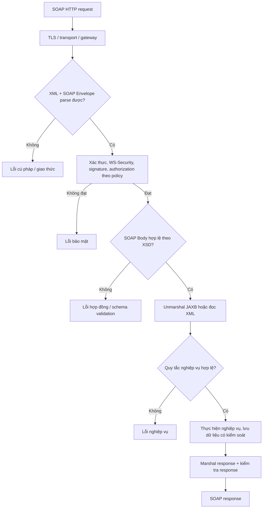

# XML đúng cú pháp, đúng XSD và đúng quy tắc nghiệp vụ là các mức khác nhau

## 1. Ba mức «đúng» của một thông điệp SOAP

Trong một dịch vụ **Spring Web Services (Spring-WS)** phát triển theo hướng **contract-first**, client gửi XML theo hợp đồng XSD/WSDL, phía server nhận và xử lý bằng endpoint Java. Nhưng một thông điệp có thể **đúng ở mức thấp hơn mà sai ở mức cao hơn**:

1. **XML đúng cú pháp (*well-formed*)**: XML parser đọc được cây XML theo quy tắc cú pháp của XML (thẻ đóng/mở, dấu nháy attribute, namespace binding, ký tự hợp lệ...).
2. **XML hợp lệ theo XSD (*schema-valid*)**: XML đã phân tích được, đồng thời đáp ứng mô hình dữ liệu XSD: tên và namespace của element, thứ tự, số lần xuất hiện, datatype, enum, facet, attribute bắt buộc, `xsi:nil`...
3. **Dữ liệu hợp lệ theo nghiệp vụ (*business-valid*)**: XML đã qua các kiểm tra cấu trúc nhưng nội dung còn phải tuân thủ quy tắc doanh nghiệp: tổng tiền bằng tổng dòng hàng, tài khoản được phép giao dịch, đơn hàng không trùng, trạng thái được chuyển hợp lệ, hàng còn tồn kho...

Ba mức tạo thành một chuỗi **điều kiện cần**, không phải ba cách gọi khác nhau của cùng một kiểm tra. Ví dụ:

- `<order><id>1</order>` sai cú pháp; không thể dùng schema hoặc service Java để suy luận nội dung.
- XML có đủ dấu mở/đóng nhưng chứa `<quantity>0</quantity>` trong khi XSD yêu cầu `xs:positiveInteger`: **well-formed nhưng XSD-invalid**.
- XML có `quantity=2`, `unitPrice=15000.00`, `declaredTotal=35000.00`: có thể **well-formed và XSD-valid**, nhưng **business-invalid** vì tổng tiền đúng phải là `30000.00`.

**Điểm quan trọng:** một SOAP request còn chịu các lớp kiểm tra **khác** như SOAP Envelope/version, xác thực, phân quyền, WS-Security, chữ ký X.509, chống replay và TLS. Những lớp bảo mật này không phải là «mức thứ tư» thay thế ba mức dữ liệu. Chúng là các điều kiện riêng để hệ thống được phép tin và xử lý thông điệp.

### Mục tiêu sau bài học

Bạn cần có khả năng:

- Phân loại lỗi thành sai cú pháp XML, sai XSD, sai nghiệp vụ hoặc sai bảo mật/giao thức.
- Thiết kế XSD contract-first với cấu trúc và datatype rõ ràng.
- Chỉ ra điều XSD có thể/không thể đảm bảo, kể cả những ràng buộc liên trường.
- Cấu hình `PayloadValidatingInterceptor` để Spring-WS kiểm tra request/response.
- Kết hợp JAXB, schema validation và domain validation mà không đánh đồng nhiệm vụ.
- Ánh xạ từng loại lỗi sang SOAP Fault ổn định, không làm lộ thông tin nội bộ.
- Viết kiểm thử âm tính theo ba mức và chạy kiểm thử liên thông với client bên ngoài.

Bài sử dụng dịch vụ minh họa **`SubmitOrder`** trong namespace `https://example.org/orders/v1`, gửi một đơn hàng có dòng hàng, đơn giá, số lượng và tổng tiền đã khai báo. Namespace này là **định danh XML**, không phải endpoint HTTP thật.

## 2. Đường đi của request: kiểm tra nào ở tầng nào?

Một request SOAP trong Spring-WS có thể đi qua các thành phần sau:



Sơ đồ là **mô hình trách nhiệm**, không khẳng định mọi ứng dụng có đúng thứ tự interceptor như vậy. Ví dụ, hạ tầng có thể xác thực TLS trước khi parse XML; một số WS-Security checks cần truy cập SOAP Header sau khi parse Envelope; schema validation có thể nằm trong interceptor trước endpoint hoặc trong binding layer. **Điểm bắt buộc** là không được thực hiện tác vụ nghiệp vụ nhạy cảm trên request chưa vượt qua các kiểm tra cần thiết.

| Tầng | Thành phần thường gặp | Kết quả mong đợi khi lỗi |
|---|---|---|
| Transport / HTTP | Gateway, TLS connector, `MessageDispatcherServlet` | Từ chối request sai transport, sai media type hoặc không xác thực |
| XML parsing | XML parser / SOAP message factory | Từ chối XML không well-formed |
| SOAP protocol | SOAP Envelope, Header, Body và binding | Phát hiện sai phiên bản Envelope, cấu trúc SOAP hoặc processing header |
| XSD | `PayloadValidatingInterceptor`, JAXP `Validator` | Từ chối XML Body không tuân thủ schema |
| OXM/JAXB | `Jaxb2Marshaller` hoặc JAXB endpoint method processing | Phát hiện lỗi bind kiểu Java, root QName hoặc converter |
| Domain | `OrdersService` và nghiệp vụ | Kiểm tra tiền, trạng thái, hạn mức, inventory, idempotency |
| Outbound | Response marshalling và schema validation | Không xuất response sai hợp đồng |
| Security | WS-Security interceptor, certificate/TLS, authorization | Từ chối thông điệp/định danh không được tin cậy |

**Đừng gộp tất cả thành một catch `Exception` rồi trả «XML không hợp lệ».** Việc phân loại giúp client biết nên sửa payload, liên hệ về quy tắc nghiệp vụ, hay báo lỗi server.

## 3. Mức 1: XML well-formed nghĩa là gì?

XML document hoặc fragment well-formed tuân thủ cú pháp XML. Các yêu cầu cơ bản:

- Mỗi element có thẻ đóng phù hợp hoặc là empty-element tag.
- Element được lồng đúng cách, không có hai root elements trong một document XML hoàn chỉnh.
- Giá trị attribute được đặt trong dấu nháy.
- Ký tự đặc biệt như `&` và `<` được escape đúng khi xuất hiện trong text hoặc attribute.
- Mọi prefix dùng trong element/attribute QName đều phải được gắn với namespace URI hợp lệ.
- Ký tự, encoding và XML declaration (nếu có) tuân thủ quy tắc XML.

### 3.1. XML sai cú pháp

**Thiếu dấu đóng phù hợp:**

```xml
<ord:SubmitOrderRequest xmlns:ord="https://example.org/orders/v1">
  <ord:clientOrderId>ORD-000123</ord:clientOrderId>
  <ord:customerId>CUST-01</ord:customerId>
  <ord:items>
</ord:SubmitOrderRequest>
```

Element `ord:items` chưa được đóng trước khi `SubmitOrderRequest` đóng, nên XML parser không thể xây dựng cây hợp lệ.

**Dùng dấu `&` chưa escape:**

```xml
<ord:customerId xmlns:ord="https://example.org/orders/v1">
  R&D
</ord:customerId>
```

Trong text XML, phải viết `R&amp;D` nếu thực sự muốn chuỗi chứa ký tự `&`.

**Prefix không được khai báo:**

```xml
<ord:SubmitOrderRequest>
  <ord:clientOrderId>ORD-000123</ord:clientOrderId>
</ord:SubmitOrderRequest>
```

Không có `xmlns:ord="..."` trong phạm vi XML; đây là lỗi namespace well-formedness.

### 3.2. XML well-formed chưa chắc đúng SOAP

Một payload XML có root `SubmitOrderRequest` có thể well-formed nhưng một HTTP request được công bố là SOAP lại không có SOAP Envelope, hoặc sử dụng namespace Envelope của SOAP 1.2 trong khi server chỉ chấp nhận SOAP 1.1. Đó là **lỗi giao thức SOAP**, không nhất thiết là lỗi XSD nghiệp vụ.

Ví dụ SOAP 1.1 Envelope:

```xml
<soap:Envelope
    xmlns:soap="http://schemas.xmlsoap.org/soap/envelope/"
    xmlns:ord="https://example.org/orders/v1">
  <soap:Header/>
  <soap:Body>
    <ord:SubmitOrderRequest>
      <!-- Các phần tử dữ liệu theo XSD -->
    </ord:SubmitOrderRequest>
  </soap:Body>
</soap:Envelope>
```

SOAP 1.2 dùng Envelope namespace khác, `http://www.w3.org/2003/05/soap-envelope`; media type và fault model cũng khác. Đừng cố chữa lỗi version mismatch bằng cách nới XSD của request.

### 3.3. Giới hạn trách nhiệm của parser

XML parser kiểm tra cú pháp, nhưng **không biết** `quantity` có bắt buộc dương, `currency` có bắt buộc hay tổng tiền có đúng không. Nếu XML vẫn well-formed, parser có thể trả cây DOM hoặc SAX/StAX events thành công ngay cả khi thông điệp hoàn toàn sai XSD.

Hơn nữa, việc parse được không có nghĩa an toàn: XML có DTD/external entity có thể gây XXE hoặc tiêu thụ tài nguyên nếu parser không được bảo vệ. XML security phải được cấu hình ở các tầng tiếp nhận thích hợp, không chờ đến domain validation.

## 4. Mức 2: Schema-valid nghĩa là gì?

**XML Schema Definition (XSD)** định nghĩa kiểu và cấu trúc của các element/attribute mà một thông điệp hợp lệ phải tuân theo. Đây là phần quan trọng của hợp đồng SOAP contract-first. WSDL mô tả operation và thông điệp; các `wsdl:part@element` thường trỏ đến global XML elements trong XSD cho kiểu document/literal.

Một XML được coi là hợp lệ theo **XSD cụ thể** khi:

1. XML đã được parse thành công và có root QName phù hợp với khai báo global element.
2. Các element con và attribute đúng tên, namespace, thứ tự, cardinality theo content model.
3. Giá trị lexical/value đúng các kiểu XSD dựng sẵn hoặc custom `simpleType`.
4. Các facet như `pattern`, `enumeration`, `minInclusive`, `fractionDigits` được thỏa mãn.
5. Các ràng buộc `minOccurs`, `maxOccurs`, `nillable`, `use="required"` được tuân thủ.

### 4.1. XSD mẫu cho SOAP `SubmitOrder`

Ví dụ sau tự chứa, sử dụng XML Schema 1.0, với các kiểu tiền tệ, số lượng, mã đơn, chi tiết dòng hàng và hai global elements cho request/response.

```xml
<?xml version="1.0" encoding="UTF-8"?>
<xs:schema xmlns:xs="http://www.w3.org/2001/XMLSchema"
           xmlns:tns="https://example.org/orders/v1"
           targetNamespace="https://example.org/orders/v1"
           elementFormDefault="qualified"
           attributeFormDefault="unqualified">

  <!-- Mã đơn: ORD- và đúng 6 chữ số -->
  <xs:simpleType name="OrderIdType">
    <xs:restriction base="xs:string">
      <xs:pattern value="ORD-[0-9]{6}"/>
    </xs:restriction>
  </xs:simpleType>

  <!-- Số lượng dương, tối đa một triệu -->
  <xs:simpleType name="QuantityType">
    <xs:restriction base="xs:positiveInteger">
      <xs:maxInclusive value="1000000"/>
    </xs:restriction>
  </xs:simpleType>

  <!-- Số tiền không âm, tối đa 12 chữ số, 2 số thập phân -->
  <xs:simpleType name="MoneyAmountType">
    <xs:restriction base="xs:decimal">
      <xs:totalDigits value="12"/>
      <xs:fractionDigits value="2"/>
      <xs:minInclusive value="0"/>
    </xs:restriction>
  </xs:simpleType>

  <xs:simpleType name="CurrencyType">
    <xs:restriction base="xs:token">
      <xs:enumeration value="VND"/>
      <xs:enumeration value="USD"/>
    </xs:restriction>
  </xs:simpleType>

  <!-- Giá trị text thập phân và một attribute currency -->
  <xs:complexType name="MoneyType">
    <xs:simpleContent>
      <xs:extension base="tns:MoneyAmountType">
        <xs:attribute name="currency"
                      type="tns:CurrencyType"
                      use="required"/>
      </xs:extension>
    </xs:simpleContent>
  </xs:complexType>

  <xs:complexType name="OrderLineType">
    <xs:sequence>
      <xs:element name="sku" type="xs:token"/>
      <xs:element name="quantity" type="tns:QuantityType"/>
      <xs:element name="unitPrice" type="tns:MoneyType"/>
    </xs:sequence>
  </xs:complexType>

  <xs:element name="SubmitOrderRequest">
    <xs:complexType>
      <xs:sequence>
        <xs:element name="clientOrderId"
                    type="tns:OrderIdType"/>
        <xs:element name="customerId" type="xs:token"/>
        <xs:element name="items">
          <xs:complexType>
            <xs:sequence>
              <xs:element name="item"
                          type="tns:OrderLineType"
                          minOccurs="1"
                          maxOccurs="unbounded"/>
            </xs:sequence>
          </xs:complexType>
        </xs:element>
        <xs:element name="declaredTotal"
                    type="tns:MoneyType"/>
        <xs:element name="note"
                    type="xs:string"
                    minOccurs="0"
                    nillable="true"/>
      </xs:sequence>
    </xs:complexType>
  </xs:element>

  <xs:element name="SubmitOrderResponse">
    <xs:complexType>
      <xs:sequence>
        <xs:element name="orderId" type="tns:OrderIdType"/>
        <xs:element name="acceptedAt" type="xs:dateTime"/>
      </xs:sequence>
    </xs:complexType>
  </xs:element>
</xs:schema>
```

Giải thích kỹ các ràng buộc:

| Cấu trúc trong XSD | Yêu cầu của XML |
|---|---|
| `OrderIdType` có `pattern` | `ORD-000123` hợp lệ, `ORD-123` không hợp lệ |
| `QuantityType` từ `xs:positiveInteger` | `quantity=1` hợp lệ, `quantity=0` hoặc âm không hợp lệ |
| `MoneyAmountType` | `unitPrice=15000.00` hợp lệ, `-1.00` không hợp lệ |
| `MoneyType` và required attribute | `<unitPrice currency="VND">...` hợp lệ, thiếu `currency` không hợp lệ |
| `CurrencyType` enum | `VND`, `USD` hợp lệ, `EUR` không có trong hợp đồng |
| `items/item minOccurs="1"` | Wrapper `items` không thể rỗng |
| `item maxOccurs="unbounded"` | Có thể có nhiều dòng hàng, giữ đúng thứ tự/schema |
| `note minOccurs="0"` | Cho phép không gửi phần tử `note` |
| `note nillable="true"` | Có thể gửi `<note xsi:nil="true"/>` với prefix/namespace đúng |
| `xs:sequence` | `clientOrderId` đứng trước `customerId`, sau đó đến `items`, `declaredTotal`, `note` |
| `elementFormDefault="qualified"` | Các local elements thuộc target namespace |
| `attributeFormDefault="unqualified"` | Attribute local `currency` **không prefix** |

**Giới hạn cố ý:** ví dụ chỉ định hai currency nhưng không tự xác minh rằng tất cả các dòng hàng dùng **cùng một currency** như tổng tiền; cũng không chứng minh tổng tiền bằng tổng từng dòng. Đây là quy tắc nghiệp vụ/liên trường cần kiểm tra riêng trong ví dụ Spring-WS này.

### 4.2. Một SOAP Body hợp lệ theo XSD

```xml
<ord:SubmitOrderRequest
    xmlns:ord="https://example.org/orders/v1"
    xmlns:xsi="http://www.w3.org/2001/XMLSchema-instance">
  <ord:clientOrderId>ORD-000123</ord:clientOrderId>
  <ord:customerId>CUST-01</ord:customerId>
  <ord:items>
    <ord:item>
      <ord:sku>BOOK-101</ord:sku>
      <ord:quantity>2</ord:quantity>
      <ord:unitPrice currency="VND">15000.00</ord:unitPrice>
    </ord:item>
  </ord:items>
  <ord:declaredTotal currency="VND">30000.00</ord:declaredTotal>
  <ord:note xsi:nil="true"/>
</ord:SubmitOrderRequest>
```

Request ở trên:

- Well-formed: các element đóng/mở, namespace binding và attribute syntax đúng.
- XSD-valid: QName, thứ tự phần tử, required fields, datatype và currency enum thỏa mãn.
- Business-valid **trong ví dụ giản lược** nếu khách hàng hợp lệ, sản phẩm được phép bán, còn hàng, đơn hàng chưa bị xử lý trước đó và tổng tiền là 30000.00 VND.

Ví dụ XML hiển thị **payload**, không phải toàn bộ SOAP Envelope. Khi gửi HTTP SOAP, client cần bao payload trong Envelope đúng phiên bản được WSDL binding công bố.

### 4.3. Well-formed nhưng XSD-invalid

**Số lượng không hợp lệ:**

```xml
<ord:quantity xmlns:ord="https://example.org/orders/v1">0</ord:quantity>
```

Đoạn trích là một element well-formed. Nếu xuất hiện tại vị trí `quantity` trong `OrderLineType`, nó không phù hợp `QuantityType` vì yêu cầu số nguyên dương. *Không nên nhận một fragment đơn lẻ làm bằng chứng kiểm thử toàn bộ request nếu schema không khai báo nó là global root.*

**Thiếu attribute bắt buộc:**

```xml
<ord:unitPrice xmlns:ord="https://example.org/orders/v1">
  15000.00
</ord:unitPrice>
```

Giá trị `15000.00` hợp lệ cho `xs:decimal` nhưng **thiếu `currency`**, nên không hợp lệ với `MoneyType`.

**Sai QName của attribute:**

```xml
<ord:unitPrice
    xmlns:ord="https://example.org/orders/v1"
    ord:currency="VND">15000.00</ord:unitPrice>
```

Attribute `ord:currency` không phải attribute `currency` **không namespace** mà XSD yêu cầu. XML well-formed nhưng thiếu required attribute đúng QName.

**Sai thứ tự theo `xs:sequence`:** trong một item, đặt `unitPrice` trước `quantity` là không hợp lệ, dù cả ba giá trị đều đúng kiểu.

**Sai `xsi:nil`:** `<ord:clientOrderId xsi:nil="true"/>` không hợp lệ vì `clientOrderId` không được khai báo `nillable="true"`.

**Nhầm phần tử thiếu và phần tử rỗng:** `<ord:items/>` không hợp lệ vì wrapper `items` bắt buộc chứa ít nhất một `item`. Khác với việc schema cho phép `items` hoàn toàn vắng mặt — ở ví dụ này `items` cũng bắt buộc.

### 4.4. XSD validation không phải một kiểu «thông minh»

XSD chủ yếu giúp kiểm chứng **hợp đồng dữ liệu**. Với XML Schema 1.0, nhiều quy tắc liên trường, phép tính tổng và điều kiện phụ thuộc trạng thái bên ngoài không thể biểu diễn trực tiếp bằng những facet thông thường.

XML Schema 1.1 bổ sung cơ chế mạnh hơn như `xs:assert` cho một số ràng buộc liên trường, nhưng **không được giả định** mọi JAXB/XSD validator hoặc SOAP toolchain trong Spring-WS hỗ trợ XSD 1.1. Hơn nữa, các điều kiện phụ thuộc database, inventory và quyền truy cập vẫn cần xử lý ở domain/security layer.

Với SOAP tích hợp nhiều đối tác, XSD 1.0 và business validation rõ ràng ở Java thường là lựa chọn thực dụng và dễ kiểm thử liên thông.

## 5. Mức 3: Business-valid nghĩa là gì?

Business validation trả lời: **«Dữ liệu có được chấp nhận để thực hiện nghiệp vụ ở thời điểm này không?»** Sau khi dữ liệu đã đúng hình dạng XSD, hệ thống còn cần kiểm tra mối quan hệ giữa các giá trị và trạng thái thực tế của doanh nghiệp.

Ví dụ request:

```xml
<ord:SubmitOrderRequest xmlns:ord="https://example.org/orders/v1">
  <ord:clientOrderId>ORD-000123</ord:clientOrderId>
  <ord:customerId>CUST-01</ord:customerId>
  <ord:items>
    <ord:item>
      <ord:sku>BOOK-101</ord:sku>
      <ord:quantity>2</ord:quantity>
      <ord:unitPrice currency="VND">15000.00</ord:unitPrice>
    </ord:item>
  </ord:items>
  <ord:declaredTotal currency="VND">35000.00</ord:declaredTotal>
</ord:SubmitOrderRequest>
```

**XML này well-formed và hợp lệ theo XSD ví dụ**. Nhưng tính toán `2 × 15000.00 = 30000.00`, trong khi `declaredTotal=35000.00`. Nếu hợp đồng nghiệp vụ yêu cầu hai giá trị khớp nhau, request phải bị từ chối ở lớp **domain validation**.

### 5.1. Ví dụ quy tắc nghiệp vụ

| Quy tắc | Vì sao XSD chưa đủ? | Nơi kiểm tra |
|---|---|---|
| Tổng tiền bằng tổng `quantity × unitPrice` | Quan hệ toán học giữa các phần tử con | Domain service |
| Tất cả dòng và tổng cùng currency | So sánh giá trị thuộc nhiều vị trí XML | Domain service |
| SKU thực sự tồn tại | Phụ thuộc catalog/database | Product/domain service |
| Khách hàng đang hoạt động | Phụ thuộc trạng thái tài khoản | Customer/domain service |
| Người gửi được đặt hàng cho customerId | Phụ thuộc danh tính và quyền được xác thực | Security + domain authorization |
| Hàng đủ tồn kho | Phụ thuộc dữ liệu thay đổi theo thời gian | Inventory service / transaction |
| Đơn trùng clientOrderId | Phụ thuộc lịch sử xử lý và idempotency | Domain + persistence uniqueness |
| Giá bán không bị giả mạo | Giá cần lấy từ nguồn tin cậy, không chỉ client input | Pricing service |
| Hạn mức thanh toán | Phụ thuộc mức tín dụng, quy định và chính sách | Business policy |
| Trạng thái đơn được chuyển tiếp | Phụ thuộc trạng thái hiện tại và workflow | Domain state machine |

**Schema-valid không đồng nghĩa được phép thực hiện giao dịch.** Phần business validation phải dựa trên **nguồn dữ liệu đáng tin**, nhất là với giá, quyền và trạng thái. Đừng chỉ kiểm tra số tiền nội bộ khớp nhau rồi mặc định giá client gửi là giá có thẩm quyền.

### 5.2. Business validation có thể thay đổi theo thời gian

Một request hoàn toàn hợp lệ hôm qua có thể bị từ chối hôm nay vì kho hàng đã hết hoặc khách hàng đã bị khóa. Đó không nhất thiết là thay đổi XSD, mà là **thay đổi trạng thái nghiệp vụ**. Giao diện SOAP nên trả lỗi nghiệp vụ có mã ổn định để client phân biệt:

- XML sai cấu trúc: client cần sửa payload.
- Đơn hàng hợp lệ về cấu trúc nhưng hết tồn kho: client có thể hiển thị lý do hoặc chọn cách xử lý khác.
- Lỗi hệ thống tạm thời: client cần phân biệt với lỗi nghiệp vụ trước khi quyết định retry.

Không khuyến khích phát minh một lỗi schema mới để diễn đạt tình trạng hết hàng hay quyền truy cập.

## 6. Bốn ví dụ cùng một operation: phân loại lỗi theo mức

| Trường hợp | XML well-formed? | XSD-valid? | Business-valid? | Lỗi được xử lý ở đâu? |
|---|---|---|---|---|
| A. Thẻ `items` không đóng | **Không** | Chưa thể đánh giá | Chưa thể đánh giá | XML parser / SOAP message factory |
| B. `quantity=0` | Có | **Không** | Không chạy | Schema validator |
| C. `quantity=2`, `unitPrice=15000.00`, `total=35000.00` | Có | Có | **Không** | Domain service |
| D. `quantity=2`, `unitPrice=15000.00`, `total=30000.00`, tồn kho/quyền hợp lệ | Có | Có | Có | Endpoint xử lý thành công |

Trong cột `Business-valid?`, giá trị «chưa thể đánh giá» hoặc «không chạy» phản ánh thiết kế đúng: không nên gọi service nghiệp vụ để quyết định request vốn đã sai XML/schema.

### 6.1. Phân loại lỗi từ thông điệp thực

Sử dụng trình tự:

1. HTTP request có đi đến đúng `MessageDispatcherServlet` không?
2. SOAP Envelope có được parse đúng phiên bản không?
3. WS-Security/TLS/authorization có đạt policy không?
4. SOAP Body root QName có đúng WSDL/XSD không?
5. Schema validator báo lỗi gì? Thiếu field, sai kiểu, enum, cardinality hay namespace?
6. JAXB/DOM mapping thành công chưa?
7. Domain service từ chối vì quy tắc gì?
8. Response hoặc SOAP Fault có đúng hợp đồng và được serialize hợp lệ không?

Đừng dùng nguyên HTTP status `500` để kết luận «lỗi Java» hay HTTP `400` để kết luận «lỗi schema»; behavior phụ thuộc SOAP version, transport, exception resolver và gateway.

## 7. Vai trò chính xác của JAXB và Spring OXM

JAXB giúp ánh xạ XML ↔ Java. Với `@RequestPayload` và `@ResponsePayload`, Spring-WS có thể dùng processor hỗ trợ JAXB-generated classes; Spring OXM còn có `Jaxb2Marshaller` cho SOAP client và một số đường xử lý.

**JAXB unmarshalling thành công không chứng minh XML schema-valid.** Một số facets, ví dụ `xs:pattern`, `fractionDigits`, `minInclusive`, có thể không được kiểm tra đầy đủ nếu schema validation không được bật/thiết lập riêng.

Ví dụ class Java có trường:

```java
private String clientOrderId;
private BigInteger quantity;
private BigDecimal unitPrice;
```

Chỉ từ việc Java fields nhận được giá trị không thể kết luận:

- `clientOrderId` khớp pattern `ORD-[0-9]{6}`.
- `quantity` lớn hơn 0 và không vượt giới hạn XSD.
- `unitPrice` có currency attribute bắt buộc.
- `declaredTotal` khớp tổng các dòng.
- Client có quyền đặt hàng.

**Schema validation** thực hiện phần đầu; **business validation** thực hiện phần quy tắc nghiệp vụ. Cấu hình `Jaxb2Marshaller#setSchema(...)` trong OXM là một lựa chọn kiểm tra XML ở binding layer, nhưng phải xác nhận **đường request Spring-WS endpoint thực sự sử dụng marshaller đó**. Đừng cho rằng một bean `Jaxb2Marshaller` được tạo cho `WebServiceTemplate` tự động validate mọi server endpoint.

### 7.1. Nếu JAXB class chứa Bean Validation annotations thì sao?

Có thể dùng `jakarta.validation` (ví dụ `@NotBlank`, `@Size`, custom constraint) cho Java objects. Tuy nhiên:

- Bean Validation **không thay thế XML schema validation**, vì Java annotations không bao quát QName, XML element order, `xsi:nil` và toàn bộ SOAP wire contract.
- Bean Validation cũng **không tự chạy** chỉ vì class có annotation. Cần gọi validator hoặc tích hợp cơ chế validation thích hợp trên đường thực thi.
- Cần cân nhắc tránh đặt nghiệp vụ phức tạp vào **generated JAXB classes**, vì chúng có thể bị ghi đè khi sinh mã từ XSD. Nên map sang domain DTO và validate ở domain layer.

Cách thiết kế rõ ràng là tách **contract model** (SOAP/JAXB) với **domain model** (nghiệp vụ), có adapter chuyển đổi và test tại ranh giới.

## 8. Thiết lập XSD validation trong Spring-WS

Một ứng dụng Spring Boot cung cấp SOAP endpoint có thể cấu hình `XsdSchema` và `PayloadValidatingInterceptor`. Dưới đây là ví dụ theo mô hình Java config.

### 8.1. Khai báo schema

Giả sử lưu XSD ở `src/main/resources/xsd/orders.xsd`:

```java
import org.springframework.context.annotation.Bean;
import org.springframework.context.annotation.Configuration;
import org.springframework.core.io.ClassPathResource;
import org.springframework.xml.xsd.SimpleXsdSchema;
import org.springframework.xml.xsd.XsdSchema;

@Configuration
public class OrdersSchemaConfiguration {

    @Bean
    public XsdSchema ordersSchema() {
        return new SimpleXsdSchema(
            new ClassPathResource("xsd/orders.xsd"));
    }
}
```

Bean này định nghĩa cách server tải XSD. Có XSD bean trong context **chưa có nghĩa mọi request được validate**. Cần gắn schema vào một validator được sử dụng ở SOAP processing pipeline.

### 8.2. Đăng ký `PayloadValidatingInterceptor`

```java
import java.util.List;
import org.springframework.context.annotation.Configuration;
import org.springframework.ws.config.annotation.EnableWs;
import org.springframework.ws.config.annotation.WsConfigurerAdapter;
import org.springframework.ws.server.EndpointInterceptor;
import org.springframework.ws.soap.server.endpoint.interceptor.PayloadValidatingInterceptor;
import org.springframework.xml.xsd.XsdSchema;

@EnableWs
@Configuration
public class OrdersValidationConfiguration
        extends WsConfigurerAdapter {

    private final XsdSchema ordersSchema;

    public OrdersValidationConfiguration(XsdSchema ordersSchema) {
        this.ordersSchema = ordersSchema;
    }

    @Override
    public void addInterceptors(List<EndpointInterceptor> interceptors) {
        PayloadValidatingInterceptor validator =
            new PayloadValidatingInterceptor();
        validator.setXsdSchema(ordersSchema);
        validator.setValidateRequest(true);
        validator.setValidateResponse(true);
        interceptors.add(validator);
    }
}
```

Ý nghĩa:

- `setValidateRequest(true)`: validate SOAP **payload trong Body** khi request đi qua interceptor.
- `setValidateResponse(true)`: validate SOAP response payload khi response đi qua đường xử lý và interceptor tương ứng.
- Schema dùng phải khớp **global root elements của request và response**.
- Cần đặt `@EnableWs`, interceptor registration và endpoint mapping vào đúng Spring ApplicationContext, đặc biệt trong WAR parent–child.
- Interceptor này không tự kiểm tra chữ ký WS-Security, quyền truy cập, business rules hoặc mọi SOAP Header.

**Chú ý:** interceptor validation chạy ở vị trí nào phụ thuộc cấu hình endpoint mappings/interceptor chain. Không xem việc khai báo bean là bằng chứng validation đã chạy. Hãy gửi request sai schema và xác minh endpoint/service **không được gọi**.

### 8.3. Servlet Spring-WS

Nếu dự án không dùng cơ chế auto-registration của Spring Boot, có thể đăng ký servlet rõ ràng:

```java
import org.springframework.boot.web.servlet.ServletRegistrationBean;
import org.springframework.context.ApplicationContext;
import org.springframework.context.annotation.Bean;
import org.springframework.context.annotation.Configuration;
import org.springframework.ws.transport.http.MessageDispatcherServlet;

@Configuration
public class OrdersServletConfiguration {

    @Bean
    public ServletRegistrationBean<MessageDispatcherServlet>
            soapServlet(ApplicationContext context) {

        MessageDispatcherServlet servlet =
            new MessageDispatcherServlet();
        servlet.setApplicationContext(context);
        servlet.setTransformWsdlLocations(false);

        return new ServletRegistrationBean<>(servlet, "/ws/*");
    }
}
```

Với cấu hình ví dụ, SOAP POST thường đến `/ws` và WSDL có thể được công bố qua `/ws/orders.wsdl` nếu đã cấu hình WSDL definition bean `orders`. Đăng ký servlet không tự sinh WSDL hoặc kích hoạt validation. Nếu starter đã tự đăng ký `MessageDispatcherServlet`, không đăng ký thêm một servlet cùng mapping mà không kiểm tra cơ chế auto-configuration.

### 8.4. Endpoint xử lý nghiệp vụ

```java
import org.springframework.ws.server.endpoint.annotation.Endpoint;
import org.springframework.ws.server.endpoint.annotation.PayloadRoot;
import org.springframework.ws.server.endpoint.annotation.RequestPayload;
import org.springframework.ws.server.endpoint.annotation.ResponsePayload;

@Endpoint
public class OrdersEndpoint {
    private static final String NS =
        "https://example.org/orders/v1";

    private final OrderApplicationService orderService;

    public OrdersEndpoint(OrderApplicationService orderService) {
        this.orderService = orderService;
    }

    @PayloadRoot(namespace = NS, localPart = "SubmitOrderRequest")
    @ResponsePayload
    public SubmitOrderResponse submit(
            @RequestPayload SubmitOrderRequest request) {

        SubmittedOrder result =
            orderService.submit(toDomainCommand(request));

        SubmitOrderResponse response = new SubmitOrderResponse();
        response.setOrderId(result.orderId());
        response.setAcceptedAt(
            toXmlDateTime(result.acceptedAt()));

        return response;
    }
}
```

Đây là **mẫu cấu trúc endpoint**, không phải file Java độc lập có thể biên dịch: `SubmitOrderRequest`/`SubmitOrderResponse` được sinh từ XSD; `toDomainCommand` và `toXmlDateTime` là adapter mapping cần triển khai theo JAXB model; `OrderApplicationService` và `SubmittedOrder` là domain types của ứng dụng. Nếu XJC sinh root bằng `JAXBElement` thay vì `@XmlRootElement`, cần dùng `ObjectFactory` và phương thức có kiểu phù hợp.

Điểm quan trọng: **XSD validation có thể chạy trước khi method được gọi**, còn domain validation diễn ra trong `orderService.submit(...)`. Nếu interceptor không chạy hoặc cấu hình sai, Java domain vẫn nên có các kiểm tra an toàn cốt lõi, nhưng đừng coi việc kiểm tra lại vài field là thay thế cho XSD.

## 9. Triển khai business validation ở tầng domain

Giả định XML đã được schema validate và ánh xạ thành domain command:

```java
import java.math.BigDecimal;
import java.math.BigInteger;
import java.util.List;

public record Money(String currency, BigDecimal amount) {}

public record OrderLine(
    String sku,
    BigInteger quantity,
    Money unitPrice
) {}

public record SubmitOrderCommand(
    String clientOrderId,
    String customerId,
    List<OrderLine> lines,
    Money declaredTotal
) {}
```

### 9.1. Kiểm tra currency và tổng tiền

```java
import java.math.BigDecimal;

public final class OrderBusinessValidator {

    public void validate(SubmitOrderCommand cmd) {
        if (cmd.lines() == null || cmd.lines().isEmpty()) {
            throw new OrderRuleViolation(
                "ORDER_EMPTY", "Order must have at least one item");
        }

        String totalCurrency = cmd.declaredTotal().currency();
        BigDecimal computedTotal = BigDecimal.ZERO;

        for (OrderLine line : cmd.lines()) {
            if (line.quantity() == null
                    || line.quantity().signum() <= 0) {
                throw new OrderRuleViolation(
                    "INVALID_QUANTITY", "Quantity must be positive");
            }
            if (!totalCurrency.equals(line.unitPrice().currency())) {
                throw new OrderRuleViolation(
                    "CURRENCY_MISMATCH", "Currencies do not match");
            }
            computedTotal = computedTotal.add(
                line.unitPrice().amount()
                    .multiply(new BigDecimal(line.quantity())));
        }

        if (computedTotal.compareTo(cmd.declaredTotal().amount()) != 0) {
            throw new OrderRuleViolation(
                "TOTAL_MISMATCH", "Declared total differs from items");
        }
    }
}
```

Ví dụ giả định `OrderRuleViolation` là một runtime exception domain riêng, nhận `code` và `message`. Trước khi dùng production phải có validation không-null và giới hạn kích thước cho tất cả field, chính sách currency/scale và mapping lỗi. Mẫu ở trên chỉ làm rõ **quy tắc liên trường**; không được xem là thư viện tính tiền hoàn chỉnh.

Tại sao dùng `BigDecimal`?

- `xs:decimal` thường được ánh xạ thành `BigDecimal` để giữ số thập phân chính xác.
- `double`/`float` có sai số biểu diễn nhị phân, không phù hợp làm nền tảng duy nhất cho số tiền.
- `compareTo(...) == 0` so sánh **giá trị số**, không yêu cầu cùng scale. Nếu nghiệp vụ có quy tắc về precision/rounding, phải kiểm tra thêm theo currency.
- Không làm tròn tự động để che dữ liệu sai: rounding phải theo hợp đồng và chính sách kế toán.

Trong thực tế, đơn giá cũng cần so với **bảng giá đáng tin** của server và kiểm tra chiết khấu/thuế, không chấp nhận đơn giá bất kỳ do client gửi chỉ vì tổng nội bộ khớp.

### 9.2. Kiểm tra độc lập với trạng thái hệ thống

```java
public SubmittedOrder submit(SubmitOrderCommand command) {
    businessValidator.validate(command);

    customerPolicy.assertCustomerCanOrder(command.customerId());
    inventoryPolicy.reserveItems(command.lines());
    idempotencyPolicy.assertNotProcessed(command.clientOrderId());

    // Lưu và phát hành event trong transaction/flow được thiết kế.
    return persistOrder(command);
}
```

Đây là **pseudocode domain flow**, không khẳng định thứ tự trên an toàn cho mọi hệ thống. Trong production cần giải quyết race conditions, transaction boundaries, hàng tồn kho thay đổi đồng thời, idempotency key uniqueness và rollback/compensation. Ví dụ «kiểm tra chưa trùng rồi lưu» mà không có database unique constraint hoặc transaction phù hợp vẫn có thể tạo đơn trùng khi hai request đến cùng lúc.

Domain validation cần hoạt động đúng cả với các đường vào **ngoài SOAP**, chẳng hạn batch jobs hoặc REST API dùng chung service. XSD chỉ bảo vệ một giao diện XML cụ thể; domain invariants nên có ở nơi mọi đường ghi dữ liệu đều đi qua.

## 10. XSD validation và SOAP Fault

Spring-WS có thể trả SOAP Fault cho nhiều loại lỗi. Phân loại fault là một phần của hợp đồng tích hợp: client cần biết có nên sửa XML, chỉnh dữ liệu nghiệp vụ, thay credential hay retry.

### 10.1. Khác biệt giữa ba mức lỗi

| Loại lỗi | Ví dụ | Bản chất | Gợi ý phản hồi |
|---|---|---|---|
| XML sai cú pháp | Sai thẻ đóng, prefix không khai báo | Không parse được | Lỗi request/protocol; không chạy endpoint |
| XSD-invalid | `quantity=0`, thiếu `currency` | Không tuân thủ hợp đồng XML | SOAP Fault cho invalid request |
| Business-invalid | `TOTAL_MISMATCH`, `OUT_OF_STOCK` | XML đúng nhưng giao dịch không được chấp nhận | SOAP Fault nghiệp vụ hoặc response lỗi theo WSDL |
| Lỗi hệ thống | Database timeout, lỗi internal mapping | Server không xử lý được | SOAP Fault server, không lộ stack trace |
| Security-invalid | Chữ ký sai, certificate hết hạn | Không được tin cậy/không có quyền | Chặn theo transport/security policy |

### 10.2. SOAP 1.1 và SOAP 1.2 khác nhau

Trong SOAP 1.1, các fault codes chuẩn thường thấy:

- `Client`: thông điệp đầu vào có lỗi phía client, tùy cách resolver áp dụng.
- `Server`: xử lý ở phía server thất bại.
- `VersionMismatch`: Envelope namespace/phiên bản không phù hợp.
- `MustUnderstand`: header bắt buộc không được xử lý.

SOAP 1.2 dùng hệ fault code khác, chẳng hạn `Sender` và `Receiver` thay cho cách gọi `Client`/`Server`, và có cấu trúc Fault khác. **Không viết cố định fault XML của SOAP 1.1 khi service dùng SOAP 1.2**.

Mã lỗi HTTP cụ thể chịu ảnh hưởng SOAP binding, SOAP fault mapping, servlet/container, gateway và các quy ước tích hợp. Đừng gắn quy tắc «mọi business validation error luôn trả HTTP 400» mà chưa kiểm tra chuẩn SOAP và hợp đồng hiện hành.

### 10.3. Typed fault theo contract-first

Nếu WSDL công bố một `wsdl:fault` với XML detail được định nghĩa trong XSD, cần xây SOAP fault detail **đúng element QName và schema**. Ví dụ lỗi nghiệp vụ có thể dùng:

```xml
<ord:BusinessFault xmlns:ord="https://example.org/orders/v1">
  <ord:code>TOTAL_MISMATCH</ord:code>
  <ord:message>Declared total does not match the order lines</ord:message>
</ord:BusinessFault>
```

Đây chỉ là **fragment minh họa fault detail**. Muốn dùng làm hợp đồng thật, phải khai báo `BusinessFault` trong XSD và `wsdl:fault`/SOAP fault binding tương ứng, và cấu hình exception resolver tạo detail phù hợp. **Không** nhúng fragment này vào WSDL đang phê duyệt nếu chưa qua quy trình thay đổi hợp đồng.

Spring-WS cung cấp các cơ chế exception resolver như `SoapFaultAnnotationExceptionResolver`, `SoapFaultMappingExceptionResolver` hoặc resolver tùy biến để ánh xạ exception sang SOAP Fault. Việc chọn và cấu hình phải kiểm tra trên version Spring-WS đang dùng. Interceptor validation có thể tạo fault cho lỗi XSD trước khi endpoint chạy; domain exception mapper xử lý lỗi nghiệp vụ sau khi endpoint được gọi.

### 10.4. Không tiết lộ dữ liệu nhạy cảm

Không trả về client:

- Stack trace Java hoặc đường dẫn file XSD nội bộ.
- Nội dung SQL, credential, database host hay khóa/chứng chỉ.
- Toàn bộ SOAP request chứa thông tin cá nhân.
- Thông tin xác thực của khách hàng khác.
- Chi tiết phân quyền nội bộ hoặc kết quả kiểm tra security đủ giúp kẻ tấn công suy đoán hệ thống.

Response nên có mã lỗi nghiệp vụ ổn định, message an toàn, correlation ID nếu được phê duyệt. Log nội bộ có thể ghi chi tiết hơn nhưng vẫn phải redact/giới hạn quyền.

## 11. Kiểm thử XSD độc lập với server

Trước khi chạy Spring-WS, nên kiểm tra XSD và XML fixtures bằng JAXP `SchemaFactory`/`Validator`. Điều này cô lập **lỗi hợp đồng XML** khỏi lỗi servlet, endpoint mapping hoặc business service.

### 11.1. Ví dụ Java dùng JAXP

```java
import java.io.File;
import javax.xml.XMLConstants;
import javax.xml.transform.stream.StreamSource;
import javax.xml.validation.Schema;
import javax.xml.validation.SchemaFactory;
import javax.xml.validation.Validator;

public final class XmlSchemaChecker {

    public static void validate(File schemaFile, File xmlFile)
            throws Exception {

        SchemaFactory factory = SchemaFactory.newInstance(
            XMLConstants.W3C_XML_SCHEMA_NS_URI);

        factory.setFeature(
            XMLConstants.FEATURE_SECURE_PROCESSING, true);
        factory.setProperty(XMLConstants.ACCESS_EXTERNAL_DTD, "");
        factory.setProperty(XMLConstants.ACCESS_EXTERNAL_SCHEMA, "");

        Schema schema = factory.newSchema(schemaFile);
        Validator validator = schema.newValidator();

        validator.setProperty(XMLConstants.ACCESS_EXTERNAL_DTD, "");
        validator.setProperty(XMLConstants.ACCESS_EXTERNAL_SCHEMA, "");
        validator.validate(new StreamSource(xmlFile));
    }
}
```

Ở đây, `schemaFile` là XSD được phê duyệt, `xmlFile` nên là **XML payload có global root được XSD khai báo** (ví dụ `SubmitOrderRequest`), không phải toàn bộ SOAP Envelope nếu schema không định nghĩa Envelope.

Nếu `Validator#validate(...)` gặp dữ liệu sai, nó có thể ném `SAXParseException` hoặc exception validation phù hợp. Trong test, nên khẳng định *ca kiểm thử không hợp lệ bị từ chối*, tránh phụ thuộc hoàn toàn vào câu chữ lỗi của một parser cụ thể.

### 11.2. Schema import/include và resource resolution

Bài mẫu chỉ có một XSD tự chứa. Trong hợp đồng thực có thể có:

```xml
<xs:import namespace="https://example.org/common/v1"
           schemaLocation="common.xsd"/>
```

Nếu tắt truy cập schema bên ngoài bằng `ACCESS_EXTERNAL_SCHEMA=""`, cần giải quyết import/include bằng **resource resolver hoặc XML catalog tin cậy**. Không bật tải mọi schema từ internet tùy ý chỉ để test nhanh; điều đó tạo dependency mạng và nguy cơ đọc resource ngoài ý muốn.

Nếu WSDL đã được ký duyệt, XSD được import cũng là một phần của gói hợp đồng cần quản lý version/checksum. Thay XSD trong classpath mà không kiểm soát cũng có thể làm server chấp nhận payload khác với client mong đợi.

### 11.3. Một file XML well-formed không phải fixture đủ

Test tốt cần có ít nhất ba loại fixture:

- **Malformed XML:** parser phải từ chối; schema validator không nhất thiết được gọi.
- **Well-formed, XSD-invalid:** parser chấp nhận, validator từ chối.
- **Well-formed, XSD-valid, business-invalid:** validator chấp nhận, domain validator từ chối.

Nếu test chỉ có XML hợp lệ, rất khó chứng minh validation interceptor thực sự được bật.

## 12. Kiểm thử bằng MockWebServiceClient

Spring-WS cung cấp `MockWebServiceClient` để gửi request tới Spring-WS pipeline trong ApplicationContext test mà không cần start HTTP server. Nó hữu ích để chứng minh **request sai XSD bị chặn trước domain service**.

### 12.1. Kiểm thử happy path

Ví dụ minh họa dùng Spring Boot/JUnit 5 và `spring-ws-test`. Để không phụ thuộc giá trị `acceptedAt` được tạo động, ví dụ chỉ kiểm tra request hợp lệ **không gây SOAP Fault**; cần bổ sung test riêng kiểm tra payload response theo XSD và các trường nghiệp vụ.

```java
import org.junit.jupiter.api.Test;
import org.springframework.beans.factory.annotation.Autowired;
import org.springframework.boot.test.context.SpringBootTest;
import org.springframework.context.ApplicationContext;
import org.springframework.ws.test.server.MockWebServiceClient;
import org.springframework.xml.transform.StringSource;

import static org.springframework.ws.test.server.RequestCreators.withPayload;
import static org.springframework.ws.test.server.ResponseMatchers.noFault;

@SpringBootTest
class SubmitOrderEndpointTest {

    @Autowired
    ApplicationContext context;

    @Test
    void validOrderIsAccepted() {
        MockWebServiceClient client =
            MockWebServiceClient.createClient(context);

        String request = """
            <ord:SubmitOrderRequest xmlns:ord="https://example.org/orders/v1">
              <ord:clientOrderId>ORD-000123</ord:clientOrderId>
              <ord:customerId>CUST-01</ord:customerId>
              <ord:items>
                <ord:item>
                  <ord:sku>BOOK-101</ord:sku>
                  <ord:quantity>2</ord:quantity>
                  <ord:unitPrice currency="VND">15000.00</ord:unitPrice>
                </ord:item>
              </ord:items>
              <ord:declaredTotal currency="VND">30000.00</ord:declaredTotal>
            </ord:SubmitOrderRequest>
            """;

        client.sendRequest(withPayload(new StringSource(request)))
              .andExpect(noFault());
    }
}
```

Đây chỉ là **smoke test**: cần bổ sung service fixture, matcher/assertion kiểm tra QName và nội dung `SubmitOrderResponse`, cùng response XSD validation. `noFault()` đơn lẻ không chứng minh response hợp lệ theo hợp đồng.

### 12.2. Kiểm thử âm tính có ý nghĩa hơn

Cấu hình `OrdersService` fake/mocked có bộ đếm số lần được gọi. Gửi `quantity=0` nhưng payload khác vẫn hợp lệ về XML. Kiểm tra:

1. SOAP request bị từ chối bởi interceptor/schema validation.
2. Service nghiệp vụ **không được gọi**.
3. SOAP Fault xuất hiện và không lộ stack trace.
4. Correlation ID/diagnostics phù hợp với logging policy.

Tương tự, gửi request XSD-valid với total mismatch:

1. Schema validator **chấp nhận** XML.
2. Endpoint và domain validator được gọi.
3. Domain ném `OrderRuleViolation("TOTAL_MISMATCH", ...)`.
4. SOAP fault mapper tạo mã lỗi nghiệp vụ ổn định.

Như vậy, hai test phủ định không chỉ kiểm tra kết quả cuối, mà còn phân biệt **đường thực thi** của lỗi XSD và lỗi nghiệp vụ.

### 12.3. Bên ngoài ứng dụng vẫn cần HTTP test

`MockWebServiceClient` không thay thế kiểm thử HTTP/servlet/proxy, SOAPAction, SOAP 1.1/1.2 media type, TLS/mTLS và real WS-Security. Với dịch vụ công bố công khai cần có test qua URL thực và ít nhất một client từ stack khác nếu tích hợp liên hệ thống.

## 13. Validation trên response cũng quan trọng

Phần lớn ví dụ nhấn mạnh request validation, nhưng **response sai schema cũng làm client bị hỏng**:

- Server trả `SubmitOrderResponse` thiếu `orderId` bắt buộc.
- `acceptedAt` có format ngày không đúng `xs:dateTime`.
- JAXB serialize khác namespace so với WSDL.
- Response trả enum mới ngoài schema client cũ.
- Response SOAP Body có sai thứ tự phần tử.

`PayloadValidatingInterceptor#setValidateResponse(true)` có thể giúp phát hiện response không hợp lệ khi nó đi qua interceptor tương ứng. Tuy nhiên:

- Phải cấu hình XSD chứa **response root**.
- Validation trong production có chi phí và cần đánh giá tác động; không nên tắt test validation để cải thiện hiệu năng rồi để lỗi lọt ra ngoài.
- Đừng dùng response validation như lớp duy nhất đảm bảo nghiệp vụ: response có cấu trúc đúng nhưng dữ liệu sai trạng thái vẫn có thể xảy ra.
- Nếu response invalid, cần giám sát và tạo phản hồi lỗi an toàn thay vì phát response sai XSD cho đối tác.

### 13.1. Client-side validation

SOAP client Spring-WS dùng `WebServiceTemplate` có thể dùng `Jaxb2Marshaller` và cấu hình schema validation ở OXM layer. Điều này giúp phát hiện response sai schema từ đối tác, đặc biệt trong tích hợp với hệ thống cũ.

Nhưng client-side JAXB schema validation chỉ hoạt động nếu **marshaller/unmarshaller đang dùng đã được cấu hình đúng**, và toàn bộ schema dependencies được resolve. Không giả định Java object tạo thành công đồng nghĩa SOAP response đã đạt XSD.

## 14. Bảo mật XML: trước cả khi nói đến schema

### 14.1. Parser hardening

Một XML document có thể **well-formed và hợp lệ về mặt parser** nhưng gây nguy hiểm nếu DTD/external entities được xử lý không kiểm soát. Khi tạo parser JAXP trực tiếp từ nguồn không tin cậy, cần chặn XXE:

```java
import javax.xml.XMLConstants;
import javax.xml.parsers.DocumentBuilderFactory;

DocumentBuilderFactory factory =
    DocumentBuilderFactory.newInstance();

factory.setNamespaceAware(true);
factory.setFeature(
    XMLConstants.FEATURE_SECURE_PROCESSING, true);
factory.setFeature(
    "http://apache.org/xml/features/disallow-doctype-decl", true);
factory.setFeature(
    "http://xml.org/sax/features/external-general-entities", false);
factory.setFeature(
    "http://xml.org/sax/features/external-parameter-entities", false);
factory.setXIncludeAware(false);
factory.setExpandEntityReferences(false);
factory.setAttribute(XMLConstants.ACCESS_EXTERNAL_DTD, "");
factory.setAttribute(XMLConstants.ACCESS_EXTERNAL_SCHEMA, "");
```

Các tính năng cụ thể được hỗ trợ phụ thuộc XML parser/JDK/provider. Trong hệ thống xử lý dữ liệu không tin cậy, cấu hình nên **fail closed** nếu một thiết lập an toàn bắt buộc không được hỗ trợ, thay vì bỏ qua exception rồi dùng parser không an toàn.

Ngoài ra cần:

- Giới hạn dung lượng SOAP request, độ sâu XML, số lượng phần tử và thời gian xử lý.
- Quản lý bộ XSD/WSDL được phép dùng; không chấp nhận `xsi:schemaLocation` từ client làm nguồn schema tùy ý.
- Tránh XML parsing nhiều lần không cần thiết trên cùng payload lớn.
- Không đưa XML payload có dữ liệu thật vào log unrestricted.
- Xử lý XML Signature Wrapping đúng cách trong WS-Security: không chỉ xác minh có chữ ký, mà phải chắc chắn **phần nội dung business endpoint xử lý là phần được bảo vệ theo policy**.

### 14.2. WS-Security không phải schema validation

Một request XML có thể schema-valid nhưng chữ ký WS-Security sai, timestamp quá hạn, token thiếu hoặc client certificate không hợp lệ. Ngược lại, một SOAP message có chữ ký hợp lệ không chứng minh `quantity` dương hay tổng tiền đúng.

Phân tách rõ:

- **Data contract:** XSD.
- **Business logic:** domain rules.
- **Authentication/authorization:** identity, security policies, trusted credentials.
- **Message integrity/confidentiality:** WS-Security ký/mã hóa, TLS/mTLS.

Với quy trình nhận dữ liệu thật, phải bảo đảm security checks phù hợp được thực hiện **trước khi** thực hiện nghiệp vụ và trước khi tin bất kỳ giá trị nào dùng để quyết định quyền.

### 14.3. Chống «lách» validation bằng cấu hình thiếu

Khai báo một `PayloadValidatingInterceptor` bean trong Spring context không đủ nếu nó chưa được đăng ký vào endpoint mappings đang nhận request. Đặc biệt khi WAR có parent/child ApplicationContexts hoặc nhiều servlet, phải kiểm tra pipeline thực. Một XSD file tồn tại trong classpath cũng không tự động được áp dụng.

Dùng test âm tính nhằm phát hiện đường bypass: request sai XSD không được phép đến service và security-invalid request không được phép đến business method nhạy cảm.

## 15. Đặc biệt lưu ý về SOAP contract-first và tiến hóa schema

Thay đổi schema có thể làm client cũ thất bại ngay cả khi server code vẫn chạy.

| Thay đổi | Rủi ro |
|---|---|
| Thêm required element | Client cũ thiếu field sẽ không validate |
| Đổi `minOccurs="0"` thành `1` | Biến field optional thành bắt buộc |
| Đổi element thành attribute | Thay wire format và QName |
| Đổi `targetNamespace` | Root QName thay đổi, client JAXB có thể không map được |
| Thu hẹp pattern/range | XML từng hợp lệ trở thành không hợp lệ |
| Thêm enum value | Client sinh enum tĩnh có thể không hiểu response mới |
| Bỏ `nillable="true"` | XML gửi `xsi:nil` không còn hợp lệ |
| Thay `soap:address` | Không nhất thiết đổi XSD nhưng có thể gây lỗi kết nối |
| Thay SOAP 1.1 bằng SOAP 1.2 | Khác Envelope, media type, fault, action |
| Thay business rule | Có thể đổi hành vi chấp nhận request dù XSD không đổi |

Một thay đổi chỉ được đánh giá **tương thích** sau khi test với client hiện hữu và profile tích hợp. Đừng chỉ nhìn vào chuyện «thêm field optional» mà mặc định client nào cũng chấp nhận XML mới.

Trong hệ thống dùng XSD/WSDL đã được phê duyệt, cần quản lý version, checksum, test fixtures và ký duyệt cho mỗi lần thay đổi. Nếu business rule thay đổi mà XML contract giữ nguyên, vẫn cần thông báo thay đổi hành vi, mã lỗi và kỳ vọng retry/idempotency nếu tác động đối tác.

## 16. Ma trận kiểm thử đủ ba mức

| # | Dữ liệu hoặc tình huống | XML parser | XSD validator | Domain/security |
|---|---|---|---|---|
| 1 | Request chuẩn: 2 × 15000.00 = 30000.00 | PASS | PASS | PASS nếu quyền/hàng đủ |
| 2 | Thiếu thẻ đóng | FAIL | Không đánh giá | Không gọi |
| 3 | Dấu `&` chưa escape | FAIL | Không đánh giá | Không gọi |
| 4 | Prefix `ord` chưa khai báo | FAIL | Không đánh giá | Không gọi |
| 5 | Wrong SOAP Envelope version | Parse XML có thể PASS | Payload có thể hợp XSD | SOAP protocol từ chối |
| 6 | Sai root namespace nghiệp vụ | PASS | FAIL | Không gọi |
| 7 | Thiếu `clientOrderId` | PASS | FAIL | Không gọi |
| 8 | `clientOrderId=ORD-123` | PASS | FAIL pattern | Không gọi |
| 9 | `quantity=0` | PASS | FAIL positiveInteger | Không gọi |
| 10 | `quantity=-1` | PASS | FAIL positiveInteger | Không gọi |
| 11 | `quantity=1000001` | PASS | FAIL maxInclusive | Không gọi |
| 12 | `unitPrice=-1.00` | PASS | FAIL minInclusive | Không gọi |
| 13 | `unitPrice=1.234` | PASS | FAIL fractionDigits | Không gọi |
| 14 | `currency=EUR` | PASS | FAIL enumeration | Không gọi |
| 15 | Thiếu `currency` attribute | PASS | FAIL required attribute | Không gọi |
| 16 | `ord:currency` thay `currency` | PASS | FAIL QName attribute | Không gọi |
| 17 | Wrapper `items` rỗng | PASS | FAIL required item | Không gọi |
| 18 | Đổi thứ tự `quantity` và `unitPrice` | PASS | FAIL sequence | Không gọi |
| 19 | `note` hoàn toàn vắng mặt | PASS | PASS | Tùy nghiệp vụ |
| 20 | `note xsi:nil="true"` | PASS | PASS | Tùy nghiệp vụ |
| 21 | `clientOrderId xsi:nil="true"` | PASS | FAIL nillable | Không gọi |
| 22 | Tổng khai báo 35000.00 thay vì 30000.00 | PASS | PASS | FAIL TOTAL_MISMATCH |
| 23 | Currency các dòng khác declaredTotal | PASS | PASS | FAIL CURRENCY_MISMATCH |
| 24 | SKU không tồn tại trong catalog | PASS | PASS | FAIL nghiệp vụ |
| 25 | Customer bị khóa | PASS | PASS | FAIL nghiệp vụ |
| 26 | Trùng `clientOrderId` đã xử lý | PASS | PASS | Idempotency/domain quyết định |
| 27 | Chữ ký WS-Security sai | XML có thể PASS | XSD có thể PASS | Security FAIL |
| 28 | Không có quyền customerId | PASS | PASS | Authorization FAIL |
| 29 | Response thiếu `acceptedAt` | PASS | FAIL response XSD | Không phát response sai |
| 30 | WSDL/XSD version lệch client | XML có thể PASS | Có thể FAIL | Interoperability test cần phát hiện |

### 16.1. Ba test phủ định phải là ba test khác nhau

Thay vì viết một test `assertThrows(Exception.class)` cho mọi lỗi, nên có:

1. **Parser negative test:** request malformed; khẳng định không đi vào schema/domain.
2. **Schema negative test:** `quantity=0`, XML vẫn parse được; khẳng định schema validator từ chối và service không được gọi.
3. **Business negative test:** tổng sai, XSD validator chấp nhận; khẳng định domain ném mã nghiệp vụ `TOTAL_MISMATCH` và được ánh xạ thành lỗi contract phù hợp.

Có thể thêm security negative test để chứng minh request không xác thực không đến domain service, bất kể XML hợp lệ.

### 16.2. Test response và fault

Không chỉ kiểm tra request. Hãy:

- Validate SOAP response thành công theo global element `SubmitOrderResponse`.
- Validate business fault detail theo XSD/WSDL nếu hợp đồng công bố typed fault.
- Kiểm tra SOAP 1.1/1.2 fault code phù hợp binding.
- Kiểm tra localization/message không làm thay đổi mã lỗi ổn định.
- Xác nhận dữ liệu nhạy cảm không bị leak.
- Kiểm tra schema validation phản ứng đúng khi response bị serializer làm sai thứ tự/QName.

## 17. Thực hành: thiết kế pipeline validation cho `SubmitOrder`

Bài thực hành có thể thực hiện theo thứ tự:

1. **Tạo XSD:** sử dụng schema ở mục 4; giữ file và snapshot XML mẫu trong version control.
2. **Tạo XML mẫu:** một request hợp lệ, một malformed, một XSD-invalid và một business-invalid.
3. **Kiểm tra JAXP:** dùng `SchemaFactory`/`Validator` đối chiếu XML với XSD để chứng minh kết quả của từng mẫu.
4. **Sinh JAXB:** sinh request/response classes từ XSD; xác nhận root QName, `ObjectFactory` và JAXB package đúng.
5. **Tạo Spring-WS servlet và endpoint:** `@EnableWs`, `@Endpoint`, `@PayloadRoot`, `@RequestPayload`, `@ResponsePayload` trong context thực.
6. **Đăng ký `PayloadValidatingInterceptor`:** validate request và response theo schema đã duyệt.
7. **Viết `OrderBusinessValidator`:** kiểm tra cùng currency và tổng tiền, đưa quy tắc giá/khách hàng/tồn kho vào domain policy phù hợp.
8. **Cấu hình SOAP Fault:** có mã cho lỗi schema, lỗi nghiệp vụ và lỗi server; bảo đảm khớp typed fault nếu WSDL khai báo.
9. **Kiểm thử pipeline bằng MockWebServiceClient:** dùng service spy/mock chứng minh request sai schema không gọi domain, request sai nghiệp vụ đi đến domain rồi bị từ chối.
10. **Kiểm thử transport:** gửi SOAP 1.1/1.2 đúng binding qua HTTP, kiểm tra WSDL, SOAPAction, TLS và gateway.
11. **Kiểm thử bảo mật:** chữ ký/timestamp sai, cert không hợp lệ và authorization fail không được thực hiện nghiệp vụ.
12. **Kiểm thử liên thông:** dùng ít nhất một SOAP client khác nền tảng sinh từ WSDL và chạy bộ XML mẫu cùng fault cases.

### Câu hỏi tự kiểm tra

1. XML well-formed nhưng thiếu `quantity` có thể được parser chấp nhận không? XSD có chấp nhận không?
2. Vì sao `quantity=2` và `unitPrice=15000.00` với `declaredTotal=35000.00` có thể XSD-valid?
3. Một `Jaxb2Marshaller` unmarshal được request chứng minh được mức validation nào?
4. `@Valid` và Jakarta Bean Validation có thay thế XML Schema validation không?
5. Tại sao `@PayloadRoot` khớp QName không chứng minh request hợp lệ theo toàn bộ XSD?
6. Nếu `PayloadValidatingInterceptor` bean tồn tại nhưng không được gắn vào mapping, test nào sẽ phát hiện?
7. SOAP 1.1 `Client` fault và SOAP 1.2 `Sender` fault có giống cách biểu diễn XML không?
8. Vì sao lỗi trùng đơn cần idempotency/uniqueness chứ không thể chỉ kiểm tra pattern ID?
9. Khi nào cần schema validation ở SOAP client bên ngoài, không chỉ server?
10. Request có chữ ký hợp lệ nhưng total sai nên bị từ chối ở lớp nào?
11. Tại sao schema XSD 1.1 có thêm assertion vẫn không thay thế kiểm tra tồn kho và quyền?
12. Vì sao không nên trả nguyên văn `SAXParseException` hoặc stack trace cho SOAP consumer?

## 18. Checklist để đưa validation vào tích hợp doanh nghiệp

- [ ] Phân biệt rõ **XML parsing**, **XSD validation**, **business validation** và **security validation**.
- [ ] XSD/WSDL được phê duyệt và version hóa; global request/response/fault QName nhất quán.
- [ ] XML parser chống DTD/XXE, giới hạn payload và không tải schema/entity từ nguồn không đáng tin.
- [ ] Server bật schema validation trên **request pipeline thực sự sử dụng**, test âm tính chứng minh interceptor được gọi.
- [ ] SOAP response/fault cũng được validate hoặc kiểm thử với XSD/WSDL, không chỉ request.
- [ ] JAXB context/`ObjectFactory`/`JAXBElement` phù hợp kiểu root và version `javax`/`jakarta`.
- [ ] Domain validation dùng các nguồn tin cậy; không dựa hoàn toàn vào giá/permission do client khai.
- [ ] Các phép tính tiền dùng `BigDecimal` cùng quy tắc currency/scale/rounding rõ ràng.
- [ ] Idempotency, transaction và kiểm soát race condition có cơ chế tại persistence/infrastructure khi cần.
- [ ] SOAP Fault phân loại lỗi contract/business/server/security đúng SOAP binding, không lộ dữ liệu nhạy cảm.
- [ ] Có test mẫu malformed, XSD-invalid, business-invalid, security-invalid và happy path; service không được gọi với request bị từ chối sớm.
- [ ] Có HTTP integration và interoperability tests với client khác stack, WSDL/XSD imports và certificate.
- [ ] CI phát hiện thay đổi bất ngờ trong XSD/WSDL, schema validation và hành vi nghiệp vụ công bố.

**Ghi nhớ:** *Well-formed XML* trả lời **«parser có đọc được không?»**; *XSD-valid XML* trả lời **«cấu trúc và kiểu dữ liệu có đúng hợp đồng không?»**; *business-valid data* trả lời **«thông điệp này có được phép trở thành giao dịch hợp lệ ở thời điểm hiện tại không?»**. Spring-WS ổn định cần kiểm chứng cả ba, đồng thời thực thi bảo mật và trả SOAP Fault nhất quán.

## 19. Tài liệu tham khảo

- [W3C — Extensible Markup Language (XML) 1.0](https://www.w3.org/TR/xml/): quy tắc well-formedness, cú pháp, entity và cấu trúc XML.
- [W3C — XML Namespaces 1.0](https://www.w3.org/TR/xml-names/): QName, namespace URI và cách ràng buộc prefix.
- [W3C — XML Schema Part 1: Structures, Second Edition](https://www.w3.org/TR/xmlschema-1/): element/attribute, sequence, cardinality, nillable, schema validity.
- [W3C — XML Schema Part 2: Datatypes, Second Edition](https://www.w3.org/TR/xmlschema-2/): simple types, positiveInteger, decimal, enum, regex và facets.
- [W3C — XML Schema 1.1 Part 1: Structures](https://www.w3.org/TR/xmlschema11-1/): assertions nâng cao; chỉ dùng khi validator/toolchain hỗ trợ.
- [W3C — Web Services Description Language 1.1](https://www.w3.org/TR/wsdl.html): hợp đồng SOAP message, operation và binding.
- [Spring Web Services — Reference Documentation](https://docs.spring.io/spring-ws/docs/current/reference/html/): contract-first, SOAP endpoints, validation, interceptors, faults và security.
- [Spring Web Services — PayloadValidatingInterceptor API](https://docs.spring.io/spring-ws/docs/current/api/org/springframework/ws/soap/server/endpoint/interceptor/PayloadValidatingInterceptor.html): cấu hình validation cho SOAP request/response.
- [Java SE — SchemaFactory API](https://docs.oracle.com/en/java/javase/21/docs/api/java.xml/javax/xml/validation/SchemaFactory.html) và [Validator API](https://docs.oracle.com/en/java/javase/21/docs/api/java.xml/javax/xml/validation/Validator.html): schema validation độc lập.
- [Jakarta XML Binding Specification](https://jakarta.ee/specifications/xml-binding/): mapping XML Schema sang Java và marshalling/unmarshalling.
- [OWASP — XML External Entity Prevention Cheat Sheet](https://cheatsheetseries.owasp.org/cheatsheets/XML_External_Entity_Prevention_Cheat_Sheet.html): chặn XXE, external entity và nguy cơ XML parser.
