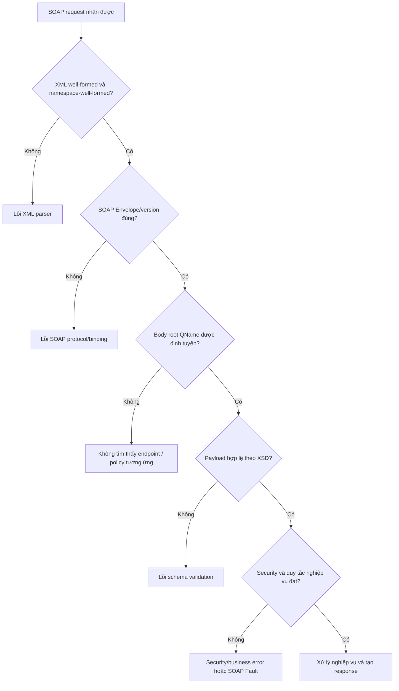
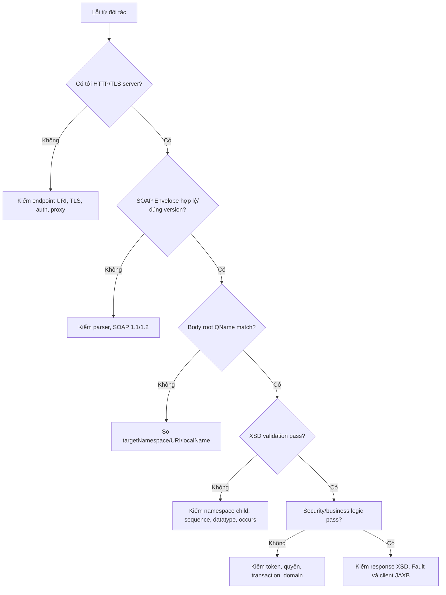

# Lỗi namespace, thứ tự, kiểu dữ liệu và số lần xuất hiện phần tử

Một SOAP request có thể là XML **well-formed** nhưng vẫn không đúng hợp đồng. Ví dụ: client gửi đúng tên `SubmitOrderRequest` nhưng sai **namespace**, đảo thứ tự `currency` và `lines`, truyền `quantity=0` trong khi XSD yêu cầu số nguyên dương, hoặc gửi sáu `line` khi hợp đồng chỉ cho phép tối đa năm. Những lỗi này có biểu hiện và điểm bị chặn khác nhau. Nếu không phân biệt, đội tích hợp dễ “sửa” nhầm endpoint mapping, JAXB hay SOAPAction trong khi vấn đề thực tế nằm ở XSD.

Trong module **SPRING_WEB_SERVICES**, ứng dụng được xây dựng theo hướng **contract-first**: XSD/WSDL định nghĩa thông điệp, JAXB/OXM ánh xạ XML với Java, `@Endpoint` xử lý nghiệp vụ, interceptor có thể xác thực payload, SOAP client phải gửi đúng cấu trúc, và SOAP Fault cần thông báo lỗi có kiểm soát. Bài học của chương **Kiểm tra dữ liệu** tập trung vào bốn nhóm vi phạm cấu trúc phổ biến nhất:

1. **Namespace/QName** của root hoặc phần tử con không đúng.
2. **Thứ tự** phần tử không tuân thủ `xs:sequence` hay mô hình nội dung.
3. **Kiểu dữ liệu và facet** không chấp nhận biểu diễn hoặc giá trị được gửi.
4. **Số lần xuất hiện phần tử** ngoài `minOccurs` và `maxOccurs`.

Mục tiêu là đọc một XSD, dự đoán XML hợp lệ/không hợp lệ, nhận diện lớp lỗi đầu tiên và thiết kế kiểm thử từ chính hợp đồng, không chỉ dựa vào thông báo của một XML parser cụ thể.

## 1. Mục tiêu học tập

Sau bài này, bạn có thể:

- Giải thích sự khác nhau giữa **XML well-formed**, **SOAP protocol hợp lệ**, **XSD-valid** và **nghiệp vụ hợp lệ**.
- Xác định **expanded QName** `{namespaceURI}localName` của root, child và attribute; phát hiện nhầm default namespace, URI version, chữ hoa/thường.
- Suy ra thứ tự bắt buộc từ `xs:sequence` và so sánh với `xs:choice`, `xs:all`.
- Kiểm các kiểu `xs:positiveInteger`, `xs:decimal`, `xs:boolean`, `xs:date`, simple type enumeration, pattern và facet về giá trị.
- Phân biệt `minOccurs`, `maxOccurs`, phần tử tùy chọn, phần tử lặp, element vắng mặt, element rỗng và `xsi:nil`.
- Tích hợp XSD validation vào Spring-WS server/client hoặc test độc lập, đồng thời hiểu những giới hạn của JAXB annotation.
- Thiết kế SOAP Fault, logging an toàn và ma trận kiểm thử âm/dương cho bốn nhóm lỗi.
- Đánh giá tác động tương thích khi thay đổi hợp đồng XSD trong hệ thống tích hợp doanh nghiệp.

## 2. Bốn lớp kiểm tra: đúng cú pháp chưa chắc đúng hợp đồng



Đây là **sơ đồ phân loại trách nhiệm**, không phải một cam kết thứ tự callback cho mọi cấu hình Spring-WS. Tùy message factory, endpoint mapping và interceptor, bước xác thực bảo mật có thể được thực hiện ở điểm khác. Một request bị chặn ở TLS/HTTP có thể chưa hề trở thành SOAP message; nếu root không match endpoint, interceptor gắn theo endpoint có thể không được gọi.

| Tầng | Câu hỏi kiểm tra | Ví dụ |
|---|---|---|
| XML parser | Thẻ mở/đóng, ký tự, khai báo prefix đúng? | Thiếu thẻ đóng hoặc dùng prefix `ord` chưa khai báo. |
| SOAP protocol | Envelope, Header, Body, version đúng? | Gửi SOAP 1.2 đến binding chỉ hỗ trợ SOAP 1.1. |
| Endpoint mapping | QName phần tử đầu `soap:Body` có match? | `@PayloadRoot` cần URI `/v1` nhưng request dùng `/v2`. |
| XSD validation | Cây element và giá trị tuân schema? | `quantity=0`; `currency` đặt trước `lines`. |
| Security | Caller, chữ ký, timestamp, quyền có hợp lệ? | WS-Security Signature thiếu/sai. |
| Nghiệp vụ | Thông tin có ý nghĩa với domain? | Order hợp lệ theo XSD nhưng vượt hạn mức mua. |

**XSD validation không thay thế security hoặc business validation.** Ngược lại, gọi được Java method và lưu dữ liệu thành công cũng không chứng minh request tuân thủ contract đã công bố.

## 3. Hợp đồng XSD xuyên suốt: SubmitOrder v1

Chúng ta dùng namespace nghiệp vụ:

```text
https://example.org/contracts/orders/v1
```

Global element request là `SubmitOrderRequest`. Schema `orders-v1.xsd` minh họa đủ bốn nhóm ràng buộc; đây là **XSD hoàn chỉnh cho phần payload được trình bày**:

```xml
<?xml version="1.0" encoding="UTF-8"?>
<xs:schema
    xmlns:xs="http://www.w3.org/2001/XMLSchema"
    xmlns:ord="https://example.org/contracts/orders/v1"
    targetNamespace="https://example.org/contracts/orders/v1"
    elementFormDefault="qualified"
    attributeFormDefault="unqualified">

    <xs:simpleType name="RequestIdType">
        <xs:restriction base="xs:token">
            <xs:pattern value="REQ-[0-9]{4}"/>
        </xs:restriction>
    </xs:simpleType>

    <xs:simpleType name="CustomerIdType">
        <xs:restriction base="xs:token">
            <xs:pattern value="CUS-[0-9]{4}"/>
        </xs:restriction>
    </xs:simpleType>

    <xs:simpleType name="SkuType">
        <xs:restriction base="xs:token">
            <xs:minLength value="1"/>
            <xs:maxLength value="24"/>
        </xs:restriction>
    </xs:simpleType>

    <xs:simpleType name="CurrencyType">
        <xs:restriction base="xs:string">
            <xs:enumeration value="VND"/>
            <xs:enumeration value="USD"/>
        </xs:restriction>
    </xs:simpleType>

    <xs:simpleType name="UnitPriceType">
        <xs:restriction base="xs:decimal">
            <xs:minExclusive value="0"/>
            <xs:totalDigits value="10"/>
            <xs:fractionDigits value="2"/>
        </xs:restriction>
    </xs:simpleType>

    <xs:complexType name="OrderLineType">
        <xs:sequence>
            <xs:element name="sku" type="ord:SkuType"/>
            <xs:element name="quantity"
                        type="xs:positiveInteger"/>
            <xs:element name="unitPrice"
                        type="ord:UnitPriceType"/>
        </xs:sequence>
    </xs:complexType>

    <xs:element name="SubmitOrderRequest">
        <xs:complexType>
            <xs:sequence>
                <xs:element name="requestId"
                            type="ord:RequestIdType"/>
                <xs:element name="customerId"
                            type="ord:CustomerIdType"/>
                <xs:element name="lines">
                    <xs:complexType>
                        <xs:sequence>
                            <xs:element name="line"
                                type="ord:OrderLineType"
                                minOccurs="1"
                                maxOccurs="5"/>
                        </xs:sequence>
                    </xs:complexType>
                </xs:element>
                <xs:element name="currency"
                            type="ord:CurrencyType"/>
                <xs:element name="note"
                            type="xs:string"
                            minOccurs="0"
                            nillable="true"/>
            </xs:sequence>
            <xs:attribute name="channel"
                          type="xs:string"
                          use="optional"/>
        </xs:complexType>
    </xs:element>

    <xs:element name="SubmitOrderResponse">
        <xs:complexType>
            <xs:sequence>
                <xs:element name="requestId"
                            type="ord:RequestIdType"/>
                <xs:element name="orderId" type="xs:string"/>
                <xs:element name="accepted" type="xs:boolean"/>
            </xs:sequence>
        </xs:complexType>
    </xs:element>

    <xs:element name="ValidationFault">
        <xs:complexType>
            <xs:sequence>
                <xs:element name="code" type="xs:string"/>
                <xs:element name="field"
                            type="xs:string"
                            minOccurs="0"/>
            </xs:sequence>
        </xs:complexType>
    </xs:element>
</xs:schema>
```

### 3.1. Tách ý nghĩa của từng ràng buộc

| Ràng buộc XSD | Ý nghĩa |
|---|---|
| `targetNamespace` | Namespace của global elements/types được khai báo. |
| `elementFormDefault="qualified"` | Các local elements trong XSD phải có namespace nghiệp vụ, trừ khi override. |
| `attributeFormDefault="unqualified"` | Local attribute `channel` không namespace. |
| `xs:sequence` | Các child phải theo đúng thứ tự. |
| `RequestIdType` và `CustomerIdType` | Pattern cụ thể cho chuỗi định danh. |
| `xs:positiveInteger` | Số nguyên lớn hơn 0. |
| `UnitPriceType` | Decimal dương với giới hạn tổng số chữ số và số chữ số thập phân. |
| `CurrencyType` | Chỉ chấp nhận `VND` hoặc `USD`. |
| `line minOccurs="1" maxOccurs="5"` | Trong mỗi `lines` có từ 1 đến 5 phần tử `line`. |
| `note minOccurs="0" nillable="true"` | Có thể vắng mặt, có nội dung hoặc hiện diện với `xsi:nil="true"`. |
| `channel use="optional"` | Attribute có thể có hoặc không. |

Với XML Schema regex, `xs:pattern` được đánh giá theo quy tắc pattern của XSD; không nên sao chép nguyên thói quen regex Java như chèn `^`/`$` mà chưa hiểu ngữ nghĩa của ngôn ngữ regex XSD.

**Lưu ý:** global element `ValidationFault` chỉ xác định cấu trúc detail nếu ứng dụng chủ động trả Fault theo mẫu đó. Nó không khiến Spring-WS tự động sinh SOAP Fault có detail này khi validator thất bại.

## 4. Một request hợp lệ để đối chiếu

XML payload dưới đây tuân schema `orders-v1.xsd`:

```xml
<ord:SubmitOrderRequest
    xmlns:ord="https://example.org/contracts/orders/v1"
    channel="portal">
    <ord:requestId>REQ-0001</ord:requestId>
    <ord:customerId>CUS-0007</ord:customerId>
    <ord:lines>
        <ord:line>
            <ord:sku>BOOK-001</ord:sku>
            <ord:quantity>2</ord:quantity>
            <ord:unitPrice>120.50</ord:unitPrice>
        </ord:line>
        <ord:line>
            <ord:sku>PEN-002</ord:sku>
            <ord:quantity>1</ord:quantity>
            <ord:unitPrice>5.00</ord:unitPrice>
        </ord:line>
    </ord:lines>
    <ord:currency>USD</ord:currency>
    <ord:note>Deliver on weekday</ord:note>
</ord:SubmitOrderRequest>
```

Khi phân tích, đừng chỉ nhìn local name:

- Root QName: `{https://example.org/contracts/orders/v1}SubmitOrderRequest`.
- `requestId`, `customerId`, `lines`, `line`, `sku`, `quantity`, `unitPrice`, `currency` và `note` thuộc namespace `/v1`.
- Attribute `channel` **không namespace**.
- `requestId` khớp `REQ-[0-9]{4}`; `customerId` khớp `CUS-[0-9]{4}`.
- Hai `line` nằm trong giới hạn 1–5; quantity đều dương; unitPrice đều thuộc giới hạn decimal.
- Thứ tự là requestId → customerId → lines → currency → note.

**Một ví dụ hợp lệ** là điểm chuẩn cho negative tests: mỗi ca lỗi nên chỉ đổi một yếu tố so với payload chuẩn, để có thể giải thích chính xác nguyên nhân.

## 5. Nhóm lỗi 1 — Namespace/QName của root và phần tử con

Tên mở rộng (expanded QName) của một XML element được xác định bằng **namespace URI + local name**, không dựa trên prefix hiển thị.

```xml
<a:SubmitOrderRequest
    xmlns:a="https://example.org/contracts/orders/v1"/>

<b:SubmitOrderRequest
    xmlns:b="https://example.org/contracts/orders/v1"/>
```

Hai root trên có **cùng QName**; chúng chỉ là ví dụ phần tử mở/đóng, chưa chứa những child bắt buộc nên **không phải request hợp lệ toàn bộ XSD**.

### 5.1. Đổi prefix nhưng giữ URI: không phải lỗi

Ba hình thức sau tương đương về QName root:

```xml
<ord:SubmitOrderRequest
    xmlns:ord="https://example.org/contracts/orders/v1"/>

<x:SubmitOrderRequest
    xmlns:x="https://example.org/contracts/orders/v1"/>

<SubmitOrderRequest
    xmlns="https://example.org/contracts/orders/v1"/>
```

Khi payload đầy đủ và các child tương ứng giữ QName, cả ba phải được xử lý giống nhau. Thông điệp SOAP client JAXB có thể dùng prefix `ns2` thay vì `ord`; không được chỉ vì vậy mà kết luận sai hợp đồng.

### 5.2. URI đúng gần như hoàn toàn vẫn là URI khác

```text
https://example.org/contracts/orders/v1
https://example.org/contracts/orders/v1/
https://example.org/contracts/orders/V1
http://example.org/contracts/orders/v1
https://example.org/contracts/orders/v2
```

Các giá trị trên **khác nhau** về namespace URI. XML namespace không tự chuẩn hóa dấu `/` cuối, đổi `http` thành `https` hoặc coi `V1` bằng `v1`. Nếu root gửi `/v2` trong khi Spring-WS cần `/v1` thì `@PayloadRoot` cho contract cũ thường không match.

### 5.3. Root đúng nhưng child không namespace

```xml
<ord:SubmitOrderRequest
    xmlns:ord="https://example.org/contracts/orders/v1">
    <requestId>REQ-0001</requestId>
    ...
</ord:SubmitOrderRequest>
```

Đây là **đoạn minh họa không hoàn chỉnh**, cố ý dùng dấu ba chấm như placeholder văn bản để nhấn mạnh child. `requestId` không có prefix, không có default namespace được khai báo, nên expanded QName của nó là `{}requestId`. Trong XSD có `elementFormDefault="qualified"`, phần tử cần thiết phải là `{.../v1}requestId`.

Hệ quả:

1. `@PayloadRoot` có thể chọn đúng endpoint vì **root QName đúng**.
2. XSD validator có thể từ chối vì child QName sai.
3. Nếu không bật validation, JAXB có thể để Java field null hoặc báo unmarshalling error tùy binding.
4. Lỗi xuất hiện sau mapping không có nghĩa annotation `@PayloadRoot` sai.

Trong ca test thực, hãy thay đổi child trong **toàn bộ payload hợp lệ** ở mục 4, không gửi dấu `...` hay fragment trực tiếp như một SOAP message.

### 5.4. Dùng default namespace đúng cách

```xml
<SubmitOrderRequest
    xmlns="https://example.org/contracts/orders/v1"
    channel="portal">
    <requestId>REQ-0001</requestId>
    <customerId>CUS-0007</customerId>
    <!-- Các child còn lại dùng cùng default namespace -->
</SubmitOrderRequest>
```

Default namespace áp dụng cho **các element không prefix**, nên `requestId`/`customerId` trên thuộc URI nghiệp vụ. Nó **không áp dụng** cho attribute `channel` không prefix, vì vậy `channel` vẫn đúng theo `attributeFormDefault="unqualified"`.

Nếu đổi thành `ord:channel="portal"` với `xmlns:ord` trỏ URI nghiệp vụ, đó là **attribute có namespace**, khác với `channel` không namespace. Schema này không khai báo attribute có QName ấy nên validation phải từ chối.

### 5.5. Prefix chưa khai báo hoặc bị redeclare

```xml
<ord:SubmitOrderRequest>
    ...
</ord:SubmitOrderRequest>
```

Nếu không có `xmlns:ord` trong scope, XML không hợp lệ theo Namespaces và parser có thể từ chối trước khi đi tới XSD validation.

Mặt khác, cùng prefix có thể bị gán lại ở phạm vi con:

```xml
<ord:SubmitOrderRequest
    xmlns:ord="https://example.org/contracts/orders/v1">
    <ord:requestId>REQ-0001</ord:requestId>
    <wrapper xmlns:ord="urn:unexpected">
        <ord:customerId>CUS-0007</ord:customerId>
    </wrapper>
</ord:SubmitOrderRequest>
```

`ord:customerId` trong `wrapper` không còn thuộc namespace nghiệp vụ. Tình huống này còn sai cấu trúc `xs:sequence` vì schema không định nghĩa `wrapper`. Khi chẩn đoán, phải giải quyết **URI thực tế tại vị trí phần tử**, không chỉ xem prefix.

### 5.6. SOAP Envelope namespace khác namespace Body

```xml
<soap:Envelope
    xmlns:soap="http://schemas.xmlsoap.org/soap/envelope/"
    xmlns:ord="https://example.org/contracts/orders/v1">
    <soap:Body>
        <ord:SubmitOrderRequest>
            ...
        </ord:SubmitOrderRequest>
    </soap:Body>
</soap:Envelope>
```

Trong ví dụ này, SOAP Envelope/Body dùng URI SOAP 1.1; payload dùng URI contract. Nếu đặt payload không prefix dưới một default namespace SOAP và không reset namespace, nó có thể bị hiểu là phần tử thuộc **SOAP protocol namespace**; `@PayloadRoot` sẽ không match.

Dấu `...` trong ví dụ Envelope là placeholder; không phải XML payload có thể validate. Bài học ở đây là **namespace SOAP ≠ namespace nghiệp vụ**.

## 6. Nhóm lỗi 2 — Sai thứ tự trong `xs:sequence`

Một `xs:sequence` biểu thị các hạt (particles) theo thứ tự. Trong schema mục 3, request có trình tự:

```text
1. requestId   (bắt buộc)
2. customerId  (bắt buộc)
3. lines       (bắt buộc)
4. currency    (bắt buộc)
5. note        (tùy chọn, nếu xuất hiện phải ở sau currency)
```

Đổi `currency` lên trước `lines` là sai:

```xml
<!-- Fragment rút gọn: thứ tự sai so với XSD -->
<ord:requestId>REQ-0001</ord:requestId>
<ord:customerId>CUS-0007</ord:customerId>
<ord:currency>USD</ord:currency>
<ord:lines>
    <!-- line hợp lệ được lược bỏ -->
</ord:lines>
```

Trong test thật, dùng toàn bộ request mục 4 rồi hoán đổi hai block `lines` và `currency`. Mọi namespace và giá trị có thể đúng, nhưng XML **không khớp content model**.

### 6.1. Thứ tự con trong một `line`

`OrderLineType` khai báo:

```xml
<xs:sequence>
    <xs:element name="sku" type="ord:SkuType"/>
    <xs:element name="quantity" type="xs:positiveInteger"/>
    <xs:element name="unitPrice" type="ord:UnitPriceType"/>
</xs:sequence>
```

Vì vậy `sku` → `quantity` → `unitPrice` là thứ tự bắt buộc. Nếu `unitPrice` xuất hiện trước `quantity`, validator từ chối. Một DTO Java có getter `getUnitPrice()` đứng trước `getQuantity()` **không được dùng làm bằng chứng** XML được phép đổi thứ tự.

### 6.2. `xs:sequence`, `xs:choice` và `xs:all` khác nhau

| Compositor | Ý nghĩa khái quát | Ảnh hưởng kiểm tra |
|---|---|---|
| `xs:sequence` | Các phần tử theo trình tự quy định | Đảo thứ tự có thể vi phạm XSD |
| `xs:choice` | Chọn một trong các lựa chọn hợp lệ theo min/max của group | Xuất hiện đồng thời nhiều nhánh có thể sai |
| `xs:all` | Các phần tử trong nhóm được phép xuất hiện không theo thứ tự | Phải tuân hạn chế của `xs:all` theo phiên bản XSD; không thể coi mọi schema dùng `all` |

Ví dụ khác, không thuộc schema đơn hàng:

```xml
<xs:choice>
    <xs:element name="email" type="xs:string"/>
    <xs:element name="phone" type="xs:string"/>
</xs:choice>
```

Nếu `choice` có occurrence mặc định một lần, XML chứa cả `email` và `phone` tại vị trí lựa chọn đó sẽ không tuân mô hình. Không suy luận rằng vì XML well-formed nên server được phép tự lấy trường đầu tiên và bỏ trường còn lại.

### 6.3. JAXB `@XmlType(propOrder)` phản ánh thứ tự, không định nghĩa thay XSD

Mã JAXB do XJC sinh có thể chứa:

```java
@XmlType(name = "OrderLineType", propOrder = {
    "sku",
    "quantity",
    "unitPrice"
})
public class OrderLineType {
    // ...
}
```

Nếu developer tự sửa `propOrder` thành `{"unitPrice","sku","quantity"}` mà không đổi XSD, XML marshal có thể bị XSD từ chối. Trong **contract-first**, sửa nguồn XSD/binding customization phù hợp rồi sinh lại JAXB, thay vì chỉnh generated sources thủ công.

Cũng cần phân biệt **thứ tự element** với **thứ tự XML attributes**: attributes không nằm trong `xs:sequence`. Một serializer đổi vị trí attribute trong start tag thường không làm đổi ngữ nghĩa XML theo schema.

## 7. Nhóm lỗi 3 — Kiểu dữ liệu: lexical space và value space

Một giá trị có thể nhìn “hợp lý” đối với con người nhưng không hợp lệ theo **lexical representation** của XSD. Ngược lại, một biểu diễn khác có thể vẫn nằm trong value space của kiểu.

Ví dụ:

| Kiểu XSD | Ví dụ hợp lệ | Ví dụ không hợp lệ hoặc không phù hợp |
|---|---|---|
| `xs:positiveInteger` | `1`, `7` | `0`, `-2`, `1.5` |
| `xs:decimal` | `10`, `10.25`, `-3.5` | `1,000.00`, `NaN` |
| `xs:boolean` | `true`, `false`, `1`, `0` | `yes`, `no` |
| `xs:date` | `2026-11-27` | `27/11/2026`, ngày không tồn tại |
| `xs:dateTime` | `2026-11-27T09:30:00+07:00` | `2026/11/27 09:30` |
| `ord:CurrencyType` | `VND`, `USD` | `EUR`, `usd` |
| `ord:RequestIdType` | `REQ-0001` | `REQ-1`, `REQ-A001` |
| `ord:UnitPriceType` | `120.50`, `1` | `0`, `-10`, `1.234` |

**Phân biệt ba vấn đề**:

1. **Lexical validity:** chuỗi ký tự có thể parse thành kiểu cơ sở không? `1,000` không thuộc lexical format chuẩn của `xs:decimal`.
2. **Facet validity:** sau khi parse, giá trị có thỏa pattern, enum, min/max, digits không? `0` là số nguyên nhưng vi phạm `xs:positiveInteger`.
3. **Business validity:** giá trị hợp lệ theo XSD nhưng có đúng quy tắc nghiệp vụ không? `quantity=100` vẫn là positiveInteger dù kho chỉ còn 3 sản phẩm.

Một số datatype có phép chuẩn hóa khoảng trắng theo chuẩn XML Schema; `xs:token` dùng quy tắc xử lý khoảng trắng khác `xs:string`. Vì thế, khi debug pattern, phải chú ý dữ liệu đã được chuẩn hóa như thế nào trước khi áp facet. Không dựa vào cơ chế `String.trim()` tùy tiện để “sửa” mọi dữ liệu sai contract.

## 8. Facet của kiểu dữ liệu: giới hạn không dừng ở `type`

Các `xs:restriction`/facet làm type cụ thể hơn. Ví dụ:

```xml
<xs:simpleType name="UnitPriceType">
    <xs:restriction base="xs:decimal">
        <xs:minExclusive value="0"/>
        <xs:totalDigits value="10"/>
        <xs:fractionDigits value="2"/>
    </xs:restriction>
</xs:simpleType>
```

Các kiểm tra khác nhau có thể thất bại riêng biệt:

| Giá trị `unitPrice` | Kết luận |
|---|---|
| `0` | Không thỏa `minExclusive=0` |
| `-1` | Không thỏa giới hạn dương |
| `12.50` | Hợp lệ với các facet ví dụ |
| `1.234` | Không thỏa `fractionDigits=2` |
| `12345678901` | Không thỏa `totalDigits=10` |
| `12,50` | Lexical decimal không hợp lệ |
| `ABC` | Không parse được decimal |

Khi XSD dùng `fractionDigits`, hãy phân biệt **giá trị số** với biểu diễn thập phân; đừng áp luật “cấm chuỗi có hơn hai ký tự sau dấu chấm” bằng regex thủ công rồi tự nhận là tương đương XML Schema. Validator chuẩn đánh giá theo quy tắc datatype/facet XML Schema và có thể xử lý biểu diễn tương đương về giá trị theo đặc tả.

### 8.1. Enumeration và phân biệt chữ hoa

```xml
<xs:simpleType name="CurrencyType">
    <xs:restriction base="xs:string">
        <xs:enumeration value="VND"/>
        <xs:enumeration value="USD"/>
    </xs:restriction>
</xs:simpleType>
```

`USD` hợp lệ; `usd` sai. JAXB có thể ánh xạ enumeration thành Java enum, nhưng việc code Java nhận string hoặc enum không thay thế XSD validation đối với XML từ đối tác. Với contract-first, đổi enum là quyết định tương thích, không chỉ thay một hằng Java.

### 8.2. Pattern không thay mọi kiểm tra nghiệp vụ

`REQ-[0-9]{4}` yêu cầu chuỗi định danh khớp cấu trúc đã khai báo. Nó **không** chứng minh request chưa từng được gửi, người gọi được phép đặt đơn hoặc requestId là duy nhất trên hệ thống.

Ngay cả khi schema pass, việc chống xử lý trùng cần idempotency key và cơ chế ghi nguyên tử/unique constraint tại data store nếu operation có side effect.

### 8.3. Kiểu Java không tự bảo vệ mọi facet

`BigInteger.ZERO` là Java value hợp lệ nhưng không phù hợp `xs:positiveInteger`. Tương tự, `BigDecimal("0")` là số hợp lệ trong Java nhưng không phù hợp `UnitPriceType`. `@XmlElement(required=true)` và `@XmlSchemaType` chủ yếu mô tả mapping; chúng không bảo đảm mọi facet luôn được kiểm tra trong khi marshal/unmarshal nếu không bật XSD validation.

## 9. Nhóm lỗi 4 — `minOccurs` và `maxOccurs`

Một khai báo `xs:element` trong content model có thể giới hạn số lần một **particle** xuất hiện:

```xml
<xs:element name="line"
            type="ord:OrderLineType"
            minOccurs="1"
            maxOccurs="5"/>
```

Trong mỗi `lines` của ví dụ, số phần tử `line` hợp lệ là **1, 2, 3, 4 hoặc 5**. `0` hoặc `6` là không hợp lệ.

| XSD | Ý nghĩa tại vị trí khai báo |
|---|---|
| Không ghi `minOccurs` | Mặc định `1` |
| Không ghi `maxOccurs` | Mặc định `1` |
| `minOccurs="0" maxOccurs="1"` | Phần tử tùy chọn, xuất hiện tối đa một lần |
| `minOccurs="1" maxOccurs="5"` | Ít nhất một, tối đa năm |
| `minOccurs="0" maxOccurs="unbounded"` | Có thể vắng mặt hoặc lặp không giới hạn bởi schema |
| `minOccurs="2" maxOccurs="2"` | Phải xuất hiện đúng hai lần |

`maxOccurs="unbounded"` không có nghĩa server được xử lý vô hạn tài nguyên: gateway/parser vẫn cần giới hạn kích thước request, số node và thời gian xử lý.

### 9.1. Thiếu cả `lines`

Vì `lines` trong request không khai báo `minOccurs` nên mặc định là 1. Bỏ toàn bộ `lines` sẽ vi phạm XSD, cho dù phía server không muốn xử lý đơn hàng có dòng sản phẩm.

### 9.2. Có `lines` nhưng không có `line`

```xml
<ord:lines xmlns:ord="https://example.org/contracts/orders/v1"/>
```

Phần tử `lines` hiện diện nhưng **không có phần tử `line`**; vì `line minOccurs=1`, nó không hợp lệ. Đây là lỗi khác với việc vắng mặt hoàn toàn `lines`.

### 9.3. Có sáu `line`

Khi chứa sáu phần tử `line` hợp lệ về nội dung trong một `lines`, XML vẫn vi phạm `maxOccurs=5`. Các giá trị `sku`, `quantity`, `unitPrice` đều đúng cũng không cứu được lỗi occurrence.

### 9.4. Lặp phần tử không được phép lặp

Trong request, `currency` có occurrence mặc định 1. Thêm `currency` lần thứ hai có thể khiến content model sai ngay cả khi hai giá trị đều `USD`. XSD không có quy tắc “lấy giá trị cuối” mặc định.

**Lưu ý vị trí:** occurrence là ràng buộc của một particle **trong content model**, không chỉ thuộc “tên element” chung chung. Cùng tên có thể tham gia các model/group khác nhau với ràng buộc khác nhau trong schema phức tạp.

## 10. Phân biệt vắng mặt, rỗng và `xsi:nil`

Đây là nhóm lỗi dễ bị bỏ qua khi Java field là `null`.

Schema mẫu:

```xml
<xs:element name="note"
            type="xs:string"
            minOccurs="0"
            nillable="true"/>
```

Vì `minOccurs=0`, `note` có thể **vắng mặt**. Vì `nillable=true`, nó cũng có thể **xuất hiện và được đánh dấu nil**. Vì type là `xs:string`, nó có thể xuất hiện với chuỗi rỗng.

Ba trường hợp khác nhau:

```xml
<!-- A: không có note (chỉ minh họa đoạn sau currency) -->
<ord:currency>USD</ord:currency>
```

```xml
<!-- B: note hiện diện với chuỗi rỗng -->
<ord:note xmlns:ord="https://example.org/contracts/orders/v1"/>
```

```xml
<!-- C: note hiện diện nhưng nil -->
<ord:note
    xmlns:ord="https://example.org/contracts/orders/v1"
    xmlns:xsi="http://www.w3.org/2001/XMLSchema-instance"
    xsi:nil="true"/>
```

Đây là **fragments**, không phải ba XML documents có thể đưa trực tiếp vào validator ở cấp global `SubmitOrderRequest`. Dùng chúng thay phần `note` sau `currency` trong payload hợp lệ để test.

Nếu `nillable="false"` hoặc không khai báo `nillable` (mặc định false), trường hợp C không hợp lệ. Nếu `minOccurs="1"`, trường hợp A không hợp lệ. Hai thuộc tính kiểm soát **hai khía cạnh độc lập**.

### 10.1. `xsi:nil` là attribute ở namespace khác

QName của `xsi:nil`:

```text
{http://www.w3.org/2001/XMLSchema-instance}nil
```

Nó không phải attribute nghiệp vụ trong namespace `ord` và cũng không phải `<nil>` child element. Việc khai báo `xmlns:xsi` chỉ làm prefix có nghĩa; **không tự khiến phần tử được phép nil**.

### 10.2. JAXB đôi khi cần `JAXBElement<T>`

Với XSD cho phép phân biệt “không có element” và “element tồn tại nhưng nil”, XJC/JAXB có thể sử dụng `JAXBElement<T>` hoặc cấu trúc khác tùy schema/binding để giữ thông tin hiện diện. Nếu chỉ dùng một Java field `String note` mang giá trị null, ứng dụng có thể đánh mất khác biệt giữa hai trạng thái.

Không tự thêm `@XmlElement(nillable=true)` vào lớp generated JAXB để “sửa” XML nếu XSD không cho phép nil. XSD là nguồn contract.

## 11. Lỗi occurrence không chỉ nằm ở element con

Ngoài `minOccurs`/`maxOccurs`, XSD còn có quy tắc về attribute và content model:

- `xs:attribute use="required"` buộc attribute tồn tại; `use="optional"` có thể vắng mặt.
- Một attribute không được xuất hiện trùng cùng QName trên cùng element trong XML well-formed.
- `xs:choice` có thể giới hạn số nhánh được chọn trong một lượt group occurrence.
- `xs:all` có giới hạn riêng theo phiên bản XSD; không thay `xs:sequence` bằng `xs:all` chỉ để cho phép client gửi bất kỳ thứ tự mà không xem tác động tương thích.
- `xs:any`/`xs:anyAttribute` có thể cho phép nội dung mở rộng theo namespace và `processContents`, nhưng cần chính sách rõ để không vô tình bỏ qua payload không mong đợi.

Nếu hệ thống cần hỗ trợ thêm trường không phá vỡ tương thích, có thể nghiên cứu **extension points có kiểm soát**. Tuy nhiên, việc tự thêm `xs:any processContents="skip"` vào mọi chỗ để “chấp nhận mọi XML” làm giảm giá trị hợp đồng và có thể gây lỗ hổng xử lý nội dung ngoài ý muốn.

## 12. XSD liên hệ với WSDL, SOAP Body và endpoint Spring-WS

Trong WSDL 1.1 phong cách document/literal, operation trỏ đến input message; message part thường tham chiếu global element:

```xml
<wsdl:message name="SubmitOrderInput"
    xmlns:wsdl="http://schemas.xmlsoap.org/wsdl/"
    xmlns:ord="https://example.org/contracts/orders/v1">
    <wsdl:part name="parameters"
               element="ord:SubmitOrderRequest"/>
</wsdl:message>
```

Khi client gọi operation, SOAP Body cần chứa phần tử QName:

```text
{https://example.org/contracts/orders/v1}SubmitOrderRequest
```

Một SOAP 1.1 request minh họa:

```xml
<soap:Envelope
    xmlns:soap="http://schemas.xmlsoap.org/soap/envelope/"
    xmlns:ord="https://example.org/contracts/orders/v1">
    <soap:Header/>
    <soap:Body>
        <ord:SubmitOrderRequest channel="portal">
            <ord:requestId>REQ-0001</ord:requestId>
            <ord:customerId>CUS-0007</ord:customerId>
            <ord:lines>
                <ord:line>
                    <ord:sku>BOOK-001</ord:sku>
                    <ord:quantity>2</ord:quantity>
                    <ord:unitPrice>120.50</ord:unitPrice>
                </ord:line>
            </ord:lines>
            <ord:currency>USD</ord:currency>
        </ord:SubmitOrderRequest>
    </soap:Body>
</soap:Envelope>
```

Trong Spring-WS:

```java
@Endpoint
public class OrderEndpoint {
    private static final String NS =
        "https://example.org/contracts/orders/v1";

    @PayloadRoot(namespace = NS, localPart = "SubmitOrderRequest")
    @ResponsePayload
    public SubmitOrderResponse submit(
            @RequestPayload SubmitOrderRequest request) {
        // Xử lý nghiệp vụ sau khi payload đã qua các lớp kiểm tra.
        return orderService.submit(request);
    }
}
```

Đoạn Java có các class/import/service giả định của ứng dụng. Nếu mã JAXB sinh ra `JAXBElement<T>` hoặc endpoint adapter dùng kiểu khác, cần điều chỉnh signature theo binding thực tế.

**Điểm phân biệt quan trọng:** `@PayloadRoot` nhìn QName **root của payload**, không kiểm đầy đủ `xs:sequence`, datatype facet hay `minOccurs/maxOccurs`. Một payload có root đúng nhưng `quantity=0` vẫn có thể **định tuyến được** rồi bị validation chặn ở bước sau. Vì vậy phải bật/kiểm chứng XSD validation riêng.

## 13. Spring-WS: kiểm tra request/response bằng `PayloadValidatingInterceptor`

Spring-WS cung cấp `PayloadValidatingInterceptor` để xác thực payload SOAP theo XSD. Ví dụ cấu hình qua `WsConfigurer`:

```java
import java.util.List;

import org.springframework.context.annotation.Configuration;
import org.springframework.ws.config.annotation.WsConfigurer;
import org.springframework.ws.server.EndpointInterceptor;
import org.springframework.ws.soap.server.endpoint.interceptor.PayloadValidatingInterceptor;
import org.springframework.xml.xsd.XsdSchema;

@Configuration
public class OrderValidationConfiguration implements WsConfigurer {

    private final XsdSchema schema;

    public OrderValidationConfiguration(XsdSchema schema) {
        this.schema = schema;
    }

    @Override
    public void addInterceptors(
            List<EndpointInterceptor> interceptors) {

        PayloadValidatingInterceptor validator =
            new PayloadValidatingInterceptor();

        validator.setXsdSchema(schema);
        validator.setValidateRequest(true);
        validator.setValidateResponse(true);

        interceptors.add(validator);
    }
}
```

Schema bean do ứng dụng tạo từ file XSD đã phê duyệt:

```java
import org.springframework.context.annotation.Bean;
import org.springframework.context.annotation.Configuration;
import org.springframework.core.io.ClassPathResource;
import org.springframework.xml.xsd.SimpleXsdSchema;
import org.springframework.xml.xsd.XsdSchema;

@Configuration
public class OrderSchemaConfiguration {

    @Bean
    public XsdSchema orderSchema() {
        return new SimpleXsdSchema(
            new ClassPathResource("xsd/orders-v1.xsd")
        );
    }
}
```

Các đoạn code chỉ là phần cấu hình liên quan đến validation; server còn cần `@EnableWs`, `MessageDispatcherServlet`/Boot servlet auto-config, endpoint, JAXB adapter và các dependency tương thích. Không khai báo thêm một `XsdSchema` có cùng kiểu nếu constructor injection trở nên mơ hồ mà không có qualifier.

### 13.1. Kiểm tra cả response để bắt lỗi server

`setValidateResponse(true)` giúp phát hiện response bị marshal sai cấu trúc do server tạo. Ví dụ:

- Server trả `accepted=YES` thay vì kiểu `xs:boolean`.
- Response thiếu `requestId` hay `orderId`.
- Generated JAXB model không khớp XSD đang công bố.
- Phần tử trả về thuộc namespace version cũ.

Validation response hữu ích cho kiểm thử contract-first, nhưng có thể tăng chi phí xử lý. Trong production cần xem xét cách interceptor báo lỗi, log và bảo vệ thông tin; không đơn giản trả toàn bộ diagnostic của validator cho client.

### 13.2. Những giới hạn cần hiểu

- Interceptor này tập trung vào **payload SOAP Body**, không tự validate mọi SOAP Header tùy biến, SOAPAction, WS-Addressing hoặc WS-Security.
- Nếu request không match endpoint mapping, interceptor gắn với endpoint có thể **chưa được chạy**; vì vậy lỗi root QName sai có thể được xử lý khác lỗi child QName sai.
- XSD validation không kiểm các quy tắc như người mua có đủ quyền, hạn mức tài khoản hay `requestId` đã được xử lý.
- Chỉ vì WSDL/XSD tồn tại trên classpath không có nghĩa runtime validation đã bật; cần kiểm thử ca âm để xác nhận.
- Fault detail do Spring-WS tạo mặc định không nhất thiết trùng một `ValidationFault` do doanh nghiệp tự thiết kế; muốn ổn định cần cấu hình và kiểm thử hành vi lỗi.

## 14. JAXB/OXM có thể bỏ sót lỗi nếu không bật schema

Spring OXM `Jaxb2Marshaller` ánh xạ XML ↔ Java, nhưng **không phải mọi XSD facet được xác thực mặc định** trong mọi quá trình marshal/unmarshal.

Một mapping mẫu:

```java
@XmlAccessorType(XmlAccessType.FIELD)
@XmlType(name = "OrderLineType", propOrder = {
    "sku", "quantity", "unitPrice"
})
public class OrderLineType {
    @XmlElement(required = true)
    protected String sku;

    @XmlElement(required = true)
    @XmlSchemaType(name = "positiveInteger")
    protected java.math.BigInteger quantity;

    @XmlElement(required = true)
    protected java.math.BigDecimal unitPrice;
}
```

Lớp trên là **mã minh họa JAXB**, chưa bao gồm import/namespace package và các ràng buộc `UnitPriceType` đầy đủ. Nó cho thấy:

- `quantity` có Java type `BigInteger`, nhưng Java vẫn có thể tạo `BigInteger.ZERO`.
- `unitPrice` có Java type `BigDecimal`, nhưng Java vẫn có thể tạo giá trị âm hoặc quá giới hạn facet.
- `@XmlElement(required=true)` mô tả binding/schema metadata, **không tự đảm bảo** null không bao giờ được marshal thành XML thiếu field.
- `@XmlType(propOrder)` giữ thứ tự serialization, nhưng phải đồng bộ với XSD, không tự biến object business thành hợp lệ.

Ví dụ cấu hình OXM schema validation:

```java
@Bean
public Jaxb2Marshaller ordersMarshaller() {
    Jaxb2Marshaller m = new Jaxb2Marshaller();
    m.setContextPath("org.example.orders.contract");
    m.setSchema(
        new ClassPathResource("xsd/orders-v1.xsd")
    );
    return m;
}
```

Đoạn này giả định package có JAXB context metadata (`ObjectFactory` hoặc `jaxb.index`) và các import Spring phù hợp. Nếu schema chứa `xs:import`, phải cấu hình đường dẫn/resolver tin cậy. Chọn rõ việc validate ở OXM, interceptor, hoặc cả hai; việc validate lặp có thể tạo overhead hoặc các đường lỗi khác nhau.

Đừng dựa vào việc JAXB unmarshalling không ném exception để kết luận XML hợp đồng hợp lệ. Cần một **XSD validation assertion riêng** cho các trường hợp bắt buộc.

## 15. SOAP Fault khi dữ liệu vi phạm hợp đồng

Khi XSD validation fail, phía server cần định nghĩa rõ **behavior lỗi**. Một dịch vụ SOAP 1.1 có thể trả SOAP Fault thuộc nhóm lỗi phía gửi, nhưng mã Fault, HTTP status, detail và nội dung chẩn đoán phụ thuộc binding, version, interceptor, exception resolver và chính sách công bố.

Ví dụ một **Fault tùy biến theo contract**:

```xml
<soap:Envelope
    xmlns:soap="http://schemas.xmlsoap.org/soap/envelope/"
    xmlns:ord="https://example.org/contracts/orders/v1">
    <soap:Body>
        <soap:Fault>
            <faultcode>soap:Client</faultcode>
            <faultstring>Request violates order contract</faultstring>
            <detail>
                <ord:ValidationFault>
                    <ord:code>INVALID_ORDER_XML</ord:code>
                    <ord:field>lines/line/quantity</ord:field>
                </ord:ValidationFault>
            </detail>
        </soap:Fault>
    </soap:Body>
</soap:Envelope>
```

Trong XSD mục 3 đã có global element `ValidationFault`; nếu WSDL muốn khai báo nó như lỗi operation, phải thêm `wsdl:message`/`wsdl:fault` và SOAP binding fault phù hợp. **Khởi tạo XSD element không tự làm Spring-WS phát sinh Fault detail đó**; phải hiện thực mapping lỗi, ví dụ một exception resolver hoặc custom interceptor/fault handling.

### 15.1. Không ép mọi lỗi về một SOAP Fault

| Lỗi | Tầng đầu tiên có thể phát hiện | Lưu ý |
|---|---|---|
| Prefix chưa khai báo, XML malformed | XML parser | Có thể xảy ra trước endpoint/validator |
| SOAP Envelope namespace sai version | SOAP message factory/protocol | Version mismatch, không phải lỗi field XSD |
| Body root namespace `v2` nhưng endpoint chỉ nhận `v1` | Endpoint mapping | Có thể không kích hoạt endpoint validation interceptor |
| Root đúng nhưng `quantity=0` | XSD validation | Có thể trả SOAP Fault validation |
| Token WS-Security sai | Security interceptor | Không được thực thi nghiệp vụ |
| Hạn mức mua vượt quá cho phép | Business service | Có thể là business Fault/response theo contract |
| TLS handshake thất bại | Transport | Có thể không có SOAP response |
| Response server không tuân schema | Outbound validation | Là lỗi phía server, không đổ trách nhiệm cho client |

Một hệ thống tốt phân loại lỗi rõ ràng, không biến lỗi server thành `soap:Client` và không trả chi tiết XML parser thô chứa path nội bộ, stack trace hoặc dữ liệu nhạy cảm.

### 15.2. Câu chữ diagnostic không phải giao diện ổn định

Thông báo của validator có thể chứa mã như `cvc-complex-type.2.4.a`, `cvc-datatype-valid.1.2.1` hoặc cách diễn đạt khác nhau theo implementation/JDK. Những mã này có ích khi debug, nhưng không nên bắt client nghiệp vụ phụ thuộc chính xác vào một chuỗi exception cụ thể.

Ưu tiên **mã lỗi ứng dụng ổn định**, QName Fault detail và danh sách field/path đã chuẩn hóa, đồng thời chỉ trả thông tin an toàn theo policy. Mapping phải tránh rò raw payload, token hay đường dẫn hệ thống.

## 16. Test XSD độc lập với SOAP bằng JAXP

Để tách vấn đề schema khỏi servlet, transport và endpoint, có thể dùng `SchemaFactory`/`Validator` của JAXP trực tiếp.

Ví dụ Java 17, dùng một XSD đáng tin do dự án quản lý:

```java
import java.io.StringReader;
import java.nio.file.Path;
import javax.xml.XMLConstants;
import javax.xml.transform.stream.StreamSource;
import javax.xml.validation.Schema;
import javax.xml.validation.SchemaFactory;
import javax.xml.validation.Validator;

public final class OrderContractValidation {

    private final Schema schema;

    public OrderContractValidation(Path xsdPath)
            throws Exception {

        SchemaFactory factory = SchemaFactory.newInstance(
            XMLConstants.W3C_XML_SCHEMA_NS_URI
        );
        factory.setFeature(
            XMLConstants.FEATURE_SECURE_PROCESSING, true
        );
        factory.setProperty(
            XMLConstants.ACCESS_EXTERNAL_DTD, ""
        );
        factory.setProperty(
            XMLConstants.ACCESS_EXTERNAL_SCHEMA, ""
        );

        schema = factory.newSchema(xsdPath.toFile());
    }

    public void validate(String payloadXml) throws Exception {
        Validator validator = schema.newValidator();

        validator.setProperty(
            XMLConstants.ACCESS_EXTERNAL_DTD, ""
        );
        validator.setProperty(
            XMLConstants.ACCESS_EXTERNAL_SCHEMA, ""
        );

        validator.validate(
            new StreamSource(new StringReader(payloadXml))
        );
    }
}
```

Khi kiểm tra nhiều request đồng thời, có thể dùng chung đối tượng `Schema` đã compile, nhưng mỗi lần gọi tạo `Validator` riêng; `Validator` có trạng thái xử lý và không được dùng chung đồng thời. Nếu XSD cần `xs:include`/`xs:import`, cần cung cấp tài nguyên cục bộ hoặc resolver tin cậy phù hợp; chặn external access mà không chuẩn bị schema phụ trợ có thể khiến khởi tạo schema thất bại.

**Lưu ý bảo mật:** ví dụ JAXP là bước hardening cơ bản, không bao phủ mọi parser/transformer có thể được sử dụng trong Spring-WS hoặc JAXB. Với XML không tin cậy, cần kiểm tra DTD/external entities, giới hạn độ sâu, kích thước, entity expansion, attachment và network access ở từng code path.

### Đảm bảo test nhận đúng lỗi, không chỉ “có exception”

Một bài test tốt:

- Dùng **payload chuẩn** làm baseline và assert pass.
- Tạo từng biến thể có **một lỗi độc lập** để biết nguyên nhân.
- Với ca âm, assert rằng validation fail; nếu có thể, kiểm nhóm lỗi/đường dẫn một cách không phụ thuộc câu chữ parser.
- Không sửa payload “cho hợp lệ” bằng cách bỏ field chưa biết rồi vẫn tiếp tục business operation.
- Không lấy `xsi:schemaLocation` do phía gửi cung cấp làm schema tin cậy thay cho schema server được quản lý.

## 17. Kiểm thử Spring-WS: âm và dương theo từng nhóm lỗi

Trong Spring-WS, `MockWebServiceClient` mô phỏng SOAP client gọi vào endpoint của ứng dụng. Nó hữu ích để xác minh validation interceptor và Fault behavior trong Spring application context.

Ví dụ kiểm request hợp lệ:

```java
import static org.springframework.ws.test.server.RequestCreators.withPayload;
import static org.springframework.ws.test.server.ResponseMatchers.noFault;

import org.springframework.context.ApplicationContext;
import org.springframework.xml.transform.StringSource;
import org.springframework.ws.test.server.MockWebServiceClient;

// Giả định applicationContext đã được Spring test khởi tạo.
MockWebServiceClient client =
    MockWebServiceClient.createClient(applicationContext);

StringSource payload = new StringSource("""
    <ord:SubmitOrderRequest
        xmlns:ord="https://example.org/contracts/orders/v1">
        <ord:requestId>REQ-0001</ord:requestId>
        <ord:customerId>CUS-0007</ord:customerId>
        <ord:lines>
            <ord:line>
                <ord:sku>BOOK-001</ord:sku>
                <ord:quantity>2</ord:quantity>
                <ord:unitPrice>120.50</ord:unitPrice>
            </ord:line>
        </ord:lines>
        <ord:currency>USD</ord:currency>
    </ord:SubmitOrderRequest>
    """);

client.sendRequest(withPayload(payload))
      .andExpect(noFault());
```

Đây là **đoạn test lõi**, không phải class JUnit đầy đủ: cần Spring test context, endpoint, marshaller/JAXB, service nghiệp vụ và import thích hợp. Kết quả `noFault()` một mình chưa xác nhận response đúng contract; nên thêm matcher kiểm QName, nội dung response và `validPayload` theo XSD.

### Ma trận kiểm thử đề xuất

| ID | Nhóm | Thay đổi trên payload chuẩn | Kết quả mong đợi |
|---|---|---|---|
| P01 | Tất cả | Payload mục 4 | XSD-valid; endpoint xử lý theo nghiệp vụ |
| P02 | Namespace | Đổi prefix `ord` thành `x`, giữ URI | Vẫn đúng QName và hợp lệ |
| P03 | Namespace | Dùng default namespace đúng cho root và child | Vẫn đúng QName và hợp lệ |
| P04 | Occurrence | Có đúng 1 `line` | Hợp lệ |
| P05 | Occurrence | Có đúng 5 `line` | Hợp lệ |
| P06 | Optional | Bỏ `note` | Hợp lệ |
| P07 | Nil | `note xsi:nil="true"` | Hợp lệ vì nillable=true |
| N01 | Namespace | Root dùng URI `/v2` | Không match `v1`, hoặc schema v1 từ chối |
| N02 | Namespace | Root đúng, child `requestId` không namespace | XSD từ chối |
| N03 | Namespace | Đổi `channel` thành attribute thuộc namespace `ord` | XSD từ chối |
| N04 | Thứ tự | Đặt `currency` trước `lines` | XSD từ chối |
| N05 | Thứ tự | Đặt `unitPrice` trước `quantity` trong `line` | XSD từ chối |
| N06 | Kiểu | `quantity=0` | XSD từ chối `positiveInteger` |
| N07 | Kiểu | `unitPrice=-1` | XSD từ chối minExclusive |
| N08 | Kiểu | `unitPrice=1.234` | XSD từ chối fractionDigits |
| N09 | Kiểu | `currency=EUR` | XSD từ chối enumeration |
| N10 | Kiểu | `requestId=REQ-A001` | XSD từ chối pattern |
| N11 | Occurrence | Bỏ toàn bộ `lines` | XSD từ chối thiếu element |
| N12 | Occurrence | Có `lines` nhưng 0 `line` | XSD từ chối minOccurs |
| N13 | Occurrence | Có 6 `line` | XSD từ chối maxOccurs |
| N14 | Occurrence | Lặp `currency` hai lần | XSD từ chối content model |
| N15 | Protocol | SOAP 1.2 Envelope vào SOAP 1.1-only endpoint | Bị xử lý như lỗi SOAP version/binding |
| N16 | Security | Payload hợp lệ nhưng chữ ký sai | Security layer từ chối, không gọi business service |

Ở mỗi test, phân biệt ba assertion:

1. **XSD oracle:** XML có hợp lệ theo XSD đã phê duyệt không?
2. **Spring-WS behavior:** Endpoint, interceptor và Fault resolver thực tế trả gì?
3. **Business side effects:** Request sai có bị chặn **trước khi** ghi DB/gửi sự kiện không?

Nếu chỉ kiểm HTTP 500, bạn có thể bỏ sót một lỗi code server không liên quan schema. Nếu chỉ kiểm exception Java mà không xem SOAP Fault trên wire, client đối tác vẫn có thể không hiểu phản hồi.

## 18. XML security, WS-Security và dữ liệu không tin cậy

Một hệ thống tích hợp không nên tin payload chỉ vì parse/validate được XSD. Các biện pháp khác vẫn cần:

- **Parser hardening:** chặn/giới hạn DTD, external entities và truy cập tài nguyên ngoài; áp dụng cho DOM, SAX, StAX, SAAJ, JAXB/transformer thực tế.
- **Resource limits:** kích thước SOAP Body/Envelope, số phần tử, độ sâu XML, tập tin MTOM, số `line` ngay cả khi XSD dùng `unbounded`.
- **Schema trust:** dùng XSD được ứng dụng quản lý; không lấy schema tùy ý từ `xsi:schemaLocation` hoặc URL client cung cấp.
- **TLS/mTLS:** kiểm server/client certificate phù hợp chính sách, không vô hiệu hostname verification để “cho test qua”.
- **WS-Security:** xác minh Timestamp, UsernameToken, Signature, signed parts, replay và algorithm policy trước khi tin metadata quan trọng.
- **Authorization:** người gọi đã xác thực có quyền tạo đơn cho `customerId` hay không.
- **Error minimization:** SOAP Fault không lộ raw XML, secret, stack trace hoặc đường dẫn nội bộ.
- **DoS control:** thông điệp quá lớn hoặc quá phức tạp có thể tốn tài nguyên dù một phần vẫn hợp lệ theo schema.

Bật `PayloadValidatingInterceptor` **không bật WS-Security** và cũng không cấu hình TLS. Một request XSD-valid vẫn phải đi qua kiểm bảo mật; một request có chữ ký hợp lệ vẫn phải tuân thủ XSD và business constraints.

## 19. Thay đổi XSD và khả năng tương thích

Trong contract-first, thay đổi XSD có thể ảnh hưởng client JAXB đã sinh và những hệ thống lưu golden SOAP XML.

| Thay đổi | Rủi ro |
|---|---|
| Đổi `targetNamespace` từ `/v1` thành `/v2` | Đổi QName root/child/type; endpoint/client cũ có thể không match |
| Đổi `xs:sequence` | Request/response cũ có thể bị từ chối vì sai thứ tự |
| Đổi `minOccurs="0"` thành `"1"` | Client cũ bỏ field sẽ không hợp lệ |
| Giảm `maxOccurs="5"` xuống `"3"` | Request cũ có 4–5 phần tử bị từ chối |
| Đổi `xs:integer` thành `xs:positiveInteger` | Các giá trị 0/âm vốn hợp lệ sẽ bị từ chối |
| Thêm enum value | Client JAXB enum cũ có thể không đọc được giá trị mới |
| Bỏ enum value | Request/response cũ sử dụng giá trị ấy bị từ chối |
| Đổi `nillable` | Thông điệp có `xsi:nil` có thể đổi trạng thái hợp lệ |
| Thêm element tùy chọn | Thường dễ hơn thêm bắt buộc, nhưng vẫn phải kiểm client cũ/validator chặt |
| Thay QName trong WSDL `wsdl:part/@element` | Đổi payload contract dù tên operation vẫn giữ nguyên |

Không khẳng định một thay đổi “backward compatible” chỉ vì Java build thành công. Cần kiểm thử **client cũ → server mới**, **server mới → client cũ**, Fault detail, namespace và binding thật. Khi thay schema, sinh lại JAXB bằng công cụ đúng hệ Jakarta/Javax của stack và cập nhật golden XML tests có chủ đích.

## 20. Quy trình chẩn đoán một request bị từ chối

Khi đối tác báo lỗi “SOAP không chạy”, hãy xử lý từng tầng:



Thực hiện theo các bước:

1. **Xác nhận contract version:** WSDL/XSD mà client dùng có phải bản đã công bố không?
2. **Kiểm SOAP protocol:** Envelope namespace và Content-Type phù hợp với binding?
3. **Đọc expanded QName** của phần tử đầu trong Body, không chỉ chuỗi prefix.
4. **Nếu root match, kiểm child QName** và default namespace, đặc biệt khi phần tử con không prefix.
5. **Đọc content model** trong XSD: `xs:sequence` và `minOccurs/maxOccurs` có cho phép cấu trúc thực không?
6. **Đọc lexical value và facet:** `quantity`, `unitPrice`, `currency`, pattern và kiểu date/boolean.
7. **Kiểm JAXB mapping:** package `@XmlSchema`, `@XmlRootElement`, `@XmlType(propOrder)`, `JAXBElement`/`ObjectFactory`.
8. **Kiểm interceptor:** schema validation có bật, có chạy ở vị trí cần thiết, có chặn request sai trước side effect?
9. **Kiểm Fault và log:** phân loại schema/business/security/transport; không lộ dữ liệu nhạy cảm.
10. **Tái hiện bằng test một lỗi mỗi lần** và xác nhận root cause chứ không chỉ lặp lại exception string.

Ghi nhận trong log chẩn đoán (đã lọc):

```text
correlationId=corr-0007
soapVersion=1.1
payloadQName={https://example.org/contracts/orders/v1}SubmitOrderRequest
contractVersion=orders-v1
validationStage=xsd
errorCategory=OCCURRENCE_MAX
fieldPath=lines/line
```

Đây là format đề xuất cho log ứng dụng, **không phải output mặc định** từ Spring-WS. Field path/mã lỗi cần được ứng dụng chuẩn hóa; không lấy text do client gửi làm log format không giới hạn.

## 21. Bài thực hành: xác định lỗi chủ đạo

Giả sử hợp đồng vẫn là `orders-v1.xsd` ở mục 3. Với mỗi trường hợp dưới đây, hãy xác định nhóm lỗi **namespace, thứ tự, kiểu hay occurrence**. Các đoạn fragment được đặt vào payload đầy đủ ở mục 4, không dùng một fragment đơn lẻ để tuyên bố toàn bộ SOAP message hợp lệ.

### Câu 1. Prefix khác nhưng URI giữ nguyên

```xml
<x:SubmitOrderRequest
    xmlns:x="https://example.org/contracts/orders/v1">
    <!-- Toàn bộ child hợp lệ, cùng URI và thứ tự -->
</x:SubmitOrderRequest>
```

### Câu 2. Root giữ local name, namespace `/v2`

```xml
<ord:SubmitOrderRequest
    xmlns:ord="https://example.org/contracts/orders/v2">
    <!-- Toàn bộ child cũng nằm ở namespace v2 -->
</ord:SubmitOrderRequest>
```

### Câu 3. Root đúng QName, child `requestId` không namespace

```xml
<ord:SubmitOrderRequest
    xmlns:ord="https://example.org/contracts/orders/v1">
    <requestId>REQ-0001</requestId>
    <!-- Các child còn lại hợp lệ theo XSD v1 -->
</ord:SubmitOrderRequest>
```

### Câu 4. Đảo thứ tự `currency` và `lines`

```text
requestId -> customerId -> currency -> lines -> note
```

### Câu 5. Thay `quantity` bằng số không

```xml
<ord:quantity
    xmlns:ord="https://example.org/contracts/orders/v1">0</ord:quantity>
```

### Câu 6. Truyền giá trị price có dấu phẩy ngăn nghìn

```xml
<ord:unitPrice
    xmlns:ord="https://example.org/contracts/orders/v1">1,200.00</ord:unitPrice>
```

### Câu 7. Không có `line` nào

```xml
<ord:lines xmlns:ord="https://example.org/contracts/orders/v1"/>
```

### Câu 8. Sáu dòng sản phẩm

```text
lines chứa 6 phần tử line đúng nội dung từng dòng
```

### Câu 9. Không gửi `note`

```text
... -> currency, sau đó đóng SubmitOrderRequest
```

### Câu 10. Gửi `note xsi:nil="true"`

```xml
<ord:note
    xmlns:ord="https://example.org/contracts/orders/v1"
    xmlns:xsi="http://www.w3.org/2001/XMLSchema-instance"
    xsi:nil="true"/>
```

### Đáp án và giải thích

| Câu | Kết luận | Giải thích |
|---|---|---|
| 1 | **Không lỗi namespace** | Prefix `x` khác `ord` nhưng namespace URI/local name giữ nguyên. Chỉ pass nếu các child thật sự hợp lệ. |
| 2 | **Namespace** | Root QName `/v2` khác global element `/v1`. |
| 3 | **Namespace child** | `requestId` là `{}requestId`, không phải `{.../v1}requestId`. |
| 4 | **Thứ tự** | Vi phạm `xs:sequence`. |
| 5 | **Kiểu/facet** | `xs:positiveInteger` không chấp nhận `0`. |
| 6 | **Kiểu lexical** | `xs:decimal` không dùng dấu phẩy tách hàng nghìn. |
| 7 | **Occurrence min** | `line minOccurs=1`. |
| 8 | **Occurrence max** | `line maxOccurs=5`. |
| 9 | **Hợp lệ** | `note minOccurs=0` cho phép vắng mặt. |
| 10 | **Hợp lệ** | `note nillable=true` cho phép hiện diện với `xsi:nil`. |

Để mở rộng, hãy viết thêm test cho `currency=EUR`, `requestId=REQ-X`, thiếu `customerId`, lặp `currency` và `unitPrice=-1`. Trong mỗi test, khẳng định đúng tầng lỗi thay vì giả định mọi request sai đều phải vào endpoint trước rồi mới trả Fault.

## 22. Tổng kết

Bốn nhóm lỗi dữ liệu phổ biến trong SOAP contract-first có thể tóm lược như sau:

- **Namespace:** so **namespace URI + local name**, không so prefix. Root đúng chưa bảo đảm child/attribute đúng.
- **Thứ tự:** `xs:sequence` bắt buộc tuần tự hóa đúng cấu trúc; không thể dựa vào thứ tự getter Java để thay hợp đồng.
- **Kiểu dữ liệu:** kiểm cả lexical form, value space và facet như `pattern`, `enumeration`, `minExclusive`, `fractionDigits`; Java object hợp lệ không chắc XSD-valid.
- **Occurrence:** `minOccurs`/`maxOccurs` quy định số lần xuất hiện; vắng mặt, rỗng và `xsi:nil` là các trạng thái khác nhau.

Trong **Spring Web Services**, hãy nối XSD/WSDL với JAXB/OXM, `@PayloadRoot`, `PayloadValidatingInterceptor`, SOAP Fault và bộ test nhiều tầng. Chẩn đoán bắt đầu từ root QName, đi sâu vào namespace child, content model, datatype và occurrence trước khi xét nghiệp vụ. Kết hợp validation với XML parser hardening, WS-Security, TLS/chứng chỉ và kiểm thử tương thích sẽ giúp dịch vụ SOAP trao đổi thông điệp ổn định, từ chối dữ liệu không hợp lệ một cách có kiểm soát và bảo vệ các hệ thống doanh nghiệp.
