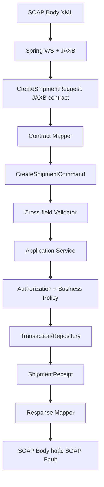

# Kiểm tra quy tắc liên trường và điều kiện nghiệp vụ sau khi đọc XML

## 1. Vì sao XML hợp lệ chưa chắc là yêu cầu hợp lệ?

Trong dịch vụ SOAP xây dựng bằng **Spring Web Services (Spring-WS)** theo hướng **contract-first**, XSD giúp các hệ thống thống nhất hình dạng XML: tên phần tử, namespace, thứ tự, kiểu dữ liệu, trường bắt buộc và một số ràng buộc giá trị. JAXB/OXM đọc XML và tạo object Java. Nhưng **cả hai bước đó chưa đủ để xác nhận một yêu cầu có thể thực hiện về mặt nghiệp vụ**.

Ví dụ một lời gọi tạo vận đơn có các trường:

- `deliveryMode = HOME`: giao đến địa chỉ.
- `deliveryAddress`: địa chỉ nhận, tùy chọn ở mức schema.
- `pickupPointCode`: điểm đến nhận tại quầy, cũng tùy chọn.
- `declaredValue`: giá trị khai báo.
- `codAmount`: số tiền thu hộ, có thể vắng mặt.
- `pickupWindowStart` và `pickupWindowEnd`: khoảng thời gian dự kiến.

XSD có thể nói `deliveryAddress` và `pickupPointCode` đều là optional. Tuy nhiên nghiệp vụ lại quy định:

1. Nếu `HOME` thì phải có `deliveryAddress`, và không được khai báo `pickupPointCode`.
2. Nếu `PICKUP` thì phải có `pickupPointCode`, và không gửi `deliveryAddress`.
3. Nếu có `codAmount`, số tiền đó phải dương và không vượt `declaredValue`.
4. `pickupWindowEnd` phải sau `pickupWindowStart`.
5. Tài khoản đang gửi phải còn hoạt động, có quyền tạo vận đơn và được phép dùng điểm giao/nhận được yêu cầu.

Các quy tắc 1–4 là **validation liên trường**. Quy tắc 5 là **validation theo trạng thái và chính sách nghiệp vụ**; nó có thể cần truy vấn dữ liệu và xác thực danh tính caller. Không nên trông đợi một XSD validator hoặc JAXB unmarshaller thực hiện tất cả.

Bài thuộc chương **Kiểm tra dữ liệu** của module **SPRING_WEB_SERVICES**, tiếp nối thiết kế XSD/WSDL, JAXB, SOAP endpoint/client và đặt việc xác thực, xử lý SOAP Fault, interceptor, XML security, WS-Security, chứng chỉ vào đúng ranh giới.

### Mục tiêu

Sau bài học, bạn có thể:

1. Phân biệt kiểm tra well-formed XML, SOAP protocol, XSD, object-level, cross-field và điều kiện nghiệp vụ có trạng thái.
2. Thiết kế command/model Java độc lập với JAXB để kiểm tra liên trường sau unmarshal.
3. Viết bộ validator tích lũy lỗi, sử dụng `BigDecimal` và `Instant` đúng ngữ nghĩa.
4. Lựa chọn giữa validation thủ công, **Jakarta Validation class-level constraint** và quy tắc trong domain/application service.
5. Đặt schema validation, mapper, validator, authorization và transaction đúng vị trí trong Spring-WS.
6. Ánh xạ lỗi thành **SOAP Fault có cấu trúc theo WSDL** mà không làm lộ thông tin nội bộ.
7. Thiết kế test matrix kiểm tra các trường hợp kết hợp, lỗi stateful, concurrency, SOAP security và client interoperability.

## 2. Các tầng validation không thay thế nhau

Một SOAP request đi qua nhiều lớp kiểm soát:

```mermaid
flowchart TD
    A[HTTP(S) request bytes] --> B[Transport, TLS/mTLS, giới hạn kích thước]
    B --> C[SOAP Envelope/Header/Body parsing]
    C --> D[XSD payload validation nếu đã cấu hình]
    D --> E[JAXB/OXM unmarshal thành contract object]
    E --> F[Contract Mapper -> Application Command]
    F --> G[Cross-field validation]
    G --> H[Caller identity + authorization]
    H --> I[Business policy/state validation]
    I --> J[Transaction, idempotency, persistence]
    J --> K[Response/typed Fault mapping]
```

Sơ đồ diễn giải **ranh giới trách nhiệm**; thứ tự thực tế của authentication, SOAP interceptors, schema validation và unmarshalling phụ thuộc cấu hình Spring-WS. Chẳng hạn WS-Security phải được xác minh trước khi ứng dụng *tin* dữ liệu/header đã ký, trong khi SOAP parser cần đọc thông điệp để tìm phần tử cần xác minh.

| Tầng | Câu hỏi | Công cụ/vị trí điển hình | Ví dụ lỗi |
| --- | --- | --- | --- |
| XML well-formed | XML có đóng/mở thẻ, namespace và encoding hợp lệ? | XML parser/message factory | Thẻ không đóng, khai báo namespace sai |
| SOAP protocol | Envelope, role, `mustUnderstand`, SOAP version có đúng? | SOAP stack/interceptor | SOAP 1.2 gửi vào binding chỉ hỗ trợ SOAP 1.1 |
| XSD/contract | XML có đúng QName, `xs:sequence`, kiểu và cardinality? | Schema validator, `PayloadValidatingInterceptor` | Thiếu `requestId`, `xs:decimal` không hợp lệ |
| Mapping | Có thể chuyển contract XML thành Java command? | JAXB/OXM + mapper | Timezone không xác định trong chính sách UTC |
| **Cross-field** | Tập hợp các trường có nhất quán với nhau? | Command validator, class-level constraint | `HOME` đồng thời có `pickupPointCode` |
| **Business policy/state** | Thao tác có được phép trong trạng thái hiện tại? | Application/domain service | Tài khoản khóa; pickup point tạm ngừng |
| Security/authorization | Caller là ai và được quyền thao tác với tài nguyên nào? | TLS/WS-Security + authorization | Caller thuộc tenant A gửi account của tenant B |
| Persistence/integrity | Dữ liệu còn thỏa invariant lúc commit? | Transaction, DB constraints, idempotency | Hai request cùng tạo vận đơn trùng ID |

**Điểm mấu chốt:** JAXB unmarshal thành công chỉ chứng minh khả năng ánh xạ trong điều kiện hiện tại; nó **không mặc định kích hoạt** toàn bộ XSD validation, Jakarta Validation hay quy tắc nghiệp vụ.

## 3. Quy tắc đơn trường, liên trường và có trạng thái

### 3.1. Quy tắc đơn trường

Chỉ cần một giá trị:

- `requestId` không rỗng.
- `declaredValue > 0`.
- `currency` thuộc danh sách mã tiền tệ được hỗ trợ.
- `deliveryMode` thuộc `HOME` hoặc `PICKUP`.

Một phần có thể thể hiện trực tiếp bằng XSD facets như `minLength`, `enumeration` hoặc `minInclusive`. Có thể bổ sung Jakarta Validation `@NotNull`, `@DecimalMin`, `@Pattern` trong Java nếu cần.

### 3.2. Quy tắc liên trường

Cần nhìn nhiều giá trị trong **cùng command**:

- `HOME` yêu cầu địa chỉ, cấm mã điểm lấy hàng.
- `PICKUP` yêu cầu mã điểm lấy hàng, cấm địa chỉ.
- `codAmount <= declaredValue`.
- `pickupWindowStart < pickupWindowEnd`.
- Nếu đồng tiền là `VND`, chính sách có thể yêu cầu số tiền nguyên (phải xác nhận quy ước kinh doanh; không giả định cho mọi loại tiền).

Một validator trên trường `codAmount` đơn lẻ không thể biết `declaredValue`, nên cần validator trên **object tổng thể** hoặc một phương thức biết cả hai trường.

### 3.3. Quy tắc cần trạng thái bên ngoài

Cần tham chiếu trạng thái thay đổi theo thời gian:

- Tài khoản còn hoạt động?
- Caller có quyền trên account?
- Điểm giao nhận đang mở, còn công suất?
- Có bị vượt hạn mức COD theo khách hàng?
- `requestId` này đã xử lý với payload khác chưa?

Những quy tắc này không phù hợp để nhét vào JAXB annotation hoặc một class-level bean validator thuần túy nếu chúng phụ thuộc repository, transaction và race conditions.

### 3.4. Quy tắc kết hợp trường và trạng thái

Ví dụ:

> Khi `deliveryMode=PICKUP` thì `pickupPointCode` không được rỗng (liên trường), và điểm đó phải được tài khoản này phép sử dụng ở thời điểm tiếp nhận (stateful).

Hai kiểm tra nên **tách riêng** để trả lỗi dễ hiểu và bảo đảm hiệu năng: từ chối cấu trúc sai trước khi thực hiện truy vấn trạng thái, đồng thời kiểm tra quyền và trạng thái trước khi ghi dữ liệu.

## 4. XSD ví dụ: CreateShipmentRequest

Giả sử namespace contract `urn:example:shipment:v1` và SOAP 1.1 document/literal. XSD sau cố ý cho phép một số trường optional, vì việc chúng có bắt buộc **hay không phụ thuộc các trường khác**.

```xml
<?xml version="1.0" encoding="UTF-8"?>
<xs:schema
    xmlns:xs="http://www.w3.org/2001/XMLSchema"
    xmlns:sh="urn:example:shipment:v1"
    targetNamespace="urn:example:shipment:v1"
    elementFormDefault="qualified">

  <xs:simpleType name="RequestIdType">
    <xs:restriction base="xs:token">
      <xs:minLength value="1"/>
      <xs:maxLength value="64"/>
    </xs:restriction>
  </xs:simpleType>

  <xs:simpleType name="DeliveryModeType">
    <xs:restriction base="xs:string">
      <xs:enumeration value="HOME"/>
      <xs:enumeration value="PICKUP"/>
    </xs:restriction>
  </xs:simpleType>

  <xs:complexType name="DeliveryAddressType">
    <xs:sequence>
      <xs:element name="line1" type="xs:token"/>
      <xs:element name="city" type="xs:token"/>
    </xs:sequence>
  </xs:complexType>

  <xs:element name="CreateShipmentRequest">
    <xs:complexType>
      <xs:sequence>
        <xs:element name="requestId" type="sh:RequestIdType"/>
        <xs:element name="accountId" type="sh:RequestIdType"/>
        <xs:element name="deliveryMode" type="sh:DeliveryModeType"/>
        <xs:element name="deliveryAddress"
                    type="sh:DeliveryAddressType" minOccurs="0"/>
        <xs:element name="pickupPointCode"
                    type="xs:token" minOccurs="0"/>
        <xs:element name="declaredValue" type="xs:decimal"/>
        <xs:element name="codAmount"
                    type="xs:decimal" minOccurs="0"/>
        <xs:element name="currency" type="xs:token"/>
        <xs:element name="pickupWindowStart" type="xs:dateTime"/>
        <xs:element name="pickupWindowEnd" type="xs:dateTime"/>
      </xs:sequence>
    </xs:complexType>
  </xs:element>

  <xs:element name="CreateShipmentResponse">
    <xs:complexType>
      <xs:sequence>
        <xs:element name="requestId" type="sh:RequestIdType"/>
        <xs:element name="shipmentId" type="sh:RequestIdType"/>
        <xs:element name="state" type="xs:string"/>
      </xs:sequence>
    </xs:complexType>
  </xs:element>
</xs:schema>
```

Cần phân biệt:

- `xs:sequence` kiểm soát thứ tự XML, **không** bảo đảm `pickupWindowEnd` sau `pickupWindowStart`.
- `minOccurs="0"` cho phép phần tử vắng mặt. Nó không đồng nghĩa với `nillable="true"`; ví dụ này **không** cho `xsi:nil="true"` trên hai trường optional.
- `xs:decimal` bảo đảm biểu diễn số thập phân hợp lệ, nhưng không tự cấm âm hoặc kiểm tra `codAmount <= declaredValue`.
- `xs:dateTime` bảo đảm cú pháp thời gian, nhưng trong XSD 1.0 **không mặc nhiên yêu cầu timezone**. Nếu nghiệp vụ cần so sánh các thời điểm tuyệt đối, phải có chính sách timezone rõ.
- `xs:token` chuẩn hóa whitespace theo schema, nhưng điều kiện dữ liệu trong Java vẫn nên được kiểm tra độc lập khi cần.
- Việc JAXB generated class có setter/getter không đồng nghĩa setter kiểm tra các ràng buộc trên.

Nếu hai kiểu giao hàng quá khác nhau, có thể thiết kế XSD bằng `xs:choice`, typed extension hoặc các global elements khác nhau. Tuy nhiên `xs:choice` chỉ giới hạn lựa chọn cấu trúc; nó không tự liên kết giá trị `deliveryMode=HOME` với branch địa chỉ theo cách tùy ý trong XSD 1.0.

## 5. XML hợp lệ về schema nhưng sai liên trường

Request sau có QName, kiểu và thứ tự đúng XSD ở mục 4, nhưng không nhất quán về nghiệp vụ:

```xml
<soapenv:Envelope
    xmlns:soapenv="http://schemas.xmlsoap.org/soap/envelope/"
    xmlns:sh="urn:example:shipment:v1">
  <soapenv:Body>
    <sh:CreateShipmentRequest>
      <sh:requestId>REQ-2026-5402</sh:requestId>
      <sh:accountId>ACCT-100</sh:accountId>
      <sh:deliveryMode>HOME</sh:deliveryMode>
      <sh:deliveryAddress>
        <sh:line1>12 Nguyen Hue</sh:line1>
        <sh:city>Ho Chi Minh City</sh:city>
      </sh:deliveryAddress>
      <sh:pickupPointCode>POINT-22</sh:pickupPointCode>
      <sh:declaredValue>500000</sh:declaredValue>
      <sh:codAmount>700000</sh:codAmount>
      <sh:currency>VND</sh:currency>
      <sh:pickupWindowStart>2026-12-03T15:00:00+07:00</sh:pickupWindowStart>
      <sh:pickupWindowEnd>2026-12-03T14:00:00+07:00</sh:pickupWindowEnd>
    </sh:CreateShipmentRequest>
  </soapenv:Body>
</soapenv:Envelope>
```

Ở đây có **ba lỗi liên trường**:

1. `HOME` không được gửi `pickupPointCode`.
2. `700000` tiền COD lớn hơn `500000` giá trị khai báo.
3. Giờ kết thúc 14:00 đứng trước giờ bắt đầu 15:00 (cùng timezone).

Một validator chỉ kiểm XML với schema trên sẽ không kết luận được ba điều này. Nếu server vẫn tạo vận đơn, việc nhận XML đúng cấu trúc đã bị nhầm với chấp nhận yêu cầu đúng nghiệp vụ.

### 5.1. Request hợp lệ hơn về nội dung

```xml
<sh:CreateShipmentRequest
    xmlns:sh="urn:example:shipment:v1">
  <sh:requestId>REQ-2026-5403</sh:requestId>
  <sh:accountId>ACCT-100</sh:accountId>
  <sh:deliveryMode>HOME</sh:deliveryMode>
  <sh:deliveryAddress>
    <sh:line1>12 Nguyen Hue</sh:line1>
    <sh:city>Ho Chi Minh City</sh:city>
  </sh:deliveryAddress>
  <sh:declaredValue>500000</sh:declaredValue>
  <sh:codAmount>300000</sh:codAmount>
  <sh:currency>VND</sh:currency>
  <sh:pickupWindowStart>2026-12-03T14:00:00+07:00</sh:pickupWindowStart>
  <sh:pickupWindowEnd>2026-12-03T15:00:00+07:00</sh:pickupWindowEnd>
</sh:CreateShipmentRequest>
```

Đây là **Body payload**, chưa có SOAP Envelope; có thể dùng làm fixture trong Spring-WS `MockWebServiceClient`. Request này thỏa các quan hệ liên trường đã nêu, nhưng vẫn có thể bị từ chối do quyền tài khoản, công suất dịch vụ, hạn mức hay trạng thái hệ thống.

## 6. Kiến trúc sau unmarshalling: contract DTO → command → policy

Nên tách object JAXB công khai và command/domain model:



### 6.1. Vì sao không đặt mọi rule vào JAXB class?

Generated JAXB classes là đầu ra của XJC và có thể thay đổi khi XSD, binding file hoặc generator thay đổi. Việc sửa tay chúng sẽ bị ghi đè khi sinh mã lại. Việc dùng chúng làm domain model khiến business service phụ thuộc XML/QName và khó tách nhiều version hợp đồng.

Ngược lại, một `CreateShipmentCommand` không phụ thuộc Spring-WS hay JAXB cho phép unit test quy tắc liên trường **không cần khởi tạo SOAP stack**.

### 6.2. Thứ tự thường dùng

1. Phân tích SOAP request an toàn và áp dụng XSD validation nếu đã cấu hình.
2. Unmarshal phần tử XML sang JAXB contract object.
3. Mapper chuyển kiểu và chuẩn hóa dữ liệu có chủ đích; loại bỏ những dữ liệu không được contract cho phép.
4. Validator kiểm tra các quan hệ giữa fields; trả kết quả hoặc lỗi có cấu trúc.
5. Xác thực caller và kiểm tra authorization/stateful policy ở boundary phù hợp (security có thể xác minh sớm hơn bước 1–4).
6. Thực hiện giao dịch và bảo vệ invariant trong transaction/DB.
7. Ánh xạ kết quả hoặc lỗi sang SOAP response/Fault theo WSDL.

Không nên chạy một service gọi database nhiều lần trước khi phát hiện các lỗi cross-field cơ bản; nhưng cũng không nên dựa vào việc request đã “qua bước 4” để bỏ authorization.

## 7. Định nghĩa command độc lập với JAXB

Một cách biểu diễn trong Java 17:

```java
import java.math.BigDecimal;
import java.time.Instant;

public enum DeliveryMode {
    HOME, PICKUP
}

public record DeliveryAddress(
        String line1,
        String city) {}

public record CreateShipmentCommand(
        String requestId,
        String accountId,
        DeliveryMode deliveryMode,
        DeliveryAddress deliveryAddress,
        String pickupPointCode,
        BigDecimal declaredValue,
        BigDecimal codAmount,
        String currency,
        Instant pickupWindowStart,
        Instant pickupWindowEnd) {}
```

Đây là **command model** ở application boundary, không phải JAXB class do XJC sinh. Các khai báo `public enum` và `public record` trong ví dụ cần được tách thành các file Java tương ứng nếu sử dụng trực tiếp trong project. Các field được giữ nullable tại giai đoạn này để bộ validator có thể tổng hợp lỗi một cách có kiểm soát. Sau validation, use case có thể tạo một domain value object có invariant mạnh hơn.

### 7.1. Khi nào đưa dữ liệu vào value object?

Có thể tạo `Money(amount, currency)` với invariant một tiền tệ hợp lệ, hoặc `PickupWindow(start, end)` chỉ cho phép khoảng thời gian dương.

Lợi ích:

- Những domain objects đã tạo xong luôn thỏa invariant nội bộ.
- Không lặp kiểm tra `start < end` ở mọi method.
- Code nghiệp vụ sử dụng các kiểu có ý nghĩa thay vì `String` và `BigDecimal` rời rạc.

Tuy nhiên, khi cần **tổng hợp nhiều lỗi cùng lúc**, nên kiểm tra input thô trước khi tạo những value object ném exception sớm. Không nên tạo value object với trạng thái bất hợp lệ chỉ để giữ đủ lỗi.

## 8. Mapper: từ JAXB XML sang command

Một ví dụ mapper mang tính định hướng:

```java
import java.time.Instant;
import java.util.Locale;
import javax.xml.datatype.DatatypeConstants;
import javax.xml.datatype.XMLGregorianCalendar;

public final class CreateShipmentMapper {

    public CreateShipmentCommand toCommand(
            CreateShipmentRequest xml) {

        DeliveryAddress address = null;

        if (xml.getDeliveryAddress() != null) {
            var a = xml.getDeliveryAddress();
            address = new DeliveryAddress(
                    a.getLine1(), a.getCity());
        }

        return new CreateShipmentCommand(
                xml.getRequestId(),
                xml.getAccountId(),
                toMode(xml.getDeliveryMode()),
                address,
                xml.getPickupPointCode(),
                xml.getDeclaredValue(),
                xml.getCodAmount(),
                normalizeCurrency(xml.getCurrency()),
                toInstant(xml.getPickupWindowStart(),
                          "pickupWindowStart"),
                toInstant(xml.getPickupWindowEnd(),
                          "pickupWindowEnd"));
    }

    private DeliveryMode toMode(
            com.example.shipment.contract.DeliveryModeType mode) {
        if (mode == null) {
            return null;
        }
        return DeliveryMode.valueOf(mode.value());
    }

    private String normalizeCurrency(String currency) {
        return currency == null
                ? null
                : currency.trim().toUpperCase(Locale.ROOT);
    }

    private Instant toInstant(
            XMLGregorianCalendar value, String field) {

        if (value == null ||
                value.getTimezone() == DatatypeConstants.FIELD_UNDEFINED) {
            throw new ContractMappingException(
                    field + " must have a timezone");
        }
        return value.toGregorianCalendar()
                .toZonedDateTime()
                .toInstant();
    }
}
```

**Đây là ví dụ mapper**, giả định generated JAXB classes có các getters tương ứng, `DeliveryModeType` được sinh dưới dạng enum có `value()`, `xs:dateTime` là `XMLGregorianCalendar`. Tên package/getters có thể khác theo XJC/binding. `ContractMappingException` là exception ứng dụng cần định nghĩa; trong dự án thực tế lỗi mapping nên có **mã ổn định** và không chứa XML nhạy cảm.

Hai quyết định quan trọng:

- Quy đổi timezone thành `Instant` **chỉ khi value có timezone rõ**. Nếu contract chấp nhận `xs:dateTime` không offset, phải thiết kế quy tắc diễn giải trong một timezone đã thỏa thuận — đừng âm thầm lấy timezone máy chủ.
- Quy đổi mã tiền tệ sang uppercase ở boundary là quyết định normalization được công bố. Không tự normalize ID, mã tenant hay token bí mật theo cách có thể tạo collision nếu contract không cho phép.

### 8.1. Nguy cơ “mapper tự chữa dữ liệu”

Một mapper có thể vô tình làm mất lỗi liên trường:

```java
// Anti-pattern: âm thầm bỏ dữ liệu mâu thuẫn
if (mode == DeliveryMode.HOME) {
    pickupPointCode = null;
}
```

Nếu client gửi `HOME` kèm `pickupPointCode`, server nên từ chối hoặc ghi nhận theo chính sách, không âm thầm bỏ trường rồi trả “thành công” trừ khi contract thực sự cho phép sự sửa chữa đó. Việc tự sửa dữ liệu che giấu bug client và tạo khác biệt khó phát hiện giữa các nền tảng.

### 8.2. Khi mapping thất bại trước cross-field validator

Ví dụ timezone không có offset hoặc enum không thể ánh xạ, mapper có thể ném lỗi có mã `INVALID_DATETIME`/`INVALID_ENUM`. Nếu muốn tổng hợp nhiều lỗi, thay cách ném exception bằng kết quả mapping chứa issues; nhưng không tạo command với các kiểu dữ liệu được đoán sai.

Không được catch mọi exception JAXB rồi tự đổi thành business rejection: XML parser error/namespace error có ngữ nghĩa khác với một lệnh nghiệp vụ bị từ chối.

## 9. Validator liên trường thủ công: dễ nhìn và dễ kiểm thử

Với nhóm quy tắc nhỏ, một validator Java thuần thường rõ ràng hơn đưa mọi logic vào annotation.

### 9.1. Định dạng kết quả lỗi

```java
public record ValidationIssue(
        String fieldPath,
        String code) {}
```

`fieldPath` trỏ đến tên field trong public contract hoặc một path đã được quy định rõ; `code` là mã máy đọc được, ổn định qua phiên bản. Không đưa raw field value, SQL, stack trace, secret hoặc thông tin quyền truy cập của khách hàng khác vào lỗi trả client.

### 9.2. Ví dụ validation thuần Java

```java
import java.math.BigDecimal;
import java.util.ArrayList;
import java.util.List;
import java.util.Set;

public final class ShipmentCommandValidator {
    private static final Set<String> CURRENCIES =
            Set.of("VND", "USD");

    public List<ValidationIssue> validate(CreateShipmentCommand c) {
        List<ValidationIssue> issues = new ArrayList<>();

        if (c.deliveryMode() == null) {
            issues.add(new ValidationIssue(
                    "deliveryMode", "DELIVERY_MODE_REQUIRED"));
        } else if (c.deliveryMode() == DeliveryMode.HOME) {
            if (c.deliveryAddress() == null) {
                issues.add(new ValidationIssue(
                        "deliveryAddress", "ADDRESS_REQUIRED"));
            }
            if (c.pickupPointCode() != null) {
                issues.add(new ValidationIssue(
                        "pickupPointCode", "PICKUP_POINT_FORBIDDEN"));
            }
        } else if (c.deliveryMode() == DeliveryMode.PICKUP) {
            if (c.pickupPointCode() == null ||
                    c.pickupPointCode().isBlank()) {
                issues.add(new ValidationIssue(
                        "pickupPointCode", "PICKUP_POINT_REQUIRED"));
            }
            if (c.deliveryAddress() != null) {
                issues.add(new ValidationIssue(
                        "deliveryAddress", "ADDRESS_FORBIDDEN"));
            }
        }

        if (c.declaredValue() == null ||
                c.declaredValue().compareTo(BigDecimal.ZERO) <= 0) {
            issues.add(new ValidationIssue(
                    "declaredValue", "DECLARED_VALUE_NOT_POSITIVE"));
        }

        if (c.codAmount() != null) {
            if (c.codAmount().compareTo(BigDecimal.ZERO) <= 0) {
                issues.add(new ValidationIssue(
                        "codAmount", "COD_NOT_POSITIVE"));
            } else if (c.declaredValue() != null &&
                    c.codAmount().compareTo(c.declaredValue()) > 0) {
                issues.add(new ValidationIssue(
                        "codAmount", "COD_EXCEEDS_DECLARED_VALUE"));
            }
        }

        if (c.currency() == null ||
                !CURRENCIES.contains(c.currency())) {
            issues.add(new ValidationIssue(
                    "currency", "CURRENCY_UNSUPPORTED"));
        }

        if (c.pickupWindowStart() == null ||
                c.pickupWindowEnd() == null ||
                !c.pickupWindowEnd().isAfter(c.pickupWindowStart())) {
            issues.add(new ValidationIssue(
                    "pickupWindowEnd", "PICKUP_WINDOW_INVALID"));
        }

        return List.copyOf(issues);
    }
}
```

Các import/class nằm trong ví dụ; cần đặt các record/enum ở package application và viết test trước khi sử dụng production. Validator giả định command không null; caller chịu trách nhiệm không truyền null toàn bộ.

**Chính sách `codAmount`:** absence nghĩa là không yêu cầu COD; nếu hiện diện phải > 0. Nếu business cho phép amount bằng 0 để diễn đạt “không COD”, phải đổi quy tắc và công bố rõ. Đây là quyết định hợp đồng, không phải hành vi mặc định của `BigDecimal` hay XSD.

### 9.3. Vì sao dùng `BigDecimal.compareTo`?

`BigDecimal.equals` còn xét scale:

```java
new BigDecimal("100.0").equals(
        new BigDecimal("100.00"));  // false

new BigDecimal("100.0").compareTo(
        new BigDecimal("100.00"));  // 0
```

So sánh số tiền theo giá trị số học thường dùng `compareTo`, sau đó xử lý đơn vị tiền tệ và rounding ở tầng policy. Không chuyển `xs:decimal` thành `double` khi cần giữ độ chính xác tiền tệ.

### 9.4. Lỗi nên trả một hay nhiều?

Tích lũy nhiều lỗi giúp client sửa request trong một lần thay vì gửi đi gửi lại từng trường. Nhưng cần giới hạn số issue và loại dữ liệu được trả để tránh lạm dụng hoặc làm lộ thông tin.

Một số tình huống nên **dừng sớm**:

- XML parser/security lỗi nghiêm trọng.
- Token/chữ ký không hợp lệ.
- Không xác định được tenant/caller đáng tin.
- Request vượt giới hạn kích thước.

Việc tiếp tục kiểm cross-field sau khi security fail có thể tạo thêm công việc không cần thiết hoặc làm lộ quy tắc nội bộ.

## 10. Ma trận quy tắc liên trường cho ví dụ

| `deliveryMode` | `deliveryAddress` | `pickupPointCode` | Kết quả |
| --- | --- | --- | --- |
| HOME | Có | Vắng | Hợp lệ theo quy tắc lựa chọn |
| HOME | Vắng | Vắng | `ADDRESS_REQUIRED` |
| HOME | Có | Có | `PICKUP_POINT_FORBIDDEN` |
| HOME | Vắng | Có | Hai lỗi: thiếu địa chỉ và cấm pickup |
| PICKUP | Vắng | Có | Hợp lệ theo quy tắc lựa chọn |
| PICKUP | Có | Có | `ADDRESS_FORBIDDEN` |
| PICKUP | Vắng | Vắng | `PICKUP_POINT_REQUIRED` |
| PICKUP | Có | Vắng | Hai lỗi: thiếu pickup và cấm địa chỉ |

Thử tất cả các tổ hợp có ý nghĩa, không chỉ happy path. Với `deliveryMode` có enum mở rộng sau này, cần chính sách khi nhận giá trị không nhận diện được; không mặc định chuyển sang HOME hoặc PICKUP.

| `declaredValue` | `codAmount` | Kết quả |
| --- | --- | --- |
| 500000 | Vắng | Hợp lệ nếu non-COD |
| 500000 | 300000 | Hợp lệ |
| 500000 | 500000 | Hợp lệ theo chính sách `<=` |
| 500000 | 700000 | `COD_EXCEEDS_DECLARED_VALUE` |
| 500000 | 0 | `COD_NOT_POSITIVE` |
| 500000 | -1 | `COD_NOT_POSITIVE` |
| 0 | Vắng | `DECLARED_VALUE_NOT_POSITIVE` |

Thời gian cũng cần ma trận: start < end, start = end, start > end; hai timestamps cùng thời điểm nhưng offset khác nhau; timezone không có; thời điểm nằm ngoài lịch hoạt động của chi nhánh.

## 11. Jakarta Validation cho quy tắc trên nhiều thuộc tính

Nếu ứng dụng đã dùng **Jakarta Validation**, có thể khai báo **class-level constraint** trên command/DTO để kiểm tra các field cùng nhau. Đừng nhầm class-level validation với **cross-parameter constraint**: loại thứ hai dùng để kiểm tra nhiều tham số của *một method/constructor*, còn ở đây các giá trị nằm trong *một command object*.

### 11.1. Khai báo annotation class-level

```java
import jakarta.validation.Constraint;
import jakarta.validation.Payload;

import java.lang.annotation.Documented;
import java.lang.annotation.Retention;
import java.lang.annotation.Target;

import static java.lang.annotation.ElementType.TYPE;
import static java.lang.annotation.RetentionPolicy.RUNTIME;

@Documented
@Constraint(validatedBy = DeliveryChoiceValidator.class)
@Target(TYPE)
@Retention(RUNTIME)
public @interface ConsistentDeliveryChoice {
    String message() default "{shipment.delivery.choice.invalid}";
    Class<?>[] groups() default {};
    Class<? extends Payload>[] payload() default {};
}
```

### 11.2. Áp dụng trên command

```java
@ConsistentDeliveryChoice
public record CreateShipmentCommand(
        String requestId,
        String accountId,
        DeliveryMode deliveryMode,
        DeliveryAddress deliveryAddress,
        String pickupPointCode,
        BigDecimal declaredValue,
        BigDecimal codAmount,
        String currency,
        Instant pickupWindowStart,
        Instant pickupWindowEnd) {}
```

Đây là cùng command ở mục 7 nhưng có annotation class-level bổ sung; **không tạo hai record trùng tên trong cùng project**. Các kiểu/import giữ nguyên.

### 11.3. Triển khai validator

```java
import jakarta.validation.ConstraintValidator;
import jakarta.validation.ConstraintValidatorContext;

public final class DeliveryChoiceValidator
        implements ConstraintValidator<
            ConsistentDeliveryChoice, CreateShipmentCommand> {

    @Override
    public boolean isValid(
            CreateShipmentCommand value,
            ConstraintValidatorContext context) {

        if (value == null || value.deliveryMode() == null) {
            return true; // Null/mode required được kiểm riêng.
        }

        boolean addressPresent = value.deliveryAddress() != null;
        boolean pickupPresent = value.pickupPointCode() != null;

        boolean consistent = switch (value.deliveryMode()) {
            case HOME -> addressPresent && !pickupPresent;
            case PICKUP -> !addressPresent && pickupPresent;
        };

        if (!consistent) {
            context.disableDefaultConstraintViolation();
            context.buildConstraintViolationWithTemplate(
                    "{shipment.delivery.choice.invalid}")
                   .addPropertyNode("deliveryMode")
                   .addConstraintViolation();
        }
        return consistent;
    }
}
```

**Giới hạn của ví dụ:** Cả validator thủ công lẫn class-level validator đều coi `pickupPointCode != null` là **phần tử đã hiện diện** vì mapper giữ nguyên sự khác biệt giữa absent và empty. Khi ở chế độ PICKUP, một chuỗi rỗng vẫn cần bị từ chối bằng kiểm tra `isBlank()` ở field-level/validator thủ công. Khi triển khai, phải thống nhất chính sách **absent/empty/nil** và không tự normalize chuỗi rỗng thành `null` nếu làm mất tín hiệu dữ liệu sai.

### 11.4. Kích hoạt validation tường minh

Khai báo annotation **không tự làm validate**. Cần gọi `jakarta.validation.Validator` (hoặc tích hợp method validation đã kiểm chứng):

```java
import jakarta.validation.ConstraintViolation;
import jakarta.validation.Validator;

public final class BeanValidatedCommandGuard {
    private final Validator validator;

    public BeanValidatedCommandGuard(Validator validator) {
        this.validator = validator;
    }

    public void requireValid(CreateShipmentCommand command) {
        var violations = validator.validate(command);
        if (!violations.isEmpty()) {
            throw new CommandValidationException(
                    violations.stream()
                        .map(v -> new ValidationIssue(
                            v.getPropertyPath().toString(),
                            v.getMessageTemplate()))
                        .toList());
        }
    }
}
```

`CommandValidationException` là exception ứng dụng cần định nghĩa; khi client cần **mã lỗi ổn định** chứ không phải message template, hãy quy ước ánh xạ validation metadata sang mã domain riêng, không coi mọi template của thư viện là hợp đồng công khai.

Trong một Spring-WS `@Endpoint`, **không giả định thêm `@Valid` vào `@RequestPayload` tự động kích hoạt đầy đủ Jakarta Validation như một REST controller dùng Spring MVC**. Phải xác minh argument resolver/method validation thực tế hoặc gọi validator tường minh sau mapping.

### 11.5. Khi nào chọn Jakarta Validation?

Phù hợp khi:

- Nhiều command/DTO có constraint tĩnh giống nhau.
- Muốn dùng `@NotNull`, `@Size`, `@DecimalMin`, group và class-level constraints thống nhất.
- Có provider Jakarta Validation được cấu hình và đã test.
- Rule chủ yếu phụ thuộc dữ liệu hiện diện trong một object.

Không nên lạm dụng để nhúng database queries, network calls hoặc transaction phụ thuộc trạng thái vào một `ConstraintValidator`. Những việc này thường thuộc application/domain policy.

## 12. Quy tắc nghiệp vụ có trạng thái: kiểm sau cross-field

Giả sử cross-field validator trả danh sách rỗng. Yêu cầu vẫn có thể không được phép nếu:

- Account đang bị khóa.
- Điểm PICKUP đã ngừng phục vụ.
- Caller không có quyền truy cập account.
- Hạn mức COD của account đã hết.
- Request ID bị dùng lại với payload khác.
- Thời gian chọn không thuộc giờ hoạt động hoặc đã quá hạn.

### 12.1. Application service minh họa

```java
public final class CreateShipmentApplicationService
        implements CreateShipmentUseCase {

    private final ShipmentCommandValidator validator;
    private final AccountRepository accounts;
    private final PickupPointRepository pickupPoints;
    private final ShipmentRepository shipments;
    private final ShipmentAuthorization authorization;

    public CreateShipmentApplicationService(
            ShipmentCommandValidator validator,
            AccountRepository accounts,
            PickupPointRepository pickupPoints,
            ShipmentRepository shipments,
            ShipmentAuthorization authorization) {
        this.validator = validator;
        this.accounts = accounts;
        this.pickupPoints = pickupPoints;
        this.shipments = shipments;
        this.authorization = authorization;
    }

    @Override
    @Transactional
    public ShipmentReceipt create(
            AuthenticatedCaller caller,
            CreateShipmentCommand command) {

        var issues = validator.validate(command);
        if (!issues.isEmpty()) {
            throw new CommandValidationException(issues);
        }

        authorization.requireCanCreateFor(
                caller, command.accountId());

        Account account = accounts.getForUpdate(
                command.accountId());
        account.requireActive();

        if (command.deliveryMode() == DeliveryMode.PICKUP) {
            PickupPoint point = pickupPoints.getForUpdate(
                    command.pickupPointCode());
            point.requireAvailableFor(account);
        }

        return shipments.createIdempotently(
                caller, account, command);
    }
}
```

Đây là **mẫu kiến trúc**, không phải code runnable độc lập: `AccountRepository`, `PickupPointRepository`, `ShipmentRepository`, `ShipmentAuthorization`, `AuthenticatedCaller`, `ShipmentReceipt` và các method tương ứng là abstraction cần xây dựng. `@Transactional` thuộc Spring transaction khi được cấu hình; nếu project không sử dụng transaction manager phù hợp, annotation không tự bảo đảm atomicity.

### 12.2. Security context không phải trường XML tự khai

`caller` phải được xác thực bởi cơ chế tin cậy, ví dụ WS-Security, TLS/mTLS hoặc security integration đã được kiểm chứng. `accountId` trong SOAP Body là **đối tượng caller muốn thao tác**, không phải bằng chứng có quyền trên account đó.

Một request cross-field hợp lệ vẫn cần authorization. Không nên đi tìm account rồi trả “account không tồn tại” cho người không có quyền nếu điều đó làm lộ dữ liệu tenant khác; thứ tự và thông tin trả về phải tuân thủ threat model.

### 12.3. “Check rồi write” có race condition

Nếu kiểm `pickupPoint` còn chỗ ở thời điểm T1 rồi ghi shipment ở T2 mà không có concurrency control, hai request đồng thời có thể cùng “thấy còn chỗ” và vượt công suất.

Cần phối hợp:

- Transaction có phạm vi hợp lý.
- Lock/optimistic version hoặc constraint phù hợp.
- Quy tắc idempotency và unique key.
- Xử lý conflict khi commit với mã lỗi ứng dụng có cấu trúc.
- Không giữ transaction trong lúc chờ network call lâu nếu có thể tránh.

**Validation là một phần của bảo vệ invariant, nhưng không thay thế được constraint và concurrency control ở database.**

## 13. Điều kiện thời gian: hai thời điểm và thời điểm hiện tại

Cross-field rule `end > start` nên dùng **thời điểm tuyệt đối** nếu hai giá trị có offset:

```text
2026-12-03T14:00:00+07:00
2026-12-03T08:00:00+01:00
```

Hai biểu diễn trên là **cùng một Instant** (07:00 UTC); với chính sách yêu cầu khoảng thời gian dương thì invalid, dù giờ trên mặt đồng hồ khác nhau.

### 13.1. Không so sánh chuỗi XML

```java
// Sai: thứ tự từ điển không biểu diễn chắc chắn thứ tự thời gian.
boolean valid = startXml.compareTo(endXml) < 0;
```

Hãy parse thành `Instant` hoặc kiểu temporal có timezone rõ rồi dùng `isAfter`/`isBefore`.

### 13.2. Quy tắc phụ thuộc thời điểm hiện tại

Ví dụ doanh nghiệp yêu cầu `pickupWindowStart` không được sớm hơn hiện tại và không được muộn quá 30 ngày. Rule này cần dùng một `Clock` inject được:

```java
import java.time.Clock;
import java.time.Duration;
import java.time.Instant;

public final class PickupWindowPolicy {
    private final Clock clock;

    public PickupWindowPolicy(Clock clock) {
        this.clock = clock;
    }

    public boolean isAcceptable(Instant start) {
        Instant now = clock.instant();
        return !start.isBefore(now)
                && !start.isAfter(now.plus(Duration.ofDays(30)));
    }
}
```

Bài tập kiểm thử nên dùng `Clock.fixed(...)` để không phụ thuộc vào giờ thật. Trong nghiệp vụ có timezone địa phương và DST, quy tắc như “giờ mở cửa 08:00–17:00 tại địa phương” cần dùng `ZoneId` của địa điểm, **không** chỉ `Instant` và duration toàn cục.

### 13.3. Thời gian cũng có concurrency

Một slot giao hàng hợp lệ khi validate có thể bị đặt hết khi commit. Policy cần có cơ chế reservation/locking hoặc kết quả `WINDOW_UNAVAILABLE` nếu không còn chỗ. Không “pass validation” rồi ngầm đảm bảo slot đã được giữ.

## 14. Số tiền, tiền tệ và đơn vị dữ liệu

Một rule `codAmount <= declaredValue` chỉ có nghĩa khi **hai giá trị có cùng currency và đơn vị**.

Nếu XSD có một `currency` áp dụng cho cả hai khoản tiền, phải ghi rõ điều đó trong contract. Nếu từng khoản có currency riêng, không thể so sánh số trực tiếp khi chưa xác định quy tắc chuyển đổi tiền và tỷ giá, thời điểm áp dụng.

### 14.1. Các điểm cần thống nhất

- Sử dụng `BigDecimal` cho tiền; tránh `double`.
- Kiểm tra scale/rounding theo currency policy; ví dụ một hệ thống chỉ hỗ trợ số nguyên VND, nhưng không giả định mọi đơn vị tiền tệ đều có cùng số chữ số thập phân.
- Quyết định liệu `codAmount=0` có hợp lệ hay phải bỏ element.
- Kiểm tra hạn mức COD bằng chính sách tài khoản; đừng hardcode mọi account cùng một hạn mức.
- Không dùng `BigDecimal.equals` để kiểm tra hai giá trị tiền có cùng số học nếu scale có thể khác.
- Đặt giới hạn kích thước số để tránh chi phí xử lý quá lớn hoặc overflow ở downstream; XSD `totalDigits`/`fractionDigits` có thể giúp kiểm ở tầng contract.

### 14.2. Quy tắc nên thuộc đâu?

| Rule | Lớp phù hợp |
| --- | --- |
| `declaredValue` có cú pháp decimal | XSD/JAXB parsing |
| `declaredValue > 0` | Field/domain validation |
| `codAmount <= declaredValue` | Cross-field validation |
| Account có được bật COD không | Stateful business policy |
| Account còn hạn mức COD không | Stateful/transactional policy |
| Số tiền lưu xuống DB không vượt khả năng của cột | Persistence constraint/conversion |

Không gộp tất cả thành một annotation khó debug hoặc một câu `if` duy nhất trong endpoint.

## 15. Đặt bước kiểm tra vào Spring-WS endpoint

Một endpoint gọn có thể nhận JAXB request rồi chuyển sang command:

```java
import org.springframework.ws.server.endpoint.annotation.Endpoint;
import org.springframework.ws.server.endpoint.annotation.PayloadRoot;
import org.springframework.ws.server.endpoint.annotation.RequestPayload;
import org.springframework.ws.server.endpoint.annotation.ResponsePayload;

@Endpoint
public final class CreateShipmentEndpoint {
    private static final String NS = "urn:example:shipment:v1";

    private final CreateShipmentMapper mapper;
    private final CreateShipmentUseCase useCase;
    private final CallerIdentityProvider callers;
    private final ShipmentResponseMapper responseMapper;

    public CreateShipmentEndpoint(
            CreateShipmentMapper mapper,
            CreateShipmentUseCase useCase,
            CallerIdentityProvider callers,
            ShipmentResponseMapper responseMapper) {
        this.mapper = mapper;
        this.useCase = useCase;
        this.callers = callers;
        this.responseMapper = responseMapper;
    }

    @PayloadRoot(
        namespace = NS,
        localPart = "CreateShipmentRequest")
    @ResponsePayload
    public CreateShipmentResponse create(
            @RequestPayload CreateShipmentRequest request) {

        CreateShipmentCommand command = mapper.toCommand(request);
        AuthenticatedCaller caller =
                callers.requireAuthenticatedCaller();

        ShipmentReceipt receipt = useCase.create(caller, command);
        return responseMapper.toResponse(receipt);
    }
}
```

Các types `CreateShipmentRequest`/`CreateShipmentResponse` được giả định là generated JAXB classes từ XSD; có thể cần `JAXBElement<T>` theo cấu trúc schema/codegen. Các interfaces application/security/mappers trong ví dụ cần triển khai trong project. Spring-WS endpoint argument/return value adapters phải hỗ trợ JAXB model, không tự có đầy đủ chỉ vì khai báo XSD.

**Endpoint không tự**:

- Mở SQL connection.
- Tạo `JAXBContext` theo request.
- Gọi service trạng thái rồi bỏ qua transaction/invariant.
- Đặt HTTP 400 hoặc ghép SOAP Fault XML bằng string.
- Tin rằng `@RequestPayload` tự chạy Jakarta Validation.
- Coi account ID trong XML là caller identity.

Bước validator có thể được application use case thực hiện như mục 12; nếu muốn chặn cross-field lỗi **trước khi gọi use case**, có thể inject một `CreateShipmentCommandValidator` ở adapter, nhưng vẫn cần giữ những invariant trọng yếu ở application/domain để không bị bypass bởi các entrypoints khác.

## 16. Schema validation với Spring-WS interceptor: quan trọng nhưng khác nghiệp vụ

Spring-WS có `PayloadValidatingInterceptor` để validate XML payload với schema. Một cấu hình minh họa:

```java
import org.springframework.context.annotation.Bean;
import org.springframework.context.annotation.Configuration;
import org.springframework.core.io.ClassPathResource;
import org.springframework.ws.soap.server.endpoint.interceptor.PayloadValidatingInterceptor;

@Configuration
public class ShipmentXmlValidationConfig {

    @Bean
    public PayloadValidatingInterceptor shipmentXmlValidator() {
        PayloadValidatingInterceptor interceptor =
                new PayloadValidatingInterceptor();
        interceptor.setSchema(
            new ClassPathResource("xsd/shipment-v1.xsd"));
        interceptor.setValidateRequest(true);
        interceptor.setValidateResponse(true);
        return interceptor;
    }
}
```

Đây là **một bean interceptor**, chưa tự nối vào chain. Cần đăng ký nó với `WsConfigurer.addInterceptors(...)` hoặc cấu hình Spring-WS tương ứng để thực sự chạy. Cấu hình cụ thể có thể khác theo version framework; kiểm tra cả request và response XML thật.

Ví dụ đăng ký:

```java
import java.util.List;
import org.springframework.context.annotation.Configuration;
import org.springframework.ws.config.annotation.EnableWs;
import org.springframework.ws.config.annotation.WsConfigurer;
import org.springframework.ws.server.EndpointInterceptor;

@Configuration
@EnableWs
public class SoapEndpointInterceptorConfig implements WsConfigurer {

    private final PayloadValidatingInterceptor xmlValidator;

    public SoapEndpointInterceptorConfig(
            PayloadValidatingInterceptor xmlValidator) {
        this.xmlValidator = xmlValidator;
    }

    @Override
    public void addInterceptors(
            List<EndpointInterceptor> interceptors) {
        interceptors.add(xmlValidator);
    }
}
```

Với nhiều version XSD, phải bảo đảm schema set/interceptor lựa chọn đúng version, tránh vô tình dùng v2 schema để validate payload v1. Khi có import/includes, các schema phụ thuộc phải được resolve an toàn.

### 16.1. Interceptor kiểm cái gì?

Theo tài liệu API của Spring-WS, interceptor này kiểm **payload XML** dựa trên schema và có thể dừng chuỗi xử lý khi payload invalid. Mặc định nó kiểm request; `setValidateResponse(true)` cho phép kiểm response (không áp dụng cho response SOAP Fault).

Nhưng nó **không** tự truy vấn account, kiểm tra quyền tenant, COD limit hoặc quan hệ `end > start` nếu các rule ấy không được XSD mô tả.

### 16.2. Không tự mặc định response validation đã bật

Để giảm rủi ro code server marshal sai XSD, nên cân nhắc kiểm response trong test/CI và khi vận hành nếu phù hợp hiệu năng. Tuy nhiên bật validation ở runtime có chi phí và có thể khiến response hỏng phát hiện muộn; kiểm thử contract trước deploy vẫn cần thiết.

### 16.3. XSD 1.1 `xs:assert` có giải quyết mọi thứ không?

XSD 1.1 hỗ trợ assertions có thể mô tả một số quan hệ liên trường. Nhưng các validator trong SOAP stacks không mặc nhiên hỗ trợ XSD 1.1 đồng nhất. Nhiều toolchain JAXB/XJC và client doanh nghiệp tập trung XSD 1.0.

Nếu ưu tiên khả năng tương tác đa nền tảng, thường nên giữ hợp đồng XSD 1.0 có cấu trúc rõ và thực thi **business validation trong Java/application layer**, đồng thời công bố rule trong contract documentation và kiểm thử đối tác.

## 17. SOAP Fault có cấu trúc cho lỗi liên trường

Một client SOAP cần phân biệt:

1. XML/schema error: thông điệp không tuân hợp đồng cấu trúc.
2. Cross-field request error: các trường hợp lệ về kiểu nhưng mâu thuẫn.
3. Business rejection: trạng thái/quyền/hạn mức làm lệnh không được chấp thuận.
4. Technical failure: database, downstream hoặc xử lý nội bộ thất bại.
5. Transport failure: TLS/connection/timeout, có thể **không có SOAP response**.

Không nên biến mọi lỗi thành một `Internal Server Error` hoặc trả response “thành công” với ID giả.

### 17.1. Mô hình lỗi máy đọc được

Trong ứng dụng:

```java
public record ValidationIssue(
        String fieldPath,
        String code) {}

public final class CommandValidationException
        extends RuntimeException {
    private final java.util.List<ValidationIssue> issues;

    public CommandValidationException(
            java.util.List<ValidationIssue> issues) {
        super("Shipment command validation failed");
        this.issues = java.util.List.copyOf(issues);
    }

    public java.util.List<ValidationIssue> issues() {
        return issues;
    }
}
```

Đây là cùng `ValidationIssue` đã khai báo ở mục 9; không tạo thêm record trùng tên. Nên giới hạn issues và loại code/path được đưa ra client; thông báo exception không chứa dữ liệu XML thô.

### 17.2. XSD Fault detail minh họa

Đặt phần tử này vào **cùng XSD namespace v1** hoặc một schema fault namespace được công bố và import rõ:

```xml
<xs:element name="ShipmentFaultDetail">
  <xs:complexType>
    <xs:sequence>
      <xs:element name="code" type="xs:string"/>
      <xs:element name="correlationId"
                  type="xs:string" minOccurs="0"/>
      <xs:element name="violations" minOccurs="0">
        <xs:complexType>
          <xs:sequence>
            <xs:element name="violation" minOccurs="1"
                        maxOccurs="unbounded">
              <xs:complexType>
                <xs:sequence>
                  <xs:element name="fieldPath" type="xs:string"/>
                  <xs:element name="code" type="xs:string"/>
                </xs:sequence>
              </xs:complexType>
            </xs:element>
          </xs:sequence>
        </xs:complexType>
      </xs:element>
    </xs:sequence>
  </xs:complexType>
</xs:element>
```

Đây là **trích đoạn bên trong `xs:schema`**, không phải file XSD độc lập. Việc khai báo element chưa đủ: WSDL 1.1 cần `wsdl:message` có part trỏ đến `ShipmentFaultDetail`, `wsdl:fault` trong portType và `soap:fault` trong binding phù hợp. Spring-WS cũng cần exception resolver/custom fault detail writer tương ứng; không tự phát typed detail chỉ vì XSD tồn tại.

### 17.3. SOAP 1.1 Fault ví dụ

```xml
<soapenv:Envelope
    xmlns:soapenv="http://schemas.xmlsoap.org/soap/envelope/"
    xmlns:sh="urn:example:shipment:v1">
  <soapenv:Body>
    <soapenv:Fault>
      <faultcode>soapenv:Client</faultcode>
      <faultstring>Invalid shipment request</faultstring>
      <detail>
        <sh:ShipmentFaultDetail>
          <sh:code>SHIPMENT_FIELDS_INCONSISTENT</sh:code>
          <sh:correlationId>CORR-5402</sh:correlationId>
          <sh:violations>
            <sh:violation>
              <sh:fieldPath>pickupPointCode</sh:fieldPath>
              <sh:code>PICKUP_POINT_FORBIDDEN</sh:code>
            </sh:violation>
            <sh:violation>
              <sh:fieldPath>codAmount</sh:fieldPath>
              <sh:code>COD_EXCEEDS_DECLARED_VALUE</sh:code>
            </sh:violation>
            <sh:violation>
              <sh:fieldPath>pickupWindowEnd</sh:fieldPath>
              <sh:code>PICKUP_WINDOW_INVALID</sh:code>
            </sh:violation>
          </sh:violations>
        </sh:ShipmentFaultDetail>
      </detail>
    </soapenv:Fault>
  </soapenv:Body>
</soapenv:Envelope>
```

SOAP 1.1 Fault có `faultcode`/`faultstring` và tùy chọn `detail`; SOAP 1.2 dùng `Code`, `Reason` và `Detail` với namespace/định dạng khác. Không gửi nguyên Fault SOAP 1.1 vào một SOAP 1.2 binding.

### 17.4. Lỗi nào là Client/Sender, lỗi nào là Server/Receiver?

| Loại | Ví dụ | Hướng ánh xạ |
| --- | --- | --- |
| Payload sai schema | Sai `xs:decimal`, thiếu required | SOAP 1.1 `Client` / SOAP 1.2 `Sender` nếu policy báo Fault |
| Cross-field invalid | HOME + pickup point, COD > declared | Client/Sender với typed detail nếu WSDL quy định |
| Business state conflict | Pickup point hết công suất, account locked | Phụ thuộc định nghĩa hợp đồng: typed business Fault hoặc response `REJECTED` |
| Backend unavailable | DB timeout, downstream lỗi | Server/Receiver hoặc lỗi kỹ thuật có policy retry |
| TLS/HTTP timeout | Không có SOAP response | Client phải phân loại là transport/unknown outcome |

Với lỗi authorization, tránh trả chi tiết sự tồn tại của account không thuộc caller. Trong những trường hợp cần bảo mật, mapping lỗi có thể không phân biệt công khai giữa “không tồn tại” và “không có quyền”.

### 17.5. Spring-WS Fault resolver

Có thể dùng `EndpointExceptionResolver`/`SoapFaultMappingExceptionResolver` để phân loại exception thành SOAP Fault, và custom logic để tạo `detail` đúng XML/XSD. Không để một exception Java như `DataIntegrityViolationException` hoặc `NullPointerException` tự đi thẳng thành tên lớp/stack trace công khai.

Lỗi sinh ra ở XML validation interceptor có thể có đường xử lý khác lỗi application exception. Test từng loại bằng SOAP message thực, không chỉ unit test method mapper.

## 18. Chọn validate ở client hay server?

Với SOAP client Java/JAXB hoặc client .NET, có thể áp dụng validation trước khi gửi để giảm request sai:

- Kiểm schema/XSD phù hợp.
- Kiểm một số field-level và cross-field tĩnh.
- Hiển thị lỗi sớm cho người nhập.
- Đóng gói SOAPAction, headers và WS-Security theo WSDL/policy.

Nhưng **server là nơi quyết định cuối cùng**. Một client có thể dùng code cũ, bypass validation, gửi XML thủ công hoặc bị sửa đổi trên đường truyền. Server vẫn cần kiểm dữ liệu và authorization/invariant.

### 18.1. Chính sách không chia sẻ được chỉ bằng XSD

Nếu v1/v2 và client Java/.NET/Python cùng phải hiểu “HOME không được kèm pickup point”, nên:

1. Ghi rule rõ trong contract documentation/version changelog.
2. Duy trì ma trận test XML cho từng rule.
3. Cung cấp business code ổn định và hướng dẫn client action.
4. Không kỳ vọng client sinh code từ WSDL tự hiểu điều kiện không được XSD thể hiện.
5. Nếu dùng `xs:assert`, xác minh cả hai phía thực sự hỗ trợ XSD 1.1; nếu không thì vẫn cần logic riêng.

## 19. Security: XML đúng không đồng nghĩa được tin cậy

Bất kỳ request nào qua SOAP boundary đều là dữ liệu ngoài cho đến khi được kiểm chứng.

| Rủi ro | Biện pháp |
| --- | --- |
| XML entity expansion, external entities, SSRF qua schema references | Cấu hình parser/schema resolver an toàn, hạn chế DTD/external entity, import đáng tin |
| Payload cực lớn hoặc giá trị decimal bất thường | Giới hạn kích thước/độ sâu/độ dài, kiểm nguồn và tài nguyên |
| WS-Security signature giả hoặc timestamp hết hạn | Security interceptor xác minh chữ ký, token, thời gian, replay theo policy |
| Caller được xác thực nhưng sửa `accountId` | Application authorization trên tài nguyên thực |
| Idempotency key bị reuse với payload khác | Scoped key + payload fingerprint + unique constraint/transaction |
| Lộ thông tin trong Fault detail | Chỉ trả mã công khai, path được phép, correlation ID; giữ chi tiết trong audit nội bộ |
| Thay đổi SOAP Body sau khi xác minh chữ ký | Bảo đảm phần dùng trong nghiệp vụ là phần đã được xác thực theo WS-Security policy |

Validation liên trường **không phải cơ chế xác thực**. XML có chữ ký hợp lệ vẫn có thể vi phạm quy tắc nghiệp vụ; một account ID có chữ ký cũng không có nghĩa caller được phép thao tác với account ấy.

### 19.1. Không trộn SOAP Header và Body validation

SOAP Header có thể chứa correlation ID, token, WS-Addressing hoặc custom context. `PayloadValidatingInterceptor` chủ yếu xác minh **payload Body**; không mặc định validate đầy đủ mọi custom Header hay WS-Security.

Nếu business cross-field cần một field trong Header (ví dụ tenantCode) và một field trong Body (accountId), hãy:

- Đọc Header ở SOAP boundary bằng `@SoapHeader`/interceptor khi phù hợp.
- Xác minh Header có đúng QName/schema, signature và targeting policy.
- Chuyển dữ liệu đã kiểm tra thành application context.
- Kiểm authorization và quan hệ Header–Body tại use case.
- Không tin Header client khai báo chỉ vì JAXB unmarshal được nó.

## 20. Kiểm thử: unit, contract và trạng thái thật

### 20.1. Unit test cross-field validator

Không cần SOAP runtime để kiểm thử:

```java
import static org.junit.jupiter.api.Assertions.*;

import java.math.BigDecimal;
import java.time.Instant;
import org.junit.jupiter.api.Test;

class ShipmentCommandValidatorTest {
    private final ShipmentCommandValidator validator =
            new ShipmentCommandValidator();

    @Test
    void rejectsHomeWithPickupCodeAndCodAboveDeclared() {
        var start = Instant.parse("2026-12-03T08:00:00Z");
        var end = Instant.parse("2026-12-03T07:00:00Z");

        var command = new CreateShipmentCommand(
                "REQ-5402", "ACCT-100", DeliveryMode.HOME,
                new DeliveryAddress("12 Nguyen Hue", "HCMC"),
                "POINT-22",
                new BigDecimal("500000"),
                new BigDecimal("700000"),
                "VND",
                start, end);

        var codes = validator.validate(command).stream()
                .map(ValidationIssue::code)
                .toList();

        assertTrue(codes.contains("PICKUP_POINT_FORBIDDEN"));
        assertTrue(codes.contains("COD_EXCEEDS_DECLARED_VALUE"));
        assertTrue(codes.contains("PICKUP_WINDOW_INVALID"));
    }
}
```

Test này làm rõ **bộ validator tự trả codes**; không cần thử JAXB hay HTTP để chứng minh logic liên trường. Nên bổ sung các test HOME/PICKUP happy path, absent/present, equal amount, equal timestamps và currency invalid.

### 20.2. Unit test bằng `Clock.fixed`

Với business policy có “ngày hiện tại”, dùng `Clock.fixed` trong test:

```java
Clock fixed = Clock.fixed(
        Instant.parse("2026-12-01T00:00:00Z"),
        java.time.ZoneOffset.UTC);

PickupWindowPolicy policy = new PickupWindowPolicy(fixed);

assertTrue(policy.isAcceptable(
        Instant.parse("2026-12-03T00:00:00Z")));
assertFalse(policy.isAcceptable(
        Instant.parse("2026-11-30T23:00:00Z")));
```

Không dựa vào đồng hồ hệ thống hoặc timezone của CI, vì test sẽ trở nên không ổn định.

### 20.3. Schema/JAXB tests

Test bộ XML với:

- Root QName đúng/sai.
- `xs:sequence` đúng/sai.
- Thiếu `requestId` hoặc `accountId`.
- `declaredValue` chứa chữ.
- `codAmount` âm: có thể hợp lệ cú pháp XSD nhưng lỗi domain.
- Timezone có/không, nhiều offset khác nhau.
- `deliveryAddress` absent, empty element hoặc `xsi:nil` khi schema không cho nil.
- JAXB root class trực tiếp hoặc `JAXBElement<T>` tùy generated model.

Round-trip Java → XML → Java hữu ích, nhưng **không đủ**; cả marshal và unmarshal có thể dùng cùng quy tắc sai mà vẫn round-trip. Phải validate với XSD đã phát hành và so QName thật.

### 20.4. Spring-WS endpoint/Fault test

Spring-WS có các test utility như `MockWebServiceClient` để gửi SOAP payload vào application context:

```java
MockWebServiceClient client =
        MockWebServiceClient.createClient(applicationContext);

client.sendRequest(
        withPayload(new StringSource(validXmlPayload)))
      .andExpect(noFault())
      .andExpect(
        payload(new StringSource(expectedResponsePayload)));
```

Đây là **khung integration test**, giả định application context, `validXmlPayload` và `expectedResponsePayload` cùng static imports thích hợp đã có. Với invalid cross-field, test phải mong đợi **SOAP Fault theo mapping của dự án**, kiểm tra `detail`/code/path nếu WSDL công bố, không giả định mọi exception tự biến thành typed Fault.

### 20.5. Test ma trận end-to-end

| Input/kịch bản | Tầng dự kiến phát hiện | Kết quả mong đợi |
| --- | --- | --- |
| XML không well-formed | Parser | Chặn trước endpoint, không gọi use case |
| Root namespace sai | SOAP mapping/schema | Không định tuyến nhầm handler |
| `declaredValue=abc` | XSD/JAXB | Lỗi kiểu XML, không ghi dữ liệu |
| HOME thiếu address | Cross-field | `ADDRESS_REQUIRED` |
| HOME có cả address và pickup code | Cross-field | `PICKUP_POINT_FORBIDDEN` |
| PICKUP thiếu pickup code | Cross-field | `PICKUP_POINT_REQUIRED` |
| COD > declared | Cross-field | `COD_EXCEEDS_DECLARED_VALUE` |
| COD âm hoặc 0 khi hiện diện | Cross-field | `COD_NOT_POSITIVE` |
| Start == end | Cross-field | `PICKUP_WINDOW_INVALID` |
| Start/end lệch offset nhưng cùng instant | Cross-field | `PICKUP_WINDOW_INVALID` |
| Timezone không có | Mapper/policy | Mã lỗi thời gian ổn định |
| Caller không có quyền trên account | Authorization | Từ chối không lộ dữ liệu tenant khác |
| Pickup point hết công suất | Stateful/transaction | Business rejection hoặc conflict theo WSDL |
| Hai request đồng thời chiếm slot cuối | DB/transaction | Một hoặc nhiều request bị từ chối theo invariant, không overbooking |
| Retry cùng request ID và payload | Idempotency | Không tạo vận đơn hai lần |
| Retry cùng ID, payload khác | Idempotency | Conflict có mã ổn định |
| WS-Security sai chữ ký/timestamp | Security | Không gọi nghiệp vụ |
| Java client và client .NET | Interoperability | Hiểu cùng XML, typed Fault và rule đã công bố |

### 20.6. Có cần thử từng tổ hợp?

Với ba nhóm trạng thái có nhiều tổ hợp, dùng **table-driven tests**, boundary-value analysis và property-based testing nếu phù hợp. Ưu tiên test mọi nhánh có tác dụng phụ và lỗi bảo mật; pairwise tests có thể giảm số case nhưng không thay thế kiểm invariant quan trọng.

## 21. Những lỗi thiết kế thường gặp

### 21.1. Tin rằng schema validation đã kiểm đủ nghiệp vụ

`minOccurs` và `xs:decimal` không kiểm `HOME ⇒ address required` hoặc số tiền COD không vượt giá trị khai báo.

**Sửa:** cross-field validator ở application boundary, stateful policy trong use case; test XML hợp lệ theo XSD nhưng bị từ chối vì rule.

### 21.2. Chèn validation vào setter của JAXB generated class

Lần chạy XJC sau có thể xóa code, gây lỗi khi unmarshal và làm logic nghiệp vụ dính contract model.

**Sửa:** mapper + validator/domain value object; không sửa generated sources.

### 21.3. Dùng `@Valid` nhưng không kích hoạt validation

Trong một số stack, annotation chỉ có tác dụng khi có resolver/AOP/method validation phù hợp. SOAP endpoint không tự giống REST MVC.

**Sửa:** gọi `Validator.validate(...)` tường minh hoặc kiểm chứng tích hợp; test một invalid request thật phải bị từ chối.

### 21.4. Validation trong controller nhưng entrypoint khác bỏ qua

SOAP endpoint kiểm cross-field, nhưng scheduled job/message consumer gọi trực tiếp service và tạo dữ liệu invalid.

**Sửa:** invariant trọng yếu nằm trong application/domain use case hoặc domain value object; boundary validation giúp thông báo lỗi sớm nhưng không là lớp bảo vệ duy nhất.

### 21.5. Bỏ authorization vì đã validate fields

Caller có thể gửi XML hoàn toàn hợp lệ nhưng account ID thuộc người khác.

**Sửa:** xác thực caller và kiểm quyền trên tài nguyên thật; không tin tenant/account được client tự khai.

### 21.6. So sánh tiền bằng `double` hoặc `BigDecimal.equals`

Sai khác dấu phẩy động hoặc scale gây lỗi điều kiện.

**Sửa:** `BigDecimal.compareTo` và Money policy theo currency.

### 21.7. So sánh `xs:dateTime` như chuỗi

Hai offset có thể đại diện cùng một thời điểm.

**Sửa:** parse timezone rõ, so `Instant`, inject `Clock` cho rule phụ thuộc now.

### 21.8. Validate rồi ghi mà không xử lý race

Slot còn trống khi check nhưng hết chỗ khi commit.

**Sửa:** transaction, locking/constraint, retry conflict có giới hạn, idempotency.

### 21.9. Dùng một SOAP Fault `Server` cho mọi lỗi

Client không biết sửa request hay retry; server có nguy cơ lộ message exception nội bộ.

**Sửa:** error taxonomy, typed detail theo WSDL, mã ổn định và log nội bộ an toàn.

### 21.10. Âm thầm sửa request mâu thuẫn

Server tự xóa `pickupPointCode` khi deliveryMode HOME, khiến client tưởng dữ liệu gửi là hợp lệ.

**Sửa:** thống nhất normalization được phép, còn mâu thuẫn có ý nghĩa phải báo lỗi.

## 22. Quy trình triển khai đề xuất

1. **Thiết kế contract**: chốt XSD/WSDL global elements, QName, kiểu dữ liệu, SOAP version và typed Fault.
2. **Phân loại rule**: đánh dấu XSD, đơn trường, liên trường, phụ thuộc context/state hoặc security.
3. **Sinh JAXB** từ XSD bằng Maven/Gradle trong build, không sửa generated classes.
4. **Cấu hình schema validation** trên Spring-WS boundary và kiểm tra interceptor thực sự chạy.
5. **Tạo mapper** từ contract model sang command types, xử lý timezone/currency có chủ đích.
6. **Tạo cross-field validator** với error codes + field paths; tích lũy lỗi an toàn.
7. **Tạo domain/application policies** kiểm quyền, trạng thái tài khoản, hạn mức và công suất dịch vụ.
8. **Bảo vệ transaction/invariant** bằng DB constraints, lock/version/idempotency khi cần.
9. **Ánh xạ lỗi có cấu trúc** theo WSDL Fault hoặc response nghiệp vụ đã định nghĩa; không phát tán exception Java.
10. **Kiểm thử unit + XML contract + SOAP integration** cho invalid/valid/stateful/concurrency.
11. **Thử client khác nền tảng** để xác minh SOAP Fault detail, xsi:nil/absent, decimal/timezone và version.
12. **Theo dõi production** với metrics và correlation IDs, không ghi XML/token nhạy cảm mặc định.

## 23. Bài tập thực hành

### Bài tập 1 — Nhận diện ranh giới validation

Cho các trường `deliveryMode`, `deliveryAddress`, `pickupPointCode`, `codAmount`, `accountId` và `pickupWindowEnd`. Liệt kê ít nhất 10 quy tắc và phân loại thành XSD, cross-field, stateful hay security. Giải thích rule nào không thể bảo đảm chỉ bằng schema validation.

### Bài tập 2 — Viết validator thuần Java

Từ `ShipmentCommandValidator` ở mục 9, bổ sung kiểm `requestId`/`accountId` không rỗng, địa chỉ HOME không có city rỗng, khoảng thời gian không dài quá 4 giờ và `codAmount` chỉ được dùng ở những account đã bật COD (tách rule cuối vào stateful policy). Tạo table-driven tests cho các tổ hợp.

### Bài tập 3 — Jakarta class-level constraint

Viết `@ConsistentDeliveryChoice`, kiểm tra rằng `PICKUP` phải có pickupPointCode, `HOME` phải có address và hai field không cùng xuất hiện. Dùng `Validator.validate(...)` trong test; điều chỉnh để nhận diện **field hiện diện nhưng chuỗi rỗng** khác với field vắng mặt.

### Bài tập 4 — Timezone và tiền tệ

Tạo hai `xs:dateTime` khác offset nhưng cùng instant; chứng minh kiểm `end.isAfter(start)` từ chối nếu bằng nhau. So sánh `BigDecimal("100.0")` và `BigDecimal("100.00")` với `equals`/`compareTo`; giải thích việc kiểm currency và scale.

### Bài tập 5 — Typed SOAP Fault

Bổ sung `ShipmentFaultDetail` vào XSD/WSDL, cấu hình exception-to-Fault mapping và test khi input HOME có pickup code. Client phải đọc `SHIPMENT_FIELDS_INCONSISTENT` với `PICKUP_POINT_FORBIDDEN` và field path, không đọc stack trace Java.

### Bài tập 6 — Race condition, idempotency, authorization

Mô phỏng hai requests đồng thời đặt slot cuối cùng, retry sau timeout cùng request ID, và caller tenant A gửi account tenant B. Viết test chứng minh không overbook, không tạo hai shipment và không lộ dữ liệu chéo tenant.

## 24. Checklist review

- [ ] XSD/WSDL và QName phản ánh đúng contract, có schema import và version rõ.
- [ ] Schema validation đã được cấu hình và kiểm chứng, không chỉ có XSD file.
- [ ] JAXB/OXM mapping không được coi là business validation.
- [ ] Mapper bảo toàn ý nghĩa absent, empty, nil, decimal và timezone; không tự sửa dữ liệu mâu thuẫn.
- [ ] Cross-field rules có ví dụ đầy đủ, error code ổn định và field path đúng contract.
- [ ] Validator dùng `BigDecimal`/`Instant`, không dùng `double` hoặc so dateTime bằng string.
- [ ] Jakarta Validation, nếu sử dụng, được kích hoạt rõ; không mặc định `@Valid` trên SOAP đủ.
- [ ] Business policies có trạng thái được kiểm trong application/domain, không nhét database queries vào JAXB.
- [ ] Caller identity và authorization tách khỏi giá trị account/tenant client tự khai.
- [ ] Transaction, unique constraints, lock/version và idempotency bảo vệ invariant khi concurrency.
- [ ] Lỗi invalid XML, cross-field, business rejection, technical failure và transport timeout được phân biệt.
- [ ] Typed SOAP Fault detail có XSD/WSDL và resolver thực, không chỉ tạo exception Java.
- [ ] XML parser, WS-Security signature/token và certificate trust theo policy được kiểm thử.
- [ ] Unit, contract, endpoint/Fault và interoperability tests phủ cả nhánh lỗi lẫn happy path.
- [ ] Không lộ XML nhạy cảm hoặc stack trace trong Fault/log; metrics tránh high-cardinality labels.

## 25. Tài liệu đối chiếu

- [Spring Web Services — PayloadValidatingInterceptor (mã nguồn chính thức)](https://github.com/spring-projects/spring-ws/blob/main/spring-ws-core/src/main/java/org/springframework/ws/soap/server/endpoint/interceptor/PayloadValidatingInterceptor.java): mô tả kiểm payload dựa trên schema, cấu hình kiểm request/response và cách interceptor xử lý XML không hợp lệ.
- [Jakarta Validation 3.1 — Đặc tả chính thức](https://jakarta.ee/specifications/bean-validation/3.1/jakarta-validation-spec-3.1.html): class-level constraints, cross-parameter constraints, cơ chế kích hoạt validation, validation groups và kiểm tra trên Java objects.
- [W3C XML Schema 1.0 Structures](https://www.w3.org/TR/xmlschema-1/): cơ chế định nghĩa kiểu dữ liệu phức hợp, phần tử, `xs:sequence`, `minOccurs` và validation theo cấu trúc.
- [W3C SOAP 1.2 Part 1](https://www.w3.org/TR/soap12-part1/): thông điệp SOAP, Fault và các quy tắc xử lý theo giao thức (đối chiếu riêng với SOAP 1.1 nếu dịch vụ dùng SOAP 1.1).

Các tài liệu này giúp xác minh semantics của từng lớp; chúng không thay thế XSD/WSDL, quy tắc nghiệp vụ và security policy đã được hai hệ thống ký kết. Ví dụ được viết cho cách tiếp cận Java/Jakarta hiện đại; cần kiểm tra tương thích phiên bản Spring-WS/JAXB/validator thực tế trước khi dùng trong production.

## 26. Tổng kết

**Kiểm tra dữ liệu sau khi đọc XML không dừng ở XSD hoặc JAXB.** XSD mô tả cấu trúc; JAXB tạo contract object; mapper chuyển thành command; **cross-field validation** xác minh các quan hệ giữa trường; **application/domain policy** xác minh quyền, trạng thái và invariant khi thực thi. Những bước này giải quyết các câu hỏi khác nhau và phải phối hợp.

Trong Spring Web Services theo hướng contract-first, hãy giữ `@Endpoint` mỏng, không trộn XML parser với nghiệp vụ, thiết kế quy tắc có mã lỗi ổn định, công bố typed SOAP Fault khi cần và bảo vệ dữ liệu bằng authorization/transaction/idempotency. Kiểm thử XML hợp lệ về schema nhưng **sai liên trường**, cùng các tình huống concurrency và client khác nền tảng, là cách chứng minh dịch vụ SOAP đáp ứng hợp đồng và an toàn khi vận hành trong doanh nghiệp.
