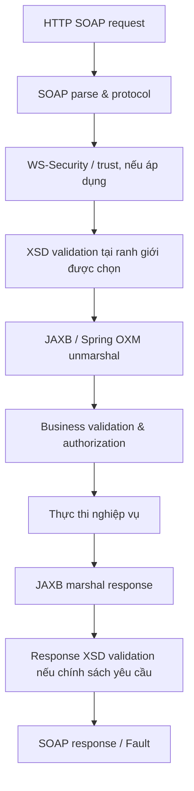

# Validation trong OXM và tránh xử lý lặp không cần thiết

Một SOAP request có thể **parse được XML**, **unmarshal thành Java object**, nhưng vẫn **sai XSD**: thiếu phần tử bắt buộc, dùng sai namespace, sai thứ tự `xs:sequence` hoặc gửi số lượng âm cho `xs:positiveInteger`. Ngược lại, request đúng XSD chưa chắc hợp lệ về nghiệp vụ: mã đơn hàng không tồn tại, khách hàng không được phép mua hàng hoặc hạn mức đã vượt quá. Nếu kiểm tra không đúng tầng, dịch vụ có thể nhận dữ liệu sai; nếu bật cùng một phép kiểm tra ở quá nhiều tầng, ứng dụng dễ tốn CPU, bộ nhớ và xử lý XML nhiều lần mà không tăng thêm độ tin cậy đáng kể.

Bài thuộc chương **Kiểm tra dữ liệu** của module **SPRING_WEB_SERVICES**. Trong mô hình phát triển dịch vụ SOAP **contract-first** với Spring Web Services (Spring-WS), ta thiết kế XSD/WSDL trước, sử dụng JAXB và Spring OXM để ánh xạ XML–Java, triển khai endpoint và SOAP client, rồi tổ chức validation, SOAP Fault, interceptor, XML security, WS-Security và kiểm thử tương thích. Trọng tâm ở đây là **validation trong `Jaxb2Marshaller`**, **validation tại ranh giới SOAP qua interceptor**, và **cách tránh xác thực, parse, marshal/unmarshal lặp mà không cần thiết**.

Ví dụ sử dụng Spring-WS/Spring Framework thuộc thế hệ Jakarta, Java hiện đại và WSDL 1.1 document/literal với SOAP 1.1 qua HTTP. Các phần mã là minh họa cho một ứng dụng Spring Boot/Spring-WS đã có cấu hình servlet, endpoint và các thư viện tương thích; cần bổ sung thành phần thích hợp nếu sử dụng độc lập.

## 1. “Validation” là nhiều phép kiểm tra khác nhau

Không thể gom mọi phép kiểm tra vào một lời gọi `validate()` chung.

| Lớp kiểm tra | Câu hỏi cần trả lời | Ví dụ | Thành phần điển hình |
| --- | --- | --- | --- |
| **XML well-formedness** | XML có cấu trúc cú pháp hợp lệ không? | Thiếu thẻ đóng, prefix chưa khai báo | XML parser / SOAP message factory |
| **SOAP protocol** | Envelope và version có đúng không? | Gửi SOAP 1.2 đến endpoint chỉ nhận SOAP 1.1 | Spring-WS, SOAP message factory |
| **XSD schema validation** | Payload có đúng QName, kiểu, thứ tự và occurrence không? | `quantity=-2`, thiếu `orderId` | `PayloadValidatingInterceptor`, JAXB với schema hoặc JAXP `Validator` |
| **JAXB/OXM mapping** | XML có chuyển được thành object Java đúng kiểu không? | Không tìm được root element, sai adapter | `Jaxb2Marshaller` |
| **Bean/business validation** | Giá trị có hợp lệ đối với ứng dụng hay không? | Mã khách hàng chưa đăng ký, tổng tiền vượt hạn mức | Service nghiệp vụ, Jakarta Bean Validation khi thích hợp |
| **Authorization** | Principal có quyền thực hiện operation không? | Gọi API đặt hàng cho tenant khác | Security/authorization layer |
| **WS-Security** | Chữ ký, token, timestamp và các phần đã ký có đáng tin không? | XML Signature sai, timestamp hết hạn | WSS4J/Spring-WS Security |
| **TLS/transport** | Kết nối có đúng chứng chỉ và đối tác tin cậy không? | Hostname không khớp certificate | HTTP/TLS stack |

**XSD-valid không có nghĩa business-valid; JAXB-unmarshal thành công không có nghĩa XSD-valid; chữ ký hợp lệ không thay thế kiểm tra XSD.** Đây là điểm xuất phát để bố trí các kiểm tra, thay vì “bật tất cả mọi nơi” hoặc “chỉ cần JAXB”.



Sơ đồ thể hiện **phân lớp trách nhiệm**, không khẳng định mọi ứng dụng phải có chính xác thứ tự callback này. Thứ tự xác minh chữ ký, validate, dispatch và unmarshalling phụ thuộc hạ tầng Spring-WS, interceptor và policy; phải kiểm thử trên cấu hình runtime cụ thể. Đặc biệt với XML đã ký, không được biến đổi dữ liệu theo cách khiến nội dung thực thi nghiệp vụ khác với nội dung đã được xác minh.

## 2. Hợp đồng XSD làm tiêu chuẩn kiểm tra

Giả sử service `CreateOrder` nhận mã đơn hàng, số lượng và đơn giá. Hợp đồng chứa:

```xml
<?xml version="1.0" encoding="UTF-8"?>
<xs:schema xmlns:xs="http://www.w3.org/2001/XMLSchema"
           targetNamespace="https://example.org/orders/v1"
           xmlns:o="https://example.org/orders/v1"
           elementFormDefault="qualified">

    <xs:simpleType name="OrderIdType">
        <xs:restriction base="xs:string">
            <xs:pattern value="ORD-[0-9]{4,12}"/>
        </xs:restriction>
    </xs:simpleType>

    <xs:element name="CreateOrderRequest">
        <xs:complexType>
            <xs:sequence>
                <xs:element name="orderId" type="o:OrderIdType"/>
                <xs:element name="quantity"
                            type="xs:positiveInteger"/>
                <xs:element name="unitPrice"
                            type="xs:decimal"/>
            </xs:sequence>
        </xs:complexType>
    </xs:element>

    <xs:element name="CreateOrderResponse">
        <xs:complexType>
            <xs:sequence>
                <xs:element name="orderId" type="o:OrderIdType"/>
                <xs:element name="accepted" type="xs:boolean"/>
            </xs:sequence>
        </xs:complexType>
    </xs:element>
</xs:schema>
```

Lưu dưới tên minh họa `src/main/resources/xsd/orders-v1.xsd`. Khi dùng WSDL document/literal, `wsdl:message` có thể tham chiếu hai **global elements** `CreateOrderRequest` và `CreateOrderResponse` trong namespace trên.

### 2.1. Request hợp lệ

```xml
<o:CreateOrderRequest xmlns:o="https://example.org/orders/v1">
    <o:orderId>ORD-1001</o:orderId>
    <o:quantity>2</o:quantity>
    <o:unitPrice>125000.00</o:unitPrice>
</o:CreateOrderRequest>
```

Khi truyền qua SOAP, phần tử này nằm trong `soap:Body`, không phải toàn bộ `soap:Envelope` được đưa vào JAXB root object.

### 2.2. Những lỗi schema cần phát hiện

| XML đầu vào | Vì sao sai XSD |
| --- | --- |
| Không có `orderId` | `minOccurs` mặc định là 1 |
| `quantity` bằng `0` hoặc `-1` | Vi phạm `xs:positiveInteger` |
| `orderId` bằng `ORDER-1` | Vi phạm pattern `ORD-[0-9]{4,12}` |
| `unitPrice` trước `quantity` | Vi phạm `xs:sequence` |
| Thẻ con `<orderId>` không namespace | Vi phạm `elementFormDefault="qualified"` |
| Thêm `<promoCode>` vào cuối | Không có phần tử này trong XSD, không có wildcard |
| `unitPrice` bằng `not-a-number` | Không biểu diễn được `xs:decimal` |

**XSD không thể tự suy ra** `orderId` có tồn tại trong cơ sở dữ liệu, `unitPrice` có khớp bảng giá, hoặc người gửi có quyền đặt hàng. Những điều đó cần kiểm tra ở lớp nghiệp vụ và bảo mật.

### 2.3. Kiểu Java do JAXB ánh xạ

Khi sinh mã phù hợp Jakarta JAXB từ schema, các kiểu thường tương ứng:

| XSD | Java thường gặp | Lưu ý |
| --- | --- | --- |
| `xs:string` / `OrderIdType` | `String` | JAXB không mặc nhiên cưỡng chế mọi pattern nếu không bật validation |
| `xs:positiveInteger` | `BigInteger` | Không giả định tự kiểm tra điều kiện dương nếu không validate XSD |
| `xs:decimal` | `BigDecimal` | Tránh mất độ chính xác nếu dùng số tiền |
| `xs:boolean` | `boolean` hoặc `Boolean` | Tùy generated binding và occurrence/nillability |

Không sửa kiểu Java tùy tiện rồi nghĩ XSD thay đổi theo. Trong contract-first, **schema là nguồn hợp đồng**; khi đổi schema, sinh lại lớp/binding và kiểm thử consumer hiện có.

## 3. Marshalling, unmarshalling và validation trong OXM

**Spring OXM** cung cấp các giao diện `org.springframework.oxm.Marshaller` và `Unmarshaller` để chuyển object ↔ XML thông qua `javax.xml.transform.Result`/`Source` (các kiểu thuộc JAXP/Java SE). `Jaxb2Marshaller` là implementation sử dụng Jakarta JAXB khi chạy với Spring Framework thế hệ Jakarta.

Hai quá trình:

```text
Client Java object
    │
    ├── marshalling: Java → XML payload
    ▼
SOAP Body XML
    │
    └── unmarshalling: XML payload → Java
            ▼
        Server Java object
```

**Mặc định, JAXB mapping không nhất thiết thực hiện đầy đủ XSD validation.** Một object có field null dù schema đánh dấu required vẫn có thể được tạo hoặc đọc trong một số cấu hình; không được coi `@XmlElement(required=true)` là một “bộ lọc tất cả dữ liệu sai”.

### 3.1. API JAXB và runtime provider là hai thứ

Một ứng dụng Spring Boot/Spring-WS dùng Jakarta JAXB thường cần các thành phần:

```text
jakarta.xml.bind:jakarta.xml.bind-api       (API JAXB)
org.glassfish.jaxb:jaxb-runtime            (JAXB provider)
org.springframework:spring-oxm             (Spring OXM)
org.springframework.ws:spring-ws-core      (Spring-WS)
```

Các dependency này có thể đã được starter/BOM kéo vào; kiểm tra **runtime dependency graph** thay vì khai báo trùng và override phiên bản không tương thích. Spring-WS dùng SAAJ hoặc message factory tương ứng để xử lý SOAP Envelope, không phải JAXB marshaller tạo Envelope.

### 3.2. Khi nào JAXB thực hiện schema validation?

Ở JAXB cấp thấp, có thể tạo `Schema` và đặt vào `Marshaller`/`Unmarshaller` thông qua `setSchema(...)`. Spring OXM che giấu phần này bằng cấu hình trên `Jaxb2Marshaller`:

```java
marshaller.setSchema(
        new ClassPathResource("xsd/orders-v1.xsd"));
```

Khi schema được cấu hình, Spring OXM/JAXB có cơ chế validate tại **lần marshal/unmarshal** được gọi qua marshaller đó. Điều kiện và chi tiết lỗi có thể phụ thuộc provider, `ValidationEventHandler` và loại XML source; cần kiểm thử trên runtime thực.

Điểm khác nhau:

- **Validation lúc unmarshalling:** XML bên ngoài có đúng schema khi chuyển thành object?
- **Validation lúc marshalling:** Java object chuẩn bị gửi ra có tạo được XML phù hợp schema không?
- **Validation trên toàn SOAP request/response:** được thực hiện tại boundary thông điệp qua interceptor riêng nếu được cấu hình.

Một bean `Jaxb2Marshaller` có schema **không tự bật** validation trong toàn bộ Spring-WS server nếu endpoint/adapter của server không dùng bean đó. Ngược lại, interceptor XSD không tự làm mọi lần marshal của một SOAP client khác đều được validate.

## 4. Cấu hình `Jaxb2Marshaller` có XSD

Giả sử có `CreateOrderRequest` và `CreateOrderResponse` được sinh từ XSD. Bean Spring OXM:

```java
import org.springframework.context.annotation.Bean;
import org.springframework.context.annotation.Configuration;
import org.springframework.core.io.ClassPathResource;
import org.springframework.oxm.jaxb.Jaxb2Marshaller;

@Configuration
public class OrderOxmConfiguration {

    @Bean
    public Jaxb2Marshaller orderMarshaller() {
        Jaxb2Marshaller marshaller = new Jaxb2Marshaller();
        marshaller.setClassesToBeBound(
                CreateOrderRequest.class,
                CreateOrderResponse.class);
        marshaller.setSchema(
                new ClassPathResource("xsd/orders-v1.xsd"));

        // Payload không cần DTD hay external entities.
        marshaller.setSupportDtd(false);
        marshaller.setProcessExternalEntities(false);
        return marshaller;
    }
}
```

Trong Spring IoC, container khởi tạo bean và vòng đời phù hợp. Nếu tạo `Jaxb2Marshaller` bằng `new` trong unit test, cần cấu hình đầy đủ và gọi `afterPropertiesSet()` trước khi dùng.

**Điều kiện để ví dụ hoạt động:**

1. Hai class được sinh/ánh xạ từ đúng schema, namespace và phiên bản Jakarta JAXB.
2. File `xsd/orders-v1.xsd` có trong classpath.
3. `JAXBContext` hỗ trợ root elements cần marshal/unmarshal; generated model có thể sử dụng `ObjectFactory` và `JAXBElement<?>` thay cho `@XmlRootElement`.
4. JAXB API và runtime provider cùng hệ/phiên bản tương thích.
5. Nếu schema nhập nhiều XSD, cần cấu hình toàn bộ schema graph và cơ chế resolve tài liệu phụ đáng tin cậy.

### 4.1. Vì sao giữ một bean marshaller?

Tạo `JAXBContext` có thể tốn chi phí xây metadata. `Jaxb2Marshaller` là component Spring dùng lại được và có thể quản lý việc tạo các instance `Marshaller`/`Unmarshaller` cấp thấp khi gọi. **Không khởi tạo `JAXBContext`/`Jaxb2Marshaller` mới trong mỗi HTTP request** chỉ để bật schema validation.

Không tự chia sẻ một instance `jakarta.xml.bind.Marshaller` hoặc `Unmarshaller` mutable giữa nhiều thread. `JAXBContext` và Spring-managed `Jaxb2Marshaller` có chính sách tái sử dụng khác với object cấp thấp có property mutable.

### 4.2. XSD import/include và vị trí nguồn schema

Schema thường dùng `xs:include`/`xs:import`:

```xml
<xs:include xmlns:xs="http://www.w3.org/2001/XMLSchema"
            schemaLocation="order-types.xsd"/>
```

Đường dẫn tương đối có thể được giải theo base URI của schema gốc và cách `SchemaFactory`/Spring cung cấp tài nguyên. Nếu muốn khóa môi trường production khỏi mạng ngoài, hãy đóng gói XSD vào classpath hoặc dùng resolver/allowlist được kiểm soát.

**Không bật truy cập mọi URL/file** chỉ để schema load được. Tách hai thời điểm:

- **Khởi tạo schema từ nguồn đáng tin:** resolve XSD import/include đã duyệt.
- **Validate dữ liệu runtime không tin cậy:** cấm DTD/external entity hoặc tài nguyên ngoài không được cho phép.

Một bộ schema tham chiếu tới URL không truy cập được có thể làm **bean khởi tạo thất bại**; đó là lỗi cấu hình server, không phải XML request của client sai.

## 5. Kiểm tra tại ranh giới SOAP bằng `PayloadValidatingInterceptor`

Spring-WS hỗ trợ kiểm tra payload của SOAP request/response tại pipeline xử lý endpoint bằng `PayloadValidatingInterceptor`, thay vì buộc mỗi endpoint tự đọc và validate XML.

Ví dụ có thể cấu hình hai bean schema và interceptor:

```java
import org.springframework.context.annotation.Bean;
import org.springframework.context.annotation.Configuration;
import org.springframework.core.io.ClassPathResource;
import org.springframework.ws.soap.server.endpoint.interceptor.PayloadValidatingInterceptor;
import org.springframework.xml.xsd.SimpleXsdSchema;
import org.springframework.xml.xsd.XsdSchema;

@Configuration
public class OrderValidationBeans {

    @Bean
    public XsdSchema ordersXsdSchema() {
        return new SimpleXsdSchema(
                new ClassPathResource("xsd/orders-v1.xsd"));
    }

    @Bean
    public PayloadValidatingInterceptor orderPayloadValidator(
            XsdSchema ordersXsdSchema) {
        PayloadValidatingInterceptor interceptor =
                new PayloadValidatingInterceptor();
        interceptor.setXsdSchema(ordersXsdSchema);
        interceptor.setValidateRequest(true);
        interceptor.setValidateResponse(true);
        return interceptor;
    }
}
```

Để interceptor chạy, **phải đăng ký** nó vào pipeline:

```java
import java.util.List;
import org.springframework.context.annotation.Configuration;
import org.springframework.ws.config.annotation.EnableWs;
import org.springframework.ws.config.annotation.WsConfigurer;
import org.springframework.ws.server.EndpointInterceptor;
import org.springframework.ws.soap.server.endpoint.interceptor.PayloadValidatingInterceptor;

@Configuration
@EnableWs
public class OrderValidationConfigurer implements WsConfigurer {
    private final PayloadValidatingInterceptor validator;

    public OrderValidationConfigurer(
            PayloadValidatingInterceptor validator) {
        this.validator = validator;
    }

    @Override
    public void addInterceptors(
            List<EndpointInterceptor> interceptors) {
        interceptors.add(validator);
    }
}
```

Hai class `public` ở trên thuộc **hai file Java riêng**. Cách tách bean và configurer giúp minh họa rõ vòng đời, tránh tình huống inject một bean được định nghĩa trong chính `@Configuration` đang chờ xây dựng. Trong ứng dụng có nhiều interceptor, thứ tự `addInterceptors` cần được xác nhận với security và policy thật.

### 5.1. Interceptor xác thực phần nào?

`PayloadValidatingInterceptor` chủ yếu validate **payload XML**, tức phần tử nghiệp vụ bên trong SOAP Body. Nó **không mặc định validate toàn bộ SOAP Envelope, HTTP headers hoặc mọi SOAP Header**. Với header riêng như `RequestContext`, cần validator/header processing phù hợp. Với `wsse:Security`, validation XSD cũng **không thay thế** kiểm tra chữ ký, token, timestamp hay certificate trust.

Ví dụ server nhận:

```xml
<s:Envelope xmlns:s="http://schemas.xmlsoap.org/soap/envelope/"
            xmlns:o="https://example.org/orders/v1">
    <s:Header/>
    <s:Body>
        <o:CreateOrderRequest>
            <o:quantity>2</o:quantity>
            <o:orderId>ORD-1001</o:orderId>
            <o:unitPrice>125000.00</o:unitPrice>
        </o:CreateOrderRequest>
    </s:Body>
</s:Envelope>
```

SOAP Envelope có thể được parse hợp lệ, nhưng Body sai thứ tự `xs:sequence`. Interceptor dùng đúng XSD sẽ từ chối request theo cơ chế xử lý validation errors. **Không cần endpoint truy vấn database mới phát hiện lỗi này.**

### 5.2. Request validation và response validation

| `validateRequest` | `validateResponse` | Ý nghĩa |
| --- | --- | --- |
| true | false | Kiểm tra đầu vào tại ingress; không kiểm tra XML trả ra |
| false | true | Kiểm tra output; không thay thế bảo vệ request từ bên ngoài |
| true | true | Kiểm tra cả hai chiều ở ranh giới endpoint |
| false | false | Không kiểm tra XSD qua interceptor này |

Chọn phương án theo rủi ro và vị trí các phép kiểm tra khác; **không tắt request validation chỉ vì có business validation**. Với response validation, lỗi thường phản ánh **bug server hoặc lệch hợp đồng**; logging/exception mapping và việc có thể trả một SOAP Fault đúng đắn phụ thuộc vòng đời response và cấu hình framework.

Nếu một ứng dụng có nhiều operation, không nhất thiết một schema duy nhất phù hợp mọi payload. Cần đăng ký interceptor đúng phạm vi hoặc cung cấp tập schema cần thiết theo cấu hình, rồi kiểm tra request của từng operation.

## 6. Có nên vừa validate trong OXM, vừa dùng interceptor?

Không có câu trả lời “luôn luôn bật cả hai” hoặc “chỉ dùng một lớp trong mọi trường hợp”. Hãy nhìn **nguồn dữ liệu**, **điểm tin cậy**, **thành phần đang thực sự dùng marshaller**, và **lợi ích kiểm tra thứ hai**.

### 6.1. Mô hình A: validate SOAP Body ở ingress/egress

```text
SOAP Request
  → PayloadValidatingInterceptor (XSD request)
  → JAXB unmarshal (mapping, không bật schema lại)
  → Business validation / authorization
  → Service
  → JAXB marshal response
  → PayloadValidatingInterceptor (XSD response)
  → SOAP Response
```

Phù hợp khi:

- Mọi request qua endpoint đều được kiểm tra ở biên SOAP.
- Endpoint adapter chuyển payload thành object Java và không cần schema validation lại trong cùng pipeline.
- Muốn có một nơi nhất quán để sinh lỗi request hợp đồng.
- Muốn kiểm tra response được gửi ra có đúng XSD hay không.

Ở mô hình này, `Jaxb2Marshaller` dùng cho server **có thể không cần `setSchema(...)`** nếu đã chứng minh interceptor sẽ chạy và bao phủ đúng payload. **Không gỡ schema khỏi marshaller dùng ở luồng khác** (ví dụ client, job xử lý XML ngoại tuyến) mà không kiểm tra trust boundary của luồng đó.

### 6.2. Mô hình B: validate ngay trong OXM

```text
Nguồn XML ngoài SOAP / client XML response
  → Jaxb2Marshaller.unmarshal(Source) + Schema
  → Business validation
  → Java object

Java object chuẩn bị xuất XML
  → Jaxb2Marshaller.marshal(... ) + Schema
  → XML output
```

Phù hợp khi:

- Cùng marshaller được gọi trực tiếp từ batch job, message consumer, SOAP client hoặc nơi không có `PayloadValidatingInterceptor`.
- Muốn ràng buộc “XML nào qua component OXM này đều phải khớp schema”.
- Cần phát hiện object Java sai XSD trước khi truyền ra ngoài.

**Giới hạn:** không có cơ sở khẳng định validator ở marshaller của client sẽ kiểm soát mọi request đi vào **server**. Mỗi bean/adapter và đường dữ liệu phải được kiểm tra riêng.

### 6.3. Mô hình C: hai lượt validate có chủ đích

Vẫn có trường hợp cần kiểm tra thêm:

1. SOAP ingress validate XSD để trả lỗi chuẩn cho đối tác.
2. Ứng dụng chuyển đổi dữ liệu hoặc sửa object theo nghiệp vụ.
3. Trước khi xuất bản sang một **hợp đồng khác** hoặc **trust boundary khác**, validate lại XML tạo ra.

Khi đó hai lượt kiểm tra **không trùng chức năng** vì dữ liệu hoặc điều kiện tin cậy đã thay đổi. Tương tự, response validation là kiểm tra **đầu ra mới được tạo**, không phải validate lại nguyên request.

Ngược lại, chạy cùng một schema validation trên **cùng payload không thay đổi** ngay trước JAXB unmarshal rồi chạy lại trong JAXB unmarshal, không có thêm logic hay thay đổi trust boundary, có thể chỉ tiêu tốn tài nguyên.

### 6.4. Ma trận quyết định

| Bối cảnh | Nơi validate XSD chính | Có cần lượt khác? |
| --- | --- | --- |
| SOAP server contract-first, ingress rõ ràng | `PayloadValidatingInterceptor` request | Không mặc định bật schema lại trên cùng XML ở JAXB |
| SOAP server cần đảm bảo response đúng hợp đồng | Interceptor response **hoặc** OXM marshal có schema | Chọn một nơi chính; bổ sung khác khi có lý do |
| SOAP client nhận response đối tác không tin cậy | OXM unmarshal có schema hoặc validation biên client riêng | Cần bảo vệ client; interceptor endpoint server không bao phủ |
| Batch job đọc XML từ file đối tác | JAXB/JAXP validator ngay tại ingestion | Không có SOAP interceptor |
| XML đã được kiểm tra nhưng sau đó biến đổi | Validate output ở boundary mới | Có, vì dữ liệu đã thay đổi |
| Business service nhận Java object từ nhiều nguồn | Business validation, authorization | XSD validation chỉ ở các nguồn XML cần hợp đồng |
| SOAP Header tùy chỉnh cần schema riêng | Header marshaller/validator | `PayloadValidatingInterceptor` Body không đủ |
| WS-Security có chữ ký | Security interceptor với signed-part policy | XSD validation vẫn cần nếu dữ liệu phải theo schema |

Đây là **khung quyết định**, không phải cấu hình mặc định bắt buộc của Spring-WS. Khi có yêu cầu tuân thủ, hệ thống phải lập hồ sơ điểm kiểm tra và bằng chứng kiểm thử; tối ưu hiệu năng không được đánh đổi bằng việc bỏ một kiểm soát bảo mật được yêu cầu.

## 7. Tránh parse và tiêu thụ `Source` lặp

Validation không chỉ tiêu tốn CPU: tùy representation, việc **đọc lại XML** có thể làm hỏng pipeline.

### 7.1. `StreamSource` và `StAXSource` thường tiêu thụ một lần

```java
// MẪU DỄ LỖI nếu Source chứa Reader/InputStream một lần.
Source payload = new StreamSource(inputReader);
schemaValidator.validate(payload);
Object request = jaxbMarshaller.unmarshal(payload); // Có thể đã EOF!
```

Một `StreamSource` bao `Reader` hoặc `InputStream` không tự tạo một bản copy có thể đọc lại. `StAXSource` phụ thuộc cursor/event reader có trạng thái. Sau khi validator đọc đến cuối, lần unmarshal tiếp theo có thể chỉ thấy EOF hoặc cursor sai vị trí.

Nếu cần hai lượt độc lập, mở lại nguồn:

```java
String xml = /* XML đã kiểm tra kích thước và lưu có chủ đích */;
try (StringReader r1 = new StringReader(xml);
     StringReader r2 = new StringReader(xml)) {
    validator.validate(new StreamSource(r1));
    Object request = marshaller.unmarshal(new StreamSource(r2));
}
```

Ví dụ giả định `validator` là JAXP `javax.xml.validation.Validator`, `marshaller` là Spring OXM và các import đã có. Cách này **đọc hai lần**, không phải tối ưu mặc định: chỉ dùng khi thật sự cần hoặc khi API không thể chia sẻ kết quả. Với XML lớn, không nên buffer nguyên văn tùy ý trong `String` hoặc log toàn bộ để “dễ validate”.

### 7.2. DOM có thể đọc lại nhưng giữ cây trong RAM

Nếu cần nhiều phép kiểm tra/tra cứu trên một tài liệu nhỏ hoặc vừa, có thể parse DOM an toàn một lần, tạo `DOMSource` và tái sử dụng cây:

```java
Document document = /* DOM được parse bằng parser an toàn */;
Source sourceForValidation = new DOMSource(document);
Source sourceForMapping = new DOMSource(document);

validator.validate(sourceForValidation);
Object request = marshaller.unmarshal(sourceForMapping);
```

DOM giúp tránh đọc lại byte stream, nhưng **không loại bỏ hoàn toàn chi phí duyệt schema hoặc JAXB**; mỗi consumer vẫn xử lý cây theo trách nhiệm riêng. DOM tree mutable không nên chia sẻ giữa request hay sửa sau khi xác minh chữ ký mà không kiểm soát.

### 7.3. Spring-WS message factory và interceptor có thể buffer

Trong pipeline SOAP thực, `SaajSoapMessageFactory` hoặc provider khác có thể đã biểu diễn message dưới dạng cấu trúc lưu trong bộ nhớ; interceptor và JAXB có thể đọc payload từ đó. Vì vậy “bật interceptor + JAXB” **không phải lúc nào cũng có nghĩa parse lại byte HTTP đúng hai lần**. Nhưng có thể có nhiều lượt duyệt XML, tạo object tạm hoặc canonicalization.

Hãy **đo đạc pipeline thật** trước khi kết luận:

- CPU khi validate request/response ở một nơi so với hai nơi.
- Bộ nhớ/GC khi xử lý XML nhiều phần tử.
- Số lần chuyển đổi `Source`, `Result`, DOM và JAXB object.
- Chi phí xác thực chữ ký WS-Security và schema import.
- Thời gian phản hồi P95/P99 với payload đại diện.

Không khẳng định `StAXSource` luôn nhanh hơn DOM hoặc `StreamSource` luôn tiết kiệm RAM; consumer phía sau có thể materialize toàn bộ document.

## 8. Tránh tạo lại schema và JAXBContext

Một phép validate thường có hai loại chi phí:

1. **Chi phí chuẩn bị:** đọc/biên dịch XSD, resolve import/include, tạo metadata JAXB.
2. **Chi phí trên mỗi request:** parser đọc XML, validator kiểm tra nội dung, JAXB tạo object hoặc serialize output.

Không nên tạo `SchemaFactory.newSchema(...)` hoặc `JAXBContext.newInstance(...)` trong mỗi endpoint invocation nếu schema/model không đổi.

### 8.1. Dùng schema được quản lý theo vòng đời ứng dụng

Với Spring, quản lý `XsdSchema` hoặc `Jaxb2Marshaller` thành bean là cách thông dụng để không cấu hình lại ở từng request. Với JAXP:

```java
import javax.xml.XMLConstants;
import javax.xml.validation.Schema;
import javax.xml.validation.SchemaFactory;

public Schema loadTrustedSchema(File xsd) throws Exception {
    SchemaFactory factory = SchemaFactory.newInstance(
            XMLConstants.W3C_XML_SCHEMA_NS_URI);
    factory.setFeature(
            XMLConstants.FEATURE_SECURE_PROCESSING, true);
    factory.setProperty(XMLConstants.ACCESS_EXTERNAL_DTD, "");
    factory.setProperty(XMLConstants.ACCESS_EXTERNAL_SCHEMA, "");
    return factory.newSchema(xsd);
}
```

`File` phải là đường dẫn đến **XSD đáng tin cậy đã được đóng gói/kiểm soát**, không phải đường dẫn do client tùy ý gửi. Ví dụ khóa truy cập external schema tuyệt đối; nếu schema có import/include hợp lệ cần resolver được kiểm soát, không nới quyền truy cập ngoài một cách bừa bãi.

`Schema` (JAXP) có thể được tạo một lần và dùng làm nguồn tạo nhiều validator. Nhưng **`Validator` không dành để dùng chung giữa các thread đồng thời**:

```java
Schema sharedSchema = /* biên dịch khi khởi tạo ứng dụng */;

public void validateOne(
        Source xml, Schema sharedSchema) throws Exception {
    javax.xml.validation.Validator validator =
            sharedSchema.newValidator();
    validator.setProperty(XMLConstants.ACCESS_EXTERNAL_DTD, "");
    validator.setProperty(XMLConstants.ACCESS_EXTERNAL_SCHEMA, "");
    validator.validate(xml);
}
```

Đoạn này giả định `Source`, `Schema` và `XMLConstants` đã import; mục đích là tách **biên dịch schema một lần** khỏi **Validator theo mỗi lượt xử lý**. Không sửa cấu hình `Validator` mutable đang được nhiều request dùng chung.

### 8.2. Không tự dựng validator bên trong endpoint

Mẫu kém:

```java
@PayloadRoot(namespace = NS, localPart = "CreateOrderRequest")
@ResponsePayload
public CreateOrderResponse create(
        @RequestPayload CreateOrderRequest request) {
    // Không nên: đọc XSD và biên dịch Schema ở mỗi request,
    // trong khi interceptor đã validate cùng payload.
    Schema schema = SchemaFactory.newInstance(
        XMLConstants.W3C_XML_SCHEMA_NS_URI).newSchema(schemaFile);
    // ...
    return orderService.create(request);
}
```

Mẫu này gây thêm chi phí chuẩn bị XSD và còn không bảo đảm object `request` được validate đúng cách nếu chỉ có object mà không có XML `Source` tương ứng. Hãy đặt validation ở một boundary xác định, tổ chức bean dùng lại và để endpoint tập trung vào nghiệp vụ.

## 9. Bean Validation và business validation không phải XSD validation

Java có các công cụ xác thực object như **Jakarta Bean Validation** (`jakarta.validation.Validator`), sử dụng annotation `@NotNull`, `@Size`, `@Positive`. Đây **không phải** JAXP `javax.xml.validation.Validator`.

Ví dụ DTO nội bộ:

```java
import jakarta.validation.constraints.NotBlank;
import jakarta.validation.constraints.Positive;
import java.math.BigInteger;

public record CreateOrderCommand(
        @NotBlank String orderId,
        @Positive BigInteger quantity) {
}
```

Đây là kiểu command cho business layer, không nhất thiết là JAXB-generated DTO. Có thể ánh xạ `CreateOrderRequest` sang command, sau đó gọi:

```java
import jakarta.validation.ConstraintViolation;
import jakarta.validation.Validator;

Set<ConstraintViolation<CreateOrderCommand>> errors =
        beanValidator.validate(command);
if (!errors.isEmpty()) {
    throw new InvalidOrderCommandException("Invalid order command");
}
```

Đoạn này giả định `beanValidator`, `command`, `Set` và exception ứng dụng đã được khai báo. Bean Validation cần một provider thích hợp (thường qua starter validation nếu đang dùng Spring Boot); thêm annotation/API không có nghĩa validator tự chạy.

Khi XSD đã có `xs:positiveInteger` và command có `@Positive`, đó có vẻ là “kiểm tra hai lần”, nhưng **đối tượng và ranh giới khác nhau** có thể khiến cả hai hợp lý: XSD bảo vệ wire contract, Bean Validation bảo vệ một command Java nhận dữ liệu từ nhiều nguồn. Nếu command chỉ được xây từ XML đã chắc chắn qua schema validation và không biến đổi, có thể cân nhắc giảm kiểm tra trùng **khi đã chứng minh** không có đường vào khác và không có yêu cầu policy riêng.

### 9.1. Quy tắc nghiệp vụ nằm ngoài XSD

Ví dụ:

- `quantity > 0` là ràng buộc có thể đặt trong XSD.
- `quantity <= inventoryAvailable` là ràng buộc phụ thuộc trạng thái kho hiện tại.
- `orderId` đã tồn tại hay chưa là ràng buộc dữ liệu nghiệp vụ.
- Người gọi có quyền xem tenant hoặc đặt hàng không là ràng buộc authorization.
- Giá bán hiện tại có khớp `unitPrice` do client gửi hay không là kiểm tra nghiệp vụ, không nên chỉ tin số từ XML.

Không cố đưa tất cả điều kiện này vào XSD hoặc marshal object qua XML chỉ để dùng lại XSD validator.

## 10. SOAP Fault và cách báo lỗi validation

Một nguyên tắc quan trọng là **phân biệt lỗi do consumer gửi sai hợp đồng** với lỗi **server cấu hình hoặc tạo output sai**.

| Nguồn lỗi | Ví dụ | Phân loại thường dùng |
| --- | --- | --- |
| SOAP Envelope sai version | SOAP 1.2 gửi tới endpoint SOAP 1.1 | Protocol/VersionMismatch |
| Request sai XSD | `quantity=-1` | Client/Sender fault theo SOAP version |
| Header sai cấu trúc theo policy | `RequestContext` thiếu correlation ID | Request/policy fault phù hợp |
| Token hoặc chữ ký sai | WS-Security verification fail | Security fault/từ chối theo policy |
| Business rule bị vi phạm | Hàng hết kho | Business fault/response đã được hợp đồng quy định |
| JAXB mapping lỗi do model/schema server lệch | Không marshal được response | Server-side fault và log |
| Response sai XSD | Server trả thiếu `accepted` | Bug server, không đổ lỗi client |
| Không load được XSD do import URL chết | Schema configuration failure | Lỗi hạ tầng/khởi tạo server |

Với `PayloadValidatingInterceptor`, cách phát sinh SOAP Fault cho request validation errors và cách xử lý response validation errors phụ thuộc các hook và cấu hình của interceptor. Với `Jaxb2Marshaller`, lỗi có thể được bọc thành `XmlMappingException` hoặc exception cụ thể hơn. **Không giả định cả hai luôn sinh cùng SOAP Fault code/detail.**

Trong Spring-WS có thể dùng exception resolver như `SoapFaultMappingExceptionResolver` để ánh xạ exception ứng dụng thành Fault có thể xử lý phía client. Tuy nhiên các lỗi ở tầng message parser, WS-Security hoặc trước endpoint mapping có thể đi qua đường xử lý khác; cần kiểm tra toàn pipeline.

**Không gửi stack trace, đường dẫn XSD nội bộ, token, certificate details hoặc nguyên văn payload nhạy cảm trong Fault.** Có thể báo mã lỗi, vị trí trường hợp lệ để hỗ trợ consumer, đồng thời ghi log server với correlation ID đã được chuẩn hóa.

### 10.1. Ví dụ Fault SOAP 1.1 cho request sai hợp đồng

```xml
<s:Envelope xmlns:s="http://schemas.xmlsoap.org/soap/envelope/">
    <s:Body>
        <s:Fault>
            <faultcode>s:Client</faultcode>
            <faultstring>Request does not match the XML contract</faultstring>
            <detail>
                <e:ValidationError
                    xmlns:e="https://example.org/orders/errors/v1">
                    <e:code>INVALID_REQUEST</e:code>
                </e:ValidationError>
            </detail>
        </s:Fault>
    </s:Body>
</s:Envelope>
```

Ví dụ này thể hiện một **Fault format có thể chọn trong hợp đồng**, không phải output mặc định cố định của `PayloadValidatingInterceptor`. Muốn có `detail` theo định dạng riêng, cần thiết kế schema/fault binding và exception resolver hoặc fault writer tương ứng. SOAP 1.2 dùng cấu trúc Fault khác; không sao chép nguyên `faultcode/faultstring` của SOAP 1.1.

## 11. XML security: tối ưu không được tạo lỗ hổng

Giảm validate lặp **không đồng nghĩa tắt bảo vệ XML**. Có những kiểm tra khác nhau buộc phải giữ:

1. **Giới hạn resource** ở HTTP/message parser: kích thước request, độ sâu/nút XML, timeout và attachment policy.
2. **DTD/external entity policy** ở parser, JAXB, DOM/StAX/transformer: ngăn XXE, SSRF hoặc đọc file tùy tiện.
3. **XSD validation** ở nơi chấp nhận dữ liệu từ boundary ngoài, khi contract yêu cầu.
4. **WS-Security verification** ở nơi nhận SOAP message: chữ ký, token, timestamp, signed parts và chứng chỉ.
5. **Business authorization** sau khi identity đã được xác minh.

Ví dụ cấu hình an toàn JAXB:

```java
Jaxb2Marshaller marshaller = new Jaxb2Marshaller();
marshaller.setSupportDtd(false);
marshaller.setProcessExternalEntities(false);
// Tiếp tục cấu hình JAXB classes và schema thích hợp.
```

Đây chỉ là cấu hình một component; nếu một interceptor hoặc transformer khác tự parse XML, **parser của nó cũng cần bảo vệ**. Không nghĩ `setSchema(...)` tự ngăn mọi XXE, vì việc giải quyết entity và schema imports có thể xảy ra trước hoặc ngoài lượt validation.

### 11.1. Schema import từ nguồn đáng tin

Với XSD nhiều file, có thể cần import/include địa phương. Hãy đóng gói schema, kiểm soát base URI và resolver/allowlist nếu cần. Không bật `ACCESS_EXTERNAL_SCHEMA="all"` cho dữ liệu không tin cậy chỉ để chữa lỗi schema không tìm thấy. Khi schema bundle sai, sửa **đường dẫn/cấu hình phân phối hợp đồng**, không giảm chính sách bảo vệ production.

### 11.2. Signed XML và validate theo đúng dữ liệu được xác minh

Một SOAP message có chữ ký WS-Security có thể được validator/JAXB xử lý theo representation đã parse. Nếu một component **sửa hoặc thay thế** Body/Header giữa bước xác minh chữ ký và bước nghiệp vụ, nguy cơ xử lý nội dung khác với phần đã được ký xuất hiện. Vì thế:

- Dựa vào kết quả xác minh của security framework cho phần tử được ký.
- Không tự tìm một node “cùng tên” rồi bỏ qua signed-part reference.
- Không thay thế kiểm tra chữ ký bằng XSD validation: XSD chỉ kiểm tra schema.
- Không serialize lại XML đã ký một cách tùy tiện để “validate lại cho chắc” nếu không hiểu ảnh hưởng tới chữ ký/canonicalization.

Việc có thêm một lượt validate XSD không sửa được lỗi xác thực chữ ký; đặt đúng tầng bảo mật quan trọng hơn tăng số lượt parse.

## 12. Kiểm thử XSD validation và hiệu năng trong OXM

Kiểm thử nên chứng minh **đúng dữ liệu**, **đúng điểm chặn**, **đúng thông báo lỗi**, đồng thời **không xử lý trùng không cần thiết**.

### 12.1. Unit test cho `Jaxb2Marshaller` có schema

Ví dụ một test kiểm tra XML vi phạm `xs:positiveInteger`:

```java
import java.io.StringReader;
import javax.xml.transform.stream.StreamSource;
import org.junit.jupiter.api.Test;
import org.springframework.core.io.ClassPathResource;
import org.springframework.oxm.XmlMappingException;
import org.springframework.oxm.jaxb.Jaxb2Marshaller;

import static org.junit.jupiter.api.Assertions.assertThrows;

class OrderOxmValidationTest {
    @Test
    void invalidQuantityIsRejected() throws Exception {
        Jaxb2Marshaller oxm = new Jaxb2Marshaller();
        oxm.setClassesToBeBound(
                CreateOrderRequest.class,
                CreateOrderResponse.class);
        oxm.setSchema(
                new ClassPathResource("xsd/orders-v1.xsd"));
        oxm.setSupportDtd(false);
        oxm.setProcessExternalEntities(false);
        oxm.afterPropertiesSet();

        String xml = """
                <o:CreateOrderRequest
                    xmlns:o="https://example.org/orders/v1">
                    <o:orderId>ORD-1001</o:orderId>
                    <o:quantity>-1</o:quantity>
                    <o:unitPrice>125000.00</o:unitPrice>
                </o:CreateOrderRequest>
                """;

        assertThrows(XmlMappingException.class,
                () -> oxm.unmarshal(
                        new StreamSource(new StringReader(xml))));
    }
}
```

Test dùng Java text block (Java 15+), giả định generated JAXB classes đúng hợp đồng và provider tương thích. Lỗi validation cụ thể có thể là subtype của `XmlMappingException`; nếu provider hoặc ứng dụng cấu hình `ValidationEventHandler` khác mặc định, cần xác định chính sách ném lỗi trước khi viết assert.

Một test thành công cũng cần assert QName/namespace, dữ liệu đúng, rồi kiểm thử marshal response `accepted` và `orderId`. **Round-trip Java → XML → Java** không đủ chứng minh XSD đúng nếu cả hai chiều cùng sử dụng model sai schema.

### 12.2. Unit test business logic

Không cần marshal/unmarshal XML để test:

- Không cho đặt quá số lượng tồn kho.
- Không cho tạo đơn hàng cho tenant không có quyền.
- Không cho áp dụng mức giá sai bảng giá.

Những test này nhận Java command/value object và chạy business service thuần; chỉ dùng XML test ở boundary nơi contract cần được chứng minh.

### 12.3. Test SOAP boundary

Với `MockWebServiceClient`:

- Gửi SOAP payload hợp lệ qua endpoint và assert response không có Fault.
- Gửi XML sai `xs:sequence` hoặc `quantity=-1`; assert endpoint không thực hiện nghiệp vụ và có lỗi phù hợp.
- Gửi payload sai namespace; xác nhận cách endpoint mapping/validation xử lý.
- Cấu hình response sai XSD trong một ca giả lập; xác nhận lỗi server-side được quan sát đúng.

Với `MockWebServiceServer` cho `WebServiceTemplate`:

- Kiểm tra XML được marshal trên request.
- Kiểm tra response hợp lệ được unmarshal.
- Kiểm tra SOAP Fault, SOAPAction và lỗi validation phía client nếu marshaller có schema.

Mock test không thay thế test end-to-end cho HTTP, SOAP version, TLS, proxy, WS-Security và runtime provider.

### 12.4. Ma trận kiểm thử

| Ca | Mục tiêu |
| --- | --- |
| XML well-formed nhưng sai `xs:sequence` | XSD validator từ chối |
| XML thiếu `orderId` | Không tin annotation required đơn thuần |
| `quantity=0` hoặc âm | Phát hiện facet `positiveInteger` |
| XML sai namespace URI | Xác định lỗi QName/hợp đồng |
| `unitPrice` không phải `xs:decimal` | Phát hiện sai kiểu |
| XML có `xs:import` từ nguồn đáng tin | Schema resolver hoạt động theo policy |
| XSD import trỏ URL không được phép | Không tự mở truy cập mạng ngoài |
| JAXB mapping không bật schema | Chứng minh unmarshal thành công không đồng nghĩa XSD-valid |
| JAXB mapping có schema | XML vi phạm hợp đồng bị từ chối |
| Interceptor request có XSD | Endpoint không chạy với request sai |
| Interceptor response có XSD | Output sai được ghi nhận/chặn theo policy |
| OXM và interceptor cùng bật schema | Đo chi phí so với cấu hình một lớp |
| XML `StreamSource` bị dùng lại | Phát hiện lỗi tiêu thụ source |
| Concurrent requests | Không chia sẻ `Validator` hoặc `Unmarshaller` mutable sai cách |
| SOAP Header `RequestContext` sai schema | Có validator header riêng khi cần |
| WS-Security chữ ký sai nhưng XSD đúng | Security layer vẫn từ chối |
| Business rule sai nhưng XSD đúng | Business validation vẫn từ chối |
| SOAP Fault lỗi client/server | Mã lỗi và detail không rò thông tin |

### 12.5. Benchmark có ý nghĩa

Để đánh giá xử lý lặp, tạo ít nhất ba cấu hình thử:

| Cấu hình | Điểm kiểm tra XSD |
| --- | --- |
| A | Chỉ interceptor tại SOAP ingress |
| B | Chỉ OXM unmarshal có schema |
| C | Cả interceptor và OXM trên cùng inbound payload |

Đo lượng request/giây, latency P50/P95/P99, CPU và bộ nhớ/GC, cùng tỷ lệ lỗi. Dùng **cùng payload, cùng SOAP version, cùng message factory, cùng WS-Security policy và dữ liệu đại diện**; loại bỏ thời gian warm-up/JIT và chi phí khởi tạo schema khỏi phép đo steady state nếu muốn đo chi phí mỗi request.

**Cấu hình A và B không nhất thiết tương đương về phạm vi bảo vệ**, bởi interceptor có thể bao phủ mọi request vào endpoint còn OXM chỉ chạy khi một adapter cụ thể được dùng. Benchmark chỉ giúp chọn **trong những cấu hình có cùng yêu cầu an toàn và phạm vi tương đương**, không dùng để biện minh cho việc bỏ validation cần thiết.

## 13. Những nhầm lẫn phổ biến

**“Unmarshal không ném lỗi tức là request đúng XSD.”** Không đúng. JAXB mapping và XSD validation là hai hành vi khác nhau; phải cấu hình schema hoặc validator riêng để xác nhận hợp đồng.

**“`@XmlElement(required=true)` luôn chặn thiếu field ở runtime.”** Không đủ. Annotation còn phục vụ JAXB metadata và schema generation; điều kiện chặn phụ thuộc validation đang được bật và provider.

**“Một bean `Jaxb2Marshaller` có schema bảo vệ mọi SOAP endpoint.”** Không chắc. Phải xác minh endpoint adapter nào dùng bean đó; pipeline khác có thể dùng marshaller khác hoặc XML trực tiếp.

**“`PayloadValidatingInterceptor` kiểm tra toàn bộ SOAP Header, WS-Security và HTTP headers.”** Sai. Mục tiêu của nó là payload XSD; header, security và transport cần thành phần phù hợp.

**“Bật schema trên cả interceptor và marshaller luôn an toàn gấp đôi.”** Chưa chắc. Có thể chỉ là hai lần duyệt cùng XML; giá trị gia tăng phải dựa vào dữ liệu/trust boundary mới hoặc policy.

**“Cứ dùng `StreamSource` thì không có chi phí bộ nhớ.”** Sai. Reader có thể bị tiêu thụ một lần; consumer có thể dựng DOM hoặc object graph lớn.

**“Tái sử dụng một `javax.xml.validation.Validator` cho mọi thread sẽ nhanh hơn.”** Không nên chia sẻ validator mutable giữa các thread. Tái sử dụng compiled `Schema`, tạo `Validator` theo lượt xử lý.

**“Schema validation thay thế Bean Validation và authorization.”** Không. XSD kiểm tra wire contract; business rules và quyền truy cập là tầng khác.

**“SOAP Fault nào cũng là lỗi dữ liệu client.”** Không. Có lỗi server response, provider, XSD configuration, security và protocol. Cần phân loại đúng.

## 14. Bài tập tự kiểm tra

**Câu 1.** Endpoint `CreateOrder` nhận `CreateOrderRequest` do JAXB tạo, nhưng `quantity=-1` vẫn đi vào nghiệp vụ. Đây có chắc là lỗi `@XmlRootElement` không?

**Đáp án:** Không. Nhiều khả năng JAXB unmarshal chưa được gắn schema validation hoặc interceptor XSD chưa được đăng ký/không bao phủ request. Kiểm tra boundary validation và XSD thực tế.

**Câu 2.** Khi nào nên bật schema trong `Jaxb2Marshaller` thay vì chỉ dùng `PayloadValidatingInterceptor`?

**Đáp án:** Khi dữ liệu XML đi qua OXM từ những nguồn không được SOAP interceptor bảo vệ, như SOAP client response, batch job hoặc luồng XML trực tiếp; hoặc khi muốn bảo đảm chính component OXM chỉ chấp nhận/xuất XML hợp đồng.

**Câu 3.** Interceptor đã validate cùng một request XML và không có bước thay đổi payload. Bật validate lại trên JAXB unmarshal có lợi ích chắc chắn nào?

**Đáp án:** Không có lợi ích chắc chắn nếu cùng schema, cùng representation và cùng boundary được bảo vệ. Nó có thể tăng chi phí; cần đo và kiểm tra những luồng mà interceptor không bao phủ trước khi quyết định bỏ lượt thứ hai.

**Câu 4.** Vì sao cùng `StreamSource` không nên truyền lần lượt vào `Validator` rồi `Unmarshaller`?

**Đáp án:** Nó có thể bọc reader/stream đã bị lượt validate tiêu thụ. Cần nguồn có thể mở lại, một pipeline xử lý duy nhất hoặc representation như DOM khi có chủ đích.

**Câu 5.** Có nên tạo `SchemaFactory.newSchema(...)` mỗi request để tăng an toàn?

**Đáp án:** Không cần nếu schema là tài nguyên bất biến đã được kiểm soát. Biên dịch XSD một lần, tạo validator theo mỗi lượt là hướng thường dùng; việc bảo vệ parser và schema resolver vẫn cần cấu hình.

**Câu 6.** `JAXBContext` và `javax.xml.validation.Validator` có nên được chia sẻ giống nhau giữa các thread không?

**Đáp án:** Không. JAXB context có thể tái sử dụng thích hợp, còn JAXP Validator có trạng thái mutable và không nên chia sẻ để validate đồng thời.

**Câu 7.** XML đúng XSD nhưng `orderId` đã bị tạo trước đó. Hệ thống có thể từ chối không?

**Đáp án:** Có, đó là validation nghiệp vụ/kiểm tra nhất quán dữ liệu. XSD không thể biết trạng thái đơn hàng trong cơ sở dữ liệu.

**Câu 8.** Một message có chữ ký WS-Security hợp lệ có thể bỏ XSD validation được không?

**Đáp án:** Không mặc nhiên. Chữ ký xác nhận tính toàn vẹn/nguồn theo policy, còn XSD kiểm tra định dạng hợp đồng. Hai yêu cầu cần quyết định và kiểm thử riêng.

**Câu 9.** Trong mô hình SOAP server, tại sao response validation có ý nghĩa dù request đã được validate?

**Đáp án:** Response là XML mới do server tạo, có thể sai schema do bug mapping hoặc logic ứng dụng. Kiểm tra đầu ra có thể phát hiện lỗi không có trong request.

**Câu 10.** Sau khi thêm validation trong OXM, độ trễ tăng. Nên tắt ngay toàn bộ validation chứ?

**Đáp án:** Không. Xác định những luồng đã được validate ở boundary tương đương, loại trùng lặp có chứng cứ, tái sử dụng schema/context, xem chi phí parse/WS-Security và đo benchmark. Giữ các điểm kiểm soát hợp đồng và bảo mật bắt buộc.

## Ghi nhớ

- **JAXB/OXM mapping, XSD validation, Bean/business validation và WS-Security là những nhiệm vụ khác nhau.** Thành công ở một lớp không chứng minh lớp khác đã đạt.
- **`Jaxb2Marshaller#setSchema(...)`** giúp kiểm tra XML ở các lượt marshal/unmarshal của chính marshaller đó; **`PayloadValidatingInterceptor`** giúp kiểm tra payload ở pipeline SOAP server khi đã đăng ký.
- **Không validate cùng một XML không đổi hai lần chỉ theo thói quen.** Chọn điểm kiểm tra chính theo trust boundary; validate lại khi dữ liệu, hợp đồng hoặc ranh giới tin cậy thay đổi.
- **Tái sử dụng schema đã biên dịch và JAXB context**, nhưng tạo `Validator` và các object JAXB cấp thấp mutable theo cách an toàn luồng; không tạo schema/context mỗi request.
- **`StreamSource`/`StAXSource` có thể bị tiêu thụ một lượt.** Thiết kế pipeline phù hợp, không dùng lại source đã hết dữ liệu mà không biết lifecycle.
- **Tối ưu phải giữ an toàn XML và giao thức:** XXE protection, SOAP Fault đúng, WS-Security, chữ ký/chứng chỉ, quyền nghiệp vụ và kiểm thử tương thích vẫn là yêu cầu riêng.
